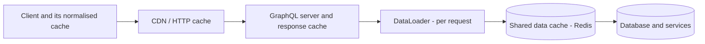
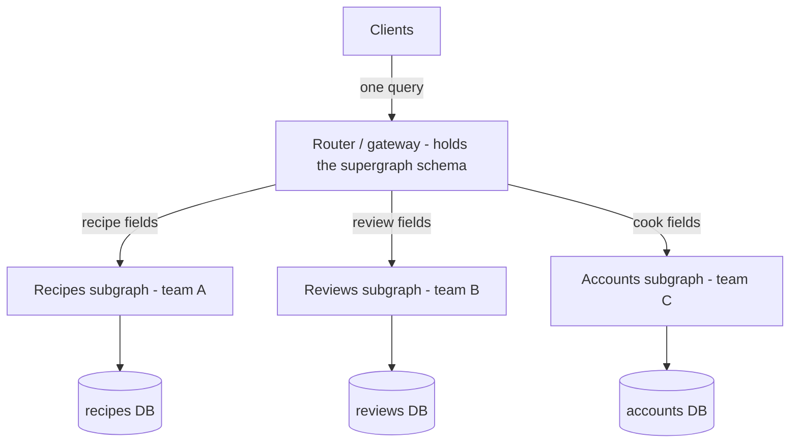

# Caching, federation and rate limiting

> **Before this lesson:** you should have read [The N+1 problem and DataLoader](#/lesson/graphql/n-plus-one-dataloader), [The normalised cache](#/lesson/graphql/cache-optimistic) and the complexity-scoring section of [Security and monitoring](#/lesson/graphql/security-monitoring). HTTP headers and status codes come from [What an API is](#/lesson/graphql/what-is-an-api).

## In plain words

A GraphQL API that works for a hundred users must keep working for a million, and for a company that has grown from one team to thirty. This lesson covers the three tools used to get there.

- **Caching** means remembering answers so that the same work is not repeated. A café that knows it sells two hundred flat whites a morning does not wait for each order before grinding beans.
- **Federation** means splitting one big API across several teams' services while clients still see a single API. Think of a shopping centre: one entrance, one directory board, many independently run shops inside.
- **Rate limiting** means capping how much any one client may use, so that nobody can crowd out everyone else. It is the "maximum four per customer" sign.

Why it matters for a job: these are the system-design topics of GraphQL interviews. Senior candidates are expected to say where caches sit and why GraphQL makes HTTP caching harder, to explain what a supergraph is, and to describe rate limiting by query cost.

## Part 1: Caching

### Why GraphQL makes the usual approach harder

The web's standard caching machinery is keyed by URL. A REST response for `GET /recipes/r1` can carry a header such as `Cache-Control: max-age=60`, meaning "this answer is good for 60 seconds". Browsers, and **CDNs** (content delivery networks: servers spread around the world that keep copies of responses near users), will then serve repeat requests without contacting your server at all.

A typical GraphQL request is a `POST` to `/graphql` with the query in the body. Every request has the same URL, and caches do not store `POST` responses. Out of the box, the entire HTTP caching layer does nothing.

That does not mean GraphQL cannot be cached. It means caching is applied at several other layers, each with its own job.

| Layer | What is remembered | Lifetime | Covered in |
|---|---|---|---|
| Client normalised cache | objects by `__typename:id`, in the app's memory | the session | lesson 17 |
| HTTP / CDN cache | whole responses for `GET` requests | seconds to minutes | below |
| Server response cache | whole responses, keyed by query + variables (+ user) | seconds to minutes | below |
| Data-source cache | individual database rows or REST responses, usually in Redis | seconds to hours | below |
| DataLoader | objects by key | **one request only** | lesson 20 |



A request moves left to right and stops at the first layer that already has the answer.

### Making GraphQL cacheable over HTTP

Two changes bring the CDN back into play.

**Send queries as `GET`.** The GraphQL-over-HTTP convention allows queries (never mutations) to be sent with the operation in the URL's query string. Full query text makes URLs too long, so this is combined with **persisted queries** (lesson 19), where the URL carries only a short hash and the variables:

```http
GET /graphql?extensions={"persistedQuery":{"version":1,"sha256Hash":"8f3b0c…"}}&variables={"id":"r1"} HTTP/1.1
```

Each distinct operation-plus-variables now has its own URL, which a CDN can cache like any other.

**Tell caches how long the response is good for.** The server sets `Cache-Control` on the response. Since one response combines many fields, the lifetime must be derived from all of them. The widely used convention (Apollo Server's cache control) attaches a **cache hint** to types and fields:

```graphql
enum CacheControlScope { PUBLIC PRIVATE }
directive @cacheControl(maxAge: Int, scope: CacheControlScope) on FIELD_DEFINITION | OBJECT

type Recipe @cacheControl(maxAge: 300) {
  id: ID!
  title: String!
  rating: Float @cacheControl(maxAge: 30)
  likedByMe: Boolean! @cacheControl(maxAge: 0, scope: PRIVATE)
}
```

- `maxAge` is how many seconds the value may be reused.
- `scope: PUBLIC` means the value is the same for everyone and may be stored by shared caches; `PRIVATE` means it depends on who is asking.

The rule for combining hints is cautious: **the response is only as cacheable as its least cacheable field.** The response's `maxAge` is the minimum over all selected fields, and one `PRIVATE` field makes the whole response private.

| Query selects | Response header |
|---|---|
| `title` | `Cache-Control: max-age=300, public` |
| `title rating` | `Cache-Control: max-age=30, public` |
| `title rating likedByMe` | not cacheable in shared caches (maxAge 0, private) |

A practical consequence for schema and query design: keep per-user fields (`likedByMe`, `me`) out of otherwise public queries, or fetch them in a second, small request, so the big public part stays cacheable for everybody.

### Server-side caches

A **response cache** in the GraphQL server stores complete results keyed by the query, its variables and, for private data, the user. A repeated identical request skips execution entirely.

A **data-source cache** stores individual pieces (a row, the result of a REST call) in a fast shared store, typically **Redis**, an in-memory database. It is finer-grained than a response cache: many different queries benefit from the same cached recipe.

The model below implements a response cache with hints and a **TTL** (time to live: how long an entry remains valid).

```js-run
let now = 0;                                             // a fake clock, in seconds
let executions = 0;

// maxAge per field, as declared with @cacheControl; a missing entry means 0 (do not cache).
const hints = {
  "Recipe.title": { maxAge: 300, scope: "PUBLIC" },
  "Recipe.rating": { maxAge: 30, scope: "PUBLIC" },
  "Recipe.likedByMe": { maxAge: 0, scope: "PRIVATE" },
};

// The policy of a response is the most restrictive policy among its fields.
function policyFor(fields) {
  let maxAge = Infinity, scope = "PUBLIC";
  for (const f of fields) {
    const hint = hints["Recipe." + f] ?? { maxAge: 0, scope: "PUBLIC" };
    maxAge = Math.min(maxAge, hint.maxAge);
    if (hint.scope === "PRIVATE") scope = "PRIVATE";
  }
  return { maxAge, scope };
}

function execute(id, fields) {                           // stands for running all the resolvers
  executions++;
  const recipe = { title: "Lentil soup", rating: 4.5 + (now % 7) / 100, likedByMe: true };
  return Object.fromEntries(fields.map((f) => [f, recipe[f]]));
}

const cache = new Map();                                 // key -> { value, expiresAt }
function handle(id, fields, userId = null) {
  const policy = policyFor(fields);
  if (policy.maxAge === 0) return { from: "executed (uncacheable)", data: execute(id, fields) };
  const key = JSON.stringify([id, fields, policy.scope === "PRIVATE" ? userId : null]);
  const hit = cache.get(key);
  if (hit && hit.expiresAt > now) return { from: "CACHE", data: hit.value };
  const value = execute(id, fields);
  cache.set(key, { value, expiresAt: now + policy.maxAge });
  return { from: "executed (stored for " + policy.maxAge + "s)", data: value };
}

const step = (t, fields) => { now = t; console.log(("t=" + t + "s").padEnd(7), fields.join(",").padEnd(22), handle("r1", fields).from); };
step(0, ["title"]);
step(10, ["title"]);
step(10, ["title", "rating"]);
step(25, ["title", "rating"]);
step(45, ["title", "rating"]);                           // 35 s after it was stored: expired
step(45, ["title", "rating", "likedByMe"]);
console.log("resolver executions:", executions, "of 6 requests");
```

Read the trace:

- The first request executes and is stored for 300 seconds (`title` alone). The second, ten seconds later, is a cache hit.
- Adding `rating` gives a different cache key and a shorter life: 30 seconds, the minimum of the two hints.
- At 45 seconds that entry has expired and the query executes again.
- Selecting `likedByMe` makes the response uncacheable.

Two of six requests were served without running any resolver. On a popular public page the proportion is far higher.

### Invalidation

Storing answers is the easy half. Knowing when a stored answer has become wrong is the hard half, known as **cache invalidation**.

| Strategy | How | Cost |
|---|---|---|
| TTL only | entries expire after a fixed time | data can be stale for up to the TTL; simplest |
| Purge on write | the mutation deletes the related cache entries (by key or by tag) | fresh data; you must know every affected entry |
| Stale-while-revalidate | serve the old entry immediately and refresh it in the background | fast and nearly fresh; brief staleness |

> [!WARNING]
> The classic caching bug is serving one user's private data to another. It happens when a response that depends on the signed-in user is stored under a key that does not include the user, or is marked public and stored by a CDN. Any field whose value depends on `currentUser` must be `PRIVATE` (or uncached). When in doubt, do not cache.

> [!TIP]
> Cache where it is cheapest to be right. Public, slowly changing, heavily read data (a recipe page, a category list) belongs at the CDN. Per-user data is usually best left to the client's normalised cache and DataLoader. Measure the hit rate: a cache that rarely hits is complexity with no return.

## Part 2: Federation and schema stitching

### The problem: one schema, many teams

A GraphQL API starts as one server, a **monolith**: one schema, one codebase, one deployment. That is the right way to start. As a company grows, the monolith strains. Thirty teams edit the same schema file. A bug in the reviews code takes down recipes. Every release must be coordinated.

The backend itself has usually been split into separate services long before, each owned by one team: a recipes service, a reviews service, an accounts service. Yet clients benefit enormously from **one graph**: a single endpoint where `recipe { reviews { by { name } } }` works regardless of which team owns which part. Giving each service its own separate GraphQL endpoint would bring back the many-requests problem that GraphQL was adopted to remove.

The goal, then: **many services behind the scenes, one schema for clients.**



### Schema stitching

The first widely used solution was **schema stitching**. A gateway server fetches the schema of each service, merges them into one, and forwards each part of an incoming query to the service that can answer it. Links between services ("a review's `recipe` comes from the recipes service") are configured **in the gateway**.

It works, and modern versions (in the `graphql-tools` project) are well maintained. Its weakness in large organisations is that the gateway's configuration becomes a place where every team's knowledge must be written down and kept in step.

The core step of stitching is merging type definitions and noticing disagreements:

```js-run
const recipesService = {
  Query: { recipe: "Recipe", recipes: "[Recipe!]!" },
  Recipe: { id: "ID!", title: "String!", rating: "Float" },
};
const reviewsService = {
  Query: { review: "Review" },
  Recipe: { id: "ID!", reviews: "[Review!]!", rating: "Int" },       // disagrees about `rating`
  Review: { id: "ID!", stars: "Int!" },
};

function stitch(a, b) {
  const merged = Object.fromEntries(Object.entries(a).map(([type, fields]) => [type, { ...fields }]));
  const conflicts = [];
  for (const [type, fields] of Object.entries(b)) {
    merged[type] ??= {};
    for (const [field, fieldType] of Object.entries(fields)) {
      if (!(field in merged[type])) merged[type][field] = fieldType;                          // new field: add
      else if (merged[type][field] !== fieldType) conflicts.push(`${type}.${field}: ${merged[type][field]} vs ${fieldType}`);
    }
  }
  return { merged, conflicts };
}

const { merged, conflicts } = stitch(recipesService, reviewsService);
console.log(JSON.stringify(merged, null, 2));
console.log("conflicts:", conflicts);
```

`Query` and `Recipe` exist in both services; their fields were combined. `Recipe.id` appears in both with the same type, which is harmless. `Recipe.rating` is `Float` in one and `Int` in the other: a **conflict** that must be reported to people, not silently resolved. The practice problem *Merge two schemas and detect conflicts* is this function.

### Apollo Federation

**Federation** takes the same goal and moves the knowledge to where it belongs. Each service, called a **subgraph**, declares in its *own* schema how its types connect to the rest of the graph. A build step called **composition** combines the subgraph schemas into a **supergraph** schema and fails if they are incompatible. A **router** (or gateway) serves the supergraph to clients.

The recipes subgraph:

```graphql
type Recipe @key(fields: "id") {
  id: ID!
  title: String!
  minutes: Int
}

type Query {
  recipe(id: ID!): Recipe
}
```

The reviews subgraph, owned by a different team:

```graphql
type Review {
  id: ID!
  stars: Int!
  text: String
}

type Recipe @key(fields: "id") {
  id: ID!
  reviews: [Review!]!
  averageStars: Float
}
```

The new ideas:

- A type that can be referred to across subgraphs is an **entity**. `@key(fields: "id")` says "a `Recipe` is uniquely identified by its `id`".
- The reviews subgraph also defines `Recipe`, but only the key and the fields *it* contributes (`reviews`, `averageStars`). It does not need to know a recipe's title.
- Each subgraph that contributes fields to an entity provides a **reference resolver**: given the key (`{ __typename: "Recipe", id: "r1" }`), return what this subgraph knows about that object.

Clients see one merged type:

```graphql
type Recipe {
  id: ID!
  title: String!
  minutes: Int
  reviews: [Review!]!
  averageStars: Float
}
```

When a query arrives, the router builds a **query plan**: the sequence of requests to subgraphs needed to answer it.

```graphql
{ recipe(id: "r1") { title reviews { stars } } }
```

1. Ask the recipes subgraph for `recipe(id: "r1") { title id }`. The router adds `id` because it is the key needed for the next step.
2. Ask the reviews subgraph to resolve the entity `Recipe` with `id: "r1"`, selecting `reviews { stars }`.
3. Merge the two results and return them in the shape of the query.

A small model of that planner:

```js-run
// Which subgraph owns each field of the supergraph.
const owner = { "Query.recipe": "recipes", "Recipe.title": "recipes", "Recipe.minutes": "recipes", "Recipe.reviews": "reviews", "Recipe.averageStars": "reviews" };

// The subgraphs, each with only its own data.
const calls = [];
const subgraphs = {
  recipes: {
    recipe(id, fields) { calls.push(`recipes: recipe(id: ${id}) { ${fields.join(" ")} }`); const r = { id, title: "Lentil soup", minutes: 35 }; return Object.fromEntries(fields.map((f) => [f, r[f]])); },
  },
  reviews: {
    resolveRecipe(ref, fields) { calls.push(`reviews: _entities(Recipe id: ${ref.id}) { ${fields.join(" ")} }`); const r = { reviews: [{ stars: 5 }, { stars: 4 }], averageStars: 4.5 }; return Object.fromEntries(fields.map((f) => [f, r[f]])); },
  },
};

// The router: split the selection by owner, fetch, merge.
function route(id, selection) {
  const mine = selection.filter((f) => owner["Recipe." + f] === "recipes");
  const theirs = selection.filter((f) => owner["Recipe." + f] === "reviews");
  const needKey = theirs.length > 0 && !mine.includes("id");
  const base = subgraphs.recipes.recipe(id, needKey ? [...mine, "id"] : mine);            // step 1
  const extra = theirs.length ? subgraphs.reviews.resolveRecipe({ __typename: "Recipe", id: base.id }, theirs) : {};   // step 2
  const merged = { ...base, ...extra };                                                    // step 3
  return { data: { recipe: Object.fromEntries(selection.map((f) => [f, merged[f]])) } };
}

console.log(JSON.stringify(route("r1", ["title", "reviews"])));
console.log(calls.join("\n"));
calls.length = 0;
console.log(JSON.stringify(route("r1", ["title", "minutes"])));
console.log(calls.join("\n"));
```

The first query touches both subgraphs; the router quietly fetched `id` from the first to use as the key in the second, and left it out of the final result because the client did not ask for it. The second query needs only the recipes subgraph, so the reviews service is never contacted.

| | Monolith | Schema stitching | Federation |
|---|---|---|---|
| Who defines cross-service links | n/a | the gateway | each subgraph, with `@key` and related directives |
| Conflict detection | n/a | when the gateway merges | at composition, usually in CI before deployment |
| Operational pieces | one server | gateway + services | router + subgraphs + schema registry |
| Fits | one team to a few | modest numbers of services; wrapping third-party schemas | many teams owning parts of one graph |

> [!WARNING]
> Federation solves an *organisational* problem: many teams needing to ship independently. It adds a router, a composition step, a registry and network hops between services. A team of five with one database gains only the cost. Start with a well-structured monolith (separate modules per domain inside one server) and federate when team coordination, not technology, has become the bottleneck.

Federation also moves the N+1 problem to a new place: if the router asked the reviews subgraph for each recipe separately, a list of 50 would mean 50 requests. Routers batch entity lookups into a single request per subgraph, and inside each subgraph the reference resolver should use a DataLoader.

## Part 3: Rate limiting by complexity

**Rate limiting** restricts how much a client may use in a period of time. It protects the service from overload and shares capacity fairly.

REST APIs count requests: "1,000 requests per hour". For GraphQL that measure is nearly meaningless, because one request can ask for one title or for ten thousand objects. The fair unit is the **cost** of the query, computed by the complexity analysis of lesson 19.

The usual algorithm is the **token bucket**:

- each client has a bucket holding up to `capacity` points;
- the bucket refills at a steady rate, say 100 points per second;
- each query removes its cost from the bucket;
- if the bucket holds fewer points than the query costs, the query is refused.

A full bucket allows a short burst; the refill rate sets the sustainable average.

```js-run
class CostLimiter {
  constructor(capacity, refillPerSecond) { this.capacity = capacity; this.refill = refillPerSecond; this.buckets = new Map(); }
  check(clientId, cost, nowSeconds) {
    const bucket = this.buckets.get(clientId) ?? { points: this.capacity, at: nowSeconds };
    bucket.points = Math.min(this.capacity, bucket.points + (nowSeconds - bucket.at) * this.refill);   // top up for elapsed time
    bucket.at = nowSeconds;
    this.buckets.set(clientId, bucket);
    if (cost > bucket.points) {
      return { allowed: false, remaining: Math.floor(bucket.points), retryAfterSeconds: Math.ceil((cost - bucket.points) / this.refill) };
    }
    bucket.points -= cost;
    return { allowed: true, remaining: Math.floor(bucket.points) };
  }
}

const limiter = new CostLimiter(1000, 100);              // burst of 1000 points, refill 100 points per second
const requests = [
  [0, "mobile-app", 91, "feed screen"],
  [0, "mobile-app", 61, "recipe list"],
  [1, "scraper", 900, "huge export"],
  [1, "scraper", 900, "huge export again"],
  [2, "mobile-app", 91, "feed screen"],
  [9, "scraper", 900, "huge export, later"],
];
for (const [t, client, cost, label] of requests) {
  console.log(("t=" + t).padEnd(4), client.padEnd(11), label.padEnd(20), "cost", String(cost).padStart(3), JSON.stringify(limiter.check(client, cost, t)));
}
```

The mobile app's modest queries never come near the limit. The scraper's first 900-point query is allowed; its second, moments later, is refused with a hint about when to retry. Eight seconds on, the bucket has refilled enough. Note that each client has its own bucket: the scraper's greed does not slow the app down.

What to tell a limited client:

- the status: many APIs answer `429 Too Many Requests`; some return 200 with an error whose code is `RATE_LIMITED`;
- when to try again, in a `Retry-After` header or in the error's `extensions`;
- the cost of each query and the remaining budget, in every response, so that well-behaved clients can pace themselves.

GitHub's GraphQL API works this way: each query is scored in points from the `first` / `last` arguments on its connections, clients have an hourly point budget, and a `rateLimit` field can be queried for the cost of a query and the points remaining.

Decide what a "client" is: an API key for partners, a user id for signed-in apps, and the IP address as a fallback for anonymous traffic. With several server instances, the buckets must live in a shared store such as Redis, or each instance will enforce its own separate limit.

> [!INTERVIEW]
> **"Why is caching harder with GraphQL than with REST, and what do you do about it?"** REST responses are keyed by URL and cached by browsers and CDNs for free. GraphQL usually POSTs every operation to one URL. Remedies, by layer: a normalised cache on the client; `GET` with persisted-query hashes plus `Cache-Control` derived from per-field cache hints for CDN caching of public data; a response or data-source cache (often Redis) on the server; and DataLoader for per-request deduplication. Private data must be scoped to the user or left uncached.
>
> **"What is Apollo Federation?"** An architecture in which several GraphQL services (subgraphs), each owned by a team, are composed into one supergraph schema served by a router. Entities are shared across subgraphs through `@key` fields; the router plans each query as a set of subgraph fetches and merges the results. Compared with schema stitching, linking logic lives in the subgraphs and composition validates compatibility before deployment.
>
> **"How would you rate limit a GraphQL API?"** By query cost, not request count: compute complexity statically, charge it against a per-client token bucket kept in a shared store, and report cost and remaining budget to clients.

## Pitfalls

- **Expecting CDN caching with `POST` requests.**
- **Caching user-specific responses under a shared key**, or marking them public.
- **Long TTLs with no invalidation plan** for data users expect to change at once (their own edits).
- **Confusing DataLoader with a cache server.** It lives for one request.
- **Caching everything.** Each cache is a place where data can be wrong; add them where measurements show a need.
- **Federating too early.** A small team pays the operational cost and gets no benefit.
- **Subgraphs disagreeing about a shared type**, discovered in production instead of by composition checks in CI.
- **Rate limiting by request count** on an API where request sizes vary a thousandfold.
- **Per-instance rate-limit counters** behind a load balancer.

## Cheat sheet

| Topic | Key points |
|---|---|
| why HTTP caching fails | one URL, `POST` bodies |
| restore CDN caching | `GET` + persisted-query hash; `Cache-Control` from hints |
| cache hints | `@cacheControl(maxAge: N, scope: PUBLIC \| PRIVATE)` |
| combining hints | minimum `maxAge`; any `PRIVATE` makes the response private |
| server caches | response cache (query + variables + user); data-source cache (Redis) |
| invalidation | TTL, purge on write, stale-while-revalidate |
| monolith | one schema, one service: the default starting point |
| stitching | gateway merges schemas; links configured in the gateway |
| federation | subgraphs + composition → supergraph; router plans queries |
| entity | type with `@key`; resolved across subgraphs by a reference resolver |
| rate limit unit | query cost (complexity points), not requests |
| algorithm | token bucket: capacity for bursts, refill rate for the average |
| client feedback | 429 or `RATE_LIMITED`, `Retry-After`, cost and remaining points |

## Summary

- GraphQL's single `POST` endpoint bypasses URL-based HTTP caching, so caching is layered: the client's normalised cache, CDN caching through `GET` with persisted queries and cache hints, server response and data caches, and per-request DataLoader.
- A response can be cached only as long, and as publicly, as its most restrictive field allows; user-specific data must never be stored under a shared key.
- Large organisations keep a single client-facing graph while splitting ownership: schema stitching merges schemas at a gateway, and federation lets each subgraph declare its entities and composes them into a supergraph served by a router.
- Federation is an answer to team scaling and carries real operational cost; a modular monolith is the right start.
- Rate limits for GraphQL should charge query cost against a per-client token bucket and tell clients what they spent and what remains.

## Glossary

- **Cache:** a store of earlier results kept for reuse.
- **CDN (content delivery network):** geographically distributed servers that cache responses near users.
- **`Cache-Control`:** the HTTP header stating how a response may be cached.
- **Cache hint:** a per-type or per-field statement of maximum age and scope.
- **TTL (time to live):** how long a cache entry stays valid.
- **Cache invalidation:** removing or refreshing entries that are no longer correct.
- **Stale-while-revalidate:** serving an old entry while refreshing it in the background.
- **Redis:** an in-memory data store often used as a shared cache.
- **Monolith:** a single service containing the whole API.
- **Schema stitching:** merging several GraphQL schemas into one at a gateway.
- **Federation:** composing independently owned subgraph schemas into a supergraph.
- **Subgraph:** one team's GraphQL service within a federated graph.
- **Supergraph:** the composed schema that clients see.
- **Router / gateway:** the server that receives client queries and distributes work to subgraphs.
- **Composition:** the build step that merges subgraph schemas and checks their compatibility.
- **Entity:** a type identified by a key and shared across subgraphs.
- **Query plan:** the router's sequence of subgraph requests for one client query.
- **Rate limiting:** restricting a client's usage over time.
- **Token bucket:** a rate-limiting algorithm with a refillable allowance.

## Check yourself

```quiz
[
  {"q": "Why does a CDN not cache typical GraphQL requests out of the box?",
   "options": ["GraphQL responses are not JSON", "They are POST requests to a single URL, and HTTP caches key on the URL of GET requests", "CDNs block GraphQL", "GraphQL responses are too large"],
   "answer": 1,
   "explain": "Every operation shares one URL and travels in a POST body. Sending queries as GET with a persisted-query hash gives each operation its own cacheable URL."},
  {"q": "Hints: `title` maxAge 300 PUBLIC, `rating` maxAge 30 PUBLIC, `likedByMe` maxAge 0 PRIVATE. What is the cache policy for a response selecting `title` and `rating`?",
   "options": ["max-age=300, public", "max-age=330, public", "max-age=30, public", "not cacheable"],
   "answer": 2,
   "explain": "A response takes the minimum maxAge of its fields: min(300, 30) = 30. Both are public, so the response is public."},
  {"q": "Same hints. A response also selects `likedByMe`. What is the danger if it were stored in a shared cache under a key without the user?",
   "options": ["It would be slower", "One user's value could be served to every other user", "The schema would fail validation", "The CDN would reject it"],
   "answer": 1,
   "explain": "User-dependent data stored under a shared key leaks between users. Such fields must be private or uncached."},
  {"q": "In the stitching model, the recipes service says `Recipe.rating: Float` and the reviews service says `Recipe.rating: Int`. What should the merge do?",
   "options": ["Silently keep the first", "Silently keep the second", "Report a conflict so that people can resolve it", "Delete the field"],
   "answer": 2,
   "explain": "Two definitions of one field with different types is a disagreement between teams. Composition must surface it, not hide it."},
  {"q": "In a federated graph, what does `@key(fields: \"id\")` on `Recipe` declare?",
   "options": ["That `id` is cached", "That `Recipe` is an entity that any subgraph can identify and extend by its `id`", "That `id` must be sorted", "That the type is deprecated"],
   "answer": 1,
   "explain": "The key tells the router how to refer to the same object in different subgraphs, so each can contribute its own fields."},
  {"q": "With the router model from this lesson, the client sends `{ recipe(id: \"r1\") { title minutes } }`. Which subgraphs are called?",
   "options": ["Recipes only", "Reviews only", "Both", "Neither; the router answers from the supergraph schema"],
   "answer": 0,
   "explain": "Both fields are owned by the recipes subgraph. The reviews subgraph is contacted only when one of its fields is selected."},
  {"q": "A token bucket has capacity 1000 and refills 100 points per second. A client with a full bucket sends a 900-point query and, immediately after, another 900-point query. What happens?",
   "options": ["Both are allowed", "The first is allowed; the second is refused because only 100 points remain", "Both are refused", "The second is allowed after 1 second"],
   "answer": 1,
   "explain": "The first query leaves 100 points. The second needs 900, so it is refused; about 8 seconds of refill are needed before it would pass."},
  {"q": "A five-person team with one database asks whether to adopt federation. What is the best advice?",
   "options": ["Yes, always federate from day one", "No: keep a modular monolith; federation addresses team-coordination problems they do not have and adds operational cost", "Yes, because it removes the need for DataLoader", "Use federation only for mutations"],
   "answer": 1,
   "explain": "Federation pays off when many teams must evolve parts of one graph independently. For a small team it is added machinery with no benefit."}
]
```

> **Source:** this module goes beyond Porcello & Banks, *Learning GraphQL*; ch. 7 (GraphQL in the real world) provides the background. URLs: https://graphql.org/learn/caching/ ; https://graphql.org/learn/performance/ ; https://graphql.org/learn/federation/ ; https://www.apollographql.com/docs/apollo-server/performance/caching ; https://www.apollographql.com/docs/graphos/schema-design/federated-schemas/federation ; https://the-guild.dev/graphql/stitching ; https://docs.github.com/en/graphql/overview/rate-limits-and-query-limits-for-the-graphql-api.
