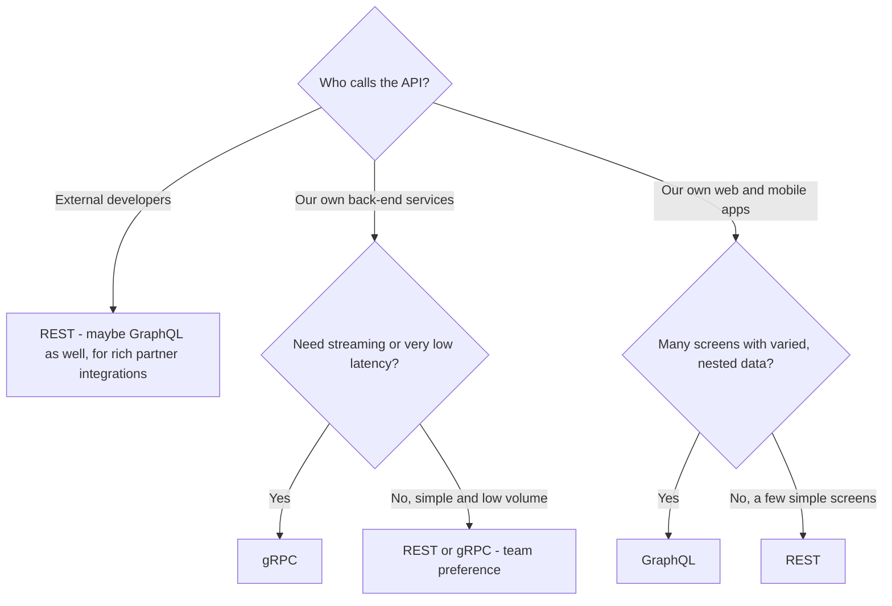
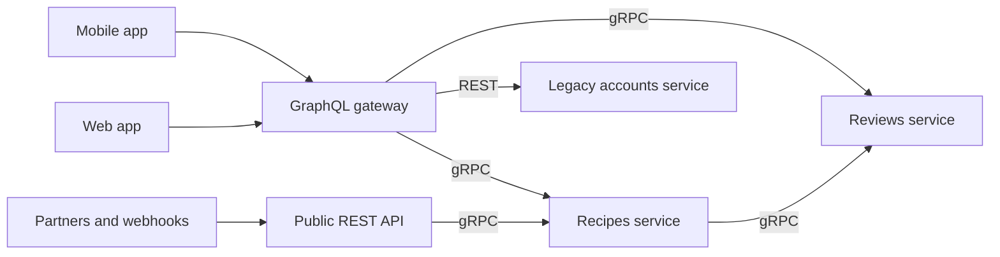

# REST vs GraphQL vs gRPC: when to choose which

> **Before this lesson:** you should know REST's conventions ([REST in plain words](#/lesson/graphql/rest-in-plain-words)), the problems GraphQL addresses ([Over-fetching, under-fetching and endpoint sprawl](#/lesson/graphql/rest-drawbacks)) and its costs ([Security and monitoring](#/lesson/graphql/security-monitoring), [Caching, federation and rate limiting](#/lesson/graphql/caching-federation-rate-limits)). gRPC is introduced here from zero.

## In plain words

By now you know two ways for programs to talk: REST and GraphQL. There is a third you will meet in almost any company with more than a handful of services: **gRPC**. This lesson puts the three side by side so that you can answer the question every API design interview eventually asks: *which one would you use here, and why?*

Three ways to get food make a fair picture.

- **REST is a set menu.** Numbered dishes, the same for everyone. Anyone can walk in off the street and order without instructions, and the kitchen can cook popular dishes ahead of time (caching). You get what the dish includes, no more, no less.
- **GraphQL is a build-your-own counter.** You state exactly what goes in the bowl. Wonderful when customers differ, but the kitchen must be ready for any combination and cannot easily cook ahead.
- **gRPC is the intercom between the restaurant's own kitchens.** Terse coded messages, very fast, understood only by trained staff with the same codebook. Nobody expects a customer to use it.

None of them is "best". Each fits a different conversation. Large systems normally use all three at once, in different places.

Why it matters for a job: this comparison is the most common opening question in API design interviews, and choosing well is a real engineering decision with years of consequences. The skill being tested is not reciting features but matching trade-offs to a situation.

## gRPC from zero

**RPC** (Remote Procedure Call) means calling a function that runs on another computer as though it were a local one. **gRPC** is a modern RPC framework released by Google in 2015. It rests on three ideas.

### 1. The contract is a `.proto` file

Both sides agree on the available functions and the exact shape of their messages in a file written in the **Protocol Buffers** language (protobuf for short):

```protobuf
syntax = "proto3";

service RecipeService {
  rpc GetRecipe (GetRecipeRequest) returns (Recipe);
  rpc ListRecipes (ListRecipesRequest) returns (stream Recipe);
}

message GetRecipeRequest {
  string id = 1;
}

message ListRecipesRequest {
  string category = 1;
  int32 page_size = 2;
}

message Recipe {
  string id = 1;
  string title = 2;
  int32 minutes = 3;
  repeated string tags = 4;
}
```

- A `service` lists functions (`rpc`). Each takes one message and returns one message (or a stream of them).
- A `message` lists typed fields. `repeated` means a list.
- The numbers after `=` are **field tags**. They, not the names, identify fields on the wire. This is why a field can be renamed without breaking anyone, and why a tag number must never be reused for a different field.

### 2. Code is generated for both sides

A compiler (`protoc`) turns the `.proto` file into source code in your language: classes for the messages, a client object (a **stub**) with one method per `rpc`, and a server skeleton to fill in. Calling the remote service then looks like a local function call:

```javascript
const recipe = await client.getRecipe({ id: "r1" });
console.log(recipe.title);
```

There is no URL to build, no JSON to parse, and the compiler rejects a call with the wrong field types.

### 3. Messages are compact binary over HTTP/2

JSON is text: field names are spelled out in every message. Protobuf's wire format is **binary**: each field is sent as its tag number, a type marker and the raw value. No names, no quotes, no brackets. Messages are typically several times smaller than the equivalent JSON and much faster to encode and decode.

The following sketch encodes one recipe both ways. The binary encoder is a simplified version of the real protobuf format, enough to show where the saving comes from.

```js-run
const recipe = { id: "r1", title: "Lentil soup", minutes: 35, tags: ["vegan", "winter"] };

// ---------- JSON: text, with every field name written out ----------
const json = JSON.stringify(recipe);

// ---------- protobuf-style: tag number + wire type + value, no names ----------
const schema = { id: [1, "string"], title: [2, "string"], minutes: [3, "int"], tags: [4, "repeated string"] };
function encode(message) {
  const bytes = [];
  const text = (tag, s) => { const utf8 = [...new TextEncoder().encode(s)]; bytes.push((tag << 3) | 2, utf8.length, ...utf8); };  // type 2 = length-delimited
  for (const [name, [tag, kind]] of Object.entries(schema)) {
    const value = message[name];
    if (kind === "int") bytes.push((tag << 3) | 0, value);          // type 0 = varint (values under 128 fit in one byte)
    else if (kind === "string") text(tag, value);
    else for (const item of value) text(tag, item);                 // repeated: the tag is written once per item
  }
  return bytes;
}
const binary = encode(recipe);

console.log("JSON     :", json);
console.log("           ", json.length, "bytes");
console.log("protobuf :", binary.map((b) => b.toString(16).padStart(2, "0")).join(" "));
console.log("           ", binary.length, "bytes");
console.log("saving   :", Math.round((1 - binary.length / json.length) * 100) + "%");
```

Read the hex output: `0a 02 72 31` is "field 1, a string, 2 bytes long, `r1`". The names `id`, `title`, `minutes` and `tags` never appear; the receiver looks the tag numbers up in its own copy of the `.proto` file. The flip side is plain to see: without that file the bytes are unreadable. You cannot inspect gRPC traffic with a text tool the way you can read JSON.

**HTTP/2** is the second version of HTTP. It allows many requests to share one connection at once and allows either side to send a continuous stream of messages. gRPC uses it for four call styles:

| Style | Shape | Example |
|---|---|---|
| unary | one request, one response | `GetRecipe` |
| server streaming | one request, many responses | `ListRecipes`, a live feed |
| client streaming | many requests, one response | uploading sensor readings |
| bidirectional streaming | both sides stream | chat, live collaboration |

gRPC also has built-in **deadlines** (the caller says "I will wait at most 200 ms" and that limit travels with the call through every downstream service) and standard status codes of its own (`NOT_FOUND`, `PERMISSION_DENIED`, `DEADLINE_EXCEEDED` and so on).

### The catch: browsers

A web page's JavaScript cannot control HTTP/2 at the level gRPC needs, so browsers cannot speak native gRPC. A translation proxy (**gRPC-Web**, or the newer **Connect** protocol) is required. Add the unreadable binary format and the need for generated code, and gRPC is awkward for public APIs. It is at its best *inside* a company's own infrastructure.

## The three side by side

| | REST | GraphQL | gRPC |
|---|---|---|---|
| Core idea | resources at URLs, HTTP verbs | client-specified queries over a typed graph | calling remote functions |
| Contract | optional (OpenAPI document) | required: the schema, introspectable | required: `.proto` files |
| Message format | JSON (text) | JSON (text) | Protocol Buffers (binary) |
| Transport | HTTP/1.1 or newer | HTTP, usually POST; WebSocket for subscriptions | HTTP/2 |
| Endpoints | many (one per resource and action) | one | one method per `rpc` |
| Who shapes the response | the server | the client | the server |
| Over- and under-fetching | common; eased with `fields` and `include` | solved by design | n/a (purpose-built messages) |
| HTTP / CDN caching | excellent, built in | needs extra work | none |
| Real-time | add-ons (SSE, WebSockets, webhooks) | subscriptions | streaming built in |
| Browser support | native | native | needs a proxy |
| Human-readable on the wire | yes | yes | no |
| Performance per call | good | good; one round trip instead of several | best: small messages, fast parsing |
| Evolving the API | version in the URL (`/v2`) | add fields, deprecate old ones | add fields with new tag numbers |
| Error reporting | HTTP status codes | `errors` array, usually HTTP 200 | gRPC status codes |
| Learning curve | lowest | medium | medium to high |
| Main risks | endpoint sprawl, chatty clients | expensive queries, N+1, caching complexity | tooling, debugging, browser reach |

## How to choose

Do not start from the technology. Start from four questions about the situation.

**1. Who is the consumer?**

- *Unknown third parties, in any language* → REST. Everyone can call it with a tool they already have; it is the lowest barrier there is.
- *Your own web and mobile apps, with many screens that change often* → GraphQL.
- *Your own back-end services talking to each other* → gRPC.

**2. How varied are the data needs?**

- Many clients each wanting different slices of connected data → GraphQL earns its cost.
- One or two fixed shapes → REST or gRPC is simpler.

**3. What dominates performance?**

- Round trips over slow mobile networks → GraphQL (one request per screen).
- Cacheable public content at huge scale → REST behind a CDN.
- Sheer call volume and low latency between services → gRPC.

**4. What can the team operate?**

- GraphQL needs query-cost controls, DataLoader discipline and schema governance.
- gRPC needs code generation in the build and HTTP/2-aware infrastructure.
- REST needs the least.



### They combine

A typical production architecture uses each where it is strongest:



- **GraphQL at the edge**, shaping data for the company's own apps.
- **gRPC between services**, where both ends are controlled and speed matters.
- **REST for the public API and webhooks**, where reach and simplicity matter.

The GraphQL layer's resolvers call gRPC or REST services. The three are layers, not rivals.

> [!TIP]
> Two neighbours worth a sentence in an interview. **Webhooks** are "reverse REST": instead of the client polling, the server sends an HTTP `POST` to a URL the client registered when an event occurs; they are the standard for notifying third parties (payments, deployments). **tRPC** gives end-to-end type safety between a TypeScript front end and a TypeScript back end without a schema language; it suits single-team, all-TypeScript projects and offers nothing to clients in other languages.

## Worked interview answers

Good answers follow one pattern: restate the situation, name the deciding factors, choose, and say what you would watch out for.

### "Design the API for a food-delivery mobile app."

> The consumers are our own iOS, Android and web clients. Screens such as the restaurant page combine restaurant details, menu sections, items, reviews and the user's basket: nested data, and each platform shows a slightly different subset. Mobile networks make round trips expensive.
>
> I would expose **GraphQL** to the apps. One query per screen, no over-fetching, and the apps can evolve without waiting on new endpoints. Order status updates use a subscription or, with less machinery, polling every few seconds.
>
> Costs I would plan for: DataLoader in every list resolver to avoid N+1; depth and complexity limits, or better a persisted-query allow-list since all clients are ours; per-field authorisation; and operation-level monitoring. Behind the gateway, services can talk gRPC. Payment provider callbacks arrive as REST webhooks.

### "We are building a public API so that other companies can integrate with our invoicing product."

> The consumers are unknown developers using any language, often from simple scripts. They need predictability, good documentation, and easy testing from the command line. Operations are mostly CRUD on a few resources: invoices, customers, payments.
>
> I would choose **REST** with an OpenAPI description. Every developer already knows how to call it, responses cache well, status codes map cleanly onto outcomes, and per-endpoint rate limiting is straightforward. I would add webhooks for events such as "invoice paid", idempotency keys on `POST`, cursor pagination, and versioning.
>
> I would consider adding GraphQL later if partners build rich interfaces on our data and ask for flexible queries, as GitHub and Shopify did. It should not be the first thing we ship.

### "Twenty internal microservices call each other thousands of times per second."

> Both ends are ours, the call volume is high, latency budgets are tight, and several flows are streams (event feeds). No browsers are involved.
>
> **gRPC**: compact binary messages, HTTP/2 multiplexing, generated clients in each team's language, deadlines that propagate through the call chain, and streaming built in. The `.proto` files live in a shared repository with compatibility checks in CI.
>
> Trade-offs: traffic is not human-readable, so we invest in tooling (reflection, `grpcurl`, tracing), and load balancers must understand HTTP/2. Anything that must be reachable from a browser goes through a gateway.

### "Our REST API works. Should we migrate to GraphQL?"

> That depends on whether we have the problems GraphQL solves. I would look for evidence: screens making many sequential calls, a growing pile of screen-specific endpoints, front-end work regularly blocked on back-end changes, several client platforms with diverging needs.
>
> If those are present, I would add a GraphQL layer in front of the existing REST services and move screens over one at a time, not rewrite. If we have one web client, a stable set of endpoints and good caching, the migration would cost more than it returns, and I would improve the REST API instead: sparse fieldsets, an `include` parameter, better pagination.

> [!WARNING]
> Avoid absolute statements in interviews: "GraphQL is faster", "REST is outdated", "gRPC is always best for performance". Each is false in some common situation, and interviewers use them to tell memorised opinions from understanding. Say what a technology optimises for, what it costs, and when that trade is worth making.

> [!INTERVIEW]
> **A compact answer to "REST vs GraphQL vs gRPC?"** "REST models resources with HTTP verbs; it is the simplest and most cacheable, and the best default for public APIs. GraphQL lets clients specify exactly the data they need from a typed graph in one request; it suits first-party apps with many varied screens, at the cost of harder caching and the need for query-cost controls. gRPC is contract-first RPC with binary protobuf over HTTP/2; it is the fastest and supports streaming, and fits service-to-service communication, but is not browser-native or human-readable. Many systems use GraphQL at the edge, gRPC internally and REST for public integrations."

## Pitfalls

- **Choosing by fashion.** The right question is "which problems do we have?", not "what are other companies using?".
- **GraphQL for a simple CRUD service with one client.** All of the cost, none of the benefit.
- **gRPC straight to the browser.** It needs gRPC-Web or Connect and a proxy.
- **Reusing or renumbering protobuf field tags.** Old and new programs will silently misread each other's data.
- **Treating REST's weaknesses as unfixable.** Fieldsets, embedding and a BFF solve many of them.
- **Exposing internal gRPC or database shapes directly through GraphQL.** Design the graph for its clients.
- **One style everywhere.** Edge, internal and public traffic have different needs.
- **Forgetting operations.** A style your team cannot monitor, secure and debug is the wrong choice, whatever its merits on paper.

## Cheat sheet

| Situation | Usual choice | One-line reason |
|---|---|---|
| public API for third parties | REST | universal, cacheable, simple |
| notifying third parties of events | webhooks | the server calls them |
| first-party apps, many varied screens | GraphQL | one request, exact data, fast UI iteration |
| several client platforms with different needs | GraphQL | each writes its own queries |
| service-to-service, high volume | gRPC | compact, fast, typed, deadlines |
| streaming between services | gRPC | built-in streaming |
| simple CRUD, one client | REST | least machinery |
| heavy public read traffic | REST + CDN | HTTP caching |
| all-TypeScript app, one team | tRPC or REST | types without a schema language |
| large system | all three | GraphQL at the edge, gRPC inside, REST outside |

## Summary

- REST, GraphQL and gRPC answer different needs: resource-oriented simplicity and caching; client-shaped queries over a graph; and fast, typed calls between services.
- gRPC defines services and messages in `.proto` files, generates client and server code, and sends compact binary messages over HTTP/2 with streaming and deadlines. It is not browser-native or human-readable.
- Choose by asking who the consumers are, how varied their data needs are, what dominates performance, and what the team can operate.
- Real systems combine them: GraphQL for the company's own apps, gRPC between internal services, REST and webhooks for the public.
- In interviews, state the trade-offs and tie the choice to the situation; avoid absolutes.

## Glossary

- **RPC (Remote Procedure Call):** calling a function that executes on another machine.
- **gRPC:** an RPC framework using Protocol Buffers and HTTP/2.
- **Protocol Buffers (protobuf):** a language for defining typed messages and their compact binary encoding.
- **`.proto` file:** the source file that declares services and messages.
- **Field tag:** the number that identifies a protobuf field on the wire.
- **Stub:** generated client code whose methods perform remote calls.
- **Binary format:** data encoded as raw bytes, not readable as text.
- **HTTP/2:** a version of HTTP supporting many simultaneous streams on one connection.
- **Streaming:** sending a sequence of messages over one call.
- **Deadline:** the latest time by which a call must complete, passed along to downstream calls.
- **gRPC-Web / Connect:** protocols that let browsers reach gRPC services through a proxy.
- **OpenAPI:** a standard format for describing REST APIs.
- **Webhook:** an HTTP callback sent by a server to a URL registered by a client when an event occurs.
- **tRPC:** a TypeScript library for type-safe calls between a TypeScript client and server.
- **Microservices:** an architecture of many small, independently deployed services.
- **Edge:** the part of a system that faces clients directly.

## Check yourself

```quiz
[
  {"q": "In a protobuf message, what identifies a field on the wire?",
   "options": ["Its name", "Its tag number", "Its position in the source file", "Its default value"],
   "answer": 1,
   "explain": "Only the tag number is sent. That is why renaming a field is safe and reusing a tag number for something else is not."},
  {"q": "Why can a web page's JavaScript not call a gRPC service directly?",
   "options": ["Browsers cannot send binary data", "Browsers do not give JavaScript the low-level HTTP/2 control gRPC requires, so a proxy protocol such as gRPC-Web is needed", "gRPC forbids browsers in its licence", "Browsers only support XML"],
   "answer": 1,
   "explain": "Native gRPC depends on HTTP/2 features not exposed to page scripts. gRPC-Web or Connect bridges the gap through a proxy."},
  {"q": "A company wants an API that unknown outside developers will integrate with from many languages. Which is the most suitable default?",
   "options": ["gRPC", "GraphQL only", "REST", "A custom binary protocol"],
   "answer": 2,
   "explain": "REST over HTTP with JSON has the lowest barrier: every language and tool can call it, and it caches and documents well."},
  {"q": "Which style gives the best fit for twenty internal services making thousands of calls per second to each other, some of them streams?",
   "options": ["REST", "GraphQL", "gRPC", "Webhooks"],
   "answer": 2,
   "explain": "Compact binary messages, HTTP/2 multiplexing, generated typed clients, deadlines and built-in streaming make gRPC the usual choice for service-to-service traffic."},
  {"q": "Which statement is the most defensible in an interview?",
   "options": ["GraphQL is always faster than REST", "REST is obsolete", "GraphQL reduces round trips and over-fetching for varied clients, at the cost of harder caching and the need for query-cost controls", "gRPC should be used for every API"],
   "answer": 2,
   "explain": "It states what the technology optimises for and what it costs. The other three are absolutes that fail in common situations."},
  {"q": "A mobile app's home screen needs nested data from five resources, and each platform shows a different subset. What is the main benefit of GraphQL here?",
   "options": ["Binary encoding", "Each client fetches exactly its own nested data in one request, without new server endpoints", "Built-in CDN caching", "No need for authentication"],
   "answer": 1,
   "explain": "Varied, nested, per-client data needs over a slow network are the case GraphQL was designed for."},
  {"q": "In the combined architecture described in this lesson, what do GraphQL resolvers typically do?",
   "options": ["Query the browser's cache", "Call internal services over gRPC or REST and assemble the result", "Replace the database", "Generate `.proto` files"],
   "answer": 1,
   "explain": "GraphQL sits at the edge as an aggregation layer. Its resolvers fetch from the services behind it."},
  {"q": "A team has one web client, a stable REST API and effective caching, and asks whether to migrate to GraphQL. What is the best response?",
   "options": ["Yes, GraphQL is the modern standard", "Probably not: without varied clients, chatty screens or endpoint sprawl, the migration costs more than it returns", "Yes, but only with gRPC as well", "Yes, because REST cannot paginate"],
   "answer": 1,
   "explain": "Adopt a technology for the problems it solves. If those problems are absent, improving the existing API is the better investment."}
]
```

> **Source:** this module goes beyond Porcello & Banks, *Learning GraphQL*; ch. 1 (history of data transport: RPC, SOAP, REST) provides the background. URLs: https://grpc.io/docs/what-is-grpc/introduction/ ; https://protobuf.dev/programming-guides/encoding/ ; https://graphql.org/learn/thinking-in-graphs/ ; https://graphql.org/learn/best-practices/ ; https://learn.microsoft.com/en-us/azure/architecture/best-practices/api-design.
