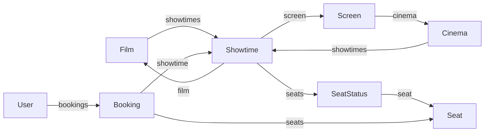
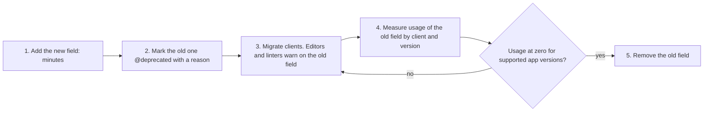

# Designing a schema live: versioning, errors and pagination styles

> **Before this lesson:** this is the capstone of the track. It draws on schema design ([Types](#/lesson/graphql/types-scalars-nonnull), [Connections](#/lesson/graphql/connections-through-types), [Arguments and pagination](#/lesson/graphql/arguments-pagination), [Mutations and input types](#/lesson/graphql/mutations-inputs-docs)), on [Security and monitoring](#/lesson/graphql/security-monitoring), and on the comparison in [REST vs GraphQL vs gRPC](#/lesson/graphql/rest-graphql-grpc).

## In plain words

A common interview exercise goes: "Here is a product. Design its API on the whiteboard. You have thirty minutes." There is no single right answer. The interviewer is watching *how you think*: do you ask what the product needs, do you make reasonable choices and explain them, do you know the standard conventions, and do you see the problems coming?

It is like being asked to sketch the floor plan of a house. Nobody expects finished blueprints. They expect you to ask who will live there, to put the kitchen near the dining room, to know that doors need to open, and to mention where the plumbing will be awkward.

This lesson gives you a repeatable method for that exercise, a complete worked answer, and the three follow-up topics that nearly always come next:

- **Versioning and deprecation**: how an API changes without breaking the apps that use it.
- **Error handling conventions**: how failures are reported.
- **Pagination styles**: how long lists are delivered.

Why it matters for a job: the same thinking is used in real design reviews. An API, once published, is very hard to change, so an hour of careful design saves months of migration work.

## A method for designing a schema live

Work through these six steps in order, out loud.

| Step | What you do | What it shows |
|---|---|---|
| 1. Clarify | ask who the clients are, what the main screens and actions are, and how big the data is | you design from needs, not from guesses |
| 2. Nouns | list the entities and their key fields | you can model a domain |
| 3. Edges | draw the relationships: one-to-many, many-to-many, any with data on them | you think in graphs |
| 4. Entry points | write the `Query` fields the screens need, with pagination | you design for clients |
| 5. Actions | write the mutations: specific verbs, `input` in, payload out | you know the conventions |
| 6. Stress-test | walk a real screen through your schema; then name the risks: nullability, authorisation, N+1, abuse, evolution | you anticipate problems |

Two habits make the difference between a passable answer and a strong one. **Start from the screens**: a schema exists to serve them. And **say the trade-offs out loud**: "I am making this nullable because it comes from another service" is worth more than a perfect schema produced in silence.

## Worked example: a cinema booking app

> **Prompt:** "Design a GraphQL schema for a cinema chain's ticket-booking app."

### Step 1: Clarify

Questions you would ask, with the answers we will assume:

- *Who are the clients?* Our own mobile and web apps. (So: persisted queries are an option; no need to design for strangers.)
- *What are the main screens?* A list of films now showing; a film page with showtimes by cinema; a seat picker; my bookings.
- *What are the main actions?* Hold seats, pay for a booking, cancel a booking.
- *Scale?* Hundreds of cinemas, thousands of showtimes per day, sudden spikes when a big film opens.
- *Anything real-time?* Seat availability changes while a user is choosing.

### Step 2: Nouns

`Film`, `Cinema`, `Screen` (an auditorium), `Showtime` (a film in a screen at a time), `Seat`, `Booking`, `User`.

### Step 3: Edges



The interesting modelling decision: a seat is not "available" or "taken" in general. It is available *for a particular showtime*. Seat J12 is free at 18:00 and sold at 21:00. Availability is data about the **pair** (showtime, seat), so it needs a through type (lesson 11). That is `SeatStatus` in the diagram. Spotting this is the kind of moment interviewers look for.

### Steps 4 and 5: The schema

```graphql
scalar DateTime

enum Rating { U PG TWELVE FIFTEEN EIGHTEEN }
enum SeatState { AVAILABLE HELD SOLD }
enum BookingStatus { PENDING_PAYMENT CONFIRMED CANCELLED }

"A film in the catalogue."
type Film {
  id: ID!
  title: String!
  runtimeMinutes: Int!
  rating: Rating!
  synopsis: String
  posterUrl: String
  "Upcoming showtimes, soonest first, optionally limited to one cinema or one day."
  showtimes(cinemaId: ID, on: DateTime, first: Int = 20, after: String): ShowtimeConnection!
}

type Cinema {
  id: ID!
  name: String!
  city: String!
  screens: [Screen!]!
}

type Screen {
  id: ID!
  name: String!
  cinema: Cinema!
  seats: [Seat!]!
}

type Seat {
  id: ID!
  row: String!
  number: Int!
  accessible: Boolean!
}

type Showtime {
  id: ID!
  film: Film!
  screen: Screen!
  startsAt: DateTime!
  "Price of one standard ticket, in pence."
  pricePence: Int!
  "Every seat in the screen with its state for this showtime."
  seats: [SeatStatus!]!
  availableSeatCount: Int!
}

"The state of one seat for one showtime."
type SeatStatus {
  seat: Seat!
  state: SeatState!
}

type Booking {
  id: ID!
  showtime: Showtime!
  seats: [Seat!]!
  status: BookingStatus!
  totalPence: Int!
  "For PENDING_PAYMENT bookings, when the seat hold lapses."
  expiresAt: DateTime
  createdAt: DateTime!
}

type User {
  id: ID!
  name: String!
  bookings(first: Int = 10, after: String): BookingConnection!
}

type PageInfo { hasNextPage: Boolean!  endCursor: String }
type ShowtimeEdge { cursor: String!  node: Showtime! }
type ShowtimeConnection { edges: [ShowtimeEdge!]!  pageInfo: PageInfo! }
type BookingEdge { cursor: String!  node: Booking! }
type BookingConnection { edges: [BookingEdge!]!  pageInfo: PageInfo! }
type FilmEdge { cursor: String!  node: Film! }
type FilmConnection { edges: [FilmEdge!]!  pageInfo: PageInfo! }

type Query {
  filmsNowShowing(city: String, first: Int = 20, after: String): FilmConnection!
  film(id: ID!): Film
  showtime(id: ID!): Showtime
  "The signed-in user, or null."
  me: User
}

input HoldSeatsInput {
  showtimeId: ID!
  seatIds: [ID!]!
  "Client-generated key so that a retried request does not create a second hold."
  idempotencyKey: String!
}

type UserError { field: String  code: String!  message: String! }

type HoldSeatsPayload {
  booking: Booking
  "Seats that could not be held because someone else took them first."
  unavailableSeats: [Seat!]!
  errors: [UserError!]!
}

input ConfirmBookingInput { bookingId: ID!  paymentToken: String! }
type ConfirmBookingPayload { booking: Booking  errors: [UserError!]! }

input CancelBookingInput { bookingId: ID! }
type CancelBookingPayload { booking: Booking  errors: [UserError!]! }

type Mutation {
  holdSeats(input: HoldSeatsInput!): HoldSeatsPayload!
  confirmBooking(input: ConfirmBookingInput!): ConfirmBookingPayload!
  cancelBooking(input: CancelBookingInput!): CancelBookingPayload!
}

type Subscription {
  "Fires whenever a seat's state changes for the given showtime."
  seatStatusChanged(showtimeId: ID!): SeatStatus!
}
```

### Step 6: Stress-test it

**Walk a screen through it.** The seat picker:

```graphql
query SeatPicker($id: ID!) {
  showtime(id: $id) {
    startsAt
    pricePence
    film { title runtimeMinutes rating }
    screen { name cinema { name } }
    seats { state seat { id row number accessible } }
  }
}
```

One request draws the whole screen. Then `holdSeats`, then `confirmBooking`. The design holds.

**Then name the decisions and risks**, unprompted:

- *Money is `Int` pence, not `Float`.* Decimal fractions cannot be represented exactly in floating point; currency is stored in its smallest unit.
- *Specific mutations, two-phase booking.* `holdSeats` creates a short-lived hold (`PENDING_PAYMENT` with `expiresAt`); `confirmBooking` takes payment. A single `book` mutation would hold database locks while waiting on a payment provider.
- *Expected failures are data.* "Seat already taken" is the normal case on opening night, so it is in the payload (`unavailableSeats`, `errors` with a `code`), not an exception.
- *Idempotency key* on `holdSeats`, because mobile networks retry.
- *Nullability.* `film(id)` and `showtime(id)` are nullable: "not found" is null. `synopsis` and `posterUrl` are nullable: optional content. Lists are `[T!]!`.
- *Pagination.* `showtimes`, `bookings` and `filmsNowShowing` grow, so they are connections. `Showtime.seats` is bounded by the size of the room (a few hundred) and is needed all at once to draw the map, so a plain list is right.
- *Authorisation.* `me` is null when signed out. `Booking` is visible only to its owner; that rule lives in the business layer so that every path to a booking enforces it.
- *N+1.* `showtimes { film { title } }` and `seats { seat { row } }` need DataLoaders.
- *Abuse.* The cycle `Film → Showtime → Film` needs depth and complexity limits, or a persisted-query allow-list since the clients are ours.
- *Real-time.* `seatStatusChanged` is filtered by showtime. With many server instances it needs a shared pub/sub broker. Polling every few seconds is an acceptable first version.
- *Concurrency.* Two users tapping the same seat is settled in the database (a unique constraint on showtime and seat for active holds), not in GraphQL.

> [!TIP]
> If time is short, write less SDL and say more. A schema with four types and two mutations, accompanied by a clear account of nullability, pagination, error handling and N+1, beats twelve types written in silence.

## Versioning and deprecation

### How REST usually does it

A REST API that needs an incompatible change typically publishes a new version beside the old one: `/v1/recipes` and `/v2/recipes`. Clients migrate when they can. Its strength is clarity. Its cost is that every version is a whole API to maintain, and clients must upgrade everything to get one new thing.

### How GraphQL does it: continuous evolution

GraphQL's own guidance is to avoid versions and **evolve one schema continuously**. That works because of a property you have relied on since lesson 3: clients receive only the fields they ask for. So:

- **Adding** a type, field, argument (optional) or enum value cannot affect an existing query. Old clients do not select the new field, so they never see it.
- **Removing or changing** something breaks only the clients that use it, and the server can find out exactly who they are.

A change is **breaking** if a query that used to be valid, or client code that used to work, can fail afterwards.

| Change | Breaking? | Why |
|---|---|---|
| add a type or a field | no | nobody selects it yet |
| add an **optional** argument or input field | no | old queries omit it |
| add a **required** argument or input field | **yes** | old queries do not supply it |
| remove or rename a field, type or argument | **yes** | old queries reference it |
| change a field's type (`Int` → `String`) | **yes** | clients parse the old type |
| output field: nullable → non-null (`String` → `String!`) | no | a stronger promise |
| output field: non-null → nullable (`String!` → `String`) | **yes** | clients did not check for null |
| argument: optional → required (`Int` → `Int!`) | **yes** | old queries may omit it |
| argument: required → optional | no | old queries still supply it |
| add an enum value | *risky* | clients with a `switch` over known values may mishandle the new one |
| remove an enum value | **yes** | clients may send it or expect it |

Notice the symmetry: for **output**, promising more is safe; for **input**, demanding more is breaking.

The classifier below applies the output-field rules to two versions of a schema.

```js-run
const before = {
  Recipe: { id: "ID!", title: "String!", cookTime: "Int", rating: "Float", author: "Cook!" },
  Cook: { id: "ID!", name: "String", email: "String!" },
};
const after = {
  Recipe: { id: "ID!", title: "String!", minutes: "Int", rating: "Float!", author: "Cook" },
  Cook: { id: "ID!", name: "String!", email: "String!", city: "String" },
  Tag: { label: "String!" },
};

function diff(oldSchema, newSchema) {
  const changes = [];
  const add = (breaking, text) => changes.push((breaking ? "BREAKING  " : "safe      ") + text);
  for (const [type, fields] of Object.entries(oldSchema)) {
    if (!newSchema[type]) { add(true, `type ${type} removed`); continue; }
    for (const [field, was] of Object.entries(fields)) {
      const now = newSchema[type][field];
      if (now === undefined) add(true, `${type}.${field} removed`);
      else if (now === was) continue;
      else if (now === was + "!") add(false, `${type}.${field} became non-null (${was} -> ${now})`);
      else if (was === now + "!") add(true, `${type}.${field} became nullable (${was} -> ${now})`);
      else add(true, `${type}.${field} changed type (${was} -> ${now})`);
    }
    for (const field of Object.keys(newSchema[type])) if (!(field in fields)) add(false, `${type}.${field} added`);
  }
  for (const type of Object.keys(newSchema)) if (!oldSchema[type]) add(false, `type ${type} added`);
  return changes.sort();
}

console.log(diff(before, after).join("\n"));
```

Two breaking changes are reported: `Recipe.cookTime` was removed (even though `minutes` was added as its replacement, old clients still ask for the old name), and `Recipe.author` became nullable. The practice problem *Classify schema changes as breaking or safe* is a fuller version. Real teams run such a check automatically on every pull request, using tools such as GraphQL Inspector, GraphQL Hive or Apollo's schema checks. A "pull request" is a proposed change to the code, and automatic checks that run on each one are called **CI** (continuous integration).

### The deprecation life cycle

To replace `cookTime` with `minutes` safely:



```graphql
type Recipe {
  minutes: Int
  cookTime: Int @deprecated(reason: "Use `minutes`. Removal planned after 2027-01-01.")
}
```

Step 4 is the one that makes the approach trustworthy, and the one REST struggles to match: because every query names its fields, the server knows **exactly** which clients still use the old field.

```js-run
const deprecated = { "Recipe.cookTime": "Use minutes.", "Query.legacyFeed": "Use recipes.", "Cook.handle": "Use name." };

// A day's operations, as (client, fields used) pairs taken from the server's usage log.
const operations = [
  { client: "web@5.2", fields: ["Query.recipes", "Recipe.title", "Recipe.minutes"] },
  { client: "ios@3.1", fields: ["Query.legacyFeed", "Recipe.title", "Recipe.cookTime"] },
  { client: "ios@4.0", fields: ["Query.recipes", "Recipe.title", "Recipe.cookTime"] },
  { client: "ios@3.1", fields: ["Query.recipe", "Recipe.cookTime"] },
  { client: "android@2.9", fields: ["Query.recipes", "Recipe.minutes"] },
];

const usage = {};
for (const op of operations) {
  for (const field of op.fields) {
    if (!(field in deprecated)) continue;
    usage[field] ??= { uses: 0, clients: new Set() };
    usage[field].uses++;
    usage[field].clients.add(op.client);
  }
}
for (const field of Object.keys(deprecated)) {
  const u = usage[field];
  console.log(field.padEnd(18), u ? `${u.uses} uses by ${[...u.clients].sort().join(", ")}` : "0 uses -> safe to remove");
}
```

`Cook.handle` can be deleted today. `Recipe.cookTime` cannot: two iOS versions still use it, and the report says exactly which. The practice problem *Deprecated field usage report* builds this from raw queries.

> [!WARNING]
> Mobile apps make deprecation slow. A version released a year ago is still on some phones and still sends its old queries. "Usage at zero" may require waiting until old app versions are no longer supported, or forcing an upgrade. Plan deprecation windows in months.

When is a versioned GraphQL API justified? Rarely, but public APIs with contractual stability guarantees sometimes publish dated schema versions (Shopify does). For first-party APIs, continuous evolution is the norm.

## Error handling conventions

### The response format

A GraphQL response may contain `data`, `errors` or both. The specification fixes the shape of each error:

```json
{
  "data": { "recipe": { "title": "Lentil soup", "author": null } },
  "errors": [
    {
      "message": "Could not load the author.",
      "locations": [ { "line": 4, "column": 5 } ],
      "path": ["recipe", "author"],
      "extensions": { "code": "UPSTREAM_TIMEOUT", "retryable": true }
    }
  ]
}
```

| Key | Meaning |
|---|---|
| `message` | a description for developers; not meant to be shown to end users verbatim |
| `locations` | where in the query text the failing field appears |
| `path` | where in the **response** the failure occurred: field names and list indexes |
| `extensions` | a free-form object for machine-readable details; by convention a `code` |

Clients should branch on `extensions.code`, never on the wording of `message`.

### Three kinds of failure

| Kind | When | `data` | Example |
|---|---|---|---|
| **Request error** | before execution: syntax or validation failure, bad variables | absent | unknown field; missing required variable |
| **Field error** | during execution: a resolver threw | present, **partial**: the field is null (and the null may propagate, lesson 10) | a database timeout; not authorised |
| **Domain outcome** | the operation ran and the business answer is "no" | present and complete | "seat already taken", "title too long" |

The third kind should not be in `errors` at all. As lesson 13 argued, expected, user-fixable outcomes belong **in the schema**, as a typed payload field or union member, because the UI must handle them and tools can then check that it does.

A decision rule you can state in an interview:

- *Would the user interface show a specific message or offer a specific next step?* → model it as data.
- *Is it a bug, an outage or a malformed request?* → a top-level error with a code.

### What about HTTP status codes?

Traditionally a GraphQL server answers `200 OK` whenever it produced a well-formed GraphQL response, even one containing errors, and reserves other codes for transport-level failures: `400` for unparseable JSON, `401` from an authentication gateway, `500` or `503` when the server is broken. The reasoning: a response can be *partly* successful, and no single status code describes "three fields fine, one failed".

The **GraphQL over HTTP** specification, being standardised by the GraphQL Foundation, refines this with a dedicated media type, `application/graphql-response+json`. A client that asks for it may receive `4xx` for *request errors* (when nothing was executed), while responses with any `data`, including partial data, remain `200`. Either way the client-side rule is unchanged: **always inspect `errors`, whatever the status.**

| | REST | GraphQL |
|---|---|---|
| Where the outcome is reported | HTTP status code, plus a body | `errors` array (and typed payloads); status mostly 200 |
| Partial success | not expressible in one response | normal: `data` and `errors` together |
| Error body format | varies; the standard is "Problem Details" (RFC 9457, `application/problem+json`) | fixed: `message`, `locations`, `path`, `extensions` |
| Validation errors | `400` or `422` with a list of field problems | `UserError` list in the mutation payload |
| Not found | `404` | a nullable field returning `null` |
| Monitoring | status-code dashboards work | must parse response bodies |

## Pagination styles

Lesson 12 covered offset and cursor pagination in detail. In a design interview you are expected to know the whole family and choose with a reason.

| Style | The client sends | Strengths | Weaknesses | Use for |
|---|---|---|---|---|
| **Offset / limit** | `limit: 20, offset: 40` | simple; jump to any position | duplicates and gaps when data changes; slow at large offsets | admin tables, small static lists |
| **Page number** | `page: 3, perPage: 20` | friendliest for "page 3 of 12" interfaces | the same as offset, which it is in disguise | search results with numbered pages |
| **Cursor (opaque)** | `first: 20, after: "abc"` | stable under inserts and deletes; the server can change its internals freely | no jumping to a page; cursors expire if ordering changes | feeds, infinite scroll, public APIs |
| **Keyset (visible key)** | `afterId: "r42"` or `createdBefore: "2026-03-01T…"` | the same speed and stability as cursors; easy to debug | exposes the sort key; awkward with compound sort orders | internal APIs, time-ordered logs |
| **Relay connection** | `first/after`, `last/before` → `edges { cursor node } pageInfo` | cursor pagination in a standard shape that clients and tools understand; room for edge data | more types and nesting | the GraphQL default for growing lists |

Three points to say whichever style you choose:

1. **Cap the page size on the server.**
2. **Sort by something unique** (append the id as a tie-breaker), or pages will overlap.
3. **Return an object, not a bare list**, so that page information can be added later without a breaking change.

A cursor is usually an encoded keyset position (for example the pair *created-at, id* of the last item), so "cursor" and "keyset" describe the same database technique: `WHERE (created_at, id) < (?, ?) ORDER BY created_at DESC, id DESC LIMIT 20`. The difference is whether the client can see inside it.

> [!INTERVIEW]
> **"How do you version a GraphQL API?"** "Usually you do not. You evolve a single schema: additive changes are safe because clients only receive what they select. To remove something, add the replacement, mark the old field `@deprecated` with a reason, track its usage per client and version, and delete it once usage reaches zero. Schema checks in CI classify each change as breaking or safe before it merges."
>
> **"How are errors reported in GraphQL?"** "Request errors (syntax, validation) return `errors` with no `data`. Field errors during execution return partial `data` with the failed field null and an entry in `errors` carrying `path` and an `extensions.code`. Expected business outcomes are modelled as data in the payload. HTTP status is normally 200 for any well-formed GraphQL response, so clients and monitoring must read the body."
>
> **"Which pagination would you use?"** "Cursor-based, in the Relay connection shape, for anything that grows or changes: it is stable and stays fast. Offset or page numbers only for small, slow-changing lists where jumping to a page matters."

## Pitfalls

- **Designing from database tables instead of from screens.**
- **Silence during a live design.** The reasoning is the answer.
- **Jumping to SDL before asking any questions.**
- **Missing the through type** when a relationship has its own data (seat availability per showtime).
- **`Float` for money.**
- **One all-purpose mutation**, or mutations returning bare booleans.
- **Removing or renaming a field without a deprecation period**, or deprecating without measuring usage.
- **Tightening inputs** (a new required argument) and assuming it is as safe as tightening outputs.
- **Using top-level `errors` for expected outcomes**, or matching on `message` text.
- **Assuming HTTP 200 means success.**
- **Offset pagination on a live feed**, uncapped page sizes, and sort orders with ties.

## Cheat sheet

| Topic | Remember |
|---|---|
| design method | clarify → nouns → edges → entry points → actions → stress-test |
| entry points | from the screens; paginate what grows |
| mutations | specific verb, single `input`, payload with `errors` |
| edge data | through type |
| money | integer minor units |
| safe changes | add types, fields, optional arguments; output nullable → non-null |
| breaking changes | remove or rename; change type; output non-null → nullable; new required argument |
| deprecation | add new → `@deprecated(reason:)` → migrate → measure → remove |
| error object | `message`, `locations`, `path`, `extensions.code` |
| request error | no `data` |
| field error | partial `data` + `errors` |
| domain outcome | in the payload, typed |
| HTTP status | usually 200; always read `errors` |
| pagination default | Relay cursor connection; cap the size; unique sort key |

## Summary

- Design a schema live by clarifying needs, listing entities, drawing edges, writing entry points from the screens, defining specific mutations, and then stress-testing the result aloud.
- Look for relationships that carry data, choose nullability deliberately, paginate what grows, and name the authorisation, N+1 and abuse risks without being asked.
- GraphQL APIs evolve continuously instead of by version: additions are safe, removals follow a measured deprecation cycle, and schema checks classify changes before they ship.
- Errors come in three kinds: request errors without data, field errors with partial data, and expected domain outcomes, which belong in typed payloads. HTTP status is not a reliable success signal.
- Among pagination styles, cursor-based connections are the default for growing lists, with offset or page numbers kept for small, static ones.

## Glossary

- **Entity:** a kind of thing in the domain that has an identity, such as a film or a booking.
- **Entry point:** a field on a root type from which queries start.
- **Stress-test (a design):** to check a design against real use cases and failure modes.
- **Idempotency key:** a client-generated value that lets the server recognise a retried request.
- **Minor unit:** the smallest unit of a currency, such as pence or cents.
- **Versioning:** publishing distinct, separately maintained versions of an API.
- **Continuous evolution:** changing one schema over time through additions and deprecations.
- **Breaking change:** a change after which a previously valid query or working client can fail.
- **Deprecation:** marking part of an API as discouraged before removing it.
- **Schema check:** an automated comparison of a proposed schema with the current one and with real usage.
- **CI (continuous integration):** automatic checks run on every proposed code change.
- **Request error:** a failure before execution; the response has no `data`.
- **Field error:** a failure while resolving a field; the response has partial `data`.
- **Domain outcome:** an expected business result, including refusals, returned as data.
- **Problem Details (RFC 9457):** a standard JSON format for REST error bodies.
- **Keyset pagination:** paging by "items beyond this key value".

## Check yourself

```quiz
[
  {"q": "In a live schema-design exercise, what should you do first?",
   "options": ["Write the `Query` type", "Ask who the clients are and what the main screens and actions are", "Choose a database", "List every scalar you might need"],
   "answer": 1,
   "explain": "A schema serves its clients. Clarifying the screens and actions drives every later decision."},
  {"q": "In the cinema schema, why is seat availability modelled as `SeatStatus` on `Showtime` and not as a field on `Seat`?",
   "options": ["Seats cannot have fields", "Availability depends on the combination of seat and showtime, so it belongs on a type representing that pair", "To avoid pagination", "Enums cannot be used on `Seat`"],
   "answer": 1,
   "explain": "The same seat is free at one showtime and sold at another. Data about a relationship lives on a through type."},
  {"q": "Which schema change is NOT breaking?",
   "options": ["Removing `Recipe.cookTime`", "Changing `Recipe.rating` from `Float` to `Float!`", "Adding a required argument to `Query.recipes`", "Changing `Cook.email` from `String!` to `String`"],
   "answer": 1,
   "explain": "Making an output field non-null is a stronger promise and cannot break existing clients. The other three can."},
  {"q": "Using the `diff` function from this lesson with `before = {Cook: {name: \"String!\"}}` and `after = {Cook: {name: \"String\", city: \"String\"}}`, what is reported?",
   "options": ["Two safe changes", "`BREAKING  Cook.name became nullable (String! -> String)` and `safe      Cook.city added`", "One breaking change only", "No changes"],
   "answer": 1,
   "explain": "Loosening an output field from non-null to nullable is breaking; adding a field is safe."},
  {"q": "What makes it possible to know when a deprecated GraphQL field can be removed?",
   "options": ["The schema's version number", "Every query names the fields it uses, so the server can measure usage of that field per client", "The HTTP status code", "Introspection being disabled"],
   "answer": 1,
   "explain": "Field-level usage data shows exactly which clients still select the field. When supported clients no longer do, it can be deleted."},
  {"q": "A response is `{\"data\": {\"recipe\": {\"title\": \"Lentil soup\", \"author\": null}}, \"errors\": [{\"message\": \"Timeout\", \"path\": [\"recipe\", \"author\"], \"extensions\": {\"code\": \"UPSTREAM_TIMEOUT\"}}]}`. What kind of failure is this, and what does `path` tell you?",
   "options": ["A request error; `path` is the URL", "A field error with partial data; `path` locates the failed field in the response", "A domain outcome; `path` is the mutation name", "A network error; `path` is the server address"],
   "answer": 1,
   "explain": "Execution ran, one resolver failed, and the rest of the data was returned. `path` points to `recipe.author` in the result."},
  {"q": "A user tries to hold a seat that someone else took a moment earlier. Where should this be reported?",
   "options": ["As a top-level error with HTTP 500", "In the mutation payload, as typed data such as `unavailableSeats` and a `UserError` with a code", "By returning null for the whole response", "Nowhere; the client should poll"],
   "answer": 1,
   "explain": "It is an expected business outcome that the UI must explain. Expected outcomes are modelled in the schema, not as exceptions."},
  {"q": "For an activity feed that receives new items constantly, which pagination style is appropriate?",
   "options": ["Offset and limit", "Page numbers", "Cursor-based (for example a Relay connection)", "No pagination"],
   "answer": 2,
   "explain": "Cursors are stable when items are inserted during paging and stay fast at depth. Offset and page numbers show duplicates or gaps."}
]
```

> **Source:** this module goes beyond Porcello & Banks, *Learning GraphQL*; ch. 4 (designing a schema) and ch. 7 (incremental migration, schema-first development) provide the background. URLs: https://graphql.org/learn/best-practices/ ; https://graphql.org/learn/schema-design/ ; https://graphql.org/learn/response/ ; https://graphql.org/learn/pagination/ ; https://graphql.github.io/graphql-over-http/draft/ ; https://spec.graphql.org/October2021/#sec-Errors ; https://relay.dev/graphql/connections.htm ; https://www.rfc-editor.org/rfc/rfc9457.
