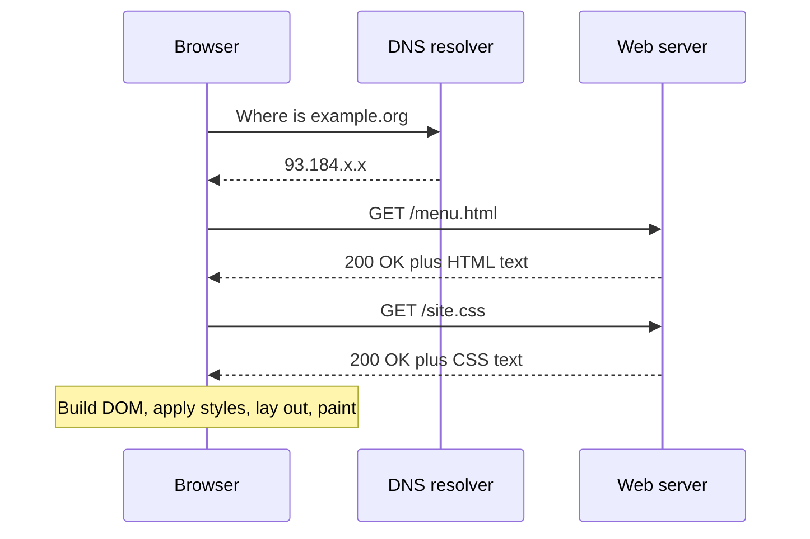
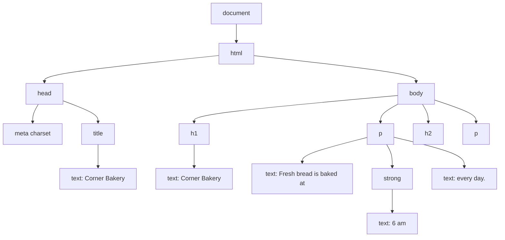

# How web pages work: elements, attributes and the DOM

> **Before this lesson:** nothing. This is the first lesson of the track. You only need a web browser and curiosity; no programming experience is assumed.

## In plain words

A **web page** is a text file written in a language called **HTML** (HyperText Markup Language). A **web browser** (Chrome, Firefox, Safari, Edge) is the program that fetches that file from another computer, called a **server**, and turns it into what you see on screen.

Think of a play script. The script is plain text, but it is full of labels: this line is spoken by Juliet, this line is a stage direction, this is the title of Act Two. The actors and director read those labels and turn the script into a performance. HTML is the script, its labels are called **tags**, and the browser is the theatre company that stages it.

Every job that involves the web, from front-end developer to tester to content editor, rests on reading and writing these labels correctly. When something looks wrong on a page, the first step is always the same: look at the structure the browser built from the HTML. This lesson shows you what that structure is.

## Why it is worth learning properly

Open any web page, press <kbd>Ctrl</kbd>+<kbd>U</kbd>, and you will see that the polished thing on screen began life as a plain text file. There is no hidden binary format and no compiler. A browser receives characters, turns them into a tree of objects, and paints that tree. Everything else you will learn in this track (styling, layout, accessibility, performance) is an operation on that tree, so it pays to understand it properly before writing a single line of CSS.

This lesson covers what happens between typing an address and seeing a page, what HTML markup actually is, how the browser repairs sloppy markup, and what a minimal correct document looks like today.

## From address bar to pixels

When you visit `https://example.org/menu.html`, several systems cooperate:

1. **DNS lookup.** Names are for people; machines route by number. The browser asks a resolver to translate `example.org` into an IP address.
2. **Connection.** The browser opens a TCP (or QUIC) connection to that address and, for `https`, negotiates encryption with TLS.
3. **Request.** It sends an HTTP request: `GET /menu.html`.
4. **Response.** The server answers with a status code (`200 OK`, `404 Not Found`, ...), headers such as `Content-Type: text/html; charset=utf-8`, and the body: the HTML text.
5. **Parsing and sub-requests.** As the browser reads the HTML it discovers more files it needs (style sheets, scripts, images, fonts) and fetches each with its own request.
6. **Rendering.** The browser combines structure (HTML) and presentation (CSS) and draws the result.



Three languages share the work, and keeping their jobs separate is the single most useful habit in front-end development:

| Layer | Language | Answers the question |
|---|---|---|
| Structure and meaning | HTML | *What is this content?* (a heading, a list, a form field) |
| Presentation | CSS | *How should it look?* (colour, size, position) |
| Behaviour | JavaScript | *What happens when the user does something?* |

A page should still make sense with only the first layer. Search engines, screen readers, reader modes and slow connections all experience your HTML before (or instead of) the other two.

## Markup: describing what content *is*

HTML stands for HyperText Markup Language. "Markup" means you annotate text with **tags** that say what role each piece plays. Compare a newspaper: you can tell headline from caption from body text at a glance. HTML encodes those roles explicitly so software can tell too.

An **element** usually consists of an opening tag, some content and a closing tag:

```html
<p>Fresh bread is baked at <strong>6 am</strong> every day.</p>
```

- `<p>` opens a paragraph, `</p>` closes it. The slash marks a closing tag.
- `<strong>` sits *inside* the paragraph. Elements nest like brackets in maths: whatever opens last must close first.
- Tag names are case-insensitive, but lowercase is the universal convention.

Edit the example below. Try changing `h1` to `h3`, or wrapping a word in `<em>`.

```html-run
<!doctype html>
<html lang="en">
<head>
  <meta charset="utf-8">
  <title>Corner Bakery</title>
</head>
<body>
  <h1>Corner Bakery</h1>
  <p>Fresh bread is baked at <strong>6 am</strong> every day.</p>
  <h2>Today's loaves</h2>
  <p>Sourdough, rye and a seeded wholemeal.</p>
</body>
</html>
```

Notice that the page has visual styling even though we wrote no CSS. Every browser ships a built-in **user-agent style sheet** that makes headings bold and large, gives paragraphs a margin, and so on. Those defaults are a starting point, not a reason to choose an element. Pick `h2` because the text is a second-level heading, never because you want medium-large bold text.

### Void elements

Some elements cannot contain anything, so they have no closing tag. They are called **void elements**: `<br>`, `<hr>`, ``, `<input>`, `<meta>`, `<link>` and a few more. You may see them written `<br />` with a trailing slash; that is a leftover from XHTML and browsers ignore the slash. Both forms are valid HTML.

## Attributes: extra information on the opening tag

Attributes are name/value pairs written inside the opening tag. They configure the element or give it metadata.

```html
<a href="/menu.html" title="See everything we bake">Our menu</a>
```

| Part | Example | Notes |
|---|---|---|
| Attribute name | `href` | Defined by the HTML standard for that element |
| Value | `"/menu.html"` | Quote it. Double quotes are conventional |
| Boolean attribute | `disabled`, `required`, `hidden` | Presence means true; the value is irrelevant |
| Global attribute | `id`, `class`, `lang`, `hidden`, `title`, `tabindex` | Allowed on every element |
| Custom data | `data-price="4.50"` | Your own data, readable from CSS and JavaScript |

```html-run
<!doctype html>
<html lang="en">
<head>
  <meta charset="utf-8">
  <title>Attributes</title>
  <style>
    [data-stock="low"] { color: #b3261e; font-weight: bold; }
    [hidden] { display: none; }
  </style>
</head>
<body>
  <p lang="fr">Pain au levain <span data-stock="low">(only 2 left)</span></p>
  <p hidden>This paragraph has the boolean attribute "hidden".</p>
  <p><a href="#top" title="A tooltip appears on hover">Hover over me</a></p>
  <button disabled>Sold out</button>
</body>
</html>
```

> [!WARNING]
> A boolean attribute is true whenever it is present. `disabled="false"` still disables the control, because the browser never looks at the value. To turn it off you must remove the attribute entirely.

## The skeleton every page needs

A complete, modern HTML document is short:

```html
<!doctype html>
<html lang="en">
<head>
  <meta charset="utf-8">
  <meta name="viewport" content="width=device-width, initial-scale=1">
  <title>Menu · Corner Bakery</title>
</head>
<body>
  ...visible content...
</body>
</html>
```

Each line earns its place:

- **`<!doctype html>`** is not an element. It is a switch that tells the browser to use *standards mode*. Leave it out and you get *quirks mode*, which reproduces layout bugs from the 1990s (odd box sizing, tables that ignore font sizes) for the sake of ancient pages.
- **`<html lang="en">`** is the root element. The `lang` attribute lets screen readers choose the right pronunciation, lets browsers offer translation, and affects hyphenation and quotation marks.
- **`<head>`** holds information *about* the page that is not drawn in the viewport: title, character encoding, links to style sheets, metadata for search engines.
- **`<meta charset="utf-8">`** declares the text encoding. Put it first in the head, because the browser needs it before it can reliably read anything else. UTF-8 covers every script and emoji.
- **`<meta name="viewport" ...>`** stops phones from pretending to be 980 pixels wide and shrinking your page. You will meet it again in the responsive design lesson.
- **`<title>`** appears on the browser tab, in bookmarks, in history, and as the headline of a search result. It is the first thing a screen reader announces.
- **`<body>`** contains everything the user sees.

> [!TIP]
> Write titles from specific to general: `Menu · Corner Bakery`. When a user has fifteen tabs open, only the first few characters are visible, so lead with what distinguishes this page.

## The DOM: what the browser really works with

The browser does not keep your text file around and consult it. It parses the characters once and builds a tree of **nodes** in memory called the **Document Object Model**. CSS selectors match against this tree, JavaScript reads and changes it, and accessibility tools derive their own tree from it.

For the bakery page above, the tree looks like this:



The vocabulary of family trees applies. `body` is the **parent** of `h1`; `h1` and the first `p` are **siblings**; `strong` is a **child** of `p` and a **descendant** of `body`; `body` is an **ancestor** of `strong`. You will use these words constantly, because CSS selectors such as `nav a` (descendant) and `ul > li` (child) are phrased in terms of them.

Three facts about the DOM surprise people:

**Text is a node too.** The words between tags become text nodes. Even the line breaks and indentation between your tags produce whitespace-only text nodes.

**Whitespace collapses when rendered.** Any run of spaces, tabs and newlines in normal text is displayed as a single space. You can indent your source however you like without affecting the output.

```html-run
<!doctype html>
<html lang="en">
<head><meta charset="utf-8"><title>Whitespace</title></head>
<body>
  <p>These      words     have
     lots of        space
     in the source.</p>
  <pre>But   inside   pre
     whitespace is kept.</pre>
</body>
</html>
```

**The DOM is not your source.** The parser is forgiving by design. It never refuses to show a page; instead it follows detailed error-recovery rules from the HTML standard, and the resulting tree can differ from what you typed.

```html-run
<!doctype html>
<html lang="en">
<head><meta charset="utf-8"><title>Error recovery</title>
<style> p { border: 2px solid teal; padding: 4px; } </style>
</head>
<body>
  <p>First paragraph
  <p>Second paragraph (the first one was closed for me)
  <p>A paragraph cannot hold a block:
    <div>so this div ends the paragraph early</div>
  and this trailing text is left outside every border.</p>
  <table><tr><td>The parser inserts a tbody here</td></tr></table>
</body>
</html>
```

In that example each `<p>` implicitly closes the previous one, the `<div>` forces the third paragraph to end, the stray `</p>` creates an empty paragraph, and the table silently gains a `<tbody>`. Inspect the result with your browser's developer tools (right-click, *Inspect*): the Elements panel shows the DOM as built, which is the truth, whereas *View Source* shows the text as sent.

> [!INTERVIEW]
> "What is the difference between HTML and the DOM?" HTML is a text serialisation; the DOM is the live in-memory tree the browser creates from it. They diverge when the parser repairs invalid markup and whenever JavaScript adds, removes or changes nodes after load.

## Nesting rules and content categories

Not every element may go inside every other element. The HTML standard gives each element a **content model**. You do not need to memorise the full table, but a handful of rules prevent most mistakes:

- A `<p>` may contain only **phrasing content** (text and inline-level elements such as `a`, `em`, `strong`, `span`, `img`). No `div`, no headings, no lists inside a paragraph.
- A `<ul>` or `<ol>` may have only `<li>` children (plus script-supporting elements). Text or a `div` directly inside `ul` is invalid.
- An `<a>` must not contain another interactive element (another link, a button).
- `<li>`, `<td>`, `<div>`, `<section>` and friends accept **flow content**, which is nearly anything.
- Headings and paragraphs cannot be nested inside each other.

When you break these rules the page still appears, but the parser rearranges your tree, and then your CSS selectors and scripts aim at a structure that does not exist. Run pages through the validator at `validator.w3.org` now and then; it is a spelling checker for markup.

## Comments, characters and entities

Notes for humans go in comments, which the parser keeps as comment nodes but never displays:

```html
<!-- Opening hours last checked in March -->
```

Comments are visible to anyone who views the source, so never put secrets in them.

Because `<` and `&` have special meaning in markup, you write them using **character references** when you want the literal character:

| You want | You type | Name |
|---|---|---|
| `<` | `&lt;` | less than |
| `>` | `&gt;` | greater than |
| `&` | `&amp;` | ampersand |
| `"` inside an attribute | `&quot;` | quotation mark |
| non-breaking space | `&nbsp;` | keeps two words on one line |
| © | `&copy;` or type © directly | with UTF-8 you can type most symbols directly |

```html-run
<!doctype html>
<html lang="en">
<head><meta charset="utf-8"><title>Entities</title></head>
<body>
  <p>In HTML a paragraph is written &lt;p&gt;...&lt;/p&gt;.</p>
  <p>Salt &amp; pepper &mdash; 10&nbsp;g each &copy; 2025</p>
  <!-- You can see this note only in the source -->
</body>
</html>
```

## A short history, and why it matters

HTML has been through several eras. Knowing them explains the odd things you will encounter in old code bases and tutorials.

| Era | What characterised it |
|---|---|
| HTML 2 to 4 (1990s) | Presentational tags like `<font>` and `<center>`, layout done with tables |
| XHTML 1 (2000s) | XML strictness: lowercase, quoted attributes, every tag closed, long doctypes |
| HTML5 (2014) | New semantic elements, native audio and video, form types, precise parsing rules |
| HTML Living Standard (now) | One continuously updated specification maintained by WHATWG; no more version numbers |

The practical consequences today: there is exactly one doctype worth typing, presentational elements and attributes (`<font>`, `bgcolor`, `align`) are obsolete because CSS does that job, and "HTML5" is best read as "modern HTML".

## Pitfalls

- **Choosing elements by default appearance.** A `<blockquote>` used only to indent, or an `<h4>` used for small bold text, misinforms assistive technology. Choose by meaning; restyle with CSS.
- **Forgetting the doctype.** Quirks mode changes how widths and line heights are computed. If a layout behaves inexplicably, check line one.
- **Missing `lang`.** A screen reader with an English voice reading French text is close to unintelligible.
- **Unquoted attribute values containing spaces.** `class=card featured` gives the element the class `card` and a meaningless attribute named `featured`.
- **Trusting View Source.** Debug with the Elements panel, which shows the repaired, live DOM.
- **Unescaped `<` or `&` in text.** Usually the parser copes, until one day `a<b` swallows the rest of your paragraph as a tag.
- **Putting block content in `<p>`.** The paragraph closes early and your styles appear to "leak".

## Cheat sheet

| Concept | Remember |
|---|---|
| Element | Opening tag + content + closing tag, e.g. `<p>hi</p>` |
| Void element | No content, no closing tag: `img`, `br`, `hr`, `input`, `meta`, `link` |
| Attribute | `name="value"` on the opening tag; boolean ones are true when present |
| Doctype | `<!doctype html>` turns on standards mode |
| `<head>` | Metadata: `charset` first, then viewport, `title`, style sheets |
| `<body>` | Everything rendered in the viewport |
| DOM | The tree the browser builds; what CSS and JS actually see |
| Relationships | parent, child, sibling, ancestor, descendant |
| Whitespace | Runs collapse to one space except in `pre` (or with `white-space` in CSS) |
| Escapes | `&lt;` `&gt;` `&amp;` `&quot;` `&nbsp;` |
| Separation | HTML = meaning, CSS = looks, JS = behaviour |

## Summary

A web page is text that a browser fetches over HTTP and parses into the DOM, a tree of element and text nodes. Elements describe the role of content; attributes refine them. A valid document needs a doctype, an `html` element with a language, a `head` containing the encoding and title, and a `body`. The parser is extremely tolerant, which keeps the web working but means the tree you get may not be the tree you wrote, so learn the basic nesting rules and inspect the live DOM when debugging. Above all, use HTML to say what things are and leave appearance to CSS.

## Glossary

| Term | Meaning |
|---|---|
| HTML | HyperText Markup Language: the text format that describes the structure and meaning of a web page |
| Browser | The program that downloads pages and displays them |
| Server | A computer that stores pages and sends them to browsers on request |
| HTTP / HTTPS | The protocol (agreed set of rules) browsers and servers use to talk; HTTPS is the encrypted version |
| DNS | Domain Name System: the lookup service that turns a name like example.org into a numeric address |
| Tag | A label in angle brackets, such as `<p>` (opening) or `</p>` (closing) |
| Element | An opening tag, its content and its closing tag, taken together |
| Attribute | Extra information written inside an opening tag as `name="value"` |
| Void element | An element that cannot have content and so has no closing tag, such as `` |
| Doctype | The first line, `<!doctype html>`, that tells the browser to use modern rules |
| DOM | Document Object Model: the tree of objects the browser builds from the HTML |
| Node | One item in the DOM tree: an element, a piece of text or a comment |
| Parser | The part of the browser that reads HTML text and builds the DOM |
| Character reference | A code such as `&lt;` that stands for a character you cannot type directly |
| CSS / JavaScript | The companion languages for appearance and for behaviour |

## Check yourself

```quiz
[
  {"q": "What does <!doctype html> do?", "options": ["Loads the HTML5 feature set", "Puts the browser in standards mode instead of quirks mode", "Declares the character encoding", "Nothing in modern browsers"], "answer": 1,
   "explain": "The doctype is a mode switch. Without it browsers emulate legacy layout bugs (quirks mode). Encoding is declared separately with meta charset."},
  {"q": "A page contains <button disabled='false'>Buy</button>. Can the user click it?", "options": ["Yes, disabled is false", "No, the button is disabled", "Only with the keyboard", "It depends on the browser"], "answer": 1,
   "explain": "Boolean attributes are true by presence. The value is ignored, so the button is disabled until the attribute is removed."},
  {"q": "What does this render? <p>One <div>Two</div> Three</p>", "options": ["One paragraph containing all three words", "A paragraph with One, then a div with Two, then the bare text Three and an empty paragraph", "Nothing; the parser stops at the error", "A div containing the paragraph"], "answer": 1,
   "explain": "A p cannot contain a div, so the parser closes the paragraph before the div. The stray closing tag then produces an empty p element."},
  {"q": "Which element belongs in the head rather than the body?", "options": ["h1", "title", "header", "p"], "answer": 1,
   "explain": "title is document metadata. header and h1 are visible content and live in the body despite the similar names."},
  {"q": "In the DOM for <ul><li>A</li><li>B</li></ul>, how are the two li elements related?", "options": ["Parent and child", "Siblings", "Ancestor and descendant", "They are unrelated"], "answer": 1,
   "explain": "They share the same parent (the ul), which makes them siblings."},
  {"q": "The source has five spaces between two words in a paragraph. How many are displayed by default?", "options": ["Five", "One", "None", "Two"], "answer": 1,
   "explain": "Whitespace runs collapse to a single space in normal flow. Use pre or the CSS white-space property to preserve them."},
  {"q": "Why should meta charset come first inside head?", "options": ["Search engines require it", "The browser must know the encoding before interpreting the remaining bytes", "It makes the page load in standards mode", "It is only a style convention"], "answer": 1,
   "explain": "If the encoding is discovered late, the parser may already have misread earlier characters (for example in the title) and has to restart."}
]
```

> **Source:** Duckett, *HTML & CSS*, Introduction and ch. 1 (Structure). MDN: https://developer.mozilla.org/en-US/docs/Learn_web_development/Core/Structuring_content/Basic_HTML_syntax · https://developer.mozilla.org/en-US/docs/Web/API/Document_Object_Model/Introduction · https://developer.mozilla.org/en-US/docs/Web/HTML/Guides/Quirks_mode_and_standards_mode
