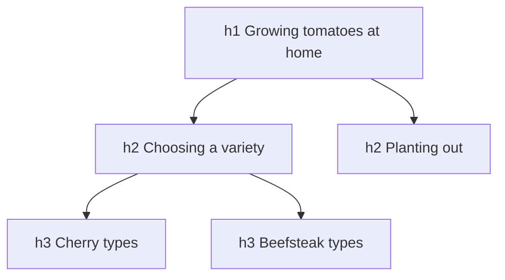

# Marking up text: headings, paragraphs and inline meaning

> **Before this lesson:** you should know what elements, tags and attributes are, and what the DOM is ([How web pages work](#/lesson/html-css/how-pages-work)).

## In plain words

**Marking up text** means wrapping pieces of writing in HTML elements that say what each piece *is*: a heading, a paragraph, a quotation, an important warning.

Picture a student going through a textbook with a set of highlighters and sticky tabs, each colour with an agreed meaning: yellow for chapter titles, pink for definitions, a tab for "quote this". Anyone who knows the colour code can find things quickly without reading every word. HTML's text elements are that colour code, and the readers who rely on it include search engines, **screen readers** (programs that read pages aloud for people who cannot see the screen) and other developers.

Choosing the right element for each piece of text is the everyday substance of writing HTML. It costs nothing extra, and it is one of the first things an interviewer or code reviewer notices.

## Why it is worth learning properly

Most of the web is words. Before a designer chooses a typeface or a developer writes a media query, somebody has to decide which words are headings, which are quotations, which deserve emphasis and which are a keyboard shortcut. Those decisions are made in HTML, and they travel with the content into places your CSS never reaches: search results, reader modes, voice assistants, translation tools and screen readers.

HTML's text elements fall into two families. **Structural** elements describe how a document is organised: headings, paragraphs, block quotations. **Semantic inline** elements add meaning to a few words inside a block: emphasis, citations, abbreviations, code. This lesson walks through both, with the rule of thumb that applies to all of them: *choose the element that states what the text is, and let CSS decide what it looks like.*

## Headings create an outline

There are six heading levels, `<h1>` to `<h6>`. Think of them as the entries of a table of contents rather than as six font sizes.

```html-run
<!doctype html>
<html lang="en">
<head><meta charset="utf-8"><title>Headings</title>
<style> body { font-family: system-ui, sans-serif; } </style></head>
<body>
  <h1>Growing tomatoes at home</h1>
  <p>A beginner's guide to a reliable summer crop.</p>
  <h2>Choosing a variety</h2>
  <h3>Cherry types</h3>
  <p>Small, sweet and quick to ripen.</p>
  <h3>Beefsteak types</h3>
  <p>Large fruit that needs a long, warm season.</p>
  <h2>Planting out</h2>
  <p>Wait until the last frost has passed.</p>
</body>
</html>
```

That page has the outline below. A screen-reader user can pull up exactly this list and jump straight to "Planting out"; surveys of screen-reader users consistently find that navigating by headings is the most common way they explore a page.



Rules that keep the outline useful:

- **One `<h1>` per page**, naming the page's main subject. It normally echoes the `<title>`.
- **Do not skip levels on the way down.** After an `h2`, the next deeper heading is an `h3`, not an `h4`. Going back up (from `h4` to `h2`) is fine; that only starts a new section.
- **Never pick a level for its size.** If the design wants a small top-level heading, keep the `h1` and change `font-size`.
- **A heading labels content that follows it.** A tagline or decorative slogan is not a heading; use a `<p>`.

> [!WARNING]
> The HTML standard once described an "outline algorithm" in which an `<h1>` nested inside `<section>` would automatically count as a lower level. No browser or screen reader ever implemented it, and it has been removed from the standard. Heading *numbers* are what assistive technology uses, so nest your levels by hand.

## Paragraphs and line breaks

`<p>` marks a paragraph: one unit of prose. Browsers put vertical margin between paragraphs by default.

`<br>` forces a line break *inside* a block. It is correct only when the break is part of the content, as in a postal address or a poem. If you find yourself writing `<br><br>` to create a gap, you want two paragraphs or a CSS margin instead.

`<hr>` represents a **thematic break**: a change of scene in a story, or a shift of topic. Browsers draw a horizontal rule, but its meaning is the change of topic, not the line.

```html-run
<!doctype html>
<html lang="en">
<head><meta charset="utf-8"><title>Breaks</title></head>
<body>
  <p>Send seed orders to:</p>
  <p>Hilltop Nursery<br>
     4 Orchard Lane<br>
     Little Marsh</p>
  <hr>
  <p>On a different subject entirely, the greenhouse reopens in April.</p>
</body>
</html>
```

## Emphasis and importance, versus mere styling

Four elements produce bold or italic text by default. They are not interchangeable.

| Element | Meaning | Default look | Use it for |
|---|---|---|---|
| `<em>` | Stress emphasis; changes how a sentence is read aloud | italic | "I *did* water them" |
| `<strong>` | Strong importance, seriousness or urgency | bold | Warnings, the key phrase of an instruction |
| `<i>` | Text in a different voice or mood, with no extra emphasis | italic | Foreign words, species names, thoughts, technical terms |
| `<b>` | Text to draw attention to, with no extra importance | bold | Keywords in a summary, product names in a review |

The test: read the sentence aloud. If your voice would stress the word, use `<em>`. If the reader must not miss it, `<strong>`. If it is only conventional typography (a Latin plant name), `<i>`. If you only want something to look heavier for design reasons and it carries no special status, that is a job for a `<span>` with a class, or for CSS on an existing element.

```html-run
<!doctype html>
<html lang="en">
<head><meta charset="utf-8"><title>Emphasis</title></head>
<body>
  <p>Water the plants <em>before</em> the sun is high, not after.</p>
  <p><strong>Warning:</strong> tomato leaves are toxic to pets.</p>
  <p>The cultivated tomato is <i lang="la">Solanum lycopersicum</i>.</p>
  <p>You will need: <b>canes</b>, <b>twine</b> and <b>a trowel</b>.</p>
  <p>Old price <s>£4.00</s> now £3.20. <small>Offer ends Friday.</small></p>
  <p>The date <del>12 May</del> <ins>19 May</ins> has changed.</p>
</body>
</html>
```

That example also shows four relatives:

- `<s>` is content that is no longer accurate or relevant (a superseded price).
- `<del>` and `<ins>` record an edit to the document: text removed and text added. Both accept a `datetime` attribute.
- `<small>` is for side comments and legal small print, not for generic small text.

`<u>` exists as well, for "non-textual annotation" such as marking a misspelling. Because underlined text looks like a link, avoid it in ordinary prose.

> [!INTERVIEW]
> "Difference between `<strong>` and `<b>`, or `<em>` and `<i>`?" The first of each pair carries meaning (importance, stress emphasis) that assistive technology may convey; the second is a typographic convention with no added weight. Neither should be chosen merely to get bold or italic; that is what `font-weight` and `font-style` are for.

## Quotations and citations

- `<blockquote>` holds an extended quotation that stands as its own block. Its optional `cite` attribute holds the URL of the source (not shown to users).
- `<q>` is a short inline quotation. The browser adds the quotation marks for you, choosing the style from the page's language, so do not type your own.
- `<cite>` marks the *title of a work*: a book, film, article, song. It is not for a person's name.

```html-run
<!doctype html>
<html lang="en">
<head><meta charset="utf-8"><title>Quotes</title>
<style>
  blockquote { border-left: 4px solid #2e7d32; margin-left: 0; padding-left: 1rem; color: #333; }
</style></head>
<body>
  <p>The seed packet says <q>sow under glass from February</q>, which is optimistic.</p>
  <figure>
    <blockquote cite="https://example.org/almanac">
      <p>A gardener learns more from one failed crop than from ten that went to plan.</p>
    </blockquote>
    <figcaption>From <cite>The Patient Almanac</cite></figcaption>
  </figure>
  <p lang="fr">Elle a dit <q>à demain</q>.</p>
</body>
</html>
```

Wrapping a `blockquote` in `<figure>` with a `<figcaption>` is the recommended pattern for attributing a quotation. Notice that the French paragraph receives guillemets automatically because of its `lang` attribute.

## Abbreviations, definitions and addresses

```html-run
<!doctype html>
<html lang="en">
<head><meta charset="utf-8"><title>Terms</title>
<style> abbr[title] { text-decoration: underline dotted; cursor: help; } </style></head>
<body>
  <p>Check the soil <abbr title="potential of hydrogen">pH</abbr> before planting.</p>
  <p><dfn>Pricking out</dfn> means moving seedlings into their own pots once
     the first true leaves appear.</p>
  <address>
    Questions? Write to <a href="mailto:grow@example.org">grow@example.org</a>.
  </address>
</body>
</html>
```

- `<abbr>` marks an abbreviation or acronym. A `title` gives the expansion as a hover tooltip, but tooltips are invisible on touch screens and to keyboard users, so spell the term out in the text the first time it appears and treat `title` as a bonus.
- `<dfn>` marks the *defining instance* of a term: the place where it is explained.
- `<address>` gives contact information for the nearest `article` or for the whole page. It is not for arbitrary postal addresses that merely appear in the content.

## Code, keyboard input and machine-readable values

Technical writing has its own inline vocabulary.

| Element | For |
|---|---|
| `<code>` | A fragment of computer code |
| `<pre>` | Preformatted text: whitespace and line breaks are preserved |
| `<kbd>` | Keys or other input the user should enter |
| `<samp>` | Sample output from a program |
| `<var>` | A variable in maths or programming |
| `<sub>`, `<sup>` | Subscript and superscript where they carry meaning (H₂O, x²) |
| `<time>` | A date or time, with a machine-readable `datetime` |
| `<data>` | Any content with a machine-readable `value` |
| `<mark>` | Text highlighted for relevance, like a search hit |

```html-run
<!doctype html>
<html lang="en">
<head><meta charset="utf-8"><title>Technical text</title>
<style>
  pre { background: #f3f3f3; padding: .75rem; border-radius: 6px; overflow: auto; }
  kbd { border: 1px solid #999; border-bottom-width: 3px; border-radius: 4px; padding: 0 .3em; }
</style></head>
<body>
  <p>Save with <kbd>Ctrl</kbd> + <kbd>S</kbd>, then run <code>npm test</code>.</p>
<pre><code>function area(r) {
  return Math.PI * r * r;
}</code></pre>
  <p>The program prints <samp>Area: 78.54</samp> when <var>r</var> = 5.</p>
  <p>Water is H<sub>2</sub>O and the area is πr<sup>2</sup>.</p>
  <p>Sow by <time datetime="2025-03-21">the spring equinox</time>.</p>
  <p>Searching for "frost": wait until the last <mark>frost</mark> has passed.</p>
</body>
</html>
```

A multi-line code listing is conventionally written as `<pre><code>…</code></pre>`: `pre` preserves the layout and `code` supplies the meaning. Remember to escape `<` and `&` inside it.

The `<time>` element deserves a second look. People write dates in endless ways ("next Tuesday", "3/4/25", "the spring equinox"). The `datetime` attribute pins the meaning down in ISO 8601 form (`2025-03-21`, `14:30`, `2025-03-21T14:30+01:00`, or a duration like `PT45M`) so that calendars, search engines and scripts can use it.

## The generic pair: `div` and `span`

Two elements mean nothing at all. `<div>` is a generic block-level container and `<span>` a generic inline one. They exist so you have something to attach a class or script to when no meaningful element fits.

```html
<p>Total: <span class="price">£12.40</span></p>
<div class="callout">
  <p>Greenhouse closed on Mondays.</p>
</div>
```

Reach for them last. Before typing `<div>`, ask whether the content is really a `nav`, a `section`, a `button`, a list or a `figure`. Markup made only of divs is nicknamed "div soup": it works visually but tells machines nothing.

## Block versus inline, briefly

You have now seen elements that start on a new line and stretch across the container (`h1`, `p`, `blockquote`, `pre`, `div`) and elements that flow within a line of text (`em`, `strong`, `a`, `code`, `span`). Traditionally these were called **block-level** and **inline** elements.

Modern HTML separates two ideas that this vocabulary blurred:

- The **content model** (an HTML matter) decides what may be nested where. A `p` accepts only phrasing content; a `div` accepts flow content.
- The **display type** (a CSS matter) decides how a box is laid out. You can set `display: block` on a `span`, but that never makes it legal to put a `div` inside a `p`.

```html-run
<!doctype html>
<html lang="en">
<head><meta charset="utf-8"><title>Block and inline</title>
<style>
  p, div { outline: 2px dashed #1565c0; margin: 8px 0; }
  em, span, a { outline: 2px solid #ef6c00; }
</style></head>
<body>
  <div>A div is block-level: it takes the full width.</div>
  <p>A paragraph is block-level too, while <em>em</em>, <span>span</span> and
     <a href="#">links</a> sit inline and are only as wide as their content.</p>
</body>
</html>
```

## Language and direction

Set the page language once on `<html lang="…">`, then mark any passage in another language with its own `lang`. This affects pronunciation by screen readers, spell-checking, hyphenation, quotation marks produced by `<q>` and font selection for scripts such as Chinese and Japanese.

For right-to-left scripts add `dir="rtl"`. When inserting user-supplied text whose direction you cannot predict (a username, for instance), wrap it in `<bdi>` so that it cannot scramble the surrounding punctuation.

> [!TIP]
> To check a page's heading structure, open developer tools and run `[...document.querySelectorAll('h1,h2,h3,h4,h5,h6')].map(h => h.tagName + ' ' + h.textContent)` in the Console. The list it prints should read like a sensible table of contents.

## Pitfalls

- **Headings chosen by size.** The outline becomes nonsense. Fix the level, then fix the size with CSS.
- **Several `h1` elements or none.** Users lose the single clear statement of what the page is about.
- **`<br>` for spacing.** Spacing is presentation; use margins or separate paragraphs.
- **Typing quotation marks inside `<q>`.** You get doubled marks.
- **`<cite>` around a person's name.** It is for titles of works.
- **Relying on `title` tooltips.** They do not appear on touch devices and are unreliable in screen readers.
- **Bold as a fake heading.** `<p><strong>Planting out</strong></p>` looks like a heading but is absent from the outline.
- **`<blockquote>` for indentation.** A screen reader announces a quotation that is not one.
- **Dates only as prose.** Add `<time datetime>` when the date matters to machines (events, publication dates).

## Cheat sheet

| Need | Element |
|---|---|
| Page title in content | `<h1>` (one per page) |
| Section headings | `<h2>`–`<h6>`, no skipped levels going down |
| Prose | `<p>` |
| Line break that is part of the content | `<br>` |
| Change of topic | `<hr>` |
| Spoken stress | `<em>` |
| Importance or urgency | `<strong>` |
| Alternate voice, foreign term | `<i>` (with `lang` if foreign) |
| Attention without importance | `<b>` |
| Long quotation | `<blockquote>` (+ `figure`/`figcaption` for the source) |
| Short quotation | `<q>` (marks added automatically) |
| Title of a work | `<cite>` |
| Abbreviation | `<abbr title="…">` |
| Code / keys / output | `<code>`, `<pre>`, `<kbd>`, `<samp>` |
| Date or time | `<time datetime="2025-03-21">` |
| Edits | `<del>`, `<ins>`; no longer accurate: `<s>` |
| No suitable element | `<div>` (block), `<span>` (inline) |

## Summary

Text markup is a set of small, precise claims about content. Headings build the outline that people and machines use to navigate, so their levels must reflect structure rather than size. Paragraphs carry prose; `br` and `hr` are for breaks that belong to the content. Inline elements distinguish stress from importance from mere typographic convention, mark quotations and titles, expand abbreviations and expose dates in a form software can read. When nothing fits, `div` and `span` give you neutral hooks. The appearance of all of these is entirely adjustable with CSS, which is exactly why the choice of element should be about meaning alone.

## Glossary

| Term | Meaning |
|---|---|
| Heading | A title for a section, written with `<h1>` to `<h6>`; the number is its level in the outline |
| Document outline | The table-of-contents-like structure formed by a page's headings |
| Paragraph | A block of prose, written with `<p>` |
| Semantic | Carrying meaning about what the content is, as opposed to how it looks |
| Inline element | An element that sits inside a line of text, such as `<em>` or `<a>` |
| Block-level element | An element that starts on a new line and spans the available width, such as `<p>` |
| Emphasis | Stress that changes the sense of a sentence, marked with `<em>` |
| Screen reader | Software that reads a page aloud and lets the user navigate by headings, links and landmarks |
| Phrasing content | Text and the inline elements allowed inside a paragraph |
| `div` / `span` | Generic containers with no meaning: block-level and inline respectively |
| ISO 8601 | The international date and time format used in `datetime`, for example `2025-03-21` |
| User-agent style sheet | The browser's built-in default styling for each element |

## Check yourself

```quiz
[
  {"q": "A designer wants the page's main title to be small and grey. What should you write?", "options": ["An h4, because it is small by default", "A p with a class", "An h1, restyled with CSS", "A small element"], "answer": 2,
   "explain": "Heading level expresses structure. The main title is the h1 regardless of its visual size; CSS controls the look."},
  {"q": "Which heading sequence is a problem for the document outline?", "options": ["h1, h2, h3, h2", "h1, h2, h2, h3", "h1, h3, h4", "h1, h2, h3, h4, h2"], "answer": 2,
   "explain": "Jumping from h1 to h3 skips a level on the way down. Returning to a higher level later is normal."},
  {"q": "What does this render? <p>She said <q>hello</q>.</p>", "options": ["She said hello. with no quotation marks", "She said followed by hello in italics", "She said “hello”. with browser-added quotation marks", "A block quotation on its own line"], "answer": 2,
   "explain": "The q element is inline and the browser inserts language-appropriate quotation marks around its content."},
  {"q": "Which element fits the scientific name in: The oak (Quercus robur) is common here?", "options": ["em", "strong", "i", "cite"], "answer": 2,
   "explain": "Taxonomic names are conventionally italic without spoken stress, which is exactly the role of i. Add a lang attribute for the Latin."},
  {"q": "What is the role of the datetime attribute on a time element?", "options": ["It formats the date for the user's locale", "It supplies a machine-readable value for the visible text", "It makes the browser show a date picker", "It is required for validation"], "answer": 1,
   "explain": "The visible text can be anything human-friendly; datetime gives software an unambiguous ISO 8601 value."},
  {"q": "Why is <p>Line one<br><br>Line two</p> poor practice?", "options": ["br is deprecated", "Two paragraphs are being faked with breaks; spacing should come from separate p elements or CSS", "br cannot be used inside p", "It fails to render in some browsers"], "answer": 1,
   "explain": "br is for line breaks that are part of the content such as addresses. Gaps between blocks of prose are paragraphs, spaced with margins."},
  {"q": "A span is given display: block in CSS. Can it now validly contain a div?", "options": ["Yes, it is block-level now", "No, content rules are defined by HTML and are unaffected by CSS", "Only in standards mode", "Yes, but only one div"], "answer": 1,
   "explain": "CSS display changes layout, not the HTML content model. A span still accepts only phrasing content."}
]
```

> **Source:** Duckett, *HTML & CSS*, ch. 2 (Text). MDN: https://developer.mozilla.org/en-US/docs/Web/HTML/Reference/Elements/Heading_Elements · https://developer.mozilla.org/en-US/docs/Web/HTML/Reference/Elements/em · https://developer.mozilla.org/en-US/docs/Web/HTML/Reference/Elements/time
