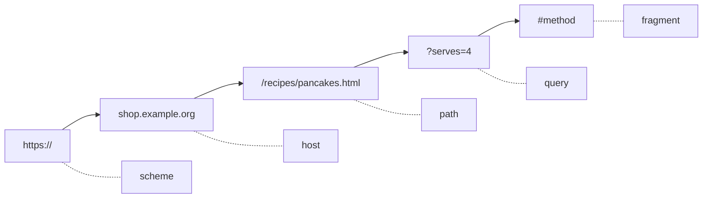

# Lists and links

> **Before this lesson:** you should be able to write elements with attributes and know block from inline elements ([How web pages work](#/lesson/html-css/how-pages-work), [Marking up text](#/lesson/html-css/text-markup)).

## In plain words

A **list** groups related items so that people and programs can see they belong together and count them. A **link** (short for **hyperlink**) is a piece of text or an image that takes you to another place when you activate it.

A shopping list on the fridge and the numbered steps in a flat-pack furniture manual are the two kinds of list you already know: one where order does not matter and one where it does. Links are like the signposts in a town: each one names a destination and points the way. A town with no signposts would be a collection of buildings; a set of pages with no links would not be a web.

Navigation menus, tables of contents, search results and product listings are all lists of links. Writing them correctly is basic professional competence, and the difference between a link and a button is a classic interview question.

## Why it is worth learning properly

Two ideas turned plain documents into the web. **Lists** give groups of related items a structure that software can count and navigate. **Links** connect one document to another, and without them there would be no "web" at all. Both look trivial, and both are routinely misused: lists get replaced by rows of `div`s, and links get replaced by clickable `span`s that no keyboard can reach. This lesson shows how to use each properly and why the proper way pays off.

## Three kinds of list

| List | Element | Items | When the order... |
|---|---|---|---|
| Unordered | `<ul>` | `<li>` | does not matter (ingredients, features, navigation links) |
| Ordered | `<ol>` | `<li>` | matters (steps, rankings, legal clauses) |
| Description | `<dl>` | `<dt>` + `<dd>` | is irrelevant; items are name/value pairs |

A quick test for ordered versus unordered: shuffle the items. If the meaning changes, it is an `ol`.

```html-run
<!doctype html>
<html lang="en">
<head><meta charset="utf-8"><title>Lists</title>
<style> body { font-family: system-ui, sans-serif; } </style></head>
<body>
  <h2>Pancake ingredients</h2>
  <ul>
    <li>200 g plain flour</li>
    <li>2 eggs</li>
    <li>400 ml milk</li>
  </ul>
  <h2>Method</h2>
  <ol>
    <li>Whisk the flour and eggs together.</li>
    <li>Add the milk a little at a time.</li>
    <li>Rest the batter for twenty minutes.</li>
    <li>Fry in a hot, lightly oiled pan.</li>
  </ol>
</body>
</html>
```

Why bother, when you could type dashes and line breaks? Because a real list announces itself. A screen reader says "list, four items" and lets the user skip the whole thing or step through it. Browsers number ordered lists for you, so inserting a step never requires renumbering. And CSS can target `li` elements to restyle the list as tabs, cards, a menu or a timeline.

### Controlling numbering

`<ol>` has three attributes that affect the *meaning* of the numbering (the visual style of the marker belongs to CSS):

- `start="5"` begins counting at 5.
- `reversed` counts down.
- `type="a"` (also `A`, `i`, `I`, `1`) chooses letters or roman numerals when the kind of label matters, as in a legal document where a clause is cited as "3(b)".

An individual `<li value="10">` can also jump the counter.

```html-run
<!doctype html>
<html lang="en">
<head><meta charset="utf-8"><title>Numbering</title></head>
<body>
  <h3>Top three, counting down</h3>
  <ol reversed>
    <li>Bronze: lemon and sugar</li>
    <li>Silver: maple syrup</li>
    <li>Gold: banana and chocolate</li>
  </ol>
  <h3>Continued from the previous page</h3>
  <ol start="5" type="a">
    <li>Flip when bubbles appear.</li>
    <li>Cook the second side for one minute.</li>
  </ol>
</body>
</html>
```

### Nesting lists

A sub-list goes **inside an `<li>`** of the outer list, never directly inside the `ul` or `ol`. The only permitted children of a list are list items.

```html-run
<!doctype html>
<html lang="en">
<head><meta charset="utf-8"><title>Nested lists</title></head>
<body>
  <ul>
    <li>Sweet toppings
      <ul>
        <li>Honey</li>
        <li>Berries
          <ul><li>Blueberries</li><li>Raspberries</li></ul>
        </li>
      </ul>
    </li>
    <li>Savoury toppings
      <ol><li>Cheese</li><li>Mushrooms</li></ol>
    </li>
  </ul>
</body>
</html>
```

Browsers change the bullet at each depth (disc, circle, square) purely as a default style.

### Description lists

A `<dl>` pairs terms (`<dt>`) with descriptions (`<dd>`). It suits glossaries, metadata ("Author: …, Published: …"), FAQ-style question and answer pairs and product specifications. One term may have several descriptions and several terms may share one description. For styling, each group may be wrapped in a `<div>`.

```html-run
<!doctype html>
<html lang="en">
<head><meta charset="utf-8"><title>Description list</title>
<style>
  dl { display: grid; grid-template-columns: max-content 1fr; gap: .4rem 1rem; }
  dt { font-weight: bold; }
  dd { margin: 0; }
</style></head>
<body>
  <dl>
    <dt>Prep time</dt><dd>10 minutes</dd>
    <dt>Resting time</dt><dd>20 minutes</dd>
    <dt>Serves</dt><dd>4 people</dd>
    <dt>Crêpe</dt><dt>Pancake</dt><dd>A thin cake of fried batter.</dd>
  </dl>
</body>
</html>
```

> [!TIP]
> A site's navigation is a list of links, so the conventional markup is `<nav><ul><li><a>…</a></li>…</ul></nav>`. Removing the bullets with `list-style: none` is a visual choice; the list structure remains for assistive technology. (Safari's VoiceOver drops list semantics when the marker is removed; adding `role="list"` to the `ul` restores them where that matters.)

## Links: the anchor element

A link is an `<a>` element with an `href` (hypertext reference) attribute. The content between the tags is the **link text**; the `href` is the destination.

```html
<a href="https://developer.mozilla.org/">MDN Web Docs</a>
```

### Reading a URL



- **Scheme**: the protocol, almost always `https`.
- **Host**: the domain name of the server.
- **Path**: which resource on that server, written like a folder path.
- **Query**: optional parameters after `?`.
- **Fragment**: after `#`, the `id` of an element *within* the page to scroll to. It is never sent to the server.

### Absolute and relative URLs

An **absolute URL** includes the scheme and host and works from anywhere. Use it for other people's sites.

A **relative URL** leaves parts out and is resolved against the address of the current page. Use it within your own site, so that links keep working when you move between a local folder, a staging server and the live domain.

Suppose the current page is `https://example.org/recipes/breakfast/pancakes.html`:

| You write | It resolves to | Meaning |
|---|---|---|
| `waffles.html` | `/recipes/breakfast/waffles.html` | Same folder |
| `./waffles.html` | `/recipes/breakfast/waffles.html` | Same folder, explicit |
| `toppings/sweet.html` | `/recipes/breakfast/toppings/sweet.html` | Child folder |
| `../dinner/stew.html` | `/recipes/dinner/stew.html` | Up one level, then down |
| `../../index.html` | `/index.html` | Up two levels |
| `/about.html` | `/about.html` | **Root-relative**: starts at the site root |
| `#method` | same page, element with `id="method"` | Fragment only |
| `//cdn.example.net/x.js` | `https://cdn.example.net/x.js` | Protocol-relative; rarely needed now |

A folder URL such as `/recipes/` usually serves that folder's `index.html`, which is why home pages are named `index.html`.

### Linking within a page

Give the target element an `id`, then link to `#that-id`. Ids must be unique in the document and should contain no spaces.

```html-run
<!doctype html>
<html lang="en">
<head><meta charset="utf-8"><title>Fragment links</title>
<style>
  html { scroll-behavior: smooth; }
  section { min-height: 260px; padding: 1rem; border-top: 3px solid #6a1b9a; }
  :target { background: #f3e5f5; }
</style></head>
<body>
  <nav>
    <a href="#ingredients">Ingredients</a> ·
    <a href="#method">Method</a> ·
    <a href="#tips">Tips</a>
  </nav>
  <section id="ingredients"><h2>Ingredients</h2><p>Flour, eggs, milk.</p></section>
  <section id="method"><h2>Method</h2><p>Whisk, rest, fry.</p></section>
  <section id="tips"><h2>Tips</h2><p>The first pancake never works.</p>
    <p><a href="#">Back to top</a></p></section>
</body>
</html>
```

The CSS `:target` pseudo-class matches the element whose id equals the current fragment, which makes a handy highlight. A link to another page can also carry a fragment: `faq.html#delivery`.

### Other kinds of destination

```html-run
<!doctype html>
<html lang="en">
<head><meta charset="utf-8"><title>Link types</title></head>
<body>
  <ul>
    <li><a href="mailto:hello@example.org?subject=Pancake%20question">Email the kitchen</a></li>
    <li><a href="tel:+441632960123">Call 01632 960123</a></li>
    <li><a href="data:text/plain,One%20cup%20flour" download="recipe.txt">Download the recipe</a></li>
    <li><a href="https://developer.mozilla.org/" target="_blank" rel="noopener">MDN (opens in a new tab)</a></li>
  </ul>
</body>
</html>
```

- `mailto:` opens the user's mail program; `?subject=` and `&body=` pre-fill fields (spaces encoded as `%20`).
- `tel:` starts a phone call on devices that can. Write the number in international format.
- `download` asks the browser to save the resource rather than navigate to it, optionally with a suggested filename. It is honoured for same-origin URLs and for `data:`/`blob:` URLs.
- `target="_blank"` opens a new tab.

> [!WARNING]
> Opening new tabs takes control away from the user and breaks the Back button. Use `target="_blank"` sparingly, say so in the link text, and add `rel="noopener"` so the new page cannot script the one that opened it. Modern browsers imply `noopener` for `_blank`, but writing it protects older ones and documents your intent.

The `rel` attribute describes the relationship between the two documents. Useful values on links include `noopener`, `noreferrer` (also hides the referring URL), `nofollow` (tells search engines not to treat the link as an endorsement), and `external`.

## Writing good link text

Screen-reader users often list every link on a page out of context. Search engines treat link text as a description of the target. Both are defeated by a page whose links all say "click here".

| Weak | Better |
|---|---|
| To see our opening hours, `click here`. | See our `opening hours`. |
| `Read more` | `Read more about sourdough starters` |
| `https://example.org/files/menu-v3-final.pdf` | `Spring menu (PDF, 240 KB)` |

Guidelines: the text should make sense on its own, be specific to its destination, mention the file type and size when it is not a web page, and be the same wherever it points to the same place.

## Link states and styling hooks

A link can be in several states, each with a CSS pseudo-class:

| Pseudo-class | Matches when |
|---|---|
| `:link` | Unvisited link with an `href` |
| `:visited` | Destination is in the browser history |
| `:hover` | Pointer is over it |
| `:focus` / `:focus-visible` | It has keyboard focus |
| `:active` | It is being pressed |

When you style several of them, write the rules in the order **L**ink, **V**isited, **H**over, **F**ocus, **A**ctive, because they have equal specificity and later rules win.

```html-run
<!doctype html>
<html lang="en">
<head><meta charset="utf-8"><title>Link states</title>
<style>
  body { font-family: system-ui, sans-serif; }
  a:link    { color: #0b57d0; }
  a:visited { color: #6a1b9a; }
  a:hover   { text-decoration-thickness: 3px; }
  a:focus-visible { outline: 3px solid #f9a825; outline-offset: 2px; }
  a:active  { color: #b3261e; }
</style></head>
<body>
  <p>Tab to these links and hover over them:
     <a href="#one">first</a>, <a href="#two">second</a>, <a href="#three">third</a>.</p>
</body>
</html>
```

For privacy, browsers restrict `:visited` styling to a few colour properties so that a site cannot detect your browsing history.

## Links versus buttons

This distinction is a favourite of code reviewers.

- A **link** goes somewhere: it changes the URL. Use `<a href>`.
- A **button** does something on the current page: submit, open a menu, toggle a setting. Use `<button>`.

An `<a>` without `href` is not focusable and is not announced as a link. A `<div onclick>` is neither focusable nor operable by keyboard. Using the right element gives you focus, Enter/Space activation, middle-click, "copy link address" and correct announcements for free.

> [!INTERVIEW]
> "When would you use `<a>` versus `<button>`?" Navigation to a URL (including a fragment) is a link; an in-page action is a button. If it should work with "open in new tab", it is a link.

## Pitfalls

- **Sub-list placed between `<li>` elements.** It must sit inside the `li` it belongs to.
- **Using `ol` with `list-style: none` and typed numbers.** Let the browser number; restyle markers with CSS.
- **`<a href="#">` used as a button.** It jumps to the top of the page and adds a history entry. Use `<button type="button">`.
- **Spaces or duplicate values in `id`.** Fragment links then hit the wrong element or none.
- **Relative link broken by moving a file.** Root-relative paths (`/css/site.css`) are more robust on a real server, though they fail when a page is opened directly from disk.
- **Bare "click here" or "more".** Meaningless out of context.
- **Removing underlines and relying on colour alone.** Roughly one man in twelve has a colour-vision deficiency. Keep the underline in body text.
- **Wrapping a button inside a link (or the reverse).** Interactive elements must not be nested.

## Cheat sheet

| Task | Markup |
|---|---|
| Bulleted list | `<ul><li>…</li></ul>` |
| Numbered list | `<ol><li>…</li></ol>`; `start`, `reversed`, `type` |
| Name/value pairs | `<dl><dt>term</dt><dd>description</dd></dl>` |
| Nested list | Put the inner `ul`/`ol` inside an `li` |
| External link | `<a href="https://…">text</a>` |
| Same-site link | relative (`../x.html`) or root-relative (`/x.html`) |
| Jump within page | `<a href="#id">` + `id="id"` on the target |
| Email / phone | `href="mailto:…"`, `href="tel:+44…"` |
| New tab | `target="_blank" rel="noopener"` (use rarely) |
| Download | `download` or `download="name.ext"` |
| State styling order | `:link`, `:visited`, `:hover`, `:focus`, `:active` |

## Summary

Use `ul` when order is irrelevant, `ol` when it matters and `dl` for term/description pairs; nest lists inside list items; leave the marker style to CSS. Links are `a` elements with an `href` that may be absolute, relative, root-relative or only a fragment, and may also start an email, a call or a download. Good link text describes the destination by itself. Keep links for navigation and buttons for actions, and both will be keyboard-accessible without extra work.

## Glossary

| Term | Meaning |
|---|---|
| Unordered list | A list whose order does not matter, written with `<ul>` |
| Ordered list | A numbered list whose order matters, written with `<ol>` |
| List item | One entry in a list, written with `<li>` |
| Description list | Pairs of terms (`<dt>`) and descriptions (`<dd>`) inside `<dl>` |
| Hyperlink | An `<a>` element with an `href` that leads to another resource |
| URL | Uniform Resource Locator: the address of a page or file |
| Absolute URL | A complete address including the scheme and host |
| Relative URL | An address written relative to the current page |
| Fragment | The part of a URL after `#`, naming an element id to scroll to |
| Scheme | The first part of a URL, such as `https`, `mailto` or `tel` |
| Link text | The words between `<a>` and `</a>` that the user reads and activates |
| Pseudo-class | A CSS keyword such as `:hover` that selects an element in a particular state |

## Check yourself

```quiz
[
  {"q": "Which list element fits the steps for assembling a bookcase?", "options": ["ul", "ol", "dl", "A series of p elements"], "answer": 1,
   "explain": "The order of the steps matters, so it is an ordered list."},
  {"q": "The current page is /blog/2025/post.html. Where does href='../about.html' lead?", "options": ["/about.html", "/blog/about.html", "/blog/2025/about.html", "/blog/2025/post/about.html"], "answer": 1,
   "explain": "The page is in /blog/2025/. Two dots go up one folder to /blog/, so the result is /blog/about.html."},
  {"q": "What does this render? <ol start='3' reversed><li>A</li><li>B</li><li>C</li></ol>", "options": ["1. A 2. B 3. C", "3. A 4. B 5. C", "3. A 2. B 1. C", "C B A numbered 1 to 3"], "answer": 2,
   "explain": "The items stay in source order; only the numbers count down, starting from the start value 3."},
  {"q": "Where must a nested ul be placed?", "options": ["Directly inside the outer ul, between two li elements", "Inside an li of the outer list", "After the outer list closes", "Inside a div inside the ul"], "answer": 1,
   "explain": "The only valid children of ul and ol are li elements, so the sub-list belongs inside the relevant li."},
  {"q": "What part of https://a.example/p?x=1#top is never sent to the server?", "options": ["The path /p", "The query x=1", "The fragment top", "The host"], "answer": 2,
   "explain": "The fragment is handled entirely by the browser, which scrolls to the element with that id."},
  {"q": "A control opens a settings panel on the same page without changing the URL. Which element?", "options": ["a href='#'", "button type='button'", "div with a click handler", "span with tabindex"], "answer": 1,
   "explain": "It performs an action rather than navigating, so it is a button. Buttons are focusable and respond to Enter and Space by default."},
  {"q": "Why add rel='noopener' to a link with target='_blank'?", "options": ["It makes the link open faster", "It stops the new page from accessing the opener through window.opener", "It hides the link from search engines", "It is required for the link to open a new tab"], "answer": 1,
   "explain": "Without it, older browsers let the opened page script or redirect the original tab. Modern browsers apply noopener by default, but being explicit is safest."}
]
```

> **Source:** Duckett, *HTML & CSS*, ch. 3 (Lists) and ch. 4 (Links). MDN: https://developer.mozilla.org/en-US/docs/Web/HTML/Reference/Elements/ol · https://developer.mozilla.org/en-US/docs/Web/HTML/Reference/Elements/a · https://developer.mozilla.org/en-US/docs/Learn_web_development/Howto/Web_mechanics/What_is_a_URL
