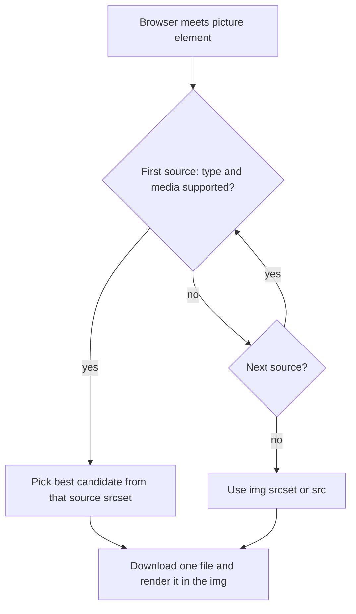

# Images: formats, alt text and responsive delivery

> **Before this lesson:** you should know how attributes work and how URLs are written ([How web pages work](#/lesson/html-css/how-pages-work), [Lists and links](#/lesson/html-css/lists-links)).

## In plain words

An image on a web page is a separate file that the browser downloads and slots into the page at the place where the `` element sits. The HTML does not contain the picture; it contains the picture's *address* and a short *text description* of it.

Think of a museum label beside an empty frame while a painting is away for restoration. The label ("Fishing boats at dawn, oil on canvas") still tells visitors what belongs there. On the web that label is the `alt` text. It is what a blind visitor hears, what appears if the file fails to load, and what a search engine reads.

Images are usually the largest files on a page, so handling them well has more effect on loading speed than almost anything else. Employers expect you to know how to describe images for accessibility, how to stop the page jumping while they load, and how to send small files to small screens.

## Why it is worth learning properly

Images are usually the heaviest thing on a page and often the most important. A product photo sells the product, a chart carries the argument of an article, a logo identifies the site. They are also where pages most often fail: a missing description locks out blind users, a missing size makes the text jump as the picture arrives, and a four-megabyte photograph sent to a phone wastes the visitor's data allowance.

This lesson covers the `` element and its essential attributes, how to write alternative text, how to choose a file format, how to caption a figure, and how `srcset`, `sizes` and `<picture>` let the browser pick the right file for each device.

> The live examples below draw their pictures with inline SVG encoded in `data:` URLs, so they work without any network access. In a real project `src` would point at a file such as `images/harbour.jpg`.

## The `img` element

`` is a void element: no closing tag, no content. Two attributes are effectively mandatory.

```html

```

- **`src`** is the URL of the image file (absolute or relative, exactly like a link's `href`).
- **`alt`** is the text alternative, used when the image cannot be seen.

```html-run
<!doctype html>
<html lang="en">
<head><meta charset="utf-8"><title>img basics</title></head>
<body>
  <p>A working image, then a broken one:</p>
  
  
</body>
</html>
```

The second image fails to load, and the browser shows the `alt` text in its place. That is one of three situations where `alt` matters: a failed or blocked download, a search engine indexing the page, and a screen reader announcing the image to someone who cannot see it.

By default an image is an **inline** element, sitting on the text baseline like a very large letter. That is why a small gap appears beneath an image inside a `div` (room for descenders such as "g" and "y"). Setting `display: block` or `vertical-align: middle` on the image removes it.

## Writing alternative text

Good alt text is a replacement for the image, not a description of the fact that there is an image. Ask: *if I removed this picture and put words in its place, what words would preserve the meaning of the page?*

| Kind of image | What to put in `alt` |
|---|---|
| Informative photo or illustration | A concise statement of what it shows that matters here |
| Image that is the only content of a link or button | The destination or action: `alt="Home"`, `alt="Search"` |
| Chart or diagram | The conclusion it supports, with full data nearby in text or a table |
| Image of text (logo, banner) | The text itself |
| Purely decorative flourish | Empty: `alt=""` |
| Image already fully described by adjacent text | Empty: `alt=""` |

Practical rules:

- Do not start with "Image of" or "Picture of"; the screen reader already says "image".
- Keep it brief, typically under about 150 characters. Long explanations belong in the surrounding text.
- Context decides. The same photo of a dog might be `alt="Bella, our office dog"` on a team page and `alt="A border collie mid-jump catching a frisbee"` in a photography tutorial.
- End with a full stop so the screen reader pauses.

> [!WARNING]
> `alt=""` and a *missing* `alt` are opposites. An empty value tells assistive technology "skip this, it is decoration". A missing attribute tells it nothing, so many screen readers fall back to reading the file name aloud: "image, D S C underscore zero zero four seven dot J P G".

The `title` attribute is not a substitute. It produces a hover tooltip that touch and keyboard users never see.

## Reserve space with `width` and `height`

Always state the image's intrinsic dimensions in pixels:

```html

```

These numbers do not lock the displayed size; CSS still controls that. Their job is to give the browser the **aspect ratio** before the file arrives, so it can reserve a box of the right shape. Without them the image starts at zero height and then pushes everything below it down the page when it loads, an annoyance measured as *Cumulative Layout Shift*.

The standard responsive pattern combines the attributes with two lines of CSS:

```css
img { max-width: 100%; height: auto; }
```

`max-width: 100%` stops the image overflowing a narrow container; `height: auto` keeps the proportions as the width changes.

```html-run
<!doctype html>
<html lang="en">
<head><meta charset="utf-8"><title>Fluid image</title>
<style>
  .column { width: 60%; border: 2px dashed #888; padding: 8px; resize: horizontal; overflow: auto; }
  img { max-width: 100%; height: auto; display: block; }
</style></head>
<body>
  <p>Drag the bottom-right corner of the dashed box to resize it.</p>
  <div class="column">
    
  </div>
</body>
</html>
```

## Choosing a format

| Format | Type | Good at | Notes |
|---|---|---|---|
| JPEG | Lossy raster | Photographs | No transparency; universal support |
| PNG | Lossless raster | Screenshots, flat colour, transparency | Large files for photos |
| GIF | Lossless, 256 colours | Legacy simple animation | Video or animated WebP is far smaller |
| WebP | Lossy or lossless | Most things; transparency and animation | Supported by all current browsers; typically 25–35% smaller than JPEG |
| AVIF | Lossy or lossless | Photographs at very small sizes | Best compression; slower to encode |
| SVG | Vector (XML text) | Logos, icons, diagrams | Sharp at any size; styleable with CSS |

Two axes explain the table. **Raster** images are grids of pixels and blur when enlarged; **vector** images are drawing instructions and scale without loss. **Lossy** compression discards detail the eye is unlikely to miss; **lossless** compression preserves every pixel.

A workable rule: SVG for anything drawn (logos, icons, charts); AVIF or WebP with a JPEG fallback for photographs; PNG when you need exact pixels with transparency. Before upload, resize images to the largest size at which they will actually be displayed (times two for high-density screens) and run them through a compressor.

## Figures and captions

When an image is referred to from the text and has a caption, wrap it in `<figure>` with a `<figcaption>`. The caption is then programmatically tied to the image, and the whole unit can be moved or styled as one.

```html-run
<!doctype html>
<html lang="en">
<head><meta charset="utf-8"><title>Figure</title>
<style>
  figure { margin: 0; max-width: 320px; border: 1px solid #ccc; padding: 10px; }
  figure img { display: block; max-width: 100%; height: auto; }
  figcaption { font: italic .9rem/1.4 Georgia, serif; margin-top: 8px; color: #444; }
</style></head>
<body>
  <figure>
    
    <figcaption>Figure 1. Library visits climbed steadily through the week.</figcaption>
  </figure>
</body>
</html>
```

`alt` and `figcaption` do different jobs: the caption is visible to everyone and adds context; the `alt` stands in for the picture itself. Do not copy one into the other. A `figure` is not limited to pictures; it can hold a code listing, a table or a quotation.

## Responsive images

A single file cannot suit both a 360-pixel-wide phone and a 2560-pixel desktop monitor. Responsive images hand the browser a menu of files and let it choose, because only the browser knows the screen size, pixel density, and network conditions.

### Resolution switching by density: `srcset` with `x`

When the image is always displayed at the same CSS size, offer versions for different pixel densities:

```html

```

A phone with a 2x screen downloads `logo-400.png` and displays it in 200 CSS pixels, so it looks crisp.

### Resolution switching by width: `srcset` with `w` plus `sizes`

When the image's displayed width varies with the layout, describe each file by its real pixel width and tell the browser how wide the image will be on screen:

```html

```

- `srcset` lists candidates as `URL width-descriptor`. `800w` means "this file is 800 pixels wide".
- `sizes` is a list of `media-condition slot-width` pairs, ending with a default. Here: on viewports up to 600 px the image fills the viewport width; otherwise it occupies half of it.
- The browser multiplies the slot width by the device pixel ratio and chooses the smallest candidate that covers it. A 400-px-wide phone at 2x needs 800 device pixels, so it takes `harbour-800.jpg`.
- `src` remains as the fallback for anything that does not understand `srcset`.

`sizes` is needed because the browser starts downloading images *before* it has loaded your CSS, so it cannot yet know the layout width. If you omit `sizes`, it assumes `100vw`.

### Art direction and format fallback: `<picture>`

`<picture>` wraps an `` with one or more `<source>` elements. The browser uses the first source whose conditions it satisfies and otherwise falls back to the `img`.

```html
<picture>
  <source type="image/avif" srcset="harbour.avif">
  <source type="image/webp" srcset="harbour.webp">
  
</picture>
```

That is **format switching**: modern browsers take the AVIF, older ones the JPEG. With the `media` attribute you get **art direction**, a *different crop* for different layouts:

```html
<picture>
  <source media="(max-width: 600px)" srcset="harbour-tall-crop.jpg">
  
</picture>
```

The `alt`, sizes and CSS always go on the inner ``; `picture` and `source` are only selection logic.



> [!INTERVIEW]
> "`srcset` versus `<picture>`?" Use `srcset` (with `sizes`) when it is the *same image at different resolutions* and you are happy for the browser to choose. Use `<picture>` when *you* must decide: a different crop per breakpoint (art direction) or a different file format with fallbacks.

## Loading behaviour

Three attributes tune when and how images are fetched and decoded.

| Attribute | Effect | Use on |
|---|---|---|
| `loading="lazy"` | Defers the download until the image is near the viewport | Images below the fold |
| `loading="eager"` (default) | Downloads immediately | Images visible at first paint |
| `fetchpriority="high"` | Asks for earlier, higher-priority fetching | The single hero image |
| `decoding="async"` | Lets the browser decode off the main thread | Most content images |

```html


```

> [!TIP]
> Never lazy-load the main image at the top of the page. It is usually the *Largest Contentful Paint* element, and delaying it makes the page feel slower. Lazy-load what the user must scroll to reach, and always pair `loading="lazy"` with `width` and `height`.

## Inline SVG

SVG can also be written directly in the HTML. It then becomes part of the DOM: stylable with CSS, scriptable, and needing no extra request.

```html-run
<!doctype html>
<html lang="en">
<head><meta charset="utf-8"><title>Inline SVG</title>
<style>
  svg { width: 120px; height: 120px; }
  .ring { fill: none; stroke: #00897b; stroke-width: 10; transition: stroke .3s; }
  svg:hover .ring { stroke: #e53935; }
</style></head>
<body>
  <svg viewBox="0 0 100 100" role="img" aria-label="Progress: three quarters complete">
    <circle class="ring" cx="50" cy="50" r="40" stroke-dasharray="188 251" transform="rotate(-90 50 50)"/>
    <text x="50" y="56" text-anchor="middle" font-size="20" font-family="sans-serif">75%</text>
  </svg>
  <button type="button">
    <svg viewBox="0 0 24 24" aria-hidden="true" style="width:1em;height:1em">
      <path d="M12 3 2 12h3v8h6v-6h2v6h6v-8h3z" fill="currentColor"/>
    </svg>
    Home
  </button>
</body>
</html>
```

Give a meaningful inline SVG `role="img"` and an `aria-label` (its equivalent of `alt`). Give a decorative one `aria-hidden="true"`, as on the icon beside the visible word "Home".

## Image maps: clickable regions inside one picture

Imagine a floor plan of a shopping centre on a notice board. You tap the bakery and one page opens; you tap the pharmacy and a different one opens. The plan is a single picture, yet different parts of it behave as different links. HTML has a feature for exactly this, called an **image map**.

An image map has three cooperating parts:

1. an `` carrying a `usemap` attribute, whose value is `#` plus a name;
2. a `<map>` element with a matching `name`, which holds the definition (it displays nothing itself);
3. one `<area>` element inside the map for each clickable region.

```html


<map name="floorplan">
  <area shape="rect"   coords="20,30,200,140"  href="/shops/bakery"   alt="Bakery">
  <area shape="circle" coords="420,150,60"     href="/shops/pharmacy" alt="Pharmacy">
  <area shape="poly"   coords="300,10,380,10,340,90" href="/shops/florist" alt="Florist">
</map>
```

The `shape` says what kind of outline to draw and `coords` gives its numbers, counted in pixels from the image's top-left corner. A `rect` takes the left, top, right and bottom edges; a `circle` takes the centre's x and y then the radius; a `poly` (polygon) takes a list of x,y corner points. A `default` shape covers whatever the other areas do not. Each `area` with an `href` needs an `alt`, because it is a link and a link needs a name that a screen reader can announce.

### Why you will rarely write one today

- **The coordinates are fixed pixels.** If CSS shrinks the image on a phone, the picture scales but the `coords` do not, so the clickable regions slide away from what they were meant to cover. Responsive layouts are the normal case now, and image maps fight them. (Scripts that rescale the numbers exist, but that is a lot of machinery for a link.)
- **The regions are invisible.** Sighted mouse users get no hover effect, no focus outline of your own design, and no hint that anything is clickable, unless you add extra work.
- **They are awkward for everyone else.** The alt text of the image describes the picture as a whole while each `area` needs its own text. Keyboard users tab through the regions in source order, so the order of the `area` elements must make sense. Touch targets are often too small.
- **Better tools exist.** The usual replacements are an **inline SVG** (covered above) whose shapes are wrapped in `<a>` elements and scale with the image; absolutely positioned links on top of an image, using percentages; or simply a normal list of links beside the picture, which is the most accessible option of all.

There is also an ancient server-side variant (`ismap`) in which the browser sent the click position to the server. Treat it as history.

Image maps still turn up in old sites, email templates and interview trivia, so recognise the syntax and know the accessibility rules, but reach for SVG first.

> [!NOTE]
> A good accessibility test for any clickable picture is to unplug the mouse. Can you reach every region with Tab, see which one is focused, and hear a meaningful name for it?

## Pitfalls

- **Missing `alt`.** The worst option. Decide between a real description and `alt=""`.
- **Alt text stuffed with keywords.** It hurts users and search engines treat it as spam.
- **No `width`/`height`.** Causes layout shift. Set both, then make the image fluid with CSS.
- **Stretching with mismatched dimensions.** Setting both width and height in CSS to a different ratio squashes the picture; use `height: auto` or `object-fit: cover`.
- **Uploading camera originals.** A 4000-pixel photo displayed at 400 pixels wastes 99% of its bytes.
- **Text baked into images.** It cannot be selected, translated, searched or resized, and it blurs when scaled.
- **`sizes` that does not match the CSS.** The browser trusts it blindly and may fetch a file far too large or too small.
- **Lazy-loading the hero image.** Delays the largest paint.
- **Using `<picture>` where `srcset` suffices.** More markup and no benefit.

## Cheat sheet

| Goal | Markup |
|---|---|
| Basic image | `` |
| Decorative image | `alt=""` |
| Fluid image | `img { max-width: 100%; height: auto; }` |
| Caption | `<figure><figcaption>…</figcaption></figure>` |
| Sharp on hi-DPI at fixed size | `srcset="a.png 1x, a@2x.png 2x"` |
| Width varies with layout | `srcset="… 400w, … 800w"` + `sizes="…"` |
| Modern format with fallback | `<picture><source type="image/avif" …></picture>` |
| Different crop per breakpoint | `<picture><source media="(max-width: 600px)" …>` |
| Below-the-fold image | `loading="lazy" decoding="async"` |
| Hero image | `fetchpriority="high"`, never lazy |
| Icon you want to recolour | Inline `<svg>` with `fill="currentColor"` |

## Summary

Every `img` needs a `src` and a deliberate `alt`: a short replacement for informative images, an empty string for decoration. Intrinsic `width` and `height` let the browser reserve space, and two lines of CSS make images fluid. Pick the format by content type: vectors as SVG, photos as AVIF or WebP with a JPEG fallback. `figure` and `figcaption` attach captions. `srcset` and `sizes` let the browser choose among resolutions, while `picture` lets you dictate crops and formats. Finally, lazy-load what is off screen and prioritise the one image that matters most at first paint.

## Glossary

| Term | Meaning |
|---|---|
| `src` | The attribute holding the address of the image file |
| Alt text | The text alternative in the `alt` attribute, used when the image cannot be seen |
| Decorative image | An image that adds no information; it gets an empty `alt=""` |
| Intrinsic size | The real pixel dimensions of the image file |
| Aspect ratio | The proportion of width to height |
| Layout shift | Content jumping on screen because something loaded late and took up space |
| Raster / vector | An image stored as a grid of pixels / as drawing instructions that scale without blur |
| Lossy / lossless | Compression that discards some detail / keeps every pixel |
| SVG | Scalable Vector Graphics: a text-based vector image format |
| `srcset` / `sizes` | Attributes that offer several image files and describe the display width so the browser can choose |
| Device pixel ratio | How many physical screen dots make one CSS pixel |
| `<picture>` | An element that lets the author choose different images for different conditions or formats |
| Art direction | Supplying a different crop of an image for different layouts |
| Lazy loading | Delaying a download until the image is about to scroll into view |
| Data URL | An address beginning `data:` that contains the file's content itself |
| Image map | A picture in which different regions link to different places, built from `usemap`, `<map>` and `<area>` |
| `<map>` / `<area>` | The element that names an image map / one clickable region inside it, with a `shape`, `coords` and `href` |
| `coords` | The numbers that position a region of an image map, in pixels from the image's top-left corner |

## Check yourself

```quiz
[
  {"q": "A decorative swirl sits between two sections and conveys nothing. What is the correct alt?", "options": ["alt='decorative swirl'", "No alt attribute at all", "alt=''", "alt='image'"], "answer": 2,
   "explain": "An empty alt tells assistive technology to ignore the image. Omitting alt often causes the file name to be read out."},
  {"q": "What is the main benefit of width and height attributes on an img that is resized by CSS?", "options": ["They make the file download faster", "They let the browser reserve the correct aspect ratio before the image loads, avoiding layout shift", "They prevent the image from being resized", "They are required for alt text to work"], "answer": 1,
   "explain": "The attributes give the intrinsic ratio so a correctly shaped box is reserved; CSS still controls the rendered size."},
  {"q": "srcset='a-400.jpg 400w, a-800.jpg 800w, a-1600.jpg 1600w' sizes='100vw'. Which file does a 400px-wide viewport with device pixel ratio 2 normally load?", "options": ["a-400.jpg", "a-800.jpg", "a-1600.jpg", "All three"], "answer": 1,
   "explain": "The slot is 400 CSS px and the screen needs 2 device pixels per CSS pixel, so 800 pixels are required; the 800w candidate fits exactly."},
  {"q": "You need a square crop on phones and a wide panorama on desktops. Which tool?", "options": ["srcset with x descriptors", "srcset with w descriptors and sizes", "picture with source elements using media", "loading='lazy'"], "answer": 2,
   "explain": "Different crops are art direction. picture with media-qualified sources forces the choice instead of leaving it to the browser."},
  {"q": "Which format is the best fit for a company logo that must look sharp at any size?", "options": ["JPEG", "GIF", "SVG", "PNG at 72 dpi"], "answer": 2,
   "explain": "SVG is vector-based, so it scales without blurring and is usually tiny for simple shapes."},
  {"q": "What does this render when photo.jpg does not exist? ", "options": ["Nothing at all", "The text Two swans on a lake (usually with a broken-image icon)", "The file name photo.jpg", "A browser error page"], "answer": 1,
   "explain": "When the image cannot load, the browser displays the alt text in its place."},
  {"q": "Where should loading='lazy' NOT be used?", "options": ["On thumbnails in a long gallery", "On the large hero image visible when the page first loads", "On images in the footer", "On images inside a collapsed section"], "answer": 1,
   "explain": "The hero image is typically the Largest Contentful Paint element; lazy loading delays it. Lazy-load only off-screen images."},
  {"q": "You shrink an image with CSS on small screens. What happens to the clickable regions defined by an image map's coords?", "options": ["They scale automatically with the image", "They keep their fixed pixel positions and no longer line up with the picture", "They are removed by the browser", "They switch to percentages"], "answer": 1, "explain": "The `coords` are plain pixel numbers. CSS scaling changes the picture but not the numbers, which is the main reason image maps are fragile in responsive pages."},
  {"q": "Which alternative is usually best for a clickable diagram that must scale and stay accessible?", "options": ["A larger image map", "An inline SVG whose shapes are wrapped in anchor elements", "A server-side image map with ismap", "Pictures of text"], "answer": 1, "explain": "SVG shapes scale with the drawing and each anchor is a real, focusable link with its own accessible name."}
]
```

> **Source:** Duckett, *HTML & CSS*, ch. 5 (Images). MDN: https://developer.mozilla.org/en-US/docs/Web/HTML/Reference/Elements/img · https://developer.mozilla.org/en-US/docs/Web/HTML/Guides/Responsive_images · https://developer.mozilla.org/en-US/docs/Web/Media/Guides/Formats/Image_types
