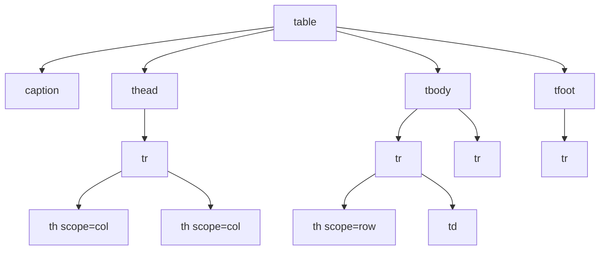

# Tables for tabular data

> **Before this lesson:** you should know basic elements and attributes and how headings label content ([How web pages work](#/lesson/html-css/how-pages-work), [Marking up text](#/lesson/html-css/text-markup)).

## In plain words

A **table** presents information in rows and columns, where each value is understood by reading across to a row label and up to a column label.

A railway departure board is the everyday example. "18:45" on its own means nothing. You understand it because it sits in the row for Bristol and under the column "Arrives". HTML table markup records those relationships explicitly, so that a person who cannot see the grid can still be told "Bristol, Arrives, 18:45".

Dashboards, price comparisons, reports and timetables are all tables, and business applications are full of them. Knowing how to build one that is accessible and usable on a phone, and knowing that tables must never be used to position page layout, are both standard expectations.

## Why it is worth learning properly

A timetable, a league table, a price comparison, a set of exam results: some information only makes sense when you can read it in two directions at once. The value "18:45" means little until you know its row ("Bristol") and its column ("Arrives"). HTML tables exist to preserve those relationships, so that a sighted reader can scan a grid and a blind reader can hear "Arrives, Bristol, 18:45".

Tables also carry historical baggage. For a decade they were abused to position page layouts, and many developers overcorrected into never using them at all. The modern rule is simple: **use a table when the content is a table**, and never for layout. This lesson shows how to build one that is correct, accessible and readable on small screens.

## Rows, cells and headers

A table is written row by row.

| Element | Role |
|---|---|
| `<table>` | The whole table |
| `<tr>` | A table row |
| `<th>` | A header cell: labels a row or column |
| `<td>` | A data cell |
| `<caption>` | The table's title |

```html-run
<!doctype html>
<html lang="en">
<head><meta charset="utf-8"><title>Basic table</title>
<style>
  body { font-family: system-ui, sans-serif; }
  table { border-collapse: collapse; }
  th, td { border: 1px solid #999; padding: .4rem .8rem; text-align: left; }
  caption { font-weight: bold; padding-bottom: .5rem; text-align: left; }
</style></head>
<body>
  <table>
    <caption>Evening trains from Cardiff</caption>
    <tr>
      <th scope="col">Destination</th>
      <th scope="col">Departs</th>
      <th scope="col">Arrives</th>
    </tr>
    <tr>
      <th scope="row">Bristol</th>
      <td>18:02</td>
      <td>18:45</td>
    </tr>
    <tr>
      <th scope="row">Swansea</th>
      <td>18:10</td>
      <td>19:04</td>
    </tr>
  </table>
</body>
</html>
```

Points to notice:

- There is no column element that contains cells. Columns emerge from the position of cells within rows, so every row should account for the same number of columns.
- `<th>` is not only a bold `<td>`. It declares "this cell describes other cells". Browsers render it bold and centred by default; that is incidental.
- The first cell of each body row is also a `th`, because "Bristol" labels its row.

## `caption`: the table's name

`<caption>` must be the first child of `<table>`. It gives the table an accessible name, so a screen-reader user browsing a list of tables hears "Evening trains from Cardiff" instead of "table with 3 columns and 3 rows". A heading placed above the table looks the same but is not connected to it. You can move the caption below the table with the CSS property `caption-side: bottom`.

## `scope`: which cells a header describes

The `scope` attribute removes any ambiguity about a header's direction.

| Value | The header applies to |
|---|---|
| `col` | The cells below it in its column |
| `row` | The cells beside it in its row |
| `colgroup` | A whole group of columns it spans |
| `rowgroup` | A whole group of rows it spans |

In a simple table browsers can usually guess, but writing `scope` costs nothing and guarantees that assistive technology associates the right header with each data cell. As a screen reader moves from cell to cell, it speaks whichever header changed.

For irregular tables where `scope` cannot express the relationships, give each header an `id` and list the relevant ids on each data cell with `headers="id1 id2"`. If you need that, first consider whether the table should be split into simpler ones.

> [!INTERVIEW]
> "How do you make a data table accessible?" Give it a `<caption>`, mark header cells with `<th>` and an explicit `scope`, group rows with `thead`/`tbody`/`tfoot`, never use it for layout, and make sure it remains usable when it is wider than the screen.

## Grouping rows: `thead`, `tbody`, `tfoot`

Three wrapper elements divide the rows into regions.

```html-run
<!doctype html>
<html lang="en">
<head><meta charset="utf-8"><title>Row groups</title>
<style>
  body { font-family: system-ui, sans-serif; }
  table { border-collapse: collapse; min-width: 340px; }
  th, td { padding: .45rem .9rem; text-align: left; }
  td:last-child, th:last-child { text-align: right; font-variant-numeric: tabular-nums; }
  thead th { background: #263238; color: white; }
  tbody tr:nth-child(even) { background: #eceff1; }
  tfoot { border-top: 3px double #263238; font-weight: bold; }
</style></head>
<body>
  <table>
    <caption>Bake sale takings</caption>
    <thead>
      <tr><th scope="col">Stall</th><th scope="col">Items sold</th><th scope="col">Takings</th></tr>
    </thead>
    <tbody>
      <tr><th scope="row">Cupcakes</th><td>48</td><td>£72.00</td></tr>
      <tr><th scope="row">Flapjacks</th><td>30</td><td>£30.00</td></tr>
      <tr><th scope="row">Lemonade</th><td>55</td><td>£41.25</td></tr>
    </tbody>
    <tfoot>
      <tr><th scope="row">Total</th><td>133</td><td>£143.25</td></tr>
    </tfoot>
  </table>
</body>
</html>
```

Benefits of the grouping elements:

- They give CSS clean hooks (`thead th`, `tbody tr:nth-child(even)`), as in the striped example above.
- When a long table is printed across pages, browsers repeat the `thead` at the top of each page.
- A `tbody` can be made scrollable, or the `thead` made sticky, independently of the rest.
- You may use several `tbody` elements to divide a table into sections.

Even if you write none of these, the parser inserts a `<tbody>` around your rows in the DOM. That matters for selectors: `table > tr` matches nothing, because every `tr` is really a grandchild of the table.

## Spanning cells

A cell can stretch across several columns with `colspan` or down several rows with `rowspan`.

```html-run
<!doctype html>
<html lang="en">
<head><meta charset="utf-8"><title>Spanning</title>
<style>
  body { font-family: system-ui, sans-serif; }
  table { border-collapse: collapse; }
  th, td { border: 1px solid #777; padding: .4rem .7rem; text-align: center; }
  thead th { background: #e3f2fd; }
  td.free { background: #f1f8e9; color: #33691e; }
</style></head>
<body>
  <table>
    <caption>Studio timetable</caption>
    <thead>
      <tr>
        <th rowspan="2" scope="col">Time</th>
        <th colspan="2" scope="colgroup">Weekdays</th>
        <th scope="col">Weekend</th>
      </tr>
      <tr>
        <th scope="col">Mon–Wed</th>
        <th scope="col">Thu–Fri</th>
        <th scope="col">Sat–Sun</th>
      </tr>
    </thead>
    <tbody>
      <tr><th scope="row">09:00</th><td>Yoga</td><td>Pilates</td><td rowspan="2" class="free">Open studio</td></tr>
      <tr><th scope="row">11:00</th><td colspan="2">Dance fitness</td></tr>
    </tbody>
  </table>
</body>
</html>
```

The bookkeeping rule: each row's cells, counting spans and counting cells "pushed in" from a `rowspan` above, must add up to the same number of columns. In the last row there are only two elements, yet the row is complete: 1 (time) + 2 (colspan) + 1 (occupied by the rowspan from the row above) = 4.



> [!WARNING]
> Spanning makes tables harder for everyone: harder to write, harder to navigate with a screen reader and almost impossible to reflow on a phone. If you need more than one level of spanned headers, try splitting the data into two tables.

## Styling columns with `colgroup` and `col`

Because cells belong to rows in the markup, there is no natural parent to hang column-wide styles on. `<colgroup>` and `<col>` fill that gap. They go directly after the caption and accept a small set of CSS properties: `background`, `border`, `width` and `visibility`.

```html
<table>
  <caption>…</caption>
  <colgroup>
    <col>
    <col span="2" class="numeric">
  </colgroup>
  …
</table>
```

For anything else (text alignment, colour, font) use a selector such as `td:nth-child(3)` instead.

## Essential table CSS

A later lesson covers table styling in depth; these few properties do most of the work.

| Property | Purpose |
|---|---|
| `border-collapse: collapse` | Merge adjacent cell borders into single lines instead of doubled ones |
| `border-spacing` | Gap between cells when borders are *not* collapsed |
| `padding` on `th, td` | Breathing room; tables look cramped by default |
| `text-align` | Left for text, right for numbers you compare |
| `font-variant-numeric: tabular-nums` | Equal-width digits so numbers line up in columns |
| `vertical-align` | Align cell content to `top`, `middle` or `bottom` |
| `table-layout: fixed` | Column widths from the first row or `col` widths; faster and predictable |
| `caption-side` | Put the caption above or below |

The old presentational attributes you may meet in legacy code (`border`, `cellpadding`, `cellspacing`, `bgcolor`, `width`, `align`) are obsolete; CSS replaces all of them.

## Wide tables on narrow screens

A table cannot shrink below the width its content needs. On a phone the usual fix is to let only the table scroll sideways, not the whole page: wrap it in a container with `overflow-x: auto`. Making that wrapper focusable and labelled lets keyboard users scroll it too.

```html-run
<!doctype html>
<html lang="en">
<head><meta charset="utf-8"><title>Scrollable table</title>
<style>
  body { font-family: system-ui, sans-serif; }
  .table-scroll { max-width: 340px; overflow-x: auto; border: 1px solid #bbb; }
  .table-scroll:focus-visible { outline: 3px solid #f9a825; }
  table { border-collapse: collapse; white-space: nowrap; }
  th, td { padding: .5rem 1rem; border-bottom: 1px solid #ddd; text-align: right; }
  th:first-child { text-align: left; position: sticky; left: 0; background: white; }
  thead th { background: #fff8e1; }
</style></head>
<body>
  <div class="table-scroll" role="region" aria-labelledby="cap" tabindex="0">
    <table>
      <caption id="cap">Monthly rainfall (mm)</caption>
      <thead><tr><th scope="col">City</th><th scope="col">Jan</th><th scope="col">Feb</th><th scope="col">Mar</th><th scope="col">Apr</th><th scope="col">May</th><th scope="col">Jun</th></tr></thead>
      <tbody>
        <tr><th scope="row">Bergen</th><td>190</td><td>152</td><td>170</td><td>114</td><td>106</td><td>132</td></tr>
        <tr><th scope="row">Lisbon</th><td>100</td><td>85</td><td>53</td><td>68</td><td>54</td><td>16</td></tr>
        <tr><th scope="row">Athens</th><td>57</td><td>47</td><td>41</td><td>31</td><td>23</td><td>11</td></tr>
      </tbody>
    </table>
  </div>
</body>
</html>
```

Notice the first column is `position: sticky`, so the city names stay visible while the months scroll past. Other strategies include hiding low-priority columns below a breakpoint or presenting each row as a stacked card. Be careful with the card approach: setting `display: block` on table elements strips their table semantics in some browsers, so test with a screen reader if you do it.

## When *not* to use a table

Tables are wrong for page layout. Layout tables force a fixed reading order, defeat responsive design, bloat the markup, and make screen readers announce rows and columns that mean nothing. CSS Grid and Flexbox do layout far better.

They are equally wrong in the opposite direction: building a "table" out of `div`s styled into a grid throws away header relationships that only real table markup provides.

A quick test: would the information make sense in a spreadsheet, with headers along the top or down the side? If yes, it is a table. If the "columns" are only a way of arranging unrelated blocks, it is layout.

> [!TIP]
> If you inherit a layout table you cannot rewrite (HTML email still relies on them), add `role="presentation"` to the `<table>` so assistive technology ignores the table structure and reads the content linearly.

## Pitfalls

- **`<td>` used for headers.** Bold text is not a header. Without `th` the data cells have no labels.
- **Heading instead of `<caption>`.** Visually similar; programmatically unconnected.
- **Rows with mismatched cell counts.** The grid develops holes or cells spill beyond the edge. Recount whenever you add a span.
- **`table > tr` in CSS or `querySelector`.** Fails because of the implicit `tbody`.
- **Empty top-left corner written as `<th></th>`.** Use an empty `<td>` there; an empty header cell confuses some screen readers.
- **Numbers centred or left-aligned.** Right-align figures and use tabular numerals so magnitudes can be compared at a glance.
- **Letting the page scroll horizontally.** Contain the overflow in a wrapper.
- **Tables for layout.** Use Grid or Flexbox.

## Cheat sheet

| Need | Markup |
|---|---|
| Table title | `<caption>` as first child of `<table>` |
| Column header | `<th scope="col">` |
| Row header | `<th scope="row">` |
| Header over several columns | `<th colspan="3" scope="colgroup">` |
| Header, body, footer regions | `<thead>`, `<tbody>`, `<tfoot>` |
| Merge cells | `colspan="n"`, `rowspan="n"` |
| Column-wide background or width | `<colgroup><col></colgroup>` |
| Single borders | `border-collapse: collapse` |
| Aligned digits | `text-align: right; font-variant-numeric: tabular-nums` |
| Phone-friendly | Wrapper with `overflow-x: auto` and `tabindex="0"` |
| Legacy layout table | `role="presentation"` |

## Summary

Tables express two-dimensional relationships. Build them row by row with `tr`, mark every label with `th` and an explicit `scope`, name the table with `caption`, and group rows into `thead`, `tbody` and `tfoot`. Use `colspan` and `rowspan` sparingly and keep the column count consistent. Style with CSS rather than obsolete attributes, give wide tables a scrolling wrapper on small screens, and keep tables out of page layout entirely.

## Glossary

| Term | Meaning |
|---|---|
| Table | A grid of data marked up with `<table>` |
| Row | A horizontal line of cells, written with `<tr>` |
| Cell | One box in the grid |
| Data cell | A cell holding a value, written with `<td>` |
| Header cell | A cell that labels a row or column, written with `<th>` |
| `scope` | Attribute on a header cell saying whether it labels a `row` or a `col` |
| Caption | The table's title, written with `<caption>` |
| Row group | `<thead>`, `<tbody>` or `<tfoot>`: the header, body and footer sections of a table |
| `colspan` / `rowspan` | Attributes that stretch a cell across several columns / rows |
| Accessible name | The label by which assistive technology identifies an element |
| `border-collapse` | CSS property that merges neighbouring cell borders into single lines |
| Layout table | The obsolete misuse of a table to position page content |

## Check yourself

```quiz
[
  {"q": "Which markup correctly labels the first cell of a body row as that row's header?", "options": ["<td><b>Bristol</b></td>", "<th scope='row'>Bristol</th>", "<th scope='col'>Bristol</th>", "<td scope='row'>Bristol</td>"], "answer": 1,
   "explain": "A header cell is a th, and scope='row' says it describes the cells in its row."},
  {"q": "A table has 4 columns. A row contains <td>A</td><td colspan='2'>B</td> and nothing else, with no rowspan from above. What happens?", "options": ["The row is complete", "The row covers only 3 columns, leaving a gap at the end", "The browser refuses to render the table", "B automatically stretches to 3 columns"], "answer": 1,
   "explain": "1 + 2 = 3 columns are filled; the fourth is left empty. Each row should account for every column."},
  {"q": "Why does the selector table > tr usually match nothing?", "options": ["The child combinator is not allowed with tables", "The parser wraps rows in an implicit tbody, so tr is not a direct child of table", "tr elements cannot be styled", "It needs !important"], "answer": 1,
   "explain": "Rows written directly inside table are placed in an automatically created tbody in the DOM."},
  {"q": "What is the advantage of caption over an h2 placed above the table?", "options": ["It is bigger by default", "It is programmatically associated with the table and becomes its accessible name", "It allows colspan", "It is required for borders to collapse"], "answer": 1,
   "explain": "Assistive technology announces the caption as the table's name; a preceding heading has no formal link to the table."},
  {"q": "Which content should be marked up as a table?", "options": ["A two-column page layout with a sidebar", "A photo gallery in a grid", "Quarterly sales figures by region", "A navigation menu"], "answer": 2,
   "explain": "Sales by region and quarter has meaningful row and column headers. The others are layout or lists."},
  {"q": "What does border-collapse: collapse do?", "options": ["Hides the table when empty", "Merges adjacent cell borders into single shared borders", "Removes all padding", "Makes columns equal width"], "answer": 1,
   "explain": "By default each cell has its own border with spacing between; collapsing shares one line between neighbours."},
  {"q": "In the DOM, how many element children does the tr have in: <tr><th rowspan='2'>X</th><td>1</td></tr>?", "options": ["1", "2", "3", "4"], "answer": 1,
   "explain": "rowspan affects layout in later rows, not the number of elements: this row has exactly a th and a td."}
]
```

> **Source:** Duckett, *HTML & CSS*, ch. 6 (Tables). MDN: https://developer.mozilla.org/en-US/docs/Web/HTML/Reference/Elements/table · https://developer.mozilla.org/en-US/docs/Learn_web_development/Core/Structuring_content/Table_accessibility · https://developer.mozilla.org/en-US/docs/Web/HTML/Reference/Elements/th
