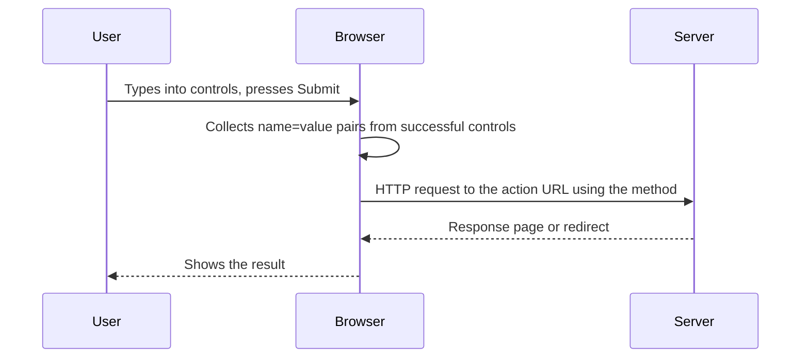

# Forms: collecting input

> **Before this lesson:** you should know elements, attributes and ids ([How web pages work](#/lesson/html-css/how-pages-work)) and how HTTP requests fetch pages (same lesson).

## In plain words

A **form** is the part of a web page where a visitor types or chooses something and sends it to the website: a search box, a login screen, a checkout page.

It works like a paper form at a bank. The form has labelled boxes ("Name", "Account number"), some boxes offer fixed choices with tick marks, and at the bottom you sign and hand it over the counter. The clerk reads each answer by the name printed next to its box. In HTML the boxes are called **controls**, the printed names are the `name` attributes, the handing over is called **submitting**, and the clerk is a program on the server.

Almost every way a website earns money or gathers information passes through a form. Small details decide whether people complete it, and an unlabelled field is one of the commonest accessibility failures on the web. Building forms properly is therefore one of the most valuable practical skills in front-end work.

## Why it is worth learning properly

Reading is only half of the web. The other half (searching, signing up, buying, commenting, booking) happens through forms. A form is a contract between three parties: the person typing, the browser that packages their answers, and the server that receives them. HTML gives you a rich set of controls for the first, a precise submission mechanism for the second, and naming conventions that the third depends on.

Forms are also where usability is won or lost. A text box that brings up the wrong phone keyboard, a checkbox with a click target the size of a grain of rice, or a field with no label can each cost real sign-ups. This lesson covers the form element, every common control, how values are sent, and how to label and group controls. The next lesson handles validation and error messages.

## How a form works



The `<form>` element wraps the controls and carries two key attributes:

- **`action`**: the URL that receives the data. If omitted, the form submits to the current page's URL.
- **`method`**: `get` (the default) or `post`.

| | `method="get"` | `method="post"` |
|---|---|---|
| Where the data goes | Appended to the URL: `/search?q=tea&sort=price` | In the request body |
| Visible in address bar, history, logs | Yes | No |
| Bookmarkable and shareable | Yes | No |
| Size limit | A few thousand characters | Effectively none |
| File uploads | No | Yes, with `enctype="multipart/form-data"` |
| Use for | Searches and filters: requests that only *read* | Anything that *changes* data, or is sensitive |

Each control contributes one **name/value pair**. The `name` attribute is the key the server sees; a control without a `name` is not submitted at all. That is the most common reason for "my field isn't arriving".

```html-run
<!doctype html>
<html lang="en">
<head><meta charset="utf-8"><title>A first form</title>
<style>
  body { font-family: system-ui, sans-serif; }
  form { display: grid; gap: .6rem; max-width: 320px; }
  output { background: #e8f5e9; padding: .5rem; font-family: monospace; min-height: 1.2em; }
</style></head>
<body>
  <form id="f" action="/search" method="get">
    <label for="q">Search teas</label>
    <input type="search" id="q" name="q" value="oolong">
    <label for="sort">Sort by</label>
    <select id="sort" name="sort">
      <option value="price">Price</option>
      <option value="rating">Rating</option>
    </select>
    <button>Search</button>
  </form>
  <p>The browser would request:</p>
  <output id="out"></output>
  <script>
    const f = document.getElementById('f'), out = document.getElementById('out');
    f.addEventListener('submit', e => {
      e.preventDefault();
      out.textContent = f.getAttribute('action') + '?' + new URLSearchParams(new FormData(f));
    });
  </script>
</body>
</html>
```

Press *Search* and the script shows the URL a real submission would produce. Change the `name` attributes and watch the query string follow.

## Labels: the non-negotiable part

Every control needs a text label that is *programmatically* connected to it. There are two ways.

```html
<!-- Explicit: for matches the control's id -->
<label for="email">Email address</label>
<input id="email" name="email" type="email">

<!-- Implicit: the control sits inside the label -->
<label>Email address <input name="email" type="email"></label>
```

A proper label does three things. Screen readers announce it when the field receives focus. Clicking or tapping the label focuses the control, or toggles it in the case of checkboxes and radio buttons, which enlarges tiny targets enormously. And speech-control users can say "click Email address".

> [!WARNING]
> `placeholder` is not a label. It vanishes the moment the user starts typing, it usually has poor contrast, and it is easily mistaken for a pre-filled value. Use it only for a short example of the expected format, alongside a real label.

## Text-like inputs

`<input>` is one element with many personalities, selected by its `type` attribute. Choosing the right type costs nothing and gives mobile users an appropriate keyboard, enables built-in validation and helps autofill.

| `type` | For | Extras the browser provides |
|---|---|---|
| `text` (default) | Any single-line text | — |
| `email` | Email addresses | `@` keyboard, format check |
| `tel` | Phone numbers | Numeric keypad; no format check |
| `url` | Web addresses | `.com`/`/` keyboard, format check |
| `search` | Search boxes | Clear button in some browsers |
| `password` | Secrets | Characters obscured; password-manager integration |
| `number` | Quantities you do arithmetic on | Spinner, `min`/`max`/`step` |

```html-run
<!doctype html>
<html lang="en">
<head><meta charset="utf-8"><title>Text inputs</title>
<style>
  body { font-family: system-ui, sans-serif; }
  form { display: grid; grid-template-columns: max-content 1fr; gap: .5rem 1rem; max-width: 420px; align-items: center; }
  input, textarea { font: inherit; padding: .3rem .5rem; }
  textarea { grid-column: 1 / -1; }
</style></head>
<body>
  <form>
    <label for="n">Full name</label>
    <input id="n" name="name" type="text" autocomplete="name">
    <label for="e">Email</label>
    <input id="e" name="email" type="email" autocomplete="email" placeholder="you@example.org">
    <label for="t">Phone</label>
    <input id="t" name="phone" type="tel" autocomplete="tel">
    <label for="p">Password</label>
    <input id="p" name="pw" type="password" autocomplete="new-password">
    <label for="qty">Tickets</label>
    <input id="qty" name="qty" type="number" min="1" max="8" value="2">
    <label for="msg" style="grid-column: 1 / -1">Message</label>
    <textarea id="msg" name="message" rows="3"></textarea>
  </form>
</body>
</html>
```

`<textarea>` is the multi-line text control. It is not an `input` type: it has a closing tag, and its initial value is the text between the tags rather than a `value` attribute.

Two attributes fine-tune text entry:

- **`autocomplete`** tells the browser what kind of data the field holds (`name`, `email`, `street-address`, `postal-code`, `cc-number`, `one-time-code`, `current-password`, `new-password`, …) so it can fill it in. It is one of the highest-impact attributes for conversion.
- **`inputmode`** picks an on-screen keyboard without changing the type: `inputmode="numeric"` for a PIN or card number that is digits but not a quantity, `inputmode="decimal"` for prices.

> [!TIP]
> Use `type="number"` only for true quantities. Credit card numbers, postcodes and phone numbers are *strings of digits*: a number input may strip leading zeros, show a pointless spinner and change value when the user scrolls. Use `type="text" inputmode="numeric"` for those.

## Choices: checkboxes, radio buttons and selects

| Control | Selection | Use when |
|---|---|---|
| `<input type="checkbox">` | Any number, each independent | On/off settings; "choose all that apply" |
| `<input type="radio">` | Exactly one of a group | Two to roughly six mutually exclusive options, all visible |
| `<select>` | One (or several with `multiple`) | Many options; limited space |
| `<input list>` + `<datalist>` | Free text with suggestions | The user may type something not on the list |

**Radio buttons form a group by sharing a `name`.** Selecting one clears the others in that group. Each has its own `value`; the submitted pair is the group name and the checked button's value.

**A checkbox** submits `name=value` only when ticked (the value defaults to `on`). Unticked boxes send nothing.

```html-run
<!doctype html>
<html lang="en">
<head><meta charset="utf-8"><title>Choices</title>
<style>
  body { font-family: system-ui, sans-serif; }
  fieldset { margin-bottom: 1rem; max-width: 380px; border: 1px solid #aaa; border-radius: 6px; }
  legend { font-weight: bold; padding: 0 .4rem; }
  label { display: block; padding: .15rem 0; }
</style></head>
<body>
  <form>
    <fieldset>
      <legend>Cup size</legend>
      <label><input type="radio" name="size" value="s"> Small</label>
      <label><input type="radio" name="size" value="m" checked> Medium</label>
      <label><input type="radio" name="size" value="l"> Large</label>
    </fieldset>
    <fieldset>
      <legend>Extras</legend>
      <label><input type="checkbox" name="extra" value="oat"> Oat milk</label>
      <label><input type="checkbox" name="extra" value="honey" checked> Honey</label>
      <label><input type="checkbox" name="extra" value="lemon"> Lemon</label>
    </fieldset>
    <label for="tea">Tea</label>
    <select id="tea" name="tea">
      <option value="">Choose one…</option>
      <optgroup label="Black">
        <option value="assam">Assam</option>
        <option value="earl" selected>Earl Grey</option>
      </optgroup>
      <optgroup label="Green">
        <option value="sencha">Sencha</option>
        <option value="matcha">Matcha</option>
      </optgroup>
    </select>
    <label for="city">Pick-up city (type or choose)</label>
    <input id="city" name="city" list="cities">
    <datalist id="cities">
      <option value="Leeds"><option value="Bath"><option value="York">
    </datalist>
  </form>
</body>
</html>
```

In a `<select>`, each `<option>` submits its `value` attribute, or its text if it has none. `selected` marks the default and `<optgroup label>` groups options under a heading.

### Grouping with `fieldset` and `legend`

A label names one control. A **group** of controls needs a name too: "Small / Medium / Large" answers which question? `<fieldset>` draws the group together and its `<legend>` supplies the question. Screen readers announce the legend along with each control's own label: "Cup size, Medium, radio button, 2 of 3". Use it around every radio group and around related sets of fields such as a billing address. Adding the `disabled` attribute to a fieldset disables every control inside it at once.

## Specialised inputs

```html-run
<!doctype html>
<html lang="en">
<head><meta charset="utf-8"><title>Special inputs</title>
<style>
  body { font-family: system-ui, sans-serif; }
  form { display: grid; grid-template-columns: max-content 1fr; gap: .6rem 1rem; max-width: 420px; align-items: center; }
</style></head>
<body>
  <form>
    <label for="d">Delivery date</label>
    <input id="d" name="date" type="date" min="2025-01-01">
    <label for="tm">Time slot</label>
    <input id="tm" name="time" type="time" step="900">
    <label for="c">Ribbon colour</label>
    <input id="c" name="colour" type="color" value="#8e24aa">
    <label for="r">Strength</label>
    <input id="r" name="strength" type="range" min="1" max="5" value="3">
    <label for="f">Gift note (PDF)</label>
    <input id="f" name="note" type="file" accept=".pdf,application/pdf">
    <input type="hidden" name="campaign" value="spring">
  </form>
</body>
</html>
```

- **`date`, `time`, `datetime-local`, `month`, `week`** show native pickers and always submit a standard format (`2025-03-21`) regardless of how the date is displayed locally.
- **`range`** is a slider for imprecise values. Display the current value nearby, since the control itself shows no number.
- **`color`** opens a colour picker and submits a hex string.
- **`file`** lets the user choose files; `accept` filters the picker and `multiple` allows several. The form must use `method="post" enctype="multipart/form-data"` or only the file *name* is sent.
- **`hidden`** carries data the user does not see or edit, such as a record id. It is trivially editable in developer tools, so the server must never trust it.

## Buttons

`<button>` has three types, and the default surprises people.

| Markup | Behaviour |
|---|---|
| `<button type="submit">` (also the default inside a form) | Submits the form |
| `<button type="reset">` | Restores every control to its initial value; rarely wanted |
| `<button type="button">` | Does nothing by itself; for JavaScript actions |

Because a bare `<button>` inside a form is a submit button, an "Add another row" or "Show password" button without `type="button"` will submit the form when clicked. Always state the type.

`<button>` is preferable to the older `<input type="submit" value="Send">` because it can contain markup (an icon and text) and is easier to style. A submit button can also carry its own `name` and `value`, letting the server tell "Save draft" from "Publish", and attributes such as `formaction` and `formmethod` that override the form's settings for that button.

Pressing Enter in a single-line text field triggers **implicit submission**, as if the form's first submit button had been clicked. Users rely on this, which is one more reason to use a real `<form>` and a real submit button rather than a `div` with a click handler.

## Disabled, read-only and other states

| Attribute | Focusable | Editable | Submitted |
|---|---|---|---|
| (none) | Yes | Yes | Yes |
| `readonly` | Yes | No | **Yes** |
| `disabled` | No | No | **No** |

`readonly` applies to text-like controls. `disabled` works on any control, and CSS can match it with `:disabled`.

> [!INTERVIEW]
> "Difference between `disabled` and `readonly`?" Both prevent editing. A read-only field can still be focused and its value is submitted; a disabled control is skipped by the keyboard and left out of the form data entirely.

## Reporting results: `output`, `progress`, `meter`

Three elements display values rather than collect them.

```html-run
<!doctype html>
<html lang="en">
<head><meta charset="utf-8"><title>Output elements</title>
<style> body { font-family: system-ui, sans-serif; } label, p { display: block; margin: .6rem 0; } </style></head>
<body>
  <form oninput="total.value = (qty.valueAsNumber * 3.5).toFixed(2)" onsubmit="return false">
    <label>Cups at £3.50: <input type="number" id="qty" name="qty" value="2" min="0"></label>
    <p>Total: £<output name="total" for="qty">7.00</output></p>
  </form>
  <label>Upload: <progress value="65" max="100">65%</progress></label>
  <label>Storage used: <meter value="0.82" min="0" max="1" low="0.5" high="0.8" optimum="0.2">82%</meter></label>
</body>
</html>
```

`<output>` holds the result of a calculation and is announced by screen readers when it changes. `<progress>` shows how far a task has got; `<meter>` shows a measurement within a known range and changes colour according to `low`, `high` and `optimum`.

## Pitfalls

- **Controls without `name`.** They are silently omitted from the submission.
- **Placeholder used as the label.** Fails accessibility and usability.
- **Radio buttons with different `name`s.** They no longer exclude each other.
- **Radio group without `fieldset`/`legend`.** The options have no question.
- **Bare `<button>` for a script action.** It submits the form; add `type="button"`.
- **`get` for passwords or state-changing actions.** Data lands in the URL, history and server logs, and crawlers may follow the link.
- **File input without `enctype="multipart/form-data"`.** Only the file name arrives.
- **`type="number"` for identifiers.** Use text with `inputmode="numeric"`.
- **Wrong or missing `autocomplete`.** Blocks password managers and address autofill.
- **Trusting hidden or disabled fields.** Anything sent from a browser can be altered; validate on the server.

## Cheat sheet

| Need | Markup |
|---|---|
| The form | `<form action="/path" method="post">` |
| Label | `<label for="id">` + matching `id`, or wrap the control |
| Single-line text | `<input type="…">` with `text`, `email`, `tel`, `url`, `search` or `password` |
| Multi-line text | `<textarea rows="4"></textarea>` |
| Quantity | `<input type="number" min max step>` |
| Digits that are not a quantity | `type="text" inputmode="numeric"` |
| One of a few | Radio buttons sharing a `name`, in a `fieldset` with `legend` |
| Any of several | Checkboxes |
| One of many | `<select><option value>` (+ `optgroup`) |
| Suggestions | `<input list="x">` + `<datalist id="x">` |
| Date / time | `type="date"`, `type="time"`, `type="datetime-local"` |
| File upload | `type="file"` + `enctype="multipart/form-data"` |
| Submit / script button | `<button type="submit">` / `<button type="button">` |
| Autofill hints | `autocomplete="email"`, `"new-password"`, … |
| Not editable but sent | `readonly`; not sent: `disabled` |

## Summary

A form gathers name/value pairs from its named controls and sends them to the `action` URL with `get` (in the URL, for reads) or `post` (in the body, for changes). Choose the most specific input type so the browser can help with keyboards, pickers and autofill. Give every control a real label, group related controls with `fieldset` and `legend`, and always declare a button's type. With that foundation in place, the next lesson adds validation and helpful error messages.

## Glossary

| Term | Meaning |
|---|---|
| Form | A group of controls that collects input and sends it to a server |
| Control | An interactive form element such as an input, select, textarea or button |
| Submit | To send the form's data to the server |
| `action` | The form attribute giving the URL that receives the data |
| `method` | The form attribute choosing how data is sent: `get` (in the URL) or `post` (in the request body) |
| `name` | The key under which a control's value is sent; without it the control is not submitted |
| Label | The text that names a control, connected with `<label>` |
| Query string | The part of a URL after `?` holding `name=value` pairs |
| Radio button | A control where exactly one option of a group can be chosen |
| Checkbox | A control that is independently on or off |
| `fieldset` / `legend` | A group of related controls and the caption that names the group |
| Placeholder | Pale hint text inside an empty field; not a substitute for a label |
| Autofill | The browser filling in remembered values, guided by the `autocomplete` attribute |
| Boolean attribute | An attribute that is true when present, such as `required` or `disabled` |

## Check yourself

```quiz
[
  {"q": "A text input has an id but no name attribute. What is submitted for it?", "options": ["id=value", "An empty pair", "Nothing", "The label text"], "answer": 2,
   "explain": "Only controls with a name contribute to the form data. The id is for labels, CSS and scripts."},
  {"q": "Which method suits a product search form whose results should be shareable by link?", "options": ["post", "get", "put", "Either; it makes no difference"], "answer": 1,
   "explain": "get puts the fields in the query string, so the results URL can be bookmarked and shared, and the request only reads data."},
  {"q": "Three radio inputs have names size1, size2 and size3. How many can be selected at once?", "options": ["One", "Two", "Three", "None"], "answer": 2,
   "explain": "Radio buttons are mutually exclusive only within a group that shares the same name. With three names there are three independent groups."},
  {"q": "A form contains <button>Add row</button> wired to a click handler. What happens on click?", "options": ["Only the handler runs", "The handler runs and the form is submitted", "Nothing, the button lacks a type", "The form is reset"], "answer": 1,
   "explain": "A button inside a form defaults to type='submit'. Use type='button' for script-only actions."},
  {"q": "What is submitted for <input type='checkbox' name='news'> when it is left unticked?", "options": ["news=off", "news=false", "news=", "Nothing"], "answer": 3,
   "explain": "Unchecked checkboxes are not successful controls, so no pair is sent. When ticked without a value attribute it sends news=on."},
  {"q": "Which statement about disabled and readonly is correct?", "options": ["Both are submitted", "readonly is submitted, disabled is not", "disabled is submitted, readonly is not", "Neither is submitted"], "answer": 1,
   "explain": "A readonly control stays focusable and its value is sent. A disabled control is skipped by focus and excluded from the form data."},
  {"q": "What is the best markup for a 16-digit card number field?", "options": ["input type='number'", "input type='text' inputmode='numeric' autocomplete='cc-number'", "input type='tel'", "textarea"], "answer": 1,
   "explain": "A card number is a string of digits, not a quantity. Text with a numeric keyboard hint and the right autocomplete token avoids spinners and lost leading zeros."}
]
```

> **Source:** Duckett, *HTML & CSS*, ch. 7 (Forms). MDN: https://developer.mozilla.org/en-US/docs/Learn_web_development/Extensions/Forms/Your_first_form · https://developer.mozilla.org/en-US/docs/Web/HTML/Reference/Elements/input · https://developer.mozilla.org/en-US/docs/Web/HTML/Reference/Attributes/autocomplete
