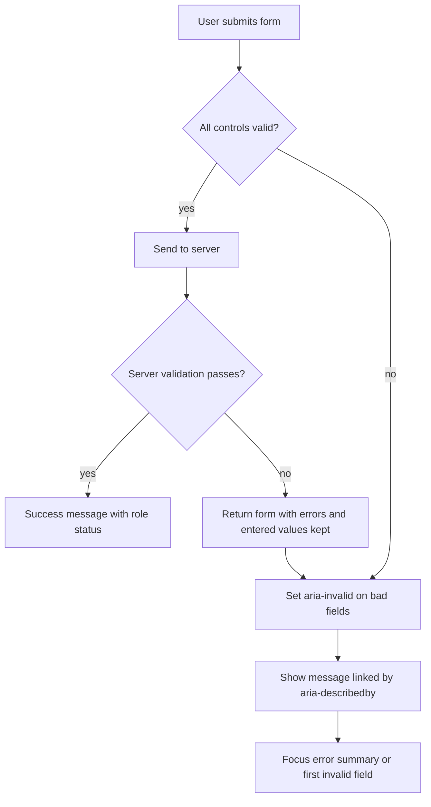

# Form validation and accessible error handling

> **Before this lesson:** you should be able to build a form with labelled controls ([Forms: collecting input](#/lesson/html-css/forms)) and know what a pseudo-class is ([Lists and links](#/lesson/html-css/lists-links)).

## In plain words

**Validation** means checking that what someone typed into a form makes sense before it is accepted: that an email address contains an `@`, that a required box is not empty, that an age is a number.

Think of the check-in desk at an airport. The agent glances at your passport before you reach security: if the name does not match the ticket you are told at once and can fix it. That quick check at the desk is like validation in the browser. The thorough inspection at border control, which nobody can talk their way around, is like validation on the server. You want both: the first for convenience, the second for safety.

Good validation with clear error messages is the difference between a form people finish and one they abandon. It is also an area where accessibility is often broken, because an error shown only as a red border is invisible to many users. Expect to be asked how you would make errors accessible.

## Why it is worth learning properly

Somebody types their email address without the "@", leaves the postcode blank, or asks for minus three tickets. What happens next decides whether they finish the form or abandon it. **Validation** is the process of checking input against rules, and it happens in two places with two different purposes:

- **Client-side validation** runs in the browser, instantly, before anything is sent. Its purpose is *helpfulness*: catch slips early and explain how to fix them.
- **Server-side validation** runs after submission. Its purpose is *safety*: it is the only check an attacker cannot bypass, because anyone can edit a page in developer tools or send requests without a browser at all.

You always need the second. This lesson is about doing the first well, mostly with plain HTML attributes, then styling the states with CSS, and finally presenting errors so that everyone, including screen-reader users, can find and understand them.

> [!WARNING]
> Client-side validation is a convenience, never a security measure. Treat everything that arrives at the server as untrusted, whatever the form was supposed to allow.

## Constraint attributes

HTML lets you declare rules directly on controls. The browser enforces them on submit, blocks the submission if any fail, focuses the first invalid control and shows a message bubble.

| Attribute | Applies to | Rule |
|---|---|---|
| `required` | Most controls | Must not be empty (checkbox: must be ticked; radio group: one must be chosen) |
| `type="email"`, `type="url"` | Inputs | Value must look like an address or URL |
| `minlength`, `maxlength` | Text inputs, textarea | Bounds on the number of characters |
| `min`, `max` | number, range, date, time | Bounds on the value |
| `step` | number, range, date, time | Value must land on a multiple of the step from `min` |
| `pattern` | Text-like inputs | Whole value must match a regular expression |
| `accept` | file | Filters the file picker (not enforced on submit) |

Try submitting this form empty, then with bad values. No JavaScript is involved.

```html-run
<!doctype html>
<html lang="en">
<head><meta charset="utf-8"><title>Built-in validation</title>
<style>
  body { font-family: system-ui, sans-serif; }
  form { display: grid; gap: .3rem; max-width: 340px; }
  label { margin-top: .6rem; font-weight: 600; }
  input { font: inherit; padding: .35rem .5rem; }
  small { color: #555; }
  button { margin-top: 1rem; padding: .5rem; font: inherit; }
</style></head>
<body>
  <form action="#" method="post">
    <label for="user">Username</label>
    <input id="user" name="user" required minlength="3" maxlength="16"
           pattern="[a-z0-9_]+" aria-describedby="user-hint" autocomplete="username">
    <small id="user-hint">3–16 characters: lowercase letters, digits or underscore.</small>

    <label for="mail">Email</label>
    <input id="mail" name="mail" type="email" required autocomplete="email">

    <label for="age">Age</label>
    <input id="age" name="age" type="number" min="18" max="120" required>

    <label for="when">Start date</label>
    <input id="when" name="when" type="date" min="2025-01-01" required>

    <label><input type="checkbox" name="terms" required> I accept the terms</label>
    <button type="submit">Create account</button>
  </form>
</body>
</html>
```

Details worth knowing:

- **`pattern` is anchored.** The expression must match the *entire* value, as if wrapped in `^(?:` … `)$`. An empty optional field is not checked against the pattern at all; combine with `required` if emptiness is also an error.
- **`maxlength` prevents typing** beyond the limit, so the user rarely sees an error for it. `minlength` is only reported on submit.
- **`type="email"` is lenient.** It accepts `a@b` because that can be a valid address on an intranet. Add a `pattern` if you need a dot in the domain, and remember the only real test of an address is sending mail to it.
- **`step` defaults to 1** for numbers, so `1.5` is invalid unless you set `step="0.5"` or `step="any"`.
- **`novalidate`** on the `<form>` (or `formnovalidate` on a "Save draft" button) switches the browser's checks off, which you want when you provide your own messages with JavaScript.

## Styling validation states with CSS

The browser exposes each control's validity through pseudo-classes.

| Pseudo-class | Matches a control that |
|---|---|
| `:required` / `:optional` | Has / lacks the `required` attribute |
| `:valid` / `:invalid` | Currently passes / fails its constraints |
| `:user-valid` / `:user-invalid` | Passes / fails, **but only after the user has interacted with it** |
| `:in-range` / `:out-of-range` | Is inside / outside `min` and `max` |
| `:placeholder-shown` | Is still displaying its placeholder (so, is empty) |
| `:focus`, `:focus-visible` | Has focus |
| `:disabled`, `:read-only`, `:checked` | Is in that state |

The trap is that `:invalid` matches from the moment the page loads. A required field that nobody has touched yet is already "invalid", so styling `:invalid` in red greets the visitor with a wall of errors. `:user-invalid` fixes this: it only begins matching once the user has edited the field and moved on, or has tried to submit.

```html-run
<!doctype html>
<html lang="en">
<head><meta charset="utf-8"><title>Validation styling</title>
<style>
  body { font-family: system-ui, sans-serif; }
  .field { display: grid; gap: .25rem; max-width: 320px; margin-bottom: 1rem; }
  input { font: inherit; padding: .4rem .55rem; border: 2px solid #9e9e9e; border-radius: 6px; }
  input:focus-visible { outline: 3px solid #90caf9; outline-offset: 1px; }
  input:user-invalid { border-color: #c62828; background: #ffebee; }
  input:user-valid   { border-color: #2e7d32; }
  .msg { display: none; color: #b71c1c; font-size: .9rem; }
  input:user-invalid ~ .msg { display: block; }
  label:has(+ input:required)::after { content: " *"; color: #c62828; }
</style></head>
<body>
  <p>Type something invalid in a field and tab away.</p>
  <div class="field">
    <label for="em">Email</label>
    <input id="em" type="email" required>
    <span class="msg">Enter an address like name@example.org.</span>
  </div>
  <div class="field">
    <label for="zip">Postcode (5 digits)</label>
    <input id="zip" inputmode="numeric" pattern="[0-9]{5}" required>
    <span class="msg">Use exactly five digits.</span>
  </div>
  <div class="field">
    <label for="nick">Nickname (optional)</label>
    <input id="nick">
  </div>
</body>
</html>
```

That example also uses `:has()` to add an asterisk after any label that is immediately followed by a required input, so the marker stays in step with the attribute automatically.

> [!TIP]
> Do not signal an error by colour alone. Pair the red border with a text message and ideally an icon, because colour differences are invisible to many users and meaningless to screen readers.

## The Constraint Validation API

When the built-in bubbles are not enough (you want your own wording, or a rule HTML cannot express such as "the two passwords must match"), JavaScript can read and set validity through a small API available on every form control.

| Member | Purpose |
|---|---|
| `el.validity` | A `ValidityState` object with boolean flags: `valueMissing`, `typeMismatch`, `patternMismatch`, `tooShort`, `tooLong`, `rangeUnderflow`, `rangeOverflow`, `stepMismatch`, `customError`, `valid` |
| `el.validationMessage` | The browser's localised message for the current problem |
| `el.checkValidity()` | Returns `true`/`false`; fires an `invalid` event if false |
| `el.reportValidity()` | Same, and also shows the message to the user |
| `el.setCustomValidity(msg)` | Non-empty string marks the control invalid with that message; empty string clears it |
| `form.checkValidity()` | Checks every control |

```html-run
<!doctype html>
<html lang="en">
<head><meta charset="utf-8"><title>Custom validation</title>
<style>
  body { font-family: system-ui, sans-serif; }
  form { display: grid; gap: .3rem; max-width: 340px; }
  label { margin-top: .7rem; font-weight: 600; }
  input { font: inherit; padding: .4rem .55rem; border: 2px solid #9e9e9e; border-radius: 6px; }
  input[aria-invalid="true"] { border-color: #c62828; }
  .error { color: #b71c1c; font-size: .9rem; min-height: 1.2em; }
  button { margin-top: .8rem; padding: .5rem; font: inherit; }
</style></head>
<body>
  <form id="signup" novalidate>
    <label for="pw1">Password</label>
    <input id="pw1" type="password" required minlength="8" autocomplete="new-password" aria-describedby="pw1-err">
    <span class="error" id="pw1-err"></span>

    <label for="pw2">Repeat password</label>
    <input id="pw2" type="password" required autocomplete="new-password" aria-describedby="pw2-err">
    <span class="error" id="pw2-err"></span>

    <button type="submit">Set password</button>
    <p id="status" role="status"></p>
  </form>
  <script>
    const form = document.getElementById('signup');
    const pw1 = form.querySelector('#pw1'), pw2 = form.querySelector('#pw2');

    function messageFor(el) {
      const v = el.validity;
      if (v.valueMissing) return 'This field is required.';
      if (v.tooShort) return 'Use at least ' + el.minLength + ' characters.';
      if (v.customError) return el.validationMessage;
      return '';
    }
    function check(el) {
      if (el === pw2) pw2.setCustomValidity(pw2.value && pw2.value !== pw1.value ? 'The passwords do not match.' : '');
      const msg = messageFor(el);
      el.setAttribute('aria-invalid', String(!el.validity.valid));
      document.getElementById(el.id + '-err').textContent = msg;
      return el.validity.valid;
    }
    [pw1, pw2].forEach(el => el.addEventListener('blur', () => check(el)));
    form.addEventListener('submit', e => {
      e.preventDefault();
      const bad = [pw1, pw2].filter(el => !check(el));
      if (bad.length) bad[0].focus();
      document.getElementById('status').textContent = bad.length ? '' : 'Password saved.';
    });
  </script>
</body>
</html>
```

The pattern in that script is the standard one:

1. Put `novalidate` on the form so the browser's bubbles do not compete with your messages. The constraint attributes still work and `validity` is still computed.
2. Validate a field when the user **leaves** it (`blur`), not on every keystroke. Shouting "invalid email" after the first letter is hostile.
3. On submit, check everything, show all messages, and move focus to the first invalid field.
4. Clear a message as soon as the problem is fixed.

## Making errors accessible

A red outline tells a sighted user that something is wrong. Four pieces of markup make the same information available to everyone.

**1. Mark the field as invalid.** `aria-invalid="true"` makes a screen reader announce "invalid entry" when the field is focused. Set it only after validation has failed, and remove it (or set `false`) once fixed.

**2. Connect the message to the field.** Give the message element an `id` and reference it with `aria-describedby` on the control. The message is then read out after the label whenever the field gains focus. The same attribute links persistent hints ("3–16 characters"); several ids can be listed, separated by spaces.

**3. Announce changes.** Text inserted by script is not read aloud unless it lives in a **live region**. `role="alert"` interrupts and announces immediately, which suits a submission failure. `role="status"` waits politely for a pause, which suits "Saved". The live-region element should already exist in the page, empty, before you put text in it.

**4. Summarise after a failed submit.** For longer forms, show a list of errors at the top, each one a link to its field, and move focus to the summary. Users then know how many problems there are and can jump to each.

```html-run
<!doctype html>
<html lang="en">
<head><meta charset="utf-8"><title>Error summary</title>
<style>
  body { font-family: system-ui, sans-serif; max-width: 380px; }
  .summary { border: 3px solid #c62828; border-radius: 6px; padding: .6rem 1rem; }
  .summary h2 { font-size: 1.05rem; margin: 0 0 .3rem; }
  .field { margin: 1rem 0; display: grid; gap: .25rem; }
  input { font: inherit; padding: .4rem; border: 2px solid #9e9e9e; border-radius: 6px; }
  input[aria-invalid="true"] { border-color: #c62828; }
  .error { color: #b71c1c; font-size: .9rem; }
  .error::before { content: "⚠ "; }
</style></head>
<body>
  <div class="summary" role="alert" tabindex="-1">
    <h2>There are 2 problems with your booking</h2>
    <ul>
      <li><a href="#guest">Enter the guest's name</a></li>
      <li><a href="#nights">Number of nights must be at least 1</a></li>
    </ul>
  </div>
  <form novalidate>
    <div class="field">
      <label for="guest">Guest name</label>
      <input id="guest" name="guest" required aria-invalid="true" aria-describedby="guest-err">
      <span class="error" id="guest-err">Enter the guest's name</span>
    </div>
    <div class="field">
      <label for="nights">Nights</label>
      <input id="nights" name="nights" type="number" min="1" value="0" aria-invalid="true" aria-describedby="nights-err">
      <span class="error" id="nights-err">Number of nights must be at least 1</span>
    </div>
  </form>
</body>
</html>
```



## Writing good error messages

- **Say what to do, not only what went wrong.** "Enter a date in the future" beats "Invalid date".
- **Be specific to the field.** "Enter your email address", not "This field is required" twenty times.
- **Keep what the user typed.** Never clear a form, or a password aside, because one field failed.
- **Be forgiving in what you accept.** Strip spaces from card numbers and accept phone numbers with or without dashes, rather than rejecting them with a regular expression.
- **Tell people the rules up front.** State format requirements in a visible hint before the user makes the mistake.
- **Mark required fields clearly** in text or with an explained asterisk, or mark the optional ones if nearly everything is required.

> [!INTERVIEW]
> "How do you make form errors accessible?" Associate each message with its control via `aria-describedby`, flag the control with `aria-invalid="true"`, announce dynamic errors through a live region (`role="alert"`), move focus to the first error or an error summary on failed submit, and never rely on colour alone.

## Pitfalls

- **Only validating in the browser.** Trivially bypassed; the server must repeat every check.
- **Styling `:invalid` directly.** Fields look wrong before the user has done anything. Prefer `:user-invalid`, or toggle a class after `blur`.
- **Validating on every keystroke.** Premature and noisy; wait for `blur` or submit.
- **Over-strict patterns.** Names contain apostrophes, hyphens and non-Latin letters; phone numbers contain spaces and plus signs.
- **Forgetting that `pattern` ignores empty values.** Add `required` when the field is mandatory.
- **Error text not linked to the field.** A screen-reader user tabbing through hears nothing wrong.
- **Disabling the submit button until the form is valid.** Users cannot discover what is missing, and disabled buttons are not focusable. Let them submit and then explain.
- **Injecting an alert container and its text at the same moment.** Some screen readers miss it; keep an empty live region in the page.
- **`setCustomValidity` never cleared.** The field stays invalid forever; call it with an empty string once the rule passes.

## Cheat sheet

| Need | Tool |
|---|---|
| Mandatory field | `required` |
| Length limits | `minlength`, `maxlength` |
| Numeric or date limits | `min`, `max`, `step` |
| Custom format | `pattern="…"` (whole value must match) |
| Turn off native bubbles | `<form novalidate>` or `formnovalidate` on a button |
| Style after interaction | `:user-invalid`, `:user-valid` |
| Style empty field | `:placeholder-shown` |
| Read why it failed | `el.validity.valueMissing`, `.patternMismatch`, … |
| Cross-field rule | `el.setCustomValidity('message')` / `('')` to clear |
| Flag for assistive tech | `aria-invalid="true"` |
| Link hint or error | `aria-describedby="hint-id error-id"` |
| Announce immediately / politely | `role="alert"` / `role="status"` |

## Summary

Validation helps users in the browser and protects data on the server; you need both. HTML constraint attributes cover the common rules without script, and pseudo-classes such as `:user-invalid` let CSS reflect the result at the right moment. For custom messages and cross-field rules, switch off native bubbles with `novalidate` and drive the Constraint Validation API yourself. Whatever the mechanism, an error must be visible as text, tied to its field with `aria-describedby`, flagged with `aria-invalid`, and announced through a live region, with focus moved to where the user needs to act.

## Glossary

| Term | Meaning |
|---|---|
| Validation | Checking input against rules before accepting it |
| Client-side | Happening in the user's browser |
| Server-side | Happening on the website's server after submission |
| Constraint | A rule a control's value must satisfy, such as `required` or `min` |
| `pattern` | An attribute holding a regular expression the whole value must match |
| Regular expression | A compact notation for describing a pattern of characters |
| Validity state | The browser's record of which constraints a control currently fails |
| `novalidate` | A form attribute that switches off the browser's built-in checking |
| Constraint Validation API | The JavaScript properties and methods for reading and setting validity |
| `aria-invalid` | An attribute telling assistive technology that a field's value is not accepted |
| `aria-describedby` | An attribute linking a control to the element that describes it, such as a hint or error |
| Live region | A part of the page whose changes are announced by screen readers |
| Error summary | A list of all problems, shown at the top of a form after a failed submission |
| Blur | The event that fires when a control loses focus |

## Check yourself

```quiz
[
  {"q": "Why is client-side validation alone insufficient?", "options": ["It is slow", "Users can bypass or disable it, so the server must validate too", "Browsers do not support it consistently", "It only works with JavaScript frameworks"], "answer": 1,
   "explain": "Anything in the browser can be edited or skipped. Server-side validation is the only trustworthy check."},
  {"q": "An optional input has pattern='[0-9]{4}' and the user leaves it empty. Is it valid?", "options": ["No, empty does not match four digits", "Yes, the pattern is not applied to an empty value", "Only if novalidate is set", "It depends on the browser"], "answer": 1,
   "explain": "Constraint attributes other than required are ignored when the value is empty. Add required to forbid emptiness."},
  {"q": "Does the value abc12345 satisfy pattern='[0-9]+'?", "options": ["Yes, it contains digits", "No, the pattern must match the entire value", "Yes, patterns are case-insensitive", "Only with the g flag"], "answer": 1,
   "explain": "The pattern attribute is implicitly anchored at both ends, so the letters make the whole value fail."},
  {"q": "What is the practical difference between :invalid and :user-invalid?", "options": ["They are identical", ":user-invalid matches only after the user has interacted with the control", ":invalid needs JavaScript", ":user-invalid applies only to custom errors"], "answer": 1,
   "explain": ":invalid matches immediately on page load for empty required fields; :user-invalid waits for interaction or a submit attempt."},
  {"q": "An input has type='number' with min='0' and no step attribute. Is 2.5 valid?", "options": ["Yes", "No, the default step is 1 so only whole numbers pass", "Only if max is set", "Only in Firefox"], "answer": 1,
   "explain": "Without step the allowed values are min plus whole multiples of 1. Use step='0.5' or step='any' to allow decimals."},
  {"q": "Which attribute makes a screen reader read an error message when its field receives focus?", "options": ["title on the input", "aria-describedby pointing at the message's id", "placeholder", "data-error"], "answer": 1,
   "explain": "aria-describedby attaches the referenced element's text as the control's accessible description."},
  {"q": "What does input.setCustomValidity('') do?", "options": ["Marks the input invalid with an empty message", "Clears any custom error so the input can be valid again", "Disables the input", "Resets its value"], "answer": 1,
   "explain": "A non-empty string sets a custom error; the empty string removes it. Forgetting to clear leaves the field permanently invalid."}
]
```

> **Source:** Duckett, *HTML & CSS*, ch. 7 (Forms), validation section. MDN: https://developer.mozilla.org/en-US/docs/Learn_web_development/Extensions/Forms/Form_validation · https://developer.mozilla.org/en-US/docs/Web/HTML/Guides/Constraint_validation · https://developer.mozilla.org/en-US/docs/Web/CSS/:user-invalid · https://developer.mozilla.org/en-US/docs/Web/Accessibility/ARIA/Reference/Attributes/aria-invalid
