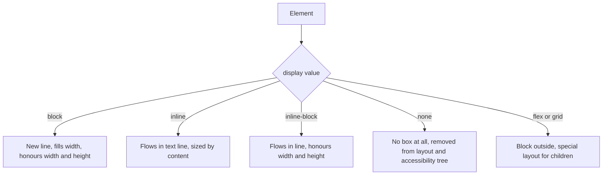

# Ids, classes, generic containers and the document head

> **Before this lesson:** you should know elements, attributes and the DOM ([How web pages work](#/lesson/html-css/how-pages-work)), block and inline text elements ([Marking up text](#/lesson/html-css/text-markup)) and fragment links ([Lists and links](#/lesson/html-css/lists-links)).

## In plain words

This lesson covers the small, general-purpose tools of HTML: ways to *name* an element so you can point at it, ways to *group* elements so you can treat them alike, neutral wrapper elements for when nothing more specific fits, and the information about a page that lives out of sight in its `<head>`.

A school is a good comparison. Each pupil has a unique student number (an `id`): exactly one pupil answers to it. Pupils also belong to groups such as "Year 9" or "choir" (a `class`): many pupils share each group and one pupil can be in several. The school office also keeps a file on the school itself (its address, its inspection reports) that visitors never see on the walls: that is the `<head>`.

Ids and classes are the hooks that all styling and scripting hang on, so you will type them in every project. "What is the difference between an id and a class?" and "block versus inline?" are among the most frequently asked interview questions.

## Why it is worth learning properly

So far every element has had a job: paragraph, list, table, form field. This lesson is about the connective tissue that holds a real page together. How do you single out *one* paragraph for a script, or mark *several* boxes as belonging to the same visual pattern? What do you use when no element describes your content? What goes in the `<head>` to make a page look right when shared on social media, and how do escape codes, comments and old doctypes fit in?

These are small topics individually, but they come up in every project and in most interviews, particularly the distinction between `id` and `class` and between block and inline boxes.

## Identifying elements: `id`

The `id` attribute gives one element a name that is **unique within the document**.

```html
<section id="pricing">…</section>
```

An id has four uses:

| Use | Example |
|---|---|
| Fragment link target | `<a href="#pricing">` scrolls to it |
| Label association | `<label for="email">` ↔ `<input id="email">` |
| ARIA relationships | `aria-labelledby="pricing-title"`, `aria-describedby="hint"` |
| Script and style hook | `document.getElementById('pricing')`, `#pricing { … }` |

Rules: an id value must contain at least one character and no whitespace. Start it with a letter to avoid awkward escaping in CSS. It is case-sensitive, so `Pricing` and `pricing` are different.

If two elements share an id, nothing crashes, but behaviour becomes arbitrary: `getElementById` returns the first, fragment links go to the first, and a label may point at the wrong field. Duplicate ids are a common accessibility bug in pages assembled from repeated components.

## Grouping elements: `class`

The `class` attribute puts an element into one or more named groups. Unlike ids, a class can be reused on any number of elements, and one element can carry several classes separated by spaces.

```html-run
<!doctype html>
<html lang="en">
<head><meta charset="utf-8"><title>id and class</title>
<style>
  body { font-family: system-ui, sans-serif; }
  .note      { padding: .6rem .9rem; border-left: 5px solid #607d8b; background: #eceff1; margin: .6rem 0; }
  .note.warn { border-color: #ef6c00; background: #fff3e0; }
  .note.ok   { border-color: #2e7d32; background: #e8f5e9; }
  #today     { outline: 3px dashed #6a1b9a; }
</style></head>
<body>
  <p class="note">Plain note: the library opens at nine.</p>
  <p class="note warn">Warning note: the lift is out of order.</p>
  <p class="note ok" id="today">Good news note: late opening tonight.</p>
  <p><a href="#today">Jump to today's note</a></p>
</body>
</html>
```

The three paragraphs share the `note` class for common styling; `warn` and `ok` are modifiers layered on top; the id singles out one element for the link.

| | `id` | `class` |
|---|---|---|
| How many elements may share a value | One | Any number |
| How many values per element | One | Many, space-separated |
| CSS selector | `#name` | `.name` |
| Specificity | High (1,0,0) | Low (0,1,0) |
| Link, label and ARIA target | Yes | No |
| Typical use | Unique landmarks and associations | Reusable styling and behaviour hooks |

> [!INTERVIEW]
> "When do you use an id versus a class?" Classes for styling, because they are reusable and have low specificity that is easy to override. Ids for things that are inherently unique and need to be *referenced*: fragment targets, `label for`, ARIA relationships. Styling with `#id` selectors makes rules hard to override and impossible to reuse.

### Naming things

Name classes after **what the thing is**, not how it currently looks. `.error-message` survives a redesign; `.red-bold-text` becomes a lie the day the brand colour changes. Lowercase words joined with hyphens are the prevailing convention, and the architecture lesson later introduces naming systems such as BEM.

## Generic containers: `div` and `span`

When no semantic element fits, HTML offers two blanks. `<div>` groups block-level content; `<span>` wraps a run of inline content. Neither has any meaning or default styling beyond `div` being displayed as a block.

```html-run
<!doctype html>
<html lang="en">
<head><meta charset="utf-8"><title>div and span</title>
<style>
  body { font-family: system-ui, sans-serif; }
  .card { border: 1px solid #bbb; border-radius: 10px; padding: 1rem; max-width: 300px; box-shadow: 0 2px 6px #0002; }
  .card h3 { margin-top: 0; }
  .price { color: #00695c; font-weight: 700; }
  .unit  { color: #666; font-size: .85em; }
</style></head>
<body>
  <div class="card">
    <h3>Day pass</h3>
    <p><span class="price">£6</span> <span class="unit">per adult</span></p>
    <p>Includes the reading room and the map archive.</p>
  </div>
</body>
</html>
```

The `div` exists purely so the border and padding have a box to belong to; the `span`s exist so two fragments of a sentence can be styled differently. Before using either, ask whether a real element fits: `article`, `section`, `nav`, `aside`, `figure`, `button`, `strong`, `em`, `time`. Reaching for `div` first produces markup that is correct to look at and empty of meaning.

## Block and inline: how boxes flow

Every element generates a box, and the box's **outer display type** determines how it takes part in the page's flow.

| | Block box | Inline box |
|---|---|---|
| Starts on a new line | Yes | No, flows with text |
| Default width | Fills the container | Only its content |
| `width` and `height` | Respected | Ignored |
| Vertical margin and padding | Push neighbours apart | Do not affect line spacing |
| Default examples | `div`, `p`, `h1`–`h6`, `ul`, `li`, `section`, `form`, `table` | `span`, `a`, `em`, `strong`, `code`, `label` |

A third value, `inline-block`, flows in a line like inline but respects width, height and vertical spacing like block. Images, buttons and inputs behave in a similar way by default.

```html-run
<!doctype html>
<html lang="en">
<head><meta charset="utf-8"><title>Display types</title>
<style>
  body { font-family: system-ui, sans-serif; line-height: 1.6; }
  .box { background: #bbdefb; border: 2px solid #1565c0; width: 120px; height: 40px; margin: 10px; padding: 6px; }
  .b  { display: block; }
  .i  { display: inline; }
  .ib { display: inline-block; }
</style></head>
<body>
  <p>Text before
    <span class="box i">inline</span>
    <span class="box i">inline</span>
    text after. Width, height and vertical margin are ignored, and the padding overlaps neighbouring lines.</p>
  <p>Text before
    <span class="box ib">inline-block</span>
    <span class="box ib">inline-block</span>
    text after.</p>
  <span class="box b">block (a span!)</span>
  <span class="box b">block</span>
</body>
</html>
```

The last two boxes are `span` elements displayed as blocks, which proves the point from an earlier lesson: display is a CSS decision. HTML's content rules are separate, and a `span` still may not contain a `div` no matter how it is displayed.



## The `hidden` attribute and friends

Several mechanisms hide content, and they differ in who is affected.

| Technique | Visible | Takes up space | Read by screen readers | Focusable |
|---|---|---|---|---|
| `hidden` attribute / `display: none` | No | No | No | No |
| `visibility: hidden` | No | Yes | No | No |
| `opacity: 0` | No | Yes | **Yes** | **Yes** |
| `aria-hidden="true"` | Yes | Yes | No | **Still yes** (avoid on focusable content) |
| "Visually hidden" CSS class | No | No | **Yes** | Yes |
| `inert` attribute | Yes | Yes | No | No |

`hidden` is HTML's way of saying "not relevant right now". It is implemented with `display: none` in the browser's style sheet, which means any author rule setting `display` will override it; a common safeguard is `[hidden] { display: none !important; }`.

## Document metadata in the `head`

Beyond `charset`, `viewport` and `title`, the head can carry information for search engines, social networks and the browser itself.

```html
<head>
  <meta charset="utf-8">
  <meta name="viewport" content="width=device-width, initial-scale=1">
  <title>Map archive · Riverside Library</title>
  <meta name="description" content="Browse 4,000 historic maps of the river valley, free to view online.">
  <link rel="canonical" href="https://library.example.org/maps/">
  <link rel="icon" href="/favicon.svg" type="image/svg+xml">
  <link rel="stylesheet" href="/css/site.css">
  <meta name="theme-color" content="#00695c">
  <meta name="robots" content="index, follow">

  <!-- Social sharing preview (Open Graph) -->
  <meta property="og:title" content="Map archive">
  <meta property="og:description" content="Browse 4,000 historic maps of the river valley.">
  <meta property="og:image" content="https://library.example.org/img/maps-card.jpg">
  <meta property="og:url" content="https://library.example.org/maps/">
</head>
```

| Tag | What it is for |
|---|---|
| `<meta name="description">` | The snippet search engines may show under the title; aim for one or two informative sentences |
| `<link rel="canonical">` | Declares the preferred URL when the same content is reachable at several addresses |
| `<link rel="icon">` | The favicon in tabs and bookmarks |
| `<link rel="stylesheet">` | An external style sheet |
| `<meta name="theme-color">` | Colours the browser chrome on mobile |
| `<meta name="robots">` | `noindex` keeps a page out of search results; `nofollow` tells crawlers not to follow its links |
| `og:*` properties | Title, description and image used when the link is pasted into chat apps and social networks |
| `<base href>` | Changes the base URL for every relative link on the page; powerful and easy to misuse |

The `keywords` meta tag you may find in older pages is ignored by major search engines and can be left out.

You will also meet `http-equiv`, which imitates an HTTP header from within the markup. The one still worth knowing is `<meta http-equiv="refresh" content="0; url=/new-page">` for a redirect when you cannot configure the server, though a real HTTP redirect is better.

## Escaping, comments and conditional leftovers

**Character references** let you write characters that would otherwise be read as markup, or that are hard to type. They come in named form (`&amp;`, `&lt;`, `&gt;`, `&quot;`, `&nbsp;`, `&copy;`, `&euro;`) and numeric form (`&#8364;` or hexadecimal `&#x20AC;` for the same euro sign). With UTF-8 you can type most symbols directly; the ones you must always escape in text are `<` and `&`, plus the matching quote inside an attribute value.

```html-run
<!doctype html>
<html lang="en">
<head><meta charset="utf-8"><title>Escapes</title>
<style> code { background: #f1f1f1; padding: 0 .25em; } </style></head>
<body>
  <p>To make text bold write <code>&lt;strong&gt;like this&lt;/strong&gt;</code>.</p>
  <p>Fish &amp; chips costs &pound;9&nbsp;&ndash;&nbsp;&pound;12 &rarr; cash only.</p>
  <p title="She said &quot;hello&quot;">Hover me to see quotes inside an attribute.</p>
  <p>Numeric references: &#169; &#x1F4DA; &#8721;</p>
  <!-- TODO: add winter opening hours -->
</body>
</html>
```

**Comments** (`<!-- … -->`) are ignored for rendering but delivered to every visitor. Use them to explain non-obvious markup, and strip them in production builds if they are bulky.

**Old doctypes and conditional comments.** Legacy pages begin with long declarations such as the XHTML 1.0 Transitional doctype, and may contain `<!--[if IE 8]>` blocks that only old Internet Explorer understood. Both are harmless relics. For anything new, `<!doctype html>` is the only declaration to use.

## Custom data attributes

Any attribute whose name begins with `data-` is yours to define. They are the sanctioned way to attach small pieces of application data to elements.

```html-run
<!doctype html>
<html lang="en">
<head><meta charset="utf-8"><title>data attributes</title>
<style>
  body { font-family: system-ui, sans-serif; }
  li { padding: .3rem .5rem; margin: .2rem 0; border-radius: 6px; list-style: none; }
  li[data-status="available"] { background: #e8f5e9; }
  li[data-status="on-loan"]   { background: #ffebee; }
  li::after { content: " — due " attr(data-due); color: #777; font-size: .85em; }
  li:not([data-due])::after { content: ""; }
</style></head>
<body>
  <ul id="books">
    <li data-status="available">Atlas of Tides</li>
    <li data-status="on-loan" data-due="12 May">The Cartographer's Year</li>
    <li data-status="available">Rivers of the North</li>
  </ul>
  <p id="count"></p>
  <script>
    const free = document.querySelectorAll('#books li[data-status="available"]').length;
    document.getElementById('count').textContent = free + ' titles available';
    console.log(document.querySelector('li').dataset.status);
  </script>
</body>
</html>
```

CSS reads them with attribute selectors and `attr()`; JavaScript reads them through `element.dataset` (`data-due-date` becomes `dataset.dueDate`). Do not use them for information that has a proper element or attribute, and do not put anything users need to perceive only in a data attribute, because assistive technology does not read it.

> [!TIP]
> To find duplicate ids on a page, run `[...document.querySelectorAll('[id]')].map(e => e.id).filter((id, i, all) => all.indexOf(id) !== i)` in the browser Console. An empty list means every id is unique.

> [!WARNING]
> Anything in the HTML, including comments, `hidden` elements and `data-*` attributes, is delivered to every visitor and can be read with View Source. Never place passwords, keys or private data there.

## Pitfalls

- **Duplicate ids.** Breaks labels, fragment links and ARIA references in confusing ways.
- **Styling everything with ids.** High specificity leads to an arms race of ever-stronger selectors.
- **Presentational class names** (`.blue`, `.left`, `.big`). They age badly; name the role.
- **Div soup.** Check for a semantic element first.
- **Giving an inline element a width.** It is ignored; use `inline-block` or `block`.
- **Author CSS defeating `hidden`.** `.panel { display: flex; }` reveals a `<div class="panel" hidden>`.
- **`aria-hidden="true"` on something focusable.** Keyboard users land on an element their screen reader says does not exist.
- **Relying on `opacity: 0` to hide controls.** They remain clickable and focusable.
- **Missing meta description and social tags.** Shared links show an arbitrary scrap of text and no image.
- **`<base>` added casually.** It silently redirects every relative URL and in-page anchor.

## Cheat sheet

| Need | Use |
|---|---|
| Unique name for linking or labelling | `id="x"` (one per document) |
| Reusable styling hook | `class="a b"` |
| Meaningless block / inline wrapper | `<div>` / `<span>` |
| New line and full width | `display: block` |
| In a line but sizable | `display: inline-block` |
| Remove from page and accessibility tree | `hidden` or `display: none` |
| Hide visually, keep for screen readers | A visually-hidden class |
| Search snippet | `<meta name="description" content="…">` |
| Preferred URL | `<link rel="canonical" href="…">` |
| Share preview | `og:title`, `og:description`, `og:image` |
| Literal `<` `&` `"` | `&lt;` `&amp;` `&quot;` |
| Custom data | `data-*` attributes, `element.dataset` |

## Summary

Ids name unique elements so that links, labels, ARIA attributes and scripts can refer to them; classes group elements for reusable styling and may be combined freely. `div` and `span` are neutral containers for when no semantic element applies. Whether a box is block, inline or inline-block decides how it flows and whether it accepts dimensions, and that is controlled by CSS, not by the element's HTML category. The head holds metadata that shapes how the page appears in search results, browser chrome and shared links. Escapes, comments and data attributes round out the toolkit for writing markup that is precise and maintainable.

## Glossary

| Term | Meaning |
|---|---|
| `id` | A name that identifies one unique element in a page |
| `class` | A name for a group of elements; an element may have several |
| Selector | A CSS pattern that picks out elements, such as `.note` or `#intro` |
| Specificity | The weight a selector carries when rules conflict |
| `div` / `span` | Meaningless block-level / inline containers |
| Block box | A box that starts on a new line and fills the available width |
| Inline box | A box that flows within a line of text and ignores width and height |
| `inline-block` | A box that flows in a line but accepts width and height |
| `hidden` | An attribute that removes an element from display and from assistive technology |
| Metadata | Information about the page itself, held in `<head>` |
| Meta description | A short summary of the page that search engines may show |
| Canonical URL | The preferred address for a page that can be reached at several |
| Open Graph | Meta tags that control how a link looks when shared on social networks |
| Favicon | The small icon shown in the browser tab |
| Data attribute | A custom attribute whose name starts with `data-` |

## Check yourself

```quiz
[
  {"q": "Two elements on a page both have id='menu'. What does document.getElementById('menu') return?", "options": ["An array of both", "null", "The first one in document order", "It throws an error"], "answer": 2,
   "explain": "Duplicate ids are invalid but not fatal; lookups return the first match, which makes bugs hard to spot."},
  {"q": "Which selector matches <p class='note warn'> but not <p class='note'>?", "options": [".note", ".note .warn", ".note.warn", "#warn"], "answer": 2,
   "explain": "Two class selectors with no space require both classes on the same element. With a space it would look for a .warn descendant inside .note."},
  {"q": "A span has width: 200px; height: 50px and default display. What size is it?", "options": ["200 by 50 pixels", "As wide and tall as its text content", "200 pixels wide, auto height", "Zero"], "answer": 1,
   "explain": "Inline boxes ignore width and height. Change display to inline-block or block for the dimensions to apply."},
  {"q": "What does this render? <div hidden style='display:block'>Hello</div>", "options": ["Nothing", "Hello", "An empty box", "A browser warning"], "answer": 1,
   "explain": "hidden is implemented as display: none in the user-agent style sheet, and any author display declaration overrides it, so the text shows."},
  {"q": "Which technique hides content visually but leaves it available to screen readers?", "options": ["display: none", "visibility: hidden", "The hidden attribute", "A visually-hidden utility class using clipping"], "answer": 3,
   "explain": "The first three remove content from the accessibility tree. A clipping-based visually-hidden class keeps it there."},
  {"q": "How does JavaScript read the attribute data-due-date='12 May' on element el?", "options": ["el.data.dueDate", "el.dataset.dueDate", "el.dataset['due-date']", "el.dueDate"], "answer": 1,
   "explain": "dataset exposes data-* attributes with the prefix removed and the rest converted from kebab-case to camelCase."},
  {"q": "What is the purpose of link rel='canonical'?", "options": ["It preloads the page", "It tells search engines which URL is the preferred one for duplicate or near-duplicate content", "It sets the favicon", "It redirects the browser"], "answer": 1,
   "explain": "Canonical consolidates ranking signals onto one URL when the same content is reachable under several addresses."}
]
```

> **Source:** Duckett, *HTML & CSS*, ch. 8 (Extra Markup). MDN: https://developer.mozilla.org/en-US/docs/Web/HTML/Reference/Global_attributes/id · https://developer.mozilla.org/en-US/docs/Web/HTML/Reference/Global_attributes/class · https://developer.mozilla.org/en-US/docs/Web/HTML/Reference/Elements/meta · https://developer.mozilla.org/en-US/docs/Web/HTML/How_to/Use_data_attributes
