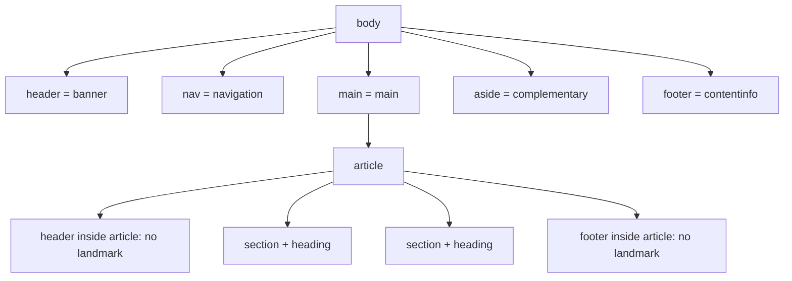
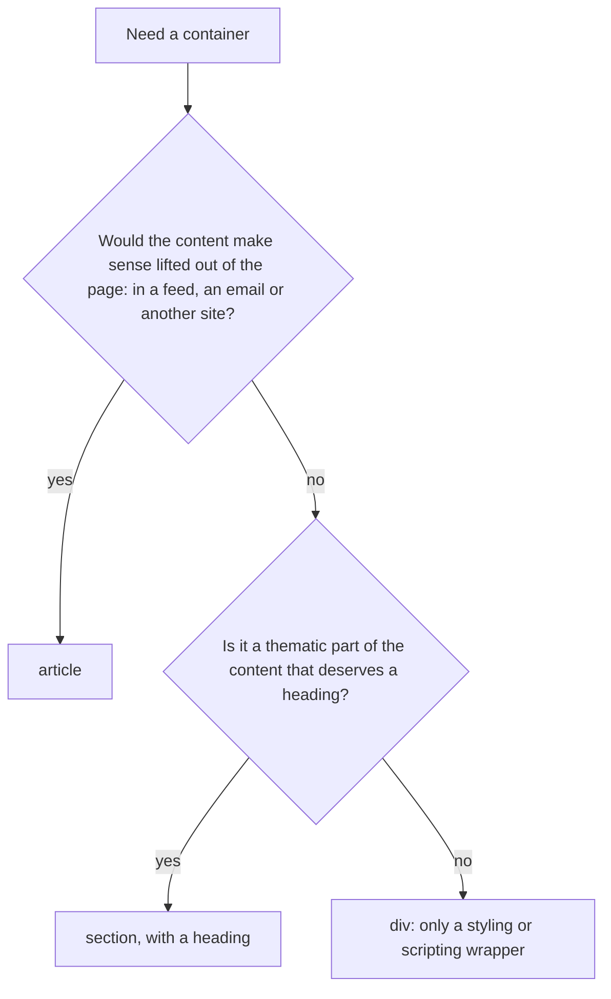

# Semantic page structure: landmarks and the document outline

> **Before this lesson:** you should know headings and the outline ([Marking up text](#/lesson/html-css/text-markup)), `div` and `class` ([Ids, classes, generic containers and the document head](#/lesson/html-css/ids-classes-meta)) and lists of links ([Lists and links](#/lesson/html-css/lists-links)).

## In plain words

**Semantic page structure** means using HTML elements that name the *regions* of a page: the top banner, the navigation menu, the main content, a sidebar, the footer.

Think of the signs in an airport: Departures, Arrivals, Baggage, Exit. Without them the building would still have all the same rooms, but nobody would know where to go. A page made only of anonymous `<div>` boxes is that unsigned airport. Elements such as `<nav>` and `<main>` are the signs, and the people who depend on them most are those who cannot see the layout and move around with a screen reader's "jump to region" command.

This is one of the simplest improvements you can make to any page, and it requires no CSS or JavaScript. "Why use semantic HTML?" is asked in almost every front-end interview, and reviewers look for `main`, `nav` and `button` in your code as a sign that you know the craft.

## Why it is worth learning properly

Look at almost any website and you can name its regions without reading a word: the banner across the top, the menu, the main story, a sidebar of extras, the small print at the bottom. For years those regions were all written the same way, as `<div id="header">`, `<div id="nav">`, `<div id="footer">`. The names helped the developer but meant nothing to a browser, a search engine or a screen reader, because an `id` is only a label.

HTML5 turned those conventions into real elements: `header`, `nav`, `main`, `article`, `section`, `aside`, `footer`. Using them costs no more typing than a `div`, and in return the page gains a machine-readable map. A screen-reader user can jump straight to the main content; a browser's reader mode can find the article; a search engine can tell navigation from substance. This lesson explains each element, how they map to *landmarks*, how headings and sections form an outline, and how to choose between the lookalikes.

## The sectioning elements

| Element | Represents | Typical content |
|---|---|---|
| `<header>` | Introductory content for the page or for a section | Logo, site title, primary navigation, an article's title and byline |
| `<nav>` | A block of major navigation links | Site menu, table of contents, breadcrumbs, pagination |
| `<main>` | The dominant content, unique to this page | Everything that is not repeated site furniture |
| `<article>` | A self-contained composition that would make sense on its own | Blog post, news story, product card, forum post, comment |
| `<section>` | A thematic grouping, normally with its own heading | Chapters of an article, the "Reviews" part of a product page |
| `<aside>` | Content only loosely related to what surrounds it | Sidebar, pull quote, related links, advertising |
| `<footer>` | Closing content for the page or for a section | Copyright, contact details, an article's tags and share links |

```html-run
<!doctype html>
<html lang="en">
<head><meta charset="utf-8"><title>Semantic skeleton</title>
<style>
  body { font-family: system-ui, sans-serif; margin: 0; display: grid; gap: 8px; padding: 8px;
         grid-template-columns: 1fr 200px; grid-template-areas: "h h" "n n" "m a" "f f"; }
  body > * { border: 2px solid; border-radius: 8px; padding: .6rem .9rem; }
  body > *::before, article::before, section::before { font: 700 .7rem/1 monospace; display: block; margin-bottom: .4rem; opacity: .7; }
  header { grid-area: h; border-color: #1565c0; background: #e3f2fd; } header::before { content: "<header>"; }
  nav    { grid-area: n; border-color: #6a1b9a; background: #f3e5f5; } nav::before { content: "<nav>"; }
  main   { grid-area: m; border-color: #2e7d32; background: #e8f5e9; } main::before { content: "<main>"; }
  aside  { grid-area: a; border-color: #ef6c00; background: #fff3e0; } aside::before { content: "<aside>"; }
  footer { grid-area: f; border-color: #455a64; background: #eceff1; } footer::before { content: "<footer>"; }
  article { border: 2px dashed #2e7d32; border-radius: 6px; padding: .5rem; } article::before { content: "<article>"; }
  section { border: 1px dotted #555; margin: .4rem 0; padding: .4rem; } section::before { content: "<section>"; }
  h1, h2, h3, p, ul { margin: .2rem 0; } ul { padding-left: 1.1rem; }
</style></head>
<body>
  <header><h1>The Allotment Post</h1></header>
  <nav aria-label="Main"><a href="#">Home</a> · <a href="#">Guides</a> · <a href="#">Plot map</a></nav>
  <main>
    <article>
      <h2>Building a raised bed</h2>
      <section><h3>Materials</h3><p>Untreated boards, screws, cardboard.</p></section>
      <section><h3>Assembly</h3><p>Level the ground, then fix the corners.</p></section>
    </article>
  </main>
  <aside><h2>This week</h2><ul><li>Sow broad beans</li><li>Mulch paths</li></ul></aside>
  <footer><p>© The Allotment Society</p></footer>
</body>
</html>
```

The coloured labels are drawn with CSS so you can see which element is which. None of these elements has any default visual style beyond being a block; their value is entirely in what they say.

## Landmarks: the accessibility payoff

Assistive technologies expose certain regions as **landmarks**, a short list of destinations a user can jump between with a single keystroke. Each semantic element maps to an ARIA *role* automatically, which is why you seldom need to write a `role` attribute yourself.

| Element | Implicit landmark role | Condition |
|---|---|---|
| `<header>` | `banner` | Only when it is not inside `article`, `aside`, `main`, `nav` or `section` |
| `<nav>` | `navigation` | Always |
| `<main>` | `main` | Always |
| `<aside>` | `complementary` | Generally; depends on nesting in newer mappings |
| `<footer>` | `contentinfo` | Only when not nested inside sectioning content |
| `<section>` | `region` | **Only if it has an accessible name** |
| `<form>` | `form` | Only if it has an accessible name |
| `<search>` | `search` | Always |
| `<article>` | `article` (a document role, not a landmark) | Always |

Three consequences follow.

**Use exactly one `<main>`.** It marks where the page's unique content begins, and it is the target of the "skip to main content" link described in the next lesson.

**Label repeated landmarks.** A page often has several `nav` elements (main menu, breadcrumbs, footer links). Without names, a screen reader lists "navigation, navigation, navigation". Give each a label:

```html
<nav aria-label="Main">…</nav>
<nav aria-label="Breadcrumb">…</nav>
<nav aria-labelledby="footer-nav-title">
  <h2 id="footer-nav-title">More from us</h2> …
</nav>
```

Do not include the word "navigation" in the label; the role already says it.

**A bare `<section>` is not a landmark.** Without a name it is treated like a `div` by assistive technology. That is intentional, since a page with thirty landmark regions would be no easier to navigate than one with none.



## `article` versus `section` versus `div`

This is the choice people agonise over. Three questions settle it.



- **`article`** is about *independence*. A blog post, a recipe, a single review, a tweet-like status update, a product in a listing: each could be syndicated and still be complete. Articles can nest; a comment on a blog post is an `article` inside the post's `article`.
- **`section`** is about *theme*. It groups content under a heading within something larger. If you cannot think of a heading for it, it probably is not a section.
- **`div`** is about *nothing*. A wrapper needed only for a grid or a background is a `div`.

They combine in both directions: an `article` may be divided into `section`s (a long guide with chapters), and a `section` may contain `article`s (a "Latest news" section listing stories).

```html-run
<!doctype html>
<html lang="en">
<head><meta charset="utf-8"><title>Articles in a section</title>
<style>
  body { font-family: system-ui, sans-serif; max-width: 520px; }
  .cards { display: grid; grid-template-columns: 1fr 1fr; gap: 12px; }
  article { border: 1px solid #c5c5c5; border-radius: 10px; padding: .8rem; }
  article h3 { margin: 0 0 .3rem; }
  article footer { font-size: .8rem; color: #666; margin-top: .5rem; }
</style></head>
<body>
  <section aria-labelledby="latest">
    <h2 id="latest">Latest guides</h2>
    <div class="cards">
      <article>
        <header><h3><a href="#">Compost in ten weeks</a></h3></header>
        <p>Balance greens and browns and turn the heap weekly.</p>
        <footer>By Priya · <time datetime="2025-04-02">2 April</time></footer>
      </article>
      <article>
        <header><h3><a href="#">Saving bean seed</a></h3></header>
        <p>Leave the best pods to dry on the plant.</p>
        <footer>By Tomasz · <time datetime="2025-03-27">27 March</time></footer>
      </article>
    </div>
  </section>
</body>
</html>
```

Here the `section` is named by its heading through `aria-labelledby`, so it becomes a `region` landmark. Each card is an `article` with its own `header` and `footer`, which are scoped to the article and therefore are *not* page-level landmarks. The `div.cards` is a pure layout wrapper.

## Headings and the outline, revisited

Sectioning elements do not change heading levels. Screen readers and browsers build the outline purely from `h1` to `h6`, so you must still descend one level at a time, regardless of how deeply a heading is nested in `section`s and `article`s.

A sensible convention:

- `h1`: the page's subject (usually inside `main`, or in the site header on the home page).
- `h2`: major divisions of the page, including the titles of sidebars and footers where they have them.
- `h3` and below: subdivisions.

It is good practice to give every `section`, `article`, `nav` and `aside` a heading, even if you later hide it visually, because the heading doubles as its name in both the outline and the landmark list.

> [!INTERVIEW]
> "What does semantic HTML give you that divs do not?" Built-in roles and landmarks for assistive technology, a navigable heading outline, default keyboard behaviour on interactive elements, better signals for search engines and reader modes, and markup that explains itself to the next developer. None of that requires any CSS or JavaScript.

## Other semantic elements worth knowing

| Element | Purpose |
|---|---|
| `<figure>` + `<figcaption>` | Self-contained illustration, diagram, code listing or quote with a caption |
| `<time datetime>` | A machine-readable date or time |
| `<address>` | Contact details for the nearest article or the page |
| `<details>` + `<summary>` | A disclosure widget that expands and collapses without JavaScript |
| `<dialog>` | A modal or non-modal dialog box with built-in focus handling |
| `<search>` | A region containing search or filtering controls |
| `<hgroup>` | A heading together with a subtitle paragraph |
| `<mark>` | Text highlighted for relevance |

`details` and `dialog` deserve a demonstration because they replace a great deal of custom JavaScript.

```html-run
<!doctype html>
<html lang="en">
<head><meta charset="utf-8"><title>details and dialog</title>
<style>
  body { font-family: system-ui, sans-serif; max-width: 460px; }
  details { border: 1px solid #bbb; border-radius: 8px; padding: .5rem .8rem; margin: .5rem 0; }
  summary { font-weight: 600; cursor: pointer; }
  details[open] { background: #f1f8e9; }
  dialog { border: 0; border-radius: 12px; padding: 1.2rem; max-width: 300px; box-shadow: 0 10px 40px #0005; }
  dialog::backdrop { background: rgb(0 0 0 / .5); }
</style></head>
<body>
  <h2>Plot questions</h2>
  <details>
    <summary>Can I keep hens on my plot?</summary>
    <p>Yes, up to six, with a fox-proof run.</p>
  </details>
  <details name="faq" open>
    <summary>When is the water switched on?</summary>
    <p>From the first of April until the end of October.</p>
  </details>
  <button type="button" onclick="document.getElementById('d').showModal()">Open dialog</button>
  <dialog id="d" aria-labelledby="d-title">
    <h3 id="d-title" style="margin-top:0">Give up your plot?</h3>
    <p>This cannot be undone.</p>
    <form method="dialog"><button>Cancel</button> <button value="yes">Confirm</button></form>
  </dialog>
</body>
</html>
```

`<details>` toggles when its `<summary>` is clicked or activated with Enter or Space, exposes its expanded state to screen readers, and can start open with the `open` attribute. Several `details` elements sharing a `name` form an exclusive accordion. `<dialog>` opened with `showModal()` traps focus inside, makes the rest of the page inert, closes on Escape and returns focus to the button that opened it; a `<form method="dialog">` inside closes it on submit.

## Semantics for small things too

Structure is not only about page regions. The same thinking applies down to single controls:

| Instead of | Write | You gain |
|---|---|---|
| `<div onclick>` | `<button type="button">` | Focus, Enter/Space, disabled state, role |
| `<span class="link" onclick>` | `<a href>` | Focus, new-tab, copy link, visited state |
| `<div class="list">` of `div`s | `<ul>` / `<ol>` | Item count, list navigation |
| `<b>Title</b><br>` | `<h2>` | A place in the outline |
| `<div class="table">` | `<table>` | Row and column headers |
| Custom toggle built from `div`s | `<input type="checkbox">` or `<details>` | State announced, keyboard operable |

Each native element comes with a role, states and keyboard behaviour that would take dozens of lines of script and ARIA to reproduce, and which re-implementations usually get subtly wrong.

> [!TIP]
> Browser extensions and the accessibility pane of developer tools can list a page's landmarks and headings. If the list makes sense by itself, the structure is good.

> [!WARNING]
> Adding a `role` attribute to a semantic element overrides its built-in meaning. `<main role="presentation">` or `<button role="link">` removes behaviour that users rely on. Change roles only when you are sure a native element cannot do the job.

## Pitfalls

- **Several `<main>` elements, or none.** There must be one visible `main` per page.
- **`<section>` as a generic wrapper.** If it has no heading and no theme, it is a `div`.
- **Wrapping everything in `<article>`.** It is for independently distributable content, not for any box.
- **`<nav>` around every group of links.** Reserve it for major navigation blocks; a handful of links in running text does not need one.
- **Unlabelled duplicate landmarks.** Two `nav`s or two `aside`s need `aria-label` or `aria-labelledby`.
- **Redundant roles.** `<nav role="navigation">` and `<main role="main">` repeat what the element already says.
- **Assuming `section` nesting fixes heading levels.** It does not; choose the numbers yourself.
- **`<header>` confused with `<head>` or with headings.** `head` is metadata, `header` is a visible introductory region, `h1`–`h6` are headings.
- **`<aside>` for content that is essential.** If the page fails without it, it belongs in the main flow.
- **`<footer>` used only at the bottom of the page.** Articles and sections can have their own.

## Cheat sheet

| Question | Answer |
|---|---|
| Site-wide top area | `<header>` (landmark: banner) |
| Major link block | `<nav aria-label="…">` |
| The page's unique content | One `<main>` |
| Could stand alone elsewhere | `<article>` |
| Thematic chunk with a heading | `<section>` (name it to make a region) |
| Tangential or supplementary | `<aside>` |
| Closing information | `<footer>` (landmark: contentinfo at page level) |
| Purely for layout | `<div>` |
| Collapsible answer | `<details><summary>` |
| Modal | `<dialog>` + `showModal()` |
| Naming a landmark | `aria-labelledby="heading-id"` or `aria-label="…"` |

## Summary

Semantic sectioning elements describe the regions of a page in a way software understands. `header`, `nav`, `main`, `aside` and `footer` become landmarks that assistive technology can jump between; `article` marks independent compositions and `section` marks themed parts with headings; `div` remains for meaningless wrappers. The heading outline is still built only from heading levels, so keep them in order. Prefer native elements such as `button`, `details` and `dialog` over scripted imitations. The result is a page that is easier to navigate, easier to index and easier to maintain.

## Glossary

| Term | Meaning |
|---|---|
| Semantic element | An element whose name describes the role of its content, such as `<nav>` |
| Landmark | A page region that assistive technology lists and lets users jump to |
| Role | What kind of thing an element is, as reported to assistive technology |
| `<header>` / `<footer>` | Introductory / closing content of a page or section |
| `<nav>` | A block of major navigation links |
| `<main>` | The content unique to this page; one per page |
| `<article>` | A self-contained piece that would make sense on its own |
| `<section>` | A themed part of the content, normally with a heading |
| `<aside>` | Content only loosely related to what surrounds it |
| Accessible name | The label announced for an element, from its text, a `<label>` or an ARIA attribute |
| `aria-label` / `aria-labelledby` | Attributes that supply an accessible name directly / by pointing at another element |
| Disclosure widget | A control that shows and hides content, built with `<details>` and `<summary>` |
| Modal dialog | A window that must be dealt with before returning to the page, built with `<dialog>` |
| Div soup | Markup built almost entirely from meaningless `<div>` elements |

## Check yourself

```quiz
[
  {"q": "How many visible main elements should a page have?", "options": ["One per article", "Exactly one", "As many as needed", "None; main is obsolete"], "answer": 1,
   "explain": "main identifies the single block of content unique to the page and maps to the main landmark."},
  {"q": "A header element is placed inside an article. Which landmark role does it have?", "options": ["banner", "contentinfo", "None; it is scoped to the article", "navigation"], "answer": 2,
   "explain": "header maps to banner only at page level. Inside sectioning content it is that section's introductory block."},
  {"q": "Which element best fits a single customer review in a list of reviews?", "options": ["section", "article", "aside", "div"], "answer": 1,
   "explain": "Each review is a self-contained item that would make sense on its own, which is the definition of article."},
  {"q": "A page contains <section><p>Some text</p></section> with no heading or label. How do screen readers treat the section?", "options": ["As a region landmark", "As a generic container with no landmark", "As the main content", "As an error"], "answer": 1,
   "explain": "section only becomes a region landmark when it has an accessible name via a heading reference or aria-label."},
  {"q": "A page has a main menu nav and a breadcrumb nav. What should you add?", "options": ["role='navigation' on both", "A distinct aria-label on each", "Nothing", "tabindex='0' on both"], "answer": 1,
   "explain": "Names such as Main and Breadcrumb let users tell the two navigation landmarks apart. The role is already implicit."},
  {"q": "An h1 sits inside section > section > article. What level is it in the outline that assistive technology uses?", "options": ["Level 3", "Level 4", "Level 1", "It is ignored"], "answer": 2,
   "explain": "Nesting does not alter heading levels; the tag number is what counts. The proposed outline algorithm was never implemented."},
  {"q": "What does a details element with no open attribute render initially?", "options": ["Its full content", "Only the summary, with a disclosure marker", "Nothing until scripted", "The summary and first paragraph"], "answer": 1,
   "explain": "details is collapsed by default, showing only its summary; activating the summary reveals the rest."}
]
```

> **Source:** Duckett, *HTML & CSS*, ch. 17 (HTML5 Layout). MDN: https://developer.mozilla.org/en-US/docs/Learn_web_development/Core/Structuring_content/Structuring_documents · https://developer.mozilla.org/en-US/docs/Web/Accessibility/ARIA/Reference/Roles/landmark_role · https://developer.mozilla.org/en-US/docs/Web/HTML/Reference/Elements/section · https://developer.mozilla.org/en-US/docs/Web/HTML/Reference/Elements/dialog
