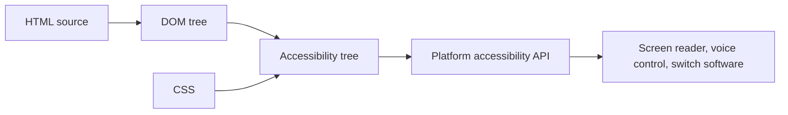

# Accessibility: names, focus, contrast and ARIA

> **Before this lesson:** you should know semantic regions and landmarks ([Semantic page structure](#/lesson/html-css/semantic-structure)), labels for form controls ([Forms](#/lesson/html-css/forms)) and alt text ([Images](#/lesson/html-css/images)).

## In plain words

**Accessibility** means making sure a website can be used by everyone, including people who cannot see the screen, cannot hear audio, cannot use a mouse, or find complex pages hard to follow.

A building is a familiar comparison. A ramp beside the steps, a lift, clear signs and doors wide enough for a wheelchair let everyone in. They also help people pushing prams, carrying luggage or recovering from an injury. Nothing about the building is worse for having them. On the web the ramps are things like text descriptions for images, controls that work from the keyboard and colours with enough contrast to read.

Accessibility is required by law in many countries, it is part of most companies' quality standards, and it is a standard interview topic. Most of it comes free when you write HTML properly, which is why this lesson builds directly on the earlier ones.

## Why it is worth learning properly

About one person in six lives with a significant disability, and everyone is "situationally" disabled now and then: holding a baby in one arm, reading a phone in bright sun, watching video in a silent office, recovering from a broken wrist. **Accessibility** (often shortened to *a11y*: a, eleven letters, y) is the practice of building pages that work for all of these people, whichever input and output devices they use.

It is also a legal requirement in many places and a standard interview topic. The encouraging news is that most of accessibility is not extra work. It is the result of doing ordinary HTML and CSS properly. This lesson gives you a mental model, the handful of techniques that fix the majority of real-world failures, and the rules for ARIA, a tool that is powerful and very easy to misuse.

## Who uses the web differently

| Situation | Typical tools | What they need from your page |
|---|---|---|
| Blind | Screen reader with speech or braille | Text alternatives, structure, names for every control |
| Low vision | Zoom, magnifier, high-contrast mode | Reflow at 400% zoom, strong contrast, text that resizes |
| Colour-vision deficiency | — | Information not carried by colour alone |
| Deaf or hard of hearing | Captions, transcripts | Text for all audio |
| Motor impairment | Keyboard only, switch device, voice control | Everything operable without a mouse; large targets; visible focus |
| Cognitive or attention differences | Reader mode, slower pace | Clear language, consistent layout, no surprise motion or time limits |

The reference standard is the **Web Content Accessibility Guidelines** (WCAG), organised under four principles summarised as **POUR**: content must be **P**erceivable, **O**perable, **U**nderstandable and **R**obust. Conformance levels run A, AA and AAA; laws and contracts usually ask for AA.

## The accessibility tree

A screen reader does not look at pixels. The browser derives a second tree from the DOM, the **accessibility tree**, in which each relevant node has four kinds of information:

- **Role**: what kind of thing it is (button, link, heading, checkbox, navigation).
- **Name**: its label ("Search", "Close dialog").
- **State and properties**: checked, expanded, disabled, required, current value.
- **Description**: optional extra help text.



Native elements fill this in automatically. `<button>Save</button>` has role *button* and name "Save". `<input type="checkbox" checked>` reports role *checkbox*, state *checked*. A `<div>` styled to look like a button contributes role *generic* and no name. That gap is the root of most accessibility bugs.

> [!TIP]
> Browser developer tools show this tree. In Chrome or Edge, open the Elements panel and choose the **Accessibility** pane; in Firefox use the **Accessibility** tab. Inspect any control to see its computed role and name.

## Accessible names

Every interactive element and every landmark you have more than one of needs a name. The browser computes it from the first of these that applies:

1. `aria-labelledby` (text of other elements, referenced by id)
2. `aria-label` (a string attribute)
3. The native mechanism: a `<label>` for form controls, `alt` for images, `<caption>` for tables, `<legend>` for fieldsets, the text content for buttons and links
4. `title` (a last resort)

```html-run
<!doctype html>
<html lang="en">
<head><meta charset="utf-8"><title>Accessible names</title>
<style>
  body { font-family: system-ui, sans-serif; }
  button { font: inherit; padding: .4rem .7rem; margin: .2rem; }
  svg { width: 1.1em; height: 1.1em; vertical-align: -.15em; }
  .sr-only { position: absolute; width: 1px; height: 1px; margin: -1px; padding: 0;
             overflow: hidden; clip-path: inset(50%); white-space: nowrap; border: 0; }
</style></head>
<body>
  <!-- 1. Visible text is the name -->
  <button type="button">Save draft</button>

  <!-- 2. Icon-only button named with aria-label -->
  <button type="button" aria-label="Close">
    <svg viewBox="0 0 24 24" aria-hidden="true"><path d="M5 5l14 14M19 5L5 19" stroke="currentColor" stroke-width="3"/></svg>
  </button>

  <!-- 3. Icon-only button named with visually hidden text -->
  <button type="button">
    <svg viewBox="0 0 24 24" aria-hidden="true"><circle cx="10" cy="10" r="6" fill="none" stroke="currentColor" stroke-width="3"/><path d="M15 15l6 6" stroke="currentColor" stroke-width="3"/></svg>
    <span class="sr-only">Search</span>
  </button>

  <!-- 4. Ambiguous links disambiguated -->
  <h3 id="t1">Winter timetable</h3>
  <a href="#" id="l1" aria-labelledby="l1 t1">Download</a>
</body>
</html>
```

The last link is announced as "Download Winter timetable": `aria-labelledby` can combine the element's own text with another element's.

The `.sr-only` class in that example is the standard **visually hidden** pattern. It removes text from view while leaving it in the accessibility tree, unlike `display: none`, which removes it from both. Use it for labels that sighted users get from an icon or from layout.

> [!WARNING]
> `aria-label` *replaces* the element's text content as its name. If a button shows "Send" but has `aria-label="Submit form"`, a voice-control user saying "click Send" gets no response. Keep the visible text inside the accessible name (WCAG calls this *Label in Name*).

## Keyboard access

Many people never touch a mouse. The contract is short:

| Key | Expected behaviour |
|---|---|
| <kbd>Tab</kbd> / <kbd>Shift</kbd>+<kbd>Tab</kbd> | Move to the next / previous focusable element |
| <kbd>Enter</kbd> | Activate a link or button; submit a form |
| <kbd>Space</kbd> | Activate a button; toggle a checkbox; scroll the page |
| Arrow keys | Move within a composite widget (radio group, select, tabs, menu) |
| <kbd>Esc</kbd> | Close a dialog, menu or popover |

Links, buttons, form controls and `<summary>` are focusable by default and appear in the **tab order**, which follows the DOM order. Everything else is not. The `tabindex` attribute changes that:

| Value | Effect |
|---|---|
| `tabindex="0"` | Adds the element to the tab order at its DOM position |
| `tabindex="-1"` | Focusable by script (`el.focus()`) or by click, but skipped by Tab |
| `tabindex="1"` or higher | Jumps ahead of everything else. **Avoid**: it creates a confusing order that is hard to maintain |

Because tab order follows the DOM, visual reordering with CSS (`order`, `flex-direction: row-reverse`, grid placement, absolute positioning) can make focus leap around the screen unpredictably. Keep source order and visual order in agreement.

### Visible focus

A keyboard user needs to see where they are. Browsers draw a focus ring by default; the classic sin is removing it with `outline: none` because a designer disliked it. The modern approach is `:focus-visible`, which matches when the browser judges that an indicator is needed (keyboard navigation, or any focus on a text field) but not after a mouse click on a button.

```html-run
<!doctype html>
<html lang="en">
<head><meta charset="utf-8"><title>Focus styles</title>
<style>
  body { font-family: system-ui, sans-serif; }
  .skip { position: absolute; left: .5rem; top: -4rem; background: #111; color: #fff; padding: .5rem .8rem; border-radius: 6px; }
  .skip:focus { top: .5rem; }
  nav a, button { display: inline-block; padding: .45rem .8rem; margin: .2rem; border-radius: 6px;
                  border: 2px solid #37474f; background: #fff; color: #263238; font: inherit; text-decoration: none; }
  :focus-visible { outline: 3px solid #f9a825; outline-offset: 3px; }
  main { margin-top: 3rem; padding: 1rem; background: #f5f5f5; }
  main:focus { outline: none; }
</style></head>
<body>
  <a class="skip" href="#content">Skip to main content</a>
  <nav aria-label="Main">
    <a href="#">Home</a><a href="#">Routes</a><a href="#">Tickets</a><a href="#">Help</a>
  </nav>
  <main id="content" tabindex="-1">
    <h1>Click in this frame, then press Tab</h1>
    <p>The first Tab reveals the skip link. Press Enter on it to jump past the menu.</p>
    <button type="button">A button</button>
  </main>
</body>
</html>
```

That example includes a **skip link**: the first focusable element on the page, hidden off screen until focused, which jumps past repeated navigation to the main content. Without one, a keyboard user must tab through the whole menu on every page.

### Focus management

When your script changes what is on screen, focus must follow:

- Opening a modal: move focus into it, keep focus inside while it is open, and return focus to the trigger when it closes. `<dialog>` with `showModal()` does all of this.
- Removing the element that has focus: move focus somewhere sensible, or it falls back to the top of the document.
- After client-side navigation: move focus to the new page's heading or main region.

The `inert` attribute makes a whole subtree unfocusable, unclickable and hidden from assistive technology, which is ideal for content behind an open drawer or dialog.

## Colour and contrast

Text must stand out from its background. WCAG defines a **contrast ratio** from 1:1 (identical) to 21:1 (black on white).

| Content | Minimum at level AA |
|---|---|
| Body text | 4.5 : 1 |
| Large text (at least 24px, or 18.66px bold) | 3 : 1 |
| UI components and meaningful graphics (borders of inputs, icons, focus rings) | 3 : 1 |
| Disabled controls, logos, pure decoration | No requirement |

```html-run
<!doctype html>
<html lang="en">
<head><meta charset="utf-8"><title>Contrast</title>
<style>
  body { font-family: system-ui, sans-serif; }
  p { padding: .6rem .9rem; margin: .4rem 0; max-width: 460px; border-radius: 6px; }
  .bad1 { color: #aaaaaa; background: #ffffff; }
  .bad2 { color: #ffffff; background: #f9a825; }
  .ok1  { color: #595959; background: #ffffff; }
  .ok2  { color: #1b1b1b; background: #f9a825; }
  .field { margin: .8rem 0; }
  .err-colour-only { border: 2px solid #d32f2f; }
  .err-better { border: 2px solid #d32f2f; }
  .msg { color: #b71c1c; font-size: .9rem; }
</style></head>
<body>
  <p class="bad1">Light grey on white: about 2.3 : 1. Fails.</p>
  <p class="ok1">Darker grey on white: about 7 : 1. Passes.</p>
  <p class="bad2">White on amber: about 1.9 : 1. Fails.</p>
  <p class="ok2">Near-black on amber: about 9 : 1. Passes.</p>
  <div class="field"><label>Colour alone: <input class="err-colour-only" value="not-an-email"></label></div>
  <div class="field"><label>Colour plus text: <input class="err-better" value="not-an-email" aria-invalid="true" aria-describedby="m"></label>
    <div class="msg" id="m">⚠ Enter a valid email address.</div></div>
</body>
</html>
```

The second half of that demo shows the other colour rule: **never use colour as the only signal**. An error needs text or an icon as well as a red border; links in body text need an underline as well as a different hue; a chart needs labels or patterns as well as a legend of coloured squares.

Also respect user preferences exposed through media queries: `prefers-reduced-motion` (tone down animation), `prefers-color-scheme` (light or dark), `prefers-contrast` and `forced-colors` (Windows high-contrast themes, where your colours are replaced, so information must not depend on backgrounds alone).

## ARIA: when HTML runs out

**WAI-ARIA** (Accessible Rich Internet Applications) is a set of attributes that edit the accessibility tree directly: `role` changes what an element is announced as, and `aria-*` attributes supply names, states and relationships.

ARIA changes only what assistive technology is *told*. It adds no behaviour: `role="button"` does not make a `div` focusable or respond to Enter. That is why the first rule of ARIA is famous:

> **If a native HTML element or attribute gives you the semantics and behaviour you need, use it instead of ARIA.**

Surveys of the web's most popular home pages repeatedly find that pages using ARIA have *more* detectable errors than pages without, because it is so often applied incorrectly. "No ARIA is better than bad ARIA."

```html-run
<!doctype html>
<html lang="en">
<head><meta charset="utf-8"><title>ARIA states</title>
<style>
  body { font-family: system-ui, sans-serif; max-width: 420px; }
  button { font: inherit; padding: .4rem .7rem; }
  [aria-expanded="true"] .chev { transform: rotate(90deg); }
  .chev { display: inline-block; transition: transform .15s; }
  #panel { border: 1px solid #bbb; border-radius: 6px; padding: .6rem; margin-top: .4rem; }
  [aria-pressed="true"] { background: #1565c0; color: #fff; }
  [aria-current="page"] { font-weight: 700; text-decoration: none; }
</style></head>
<body>
  <button type="button" id="t" aria-expanded="false" aria-controls="panel">
    <span class="chev" aria-hidden="true">▶</span> Opening hours
  </button>
  <div id="panel" hidden>Mon–Fri 9–5, Sat 10–2.</div>

  <p><button type="button" id="mute" aria-pressed="false">Mute notifications</button></p>
  <nav aria-label="Main"><a href="#" aria-current="page">Home</a> · <a href="#">Routes</a></nav>
  <p role="status" id="live"></p>
  <script>
    const t = document.getElementById('t'), panel = document.getElementById('panel');
    t.addEventListener('click', () => {
      const open = t.getAttribute('aria-expanded') === 'true';
      t.setAttribute('aria-expanded', String(!open));
      panel.hidden = open;
    });
    const mute = document.getElementById('mute');
    mute.addEventListener('click', () => {
      const on = mute.getAttribute('aria-pressed') !== 'true';
      mute.setAttribute('aria-pressed', String(on));
      document.getElementById('live').textContent = on ? 'Notifications muted.' : 'Notifications on.';
    });
  </script>
</body>
</html>
```

The ARIA attributes you will use most:

| Attribute | Meaning | Typical host |
|---|---|---|
| `aria-label`, `aria-labelledby` | Accessible name | Icon buttons, landmarks, dialogs |
| `aria-describedby` | Extra description read after the name | Inputs with hints or errors |
| `aria-expanded` | Whether a controlled region is open | Disclosure and menu buttons |
| `aria-controls` | Which element this one controls | Same |
| `aria-pressed` | Toggle button state | On/off buttons |
| `aria-current` | The current item in a set (`page`, `step`, `true`) | Navigation links |
| `aria-invalid`, `aria-required` | Form field state | Custom validation |
| `aria-hidden="true"` | Remove from the accessibility tree | Decorative icons |
| `aria-live`, `role="status"`, `role="alert"` | Announce dynamic changes | Toasts, error summaries |
| `aria-disabled` | Announced as disabled but still focusable | Buttons that explain why they are unavailable |

Notice that the CSS in the example styles *from* the ARIA state (`[aria-pressed="true"]`). That keeps the visual state and the announced state permanently in step, since there is only one source of truth.

> [!INTERVIEW]
> "What is ARIA and when should you use it?" It is a vocabulary of roles, states and properties that supplements HTML semantics for assistive technology. Use it only when no native element does the job (for example tabs, comboboxes, live regions) or to add state to native elements (`aria-expanded`, `aria-current`). It never adds behaviour, so keyboard handling and focus management remain your responsibility.

## A testing routine

Automated checkers find perhaps a third of problems, so combine them with manual checks.

1. **Unplug the mouse.** Tab through the page. Can you reach and operate everything? Can you always see focus? Does the order make sense?
2. **Zoom to 200% and 400%.** Does content reflow into one column without horizontal scrolling or overlap?
3. **Run an automated audit** (Lighthouse, axe DevTools, WAVE) for missing alt text, labels and contrast failures.
4. **Check the heading and landmark outline** with a browser extension or the accessibility tree.
5. **Listen with a screen reader**: NVDA on Windows (free), VoiceOver on macOS and iOS, TalkBack on Android. Close your eyes and try to complete the main task.
6. **Emulate preferences** in developer tools: reduced motion, forced colours, colour-vision deficiencies.

## Pitfalls

- **`outline: none` with no replacement.** Keyboard users are lost. Style `:focus-visible` instead.
- **Clickable `div`s and `span`s.** No focus, no role, no keyboard activation.
- **Icon buttons without a name.** Announced as only "button".
- **Positive `tabindex`.** Breaks the natural order.
- **`aria-hidden="true"` on or around focusable elements.** Creates invisible-yet-focusable "ghost" controls.
- **Redundant or conflicting roles.** `<button role="button">` is noise; `<a role="button">` promises Space-key behaviour it does not have.
- **Placeholder as label, colour as the only cue, low-contrast grey text.** The three most common visual failures.
- **Hover-only content.** Tooltips and menus must also open on focus and be dismissible with Esc.
- **Small touch targets.** Aim for at least 24 by 24 CSS pixels (WCAG 2.2 AA), preferably 44 by 44.
- **Blocking zoom** with `user-scalable=no` in the viewport meta tag.

## Cheat sheet

| Goal | Technique |
|---|---|
| Name a control | Visible text, `<label>`, `alt`; else `aria-label` / `aria-labelledby` |
| Hide decoration from screen readers | `alt=""` or `aria-hidden="true"` |
| Hide text visually only | `.sr-only` clipping pattern |
| Make an element script-focusable | `tabindex="-1"` |
| Add a custom widget to tab order | `tabindex="0"` plus key handlers and a role |
| Visible keyboard focus | `:focus-visible { outline: … }` |
| Bypass repeated navigation | Skip link to `<main id="content">` |
| Text contrast (AA) | 4.5 : 1 normal, 3 : 1 large and UI |
| Toggle state | `aria-pressed`, `aria-expanded`, `aria-current` |
| Announce updates | `role="status"` (polite), `role="alert"` (urgent) |
| Disable background behind a modal | `<dialog>.showModal()` or `inert` |

## Summary

Assistive technology reads an accessibility tree of roles, names and states that the browser builds from your DOM. Native HTML populates that tree correctly, so the foundation of accessibility is semantic markup. On top of that: give every control a name, keep everything keyboard-operable in a logical order with a visible focus indicator, meet the contrast ratios and never rely on colour alone, and manage focus when the interface changes. Reach for ARIA only to fill genuine gaps, remembering that it describes behaviour without providing it. Then test with a keyboard, with zoom and with a screen reader.

## Glossary

| Term | Meaning |
|---|---|
| Accessibility (a11y) | The practice of making websites usable by people of all abilities |
| Assistive technology | Software or hardware that helps people use a computer, such as a screen reader or a switch device |
| WCAG | Web Content Accessibility Guidelines: the international standard, with levels A, AA and AAA |
| Accessibility tree | The browser's simplified version of the DOM that assistive technology reads |
| Role | What kind of thing an element is: button, link, heading |
| Accessible name | The label announced for an element |
| State | A changeable condition of an element: checked, expanded, disabled |
| Focus | The element that will receive keyboard input; shown by a focus indicator |
| Tab order | The sequence in which the Tab key visits focusable elements |
| `tabindex` | An attribute that makes an element focusable or changes its place in the tab order |
| Skip link | A link at the top of a page that jumps past repeated navigation to the main content |
| Contrast ratio | A measure from 1:1 to 21:1 of how much two colours differ in brightness |
| ARIA | Accessible Rich Internet Applications: attributes that add roles, names and states for assistive technology |
| Live region | An area whose text changes are announced automatically |
| Visually hidden | Hidden from sight but still available to screen readers |

## Check yourself

```quiz
[
  {"q": "What is the first rule of ARIA?", "options": ["Every element needs a role", "Prefer a native HTML element or attribute over ARIA whenever one provides the semantics and behaviour", "Always add aria-label to buttons", "ARIA must be added by JavaScript"], "answer": 1,
   "explain": "Native elements carry role, state and keyboard behaviour for free; ARIA only alters what is announced."},
  {"q": "What does <div role='button'>Save</div> provide by itself?", "options": ["Focusability, Enter and Space activation, and a button role", "Only the announced role of button; no focus or keyboard behaviour", "Nothing at all", "A submit action"], "answer": 1,
   "explain": "ARIA changes semantics, not behaviour. You would still need tabindex='0' and key handlers, which is why a real button is better."},
  {"q": "How is this announced? <button aria-label='Close'>X</button>", "options": ["X, button", "Close, button", "Close X, button", "Button"], "answer": 1,
   "explain": "aria-label overrides the text content when the accessible name is computed, so the name is Close."},
  {"q": "Which tabindex value makes an element focusable from script but leaves it out of the Tab sequence?", "options": ["0", "1", "-1", "none"], "answer": 2,
   "explain": "tabindex='-1' allows el.focus() and click focus without adding a tab stop, which is ideal for headings or containers you move focus to."},
  {"q": "What is the minimum WCAG AA contrast ratio for normal-size body text?", "options": ["3 : 1", "4.5 : 1", "7 : 1", "21 : 1"], "answer": 1,
   "explain": "AA requires 4.5:1 for normal text and 3:1 for large text and user-interface components. 7:1 is the AAA level."},
  {"q": "Why prefer :focus-visible to :focus for styling focus rings on buttons?", "options": ["It has higher specificity", "It shows the ring for keyboard focus without showing it after mouse clicks", "It works in more browsers than :focus", "It also matches hover"], "answer": 1,
   "explain": ":focus-visible lets the browser decide when an indicator is needed, so designers stop being tempted to remove outlines altogether."},
  {"q": "A decorative icon inside a button that already has visible text should be marked how?", "options": ["role='img' with a long aria-label", "aria-hidden='true'", "tabindex='0'", "title='icon'"], "answer": 1,
   "explain": "The text already names the button; hiding the icon from the accessibility tree prevents redundant or confusing announcements."},
  {"q": "Visual order differs from DOM order because of CSS order and row-reverse. What follows the DOM order?", "options": ["Nothing; both follow the visual order", "Tab focus order and screen-reader reading order", "Only the paint order", "Only search engines"], "answer": 1,
   "explain": "Keyboard focus and assistive technology follow the source order, so heavy visual reordering causes focus to jump unpredictably."}
]
```

> **Source:** Duckett, *HTML & CSS*, accessibility notes across ch. 5–8 and 17; this lesson extends the book with current guidance. MDN: https://developer.mozilla.org/en-US/docs/Learn_web_development/Core/Accessibility · https://developer.mozilla.org/en-US/docs/Web/Accessibility/ARIA · https://developer.mozilla.org/en-US/docs/Web/CSS/:focus-visible · WCAG 2.2: https://www.w3.org/TR/WCAG22/
