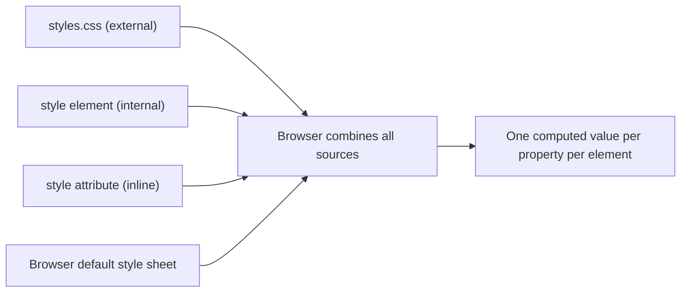

# Introducing CSS: rules, selectors and where styles live

> **Before this lesson:** you should be able to write HTML elements, attributes, ids and classes ([How web pages work](#/lesson/html-css/how-pages-work), [Ids, classes, generic containers and the document head](#/lesson/html-css/ids-classes-meta)) and know the parent/child vocabulary of the DOM tree.

## In plain words

**CSS** (Cascading Style Sheets) is the language that controls how HTML looks: colours, fonts, sizes, spacing and where things sit on the page.

Imagine the dress code for a school play. It is a separate sheet of paper from the script, and it is written as a list of instructions: "everyone playing a soldier wears a red coat", "the narrator wears a hat", "the actor called Sam wears glasses". Each instruction has two parts: *who* it applies to, and *what* they should wear. A CSS rule has the same two parts: a **selector** that says which elements it applies to, and **declarations** that say how they should look. Keeping the dress code separate from the script means you can restage the whole play in new costumes without rewriting a line of dialogue.

Every visual aspect of every website is CSS, so this is the foundation for the entire second half of the track. Selectors in particular are something you will write daily and be quizzed on in interviews.

## Why it is worth learning properly

HTML says what each piece of content *is*. Cascading Style Sheets (CSS) say what it should *look like*: its colour, typeface, size, spacing and position. Keeping the two apart is what lets one HTML document appear as a three-column desktop page, a single-column phone page, a clean printout and a dark-mode variant, all without touching the markup.

The mental picture to hold on to is simple. The browser treats **every element as a box**. CSS is a list of instructions of the form "find these boxes, and set these properties on them". Everything in the CSS half of this track elaborates on one of those two halves: how you *find* boxes (selectors) and what you can *set* (properties and values).

## Anatomy of a rule

```css
h2 {
  color: darkslateblue;
  font-size: 1.5rem;
}
```

| Part | In the example | Role |
|---|---|---|
| **Selector** | `h2` | Which elements the rule applies to |
| **Declaration block** | `{ … }` | The instructions |
| **Declaration** | `color: darkslateblue;` | One instruction |
| **Property** | `color` | The aspect being set |
| **Value** | `darkslateblue` | The setting |

Declarations end with a semicolon. The last one in a block technically does not need it, but always write it, because forgetting it when you add another line is the most common syntax error in CSS. Comments are written `/* like this */`.

CSS is forgiving in a specific way: if the browser meets a declaration it does not understand (a typo, or a feature it does not support), it **drops that one declaration** and carries on. A misspelled property never breaks the page; it silently does nothing. Developer tools show discarded declarations struck through with a warning icon, which is the first place to look when a style "isn't working".

```html-run
<!doctype html>
<html lang="en">
<head><meta charset="utf-8"><title>First rules</title>
<style>
  body { font-family: Georgia, serif; }
  h1   { color: #283593; }
  h2   { color: #5c6bc0; font-size: 1.2rem; }
  p    { line-height: 1.6; }
  p    { colr: red; }          /* typo: ignored, the page still works */
</style></head>
<body>
  <h1>Kite Club</h1>
  <h2>Sunday meet-up</h2>
  <p>We fly from the east field whenever the wind is above ten knots.</p>
</body>
</html>
```

## Three places to put CSS

| Method | Syntax | Scope | Use it for |
|---|---|---|---|
| **External style sheet** | `<link rel="stylesheet" href="styles.css">` in the `head` | Every page that links to it | Almost everything |
| **Internal style sheet** | `<style> … </style>` in the `head` | That one page | Demos, single-page documents, critical above-the-fold CSS |
| **Inline style** | `style="color: red"` on an element | That one element | Values computed by script; almost never by hand |

An external file is the norm for real sites: one change restyles every page, the browser caches the file after the first visit, and the HTML stays clean. The live examples in this track use `<style>` blocks only so that each one is self-contained.

Inline styles have no selector and no reuse, cannot contain media queries or hover states, and override nearly everything else, which makes them painful to maintain. Their legitimate use is for values that genuinely differ per element and are produced by a program, such as a progress bar's width.

A style sheet can also pull in another with `@import url("other.css");` at its top. Prefer multiple `<link>` elements instead: imports are discovered late and delay rendering.



## Selecting elements

Selectors are a pattern language for picking nodes out of the DOM. Start with the five basic kinds.

| Selector | Example | Matches |
|---|---|---|
| Universal | `*` | Every element |
| Type | `p` | Every `<p>` |
| Class | `.note` | Every element whose `class` includes `note` |
| Id | `#intro` | The element with `id="intro"` |
| Attribute | `[type="email"]` | Every element with that attribute value |

You can chain them without spaces to require all conditions on the *same* element: `p.note` is a paragraph with class `note`; `a.button.primary` is a link with both classes; `input[type="checkbox"]` is a checkbox input.

A comma makes a **selector list**, applying the same declarations to each: `h1, h2, h3 { font-family: Georgia, serif; }`.

```html-run
<!doctype html>
<html lang="en">
<head><meta charset="utf-8"><title>Basic selectors</title>
<style>
  * { font-family: system-ui, sans-serif; }
  p { margin: .4rem 0; padding: .3rem .6rem; }
  .tip { background: #e0f7fa; }
  #first { border-left: 6px solid #00838f; }
  p.tip.new { font-weight: 700; }
  [lang] { font-style: italic; }
  h2, h3 { color: #00695c; }
</style></head>
<body>
  <h2>Flying tips</h2>
  <p id="first" class="tip">Stand with your back to the wind.</p>
  <p class="tip new">Let out line slowly as the kite climbs.</p>
  <p>Not a tip: the car park closes at six.</p>
  <p lang="fr" class="tip">Bon vent !</p>
  <h3>Safety</h3>
  <p>Never fly near power lines.</p>
</body>
</html>
```

### Attribute selectors in detail

| Pattern | Matches when the attribute… |
|---|---|
| `[href]` | exists |
| `[type="text"]` | equals the value exactly |
| `[class~="card"]` | contains the word in a space-separated list |
| `[lang\|="en"]` | equals `en` or starts with `en-` |
| `[href^="https://"]` | starts with the string |
| `[href$=".pdf"]` | ends with the string |
| `[href*="example"]` | contains the string anywhere |
| `[type="email" i]` | matches case-insensitively |

## Combinators: selecting by relationship

Combinators join selectors according to how elements are related in the DOM tree.

| Combinator | Example | Reads as |
|---|---|---|
| Descendant (space) | `nav a` | Any `a` anywhere inside a `nav` |
| Child `>` | `ul > li` | An `li` that is a direct child of a `ul` |
| Next sibling `+` | `h2 + p` | A `p` immediately following an `h2` with the same parent |
| Subsequent sibling `~` | `h2 ~ p` | Any `p` after an `h2` with the same parent |

```html-run
<!doctype html>
<html lang="en">
<head><meta charset="utf-8"><title>Combinators</title>
<style>
  body { font-family: system-ui, sans-serif; }
  article p        { color: #37474f; }                  /* descendant */
  article > p      { border-left: 4px solid #ffb300; padding-left: .6rem; }  /* child */
  h2 + p           { font-size: 1.15rem; font-weight: 600; }  /* next sibling */
  h2 ~ ul          { background: #fff8e1; }             /* later sibling */
  li + li          { border-top: 1px solid #ccc; }      /* every li except the first */
</style></head>
<body>
  <article>
    <h2>Choosing a kite</h2>
    <p>This paragraph directly follows the heading, so it is the lead.</p>
    <p>A direct child of the article: gets the amber bar.</p>
    <blockquote><p>Nested deeper: slate colour, but no amber bar.</p></blockquote>
    <ul><li>Diamond</li><li>Delta</li><li>Box</li></ul>
  </article>
</body>
</html>
```

`li + li` is a classic idiom: "an item that has an item before it", which is every item but the first, perfect for separators between things.

Browsers evaluate a compound selector **from right to left**. For `nav ul a` the engine first finds all `a` elements, then checks each one's ancestors. The rightmost part, the one that names the element actually being styled, is called the **subject** (or key selector).

## Pseudo-classes: selecting by state or position

A pseudo-class begins with one colon and matches elements in a particular state or location that is not written in the markup.

| Group | Examples |
|---|---|
| User action | `:hover`, `:active`, `:focus`, `:focus-visible`, `:focus-within` |
| Links | `:link`, `:visited`, `:any-link`, `:target` |
| Forms | `:checked`, `:disabled`, `:required`, `:invalid`, `:placeholder-shown` |
| Position | `:first-child`, `:last-child`, `:only-child`, `:nth-child(…)`, `:first-of-type`, `:nth-of-type(…)` |
| Logic | `:not(…)`, `:is(…)`, `:where(…)`, `:has(…)` |
| Document | `:root`, `:empty` |

`:nth-child()` takes a formula `an+b`, where *n* counts 0, 1, 2, …:

| Expression | Selects |
|---|---|
| `:nth-child(3)` | The third child |
| `:nth-child(odd)` or `2n+1` | 1st, 3rd, 5th… |
| `:nth-child(even)` or `2n` | 2nd, 4th, 6th… |
| `:nth-child(3n)` | Every third |
| `:nth-child(n+4)` | The fourth onwards |
| `:nth-child(-n+3)` | The first three |
| `:nth-last-child(2)` | The second from the end |

```html-run
<!doctype html>
<html lang="en">
<head><meta charset="utf-8"><title>Pseudo-classes</title>
<style>
  body { font-family: system-ui, sans-serif; }
  ol { padding: 0; max-width: 300px; list-style-position: inside; }
  li { padding: .35rem .6rem; }
  li:nth-child(odd)   { background: #ede7f6; }
  li:first-child      { font-weight: 700; }
  li:last-child       { color: #888; }
  li:nth-child(-n+3)  { border-left: 5px solid #7e57c2; }
  li:hover            { background: #d1c4e9; }
  li:not(.absent):hover { cursor: pointer; }
  .absent             { text-decoration: line-through; }
  form:focus-within   { outline: 2px dashed #7e57c2; outline-offset: 4px; }
  label:has(input:checked) { font-weight: 700; color: #4527a0; }
</style></head>
<body>
  <ol>
    <li>Ada</li><li>Bashir</li><li>Chen</li><li class="absent">Dita</li><li>Emeka</li><li>Farah</li>
  </ol>
  <form>
    <label><input type="checkbox" checked> Email me the results</label><br>
    <label><input type="checkbox"> Text me the results</label>
  </form>
</body>
</html>
```

> [!WARNING]
> `p:first-child` does **not** mean "the first paragraph". It means "a `p` that is the first child of its parent". If an `h2` comes first, nothing matches. For "the first `p` among its siblings" use `p:first-of-type`.

### The logical pseudo-classes

- **`:not(X)`** matches elements that do not match X: `a:not([href^="http"])`.
- **`:is(A, B, C)`** matches any of the listed selectors and shortens repetition: `:is(h1, h2, h3) a` instead of `h1 a, h2 a, h3 a`.
- **`:where(…)`** behaves like `:is()` but contributes zero specificity, which makes it ideal for base styles that should be easy to override.
- **`:has(X)`** matches an element that *contains* (or is followed by) something matching X. It is the long-awaited "parent selector": `figure:has(figcaption)`, `form:has(:invalid)`, `h2:has(+ p)`.

## Pseudo-elements: styling parts of an element

A pseudo-element, written with two colons, targets a piece of an element or creates a virtual box that is not in the DOM.

| Pseudo-element | Targets |
|---|---|
| `::before`, `::after` | A generated box as the first / last child; **requires** the `content` property |
| `::first-line`, `::first-letter` | The first rendered line or letter of a block |
| `::marker` | A list item's bullet or number |
| `::placeholder` | Placeholder text in an input |
| `::selection` | Text the user has highlighted |
| `::backdrop` | The layer behind a modal dialog or fullscreen element |

```html-run
<!doctype html>
<html lang="en">
<head><meta charset="utf-8"><title>Pseudo-elements</title>
<style>
  body { font-family: Georgia, serif; max-width: 420px; line-height: 1.5; }
  p::first-letter { font-size: 2.6em; float: left; line-height: 1; padding-right: .1em; color: #ad1457; }
  p::first-line   { font-variant: small-caps; }
  ::selection     { background: #f8bbd0; }
  a[href^="http"]::after { content: " ↗"; font-size: .8em; }
  li::marker      { color: #ad1457; content: "✦ "; }
  .required::after { content: " (required)"; color: #b71c1c; font-size: .85em; }
</style></head>
<body>
  <p>Kites have been flown for more than two thousand years, for signalling, for science and for pleasure. Select some of this text.</p>
  <ul><li>See the <a href="https://example.org">festival site</a></li><li class="required">Bring gloves</li></ul>
</body>
</html>
```

Generated content from `::before` and `::after` is for decoration. It cannot be selected or reliably searched, and assistive technologies treat it inconsistently, so anything essential belongs in the HTML.

## Values and units at a glance

| Kind | Examples | Notes |
|---|---|---|
| Keywords | `block`, `bold`, `center`, `auto`, `none` | Specific to each property |
| Absolute length | `px` | One CSS pixel; the workhorse for borders and small details |
| Font-relative length | `em`, `rem`, `ch`, `lh` | `em` = current element's font size; `rem` = root font size |
| Viewport length | `vw`, `vh`, `dvh`, `vmin`, `vmax` | 1% of the viewport's width or height |
| Percentage | `50%` | Relative to something the property defines, usually the parent |
| Colour | `#1e88e5`, `rgb(30 136 229)`, `hsl(207 79% 51%)` | See the colour lesson |
| Functions | `calc(100% - 2rem)`, `min()`, `max()`, `clamp()`, `var(--x)`, `url(…)` | Compute or fetch values |
| Global keywords | `inherit`, `initial`, `unset`, `revert` | Accepted by every property |

Zero needs no unit (`margin: 0`). Any other length does: `margin: 10` is invalid and ignored.

Many properties are **shorthands** that set several at once: `margin: 1rem 2rem` sets all four margins, `border: 1px solid #333` sets width, style and colour, `font`, `background`, `flex`, `transition` and `inset` are others. A shorthand resets every sub-property it covers to its initial value if you omit it, so `background: red` also wipes out a previously set `background-image`.

> [!INTERVIEW]
> "Explain `div p`, `div > p`, `div + p` and `div ~ p`." Descendant: any `p` inside a `div` at any depth. Child: a `p` whose parent is the `div`. Next sibling: a `p` that comes immediately after a `div` under the same parent. Subsequent sibling: any `p` that comes later than a `div` under the same parent.

> [!TIP]
> To test a selector quickly, open developer tools and type `document.querySelectorAll('your selector')` in the Console. It returns exactly the elements that the selector matches, so you can see mistakes before writing any declarations.

## Pitfalls

- **Missing semicolon or brace.** The following declaration, or the whole next rule, is swallowed. Check the Styles pane for struck-through lines.
- **Space versus no space.** `.card.featured` is one element with two classes; `.card .featured` is a descendant.
- **`:first-child` versus `:first-of-type`.** Count all siblings, or only those of the same type.
- **Forgetting `content` on `::before`/`::after`.** Without it no box is generated, even `content: ""` is required.
- **Unitless lengths.** `width: 300` does nothing.
- **Over-long selectors** such as `body div#main ul.menu li a`. They break when the markup changes and are hard to override; one class is usually enough.
- **Styling by hand with inline `style`.** It defeats reuse and beats your style sheet in the cascade.
- **Shorthand side effects.** `font: 16px Arial` resets `font-weight`, `line-height` and others.
- **Assuming a rule failed when it was overridden.** The next lesson explains the cascade that decides which declaration wins.

## Cheat sheet

| Want to select | Selector |
|---|---|
| All paragraphs | `p` |
| Elements with a class | `.name` |
| One unique element | `#name` |
| Element with two classes | `.a.b` |
| Links inside nav | `nav a` |
| Direct children only | `ul > li` |
| Element right after another | `h2 + p` |
| All but the first item | `li + li` or `li:not(:first-child)` |
| Zebra stripes | `tr:nth-child(even)` |
| External links | `a[href^="http"]` |
| Hovered or keyboard-focused | `:hover`, `:focus-visible` |
| Parent containing something | `.card:has(img)` |
| Any of several | `:is(h1, h2, h3)` |
| Decorative extra box | `::before { content: ""; }` |

## Summary

A CSS rule pairs a selector with declarations of `property: value`. Styles normally live in an external file linked from the head. Selectors find elements by type, class, id or attribute, by their relationships (descendant, child, sibling), by state and position (pseudo-classes) and can even style sub-parts or generated boxes (pseudo-elements). Unknown declarations are skipped without error. What happens when two valid rules disagree about the same property is decided by the cascade, the subject of the next lesson.

## Glossary

| Term | Meaning |
|---|---|
| CSS | Cascading Style Sheets: the language that describes how HTML is presented |
| Rule | A selector together with a block of declarations |
| Selector | The pattern that chooses which elements a rule applies to |
| Declaration | One `property: value;` pair |
| Property | An aspect of appearance that can be set, such as `color` |
| Value | The setting given to a property, such as `red` |
| Style sheet | A collection of CSS rules, usually a `.css` file |
| External / internal / inline | CSS in a separate file / in a `<style>` element / in a `style` attribute |
| Combinator | A symbol that joins selectors by relationship: space, `>`, `+`, `~` |
| Descendant | An element nested anywhere inside another |
| Pseudo-class | A keyword with one colon that selects by state or position, such as `:hover` |
| Pseudo-element | A keyword with two colons that selects part of an element or creates a box, such as `::before` |
| Shorthand | A property that sets several related properties at once |
| Unit | The measure attached to a number, such as `px`, `rem` or `%` |
| User-agent style sheet | The browser's own default CSS |

## Check yourself

```quiz
[
  {"q": "Given <div><h2>T</h2><p>A</p><p>B</p></div>, which paragraphs does h2 + p select?", "options": ["A and B", "Only A", "Only B", "Neither"], "answer": 1,
   "explain": "The next-sibling combinator matches only the element immediately after the h2. h2 ~ p would match both."},
  {"q": "Given <div><h2>T</h2><p>A</p><p>B</p></div>, what does p:first-child select?", "options": ["Paragraph A", "Paragraph B", "Nothing", "The h2"], "answer": 2,
   "explain": "The first child of the div is the h2, so no p is a first child. p:first-of-type would select A."},
  {"q": "What is the difference between .menu.open and .menu .open?", "options": ["None", "The first needs both classes on one element; the second matches an .open element inside a .menu element", "The second needs both classes on one element", "The first is invalid"], "answer": 1,
   "explain": "Without a space the selectors compound on the same element; a space is the descendant combinator."},
  {"q": "A rule contains widht: 200px; followed by color: red;. What happens?", "options": ["The whole style sheet is discarded", "The rule is discarded", "Only the misspelled declaration is ignored; the colour applies", "The browser guesses width"], "answer": 2,
   "explain": "CSS error handling drops only the invalid declaration and continues with the rest."},
  {"q": "Which items does li:nth-child(-n+2) select in a list of five?", "options": ["The last two", "The first two", "Every second item", "Items 2 to 5"], "answer": 1,
   "explain": "With n = 0, 1, 2… the formula yields 2, 1, 0, -1…, so only positions 1 and 2 match."},
  {"q": "p::after { color: red; } is applied but nothing appears. Why?", "options": ["::after only works on div", "The content property is missing, so no box is generated", "Pseudo-elements need JavaScript", "The colon should be single"], "answer": 1,
   "explain": "::before and ::after render only when content is set, even if it is an empty string."},
  {"q": "Which selector matches a card only when it contains an image?", "options": [".card > img", ".card:has(img)", "img .card", ".card + img"], "answer": 1,
   "explain": ":has() selects the element on the left based on what it contains. .card > img would select the image, not the card."},
  {"q": "Which link is matched by a[href$='.pdf']?", "options": ["href='pdf/guide.html'", "href='guide.pdf'", "href='guide.pdf?x=1'", "href='.pdf/guide'"], "answer": 1,
   "explain": "The $= operator requires the attribute value to end with the given string."}
]
```

> **Source:** Duckett, *HTML & CSS*, ch. 10 (Introducing CSS). MDN: https://developer.mozilla.org/en-US/docs/Learn_web_development/Core/Styling_basics/What_is_CSS · https://developer.mozilla.org/en-US/docs/Web/CSS/CSS_selectors · https://developer.mozilla.org/en-US/docs/Web/CSS/:nth-child · https://developer.mozilla.org/en-US/docs/Web/CSS/:has
