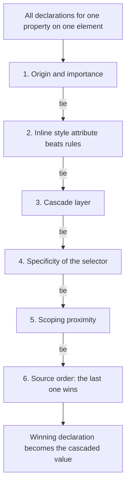

# The cascade, specificity and inheritance

> **Before this lesson:** you should be able to write CSS rules and the main kinds of selector: type, class, id, attribute, pseudo-class ([Introducing CSS](#/lesson/html-css/css-intro)).

## In plain words

Often several CSS rules try to set the same thing on the same element: one says a link is blue, another says it is green. The **cascade** is the fixed procedure the browser follows to decide which one wins. **Specificity** is one step of that procedure: a score that measures how precisely a selector points at an element. **Inheritance** is what happens when no rule says anything: some properties are handed down from the parent element.

Think of instructions at work. A company-wide policy says "dress smartly". Your department's rule says "wear the blue uniform". Your manager tells you personally, "today, wear the high-visibility jacket". When they conflict, the most specific instruction wins. And if nobody has said anything about shoes, you carry on with what your family taught you, which is inheritance.

This topic causes more confusion than any other part of CSS. Once you can predict which rule wins, styling stops feeling random. Specificity puzzles are a staple of front-end interviews.

## Why it is worth learning properly

You write `color: green` on a link and it stays stubbornly blue. You delete a rule and three unrelated things change. Almost every "CSS is random" complaint comes from not knowing the algorithm the browser uses to settle disagreements. That algorithm is called **the cascade**, and it is the "C" in CSS. It is entirely deterministic: for every property of every element, the browser gathers all the declarations that apply and picks exactly one winner by a fixed sequence of tie-breakers.

Once you can run that sequence in your head, debugging styles becomes a matter of reading rather than guessing. This lesson walks through the sequence, shows how specificity is calculated, explains what happens when *no* declaration applies (inheritance and initial values), and introduces the modern tools, cascade layers and `:where()`, that keep large style sheets under control.

## The problem the cascade solves

Declarations reach an element from many directions: the browser's built-in style sheet, your external files, a `<style>` block, an inline `style` attribute, the user's own preferences. Several may set the same property.

```html-run
<!doctype html>
<html lang="en">
<head><meta charset="utf-8"><title>Conflict</title>
<style>
  p        { color: teal; }
  .lead    { color: purple; }
  #opening { color: crimson; }
  p        { color: orange; }
</style></head>
<body>
  <p>Plain paragraph. Two type selectors apply; the later one wins.</p>
  <p class="lead">Paragraph with a class.</p>
  <p class="lead" id="opening">Paragraph with a class and an id.</p>
  <p class="lead" id="x" style="color: navy">Paragraph with an inline style.</p>
</body>
</html>
```

Four rules, four different outcomes. To predict them you need the cascade's ordered criteria.

## The cascade in order

The browser compares competing declarations on these criteria, moving to the next only when the current one is a tie.



### 1. Origin and importance

There are three core **origins**: *user-agent* (the browser's defaults), *user* (settings and custom style sheets of the person browsing) and *author* (your CSS). For normal declarations, author beats user beats user-agent, which is why your `h1` colour replaces the default black.

Adding `!important` to a declaration moves it into a separate, higher band, **and reverses the origin order** inside that band. An important *user* declaration beats an important *author* one. That inversion is deliberate: it guarantees that someone who needs, say, a minimum font size can always get it. Above all of these sit declarations being applied by a running CSS transition.

| Priority (high to low) | |
|---|---|
| Transitions | |
| `!important` user-agent | |
| `!important` user | |
| `!important` author | |
| Animations (`@keyframes`) | |
| Normal author | ← nearly all of your CSS |
| Normal user | |
| Normal user-agent | ← browser defaults |

### 2. Inline styles

Within the author origin, a declaration in a `style="…"` attribute beats any declaration that comes from a selector, whatever that selector's specificity. Only `!important` in a style sheet overrides a normal inline style.

### 3. Cascade layers

Layers (covered below) let you group rules and declare which groups take precedence, independently of specificity. Rules outside any layer beat all layered rules.

### 4. Specificity

If the declarations are still tied, the one with the more specific selector wins. This is the criterion you will meet most often, and it gets its own section next.

### 5. Scoping proximity

When rules come from `@scope` blocks, the one whose scope root is nearer to the element wins. It is a recent addition and only matters if you use `@scope`.

### 6. Source order

Finally, if everything else is equal, the declaration that appears **last** in the combined source wins. The order of `<link>` and `<style>` elements in the HTML matters; the order of class names inside a `class` attribute does not.

## Calculating specificity

Specificity is a three-part score, conventionally written **(A, B, C)**:

| Column | Counts | Examples |
|---|---|---|
| **A** | Id selectors | `#nav` |
| **B** | Class selectors, attribute selectors, pseudo-classes | `.card`, `[type="text"]`, `:hover`, `:nth-child(2)` |
| **C** | Type selectors and pseudo-elements | `p`, `li`, `::before` |

Compare A first; only if A is equal compare B; only if B is equal compare C. The columns never overflow into one another: **one id beats any number of classes**, and one class beats any number of type selectors. The scores are tuples, not ordinary numbers, so avoid the tempting shortcut of reading (0,1,3) as "13".

| Selector | A | B | C | Notes |
|---|---|---|---|---|
| `*` | 0 | 0 | 0 | The universal selector adds nothing |
| `li` | 0 | 0 | 1 | |
| `ul li` | 0 | 0 | 2 | Combinators add nothing |
| `li::marker` | 0 | 0 | 2 | Pseudo-element counts as C |
| `.item` | 0 | 1 | 0 | |
| `li.item` | 0 | 1 | 1 | |
| `a:hover` | 0 | 1 | 1 | Pseudo-class counts as B |
| `input[type="email"]` | 0 | 1 | 1 | Attribute counts as B |
| `ul.menu li.item a` | 0 | 2 | 3 | |
| `#nav` | 1 | 0 | 0 | |
| `#nav .item a:hover` | 1 | 2 | 1 | |
| `style="…"` | — | — | — | Not a selector; outranks all of the above |

Special cases:

- **`:is()`, `:not()` and `:has()`** take the specificity of the most specific selector in their argument list. `:is(#a, p)` scores (1,0,0) even when it is matching a plain `p`.
- **`:where()`** always scores (0,0,0), whatever it contains.
- **Combinators** (`>`, `+`, `~`, space) and the universal selector contribute nothing.
- **Inherited values have no specificity at all.** Any declaration that targets an element directly, even `* { }`, beats a value inherited from an ancestor's high-specificity rule.

Work through this before reading the explanation underneath.

```html-run
<!doctype html>
<html lang="en">
<head><meta charset="utf-8"><title>Specificity puzzle</title>
<style>
  body { font-family: system-ui, sans-serif; }
  #menu a              { color: crimson; }      /* (1,0,1) */
  .menu .link.active   { color: seagreen; }     /* (0,3,0) */
  nav ul li a          { color: slateblue; }    /* (0,0,4) */
  a:not(.x):not(.y)    { color: orange; }       /* (0,2,1) */
  :where(#menu) a.link { color: deeppink; }     /* (0,1,1) */
</style></head>
<body>
  <nav>
    <ul id="menu" class="menu">
      <li><a class="link active" href="#">What colour am I?</a></li>
    </ul>
  </nav>
</body>
</html>
```

The link is crimson. Only the first selector has an id, so it wins column A outright; the three classes of the second rule cannot catch up, and `:where(#menu)` contributes nothing despite containing an id. Try deleting the first rule: now green wins with (0,3,0) over orange's (0,2,1).

> [!INTERVIEW]
> A classic: "`.a.b.c.d.e.f.g.h.i.j.k` versus `#x`: which wins?" The id. Eleven classes give (0,11,0), which still loses to (1,0,0) because column A is compared first.

## `!important` and why to avoid it

Appending `!important` lifts a declaration out of the normal contest:

```css
.hidden { display: none !important; }
```

It is tempting as a quick fix, and that is the danger. Once one rule uses it, the only way to override that rule is another `!important` with equal or higher specificity, and the style sheet escalates into a shouting match.

Reasonable uses are few: utility classes whose whole purpose is to win (`.hidden`, `.sr-only`), overriding inline styles injected by third-party widgets you cannot edit, and user style sheets. If you find yourself needing it against your own CSS, the real problem is a selector that is more specific than it should be.

## Inheritance: when no rule applies

The cascade picks among declarations that *target* an element. Often there are none: you never wrote a colour for every `<em>`. Then one of two things happens, depending on the property.

- **Inherited properties** take the computed value from the parent element. These are mostly about text: `color`, `font-family`, `font-size`, `font-weight`, `font-style`, `line-height`, `letter-spacing`, `text-align`, `text-transform`, `white-space`, `visibility`, `cursor`, `list-style`.
- **Non-inherited properties** fall back to the property's **initial value**. These are mostly about boxes: `margin`, `padding`, `border`, `background`, `width`, `height`, `display`, `position`, `overflow`, `box-shadow`.

The split is common sense. You want a font set on `body` to reach every paragraph; you would not want a border set on a `div` to appear around every child inside it.

```html-run
<!doctype html>
<html lang="en">
<head><meta charset="utf-8"><title>Inheritance</title>
<style>
  .panel { color: #4a148c; font-family: Georgia, serif; border: 3px solid #ab47bc; padding: 1rem; }
  .keep-border { border: inherit; padding: .3rem; }
  button { margin-top: .5rem; }
  .fixed { font: inherit; color: inherit; }
</style></head>
<body>
  <div class="panel">
    Text in the panel is purple serif.
    <p>This paragraph <em>inherits</em> colour and font, but not the border or padding.</p>
    <p class="keep-border">This one asks for the border explicitly with <code>border: inherit</code>.</p>
    <button>Default button: ignores the panel's font and colour</button><br>
    <button class="fixed">Button with font: inherit</button>
  </div>
</body>
</html>
```

The first button surprises people. Form controls do not pick up the page's font because the browser's own style sheet *sets* `font` on them, and any targeted declaration beats inheritance. `font: inherit` (commonly applied to `button, input, select, textarea`) asks for the parent's value back.

Links behave the same way: the user-agent sheet gives `a:any-link` a colour, so a link inside a red paragraph remains blue until you say otherwise.

### Controlling inheritance with global keywords

Every property accepts these values:

| Keyword | Resulting value |
|---|---|
| `inherit` | The parent's computed value, even for a property that does not normally inherit |
| `initial` | The property's specification-defined initial value (for `display` that is `inline`, not the browser's default for the element) |
| `unset` | `inherit` if the property is inherited, otherwise `initial` |
| `revert` | Rolls back to what the previous origin would give, typically the browser's default style for that element |
| `revert-layer` | Rolls back to the value from the previous cascade layer |

The shorthand `all` sets every property at once, so `all: unset` strips an element bare and `all: revert` restores browser defaults, both handy when embedding a component in a hostile page.

## From declared value to pixels

It helps to know the stages a value passes through.

| Stage | Meaning | Example for `font-size: 1.5em` in a 16px parent |
|---|---|---|
| Declared | Every declaration that applies | `1.5em`, and perhaps `2rem` from another rule |
| Cascaded | The cascade's winner | `1.5em` |
| Specified | Cascaded value, or else inherited / initial | `1.5em` |
| Computed | Resolved as far as possible without layout; this is what children inherit | `24px` |
| Used | After layout (percentages and `auto` resolved) | `24px` |
| Actual | After device rounding | `24px` |

The important detail: **children inherit the computed value**. If a parent has `font-size: 1.5em` (computed 24px), a child inherits 24px, not "1.5em" to be applied again. A unitless `line-height: 1.5`, however, has a computed value that is still the number, so each descendant multiplies it by its own font size, which is exactly why unitless line heights are recommended.

## Taming the cascade: `:where()` and layers

Two modern features let you control precedence without escalating specificity.

**`:where()` for low-specificity defaults.** Wrapping a selector in `:where()` zeroes its specificity, so any later single-class rule can override it. Resets and library base styles are commonly written this way:

```css
:where(ul, ol)[role="list"] { list-style: none; padding: 0; }   /* (0,1,0) from the attribute only */
:where(a) { color: inherit; }                                     /* (0,0,0) */
```

**`@layer` for explicit precedence.** A cascade layer is a named bucket of rules. You declare the order of the buckets once, and from then on *a later layer beats an earlier layer regardless of specificity*.

```html-run
<!doctype html>
<html lang="en">
<head><meta charset="utf-8"><title>Cascade layers</title>
<style>
  @layer reset, base, components, utilities;

  @layer utilities {
    .text-center { text-align: center; }
    .mt-0 { margin-top: 0; }
  }
  @layer components {
    article.card > h2.card-title { margin-top: 2rem; text-align: left; color: #1a237e; }
    .card { border: 1px solid #9fa8da; border-radius: 10px; padding: 1rem; max-width: 340px; }
  }
  @layer base {
    #page h2 { color: gray; font-family: Georgia, serif; }
  }
  @layer reset {
    * { margin: 0; }
  }
  /* un-layered author styles would beat every layer */
</style></head>
<body id="page">
  <article class="card">
    <h2 class="card-title text-center mt-0">Layered heading</h2>
    <p>The single-class utilities beat the three-part component selector, and the component colour beats an id selector in the base layer.</p>
  </article>
</body>
</html>
```

The first line fixes the order. Even though the layer blocks are then written in a scrambled sequence, and even though `#page h2` has an id, the outcome depends only on layer order: `utilities` over `components` over `base` over `reset`. Specificity is compared only among rules in the *same* layer. This is what makes it safe to import a third-party style sheet into a low layer (`@import url(lib.css) layer(vendor);`) and override it with simple selectors.

One twist mirrors the origin rule: for `!important` declarations the layer order is reversed, so an important declaration in an early layer beats one in a later layer.

## A debugging method

When a style does not apply, open developer tools, select the element and read the Styles pane from the top. It lists every matching rule in winning order, with losing declarations struck through.

1. **Is the declaration there at all?** If not, the selector does not match: check spelling, the DOM structure and whether the file loaded.
2. **Is it struck through with a warning?** Invalid property or value.
3. **Is it struck through without a warning?** Something beat it. Look upward for the winner and compare, in order: `!important`, inline style, layer, specificity, source order.
4. **Is it not struck through but has no effect?** The property does not apply in this context (for example `width` on an inline element, or `z-index` on a non-positioned box). That is a layout question, not a cascade one.
5. **Check the Computed pane** to see the final value and click through to the rule that supplied it.

> [!TIP]
> Hover over a selector in the Styles pane of Chrome or Edge developer tools and a tooltip shows its specificity as three numbers. Use it to check your own calculation.

> [!WARNING]
> `!important` does not mean "this rule matters". It moves the declaration into a different band of the cascade, and the only way to beat it later is another `!important`. Treat every use as a debt.

## Pitfalls

- **Adding to specificity to win.** Each escalation makes the next override harder. Lower the other selector instead, or use a layer.
- **Styling with ids.** One id outweighs any number of classes, so id rules are effectively un-overridable by ordinary component CSS.
- **Reading specificity as a base-10 number.** (0,11,0) is still less than (1,0,0).
- **Assuming class order in HTML matters.** `class="a b"` and `class="b a"` are identical; only the order of rules in the CSS counts.
- **Expecting inheritance to beat a direct rule.** Even the universal selector wins over an inherited value.
- **Forgetting browser defaults on buttons, inputs and links.** Use `font: inherit` and `color: inherit` where appropriate.
- **`initial` when you meant `revert`.** `display: initial` makes a `div` inline, because the initial value of `display` is `inline`.
- **`!important` in component styles.** Reserve it for true utilities and for defeating third-party inline styles.
- **Load order accidents.** Linking a library's CSS after your own lets its equal-specificity rules override yours.

## Cheat sheet

| Question | Answer |
|---|---|
| Order of tie-breakers | Origin and importance → inline → layer → specificity → scope proximity → source order |
| Specificity columns | (ids, classes + attributes + pseudo-classes, types + pseudo-elements) |
| `*`, combinators, `:where()` | Add 0 |
| `:is()`, `:not()`, `:has()` | Specificity of their most specific argument |
| Inline `style` | Beats all selectors; loses to `!important` |
| Equal specificity | Later rule wins |
| Inherited by default | Text properties: `color`, `font-*`, `line-height`, `text-align`, `visibility`, `cursor` |
| Not inherited | Box properties: `margin`, `padding`, `border`, `background`, `width`, `display`, `position` |
| Force inheritance | `property: inherit` |
| Back to browser default | `revert` |
| Explicit precedence | `@layer a, b, c;` (later wins) |

## Summary

The cascade resolves every conflict by comparing origin and importance, then inline styles, then layers, then specificity, then source order. Specificity is a three-column score in which ids outrank classes and classes outrank type selectors, with no carrying between columns. When nothing targets an element, text-related properties inherit from the parent and box-related properties take their initial value; the keywords `inherit`, `initial`, `unset` and `revert` let you choose explicitly. Keep selectors low and flat, avoid `!important`, and use `:where()` and `@layer` to state precedence deliberately instead of fighting for it.

## Glossary

| Term | Meaning |
|---|---|
| Cascade | The algorithm that chooses one winning declaration for each property of each element |
| Origin | Where a style comes from: the browser, the user or the page's author |
| Specificity | A three-part score (ids, classes, elements) measuring how targeted a selector is |
| Source order | The order in which rules appear; the later one wins a tie |
| `!important` | A flag that lifts a declaration above normal ones; best avoided |
| Inline style | A declaration written in an element's `style` attribute |
| Inheritance | A property taking its value from the parent element when nothing sets it directly |
| Initial value | A property's built-in default, defined by the CSS specification |
| Computed value | The final resolved value of a property for an element |
| `inherit` / `initial` / `unset` / `revert` | Keywords that request the parent's value / the default / whichever is natural / the browser's style |
| Cascade layer | A named group of rules (`@layer`) with an explicit precedence |
| `:where()` | A selector wrapper that contributes zero specificity |
| Declaration | One `property: value` pair |

## Check yourself

```quiz
[
  {"q": "What is the specificity of ul#nav li.active a:hover?", "options": ["(1,2,3)", "(1,1,3)", "(0,3,3)", "(1,3,2)"], "answer": 0,
   "explain": "One id (#nav); two in the class column (.active and :hover); three type selectors (ul, li, a)."},
  {"q": "Rules in order: .btn { color: blue; } then button { color: red; }. What colour is <button class='btn'>?", "options": ["Red, because it comes later", "Blue, because a class is more specific than a type selector", "Black", "Purple"], "answer": 1,
   "explain": "Specificity (0,1,0) beats (0,0,1). Source order is consulted only when specificity is equal."},
  {"q": "Which wins for <p id='a' class='b c d'>: #a { color: red; } or .b.c.d { color: green; }?", "options": ["Green: three classes beat one id", "Red: the id column is compared first", "Whichever is later in the file", "Neither applies"], "answer": 1,
   "explain": "(1,0,0) outranks (0,3,0). No number of classes can outweigh an id."},
  {"q": "body { color: navy; } and * { color: gray; }. What colour is text in a paragraph with no other rules?", "options": ["Navy, inherited from body", "Gray, because the universal selector targets the p directly", "Black", "It depends on source order"], "answer": 1,
   "explain": "A declaration that matches the element always beats inheritance, even with zero specificity."},
  {"q": "What is the specificity of :where(#main .card) h2?", "options": ["(1,1,1)", "(0,1,1)", "(0,0,1)", "(1,0,1)"], "answer": 2,
   "explain": ":where() contributes nothing regardless of its contents, leaving only the type selector h2."},
  {"q": "Which of these properties is inherited by default?", "options": ["border", "padding", "line-height", "background-color"], "answer": 2,
   "explain": "Text-related properties such as line-height inherit. Box properties like border, padding and background do not."},
  {"q": "With @layer base, components; a rule in base uses #id h2 and a rule in components uses h2. Both set color normally. Which wins?", "options": ["base, because of the id", "components, because later layers beat earlier ones regardless of specificity", "Neither", "Whichever appears later in the file"], "answer": 1,
   "explain": "Layer order is decided before specificity. Specificity only compares rules within the same layer."},
  {"q": "What does this render? <p style='color: blue'>Hi</p> with the rule p { color: red !important; }", "options": ["Blue", "Red", "Purple", "Black"], "answer": 1,
   "explain": "A normal inline style beats normal rules, but an !important author declaration outranks any normal declaration, including inline."}
]
```

> **Source:** Duckett, *HTML & CSS*, ch. 10 (Introducing CSS: how rules cascade, inheritance). MDN: https://developer.mozilla.org/en-US/docs/Web/CSS/CSS_cascade/Cascade · https://developer.mozilla.org/en-US/docs/Web/CSS/CSS_cascade/Specificity · https://developer.mozilla.org/en-US/docs/Web/CSS/CSS_cascade/Inheritance · https://developer.mozilla.org/en-US/docs/Web/CSS/@layer
