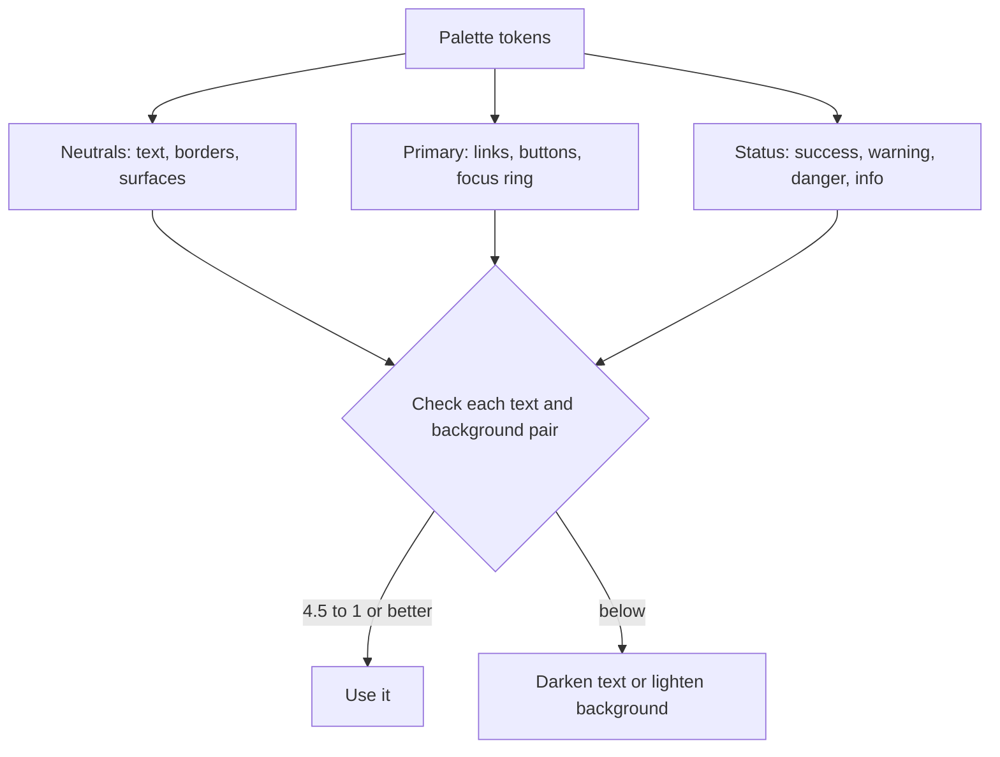

# Colour: notations, transparency and contrast

> **Before this lesson:** you should be able to write CSS rules ([Introducing CSS](#/lesson/html-css/css-intro)) and know that text properties are inherited ([The cascade, specificity and inheritance](#/lesson/html-css/cascade)). The contrast section builds on [Accessibility](#/lesson/html-css/accessibility).

## In plain words

This lesson is about telling the browser which **colour** to use for text, backgrounds and borders, and about choosing colours that people can actually read.

A screen makes colour the way stage lighting does: by mixing red, green and blue lamps at different brightnesses. Turn all three up full and you get white; turn them all off and you get black. Every way of writing a colour in CSS is a way of giving the browser that recipe, in the same way that "two parts red, one part blue" is a recipe for a paint shop.

Colour sets the mood of a brand, shows what is clickable and signals success or danger. Chosen badly, it makes text unreadable for the many people with weaker eyesight or colour blindness. Developers are expected to translate a designer's palette into CSS, to check contrast, and increasingly to support both a light and a dark theme.

## Why it is worth learning properly

Colour is the fastest way to give a page a personality, and the fastest way to make it unreadable. A good palette establishes hierarchy (this is a button, that is a warning, this text is secondary) and a bad one hides content from a large share of visitors. CSS gives you several ways to write a colour, several places to apply one, and tools for transparency, gradients and automatic light and dark themes.

This lesson covers how screens make colour, every notation you are likely to meet, when to pick each, how opacity and alpha differ, how to check contrast, and how to respond to the user's preferred colour scheme.

## How a screen makes colour

Each pixel of a display contains red, green and blue sub-pixels. Varying the brightness of the three produces every colour the screen can show; all three at full power give white, all three off give black. This is **additive** mixing, the opposite of paint. Most CSS colour notations are only different ways to describe those three channel intensities, sometimes with a fourth number, **alpha**, for how opaque the colour is.

Three properties do most of the colouring work:

| Property | Colours |
|---|---|
| `color` | The text (the foreground), plus anything that defaults to the text colour |
| `background-color` | The area behind the content and padding |
| `border-color` | The border, which defaults to the text colour |

Others accept colours too: `outline-color`, `text-decoration-color`, `caret-color`, `accent-color` (for checkboxes, radios and range sliders), `box-shadow`, `fill` and `stroke` in SVG.

## Notations

```html-run
<!doctype html>
<html lang="en">
<head><meta charset="utf-8"><title>Colour notations</title>
<style>
  body { font-family: system-ui, sans-serif; display: grid; grid-template-columns: repeat(3, 1fr); gap: 8px; }
  div { padding: 1.1rem .6rem; border-radius: 8px; color: white; font: 600 .85rem/1.2 ui-monospace, monospace; text-align: center; }
  .a { background-color: rebeccapurple; }
  .b { background-color: #663399; }
  .c { background-color: #639; }
  .d { background-color: rgb(102 51 153); }
  .e { background-color: hsl(270 50% 40%); }
  .f { background-color: oklch(44% 0.16 304); }
</style></head>
<body>
  <div class="a">rebeccapurple</div>
  <div class="b">#663399</div>
  <div class="c">#639</div>
  <div class="d">rgb(102 51 153)</div>
  <div class="e">hsl(270 50% 40%)</div>
  <div class="f">oklch(44% 0.16 304)</div>
</body>
</html>
```

All six boxes are the same purple (the last is a close match in a different colour space).

### Named colours

CSS defines about 150 keywords: `red`, `teal`, `tomato`, `cornflowerblue`, `rebeccapurple`. They are convenient for demos and debugging (`outline: 1px solid red`) but too limited and oddly distributed for a real design. Two special keywords matter more:

- **`transparent`**: fully see-through.
- **`currentColor`**: whatever the element's `color` is. Borders, SVG icons and shadows set to `currentColor` automatically follow the text colour.

### Hexadecimal

`#RRGGBB` writes each channel as two base-16 digits from `00` (0) to `ff` (255). `#ff0000` is pure red; `#000000` black; `#ffffff` white; equal pairs like `#808080` are greys.

- **Shorthand** `#RGB` doubles each digit: `#f80` means `#ff8800`.
- **With alpha**: `#RRGGBBAA` or `#RGBA`. `#00000080` is black at about 50% opacity.

Hex is compact and what design tools export, which is why it remains the commonest notation. Its weakness is that it is hard to read or adjust by eye.

### `rgb()`

The same three channels in decimal, 0–255 or percentages, with an optional alpha after a slash:

```css
color: rgb(34 139 34);
color: rgb(34 139 34 / 0.6);
color: rgb(34 139 34 / 60%);
```

Older code uses commas and a separate `rgba()` function: `rgba(34, 139, 34, 0.6)`. Both forms are valid and equivalent; the space-separated syntax with `/` is the modern one and `rgba` is now an alias of `rgb`.

### `hsl()`

HSL describes a colour the way people think about one.

| Component | Range | Meaning |
|---|---|---|
| **Hue** | 0–360 (an angle) | Position on the colour wheel: 0 red, 120 green, 240 blue |
| **Saturation** | 0–100% | 0% grey, 100% vivid |
| **Lightness** | 0–100% | 0% black, 50% the pure colour, 100% white |

```css
color: hsl(210 80% 45%);
color: hsl(210 80% 45% / 0.5);
```

Its advantage is that variations are easy to derive: keep the hue and change the lightness to get tints and shades; rotate the hue by 180 for a complement.

```html-run
<!doctype html>
<html lang="en">
<head><meta charset="utf-8"><title>HSL scales</title>
<style>
  body { font-family: system-ui, sans-serif; }
  .row { display: flex; margin-bottom: 10px; }
  .row span { flex: 1; height: 54px; display: grid; place-items: center; font-size: .75rem; }
  .light span { color: #000; } .light span:nth-child(n+4) { color: #fff; }
</style></head>
<body>
  <p>Same hue (210) and saturation, lightness from 90% down to 20%:</p>
  <div class="row light">
    <span style="background:hsl(210 80% 90%)">90%</span><span style="background:hsl(210 80% 75%)">75%</span>
    <span style="background:hsl(210 80% 60%)">60%</span><span style="background:hsl(210 80% 45%)">45%</span>
    <span style="background:hsl(210 80% 30%)">30%</span><span style="background:hsl(210 80% 20%)">20%</span>
  </div>
  <p>Same saturation and lightness, hue rotating in steps of 60:</p>
  <div class="row">
    <span style="background:hsl(0 80% 55%)">0</span><span style="background:hsl(60 80% 55%)">60</span>
    <span style="background:hsl(120 80% 55%)">120</span><span style="background:hsl(180 80% 55%)">180</span>
    <span style="background:hsl(240 80% 55%)">240</span><span style="background:hsl(300 80% 55%)">300</span>
  </div>
</body>
</html>
```

Look closely at the second row: the yellow (60) appears far brighter than the blue (240) even though both are "55% lightness". HSL's lightness is a mathematical convenience, not a measure of what the eye perceives.

### `oklch()` and wider gamuts

Newer notations fix that flaw. **`oklch(L C H)`** uses perceptual **L**ightness (0–100%), **C**hroma (colourfulness, roughly 0 to 0.4) and **H**ue angle. Two colours with the same L genuinely look equally light, which makes it far easier to build palettes with predictable contrast. It can also describe colours outside the traditional sRGB range that modern wide-gamut screens can show.

Related functions you may meet: `lab()`, `lch()`, `oklab()`, `color(display-p3 1 0 0)`. All current browsers support them. For everyday work hex and `hsl()` remain perfectly good; reach for `oklch()` when generating scales or themes.

### Mixing and deriving colours

`color-mix()` blends two colours in a chosen colour space:

```css
--brand: #1565c0;
--brand-hover: color-mix(in oklch, var(--brand), black 15%);
--brand-tint:  color-mix(in srgb, var(--brand) 12%, white);
```

Combined with custom properties this lets one brand value drive a whole family of related colours.

## Transparency: `opacity` versus alpha

There are two different ways to make something see-through, and they are often confused.

| | `opacity: 0.5` | Alpha in a colour, e.g. `rgb(0 0 0 / 0.5)` |
|---|---|---|
| Affects | The **whole element** and everything inside it: text, images, children | Only the single colour it is written in |
| Children can opt out | No | Not applicable; they are unaffected |
| Side effect | Creates a stacking context | None |

```html-run
<!doctype html>
<html lang="en">
<head><meta charset="utf-8"><title>Opacity vs alpha</title>
<style>
  body { font-family: system-ui, sans-serif; margin: 0; padding: 1rem;
         background: repeating-linear-gradient(45deg, #ffe082 0 20px, #ffca28 20px 40px); }
  .box { padding: 1rem; margin-bottom: 1rem; max-width: 360px; border-radius: 10px; color: #fff; font-weight: 600; }
  .with-opacity { background: #1a237e; opacity: 0.5; }
  .with-alpha   { background: rgb(26 35 126 / 0.5); }
</style></head>
<body>
  <div class="box with-opacity">opacity: 0.5 — the text fades too, and gets hard to read.</div>
  <div class="box with-alpha">Alpha background — only the fill is translucent; the text stays solid.</div>
</body>
</html>
```

For a translucent panel with readable content, put the alpha in the background colour. Use `opacity` when you want the entire element to fade, for example a disabled card or a fade-in animation.

## Contrast

The colour of text only means something relative to its background. Low contrast is the most common accessibility failure on the web, typically pale grey text on white or white text on a bright brand colour.

WCAG expresses contrast as a ratio between the relative luminances of the two colours, from 1:1 to 21:1.

| Ratio | Passes |
|---|---|
| Below 3 : 1 | Nothing |
| 3 : 1 | Large text (24px, or about 19px bold) and interface components at AA |
| 4.5 : 1 | Normal text at AA |
| 7 : 1 | Normal text at AAA |

Some reference points on a white background:

| Text colour | Ratio | Verdict for body text |
|---|---|---|
| `#000000` | 21 : 1 | Pass |
| `#595959` | 7.0 : 1 | Pass (AAA) |
| `#767676` | 4.54 : 1 | Barely passes AA: the lightest usable grey |
| `#999999` | 2.85 : 1 | Fail |
| `#0000ee` (classic link blue) | 9.4 : 1 | Pass |
| `#ff0000` | 4.0 : 1 | Fail for normal text |

Developer tools calculate the ratio for you: click the colour swatch next to a `color` declaration in the Styles pane and the picker shows the ratio and the AA/AAA boundaries.

> [!WARNING]
> Translucent text or backgrounds make contrast depend on whatever happens to be underneath. Text over a photograph can pass in one corner and fail in another. Put a solid or strongly tinted layer behind text on images, and test against the lightest and darkest parts.

Remember the companion rule from the accessibility lesson: colour must never be the *only* carrier of information. Pair it with text, an icon, an underline or a pattern.

## Building a palette

A practical interface palette is small:

1. **Neutrals**: a scale of greys (often very slightly tinted) for text, borders and surfaces. Most of any interface is neutral.
2. **One primary colour** for interactive elements and brand accents, with lighter and darker steps for hover and pressed states.
3. **Semantic colours** for status: success (green), warning (amber), danger (red), information (blue).

Guidelines:

- Avoid pure black on pure white for long text; a very dark grey such as `#1f2328` on an off-white is easier on the eyes while still exceeding 12:1.
- Define colours once as custom properties with role-based names (`--text`, `--surface`, `--accent`, `--danger`), then use the variables everywhere.
- Reserve saturated colour for things that need attention. If everything shouts, nothing is heard.
- Check every text/background pair you actually use, including hover, disabled and focus states.



## Light and dark themes

Operating systems let people choose a light or dark appearance, and CSS can follow that choice.

First, tell the browser which schemes your page supports with the `color-scheme` property. This switches the built-in pieces you do not style yourself: the default page background and text colour, form controls and scrollbars.

Then supply your own colours for each mode, either with a media query or with the `light-dark()` function.

```html-run
<!doctype html>
<html lang="en">
<head><meta charset="utf-8"><title>Colour schemes</title>
<style>
  :root {
    color-scheme: light dark;
    --surface: light-dark(#ffffff, #121417);
    --panel:   light-dark(#f1f3f5, #1e2227);
    --text:    light-dark(#1f2328, #e6e8eb);
    --accent:  light-dark(#0b57d0, #8ab4f8);
  }
  :root[data-theme="light"] { color-scheme: light; }
  :root[data-theme="dark"]  { color-scheme: dark; }

  body  { font-family: system-ui, sans-serif; background: var(--surface); color: var(--text); padding: 1rem; }
  .card { background: var(--panel); border-radius: 10px; padding: 1rem; max-width: 360px; }
  a     { color: var(--accent); }
  button, input { font: inherit; margin-top: .6rem; }
</style></head>
<body>
  <div class="card">
    <h3 style="margin-top:0">Theme demo</h3>
    <p>These colours follow your system setting. <a href="#">A link</a>.</p>
    <input placeholder="Native control"> 
    <div>
      <button type="button" onclick="document.documentElement.dataset.theme='light'">Light</button>
      <button type="button" onclick="document.documentElement.dataset.theme='dark'">Dark</button>
      <button type="button" onclick="delete document.documentElement.dataset.theme">System</button>
    </div>
  </div>
</body>
</html>
```

`light-dark(a, b)` returns the first value when the element's used colour scheme is light and the second when it is dark, so one declaration covers both modes. The buttons override the scheme by setting an attribute on the root element, which changes `color-scheme` and therefore flips every `light-dark()` at once.

The equivalent with a media query, which works in older browsers too:

```css
:root { --surface: #fff; --text: #1f2328; }
@media (prefers-color-scheme: dark) {
  :root { --surface: #121417; --text: #e6e8eb; }
}
```

Dark themes are not simple inversions. Use dark greys in place of pure black, reduce the saturation of bright accent colours so they do not vibrate against the background, and re-check contrast, because a blue that passes on white will often fail on charcoal.

> [!INTERVIEW]
> "How would you implement dark mode?" Define colours as custom properties with semantic names; set `color-scheme: light dark` so native controls follow; provide dark values via `prefers-color-scheme` or `light-dark()`; offer a manual override stored as an attribute on the root element; and verify contrast in both themes.

> [!TIP]
> Pick the text colour and the background colour as a pair and store them together (for example `--surface` and `--on-surface`). Checking contrast once per pair is far easier than checking every combination that happens to occur.

## Pitfalls

- **Grey text that is too pale.** Anything lighter than about `#767676` on white fails AA for body text.
- **`opacity` used for a translucent background.** It also fades the text and children. Use an alpha colour.
- **Colour as the sole indicator** of errors, links, required fields or chart series.
- **Hard-coded hex values scattered through the CSS.** A rebrand or dark mode then means hunting through every file. Centralise them in custom properties.
- **Assuming HSL lightness equals perceived brightness.** Yellow and blue at the same L look very different; verify contrast or use `oklch`.
- **Forgetting `color-scheme`.** In dark mode your page turns dark but inputs and scrollbars stay glaringly white.
- **Pure black backgrounds with pure white text.** Maximum contrast can cause glare and halation; soften both slightly.
- **Text on images or gradients without a scrim.** Contrast varies across the picture.
- **Confusing 8-digit hex order.** It is `#RRGGBBAA`: alpha comes last.

## Cheat sheet

| Need | Write |
|---|---|
| Text colour | `color: #1f2328` |
| Background | `background-color: hsl(210 40% 96%)` |
| Hex with 50% alpha | `#1565c080` |
| Modern RGB with alpha | `rgb(21 101 192 / 0.5)` |
| Tint or shade by eye | `hsl(H S% L%)`: change L |
| Perceptually even scale | `oklch(L C H)` |
| Follow the text colour | `currentColor` |
| Blend two colours | `color-mix(in oklch, var(--brand), white 20%)` |
| Translucent panel, solid text | Alpha in `background-color`, not `opacity` |
| Fade whole element | `opacity: 0.6` |
| Native controls match theme | `color-scheme: light dark` |
| One declaration for both themes | `light-dark(#fff, #121417)` |
| Detect preference | `@media (prefers-color-scheme: dark)` |
| Tint checkboxes and sliders | `accent-color: var(--accent)` |
| Minimum body-text contrast | 4.5 : 1 |

## Summary

Colours in CSS are ultimately red, green and blue intensities plus optional alpha, written as names, hex, `rgb()`, `hsl()` or the perceptually uniform `oklch()`. `color` sets the foreground, `background-color` the fill, and `currentColor` links other properties to the text colour. Alpha makes one colour translucent while `opacity` fades an entire element. Legibility depends on contrast ratio: at least 4.5:1 for ordinary text. Store your palette in custom properties, declare `color-scheme`, and provide light and dark values so the page respects the visitor's preference.

## Glossary

| Term | Meaning |
|---|---|
| RGB | Red, green, blue: the three light channels a screen mixes to make colours |
| Hex code | A colour written as `#` followed by hexadecimal digits, such as `#1e88e5` |
| Hexadecimal | Base-16 counting, using digits 0-9 and letters a-f |
| HSL | Hue, saturation, lightness: a way to describe colour by its position on the colour wheel, its vividness and its brightness |
| Hue | The basic colour, given as an angle from 0 to 360 on the colour wheel |
| Alpha | The opacity of a colour, from 0 (transparent) to 1 (solid) |
| `opacity` | A property that makes an entire element, including its contents, translucent |
| `currentColor` | A keyword meaning "the element's text colour" |
| Contrast ratio | A number from 1:1 to 21:1 comparing the brightness of two colours |
| Palette | The limited set of colours a design uses |
| Colour scheme | The light or dark appearance the user has chosen |
| `prefers-color-scheme` | A media query that reports whether the user wants a light or dark theme |
| OKLCH | A modern colour notation whose lightness matches human perception |
| Gamut | The range of colours a screen can display |

## Check yourself

```quiz
[
  {"q": "Which full hex colour does #3c9 expand to?", "options": ["#3c9000", "#33cc99", "#030c09", "#3c93c9"], "answer": 1,
   "explain": "Each digit of the three-digit shorthand is doubled: 3 becomes 33, c becomes cc, 9 becomes 99."},
  {"q": "In hsl(120 100% 50%), what colour is described?", "options": ["Pure red", "Pure green", "Pure blue", "White"], "answer": 1,
   "explain": "Hue 0 is red, 120 is green and 240 is blue. Full saturation at 50% lightness is the pure hue."},
  {"q": "A card has background navy and opacity: 0.5, and contains white text. What does the text look like?", "options": ["Fully opaque white", "Half-transparent, along with the background", "Invisible", "Navy"], "answer": 1,
   "explain": "opacity applies to the whole element including its content. Use an alpha background colour to keep the text solid."},
  {"q": "What does this render? <p style='color: green; border: 2px solid;'>Hi</p>", "options": ["Green text with a black border", "Green text with a green border", "Green text with no border", "Black text with a green border"], "answer": 1,
   "explain": "When border-color is omitted it defaults to currentColor, the element's text colour."},
  {"q": "Which contrast ratio is the WCAG AA minimum for normal body text?", "options": ["2 : 1", "3 : 1", "4.5 : 1", "7 : 1"], "answer": 2,
   "explain": "4.5:1 for normal text, 3:1 for large text and UI components; 7:1 is the stricter AAA level."},
  {"q": "What does color-scheme: light dark on :root do?", "options": ["Automatically inverts all your colours in dark mode", "Tells the browser the page supports both schemes so default colours, form controls and scrollbars adapt", "Forces dark mode", "Disables the user's preference"], "answer": 1,
   "explain": "It adapts the user-agent-provided parts of the page. Your own colours still need dark values via a media query or light-dark()."},
  {"q": "In #11223380, what do the final two digits represent?", "options": ["Blue", "Alpha (opacity)", "Brightness", "They are ignored"], "answer": 1,
   "explain": "Eight-digit hex is RRGGBBAA; 80 in hex is 128 of 255, about 50% opaque."},
  {"q": "Why might hsl(60 100% 50%) and hsl(240 100% 50%) need different text colours on top?", "options": ["They have different saturation", "HSL lightness is not perceptual: yellow appears far lighter than blue at the same L", "Hue 240 is invalid", "They are the same colour"], "answer": 1,
   "explain": "Yellow has much higher luminance than blue at equal HSL lightness, so dark text suits yellow and light text suits blue."}
]
```

> **Source:** Duckett, *HTML & CSS*, ch. 11 (Color). MDN: https://developer.mozilla.org/en-US/docs/Web/CSS/color_value · https://developer.mozilla.org/en-US/docs/Web/CSS/color_value/oklch · https://developer.mozilla.org/en-US/docs/Web/CSS/color-scheme · https://developer.mozilla.org/en-US/docs/Web/CSS/color_value/light-dark · https://developer.mozilla.org/en-US/docs/Web/Accessibility/Guides/Understanding_WCAG/Perceivable/Color_contrast
