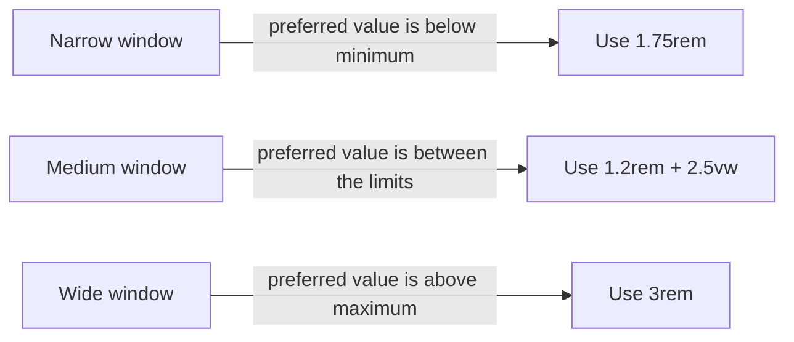

# Typography: fonts, sizes, spacing and units

> **Before this lesson:** you should be able to write a CSS rule with a selector and declarations ([Introducing CSS](#/lesson/html-css/css-intro)) and know that text properties are inherited from parent elements ([The cascade, specificity and inheritance](#/lesson/html-css/cascade)).

## In plain words

**Typography** is the craft of arranging text so that it is comfortable to read: which letter shapes to use, how big they are, how much air sits between lines and how wide a column runs.

Think of a paperback novel and a tax form. Both are made of words, yet one invites you in and the other repels you. The difference is almost entirely typographic: the novel uses a readable typeface, generous space between lines and a column narrow enough that your eye finds the start of the next line without effort.

On the job this matters because most of what a web page delivers is text. A developer who can set type well makes every page look more professional, and one who understands the units of measurement involved (pixels, `em`, `rem`) avoids a whole family of layout and accessibility bugs. Questions such as "what is the difference between `em` and `rem`?" appear in nearly every front-end interview.

## The vocabulary of type

A few words from the printing trade are used throughout CSS, so here they are in plain terms before we use them.

- A **typeface** (or **font family**) is a design of letters with a name, such as Georgia or Arial.
- A **font** is, strictly, one particular style of a typeface, for example "Georgia bold italic". In everyday speech people say "font" for both.
- A **serif** is the small finishing stroke at the ends of letters. **Serif** typefaces have them (Georgia, Times New Roman); **sans-serif** typefaces do not ("sans" is French for "without": Arial, Verdana, Helvetica).
- A **monospace** typeface gives every character the same width, which is why it is used for code.
- **Weight** is how thick the strokes are: light, regular, bold.
- The **baseline** is the invisible line the letters sit on. Parts that hang below it, as in "g" and "y", are **descenders**.

```html-run
<!doctype html>
<html lang="en">
<head><meta charset="utf-8"><title>Generic families</title>
<style>
  p { font-size: 1.4rem; margin: .4rem 0; }
  .serif { font-family: serif; }
  .sans  { font-family: sans-serif; }
  .mono  { font-family: monospace; }
  .curs  { font-family: cursive; }
  .sys   { font-family: system-ui; }
</style></head>
<body>
  <p class="serif">serif: The quick brown fox, 0123</p>
  <p class="sans">sans-serif: The quick brown fox, 0123</p>
  <p class="mono">monospace: The quick brown fox, 0123</p>
  <p class="curs">cursive: The quick brown fox, 0123</p>
  <p class="sys">system-ui: The quick brown fox, 0123</p>
</body>
</html>
```

Reading the code: each paragraph has a class, and each class sets one property, `font-family`, to a **generic family** keyword. A generic family is not a specific typeface; it is a request for "whatever serif (or sans-serif, or monospace) face this device has". That is why the output can look slightly different on Windows, macOS and Android. `system-ui` asks for the typeface the operating system uses for its own menus and buttons.

## Choosing typefaces with `font-family`

A web page can only display a typeface that is available on the visitor's device (or one that you send along with the page, covered below). Because you cannot know what is installed, `font-family` takes a **list** of choices, called a **font stack**. The browser uses the first one it can find.

```css
body {
  font-family: "Helvetica Neue", Arial, sans-serif;
}
```

Line by line:

- `"Helvetica Neue"` is the first choice. Names containing spaces are wrapped in quotation marks.
- `Arial` is the second choice, used if the first is missing.
- `sans-serif` is the generic fallback. Always end a stack with a generic family so that something sensible is guaranteed.

The browser makes this decision per character. If your chosen face has no glyph (a **glyph** is the drawn shape of one character) for, say, a Japanese symbol, the browser moves along the stack for that one character.

## Web fonts with `@font-face`

To use a typeface that visitors do not have, you provide the font file yourself. The `@font-face` rule gives the file a family name that you can then use in any stack.

```css
@font-face {
  font-family: "Lexia";                               /* the name you will refer to */
  src: url("/fonts/lexia-regular.woff2") format("woff2");  /* where the file is */
  font-weight: 400;                                   /* which weight this file holds */
  font-style: normal;
  font-display: swap;                                 /* what to do while it downloads */
}

body { font-family: "Lexia", Georgia, serif; }
```

- **WOFF2** (Web Open Font Format 2) is the compressed font format every current browser accepts; it is the only one you need.
- Each weight and style is normally a separate file with its own `@font-face` block. A **variable font** packs a whole range of weights into one file, declared with a range such as `font-weight: 100 900`.
- `font-display` controls the waiting period. With `swap` the browser shows the fallback face at once and swaps in the web font when it arrives. Without it some browsers hide the text for up to three seconds, an effect nicknamed FOIT (flash of invisible text).

Hosted services such as Google Fonts generate these rules for you; you add a `<link>` to their style sheet. Hosting the files on your own server avoids an extra connection and third-party tracking.

> [!WARNING]
> Every font file is a download that delays the appearance of text. Two families with two weights each is plenty for most sites. Check that the licence of any typeface you use permits web embedding.

## Size: `font-size` and the units behind it

`font-size` sets how tall the letters are. Browsers default to **16 pixels** for ordinary text unless the user has changed that preference. A **pixel** (`px`) in CSS is a fixed small unit of length, roughly 1/96 of an inch.

You can state sizes in several units, and choosing between them is one of the most important decisions in a style sheet.

| Unit | What 1 unit equals | Example |
|---|---|---|
| `px` | One CSS pixel; always the same | `18px` |
| `em` | The font size of the **element itself** (for `font-size`, of its **parent**) | `1.5em` |
| `rem` | The font size of the **root** element, `<html>` ("root em") | `1.5rem` |
| `%` | A percentage of the parent's font size | `150%` |

Start with the simplest case. The root font size is 16px. A heading declared `font-size: 2rem` is therefore 2 × 16 = 32px, wherever it sits in the page.

Now the complication with `em`. Because an `em` is relative to the surrounding font size, nested elements **compound**:

```html-run
<!doctype html>
<html lang="en">
<head><meta charset="utf-8"><title>em compounds, rem does not</title>
<style>
  body { font-family: system-ui, sans-serif; }
  .em  ul { font-size: 1.3em; }   /* 1.3 times the PARENT's size */
  .rem ul { font-size: 1.3rem; }  /* 1.3 times the ROOT size, always */
  section { border: 1px solid #bbb; padding: .5rem; margin-bottom: .6rem; }
</style></head>
<body>
  <section class="em"><strong>em</strong>
    <ul><li>Level one
      <ul><li>Level two
        <ul><li>Level three keeps growing</li></ul></li></ul></li></ul>
  </section>
  <section class="rem"><strong>rem</strong>
    <ul><li>Level one
      <ul><li>Level two
        <ul><li>Level three stays the same</li></ul></li></ul></li></ul>
  </section>
</body>
</html>
```

In the first box each nested list multiplies its parent's size by 1.3, giving 20.8px, then 27px, then 35px. In the second, every list is 1.3 × 16 = 20.8px, because `rem` ignores the parents and looks only at the root.

**Why not use pixels for everything?** Because some people set a larger default text size in their browser settings in order to read comfortably. `rem` sizes scale up with that setting; `px` sizes ignore it. Using `rem` for font sizes is therefore the accessible choice.

A workable rule of thumb:

| Use | For |
|---|---|
| `rem` | Font sizes, and spacing that should follow the user's text-size preference |
| `em` | Things that should scale with the *element's own* text: padding inside a button, the gap beside an icon |
| `px` | Hairline details that should not scale: 1px borders, small shadows |
| unitless number | `line-height` |

> [!INTERVIEW]
> "`em` versus `rem`?" Both are relative to a font size. `rem` is relative to the root element's font size, so it is consistent everywhere. `em` is relative to the current element's font size (or the parent's, when used on `font-size` itself), so it compounds when nested. Use `rem` for type scales and `em` for component-internal spacing.

### A type scale

Rather than inventing a size for each heading, designers choose a **type scale**: a short series of sizes in which each step is the previous one multiplied by a fixed ratio. With a ratio of 1.25 starting at 1rem you get 1, 1.25, 1.563, 1.953, 2.441 rem.

```html-run
<!doctype html>
<html lang="en">
<head><meta charset="utf-8"><title>Type scale</title>
<style>
  body { font-family: Georgia, serif; line-height: 1.5; max-width: 34rem; }
  h1 { font-size: 2.441rem; }
  h2 { font-size: 1.953rem; }
  h3 { font-size: 1.563rem; }
  h4 { font-size: 1.25rem; }
  p  { font-size: 1rem; }
  small { font-size: 0.8rem; }
  h1, h2, h3, h4 { line-height: 1.2; margin: 1.2em 0 .4em; }
</style></head>
<body>
  <h1>Heading one</h1><h2>Heading two</h2><h3>Heading three</h3><h4>Heading four</h4>
  <p>Body copy at one rem. <small>Small print at 0.8rem.</small></p>
</body>
</html>
```

Note `margin: 1.2em 0 .4em` on the headings: because the margin is in `em`, a bigger heading automatically gets a proportionally bigger gap above it.

## Weight, style and other font properties

| Property | Common values | Effect |
|---|---|---|
| `font-weight` | `normal` (400), `bold` (700), or any number 1–1000 | Stroke thickness |
| `font-style` | `normal`, `italic` | Slanted letterforms |
| `font-variant` | `small-caps` | Lowercase shown as small capitals |
| `font-variant-numeric` | `tabular-nums` | Equal-width digits for columns of figures |
| `font-stretch` | `condensed`, `expanded`, or a percentage | Narrower or wider faces, where the font supplies them |

If you ask for a weight the font file does not contain, the browser fakes it by thickening the regular outlines ("faux bold"), which looks smudged. Load the weights you use, or use a variable font.

The `font` shorthand sets several of these in one declaration, in a fixed order: `font: italic 700 1.25rem/1.4 Georgia, serif;` means style, weight, size, a slash, line height, then the family. Size and family are compulsory, and anything you leave out is reset to its default.

## Line height, measure and alignment

Three settings control how comfortable a block of text is to read.

**`line-height`** is the vertical distance from one baseline to the next. Printers call it **leading** (pronounced "ledding"). Write it as a plain number with no unit:

```css
body { line-height: 1.5; }   /* each element's line height = 1.5 x its own font size */
```

A unitless value is inherited as a *multiplier*, so a 32px heading gets 48px lines and a 12px caption gets 18px lines. If you wrote `line-height: 24px` instead, that fixed distance would be inherited by the big heading too and its lines would overlap. Aim for about 1.5 for body text and 1.1 to 1.3 for large headings.

**Measure** is the typographer's word for the length of a line. Lines much longer than about 75 characters make it hard to find the next line; lines under about 45 chop sentences up. The `ch` unit, equal to the width of the digit zero in the current font, expresses this directly: `max-width: 65ch`.

**`text-align`** sets horizontal alignment: `left`, `right`, `center`, `justify`, or the direction-aware `start` and `end`. Centre short things such as headings. Avoid `justify` for web text: without fine hyphenation it opens uneven gaps between words.

```html-run
<!doctype html>
<html lang="en">
<head><meta charset="utf-8"><title>Readable text</title>
<style>
  body { font-family: Georgia, serif; font-size: 1.05rem; margin: 1rem; }
  .bad  { line-height: 1.1; }
  .good { line-height: 1.6; max-width: 60ch; }
  h3 { font-family: system-ui, sans-serif; margin-bottom: .2rem; }
</style></head>
<body>
  <h3>Tight lines, full width</h3>
  <p class="bad">A lighthouse keeper's log is a patient document. Each evening the lamp is trimmed, the weather noted and the passing ships counted, and each morning the glass is cleaned of salt. Nothing in it is hurried, because nothing at the edge of the sea can be.</p>
  <h3>Line height 1.6, measure 60ch</h3>
  <p class="good">A lighthouse keeper's log is a patient document. Each evening the lamp is trimmed, the weather noted and the passing ships counted, and each morning the glass is cleaned of salt. Nothing in it is hurried, because nothing at the edge of the sea can be.</p>
</body>
</html>
```

## Spacing and decoration

| Property | What it does | Typical use |
|---|---|---|
| `letter-spacing` | Adds space between characters (called **tracking**) | Slightly positive for all-caps labels: `0.05em` |
| `word-spacing` | Adds space between words | Rare |
| `text-transform` | `uppercase`, `lowercase`, `capitalize` | Styling labels without retyping the HTML |
| `text-decoration` | `underline`, `line-through`, `none`, plus colour, style and thickness | Links, deleted prices |
| `text-underline-offset` | Moves an underline away from the letters | Clearer links |
| `text-indent` | Indents the first line of a block | Book-style paragraphs |
| `text-shadow` | A shadow behind the glyphs: `x y blur colour` | Legibility over images |
| `vertical-align` | Shifts an inline box up or down relative to the line | `sub`, `super`, `middle` for icons |
| `text-wrap` | `balance` evens out the lines of a heading; `pretty` avoids a lonely last word | Headings, paragraphs |

```html-run
<!doctype html>
<html lang="en">
<head><meta charset="utf-8"><title>Text details</title>
<style>
  body { font-family: system-ui, sans-serif; max-width: 26rem; }
  .eyebrow { text-transform: uppercase; letter-spacing: .08em; font-size: .8rem; font-weight: 700; color: #00695c; }
  h2 { text-wrap: balance; margin: .2rem 0 .6rem; line-height: 1.15; }
  a { text-decoration: underline; text-decoration-color: #00897b; text-decoration-thickness: 2px; text-underline-offset: 3px; }
  .was { text-decoration: line-through; color: #777; }
  .clip { white-space: nowrap; overflow: hidden; text-overflow: ellipsis; border: 1px dashed #aaa; padding: .3rem; }
</style></head>
<body>
  <p class="eyebrow">Coastal walks</p>
  <h2>Seven miles along the cliff path from the harbour to the old light</h2>
  <p>Tickets <span class="was">£12</span> £9. <a href="#">Read the route notes</a>.</p>
  <p class="clip">This single line is too long for its box, so it ends with an ellipsis instead of wrapping.</p>
</body>
</html>
```

Two things to notice. The eyebrow text is written in normal case in the HTML and capitalised by CSS, so screen readers read it as a word instead of spelling out letters. And the last paragraph shows the three-declaration recipe for cutting off one line with "…": `white-space: nowrap` (do not wrap), `overflow: hidden` (hide what does not fit) and `text-overflow: ellipsis` (show the dots).

### Wrapping and long words

`white-space` controls whether spaces collapse and lines wrap: `normal` (the default), `nowrap` (one long line), `pre` (keep every space and line break, like the `<pre>` element), `pre-wrap` (keep them but still wrap). A long unbroken string such as a web address can poke out of a narrow box; `overflow-wrap: anywhere` lets the browser break it. `hyphens: auto` adds hyphens at line ends when the page's `lang` attribute tells the browser which language's rules to follow.

## Fluid type with `clamp()`

A heading that looks right on a wide monitor is often too big on a phone. Instead of switching sizes at fixed screen widths, you can let the size grow smoothly with the window.

`clamp(minimum, preferred, maximum)` returns the preferred value but never less than the minimum or more than the maximum.

```css
h1 { font-size: clamp(1.75rem, 1.2rem + 2.5vw, 3rem); }
```

Piece by piece: `1.75rem` is the smallest the heading may be. `3rem` is the largest. In between it is `1.2rem + 2.5vw`, where `vw` is a **viewport unit**: 1vw equals 1% of the browser window's width. Adding a `rem` part to the `vw` part matters, because a size made of `vw` alone would not respond when the user zooms or enlarges their default text.



> [!TIP]
> Developer tools show which typeface was really used: select some text, open the Computed pane and look for "Rendered Fonts". It reveals when the browser silently fell back to a different family.

## Pitfalls

- **Font sizes in pixels.** They ignore the user's text-size preference. Use `rem`.
- **Setting `html { font-size: 62.5% }` to make "1rem = 10px".** A once-popular trick that makes sums easier and breaks third-party components that assume 16px. Leave the root size alone.
- **`em` font sizes on nested elements.** They compound unexpectedly; prefer `rem` for sizes.
- **`line-height` with units.** A fixed line height is inherited as a fixed length and collides with larger text. Use a unitless number.
- **Lines that are too long.** Cap text columns at roughly 60–75 characters with `max-width` in `ch`.
- **Too many web fonts.** Each file slows the first display of text; missing `font-display: swap` can hide text while it loads.
- **Faux bold and italic.** Load the real weights and styles.
- **All-caps typed in the HTML.** Screen readers may spell it out letter by letter; use `text-transform`.
- **Justified text and centred paragraphs.** Both are tiring to read in long passages.
- **Fluid sizes in pure `vw`.** They do not zoom. Combine with `rem` inside `clamp()`.

## Cheat sheet

| Goal | CSS |
|---|---|
| Typeface with fallbacks | `font-family: "Name", Fallback, generic;` |
| Operating-system face | `font-family: system-ui, sans-serif;` |
| Custom font file | `@font-face { font-family; src: url(...) format("woff2"); font-display: swap; }` |
| Size relative to root | `font-size: 1.25rem;` |
| Space that tracks the element's text | `padding: .5em 1em;` |
| Comfortable leading | `line-height: 1.5;` (no unit) |
| Readable column | `max-width: 65ch;` |
| Bold / italic | `font-weight: 700;` / `font-style: italic;` |
| Small-caps label | `text-transform: uppercase; letter-spacing: .05em;` |
| One-line cut-off | `white-space: nowrap; overflow: hidden; text-overflow: ellipsis;` |
| Break long strings | `overflow-wrap: anywhere;` |
| Even heading lines | `text-wrap: balance;` |
| Fluid heading | `font-size: clamp(1.75rem, 1.2rem + 2.5vw, 3rem);` |
| Aligned digits | `font-variant-numeric: tabular-nums;` |

## Summary

Type on the web starts with a font stack ending in a generic family, optionally extended with your own files through `@font-face`. Size text in `rem` so it honours the reader's preferences, keep `em` for spacing that should follow an element's own text, and give `line-height` a unitless number so it scales correctly when inherited. Readability comes from moderate line length, adequate leading and restrained alignment. Finer controls (spacing, transformation, decoration, wrapping) polish the result, and `clamp()` lets sizes adapt smoothly to any screen.

## Glossary

| Term | Meaning |
|---|---|
| Typeface / font family | A named design of letters, such as Georgia |
| Serif / sans-serif | With / without small finishing strokes on the letters |
| Font stack | An ordered list of fallback families in `font-family` |
| Generic family | A keyword like `serif` or `monospace` that lets the device choose a face of that kind |
| Glyph | The drawn shape of a single character |
| WOFF2 | The standard compressed file format for web fonts |
| `px` | CSS pixel, a fixed unit of length |
| `em` | A length equal to the current element's font size |
| `rem` | A length equal to the root (`html`) element's font size |
| `ch` | The width of the digit 0 in the current font |
| `vw` | One percent of the viewport (browser window) width |
| Line height / leading | Distance between the baselines of consecutive lines |
| Measure | The length of a line of text |
| Tracking | Uniform extra space between letters (`letter-spacing`) |
| Type scale | A set of font sizes related by a constant ratio |
| FOIT | Flash of invisible text while a web font downloads |

## Check yourself

```quiz
[
  {"q": "The root font size is 16px. A div has font-size: 20px and contains a p with font-size: 1.5rem. How big is the paragraph's text?", "options": ["30px", "24px", "20px", "16px"], "answer": 1,
   "explain": "rem always refers to the root element: 1.5 x 16 = 24px. The div's 20px is irrelevant."},
  {"q": "Same setup, but the p has font-size: 1.5em. How big is its text now?", "options": ["30px", "24px", "20px", "36px"], "answer": 0,
   "explain": "On the font-size property, em refers to the parent's font size: 1.5 x 20 = 30px."},
  {"q": "A button has font-size: 20px and padding: 0.5em. How much padding does it get?", "options": ["8px", "10px", "0.5px", "16px"], "answer": 1,
   "explain": "On properties other than font-size, em refers to the element's own font size: 0.5 x 20 = 10px."},
  {"q": "Why is line-height: 1.5 preferred over line-height: 24px on body?", "options": ["Numbers render faster", "The unitless value is inherited as a multiplier, so each element scales its line height to its own font size", "Pixels are not allowed for line-height", "It makes text bold"], "answer": 1,
   "explain": "A fixed 24px would also be inherited by large headings, whose lines would then overlap. A unitless ratio adapts."},
  {"q": "In font-family: 'Avenir Next', Arial, sans-serif the device has neither Avenir Next nor Arial. What is used?", "options": ["Times New Roman always", "No text is shown", "The device's default sans-serif face", "The browser shows an error"], "answer": 2,
   "explain": "The browser walks the stack and falls back to the generic family, which every device can satisfy."},
  {"q": "What does font-display: swap do?", "options": ["Swaps bold for italic", "Shows fallback text immediately and replaces it when the web font loads", "Prevents the font from downloading", "Changes the font on hover"], "answer": 1,
   "explain": "It avoids invisible text during the download at the cost of a brief change in appearance."},
  {"q": "What does this render? <p style='width:120px; white-space:nowrap; overflow:hidden; text-overflow:ellipsis'>A very long sentence indeed</p>", "options": ["The text wraps onto several lines", "One line cut off with an ellipsis at the box edge", "The text overflows visibly past the box", "Nothing"], "answer": 1,
   "explain": "nowrap keeps it on one line, overflow hidden clips it, and text-overflow adds the three dots."},
  {"q": "For font-size: clamp(1rem, 0.5rem + 2vw, 2rem) on a 2000px-wide viewport with a 16px root, what is the size?", "options": ["16px", "48px", "32px", "40px"], "answer": 2,
   "explain": "The preferred value is 8px + 40px = 48px, which exceeds the 2rem maximum, so it is capped at 32px."}
]
```

> **Source:** Duckett, *HTML & CSS*, ch. 12 (Text). MDN: https://developer.mozilla.org/en-US/docs/Learn_web_development/Core/Text_styling/Fundamentals · https://developer.mozilla.org/en-US/docs/Web/CSS/@font-face · https://developer.mozilla.org/en-US/docs/Web/CSS/length · https://developer.mozilla.org/en-US/docs/Web/CSS/clamp · https://developer.mozilla.org/en-US/docs/Web/CSS/line-height
