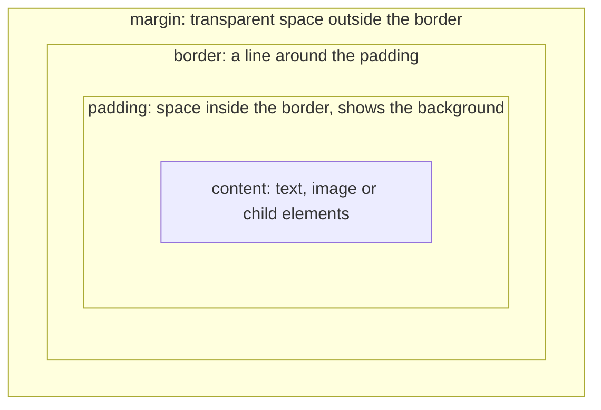

# The box model: content, padding, border and margin

> **Before this lesson:** you should know how to write CSS rules and selectors ([Introducing CSS](#/lesson/html-css/css-intro)) and the difference between block and inline elements ([Ids, classes, generic containers and the document head](#/lesson/html-css/ids-classes-meta)).

## In plain words

Every element on a web page, whether a heading, a link, an image or a button, is drawn as a rectangle. The **box model** is the set of rules that says how big that rectangle is and how much empty space surrounds it.

Picture a framed photograph hanging in a gallery. The photo itself is the *content*. The cardboard mount between the photo and the frame is the *padding*. The wooden frame is the *border*. The bare wall the gallery leaves between this frame and the next one is the *margin*. CSS boxes have exactly these four layers, in the same order from the inside out.

This matters for a job because almost every layout bug ("why is this box wider than its container?", "where is that gap coming from?", "why won't these two things line up?") turns out to be a box-model question. Interviewers ask about it constantly, especially the `box-sizing` property and a behaviour called margin collapsing.

## The four layers



| Layer | What it is | Has a background? |
|---|---|---|
| **Content** | The area where text and child elements are placed | Yes |
| **Padding** | Space between the content and the border | Yes, the element's background shows through |
| **Border** | A line drawn around the padding | Its own colour |
| **Margin** | Space between this box's border and neighbouring boxes | No, always transparent |

Here is the smallest possible demonstration. One box, with each layer given an obvious size and colour.

```html-run
<!doctype html>
<html lang="en">
<head><meta charset="utf-8"><title>One box</title>
<style>
  body { background: #eceff1; margin: 0; }
  .box {
    width: 200px;                 /* width of the content area */
    padding: 20px;                /* space inside the border */
    border: 10px solid #1565c0;   /* the frame */
    margin: 30px;                 /* space outside the border */
    background: #bbdefb;          /* fills content AND padding */
  }
</style></head>
<body>
  <div class="box">Content area. The pale blue around this text is padding, the dark blue line is the border, and the grey gap beyond it is margin.</div>
</body>
</html>
```

Line by line:

- `width: 200px` asks for a content area 200 pixels wide.
- `padding: 20px` adds 20 pixels of space on all four sides between the text and the border.
- `border: 10px solid #1565c0` draws a line 10 pixels thick, in a solid style, in dark blue. `border` is a **shorthand**: one declaration that sets several properties (width, style and colour) at once.
- `margin: 30px` pushes everything else 30 pixels away on all four sides.
- `background` colours the content and padding areas. The margin stays see-through, which is why the page's grey shows there.

## How big is the box? `box-sizing`

Here is the question that catches every beginner. In the example above, how wide is the visible box, from the outer edge of the left border to the outer edge of the right border?

By default the answer is **not** 200 pixels. `width` sets only the content area, and padding and border are added on top:

$$\text{visible width} = 200 + 20 + 20 + 10 + 10 = 260\text{px}$$

This default behaviour has a name: `box-sizing: content-box`. It is awkward, because the size you type is not the size you get. Ask for a box that is `width: 100%` with some padding, and it ends up wider than its container and sticks out.

The alternative is `box-sizing: border-box`. With it, `width` and `height` describe the box **up to and including the border**, and the content area shrinks to make room for the padding and border.

```html-run
<!doctype html>
<html lang="en">
<head><meta charset="utf-8"><title>box-sizing</title>
<style>
  body { font-family: system-ui, sans-serif; }
  .container { width: 300px; background: #ffe0b2; padding: 0; margin-bottom: 1.5rem; outline: 2px dashed #e65100; }
  .item { width: 100%; padding: 20px; border: 5px solid #4e342e; background: #fff; }
  .content-box { box-sizing: content-box; }   /* the default */
  .border-box  { box-sizing: border-box; }
</style></head>
<body>
  <p>Both white boxes say <code>width: 100%</code> inside a 300px dashed container.</p>
  <div class="container"><div class="item content-box">content-box: 300 + 40 + 10 = 350px wide. It overflows.</div></div>
  <div class="container"><div class="item border-box">border-box: exactly 300px wide. It fits.</div></div>
</body>
</html>
```

| | `content-box` (default) | `border-box` |
|---|---|---|
| `width` measures | Content only | Content + padding + border |
| Visible width of a box with `width: 300px; padding: 20px; border: 5px` | 350px | 300px |
| Content width of that box | 300px | 250px |
| Margin included? | No | No (never) |

Because `border-box` is so much easier to reason about, nearly every project begins its style sheet with this rule, which applies it to every element:

```css
*, *::before, *::after {
  box-sizing: border-box;
}
```

The `*` is the universal selector (it matches every element), and `::before` and `::after` are included because generated boxes are not matched by `*`.

> [!INTERVIEW]
> "Explain the box model and `box-sizing`." Every element is a box of content, padding, border and margin. With the default `content-box`, `width` and `height` apply to the content only, so padding and border make the box larger. With `border-box` they include padding and border, so the declared size is the rendered size. Margin is outside the box in both cases.

## Setting each layer

### Padding and margin: the shorthand pattern

Both properties take one to four values. The same pattern is used by several other properties, so it is worth learning once.

| You write | Meaning |
|---|---|
| `padding: 10px` | All four sides |
| `padding: 10px 20px` | Top and bottom 10px; left and right 20px |
| `padding: 10px 20px 30px` | Top 10px; left and right 20px; bottom 30px |
| `padding: 10px 20px 30px 40px` | Top, right, bottom, left: **clockwise from the top** |

There are also individual properties: `padding-top`, `padding-right`, `padding-bottom`, `padding-left`, and the same four for `margin`.

Differences between the two:

- **Padding cannot be negative. Margin can.** A negative margin pulls a box toward (or over) its neighbour.
- **Margin accepts `auto`.** On a block box with a set width, `margin-left: auto; margin-right: auto` shares the leftover horizontal space equally, which centres the box.
- **Padding is clickable and coloured; margin is neither.** To enlarge a button's click target, add padding.

```html-run
<!doctype html>
<html lang="en">
<head><meta charset="utf-8"><title>Centring with auto margins</title>
<style>
  * { box-sizing: border-box; }
  body { font-family: system-ui, sans-serif; background: #f5f5f5; }
  .page { max-width: 320px; margin: 0 auto; background: white; padding: 1rem 1.5rem; border: 1px solid #ccc; }
  .tag { display: inline-block; padding: .2em .7em; margin: 0 .3em .3em 0; background: #e1bee7; border-radius: 999px; }
</style></head>
<body>
  <div class="page">
    <h3 style="margin-top:0">Centred column</h3>
    <p><code>margin: 0 auto</code> means no margin top and bottom, automatic margins left and right.</p>
    <span class="tag">padding</span><span class="tag">in em</span><span class="tag">scales with text</span>
  </div>
</body>
</html>
```

### Logical properties

The words top, right, bottom and left are *physical* directions. Languages such as Arabic and Hebrew run right to left, so "the side where a line of text starts" is the right, not the left. **Logical properties** name sides by the flow of text instead:

| Logical | In English (left-to-right, top-to-bottom) |
|---|---|
| `margin-inline-start` / `-end` | left / right |
| `margin-block-start` / `-end` | top / bottom |
| `padding-inline`, `padding-block` | left + right, top + bottom |
| `inline-size`, `block-size` | width, height |

"Inline" is the direction text runs along a line; "block" is the direction in which paragraphs stack. `margin-inline: auto` is a neat way to centre horizontally, and all of these adapt automatically when the page's direction changes.

### Borders

A border needs three things: a width, a style and a colour. The style is compulsory, because the default style is `none`, which draws nothing.

```html-run
<!doctype html>
<html lang="en">
<head><meta charset="utf-8"><title>Borders</title>
<style>
  body { font-family: system-ui, sans-serif; display: grid; grid-template-columns: repeat(3, 1fr); gap: 12px; }
  div { padding: .8rem; text-align: center; }
  .a { border: 3px solid #00695c; }
  .b { border: 3px dashed #00695c; }
  .c { border: 3px dotted #00695c; }
  .d { border: 6px double #00695c; }
  .e { border-bottom: 4px solid #ef6c00; }
  .f { border: 3px solid #00695c; border-radius: 12px; }
  .g { border: 3px solid #00695c; border-radius: 50%; aspect-ratio: 1; display: grid; place-items: center; }
  .h { border: 3px solid; border-color: #c62828 #1565c0 #2e7d32 #f9a825; }
  .i { outline: 3px solid #6a1b9a; outline-offset: 4px; }
</style></head>
<body>
  <div class="a">solid</div><div class="b">dashed</div><div class="c">dotted</div>
  <div class="d">double</div><div class="e">one side only</div><div class="f">border-radius</div>
  <div class="g">50%</div><div class="h">four colours</div><div class="i">outline</div>
</body>
</html>
```

- `border-radius` rounds the corners. A value of `50%` on a square box makes a circle; a very large value such as `999px` makes a pill shape.
- You can set one side with `border-top`, `border-right`, `border-bottom` or `border-left`.
- An **outline** (last box) looks like a border but is drawn *outside* the border and **takes up no space**: adding or removing it never moves anything. That is why browsers use outlines for focus indicators.

### Width, height and their limits

| Property | Purpose |
|---|---|
| `width`, `height` | A preferred size |
| `min-width`, `min-height` | The box may grow but never shrink below this |
| `max-width`, `max-height` | The box may shrink but never grow beyond this |

Block boxes are as wide as their container by default and as tall as their content. Fixed heights are a frequent cause of bugs: if the text needs more room than the `height` allows (a longer translation, a larger user font), it spills out. Prefer `min-height`, which sets a floor and lets the box grow.

A very common pattern is a fluid column with a cap: `width: 100%; max-width: 40rem;`. It fills small screens and stops growing on large ones.

A percentage width refers to the width of the **containing block**, which is normally the parent's content area. Surprisingly, percentage `padding` and `margin`, even top and bottom, are also calculated from the containing block's *width*.

## When content does not fit: `overflow`

If content is bigger than its box, it **overflows**. The `overflow` property decides what happens to the part that sticks out.

| Value | Behaviour |
|---|---|
| `visible` (default) | The extra content is drawn outside the box, overlapping whatever is there |
| `hidden` | The extra is clipped and cannot be reached |
| `scroll` | Scrollbars are always shown |
| `auto` | Scrollbars appear only when needed |
| `clip` | Like hidden, but without creating a scrollable area |

```html-run
<!doctype html>
<html lang="en">
<head><meta charset="utf-8"><title>overflow</title>
<style>
  * { box-sizing: border-box; }
  body { font-family: system-ui, sans-serif; display: flex; gap: 16px; }
  .box { width: 150px; height: 80px; border: 2px solid #37474f; padding: 6px; background: #fffde7; margin-bottom: 60px; }
  .v { overflow: visible; } .h { overflow: hidden; } .a { overflow: auto; }
</style></head>
<body>
  <div class="box v"><b>visible</b>: this text is longer than the fixed height allows, so it spills out underneath the box.</div>
  <div class="box h"><b>hidden</b>: this text is longer than the fixed height allows, so the rest is cut off.</div>
  <div class="box a"><b>auto</b>: this text is longer than the fixed height allows, so you can scroll to read it.</div>
</body>
</html>
```

`overflow-x` and `overflow-y` control each direction separately.

## Margin collapsing

This is the box model's strangest rule. When the **vertical** margins of two block boxes touch, they do not add together. They **collapse** into a single margin whose size is the larger of the two.

```html-run
<!doctype html>
<html lang="en">
<head><meta charset="utf-8"><title>Margin collapsing</title>
<style>
  body { font-family: system-ui, sans-serif; }
  p { background: #c8e6c9; margin: 0; padding: .4rem; }
  .a { margin-bottom: 40px; }
  .b { margin-top: 25px; }
  .parent { background: #ffccbc; }
  .child  { margin-top: 30px; background: #fff; padding: .4rem; }
  .fixed  { display: flow-root; }
</style></head>
<body>
  <p class="a">Paragraph A has margin-bottom: 40px.</p>
  <p class="b">Paragraph B has margin-top: 25px. The gap between us is 40px, not 65px.</p>
  <hr>
  <div class="parent"><div class="child">My 30px top margin escapes above my orange parent.</div></div>
  <hr>
  <div class="parent fixed"><div class="child">With display: flow-root on the parent, the margin stays inside.</div></div>
</body>
</html>
```

Three situations cause collapsing:

1. **Adjacent siblings.** The bottom margin of one block and the top margin of the next combine into the larger of the two (first pair above).
2. **Parent and first or last child.** If nothing separates a parent's top edge from its first child's top margin (no padding, no border), the child's margin merges with the parent's and appears *outside* the parent (second example).
3. **Empty blocks.** A box with no height, padding or border has its own top and bottom margins collapse together.

When collapsing does **not** happen:

- Horizontal (left and right) margins never collapse.
- Margins of flex items and grid items never collapse.
- A parent with padding, a border, or `display: flow-root` keeps its children's margins inside.
- Floated and absolutely positioned boxes do not take part.

The rule exists for a good reason: in a run of paragraphs each with a top and bottom margin, you want one line's worth of space between them, not two. It becomes confusing only in the parent-and-child case.

> [!TIP]
> Many teams avoid the whole issue by giving margins in one direction only (for example, only `margin-top` on elements, or only a bottom margin), or by using the `gap` property of flex and grid containers for spacing between siblings.

## Seeing the box model in developer tools

Right-click any element and choose **Inspect**. In the Elements panel, select the **Computed** tab (Chrome, Edge) or **Layout** tab (Firefox). You will see a diagram of nested rectangles labelled margin, border, padding and the content size, with the actual numbers in pixels. Hovering over an element in the DOM tree also highlights its layers on the page in different colours. When a size surprises you, this diagram tells you which layer the extra pixels came from.

## Shadows and visibility

Two more properties change how a box looks without changing its size.

- `box-shadow: 0 4px 12px rgb(0 0 0 / 0.2)` draws a shadow. The values are horizontal offset, vertical offset, blur radius and colour; add the word `inset` to draw it inside the box. Like outlines, shadows take up no space.
- `visibility: hidden` makes a box invisible but **keeps its space**, while `display: none` removes the box entirely so that its neighbours close the gap.

> [!WARNING]
> A fixed `height` on a box that holds text is a bug waiting for longer content, a translation or a larger font setting. Use `min-height`, or leave the height to the content.

## Pitfalls

- **Forgetting `box-sizing: border-box`.** Boxes with padding become wider than intended and overflow their container.
- **Fixed `height` on boxes containing text.** The text overflows when it wraps onto more lines. Use `min-height` or let the content decide.
- **Border with no style.** `border: 2px red` draws nothing because the style defaults to `none`.
- **Expecting vertical margins to add up.** Adjacent vertical margins collapse to the larger one.
- **A child's top margin moving the parent.** Add padding to the parent or give it `display: flow-root`.
- **Vertical margin or padding on inline elements.** It does not push lines apart; change the element to `inline-block` or `block`.
- **`margin: auto` on a box without a width.** A block already fills its container, so there is no spare space to share.
- **Using margin where padding is needed.** Margin is outside the background and outside the clickable area.
- **Percentage vertical padding assumed to follow height.** It follows the containing block's width.
- **`overflow: hidden` to hide a layout problem.** It also clips shadows, focus outlines and dropdown menus.

## Cheat sheet

| Goal | CSS |
|---|---|
| Size includes padding and border | `box-sizing: border-box` |
| Space inside the border | `padding: 1rem` |
| Space outside the border | `margin: 1rem` |
| Clockwise shorthand | `top right bottom left` |
| Centre a block horizontally | `max-width: 40rem; margin-inline: auto` |
| A frame | `border: 1px solid #ccc` |
| Rounded corners / circle | `border-radius: 8px` / `50%` |
| Ring that takes no space | `outline: 2px solid; outline-offset: 2px` |
| Fluid with a cap | `width: 100%; max-width: 600px` |
| Grow with content | `min-height` instead of `height` |
| Scroll when too tall | `max-height: 300px; overflow: auto` |
| Stop margins escaping a parent | `display: flow-root` or add padding |
| Shadow | `box-shadow: 0 4px 12px rgb(0 0 0 / .2)` |
| Hide, keep space / remove | `visibility: hidden` / `display: none` |

## Summary

Each element is a box built from content, padding, border and margin. By default `width` and `height` describe only the content, so most projects switch every element to `box-sizing: border-box`, which makes declared sizes include padding and border. Padding and margin share a clockwise shorthand; margins can be negative or `auto`, and adjacent vertical margins of block boxes collapse into one. Prefer minimum and maximum sizes to fixed heights, decide deliberately what happens on overflow, and use the developer tools' box diagram whenever a size is not what you expected.

## Glossary

| Term | Meaning |
|---|---|
| Box model | The rules describing an element's content, padding, border and margin |
| Content area | The innermost rectangle, where text and children go |
| Padding | Space between content and border; shows the element's background |
| Border | A line around the padding |
| Margin | Transparent space outside the border |
| `box-sizing` | Property choosing whether `width`/`height` include padding and border |
| Shorthand | One property that sets several related properties together |
| Containing block | The box that percentages are measured against, usually the parent's content area |
| Overflow | Content that does not fit inside its box |
| Margin collapsing | Touching vertical margins combining into the larger one |
| Outline | A line drawn outside the border that occupies no space |
| Logical properties | Properties named by text direction (`inline`, `block`) instead of left/right/top/bottom |

## Check yourself

```quiz
[
  {"q": "With default box-sizing, what is the total rendered width of a box with width: 200px; padding: 10px; border: 5px solid; margin: 20px (border edge to border edge)?", "options": ["200px", "220px", "230px", "270px"], "answer": 2,
   "explain": "Content 200 + padding 10 + 10 + border 5 + 5 = 230px. Margin is outside the border and not part of the box's visible width."},
  {"q": "The same box with box-sizing: border-box. How wide is its content area?", "options": ["200px", "170px", "180px", "230px"], "answer": 1,
   "explain": "The 200px now includes padding and border, so the content gets 200 - 20 - 10 = 170px."},
  {"q": "Two stacked paragraphs: the first has margin-bottom: 30px, the second margin-top: 20px. How large is the gap between them?", "options": ["50px", "30px", "20px", "10px"], "answer": 1,
   "explain": "Adjacent vertical margins of block boxes collapse to the larger value, 30px."},
  {"q": "What does margin: 10px 20px 30px mean?", "options": ["Top 10, right 20, bottom 30, left 0", "Top 10, left and right 20, bottom 30", "Top and bottom 10, left 20, right 30", "It is invalid"], "answer": 1,
   "explain": "With three values the middle one applies to both left and right."},
  {"q": "What does this render? <div style='border: 4px blue'>Hi</div>", "options": ["Hi in a blue border", "Hi with no visible border", "Hi in a black border", "Nothing"], "answer": 1,
   "explain": "border-style defaults to none, so without a style such as solid no border is drawn."},
  {"q": "A div has width: 300px and margin: 0 auto. What happens?", "options": ["Nothing", "It is centred horizontally in its container", "It is centred vertically", "It stretches to full width"], "answer": 1,
   "explain": "Auto left and right margins on a block with a set width share the leftover space equally."},
  {"q": "Which of these never takes up space in the layout?", "options": ["padding", "border", "margin", "outline"], "answer": 3,
   "explain": "Outlines (and box shadows) are painted on top without affecting the size or position of any box."},
  {"q": "A parent 400px wide and 100px tall contains a child with padding-top: 10%. How much top padding does the child get?", "options": ["10px", "40px", "4px", "0"], "answer": 1,
   "explain": "Percentage padding, even vertical, is computed from the containing block's width: 10% of 400px."}
]
```

> **Source:** Duckett, *HTML & CSS*, ch. 13 (Boxes). MDN: https://developer.mozilla.org/en-US/docs/Learn_web_development/Core/Styling_basics/Box_model · https://developer.mozilla.org/en-US/docs/Web/CSS/box-sizing · https://developer.mozilla.org/en-US/docs/Web/CSS/CSS_box_model/Mastering_margin_collapsing · https://developer.mozilla.org/en-US/docs/Web/CSS/overflow
