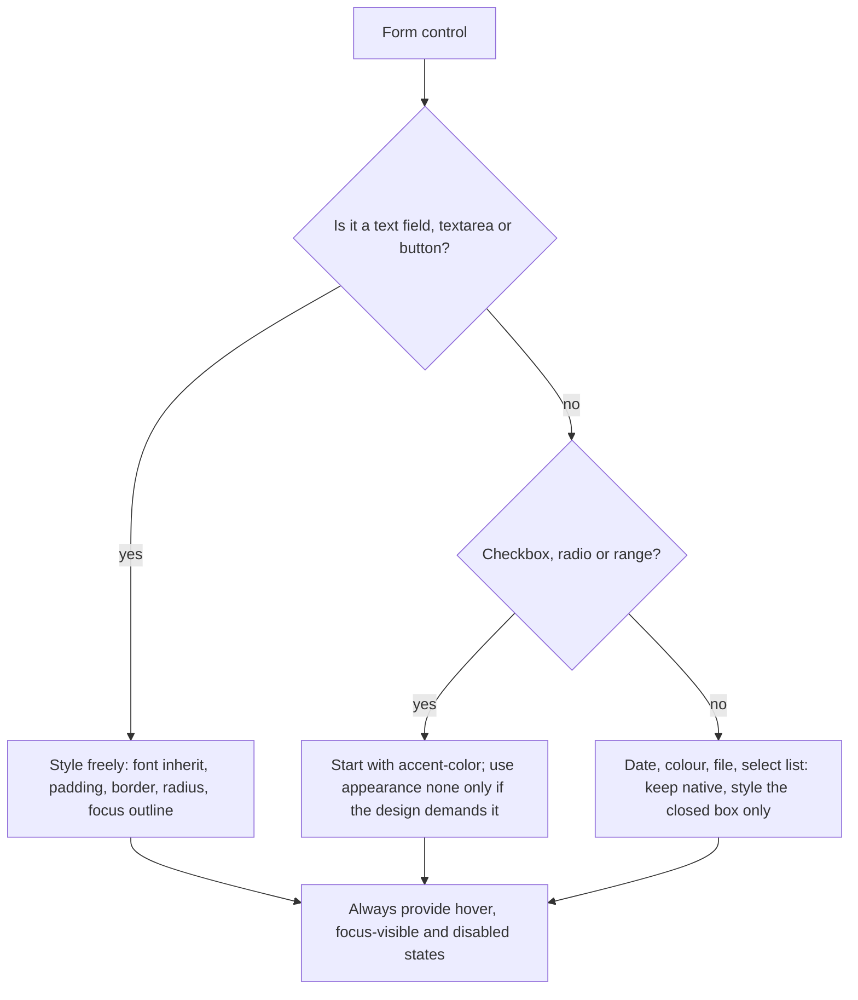

# Styling lists, tables and forms

> **Before this lesson:** you should know the HTML for lists ([Lists and links](#/lesson/html-css/lists-links)), tables ([Tables for tabular data](#/lesson/html-css/tables)) and form controls ([Forms: collecting input](#/lesson/html-css/forms)), and how padding, borders and margins work ([The box model](#/lesson/html-css/box-model)).

## In plain words

Lists, tables and forms are the three places where a browser's built-in appearance is strongest. A list arrives with bullets and an indent, a table with cramped cells and no lines, a form with small grey boxes that look different on every operating system. This lesson is about replacing those factory settings with a design of your own.

A helpful comparison is a rented flat. It comes furnished: the furniture works, but it is nobody's taste. You are allowed to repaint, swap the curtains and rearrange everything, provided you do not knock out the load-bearing walls. In CSS terms, you may change how a list, table or form *looks* as much as you like, as long as the underlying HTML keeps doing its job for keyboards and screen readers (a **screen reader** is software that reads the page aloud for people who cannot see it).

Why it matters at work: navigation menus are lists, dashboards are tables, and sign-up, checkout and search are forms. These are the parts of an interface that people actually operate, so they receive the most design attention and the most bug reports.

## Part 1: Lists

### Markers

The bullet or number in front of a list item is called its **marker**. The `list-style-type` property chooses it.

```html-run
<!doctype html>
<html lang="en">
<head><meta charset="utf-8"><title>Marker types</title>
<style>
  body { font-family: system-ui, sans-serif; display: grid; grid-template-columns: repeat(3, 1fr); gap: 8px; }
  .a { list-style-type: disc; }
  .b { list-style-type: square; }
  .c { list-style-type: "→ "; }
  .d { list-style-type: decimal; }
  .e { list-style-type: lower-alpha; }
  .f { list-style-type: upper-roman; }
</style></head>
<body>
  <ul class="a"><li>disc</li><li>(default)</li></ul>
  <ul class="b"><li>square</li><li>square</li></ul>
  <ul class="c"><li>a string</li><li>of my own</li></ul>
  <ol class="d"><li>decimal</li><li>(default)</li></ol>
  <ol class="e"><li>lower-alpha</li><li>lower-alpha</li></ol>
  <ol class="f"><li>upper-roman</li><li>upper-roman</li></ol>
</body>
</html>
```

Each rule here sets a single property on the list. The third one shows that the value can be any piece of text in quotation marks, including an emoji.

Two related properties:

- `list-style-position: outside` (the default) hangs the marker in the space to the left of the text; `inside` pulls it into the text block so that wrapped lines run underneath it.
- `list-style-image: url(tick.svg)` uses a picture, though you get little control over its size or position.

The shorthand `list-style` sets all three, and the value you will type most is `list-style: none`, which removes markers altogether.

### Styling the marker itself

The `::marker` pseudo-element (a **pseudo-element** is a selector for a *part* of an element) targets the marker box. It accepts only a few properties: `color`, `font-*`, and `content`.

```css
li::marker { color: crimson; font-weight: 700; }
```

### Removing the defaults to build something else

A browser gives lists a left padding of 40 pixels (to make room for markers) plus top and bottom margins. To use a list as the skeleton of a menu, you strip all three:

```html-run
<!doctype html>
<html lang="en">
<head><meta charset="utf-8"><title>List to navigation bar</title>
<style>
  body { font-family: system-ui, sans-serif; margin: 0; }
  .menu {
    list-style: none;       /* 1. no bullets */
    margin: 0;              /* 2. no outer space */
    padding: 0;             /* 3. no indent */
    display: flex;          /* 4. items side by side */
    gap: .25rem;            /* 5. a little space between them */
    background: #263238;
    padding: .5rem;
  }
  .menu a {
    display: block;         /* 6. the whole rectangle is clickable */
    padding: .5rem 1rem;
    color: white;
    text-decoration: none;
    border-radius: 6px;
  }
  .menu a:hover, .menu a:focus-visible { background: #455a64; }
  .menu a[aria-current="page"] { background: #00897b; }
</style></head>
<body>
  <nav aria-label="Main">
    <ul class="menu">
      <li><a href="#" aria-current="page">Home</a></li>
      <li><a href="#">Timetable</a></li>
      <li><a href="#">Fares</a></li>
      <li><a href="#">Contact</a></li>
    </ul>
  </nav>
</body>
</html>
```

The numbered comments are the recipe. Steps 1–3 remove the defaults. Step 4 uses `display: flex`, a layout mode covered fully in the Flexbox lesson; for now, read it as "put my children in a row". Step 6 matters for usability: a link is an inline element by default, so padding would not enlarge its clickable area vertically. Making it `display: block` turns the entire padded rectangle into the target.

`aria-current="page"` is an attribute that tells assistive technology which link is the current page; the CSS reuses it as a styling hook, so the highlighted item and the announced item can never disagree.

### Custom numbering with counters

For numbered steps with decorated numbers, CSS can count for you. A **counter** is a named number that CSS increases as it meets elements.

```html-run
<!doctype html>
<html lang="en">
<head><meta charset="utf-8"><title>Counters</title>
<style>
  body { font-family: system-ui, sans-serif; }
  .steps { list-style: none; padding: 0; counter-reset: step; max-width: 22rem; }
  .steps li { counter-increment: step; display: flex; gap: .8rem; align-items: center; margin: .6rem 0; }
  .steps li::before {
    content: counter(step);
    flex: none; width: 2rem; height: 2rem; border-radius: 50%;
    display: grid; place-items: center;
    background: #5e35b1; color: white; font-weight: 700;
  }
</style></head>
<body>
  <ol class="steps">
    <li>Tap your card on the reader.</li>
    <li>Wait for the green light.</li>
    <li>Take a seat.</li>
  </ol>
</body>
</html>
```

`counter-reset: step` creates a counter called `step` starting at zero. `counter-increment: step` adds one for each list item. `content: counter(step)` prints the current number inside a generated `::before` box, which is then styled as a purple circle.

## Part 2: Tables

An unstyled table has no lines and almost no spacing. Five properties transform it.

```html-run
<!doctype html>
<html lang="en">
<head><meta charset="utf-8"><title>Table styling</title>
<style>
  body { font-family: system-ui, sans-serif; }
  table {
    border-collapse: collapse;   /* 1. merge double borders into single lines */
    width: 100%; max-width: 30rem;
  }
  caption { caption-side: top; text-align: left; font-weight: 700; padding-bottom: .5rem; }
  th, td {
    padding: .6rem .8rem;        /* 2. breathing room */
    text-align: left;            /* 3. text aligned left */
    border-bottom: 1px solid #cfd8dc;   /* 4. row separators only */
  }
  thead th { background: #eceff1; border-bottom: 2px solid #607d8b; }
  td.num, th.num { text-align: right; font-variant-numeric: tabular-nums; }  /* 5. numbers right */
  tbody tr:nth-child(even) { background: #f7f9fa; }    /* zebra stripes */
  tbody tr:hover { background: #e0f2f1; }               /* highlight the row under the pointer */
</style></head>
<body>
  <table>
    <caption>Single fares</caption>
    <thead><tr><th scope="col">Zone</th><th scope="col">Stops</th><th scope="col" class="num">Adult</th><th scope="col" class="num">Child</th></tr></thead>
    <tbody>
      <tr><th scope="row">A</th><td>City centre</td><td class="num">£1.80</td><td class="num">£0.90</td></tr>
      <tr><th scope="row">B</th><td>Inner suburbs</td><td class="num">£2.40</td><td class="num">£1.20</td></tr>
      <tr><th scope="row">C</th><td>Outer suburbs</td><td class="num">£3.10</td><td class="num">£1.55</td></tr>
      <tr><th scope="row">D</th><td>Airport</td><td class="num">£5.00</td><td class="num">£2.50</td></tr>
    </tbody>
  </table>
</body>
</html>
```

What each numbered declaration does:

1. **`border-collapse: collapse`.** By default every cell has its own border with a small gap between cells, which produces doubled lines. Collapsing makes neighbouring cells share one border. With the default value, `separate`, the `border-spacing` property sets the size of the gap.
2. **Padding on `th` and `td`.** Cells are the boxes that hold content, so padding goes on them, not on rows. Rows (`tr`) do not accept padding or margin.
3. **`text-align: left`.** Header cells are centred by default, which rarely matches the column beneath.
4. **Horizontal rules only.** Lines under each row guide the eye along it; vertical lines usually add clutter.
5. **Right-aligned numbers with `tabular-nums`.** Units line up under units, tens under tens, making amounts easy to compare.

The selector `tbody tr:nth-child(even)` reads "every even-numbered row inside the table body" and produces the alternating **zebra stripes** that help the eye stay on one row.

Other table properties you will meet:

| Property | Use |
|---|---|
| `vertical-align: top` | Align cell contents to the top when rows have different heights (default is `middle`) |
| `table-layout: fixed` | Columns take their widths from the first row instead of from all the content; faster and predictable |
| `empty-cells: hide` | Do not draw borders and backgrounds for empty cells (with separate borders) |
| `caption-side: bottom` | Put the caption underneath |
| `position: sticky; top: 0` on `thead th` | Keep the header row visible while a long table scrolls |

## Part 3: Forms

Form controls are the hardest things to style because each operating system draws them in its own way. The approach that works is to style what can be styled reliably and leave the rest alone.

| Easy to style | Possible with care | Leave mostly native |
|---|---|---|
| Text inputs, `textarea`, `button`, `label`, `fieldset`, `legend` | Checkboxes, radio buttons, `select` (closed state), range sliders | Date and colour pickers, file inputs, the open list of a `select` |

### Step 1: make controls inherit the page's type

Controls do not inherit `font-family` or `font-size` on their own, because the browser's built-in style sheet sets its own. One rule fixes that:

```css
button, input, select, textarea { font: inherit; }
```

`font: inherit` means "use whatever font settings my parent has".

### Step 2: text fields

```html-run
<!doctype html>
<html lang="en">
<head><meta charset="utf-8"><title>Text fields</title>
<style>
  *, *::before, *::after { box-sizing: border-box; }
  body { font-family: system-ui, sans-serif; }
  button, input, select, textarea { font: inherit; }
  form { max-width: 22rem; display: grid; gap: 1rem; }
  .field { display: grid; gap: .3rem; }
  label { font-weight: 600; }
  input, textarea, select {
    width: 100%;
    padding: .55rem .7rem;
    border: 2px solid #90a4ae;
    border-radius: 8px;
    background: white;
  }
  input:hover, textarea:hover, select:hover { border-color: #546e7a; }
  input:focus-visible, textarea:focus-visible, select:focus-visible {
    outline: 3px solid #80cbc4; outline-offset: 1px; border-color: #00897b;
  }
  input::placeholder { color: #78909c; }
  input:disabled { background: #eceff1; color: #78909c; cursor: not-allowed; }
  textarea { min-height: 5rem; resize: vertical; }
</style></head>
<body>
  <form>
    <div class="field"><label for="n">Name</label><input id="n" placeholder="Sam Okoro"></div>
    <div class="field"><label for="z">Zone</label>
      <select id="z"><option>A – City centre</option><option>B – Inner suburbs</option></select></div>
    <div class="field"><label for="m">Message</label><textarea id="m"></textarea></div>
    <div class="field"><label for="c">Card number</label><input id="c" value="Not available yet" disabled></div>
  </form>
</body>
</html>
```

Things worth pointing out:

- `box-sizing: border-box` combined with `width: 100%` makes each field exactly as wide as its container; without it the padding and border would push it past the edge.
- The label sits *above* its field. That arrangement is the quickest for people to scan and works on narrow screens.
- There are separate looks for hover (pointer over the field), focus (the field is active) and disabled. The focus style uses `outline`, which takes up no space, so nothing shifts when it appears.
- `::placeholder` styles the hint text; make sure it still has readable contrast.
- `resize: vertical` lets users drag a text area taller but not wider, so it cannot break the layout.

> [!WARNING]
> Never remove a focus indicator without supplying another. `outline: none` on its own leaves keyboard users unable to see where they are on the page.

### Step 3: buttons

A button needs at least four visual states: resting, hover, focus and disabled.

```html-run
<!doctype html>
<html lang="en">
<head><meta charset="utf-8"><title>Button states</title>
<style>
  body { font-family: system-ui, sans-serif; display: flex; gap: .8rem; flex-wrap: wrap; align-items: center; }
  .btn {
    font: inherit; font-weight: 600;
    padding: .6em 1.2em;                 /* em: scales with the button's text */
    border: 2px solid transparent;
    border-radius: 8px;
    background: #00695c; color: white;
    cursor: pointer;
    transition: background-color .15s, transform .05s;
  }
  .btn:hover         { background: #004d40; }
  .btn:focus-visible { outline: 3px solid #ffb300; outline-offset: 2px; }
  .btn:active        { transform: translateY(1px); }
  .btn:disabled      { background: #b0bec5; cursor: not-allowed; }
  .btn.secondary     { background: white; color: #00695c; border-color: #00695c; }
  .btn.secondary:hover { background: #e0f2f1; }
</style></head>
<body>
  <button class="btn" type="button">Buy ticket</button>
  <button class="btn secondary" type="button">Add to basket</button>
  <button class="btn" type="button" disabled>Sold out</button>
  <a class="btn" href="#" style="text-decoration:none">A link styled as a button</a>
</body>
</html>
```

The padding is in `em`, so a button with larger text automatically gets proportionally larger padding. `:active` matches while the button is being pressed; moving it down one pixel gives a pleasing "push" effect. `cursor: pointer` shows the hand cursor.

### Step 4: checkboxes and radio buttons

The quickest way to bring these into your colour scheme is one property:

```css
input[type="checkbox"], input[type="radio"] { accent-color: #00695c; }
```

`accent-color` recolours the browser's own control while keeping all of its behaviour. For a fully custom look you can turn off the native drawing with `appearance: none` and paint your own box:

```html-run
<!doctype html>
<html lang="en">
<head><meta charset="utf-8"><title>Custom checkbox</title>
<style>
  body { font-family: system-ui, sans-serif; }
  label { display: flex; align-items: center; gap: .6rem; margin: .5rem 0; cursor: pointer; }
  .native { accent-color: #00695c; width: 1.2rem; height: 1.2rem; }
  .custom {
    appearance: none;                 /* switch off the system look */
    width: 1.3rem; height: 1.3rem; margin: 0;
    border: 2px solid #546e7a; border-radius: 4px;
    display: grid; place-content: center;
  }
  .custom::before {                   /* the tick, hidden until checked */
    content: ""; width: .7rem; height: .7rem;
    background: white;
    clip-path: polygon(14% 44%, 0 65%, 50% 100%, 100% 16%, 80% 0%, 43% 62%);
    transform: scale(0); transition: transform .1s;
  }
  .custom:checked { background: #00695c; border-color: #00695c; }
  .custom:checked::before { transform: scale(1); }
  .custom:focus-visible { outline: 3px solid #ffb300; outline-offset: 2px; }
</style></head>
<body>
  <label><input class="native" type="checkbox" checked> Native box with accent-color</label>
  <label><input class="custom" type="checkbox" checked> Custom box with appearance: none</label>
  <label><input class="custom" type="checkbox"> Another custom box</label>
</body>
</html>
```

The important point is that the real `<input>` is still there. It is still focusable, still toggled by the Space key, still announced as a checkbox. Older tutorials hide the input with `display: none` and style a neighbouring `<span>`; that removes the control from the keyboard and from screen readers, so avoid it.

### Step 5: grouping and layout

`fieldset` draws a border with its `legend` sitting in a gap in the top line. Both can be restyled, or reset with `border: 0; padding: 0; margin: 0` when you want the grouping without the frame.

For the overall arrangement, a grid with a gap is the simplest robust form layout: one column on small screens, labels beside fields on wide ones.

```css
.form-row { display: grid; gap: .3rem; }
@media (min-width: 40rem) {
  .form-row { grid-template-columns: 10rem 1fr; align-items: center; gap: 1rem; }
}
```



> [!INTERVIEW]
> "How do you build a custom checkbox accessibly?" Keep the real `<input type="checkbox">` in the DOM and focusable. Either recolour it with `accent-color`, or apply `appearance: none` and draw the box and tick on the input itself (or on a sibling, with the input visually hidden but not `display: none`). Provide a visible `:focus-visible` style and keep it wrapped in or linked to a `<label>`.

> [!TIP]
> Press the Tab key through any form you style. If you cannot tell which field is active at every step, the focus styles need more work.

## Pitfalls

- **`list-style: none` and forgetting the padding.** The bullets vanish but the 40px indent stays.
- **Padding or margin on `tr`.** Rows ignore them; put padding on cells.
- **Double table borders.** Add `border-collapse: collapse`.
- **Controls in a different font from the page.** Add `font: inherit`.
- **`width: 100%` inputs overflowing.** Missing `box-sizing: border-box`.
- **Hiding real inputs with `display: none`.** They leave the tab order and the accessibility tree.
- **`outline: none` with nothing in its place.** Keyboard users lose their position.
- **Styling only `:hover`.** Touch and keyboard users never see it; pair it with `:focus-visible`.
- **Tiny click targets.** Make links `display: block` with padding; aim for at least 24 by 24 pixels.
- **Fighting native pickers.** Trying to restyle the date picker's calendar or a `select`'s open list leads to brittle, browser-specific hacks.

## Cheat sheet

| Goal | CSS |
|---|---|
| Change bullets or numbers | `list-style-type: square`, `lower-roman`, `"→ "` |
| Remove list defaults | `list-style: none; margin: 0; padding: 0` |
| Colour the marker | `li::marker { color: … }` |
| Custom numbers | `counter-reset`, `counter-increment`, `content: counter(name)` |
| Horizontal menu | `display: flex; gap` on the `ul`; `display: block; padding` on links |
| Single table lines | `border-collapse: collapse` |
| Cell spacing | `padding` on `th, td` |
| Zebra rows | `tbody tr:nth-child(even) { background: … }` |
| Aligned figures | `text-align: right; font-variant-numeric: tabular-nums` |
| Controls use page font | `button, input, select, textarea { font: inherit }` |
| Brand-coloured checkboxes | `accent-color: …` |
| Fully custom control | `appearance: none` on the real input |
| Focus ring | `:focus-visible { outline: 3px solid …; outline-offset: 2px }` |
| Disabled look | `:disabled { … cursor: not-allowed }` |

## Summary

Lists are restyled through their markers (`list-style-type`, `::marker`, counters) or stripped of defaults to become menus. Tables become readable with collapsed borders, cell padding, sensible alignment and zebra stripes. Forms start with `font: inherit` and `box-sizing: border-box`; text fields and buttons can be styled freely as long as hover, focus and disabled states are all designed, while checkboxes and radios are best tinted with `accent-color` or redrawn on the real input with `appearance: none`. In every case the HTML stays the same, so the behaviour that keyboards and assistive technology rely on is preserved.

## Glossary

| Term | Meaning |
|---|---|
| Marker | The bullet or number displayed before a list item |
| `::marker` | Pseudo-element that selects a list item's marker box |
| Counter | A named number that CSS increments and can print with `content` |
| Zebra striping | Alternating background colours on table rows |
| `border-collapse` | Table property that merges adjacent cell borders into one |
| Tabular numerals | Digits that all have the same width so columns line up |
| `appearance: none` | Removes a control's operating-system styling so you can draw your own |
| `accent-color` | Sets the highlight colour of native checkboxes, radios and sliders |
| Focus indicator | The visible ring showing which element will receive keyboard input |
| State | A condition of a control (hover, focus, active, disabled, checked) that CSS can target with a pseudo-class |

## Check yourself

```quiz
[
  {"q": "After ul { list-style: none; } the bullets are gone but the items are still indented. Why?", "options": ["The li elements have margins", "The ul still has its default left padding", "list-style: none is invalid", "Bullets are only hidden, not removed"], "answer": 1,
   "explain": "Browsers give lists about 40px of inline-start padding to hold markers. Set padding: 0 to remove the indent."},
  {"q": "A table shows doubled lines between cells. Which declaration fixes it?", "options": ["border: none", "border-collapse: collapse", "border-spacing: 2px", "table-layout: fixed"], "answer": 1,
   "explain": "Collapsing makes adjacent cells share a single border instead of each drawing its own."},
  {"q": "Where must padding be applied to add space inside table cells?", "options": ["On table", "On tr", "On th and td", "On tbody"], "answer": 2,
   "explain": "Rows and row groups do not accept padding; the cells are the boxes that hold content."},
  {"q": "In a tbody with five rows, which rows match tbody tr:nth-child(even)?", "options": ["Rows 1, 3 and 5", "Rows 2 and 4", "Only row 2", "All rows"], "answer": 1,
   "explain": "even is shorthand for 2n, which selects the second, fourth, sixth... children."},
  {"q": "Why do inputs and buttons often appear in a different font from the surrounding page?", "options": ["They cannot be styled", "The browser style sheet sets their font, which beats inheritance; font: inherit fixes it", "They always use monospace", "The page font fails to load for forms"], "answer": 1,
   "explain": "A declaration that targets the element directly wins over an inherited value, so you must explicitly ask for inheritance."},
  {"q": "Which technique keeps a custom-looking checkbox accessible?", "options": ["Hide the input with display: none and style a span", "Replace the input with a div and a click handler", "Keep the real input and style it with appearance: none or accent-color", "Use a background image on the label only"], "answer": 2,
   "explain": "The real input provides focus, keyboard toggling and the checkbox role. display: none removes all of that."},
  {"q": "What does this render? <ol style='list-style-type: upper-roman'><li>A</li><li>B</li><li>C</li></ol>", "options": ["1. A 2. B 3. C", "I. A II. B III. C", "a. A b. B c. C", "Bulleted A, B, C"], "answer": 1,
   "explain": "upper-roman numbers the items with capital Roman numerals."},
  {"q": "A nav link has padding: 12px 20px but only the text itself seems to respond comfortably and the bar's height does not change. What is the usual fix?", "options": ["Add margin instead", "Set display: block (or inline-block) on the link", "Use a button instead", "Increase font-size"], "answer": 1,
   "explain": "Vertical padding on an inline element does not affect layout height. As a block the whole padded rectangle becomes part of the layout and the click target."}
]
```

> **Source:** Duckett, *HTML & CSS*, ch. 14 (Lists, Tables & Forms). MDN: https://developer.mozilla.org/en-US/docs/Learn_web_development/Core/Text_styling/Styling_lists · https://developer.mozilla.org/en-US/docs/Learn_web_development/Core/Styling_basics/Tables · https://developer.mozilla.org/en-US/docs/Learn_web_development/Extensions/Forms/Styling_web_forms · https://developer.mozilla.org/en-US/docs/Web/CSS/accent-color
