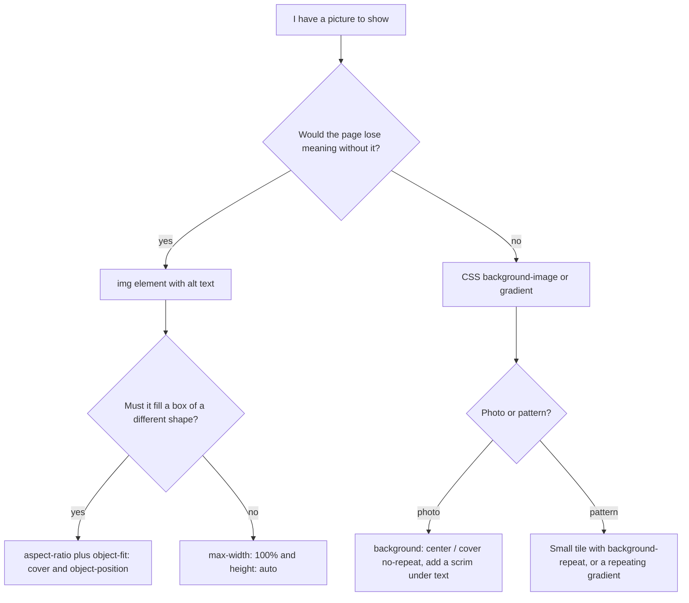

# Backgrounds, gradients and sizing images with CSS

> **Before this lesson:** you should know the `` element and why `alt`, `width` and `height` matter ([Images: formats, alt text and responsive delivery](#/lesson/html-css/images)), how colours are written ([Colour](#/lesson/html-css/color)) and how padding and borders work ([The box model](#/lesson/html-css/box-model)).

## In plain words

There are two ways to put a picture on a web page. You can place it **in the content** with an `` element, or you can paint it **behind the content** of some box with the CSS `background-image` property.

Think of a restaurant menu. A photo of the signature dish is part of what the menu tells you; remove it and information is lost. The linen-textured paper the menu is printed on is decoration; swap it for plain paper and the menu says exactly the same thing. The dish photo is an ``. The paper texture is a background.

Knowing which is which, and knowing how to control the size, position and cropping of both, is everyday front-end work: hero banners, cards with photo tops, avatars, icons and patterned sections all depend on it. Interviewers like to ask about `object-fit`, about `cover` versus `contain`, and about when a background image is the wrong choice.

## Content image or background image?

| Question | `` in HTML | `background-image` in CSS |
|---|---|---|
| Is it part of the content? | Yes | No, decoration only |
| Can it have alternative text? | Yes, `alt` | No |
| Seen by search engines and screen readers? | Yes | No |
| Printed by default? | Yes | Usually not |
| Takes up space by itself? | Yes | No: the box needs its own size |
| Can sit behind text easily? | With extra work | Yes |

Rule: **if the page would lose meaning without the picture, it belongs in the HTML.**

## Sizing content images

### The basic fluid image

An image has an **intrinsic size**: the number of pixels in the file. Left alone, it is displayed at that size, and a 2000-pixel-wide photo will burst out of a 400-pixel column. Two declarations fix that for every image on a site:

```css
img {
  max-width: 100%;   /* never wider than the box it sits in */
  height: auto;      /* keep the original proportions */
}
```

`max-width: 100%` allows the image to shrink but not to grow beyond its natural size. `height: auto` tells the browser to work out the height from the width, so the picture is never squashed.

### `aspect-ratio`: reserving a shape

The **aspect ratio** of a rectangle is its width divided by its height. A widescreen video is 16 : 9; a square is 1 : 1. The `aspect-ratio` property lets you give any box a shape without stating both dimensions:

```css
.thumb { width: 100%; aspect-ratio: 4 / 3; }
```

The box is as wide as its container, and its height is computed as three quarters of that width, whatever the width turns out to be.

### `object-fit`: what happens when the shapes disagree

Suppose you force an image into a box whose shape is different from the picture's own, for example a wide landscape photo into a square avatar. By default the picture is stretched to fill the box and looks distorted. `object-fit` chooses a better behaviour.

```html-run
<!doctype html>
<html lang="en">
<head><meta charset="utf-8"><title>object-fit</title>
<style>
  body { font-family: system-ui, sans-serif; display: grid; grid-template-columns: repeat(4, 1fr); gap: 10px; }
  figure { margin: 0; text-align: center; font-size: .85rem; }
  img { width: 100%; aspect-ratio: 1 / 1; border: 2px solid #37474f; background: #eceff1; display: block; }
  .fill    { object-fit: fill; }
  .contain { object-fit: contain; }
  .cover   { object-fit: cover; }
  .pos     { object-fit: cover; object-position: left center; }
</style></head>
<body>
  <figure><figcaption>fill (default): stretched</figcaption></figure>
  <figure><figcaption>contain: all visible, bars left over</figcaption></figure>
  <figure><figcaption>cover: box filled, edges cropped</figcaption></figure>
  <figure><figcaption>cover + object-position: left</figcaption></figure>
</body>
</html>
```

The source picture is a wide rectangle with a red circle on the left and a yellow one on the right. Every `` is forced into a square by `aspect-ratio: 1 / 1`.

| `object-fit` | Result |
|---|---|
| `fill` | Stretch to the box, ignoring proportions (circles become ovals) |
| `contain` | Scale down until the **whole** picture fits; empty bands remain |
| `cover` | Scale up until the box is **completely covered**; the overflow is cropped |
| `none` | Show at intrinsic size, cropped by the box |
| `scale-down` | Whichever of `none` or `contain` is smaller |

`object-position` chooses which part survives the crop. In the fourth square it is set to `left center`, so the red circle is kept instead of the middle of the picture.

The same two properties work on `<video>`.

> [!INTERVIEW]
> "`contain` versus `cover`?" Both preserve the aspect ratio. `contain` fits the entire image inside the box, possibly leaving empty space. `cover` fills the entire box, possibly cropping the image. The same words mean the same thing for `object-fit` on images and for `background-size` on backgrounds.

### Aligning images with text

An image is an inline element, so it sits on a line of text like a large letter, resting on the baseline with a small gap beneath for descenders. Three common adjustments:

- `display: block` removes the gap and lets `margin-inline: auto` centre the image.
- `vertical-align: middle` lines an icon up with the neighbouring text.
- `float: left` (with a margin) lets a paragraph wrap around the picture, the classic magazine layout. `shape-outside: circle()` even makes the text follow a curve.

```html-run
<!doctype html>
<html lang="en">
<head><meta charset="utf-8"><title>Wrapping text</title>
<style>
  body { font-family: Georgia, serif; max-width: 26rem; line-height: 1.5; }
  .portrait { float: left; width: 110px; aspect-ratio: 1; border-radius: 50%; shape-outside: circle(50%);
              margin: 0 1rem .4rem 0; background: radial-gradient(circle at 35% 35%, #ffe082, #ef6c00); }
  .after { clear: both; border-top: 1px solid #bbb; padding-top: .5rem; }
</style></head>
<body>
  <div class="portrait" role="img" aria-label="Portrait placeholder"></div>
  <p>The baker starts at four. By the time the first bus passes the shop the ovens have been lit for two hours and the window is fogged from the inside. She says the quiet is the best ingredient.</p>
  <p class="after">This paragraph has <code>clear: both</code>, so it starts below the floated circle.</p>
</body>
</html>
```

`float` takes a box out of the normal top-to-bottom flow and pushes it to one side so that following text flows around it. `clear: both` on a later element says "do not sit beside any float; start underneath".

## Background images

### The smallest example

```html-run
<!doctype html>
<html lang="en">
<head><meta charset="utf-8"><title>background-image</title>
<style>
  .banner {
    height: 140px;                      /* a background does not give a box any size */
    background-color: #e3f2fd;          /* shown while the image loads, or if it fails */
    background-image: url("data:image/svg+xml,%3Csvg xmlns='http://www.w3.org/2000/svg' width='40' height='40'%3E%3Ccircle cx='20' cy='20' r='8' fill='%2364b5f6'/%3E%3C/svg%3E");
    border: 2px solid #1565c0;
  }
</style></head>
<body>
  <div class="banner"></div>
</body>
</html>
```

Three things to observe. The `div` has no content, so without `height` it would be zero pixels tall and the background would be invisible. The image is only one small circle, yet it fills the box, because backgrounds **repeat** (tile) in both directions by default. And `background-color` sits underneath the image as a fallback.

### The background properties

| Property | Controls | Common values |
|---|---|---|
| `background-image` | The picture(s) or gradient(s) | `url(…)`, `linear-gradient(…)`, `none` |
| `background-repeat` | Tiling | `repeat`, `no-repeat`, `repeat-x`, `repeat-y`, `space`, `round` |
| `background-position` | Where the image is anchored | `center`, `top right`, `20px 50%` |
| `background-size` | How large it is drawn | `auto`, `cover`, `contain`, `200px`, `50% auto` |
| `background-attachment` | Whether it scrolls with the page | `scroll`, `fixed`, `local` |
| `background-origin` | Which box positions are measured from | `padding-box`, `border-box`, `content-box` |
| `background-clip` | Where painting stops | `border-box`, `padding-box`, `content-box`, `text` |
| `background-color` | The solid layer at the bottom | any colour |

`cover` and `contain` mean for `background-size` exactly what they mean for `object-fit`.

```html-run
<!doctype html>
<html lang="en">
<head><meta charset="utf-8"><title>Size, repeat, position</title>
<style>
  body { font-family: system-ui, sans-serif; display: grid; grid-template-columns: repeat(3, 1fr); gap: 10px; }
  div { height: 110px; border: 2px solid #455a64; background-color: #eceff1; font-size: .8rem; padding: 4px;
        background-image: url("data:image/svg+xml,%3Csvg xmlns='http://www.w3.org/2000/svg' viewBox='0 0 120 60'%3E%3Crect width='120' height='60' fill='%23a5d6a7'/%3E%3Cpath d='M0 60 40 15 70 45 90 25 120 60Z' fill='%232e7d32'/%3E%3Ccircle cx='98' cy='14' r='8' fill='%23fff59d'/%3E%3C/svg%3E"); }
  .a { background-size: 60px auto; }
  .b { background-size: 60px auto; background-repeat: no-repeat; background-position: right bottom; }
  .c { background-size: 60px auto; background-repeat: repeat-x; background-position: center; }
  .d { background-size: contain; background-repeat: no-repeat; background-position: center; }
  .e { background-size: cover; background-position: center; }
  .f { background-size: 100% 100%; }
</style></head>
<body>
  <div class="a">repeat (default)</div>
  <div class="b">no-repeat, right bottom</div>
  <div class="c">repeat-x, center</div>
  <div class="d">contain</div>
  <div class="e">cover</div>
  <div class="f">100% 100% (distorted)</div>
</body>
</html>
```

The usual recipe for a full-bleed photo banner is the fifth box: `background-size: cover; background-position: center;`.

### The shorthand

`background` sets everything in one declaration:

```css
.hero { background: #263238 url("harbour.jpg") center / cover no-repeat; }
```

Read it as: colour, image, position, a slash, size, repeat. Size must follow position after a `/`. Remember that a shorthand resets whatever you leave out, so `background: red;` written later also removes the image.

### Several layers at once

A box can have many background images, separated by commas. **The first one listed is on top.** This is how you darken a photo so that text placed over it stays readable:

```html-run
<!doctype html>
<html lang="en">
<head><meta charset="utf-8"><title>Layered backgrounds</title>
<style>
  .hero {
    min-height: 180px; display: grid; place-items: center; text-align: center;
    color: white; font: 700 1.6rem/1.2 system-ui, sans-serif; padding: 1rem;
    background:
      linear-gradient(rgb(0 0 0 / .55), rgb(0 0 0 / .55)),                        /* top: dark veil */
      url("data:image/svg+xml,%3Csvg xmlns='http://www.w3.org/2000/svg' viewBox='0 0 200 100'%3E%3Crect width='200' height='100' fill='%23ffcc80'/%3E%3Ccircle cx='150' cy='35' r='22' fill='%23fff3e0'/%3E%3Cpath d='M0 100 60 40 100 75 140 50 200 100Z' fill='%23ef6c00'/%3E%3C/svg%3E")
        center / cover no-repeat,                                                 /* bottom: picture */
      #263238;                                                                     /* colour underneath */
  }
</style></head>
<body>
  <div class="hero">Text stays readable over a busy picture</div>
</body>
</html>
```

A veil like this is called a **scrim**. Without it, white text over the pale parts of the picture would fail contrast requirements.

## Gradients

A **gradient** is an image the browser generates: a smooth blend between colours. It is written where an image URL would go, costs no download and stays sharp at every size.

```html-run
<!doctype html>
<html lang="en">
<head><meta charset="utf-8"><title>Gradients</title>
<style>
  body { display: grid; grid-template-columns: repeat(3, 1fr); gap: 10px; font: .8rem system-ui, sans-serif; }
  div { height: 100px; border-radius: 8px; display: grid; place-items: end start; padding: 6px; color: #000; }
  .a { background: linear-gradient(#bbdefb, #1565c0); }
  .b { background: linear-gradient(to right, #ff8a65, #ffd54f, #81c784); }
  .c { background: linear-gradient(135deg, #7e57c2 0%, #7e57c2 50%, #26a69a 50%, #26a69a 100%); }
  .d { background: radial-gradient(circle at 30% 30%, #fff59d, #f57f17); }
  .e { background: conic-gradient(#ef5350 0 25%, #42a5f5 0 60%, #66bb6a 0); border-radius: 50%; width: 100px; }
  .f { background: repeating-linear-gradient(45deg, #ffe082 0 10px, #ffb300 10px 20px); }
</style></head>
<body>
  <div class="a">linear, top to bottom</div>
  <div class="b">to right, three colours</div>
  <div class="c">135deg with a hard stop</div>
  <div class="d">radial</div>
  <div class="e"></div>
  <div class="f">repeating stripes</div>
</body>
</html>
```

- **`linear-gradient(direction, colour stops…)`** blends along a straight line. The direction is a keyword (`to right`, `to bottom left`) or an angle (`0deg` points up, `90deg` right). It defaults to top-to-bottom.
- A **colour stop** is a colour with an optional position: `#7e57c2 50%`. Two stops at the same position make a sharp edge instead of a blend (box three).
- **`radial-gradient`** spreads outward from a point; **`conic-gradient`** sweeps round a centre like a clock hand, which makes pie charts (box five).
- The **`repeating-`** versions tile the pattern, which produces stripes.

## Icons and sprites

Small icons used to be combined into one large image file, a **sprite sheet**, and shown piece by piece with `background-position`, because every separate file cost a slow network request. You will meet this in older code. Today the usual choices are inline SVG (which can take the text colour via `fill="currentColor"`) or an SVG file used as a **mask** so that CSS supplies the colour.

## Filters, blending and clipping

| Property | Effect |
|---|---|
| `filter: grayscale(1)`, `blur(4px)`, `brightness(.8)`, `drop-shadow(…)` | Processes the element's pixels |
| `backdrop-filter: blur(8px)` | Blurs whatever is *behind* a translucent element (frosted glass) |
| `mix-blend-mode`, `background-blend-mode` | Blends layers like photo-editing software |
| `clip-path: circle(50%)`, `polygon(…)`, `inset(…)` | Cuts the element to a shape |
| `border-radius: 50%` | The cheapest way to make a circular avatar |
| `image-rendering: pixelated` | Keeps pixel art crisp when enlarged |



> [!TIP]
> A quick way to test whether text over an image is readable: temporarily swap the picture for pure white, then for pure black. If the text survives both, the scrim is strong enough.

> [!WARNING]
> A CSS background image is downloaded only when an element that uses it is rendered, and it is invisible to assistive technology. If the picture carries information, it must be an `` with `alt` text.

## Pitfalls

- **Meaningful images as backgrounds.** No `alt`, invisible to assistive technology and search engines, missing in print.
- **Background on an empty box with no size.** Nothing appears; give the box a height, `min-height`, `aspect-ratio` or padding.
- **Distorted images.** Setting both `width` and `height` in CSS without `object-fit`. Use `height: auto` or `object-fit: cover`.
- **Text over a photo with no scrim.** Contrast fails wherever the picture is light.
- **Forgetting `no-repeat`.** A small image tiles across the whole box.
- **Shorthand wiping earlier settings.** `background: blue` after `background-image: …` removes the image.
- **Wrong layer order.** With multiple backgrounds the *first* is on top.
- **`background-attachment: fixed` on mobile.** It is slow and often ignored on phones.
- **Huge background photos.** CSS cannot use `srcset`; serve sensible sizes (the `image-set()` function and media queries help).
- **Uncleared floats.** Content after a floated image wraps beside it unexpectedly; add `clear: both` or wrap the section in a container with `display: flow-root`.

## Cheat sheet

| Goal | CSS |
|---|---|
| Fluid content image | `img { max-width: 100%; height: auto; }` |
| Fixed-shape box | `aspect-ratio: 16 / 9` |
| Fill box, crop excess | `object-fit: cover` (+ `object-position`) |
| Show whole image in box | `object-fit: contain` |
| Circular avatar | `aspect-ratio: 1; border-radius: 50%; object-fit: cover` |
| Photo banner | `background: url(x.jpg) center / cover no-repeat` |
| Tiled pattern | `background: url(tile.svg)` or `repeating-linear-gradient(…)` |
| Scrim for text | `linear-gradient(rgb(0 0 0 / .5), rgb(0 0 0 / .5)), url(x.jpg)` |
| Two-colour blend | `linear-gradient(to right, a, b)` |
| Hard-edged stripe | Two stops at the same position |
| Text wrapping round a picture | `float: left; margin: 0 1rem 1rem 0` |
| Stop wrapping | `clear: both` |
| Greyscale until hover | `filter: grayscale(1)` → `filter: none` |

## Summary

Use `` for pictures that carry meaning and CSS backgrounds for decoration. Make content images fluid with `max-width: 100%` and `height: auto`, give boxes a predictable shape with `aspect-ratio`, and choose between cropping and letterboxing with `object-fit`. Backgrounds are controlled by repeat, position and size (where `cover` and `contain` behave as they do for `object-fit`), can be stacked in layers with the first on top, and can be generated as gradients at no download cost. Whenever text sits on an image, add a scrim so that it stays readable.

## Glossary

| Term | Meaning |
|---|---|
| Intrinsic size | The natural pixel dimensions stored in an image file |
| Aspect ratio | Width divided by height, written like `16 / 9` |
| `object-fit` | How an image or video is fitted into a box of a different shape |
| `cover` / `contain` | Fill the box and crop / fit entirely and leave gaps |
| Background image | A picture painted behind an element's content by CSS |
| Tiling | Repeating a background image to fill the box |
| Shorthand | A property that sets several others at once, such as `background` |
| Gradient | A browser-generated image blending between colours |
| Colour stop | A colour and its position along a gradient |
| Scrim | A translucent layer placed between a picture and text to improve contrast |
| Float | A box pushed to one side so following content wraps around it |
| Sprite sheet | One image file holding many small icons, shown via `background-position` |

## Check yourself

```quiz
[
  {"q": "A product photo that customers need to see should be added how?", "options": ["As a CSS background-image", "As an img element with alt text", "As a gradient", "Either; there is no difference"], "answer": 1,
   "explain": "It is content, so it belongs in the HTML where it can have alternative text and be indexed and printed."},
  {"q": "What does this render? <div style=\"background-image: url(photo.jpg)\"></div> (photo.jpg exists; no other CSS)", "options": ["The photo at full size", "Nothing visible, because the empty div has zero height", "The photo stretched to the window", "A broken-image icon"], "answer": 1,
   "explain": "A background never gives its box a size. An empty block has no height, so there is nothing to paint on."},
  {"q": "A 300x150 image is placed in a 100x100 box with object-fit: cover. What is shown?", "options": ["The whole image, squashed", "The whole image with empty bands above and below", "The box completely filled, with the left and right edges of the image cropped", "Only the top-left 100x100 pixels at full size"], "answer": 2,
   "explain": "cover scales the image until both dimensions cover the box (here to 200x100) and crops the overflow, centred by default."},
  {"q": "Same image and box with object-fit: contain?", "options": ["Cropped at the sides", "The whole image visible at 100x50 with empty space above and below", "Stretched to 100x100", "Shown at 300x150 overflowing"], "answer": 1,
   "explain": "contain scales the image down until it fits entirely, preserving its 2:1 ratio, leaving unused space in the square."},
  {"q": "In background: linear-gradient(rgb(0 0 0 / .5), rgb(0 0 0 / .5)), url(a.jpg); which layer is on top?", "options": ["The photo", "The gradient", "They are blended equally", "Whichever loads first"], "answer": 1,
   "explain": "With multiple backgrounds the first in the list is painted on top, so the translucent gradient darkens the photo."},
  {"q": "What does linear-gradient(to right, red 50%, blue 50%) produce?", "options": ["A smooth blend from red to blue", "A hard edge: left half red, right half blue", "A purple box", "A diagonal stripe"], "answer": 1,
   "explain": "Two stops at the same position leave no distance to blend over, giving a sharp boundary."},
  {"q": "An img has width: 100% and height: 200px in a 600px-wide container; the picture is square. Without object-fit, what happens?", "options": ["It is cropped to fit", "It is distorted to 600 by 200", "It stays square at 200 by 200", "It is hidden"], "answer": 1,
   "explain": "The default object-fit is fill, which stretches the image to the box's dimensions regardless of its proportions."},
  {"q": "After .box { background-image: url(a.png); } a later rule sets .box { background: yellow; }. What is the result?", "options": ["Yellow with the image on top", "Only yellow; the shorthand reset background-image to none", "Only the image", "Invalid CSS"], "answer": 1,
   "explain": "The background shorthand resets every background sub-property it does not mention, including the image."}
]
```

> **Source:** Duckett, *HTML & CSS*, ch. 16 (Images). MDN: https://developer.mozilla.org/en-US/docs/Web/CSS/object-fit · https://developer.mozilla.org/en-US/docs/Web/CSS/background · https://developer.mozilla.org/en-US/docs/Web/CSS/CSS_images/Using_CSS_gradients · https://developer.mozilla.org/en-US/docs/Web/CSS/aspect-ratio
