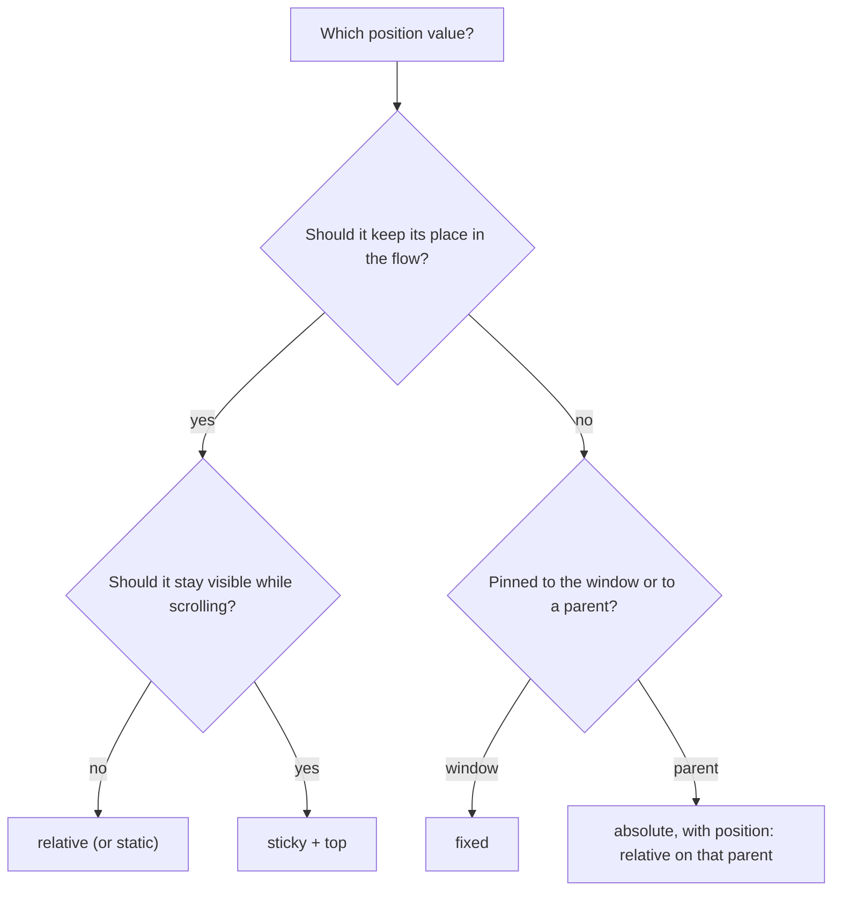

# Normal flow, display, positioning and stacking

> **Before this lesson:** you should understand content, padding, border and margin ([The box model](#/lesson/html-css/box-model)) and the difference between block and inline boxes ([Ids, classes, generic containers and the document head](#/lesson/html-css/ids-classes-meta)).

## In plain words

**Layout** is the browser's job of deciding where every box goes on the page. Left to itself the browser uses a default arrangement called **normal flow**: boxes are placed one after another in the order they appear in the HTML, like words and paragraphs in a letter.

A useful picture is a queue of people. In normal flow everyone stands in line in the order they arrived. **Positioning** lets you take one person out of the line and place them somewhere specific: a step to the side, pinned to a corner of the room, or stuck to the window as the bus moves. **Stacking** is about who stands in front of whom when two people occupy the same spot.

On the job you need this for anything that overlaps or stays put: a notification badge on an icon, a dropdown menu, a header that remains at the top while you scroll, a pop-up dialog. In interviews, "explain the values of `position`" and "why isn't my `z-index` working?" are among the most common CSS questions.

## Normal flow: the starting point

Before changing anything, be sure of what the default does.

- **Block boxes** (paragraphs, headings, `div`s) are laid out top to bottom. Each one starts on a new line and is as wide as its container.
- **Inline boxes** (links, `span`s, `em`) are laid out left to right inside a line of text, wrapping to a new line when they run out of room.

```html-run
<!doctype html>
<html lang="en">
<head><meta charset="utf-8"><title>Normal flow</title>
<style>
  body { font-family: system-ui, sans-serif; }
  div  { background: #bbdefb; border: 2px solid #1565c0; margin: 6px 0; padding: 6px; }
  span { background: #ffe0b2; border: 2px solid #ef6c00; }
</style></head>
<body>
  <div>Block one</div>
  <div>Block two, containing <span>inline A</span> and <span>inline B</span> and <span>inline C</span> in a line.</div>
  <div>Block three</div>
</body>
</html>
```

Nothing in that CSS says where anything goes. The blue boxes stack and the orange boxes sit in the line because of normal flow alone. Good layouts work *with* the flow and step outside it only when necessary.

## The `display` property

`display` decides what kind of box an element generates and how its children are arranged.

| Value | The box itself | Its children |
|---|---|---|
| `block` | New line, full width, accepts width and height | Normal flow |
| `inline` | Sits in a line of text; width and height ignored | Normal flow |
| `inline-block` | Sits in a line but accepts width, height and vertical spacing | Normal flow |
| `flex` | Behaves like a block | Arranged along one axis (Flexbox lesson) |
| `grid` | Behaves like a block | Arranged in rows and columns (Grid lesson) |
| `inline-flex`, `inline-grid` | Sits in a line | Flex or grid children |
| `flow-root` | Block that fully contains its floats and child margins | Normal flow |
| `contents` | Generates **no box**; children act as if they belonged to the grandparent | — |
| `none` | Generates no box at all; the element and its descendants disappear | — |

```html-run
<!doctype html>
<html lang="en">
<head><meta charset="utf-8"><title>display values</title>
<style>
  body { font-family: system-ui, sans-serif; }
  .chip { background: #c8e6c9; border: 2px solid #2e7d32; padding: 8px; width: 110px; margin: 4px; }
  .block  { display: block; }
  .inline { display: inline; }
  .ib     { display: inline-block; }
  .none   { display: none; }
</style></head>
<body>
  <p>block:</p>
  <span class="chip block">one</span><span class="chip block">two</span>
  <p>inline (width ignored):</p>
  <span class="chip inline">one</span><span class="chip inline">two</span>
  <p>inline-block (width respected, same line):</p>
  <span class="chip ib">one</span><span class="chip ib">two</span><span class="chip ib none">hidden</span><span class="chip ib">four</span>
</body>
</html>
```

Each chip is a `<span>` with the same padding and `width: 110px`. Only `display` differs. In the last row the third chip has `display: none`, so "four" slides along as though it did not exist.

## The `position` property

`position` takes an element out of its normal place. It has five values. Four companion properties, `top`, `right`, `bottom` and `left` (collectively **offsets**, also settable together with the shorthand `inset`), say how far to move it, but what they measure *from* depends on the position value.

| Value | Still occupies its space in the flow? | Offsets are measured from | Scrolls with the page? |
|---|---|---|---|
| `static` (default) | Yes | Offsets are ignored | Yes |
| `relative` | Yes, the original gap is kept | The element's own normal position | Yes |
| `absolute` | **No** | The nearest *positioned* ancestor | Yes |
| `fixed` | **No** | The viewport (the visible window) | No |
| `sticky` | Yes | Its scrolling container, once a threshold is reached | Until it sticks |

A **positioned** element means any element whose `position` is something other than `static`.

### `relative`: nudge, and become a reference point

```html-run
<!doctype html>
<html lang="en">
<head><meta charset="utf-8"><title>relative</title>
<style>
  body { font-family: system-ui, sans-serif; }
  .box { background: #e1bee7; border: 2px solid #6a1b9a; padding: 10px; margin: 6px 0; width: 180px; }
  .moved { position: relative; top: 14px; left: 40px; background: #ce93d8; }
</style></head>
<body>
  <div class="box">One</div>
  <div class="box moved">Two (relative)</div>
  <div class="box">Three</div>
</body>
</html>
```

Box two is drawn 14 pixels lower and 40 pixels to the right of where it would have been (`top: 14px` means "push me away from my top edge's original place"). Crucially, box three has **not moved**: the space box two originally occupied is preserved, which is why two now overlaps three.

On its own that is rarely useful. The real reason to write `position: relative` is its side effect: the element becomes a positioned ancestor, the reference frame for absolutely positioned children.

### `absolute`: place inside a positioned ancestor

An absolutely positioned element is removed from the flow entirely; other elements close up as if it were not there. Its offsets are measured from the edges of its **containing block**, which is the padding box of the nearest ancestor that is positioned. If no ancestor is positioned, the reference is the page itself.

That leads to the single most used positioning pattern: **`relative` on the parent, `absolute` on the child.**

```html-run
<!doctype html>
<html lang="en">
<head><meta charset="utf-8"><title>Badge</title>
<style>
  body { font-family: system-ui, sans-serif; padding: 1.5rem; }
  .icon {
    position: relative;            /* 1. become the reference frame */
    display: inline-block;
    width: 56px; height: 56px; border-radius: 14px;
    background: #37474f; color: white; font-size: 1.6rem;
    display: inline-grid; place-items: center;
  }
  .badge {
    position: absolute;            /* 2. leave the flow */
    top: -8px; right: -8px;        /* 3. 8px outside the icon's top-right corner */
    min-width: 22px; height: 22px; padding: 0 6px;
    border-radius: 999px; background: #d32f2f; color: white;
    font: 700 .75rem/22px system-ui, sans-serif; text-align: center;
  }
</style></head>
<body>
  <span class="icon">✉<span class="badge">3</span></span>
</body>
</html>
```

Step by step: the icon is `position: relative` with no offsets, so it does not move, but it is now "positioned". The badge is `position: absolute`, so it looks upward through its ancestors, finds the icon, and measures `top: -8px; right: -8px` from the icon's top and right edges. Negative values push it outside. Delete the `position: relative` line and the badge flies to the top-right corner of the whole frame, because no positioned ancestor remains.

Two handy facts about absolute boxes:

- `inset: 0` (all four offsets zero) stretches the box to cover its containing block exactly, the standard way to make an overlay.
- An absolute box with no width shrinks to fit its content.

### `fixed`: pinned to the window

A fixed element is positioned against the **viewport**, the visible area of the browser window, and does not move when the page scrolls. Typical uses are "back to top" buttons, chat bubbles and cookie banners. Because it is out of the flow, content can hide underneath it, so leave room with padding.

One trap: if any ancestor has a `transform`, `filter` or `perspective`, the fixed element is positioned relative to *that ancestor* instead of the viewport.

### `sticky`: normal until it reaches an edge

A sticky element behaves like a normal in-flow element until scrolling would carry it past the offset you specify. Then it stays stuck at that offset for as long as its parent is still on screen.

```html-run
<!doctype html>
<html lang="en">
<head><meta charset="utf-8"><title>sticky and fixed</title>
<style>
  body { font-family: system-ui, sans-serif; margin: 0; }
  header { position: sticky; top: 0; background: #004d40; color: white; padding: .7rem 1rem; }
  h2 { position: sticky; top: 2.6rem; background: #b2dfdb; margin: 0; padding: .3rem 1rem; }
  p { padding: 0 1rem; margin: .5rem 0 8rem; }
  .fab { position: fixed; right: 16px; bottom: 16px; width: 48px; height: 48px; border-radius: 50%;
         border: 0; background: #ff7043; color: white; font-size: 1.3rem; box-shadow: 0 3px 8px #0005; }
</style></head>
<body>
  <header>Sticky header — scroll this frame</header>
  <section><h2>Section A</h2><p>Scroll down. This heading sticks under the header until its section has gone past.</p></section>
  <section><h2>Section B</h2><p>The next heading then replaces it.</p></section>
  <section><h2>Section C</h2><p>The round button is fixed to the window corner the whole time.</p></section>
  <button class="fab" type="button" aria-label="Back to top" onclick="scrollTo({top:0,behavior:'smooth'})">↑</button>
</body>
</html>
```

Sticky positioning needs two things to work, and forgetting either is the usual reason it "does nothing":

1. **A threshold**: at least one of `top`, `bottom`, `left` or `right` must be set.
2. **Room to move**: the element sticks only within its parent. If the parent is exactly as tall as the sticky child, there is nowhere to slide. Also, an ancestor with `overflow: hidden`, `auto` or `scroll` becomes the scrolling container the element sticks to, which often breaks the effect.



> [!INTERVIEW]
> "Explain the `position` values." `static`: normal flow, offsets ignored. `relative`: stays in flow, shifted visually from its own position, and becomes a containing block for absolute descendants. `absolute`: removed from flow, positioned against the nearest positioned ancestor. `fixed`: removed from flow, positioned against the viewport and unaffected by scrolling. `sticky`: in flow until a scroll threshold, then pinned within its parent.

## Stacking: `z-index` and stacking contexts

When boxes overlap, which is on top? Imagine a third axis, the **z-axis**, pointing out of the screen toward you.

Without any `z-index`, the rule is: positioned elements are drawn above non-positioned ones, and among equals, whatever comes **later in the HTML** is on top.

`z-index` changes that order. It takes a whole number (negative allowed); higher numbers are nearer the viewer. It has a precondition that trips everybody up at least once: **`z-index` only works on positioned elements** (and on flex and grid items). On a plain static box it is ignored.

```html-run
<!doctype html>
<html lang="en">
<head><meta charset="utf-8"><title>z-index</title>
<style>
  body { font-family: system-ui, sans-serif; }
  .stage { position: relative; height: 150px; }
  .card { position: absolute; width: 130px; height: 90px; padding: 8px; color: white; font-weight: 700; border-radius: 10px; box-shadow: 0 2px 8px #0006; }
  .a { background: #e53935; left: 10px;  top: 10px; z-index: 3; }
  .b { background: #1e88e5; left: 70px;  top: 30px; z-index: 2; }
  .c { background: #43a047; left: 130px; top: 50px; z-index: 1; }
</style></head>
<body>
  <div class="stage">
    <div class="card a">A · z 3</div>
    <div class="card b">B · z 2</div>
    <div class="card c">C · z 1</div>
  </div>
  <p>C comes last in the HTML, so by default it would be on top. The z-index values reverse that.</p>
</body>
</html>
```

### Stacking contexts: why 9999 sometimes loses

A **stacking context** is a group of elements that is flattened into a single layer before being stacked against anything outside the group. Think of sheets of paper inside a closed folder: you can reorder the sheets within the folder, but no sheet can come out above another folder that lies on top of this one. A `z-index` only competes with siblings *inside the same stacking context*.

```html-run
<!doctype html>
<html lang="en">
<head><meta charset="utf-8"><title>Stacking contexts</title>
<style>
  body { font-family: system-ui, sans-serif; }
  .folder { position: relative; padding: 12px; width: 260px; border-radius: 10px; }
  .one { background: #ffe0b2; z-index: 1; }
  .two { background: #b3e5fc; z-index: 2; margin-top: -30px; margin-left: 60px; }
  .popup { position: absolute; top: 40px; left: 20px; z-index: 9999;
           background: #d32f2f; color: white; padding: 8px; border-radius: 8px; width: 200px; }
</style></head>
<body>
  <div class="folder one">Folder one (z-index 1)
    <div class="popup">I have z-index 9999, yet folder two covers me.</div>
  </div>
  <div class="folder two">Folder two (z-index 2)<br><br><br></div>
</body>
</html>
```

The red box asks for 9999, but it lives inside folder one, whose own level is 1. Folder two is at level 2, so *everything* in folder two is above *everything* in folder one. The 9999 only orders the popup among folder one's other children.

The things that create a new stacking context:

- The root `<html>` element.
- A positioned element with a `z-index` other than `auto`.
- `position: fixed` or `position: sticky`.
- A flex or grid item with a `z-index` other than `auto`.
- `opacity` less than 1.
- `transform`, `filter`, `backdrop-filter`, `perspective`, `clip-path`, `mask` (any value except `none`).
- `isolation: isolate` — the explicit, side-effect-free way to make one.
- `will-change` naming one of the properties above; `contain: paint` or `layout`; `container-type`.

So adding a harmless-looking `opacity: 0.99` or a `transform` to a parent can suddenly trap its dropdown menu underneath a neighbour.

> [!TIP]
> When a `z-index` "does not work", check in this order: (1) is the element positioned? (2) which ancestor forms its stacking context, and what is *that* ancestor's level compared with the element you are trying to cover? Fix the ancestor's level, or move the popup's HTML to the end of `<body>` so that it belongs to the root context.

A well-run project defines a small scale of named levels instead of scattering large numbers: for example `--z-dropdown: 100; --z-sticky: 200; --z-modal: 300; --z-toast: 400;`.

For true pop-ups, modern HTML offers the **top layer**: a `<dialog>` opened with `showModal()` and elements using the `popover` attribute are drawn above everything on the page regardless of `z-index` or stacking contexts.

## Floats in one paragraph

`float: left` or `right` shifts a box to one side and lets inline content wrap around it. It was once the main layout tool; Flexbox and Grid have replaced it for that, leaving it for its original purpose of wrapping text around an image. A parent does not grow to contain its floated children unless it is given `display: flow-root` (the modern replacement for the old "clearfix" hack), and `clear: both` makes an element start below any floats.

## Hiding things

| Technique | Space kept? | Clickable / focusable? | Read by screen readers? |
|---|---|---|---|
| `display: none` | No | No | No |
| `visibility: hidden` | Yes | No | No |
| `opacity: 0` | Yes | **Yes** | **Yes** |
| Positioned off screen / clipped (visually hidden) | No | Yes | Yes |

> [!WARNING]
> An absolutely or fixed positioned element is removed from the flow, so nothing reserves space for it. On a narrow screen or with larger text it will overlap whatever is underneath. Use positioning for small overlays, not for page layout.

## Pitfalls

- **`absolute` child without a positioned parent.** It positions against the page. Add `position: relative` to the intended parent.
- **`z-index` on a static element.** Ignored. Give it a `position`.
- **Escalating `z-index` numbers.** The problem is nearly always a stacking context, not the size of the number.
- **Accidental stacking contexts** from `opacity`, `transform` or `filter` on an ancestor.
- **Sticky without `top`**, or inside an ancestor with `overflow: hidden`.
- **Fixed elements covering content.** Reserve space with padding, and remember fixed headers eat a lot of a phone screen.
- **`fixed` inside a transformed ancestor.** It stops being fixed to the viewport.
- **Using `relative` offsets to build layouts.** The original gap remains and boxes overlap; use margin, flex or grid.
- **Absolute positioning for whole page layouts.** Nothing adapts when content grows; reserve it for small overlays.
- **`display: none` for content screen readers should hear.** Use a visually-hidden class instead.

## Cheat sheet

| Goal | CSS |
|---|---|
| Put boxes on one line but keep their size | `display: inline-block` |
| Remove an element completely | `display: none` |
| Badge on a corner | Parent `position: relative`; child `position: absolute; top: 0; right: 0` |
| Overlay covering its parent | `position: absolute; inset: 0` |
| Centre an absolute box | `inset: 0; margin: auto` (with a set size) or `top: 50%; left: 50%; translate: -50% -50%` |
| Header that stays on screen | `position: sticky; top: 0` |
| Button pinned to the window | `position: fixed; right: 1rem; bottom: 1rem` |
| Bring forward | `position` + `z-index: 1` |
| Contain children's z-indexes | `isolation: isolate` |
| Contain floats and child margins | `display: flow-root` |
| Always-on-top modal | `<dialog>` + `showModal()` |

## Summary

Normal flow stacks block boxes vertically and runs inline boxes along lines; `display` chooses the kind of box and the layout of its children. `position` moves an element relative to itself (`relative`), to a positioned ancestor (`absolute`), to the viewport (`fixed`) or to a scroll threshold (`sticky`). Overlap order is governed by source order and `z-index`, which applies only to positioned elements and only within their stacking context; many properties besides `z-index` create such contexts. Most stacking bugs disappear once you identify which context an element lives in.

## Glossary

| Term | Meaning |
|---|---|
| Layout | The process of calculating the position and size of every box |
| Normal flow | The default arrangement: blocks top to bottom, inline content along lines |
| Viewport | The visible area of the browser window |
| Offset | A distance set with `top`, `right`, `bottom`, `left` or `inset` |
| Positioned element | An element whose `position` is not `static` |
| Containing block | The rectangle an element's offsets and percentages are measured against |
| Out of flow | Removed from normal flow so that other boxes ignore it (absolute, fixed, float) |
| z-axis | The imaginary front-to-back direction on which overlapping boxes are ordered |
| `z-index` | A number setting an element's order on the z-axis within its stacking context |
| Stacking context | A group of elements stacked together as one unit relative to the outside |
| Top layer | A browser-managed layer above the whole page, used by modal dialogs and popovers |
| Float | A box shifted left or right with inline content wrapping around it |

## Check yourself

```quiz
[
  {"q": "A div has position: relative; top: 20px. What happens to the element after it in the flow?", "options": ["It moves down 20px too", "It stays where it was; the original space of the div is preserved", "It moves up to fill the gap", "It becomes hidden"], "answer": 1,
   "explain": "Relative positioning shifts the box visually but keeps its original slot in the flow, so neighbours are unaffected."},
  {"q": "An element is position: absolute; top: 0; left: 0. None of its ancestors has a position set. Where does it appear?", "options": ["At the top-left of its parent", "At the top-left of the page (the initial containing block)", "It does not render", "At the top-left of the nearest div"], "answer": 1,
   "explain": "With no positioned ancestor the containing block is the initial one, tied to the page."},
  {"q": "A box has z-index: 100 but no position property, and is not a flex or grid item. What effect does z-index have?", "options": ["It moves to the front", "None; z-index is ignored on static, non-flex/grid elements", "It creates a stacking context", "It hides the element"], "answer": 1,
   "explain": "z-index applies only to positioned elements and to flex and grid items."},
  {"q": "Parent A (position: relative; z-index: 1) contains child X with z-index: 9999. Sibling B (position: relative; z-index: 2) overlaps X. Which is on top?", "options": ["X, because 9999 is larger than 2", "B, because A's whole stacking context sits below B", "Whichever is later in the HTML", "They blend"], "answer": 1,
   "explain": "X's z-index only matters inside A's stacking context. A as a whole is at level 1, below B at level 2."},
  {"q": "Which of these creates a new stacking context?", "options": ["margin: 10px", "opacity: 0.9", "color: red", "width: 50%"], "answer": 1,
   "explain": "Any opacity below 1 creates a stacking context, as do transform, filter, and positioned elements with a z-index."},
  {"q": "A header has position: sticky but no top, bottom, left or right. What happens when the page scrolls?", "options": ["It sticks to the top", "It scrolls away like a normal element", "It becomes fixed", "It disappears"], "answer": 1,
   "explain": "Sticky needs a threshold offset to know where to stick; without one it behaves like a relatively positioned element with no offsets."},
  {"q": "What does this render? Two overlapping absolutely positioned boxes with no z-index: red first in the HTML, blue second.", "options": ["Red on top", "Blue on top", "Whichever is larger on top", "Neither is visible"], "answer": 1,
   "explain": "With equal stacking level, later elements in source order are painted over earlier ones."},
  {"q": "Which technique hides an element visually while keeping it focusable and clickable?", "options": ["display: none", "visibility: hidden", "opacity: 0", "The hidden attribute"], "answer": 2,
   "explain": "opacity: 0 only makes the element transparent; it still occupies space and receives clicks and focus."}
]
```

> **Source:** Duckett, *HTML & CSS*, ch. 15 (Layout: positioning schemes, z-index, floats). MDN: https://developer.mozilla.org/en-US/docs/Web/CSS/position · https://developer.mozilla.org/en-US/docs/Web/CSS/display · https://developer.mozilla.org/en-US/docs/Web/CSS/CSS_positioned_layout/Stacking_context · https://developer.mozilla.org/en-US/docs/Web/CSS/CSS_display/Block_and_inline_layout_in_normal_flow
