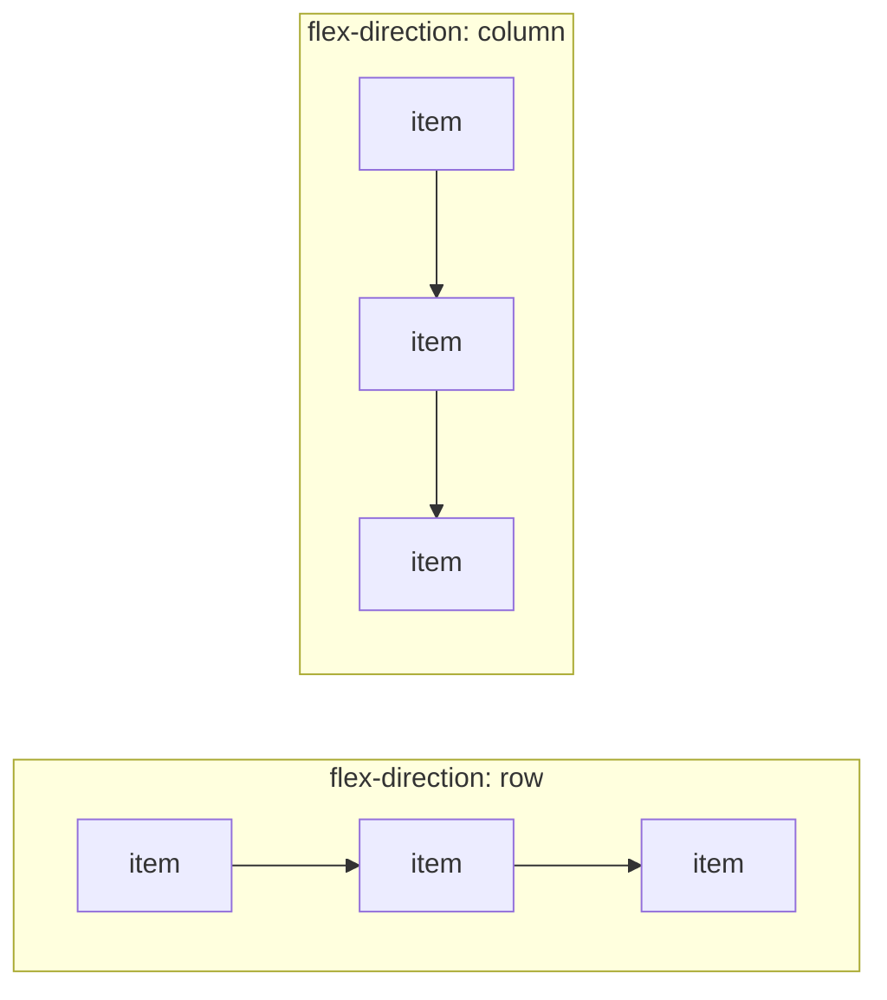

# Flexbox in depth

> **Before this lesson:** you should be comfortable with the box model ([The box model](#/lesson/html-css/box-model)) and with normal flow and the `display` property ([Normal flow, display, positioning and stacking](#/lesson/html-css/display-positioning)).

## In plain words

**Flexbox** (short for "flexible box layout") is a way of arranging a group of items in a single line, either a row or a column, and telling the browser how to share out any spare space among them.

Imagine books on a shelf. You can push them all to the left, all to the right, or spread them evenly. If the shelf is longer than the books need, you decide where the gap goes; if it is shorter, some books must squeeze. You can also decide whether the books stand at the bottom of the shelf, hang from the top or are centred. Flexbox gives you exactly those controls for boxes on a web page.

Before flexbox existed, simple things such as "put these three buttons in a row with equal gaps" or "centre this box vertically" required fragile tricks. Now they take two or three lines. Flexbox is the tool you will use most for navigation bars, toolbars, cards, form rows and centring, and "how do you centre a div?" remains the most famous interview question in CSS.

## The two roles: container and items

Flexbox always involves a parent and its direct children.

- The parent, on which you write `display: flex`, is the **flex container**.
- Its direct children automatically become **flex items**. Grandchildren are not affected.

Start with the smallest possible example.

```html-run
<!doctype html>
<html lang="en">
<head><meta charset="utf-8"><title>display: flex</title>
<style>
  body { font-family: system-ui, sans-serif; }
  .row { display: flex; background: #eceff1; padding: 8px; }
  .row > div { background: #90caf9; border: 2px solid #1565c0; padding: 10px 16px; }
</style></head>
<body>
  <div class="row">
    <div>One</div>
    <div>Two is longer</div>
    <div>Three</div>
  </div>
</body>
</html>
```

The only new declaration is `display: flex` on `.row`. Without it the three `div`s would stack vertically, each as wide as the page, because `div` is a block element. With it, three things happen by default:

1. The items line up in a **row**, left to right.
2. Each item is only as **wide as its content** needs.
3. All items are **stretched to the same height** as the tallest one.

Everything else in this lesson is a way of adjusting one of those defaults.

## Main axis and cross axis

Flexbox works along two perpendicular directions, and every property refers to one of them.

- The **main axis** is the direction the items are laid out in.
- The **cross axis** is the direction at right angles to it.

`flex-direction` chooses the main axis:

| `flex-direction` | Main axis | Cross axis |
|---|---|---|
| `row` (default) | Horizontal, left to right | Vertical |
| `row-reverse` | Horizontal, right to left | Vertical |
| `column` | Vertical, top to bottom | Horizontal |
| `column-reverse` | Vertical, bottom to top | Horizontal |



The single most useful sentence to memorise: **`justify-content` works along the main axis; `align-items` works along the cross axis.** When you switch to `flex-direction: column`, the two swap their visual effect: `justify-content` then moves things up and down.

## Distributing space on the main axis: `justify-content`

When the items do not fill the container, `justify-content` says where the leftover space goes.

```html-run
<!doctype html>
<html lang="en">
<head><meta charset="utf-8"><title>justify-content</title>
<style>
  body { font: .85rem system-ui, sans-serif; }
  .row { display: flex; background: #eceff1; padding: 6px; margin-bottom: 4px; }
  .row > div { background: #a5d6a7; border: 2px solid #2e7d32; padding: 6px 14px; }
  .s  { justify-content: flex-start; }
  .c  { justify-content: center; }
  .e  { justify-content: flex-end; }
  .sb { justify-content: space-between; }
  .sa { justify-content: space-around; }
  .se { justify-content: space-evenly; }
  p { margin: .6rem 0 .1rem; }
</style></head>
<body>
  <p>flex-start (default)</p><div class="row s"><div>A</div><div>B</div><div>C</div></div>
  <p>center</p><div class="row c"><div>A</div><div>B</div><div>C</div></div>
  <p>flex-end</p><div class="row e"><div>A</div><div>B</div><div>C</div></div>
  <p>space-between: first and last touch the edges</p><div class="row sb"><div>A</div><div>B</div><div>C</div></div>
  <p>space-around: half-size gaps at the edges</p><div class="row sa"><div>A</div><div>B</div><div>C</div></div>
  <p>space-evenly: all gaps equal</p><div class="row se"><div>A</div><div>B</div><div>C</div></div>
</body>
</html>
```

## Aligning on the cross axis: `align-items`

`align-items` positions the items across the line.

| Value | Effect (in a row) |
|---|---|
| `stretch` (default) | Items grow to the full height of the container |
| `flex-start` | Items sit at the top |
| `center` | Items are centred vertically |
| `flex-end` | Items sit at the bottom |
| `baseline` | Items are shifted so their first lines of text line up |

A single item can override the container's choice with `align-self`.

### Centring, finally

Combine the two properties and you have the modern answer to the oldest CSS problem:

```html-run
<!doctype html>
<html lang="en">
<head><meta charset="utf-8"><title>Centring</title>
<style>
  body { font-family: system-ui, sans-serif; margin: 0; }
  .stage {
    display: flex;
    justify-content: center;   /* centre on the main axis (horizontal) */
    align-items: center;       /* centre on the cross axis (vertical) */
    min-height: 220px;         /* the container needs spare height to centre within */
    background: #e8eaf6;
  }
  .card { background: white; padding: 1.2rem 2rem; border-radius: 12px; box-shadow: 0 4px 16px #0003; }
</style></head>
<body>
  <div class="stage"><div class="card">Perfectly centred</div></div>
</body>
</html>
```

Note the comment on `min-height`. Vertical centring needs free vertical space; a container that is only as tall as its content has nothing to centre in. To centre in the whole window, give the container `min-height: 100vh` (or the newer `100dvh`, which accounts for mobile browser toolbars).

## Gaps between items: `gap`

`gap` puts space **between** items and none on the outer edges, which is nearly always what you want. Before it existed people used margins and then had to remove the margin from the last item.

```css
.toolbar { display: flex; gap: 0.5rem; }        /* same gap in both directions */
.tags    { display: flex; flex-wrap: wrap; gap: 0.5rem 1rem; }  /* row gap, then column gap */
```

## Wrapping onto several lines: `flex-wrap`

By default a flex container keeps every item on one line (`flex-wrap: nowrap`), shrinking them if necessary and letting them overflow if they cannot shrink enough. `flex-wrap: wrap` allows items to move onto a new line when they run out of room.

```html-run
<!doctype html>
<html lang="en">
<head><meta charset="utf-8"><title>flex-wrap</title>
<style>
  body { font-family: system-ui, sans-serif; }
  .tags { display: flex; flex-wrap: wrap; gap: .5rem; max-width: 300px; padding: 8px; border: 2px dashed #9e9e9e; resize: horizontal; overflow: auto; }
  .tags span { background: #ffe082; padding: .3rem .8rem; border-radius: 999px; white-space: nowrap; }
</style></head>
<body>
  <p>Drag the corner of the dashed box to change its width.</p>
  <div class="tags">
    <span>sourdough</span><span>rye</span><span>focaccia</span><span>baguette</span>
    <span>ciabatta</span><span>brioche</span><span>pumpernickel</span>
  </div>
</body>
</html>
```

When wrapping produces several lines, `align-content` distributes the *lines* within the container (it accepts the same values as `justify-content`). It has no effect when there is only one line.

## How items grow and shrink: the `flex` property

This is the "flexible" part. Each item has three settings that decide its size along the main axis.

| Property | Question it answers | Default |
|---|---|---|
| `flex-basis` | What size does the item *start* at, before spare space is shared? | `auto` (its width, or its content size) |
| `flex-grow` | If there is space left over, what share of it does this item take? | `0` (take none) |
| `flex-shrink` | If there is not enough space, what share of the shortfall does it give up? | `1` (shrink equally) |

The browser's procedure is: add up all the items' basis sizes; compare the total with the container; if there is space left, hand it out in proportion to the `flex-grow` numbers; if there is a shortfall, take it away in proportion to `flex-shrink` (weighted by each item's basis).

A worked example. A container is 600px wide and holds three items, each with `flex-basis: 100px`. The total is 300px, so 300px is spare.

- If the grow factors are 1, 1, 1, each receives 100px and ends at 200px.
- If they are 1, 2, 0, the spare 300px is split into 3 parts: the first gets 100px (→ 200px), the second 200px (→ 300px), the third nothing (→ 100px).

```html-run
<!doctype html>
<html lang="en">
<head><meta charset="utf-8"><title>flex-grow</title>
<style>
  body { font: .85rem system-ui, sans-serif; }
  .row { display: flex; width: 600px; max-width: 100%; background: #eceff1; margin-bottom: 8px; }
  .row > div { flex-basis: 100px; padding: 10px 0; text-align: center; color: white; }
  .row > div:nth-child(1) { background: #5c6bc0; } .row > div:nth-child(2) { background: #26a69a; } .row > div:nth-child(3) { background: #ef5350; }
  .none > div { flex-grow: 0; }
  .equal > div { flex-grow: 1; }
  .mixed > div:nth-child(1) { flex-grow: 1; } .mixed > div:nth-child(2) { flex-grow: 2; } .mixed > div:nth-child(3) { flex-grow: 0; }
</style></head>
<body>
  <p>grow 0, 0, 0 — spare space is left empty</p>
  <div class="row none"><div>100</div><div>100</div><div>100</div></div>
  <p>grow 1, 1, 1 — spare space shared equally</p>
  <div class="row equal"><div>200</div><div>200</div><div>200</div></div>
  <p>grow 1, 2, 0</p>
  <div class="row mixed"><div>200</div><div>300</div><div>100</div></div>
</body>
</html>
```

### The shorthand

You will nearly always write the three together as `flex: grow shrink basis`.

| Shorthand | Expands to | Meaning |
|---|---|---|
| `flex: 1` | `1 1 0%` | Ignore content size; share **all** space equally. Equal columns. |
| `flex: auto` | `1 1 auto` | Start from content size, then grow and shrink |
| `flex: none` | `0 0 auto` | Rigid: never grow, never shrink |
| `flex: 0 0 200px` | — | Exactly 200px, rigid |
| `flex: 1 1 250px` | — | Aim for 250px, flexible both ways (great with `flex-wrap`) |
| (not set) | `0 1 auto` | Content size, may shrink, will not grow |

The difference between `flex: 1` and `flex: auto` matters: with a basis of 0 the items end up *equal*; with a basis of `auto` an item with more content ends up *larger*.

### The classic sidebar layout

```html-run
<!doctype html>
<html lang="en">
<head><meta charset="utf-8"><title>Sidebar layout</title>
<style>
  * { box-sizing: border-box; }
  body { font-family: system-ui, sans-serif; margin: 0; }
  .layout { display: flex; gap: 1rem; padding: 1rem; min-height: 200px; }
  .sidebar { flex: 0 0 160px; background: #d1c4e9; padding: 1rem; border-radius: 8px; }   /* fixed 160px */
  .content { flex: 1; min-width: 0; background: #f3e5f5; padding: 1rem; border-radius: 8px; } /* takes the rest */
</style></head>
<body>
  <div class="layout">
    <aside class="sidebar">Sidebar<br>160px, rigid</aside>
    <main class="content">Main content takes whatever width remains. Resize the window: only this box changes.</main>
  </div>
</body>
</html>
```

### The `min-width: 0` trick

Notice `min-width: 0` on `.content`. Flex items have a hidden default, `min-width: auto`, which means **an item refuses to shrink smaller than its content's minimum width**: its longest word, a wide image, a `<pre>` block or text with `white-space: nowrap`. That is the cause of the common bug where a long URL or code sample makes a flex layout overflow sideways. Setting `min-width: 0` (or `overflow: hidden`) on the item lets it shrink properly.

> [!WARNING]
> If a flex layout spills past the edge of the screen and one item seems unwilling to shrink, add `min-width: 0` to that item. In a column layout the equivalent is `min-height: 0`.

## Pushing items apart with auto margins

In a flex container, a margin of `auto` absorbs **all** the free space on that side. This gives a neat way to split a row: a logo on the left and everything else on the right.

```html-run
<!doctype html>
<html lang="en">
<head><meta charset="utf-8"><title>Auto margins</title>
<style>
  body { font-family: system-ui, sans-serif; margin: 0; }
  nav { display: flex; align-items: center; gap: 1rem; padding: .7rem 1rem; background: #263238; color: white; }
  nav a { color: white; text-decoration: none; }
  .brand { font-weight: 700; font-size: 1.1rem; }
  .push { margin-left: auto; }             /* swallows the free space to its left */
  .btn { background: #ffb300; color: #212121; padding: .4rem .9rem; border-radius: 6px; }
</style></head>
<body>
  <nav>
    <span class="brand">Loaf</span>
    <a href="#">Bread</a><a href="#">Pastry</a>
    <a href="#" class="push">Sign in</a>
    <a href="#" class="btn">Basket</a>
  </nav>
</body>
</html>
```

"Sign in" has `margin-left: auto`, so it and everything after it are pushed to the far right. The same trick with `margin-top: auto` in a column pushes a card's button to the bottom, or a page's footer to the bottom of the window.

### Sticky footer with a column

```html-run
<!doctype html>
<html lang="en">
<head><meta charset="utf-8"><title>Footer at the bottom</title>
<style>
  body { font-family: system-ui, sans-serif; margin: 0;
         display: flex; flex-direction: column; min-height: 100vh; }
  header, footer { background: #004d40; color: white; padding: .8rem 1rem; }
  main { flex: 1; padding: 1rem; }      /* grows to fill, pushing the footer down */
</style></head>
<body>
  <header>Header</header>
  <main>Short page. The footer still sits at the bottom of the window.</main>
  <footer>Footer</footer>
</body>
</html>
```

The body is a column at least as tall as the window. `main` has `flex: 1`, so it takes all the spare height, which pushes the footer to the bottom even when there is little content.

## Changing visual order

`order` changes where an item is *drawn* without changing the HTML. Items are arranged by ascending `order` (default 0), then by source order. `flex-direction: row-reverse` and `column-reverse` flip the whole line.

> [!WARNING]
> Reordering is visual only. Keyboard focus and screen readers still follow the HTML order, so heavy use of `order` or the `-reverse` directions makes the Tab key jump around confusingly. If the logical order should change, change the HTML.

## Flexbox or Grid?

| Use Flexbox when | Use Grid when |
|---|---|
| Laying out in **one direction** (a row *or* a column) | Laying out in **two directions** at once (rows *and* columns) |
| The **content** should decide the sizes | The **layout** should decide the sizes |
| Navigation bars, toolbars, button groups, tag lists, centring | Page skeletons, card galleries, anything that must line up in both directions |

They are complementary: a grid for the page, flex inside its header and cards.

> [!INTERVIEW]
> "What does `flex: 1` mean?" It is shorthand for `flex-grow: 1; flex-shrink: 1; flex-basis: 0%`. The item starts from zero size and takes an equal share of the container's space, so several `flex: 1` siblings become equal widths regardless of their content. Contrast `flex: auto`, whose basis is the content size.

> [!TIP]
> Firefox, Chrome and Edge developer tools mark flex containers with a small `flex` badge in the Elements panel. Click it to draw the container's lines, items and free space on the page.

## Pitfalls

- **Putting flex properties on the wrong element.** `justify-content` and `align-items` go on the container; `flex`, `align-self` and `order` go on items.
- **Expecting grandchildren to be flex items.** Only direct children are.
- **Vertical centring with no spare height.** Give the container a height or `min-height`.
- **Confusing the axes after `flex-direction: column`.** `justify-content` is now vertical.
- **Overflow caused by `min-width: auto`.** Add `min-width: 0` to the item that will not shrink.
- **`flex: 1` versus `flex: auto`.** Equal sizes versus content-proportional sizes.
- **`align-content` doing nothing.** It only applies when items wrap onto more than one line.
- **Margins for spacing.** Use `gap`; it never adds space at the outer edges.
- **`justify-content: space-between` on a wrapped last row.** Two leftover items fly to opposite ends; a grid is the better tool for galleries.
- **Images as flex items stretching oddly.** The default `align-items: stretch` distorts them; set `align-items: flex-start` or `align-self: center`.
- **Visual reordering.** Tab order follows the DOM, not `order`.

## Cheat sheet

**On the container**

| Property | Values |
|---|---|
| `display` | `flex`, `inline-flex` |
| `flex-direction` | `row`, `column`, `row-reverse`, `column-reverse` |
| `flex-wrap` | `nowrap`, `wrap` |
| `justify-content` (main axis) | `flex-start`, `center`, `flex-end`, `space-between`, `space-around`, `space-evenly` |
| `align-items` (cross axis) | `stretch`, `flex-start`, `center`, `flex-end`, `baseline` |
| `align-content` (wrapped lines) | same as `justify-content`, plus `stretch` |
| `gap` | `1rem`, or `row-gap column-gap` |

**On the items**

| Property | Purpose |
|---|---|
| `flex: 1` | Share space equally |
| `flex: none` | Stay at natural size |
| `flex: 0 0 200px` | Fixed size |
| `align-self` | Override cross-axis alignment for one item |
| `margin-left: auto` | Push this and later items to the far end |
| `min-width: 0` | Allow shrinking below content size |
| `order` | Visual reordering (use sparingly) |

## Summary

Writing `display: flex` on a container lays its direct children along a main axis chosen by `flex-direction`. `justify-content` distributes free space along that axis, `align-items` aligns across it, and `gap` separates the items. Each item's size comes from its `flex-basis`, enlarged by `flex-grow` when there is spare room and reduced by `flex-shrink` when there is not; the `flex` shorthand sets all three. Auto margins soak up free space, `flex-wrap` allows multiple lines, and `min-width: 0` cures most overflow problems. Use flexbox for one-directional arrangements and reach for Grid when rows and columns must align together.

## Glossary

| Term | Meaning |
|---|---|
| Flexbox | A CSS layout mode that arranges items along one axis and shares out free space |
| Flex container | The element with `display: flex` |
| Flex item | A direct child of a flex container |
| Main axis | The direction items are placed in (set by `flex-direction`) |
| Cross axis | The direction perpendicular to the main axis |
| `justify-content` | Distributes free space along the main axis |
| `align-items` | Aligns items along the cross axis |
| `gap` | Space between items, not at the edges |
| `flex-basis` | An item's starting size on the main axis |
| `flex-grow` | The proportion of spare space an item takes |
| `flex-shrink` | The proportion of a shortfall an item gives up |
| Free space | What remains in the container after the items' basis sizes are added up |
| `min-width: auto` | The default floor that stops a flex item shrinking below its content |

## Check yourself

```quiz
[
  {"q": "A flex container has flex-direction: column. Which property centres its items horizontally?", "options": ["justify-content: center", "align-items: center", "text-align: center", "align-content: center"], "answer": 1,
   "explain": "In a column the main axis is vertical, so the cross axis is horizontal, and align-items controls the cross axis."},
  {"q": "What does flex: 1 expand to?", "options": ["flex-grow: 1; flex-shrink: 0; flex-basis: auto", "flex-grow: 1; flex-shrink: 1; flex-basis: 0%", "flex-grow: 0; flex-shrink: 1; flex-basis: 100%", "flex-grow: 1; flex-shrink: 1; flex-basis: auto"], "answer": 1,
   "explain": "A single unitless number sets flex-grow, with shrink 1 and a basis of 0%, giving equal shares of the whole space."},
  {"q": "A 500px container holds two items with flex-basis: 100px. Item A has flex-grow: 1 and item B has flex-grow: 3. How wide is B?", "options": ["300px", "325px", "375px", "400px"], "answer": 1,
   "explain": "Free space is 500 - 200 = 300px, split in the ratio 1:3. B receives three quarters of it, 225px, on top of its 100px basis: 325px."},
  {"q": "What does this render? A flex row container 300px wide containing three divs each with only the text Hi and no flex properties.", "options": ["Three boxes each 100px wide", "Three narrow boxes at the left, each as wide as its text, with empty space on the right", "Three boxes stacked vertically", "One box containing HiHiHi"], "answer": 1,
   "explain": "By default items take their content width (flex-grow is 0) and are packed at the start of the main axis."},
  {"q": "A flex item containing a very long unbroken URL makes the row overflow. What is the standard fix on that item?", "options": ["flex-grow: 0", "min-width: 0", "align-self: stretch", "order: -1"], "answer": 1,
   "explain": "Flex items default to min-width: auto and will not shrink below their content's minimum size. min-width: 0 removes that floor."},
  {"q": "In a row flex container, one item has margin-left: auto. What happens?", "options": ["Nothing", "That item and those after it are pushed to the right end", "The item is centred", "The item is hidden"], "answer": 1,
   "explain": "An auto margin on a flex item absorbs all the free space on that side."},
  {"q": "align-content: center seems to have no effect on a flex container. What is the most likely reason?", "options": ["It only works in Grid", "The container has a single line (no wrapping), so there are no lines to distribute", "It needs !important", "It only works on columns"], "answer": 1,
   "explain": "align-content distributes multiple flex lines; with flex-wrap: nowrap there is only one line and align-items is the relevant property."},
  {"q": "Items are visually reordered with the order property. In what sequence does the Tab key visit them?", "options": ["Visual order", "DOM (source) order", "Random", "Reverse order"], "answer": 1,
   "explain": "order changes painting and layout only; focus navigation and assistive technology follow the document order."}
]
```

> **Source:** Duckett, *HTML & CSS*, ch. 15 (Layout) — the book predates flexbox; this lesson covers the modern replacement for its float-based column techniques. MDN: https://developer.mozilla.org/en-US/docs/Learn_web_development/Core/CSS_layout/Flexbox · https://developer.mozilla.org/en-US/docs/Web/CSS/CSS_flexible_box_layout/Basic_concepts_of_flexbox · https://developer.mozilla.org/en-US/docs/Web/CSS/flex · https://developer.mozilla.org/en-US/docs/Web/CSS/CSS_flexible_box_layout/Controlling_ratios_of_flex_items_along_the_main_axis
