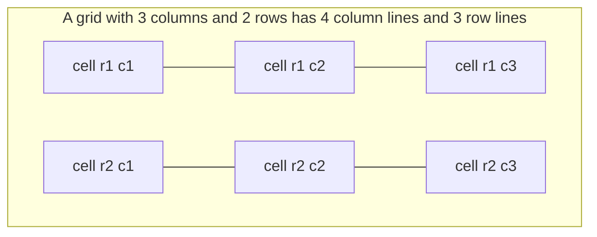
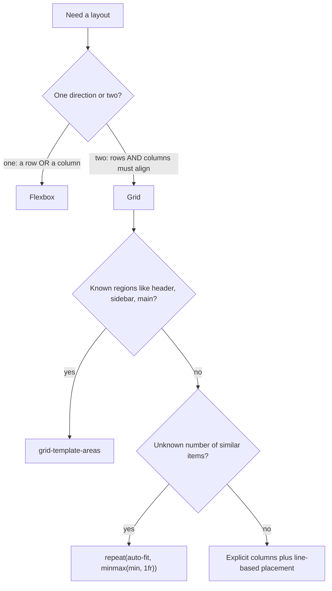

# CSS Grid in depth

> **Before this lesson:** you should know the box model ([The box model](#/lesson/html-css/box-model)) and have worked through [Flexbox in depth](#/lesson/html-css/flexbox), because Grid reuses its alignment vocabulary (`justify-…`, `align-…`, `gap`).

## In plain words

**CSS Grid** is a layout system that divides a box into rows and columns, like a sheet of squared paper, and lets you place content into the resulting cells.

Think of a newspaper page. Before any story is written, the designer rules the page into columns and bands. Headlines, photographs and articles are then slotted into that framework: a photo might span two columns, a headline might run across the whole width. The framework comes first and the content fits into it. That is the difference from flexbox, where each item's own size drives the result. Grid is "layout first"; flexbox is "content first".

Grid is the standard tool for whole-page layouts (header, sidebar, main area, footer), for galleries of cards and for any design where things must line up both across and down. In interviews you will be asked to build a responsive card grid, to explain the `fr` unit, and to say when you would choose Grid over flexbox.

## Vocabulary

A handful of terms are used constantly, so here they are before any code.

| Term | Meaning |
|---|---|
| **Grid container** | The element with `display: grid` |
| **Grid item** | A direct child of the container |
| **Grid line** | A dividing line between rows or columns. Lines are **numbered from 1** |
| **Track** | A row or a column: the space between two adjacent lines |
| **Cell** | One box where a row and a column cross |
| **Area** | A rectangle made of one or more cells |
| **Gap** (or gutter) | The space between tracks |



The detail people forget: three columns are bounded by **four** lines. Line 1 is the left edge, line 4 the right edge.

## A first grid

```html-run
<!doctype html>
<html lang="en">
<head><meta charset="utf-8"><title>First grid</title>
<style>
  body { font-family: system-ui, sans-serif; }
  .grid {
    display: grid;                          /* 1. turn the container into a grid */
    grid-template-columns: 150px 150px 150px; /* 2. three columns, each 150px wide */
    gap: 10px;                              /* 3. 10px between rows and between columns */
  }
  .grid > div { background: #b3e5fc; border: 2px solid #0277bd; padding: 12px; }
</style></head>
<body>
  <div class="grid">
    <div>1</div><div>2</div><div>3</div>
    <div>4</div><div>5</div>
  </div>
</body>
</html>
```

Reading the three declarations:

1. `display: grid` makes `.grid` a grid container and its five children grid items.
2. `grid-template-columns` lists the width of each column. Three values means three columns.
3. `gap` sets the gutter.

We never said how many rows there are. The browser fills the first row with items 1–3, sees there are more, and **creates a second row automatically** for items 4 and 5. Filling cells one after another like this is called **auto-placement**.

## Flexible tracks: the `fr` unit

Fixed pixel columns do not adapt to the screen. The `fr` unit ("fraction") represents **a share of the space left over** after fixed-size tracks and gaps have been subtracted.

```css
grid-template-columns: 1fr 1fr 1fr;     /* three equal columns */
grid-template-columns: 200px 1fr;       /* fixed sidebar, the rest for content */
grid-template-columns: 1fr 2fr;         /* one third, two thirds */
```

A worked example: a container 700px wide with `grid-template-columns: 200px 1fr 2fr` and `gap: 10px`. Two gaps take 20px and the fixed column 200px, leaving 480px. That is divided into 3 shares of 160px: the second column gets 160px and the third 320px.

```html-run
<!doctype html>
<html lang="en">
<head><meta charset="utf-8"><title>fr units</title>
<style>
  body { font: .85rem system-ui, sans-serif; }
  .grid { display: grid; gap: 10px; margin-bottom: 14px; }
  .grid > div { background: #c5e1a5; border: 2px solid #558b2f; padding: 10px; text-align: center; }
  .a { grid-template-columns: 1fr 1fr 1fr; }
  .b { grid-template-columns: 200px 1fr; }
  .c { grid-template-columns: 1fr 2fr 1fr; }
  .d { grid-template-columns: repeat(4, 1fr); }
</style></head>
<body>
  <div class="grid a"><div>1fr</div><div>1fr</div><div>1fr</div></div>
  <div class="grid b"><div>200px</div><div>1fr</div></div>
  <div class="grid c"><div>1fr</div><div>2fr</div><div>1fr</div></div>
  <div class="grid d"><div>repeat</div><div>(4,</div><div>1fr)</div><div>→ 4 equal</div></div>
</body>
</html>
```

The last grid uses **`repeat(count, size)`**, which saves typing the same value several times: `repeat(4, 1fr)` is the same as `1fr 1fr 1fr 1fr`.

Other track sizes you can use:

| Value | Meaning |
|---|---|
| `auto` | As big as the content needs; stretches to take leftover space if no `fr` track claims it |
| `min-content` | As narrow as the content can go (the longest word) |
| `max-content` | As wide as the content wants without wrapping |
| `minmax(min, max)` | Never smaller than `min`, never larger than `max` |
| `fit-content(300px)` | Like `auto`, but capped at the given size |

Rows are defined the same way with `grid-template-rows`. Rows that you do not define are created as needed, and their size is set by `grid-auto-rows` (default `auto`, meaning as tall as their content).

> [!WARNING]
> `1fr` is really `minmax(auto, 1fr)`: a track will not shrink below its content's minimum width. A long word or a wide image can therefore make "equal" columns unequal or overflow the page. Write `minmax(0, 1fr)` to get strictly equal, shrinkable columns.

## The responsive card grid: `auto-fit` and `minmax`

Here is the most celebrated line in Grid. It makes as many columns as will fit, each at least 200px wide, sharing any leftover space equally, with **no media queries**:

```css
grid-template-columns: repeat(auto-fit, minmax(200px, 1fr));
```

Take it apart from the inside:

- `minmax(200px, 1fr)`: each column must be at least 200px and may grow to an equal share of the free space.
- `repeat(auto-fit, …)`: instead of a fixed count, repeat that column as many times as fit in the container.

```html-run
<!doctype html>
<html lang="en">
<head><meta charset="utf-8"><title>Auto-fit card grid</title>
<style>
  body { font-family: system-ui, sans-serif; }
  .wrap { resize: horizontal; overflow: auto; border: 2px dashed #9e9e9e; padding: 10px; }
  .cards { display: grid; grid-template-columns: repeat(auto-fit, minmax(140px, 1fr)); gap: 12px; }
  .cards > article { background: #ffe0b2; border-radius: 10px; padding: 1rem; min-height: 70px; }
</style></head>
<body>
  <p>Drag the corner of the dashed box. Columns are added and removed automatically.</p>
  <div class="wrap">
    <div class="cards">
      <article>Rye</article><article>Spelt</article><article>Oat</article>
      <article>Barley</article><article>Millet</article><article>Buckwheat</article>
    </div>
  </div>
</body>
</html>
```

With a 600px container, 12px gaps and a 140px minimum, four columns fit (4 × 140 + 3 × 12 = 596). At 450px three fit (3 × 140 + 2 × 12 = 444), at 300px two, and below 292px a single column.

**`auto-fit` versus `auto-fill`.** They differ only when there are fewer items than columns that would fit. `auto-fill` keeps the empty columns, so the items stay at their minimum width. `auto-fit` collapses the empty columns to zero, so the existing items stretch to fill the row.

> [!INTERVIEW]
> "Build a responsive grid of cards without media queries." `display: grid; grid-template-columns: repeat(auto-fit, minmax(16rem, 1fr)); gap: 1rem;`. Be ready to explain each piece, and to add that `minmax(min(16rem, 100%), 1fr)` prevents overflow when the container is narrower than the minimum.

## Placing items on lines

By default each item takes one cell in order. To make an item span several cells or sit in a specific place, name the **lines** where it starts and ends.

| Property | Meaning |
|---|---|
| `grid-column: 1 / 3` | Start at column line 1, end at column line 3 (covers columns 1 and 2) |
| `grid-column: 2 / span 2` | Start at line 2 and cover 2 columns |
| `grid-column: span 2` | Cover 2 columns from wherever auto-placement puts it |
| `grid-column: 1 / -1` | From the first line to the **last** line: full width |
| `grid-row: 1 / 3` | The same idea for rows |

Negative numbers count from the end, so `-1` is the last line of the explicit grid.

```html-run
<!doctype html>
<html lang="en">
<head><meta charset="utf-8"><title>Line placement</title>
<style>
  body { font-family: system-ui, sans-serif; }
  .grid { display: grid; grid-template-columns: repeat(4, 1fr); grid-auto-rows: 60px; gap: 8px; }
  .grid > div { background: #d1c4e9; border: 2px solid #5e35b1; padding: 6px; font-size: .85rem; }
  .wide  { grid-column: 1 / -1; background: #b39ddb !important; }   /* full width */
  .two   { grid-column: span 2; }                                   /* two columns wide */
  .tall  { grid-row: span 2; }                                      /* two rows tall */
  .exact { grid-column: 3 / 5; grid-row: 2 / 3; background: #ffcc80 !important; }  /* a precise slot */
</style></head>
<body>
  <div class="grid">
    <div class="wide">1 / -1 (full width)</div>
    <div class="tall">span 2 rows</div>
    <div class="exact">col 3 / 5, row 2</div>
    <div>auto</div>
    <div class="two">span 2 columns</div>
    <div>auto</div>
  </div>
</body>
</html>
```

Items you place explicitly are positioned first; the remaining items then flow into the empty cells around them. Adding `grid-auto-flow: dense` asks the browser to back-fill holes with later items, useful for image mosaics (at the cost of changing the visual order).

## Naming areas: `grid-template-areas`

For page-level layouts there is a more readable method. You give each region a name and then draw the layout as rows of words.

```html-run
<!doctype html>
<html lang="en">
<head><meta charset="utf-8"><title>Holy grail layout</title>
<style>
  * { box-sizing: border-box; }
  body { font-family: system-ui, sans-serif; margin: 0; }
  .page {
    display: grid;
    min-height: 100vh;
    grid-template-columns: 160px 1fr 160px;
    grid-template-rows: auto 1fr auto;
    grid-template-areas:
      "header header header"
      "nav    main   aside"
      "footer footer footer";
    gap: 8px; padding: 8px;
  }
  header { grid-area: header; background: #90caf9; }
  nav    { grid-area: nav;    background: #ce93d8; }
  main   { grid-area: main;   background: #a5d6a7; }
  aside  { grid-area: aside;  background: #ffcc80; }
  footer { grid-area: footer; background: #b0bec5; }
  .page > * { padding: .8rem; border-radius: 8px; }

  @media (max-width: 600px) {
    .page {
      grid-template-columns: 1fr;
      grid-template-areas: "header" "nav" "main" "aside" "footer";
    }
  }
</style></head>
<body>
  <div class="page">
    <header>Header</header>
    <nav>Nav</nav>
    <main>Main content. Rows are auto / 1fr / auto, so this middle band grows to fill the window.</main>
    <aside>Aside</aside>
    <footer>Footer</footer>
  </div>
</body>
</html>
```

How it works:

- Each quoted string in `grid-template-areas` is one row; each word in it is one column. Repeating a name makes that area span those cells. A full stop (`.`) leaves a cell empty.
- Each child claims an area with `grid-area: name`.
- Every area must be a rectangle; an L-shape is invalid and the whole declaration is ignored.
- `grid-template-rows: auto 1fr auto` means the header and footer are as tall as their content while the middle row takes the remaining height.

This three-band, three-column arrangement is so well known it has a nickname, the **holy grail layout**, because it was notoriously hard to achieve before Grid. The media query at the end redraws the areas as a single column on narrow screens by changing two declarations; the HTML is untouched.

## Alignment in Grid

Grid has two levels of alignment, and the property names tell you which.

| Property | Aligns | Direction |
|---|---|---|
| `justify-items` | Each item **inside its cell** | Horizontal (inline) |
| `align-items` | Each item **inside its cell** | Vertical (block) |
| `place-items` | Shorthand for both | `align` then `justify` |
| `justify-content` | The **whole grid** inside the container | Horizontal |
| `align-content` | The **whole grid** inside the container | Vertical |
| `place-content` | Shorthand for both | |
| `justify-self`, `align-self`, `place-self` | One item, overriding the container | |

The default for items is `stretch`: each fills its cell. The `-content` properties matter only when the tracks add up to less than the container.

The shortest way to centre anything in CSS uses Grid:

```html-run
<!doctype html>
<html lang="en">
<head><meta charset="utf-8"><title>place-items</title>
<style>
  body { margin: 0; font-family: system-ui, sans-serif; }
  .stage { display: grid; place-items: center; min-height: 200px; background: #fce4ec; }
  .dot { background: #ad1457; color: white; padding: 1rem 1.5rem; border-radius: 12px; }
</style></head>
<body>
  <div class="stage"><div class="dot">display: grid; place-items: center;</div></div>
</body>
</html>
```

## Overlapping and layering

Two items may be placed in the same cell. They then overlap, and `z-index` (which works on grid items without needing `position`) decides the order. This replaces a lot of absolute positioning:

```html-run
<!doctype html>
<html lang="en">
<head><meta charset="utf-8"><title>Stacking in one cell</title>
<style>
  .hero { display: grid; max-width: 420px; border-radius: 12px; overflow: hidden; font-family: system-ui, sans-serif; }
  .hero > * { grid-area: 1 / 1; }      /* everything in row 1, column 1 */
  .pic { min-height: 160px; background: linear-gradient(135deg, #00897b, #1a237e); }
  .caption { align-self: end; padding: 1rem; color: white; background: linear-gradient(transparent, rgb(0 0 0 / .7)); }
</style></head>
<body>
  <div class="hero">
    <div class="pic" role="img" aria-label="Abstract teal and navy picture"></div>
    <div class="caption"><strong>Caption over the picture</strong><br>No absolute positioning used.</div>
  </div>
</body>
</html>
```

`grid-area: 1 / 1` is shorthand for "row line 1, column line 1". Both children land in the same cell; the caption uses `align-self: end` to sit at the bottom.

## Subgrid

A grid item's own children are not part of the parent's grid. In a row of cards, each card is a grid item, but the card's title, text and button are laid out independently, so the buttons of neighbouring cards may not line up. **Subgrid** lets a nested grid borrow its parent's tracks:

```css
.cards { display: grid; grid-template-columns: repeat(3, 1fr); gap: 1rem; }
.card  { display: grid; grid-row: span 3; grid-template-rows: subgrid; }
```

Each card spans three rows of the parent and, with `grid-template-rows: subgrid`, its three children occupy those shared rows. All titles then share one row height, all bodies another, all buttons a third.

## Explicit and implicit grid

The tracks you define with `grid-template-columns` and `grid-template-rows` form the **explicit grid**. If there are more items than cells, the browser adds tracks to hold them: the **implicit grid**. `grid-auto-rows` and `grid-auto-columns` size those extra tracks, and `grid-auto-flow` (`row` by default, or `column`) decides in which direction new tracks are added. A common setting is `grid-auto-rows: minmax(100px, auto)`: rows at least 100px tall that grow with their content.



> [!TIP]
> Click the `grid` badge next to a grid container in developer tools to overlay its numbered lines, tracks and named areas on the page. It removes all guesswork from line-based placement.

## Pitfalls

- **Off-by-one with lines.** Three columns have four lines; `grid-column: 1 / 3` covers two columns, not three.
- **`1fr` columns overflowing.** Content with a large minimum width forces the track wider. Use `minmax(0, 1fr)` and `min-width: 0` on the item.
- **`minmax(300px, 1fr)` overflowing on phones.** When the container is narrower than 300px, the column cannot shrink. Use `minmax(min(300px, 100%), 1fr)`.
- **Non-rectangular or misspelled areas.** The whole `grid-template-areas` declaration is dropped; check developer tools for a struck-through line.
- **Percentages plus `gap`.** `50% 50%` columns with a gap overflow, because gaps are added on top. Use `fr`.
- **Expecting nested elements to follow the grid.** Only direct children are grid items; use subgrid or flatten the HTML.
- **`auto-fit` versus `auto-fill` confusion.** Few items stretching across the row means `auto-fit`; items staying small with empty space means `auto-fill`.
- **Visual order differing from source order.** Explicit placement and `dense` packing do not change keyboard or reading order.
- **Fixed row heights.** `grid-template-rows: 200px` clips or overflows when content grows; prefer `minmax(200px, auto)`.
- **Using Grid for a single row of buttons.** Flexbox is simpler when content should set the sizes.

## Cheat sheet

**On the container**

| Goal | CSS |
|---|---|
| Make a grid | `display: grid` |
| Three equal columns | `grid-template-columns: repeat(3, 1fr)` |
| Fixed sidebar + fluid content | `grid-template-columns: 240px 1fr` |
| Responsive cards | `grid-template-columns: repeat(auto-fit, minmax(16rem, 1fr))` |
| Header / stretchy middle / footer | `grid-template-rows: auto 1fr auto; min-height: 100vh` |
| Named layout | `grid-template-areas: "head head" "side main"` |
| Gutters | `gap: 1rem` |
| Height of automatically created rows | `grid-auto-rows: minmax(100px, auto)` |
| Centre every item in its cell | `place-items: center` |

**On an item**

| Goal | CSS |
|---|---|
| Span two columns | `grid-column: span 2` |
| Full width | `grid-column: 1 / -1` |
| Exact slot | `grid-column: 2 / 4; grid-row: 1 / 3` |
| Named slot | `grid-area: main` |
| Align one item | `place-self: center` |
| Stack in one cell | `grid-area: 1 / 1` on each |

## Summary

Grid divides a container into tracks defined by `grid-template-columns` and `grid-template-rows`, using fixed sizes, content-based sizes, `minmax()` ranges and `fr` shares of free space. Items fill cells automatically, or you place them by line numbers, spans or named areas. `repeat(auto-fit, minmax(…, 1fr))` produces responsive columns with no media queries, and `grid-template-areas` makes page layouts readable and easy to rearrange at breakpoints. Alignment properties position items within cells and the grid within its container, items may share a cell to overlap, and subgrid lets nested content align to the parent's tracks. Choose Grid when rows and columns matter together and flexbox for single-direction arrangements.

## Glossary

| Term | Meaning |
|---|---|
| Grid container / item | The element with `display: grid` / its direct children |
| Grid line | A numbered dividing line; numbering starts at 1 and `-1` is the last |
| Track | A row or column |
| Cell | The intersection of one row and one column |
| Area | A named or line-bounded rectangle of cells |
| `fr` | A unit meaning one share of the leftover space |
| `repeat()` | Function that repeats a track definition |
| `minmax()` | Function giving a track a minimum and maximum size |
| Auto-placement | The browser filling cells in order for items you did not place |
| Explicit grid | The tracks you defined |
| Implicit grid | Extra tracks the browser creates for overflow items |
| `auto-fit` / `auto-fill` | Keywords that create as many columns as fit; they differ in how empty columns are treated |
| Subgrid | A nested grid that adopts its parent's tracks |
| Holy grail layout | Header, footer and a three-column middle with a fluid centre |

## Check yourself

```quiz
[
  {"q": "A grid has grid-template-columns: repeat(4, 1fr). How many column lines does it have?", "options": ["3", "4", "5", "8"], "answer": 2,
   "explain": "N tracks are bounded by N + 1 lines, so four columns have five lines, numbered 1 to 5."},
  {"q": "A 620px-wide grid container has grid-template-columns: 100px 1fr 3fr and gap: 10px. How wide is the third column?", "options": ["375px", "390px", "465px", "310px"], "answer": 0,
   "explain": "Subtract two gaps (20px) and the fixed column (100px): 500px remain, split into 4 shares of 125px. The 3fr column gets 375px."},
  {"q": "Which declaration makes an item stretch across every column of the explicit grid?", "options": ["grid-column: span all", "grid-column: 1 / -1", "grid-column: 0 / 100%", "width: 100%"], "answer": 1,
   "explain": "Line 1 is the first line and -1 refers to the last line, so the item covers all explicit columns."},
  {"q": "A grid uses repeat(auto-fit, minmax(200px, 1fr)) with gap: 0 in a 1000px container and has only two items. How wide is each item?", "options": ["200px", "250px", "500px", "1000px"], "answer": 2,
   "explain": "Five 200px columns would fit, but auto-fit collapses the three empty ones, so the two remaining tracks share the full width."},
  {"q": "Same grid but with auto-fill instead of auto-fit. How wide is each of the two items?", "options": ["200px", "250px", "500px", "1000px"], "answer": 0,
   "explain": "auto-fill keeps the empty tracks, so there are five columns of 200px (1000 / 5) and each item occupies one of them."},
  {"q": "What does this render? A grid with grid-template-columns: 1fr 1fr containing five divs and no placement rules.", "options": ["One row of five", "Two columns and three rows, with the last row half empty", "Five rows of one", "Only the first two divs are shown"], "answer": 1,
   "explain": "Auto-placement fills two cells per row and creates implicit rows as needed: 2 + 2 + 1."},
  {"q": "What is wrong with grid-template-areas: 'a a' 'a b'; ?", "options": ["Nothing", "Area a is L-shaped; areas must be rectangles, so the declaration is invalid", "Rows need three names", "Names must be longer than one letter"], "answer": 1,
   "explain": "Each named area must form a single rectangle. An invalid template is ignored entirely."},
  {"q": "What is the shortest way to centre a single child both ways inside a grid container?", "options": ["text-align: center", "place-items: center", "margin: 0 auto", "justify-content: space-between"], "answer": 1,
   "explain": "place-items sets align-items and justify-items together, centring the item in its cell, which here is the whole container."}
]
```

> **Source:** Duckett, *HTML & CSS*, ch. 15 (Layout: grids, fixed and liquid columns) — the book describes grid-based design using floats and frameworks; this lesson teaches the native CSS Grid that replaced them. MDN: https://developer.mozilla.org/en-US/docs/Learn_web_development/Core/CSS_layout/Grids · https://developer.mozilla.org/en-US/docs/Web/CSS/CSS_grid_layout/Basic_concepts_of_grid_layout · https://developer.mozilla.org/en-US/docs/Web/CSS/repeat · https://developer.mozilla.org/en-US/docs/Web/CSS/CSS_grid_layout/Subgrid
