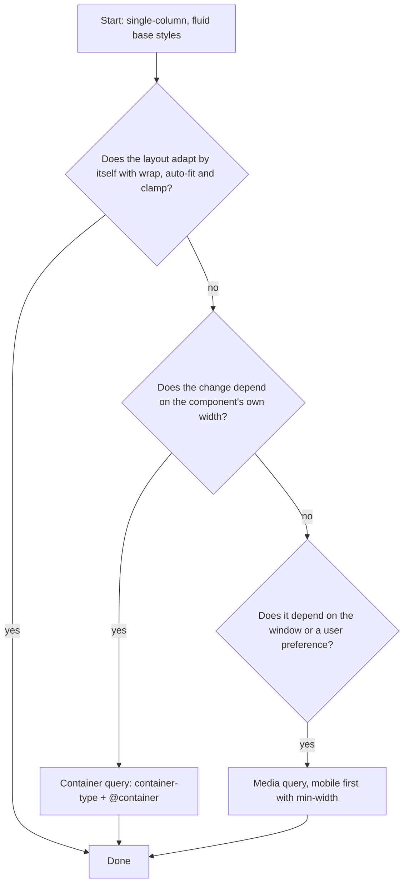

# Responsive design: viewport, media queries, fluid sizing and container queries

> **Before this lesson:** you should know [Flexbox in depth](#/lesson/html-css/flexbox) and [CSS Grid in depth](#/lesson/html-css/grid), the `rem` unit and `clamp()` from [Typography](#/lesson/html-css/typography), and `srcset`/`picture` from [Images](#/lesson/html-css/images).

## In plain words

**Responsive web design** means building one page that rearranges itself to suit whatever screen it is shown on, from a small phone held upright to a very wide desktop monitor, instead of building a separate site for each device.

Water is a good picture of it. Pour water into a tall glass, a wide bowl or a narrow bottle and it takes the shape of each. A responsive page is content that behaves like water: the same paragraphs, images and menus settle into one narrow column on a phone and spread into several columns on a laptop.

More than half of all web traffic comes from phones, so a page that only works on a desktop is broken for most visitors, and search engines rank pages by their mobile version. Every front-end job expects you to build responsively by default, and interviewers will ask about the viewport meta tag, media queries, the "mobile-first" approach and, increasingly, container queries.

## The three original ingredients

The term was coined in 2010 with three ingredients, and they are still the core:

1. **Fluid layouts**: sizes in relative units (percentages, `fr`, `rem`) instead of fixed pixels.
2. **Flexible media**: images and videos that shrink to fit their container.
3. **Media queries**: CSS that applies only when the screen meets a condition.

Modern CSS adds tools that often make the third ingredient unnecessary: flexbox wrapping, Grid's `auto-fit`, `clamp()`, and container queries. A good strategy is to let the layout adapt by itself wherever possible and add explicit conditions only where the design must change shape.

## Step 0: the viewport meta tag

The **viewport** is the area of the browser window in which the page is displayed.

When smartphones first appeared, almost no site was designed for a small screen. To cope, mobile browsers pretend the screen is about 980 pixels wide, lay the page out at that width, and then shrink the whole thing to fit. The result is a tiny, zoomed-out desktop page. To tell the browser "this page is designed for small screens; use the real width", you must include this line in the `<head>` of **every** page:

```html
<meta name="viewport" content="width=device-width, initial-scale=1">
```

- `width=device-width` sets the layout width to the device's actual width in CSS pixels.
- `initial-scale=1` sets the starting zoom to 100%.

Without this tag, none of the techniques below work on a phone, because the browser never reports a narrow width.

> [!WARNING]
> Do not add `user-scalable=no` or `maximum-scale=1`. They stop people from pinch-zooming, which many users with low vision depend on.

A note on pixels. A **CSS pixel** is not a physical dot on the screen. A phone whose screen is 1170 physical pixels across typically reports a width of 390 CSS pixels, because it uses three physical pixels for each CSS pixel to make text sharp. That ratio is the **device pixel ratio**. You always design in CSS pixels.

## Step 1: fluid by default

Before writing any conditions, remove the things that *prevent* a page from adapting.

```css
*, *::before, *::after { box-sizing: border-box; }
img, video, svg { max-width: 100%; height: auto; }   /* media never overflow */
.wrapper { width: 100%; max-width: 70rem; margin-inline: auto; padding-inline: 1rem; }
```

Guidelines:

- Prefer `max-width` to `width`, and `min-height` to `height`. Fixed dimensions are the main cause of overflow.
- Use `rem` for type and spacing, `%` and `fr` for widths.
- Let flexbox wrap (`flex-wrap: wrap`) and let Grid choose the column count (`repeat(auto-fit, minmax(…))`).

The following layout is fully responsive and contains no media query at all.

```html-run
<!doctype html>
<html lang="en">
<head><meta charset="utf-8"><meta name="viewport" content="width=device-width, initial-scale=1"><title>Intrinsic layout</title>
<style>
  * { box-sizing: border-box; }
  body { font-family: system-ui, sans-serif; margin: 0; }
  .frame { resize: horizontal; overflow: auto; border: 2px dashed #9e9e9e; max-width: 100%; width: 640px; padding: 12px; }
  .cards { display: grid; gap: 12px; grid-template-columns: repeat(auto-fit, minmax(min(11rem, 100%), 1fr)); }
  .card { background: #e0f2f1; border-radius: 10px; padding: 1rem; }
  h1 { font-size: clamp(1.4rem, 1rem + 3cqi, 2.4rem); margin: 0 0 .6rem; }
  .frame { container-type: inline-size; }
</style></head>
<body>
  <div class="frame">
    <h1>Seed swap</h1>
    <div class="cards">
      <div class="card">Tomato</div><div class="card">Runner bean</div><div class="card">Chard</div><div class="card">Squash</div>
    </div>
  </div>
  <p style="padding:0 12px">Drag the corner of the dashed box to simulate different screen widths.</p>
</body>
</html>
```

Layouts like this, where the content and container negotiate the result without explicit breakpoints, are called **intrinsic** layouts.

## Step 2: media queries

A **media query** wraps a block of CSS in a condition. The rules inside apply only while the condition is true.

```css
@media (min-width: 600px) {
  .sidebar { display: block; }
}
```

Read it as: "when the viewport is at least 600 CSS pixels wide, show the sidebar". The width at which a layout changes is called a **breakpoint**.

### Mobile first

There are two ways to organise your queries.

- **Desktop first**: write the wide layout as the default, then use `max-width` queries to undo things for small screens.
- **Mobile first**: write the narrow, single-column layout as the default, then use `min-width` queries to *add* complexity as space becomes available.

Mobile first is the recommended approach. The default styles are the simplest (one column needs almost no CSS), every device gets a usable page even if it ignores the queries, and each query only adds. The simplest possible example:

```html-run
<!doctype html>
<html lang="en">
<head><meta charset="utf-8"><meta name="viewport" content="width=device-width, initial-scale=1"><title>Mobile first</title>
<style>
  * { box-sizing: border-box; }
  body { font-family: system-ui, sans-serif; margin: 0; }
  .page { display: grid; gap: 10px; padding: 10px; }            /* default: one column */
  .page > * { padding: 1rem; border-radius: 8px; }
  header { background: #90caf9; } main { background: #a5d6a7; } aside { background: #ffcc80; } footer { background: #b0bec5; }

  @media (min-width: 500px) {                                   /* medium: two columns */
    .page { grid-template-columns: 2fr 1fr; }
    header, footer { grid-column: 1 / -1; }
  }
  @media (min-width: 800px) {                                   /* wide: constrain and enlarge */
    .page { max-width: 760px; margin-inline: auto; gap: 16px; }
    main { font-size: 1.1rem; }
  }
</style></head>
<body>
  <div class="page">
    <header>Header</header>
    <main>Main. Below 500px everything is one column. From 500px the aside moves beside this box.</main>
    <aside>Aside</aside>
    <footer>Footer</footer>
  </div>
</body>
</html>
```

Walk through it in order. With no query matching, `.page` is a one-column grid. At 500px the first query adds a second column and makes the header and footer span both. At 800px the second query adds a maximum width. Each block builds on the previous one, because later rules of equal specificity override earlier ones.

### Query syntax

| Feature | Example | True when |
|---|---|---|
| Width | `(min-width: 48rem)`, `(max-width: 599px)` | The viewport is at least / at most that wide |
| Range syntax | `(width >= 48rem)`, `(600px <= width < 900px)` | Same idea, easier to read; supported by all current browsers |
| Orientation | `(orientation: landscape)` | Width is greater than height |
| Pointer precision | `(pointer: coarse)` | The main input is imprecise, like a finger |
| Hover ability | `(hover: hover)` | The main input can hover, like a mouse |
| Colour scheme | `(prefers-color-scheme: dark)` | The user chose a dark theme |
| Motion | `(prefers-reduced-motion: reduce)` | The user asked for less animation |
| Contrast | `(prefers-contrast: more)` | The user asked for higher contrast |
| Media type | `print`, `screen` | The page is being printed / shown on a screen |

Combine conditions with `and`, list alternatives with commas (meaning "or"), and negate with `not`:

```css
@media (min-width: 600px) and (orientation: landscape) { … }
@media (max-width: 400px), (orientation: portrait) { … }
@media print { nav, .ads { display: none; } }
```

### Choosing breakpoints

Do not chase particular devices; there are thousands of screen sizes and new ones appear every year. Instead, slowly widen the browser window and add a breakpoint **where the content starts to look wrong**: lines too long, cards too stretched, too much empty space. Most sites need only two or three.

Writing breakpoints in `em` or `rem` (for example `48em`) instead of pixels means they also respond when a user enlarges their default font size.

One limitation to remember: a custom property cannot be used inside the condition of a media query. `@media (min-width: var(--bp))` does not work, because the query is evaluated before any element's variables exist.

> [!INTERVIEW]
> "What is mobile-first CSS?" Write the base styles for the narrowest layout with no media query, then layer enhancements with `min-width` queries in ascending order. The benefits are simpler defaults, progressive enhancement and fewer overrides than starting from desktop and subtracting.

## Step 3: fluid type and spacing

Between breakpoints, sizes can scale smoothly instead of jumping. The `clamp(min, preferred, max)` function from the typography lesson does this for any length.

```css
h1      { font-size: clamp(1.75rem, 1.2rem + 2.5vw, 3rem); }
section { padding-block: clamp(2rem, 6vw, 6rem); }
.grid   { gap: clamp(0.75rem, 2vw, 2rem); }
```

Viewport units to know:

| Unit | Equals |
|---|---|
| `vw`, `vh` | 1% of the viewport's width / height |
| `vmin`, `vmax` | 1% of the smaller / larger of the two |
| `dvh` | 1% of the *dynamic* viewport height, which changes as a phone's address bar hides and shows |
| `svh`, `lvh` | 1% of the smallest / largest possible viewport height |

On phones, `100vh` is taller than the visible area while the address bar is showing, so a "full-screen" section gets cut off. `min-height: 100dvh` fixes that.

## Step 4: container queries

Media queries ask about the **whole window**. But a reusable component, say a product card, does not know where it will be placed. In a wide main column it has room for a picture beside the text; in a narrow sidebar on the same screen it does not. The window width is identical in both cases, so a media query cannot tell them apart.

A **container query** asks about the size of an **ancestor element** instead. It needs two steps.

1. Mark the ancestor as a **query container**:

```css
.card-slot { container-type: inline-size; }
```

`inline-size` means "allow queries about my width" (the inline direction is horizontal in English).

2. Write a query using `@container`:

```css
@container (min-width: 400px) {
  .card { display: grid; grid-template-columns: 120px 1fr; }
}
```

```html-run
<!doctype html>
<html lang="en">
<head><meta charset="utf-8"><title>Container query</title>
<style>
  * { box-sizing: border-box; }
  body { font-family: system-ui, sans-serif; display: grid; grid-template-columns: 2fr 1fr; gap: 14px; margin: 10px; }
  .slot { container-type: inline-size; border: 2px dashed #9e9e9e; padding: 8px; }
  .card { background: #ede7f6; border-radius: 10px; padding: .8rem; display: grid; gap: .6rem; }
  .thumb { background: linear-gradient(135deg, #7e57c2, #26c6da); border-radius: 8px; aspect-ratio: 16 / 9; }
  h3, p { margin: 0; }

  @container (min-width: 380px) {
    .card { grid-template-columns: 130px 1fr; align-items: center; }
    .thumb { aspect-ratio: 1; }
  }
</style></head>
<body>
  <div class="slot">
    <article class="card"><div class="thumb"></div><div><h3>Wide slot</h3><p>The same card component, arranged side by side because its container is wide.</p></div></article>
  </div>
  <div class="slot">
    <article class="card"><div class="thumb"></div><div><h3>Narrow slot</h3><p>The same card, stacked.</p></div></article>
  </div>
</body>
</html>
```

The two cards have identical HTML and CSS. Each asks "how wide is *my* slot?" and gets a different answer.

Details:

- You can name a container (`container-name: sidebar`, or the shorthand `container: sidebar / inline-size`) and target it: `@container sidebar (min-width: 300px)`.
- **Container query units** measure the container: `1cqi` is 1% of its inline size. They are ideal inside `clamp()` for type that scales with the component.
- An element cannot be styled by a query about itself; the container must be an ancestor. That is why the example has a `.slot` wrapper.

| | Media query | Container query |
|---|---|---|
| Measures | The viewport (or user preferences) | A chosen ancestor element |
| Best for | Page-level layout, preferences such as dark mode and reduced motion | Reusable components |
| Setup | None | `container-type` on the ancestor |

## Step 5: responsive images, recap

From the images lesson: `srcset` with width descriptors plus `sizes` lets the browser pick a suitably sized file; `<picture>` with `<source media>` swaps crops at breakpoints; `loading="lazy"` defers off-screen images. In CSS, give media `max-width: 100%` and use `aspect-ratio` so that space is reserved before the file arrives.

## Patterns for navigation and tables

Two components always need thought on small screens.

**Navigation.** A row of seven links does not fit on a phone. Options, from simplest to most complex: let the links wrap onto two lines; make the row scroll sideways (`overflow-x: auto`); or hide the links behind a "Menu" button on narrow screens. If you use a button, it must be a real `<button>` with `aria-expanded`, so that keyboard and screen-reader users can operate it.

**Touch targets.** Fingers are less precise than mouse pointers. Make interactive targets at least 24 by 24 CSS pixels, preferably around 44, with space between them. `@media (pointer: coarse)` lets you enlarge targets only on touch devices, and `@media (hover: hover)` lets you restrict hover-dependent effects to devices that can hover.

**Tables.** Wrap wide tables in a container with `overflow-x: auto` so that the table scrolls sideways instead of the whole page.

## Testing

- Open developer tools and switch on **device mode** (the phone-and-tablet icon). Drag the width handle slowly from 320px upward and watch for breakage.
- Check there is **no horizontal scrollbar** at 320px, the narrowest common width.
- Zoom the desktop browser to 400%. This is equivalent to a 320px viewport and is an accessibility requirement (WCAG "Reflow").
- Test on at least one real phone. Emulators do not reproduce touch behaviour, the on-screen keyboard or address-bar resizing.



> [!TIP]
> Build and test the narrowest layout first. It is the hardest to fit, and wider layouts are then a matter of using extra room well.

## Pitfalls

- **Missing viewport meta tag.** The phone shows a shrunken desktop layout and your queries never match.
- **Fixed widths.** `width: 960px` guarantees horizontal scrolling on phones. Use `max-width`.
- **Disabling zoom.** An accessibility failure.
- **Device-specific breakpoints.** Let the content decide where the layout changes.
- **Overlapping `max-width` and `min-width` queries** at the same value, so both (or neither) apply at exactly that width. Stick to `min-width`, or use range syntax with `<` and `>=`.
- **`100vh` on mobile.** Content hides behind the browser's toolbar; use `100dvh`.
- **Hiding content on mobile with `display: none`.** It is still downloaded, and phone users generally want the same information.
- **Hover-only interactions.** Touch screens cannot hover.
- **Font sizes in pure `vw`.** They ignore zoom; combine with `rem` inside `clamp()`.
- **A container querying itself.** The query container must be an ancestor of the element being styled.
- **Variables in media query conditions.** Not supported.

## Cheat sheet

| Goal | Code |
|---|---|
| Enable responsive behaviour on phones | `<meta name="viewport" content="width=device-width, initial-scale=1">` |
| Fluid media | `img, video { max-width: 100%; height: auto; }` |
| Centred column with a cap | `max-width: 70rem; margin-inline: auto; padding-inline: 1rem;` |
| Columns without queries | `repeat(auto-fit, minmax(min(16rem, 100%), 1fr))` |
| Apply from a width upward | `@media (min-width: 48em) { … }` or `(width >= 48em)` |
| Fluid size | `clamp(1rem, 0.8rem + 1vw, 1.5rem)` |
| Full-height section on phones | `min-height: 100dvh` |
| Component responds to its slot | `container-type: inline-size` + `@container (min-width: 400px) { … }` |
| Respect reduced motion | `@media (prefers-reduced-motion: reduce) { … }` |
| Dark theme | `@media (prefers-color-scheme: dark) { … }` |
| Touch devices | `@media (pointer: coarse) { … }` |
| Print styles | `@media print { … }` |

## Summary

Responsive design starts with the viewport meta tag and a fluid foundation: relative units, flexible media, wrapping flex rows and auto-fitting grids. Where the design must change shape, add mobile-first media queries with `min-width`, at breakpoints chosen by the content. Smooth the steps between breakpoints with `clamp()` and viewport units. For reusable components, container queries respond to the size of the surrounding element instead of the window. Media queries also express user preferences such as dark mode and reduced motion. Finally, test by resizing, zooming and using a real phone.

## Glossary

| Term | Meaning |
|---|---|
| Responsive design | One page whose layout adapts to any screen size |
| Viewport | The area of the browser window that shows the page |
| Viewport meta tag | The `<meta name="viewport">` line that makes phones use their real width |
| CSS pixel | The unit of length in CSS; may correspond to several physical screen dots |
| Device pixel ratio | Physical pixels per CSS pixel |
| Media query | CSS applied only when a condition about the viewport or user preferences is true |
| Breakpoint | A viewport width at which the layout changes |
| Mobile first | Writing narrow-screen styles as the default and adding wider layouts with `min-width` |
| Fluid | Sized in relative units so that it scales continuously |
| Intrinsic layout | A layout that adapts through content and container sizing without breakpoints |
| Container query | CSS applied according to the size of an ancestor element |
| Query container | An element marked with `container-type` whose size can be queried |
| `dvh` | A unit equal to 1% of the currently visible viewport height |

## Check yourself

```quiz
[
  {"q": "A page has perfect media queries but shows a tiny zoomed-out desktop layout on phones. What is most likely missing?", "options": ["A doctype", "The viewport meta tag", "A print style sheet", "JavaScript"], "answer": 1,
   "explain": "Without width=device-width the mobile browser lays the page out on a virtual viewport about 980px wide, so narrow-width queries never match."},
  {"q": "In mobile-first CSS, which kind of media query is used to add layouts for larger screens?", "options": ["max-width", "min-width", "orientation", "print"], "answer": 1,
   "explain": "Base styles serve the narrowest screens; min-width queries layer on enhancements as space increases."},
  {"q": "Styles: .box { color: red; } @media (min-width: 600px) { .box { color: green; } } @media (min-width: 900px) { .box { color: blue; } }. What colour is .box at a viewport width of 1024px?", "options": ["Red", "Green", "Blue", "Purple"], "answer": 2,
   "explain": "All three rules match at 1024px and have equal specificity, so the last one in source order wins."},
  {"q": "Same styles. What colour at 600px exactly?", "options": ["Red", "Green", "Blue", "None"], "answer": 1,
   "explain": "min-width: 600px is inclusive, so the green rule applies; the 900px rule does not."},
  {"q": "A card component should switch to a horizontal layout when the column it sits in is wide, regardless of window size. Which tool fits?", "options": ["A media query on min-width", "A container query", "The viewport meta tag", "position: sticky"], "answer": 1,
   "explain": "Container queries respond to an ancestor's size, which is exactly what a reusable component needs."},
  {"q": "What must be set on an ancestor before @container (min-width: 400px) can match?", "options": ["display: grid", "container-type: inline-size", "position: relative", "overflow: hidden"], "answer": 1,
   "explain": "container-type establishes a query container; inline-size enables width-based queries."},
  {"q": "Why prefer min-height: 100dvh over 100vh for a full-screen section on phones?", "options": ["dvh is faster", "dvh tracks the visible height as browser toolbars show and hide, whereas 100vh can exceed the visible area", "vh is deprecated", "dvh ignores zoom"], "answer": 1,
   "explain": "On mobile, 100vh usually equals the largest viewport height, so content can sit under the address bar. The dynamic unit follows the visible area."},
  {"q": "How should breakpoints be chosen?", "options": ["Match the widths of the most popular phones", "Where the content's layout starts to look or work badly as the window widens", "Every 100 pixels", "Only at 768px and 1024px"], "answer": 1,
   "explain": "Device sizes change constantly; content-driven breakpoints stay valid whatever hardware appears."}
]
```

> **Source:** Duckett, *HTML & CSS*, ch. 15 (Layout: screen sizes, fixed and liquid layouts) and ch. 18 — the book predates responsive design; this lesson brings the topic up to date. MDN: https://developer.mozilla.org/en-US/docs/Learn_web_development/Core/CSS_layout/Responsive_Design · https://developer.mozilla.org/en-US/docs/Web/CSS/CSS_media_queries/Using_media_queries · https://developer.mozilla.org/en-US/docs/Web/CSS/CSS_containment/Container_queries · https://developer.mozilla.org/en-US/docs/Web/HTML/Guides/Viewport_meta_element
