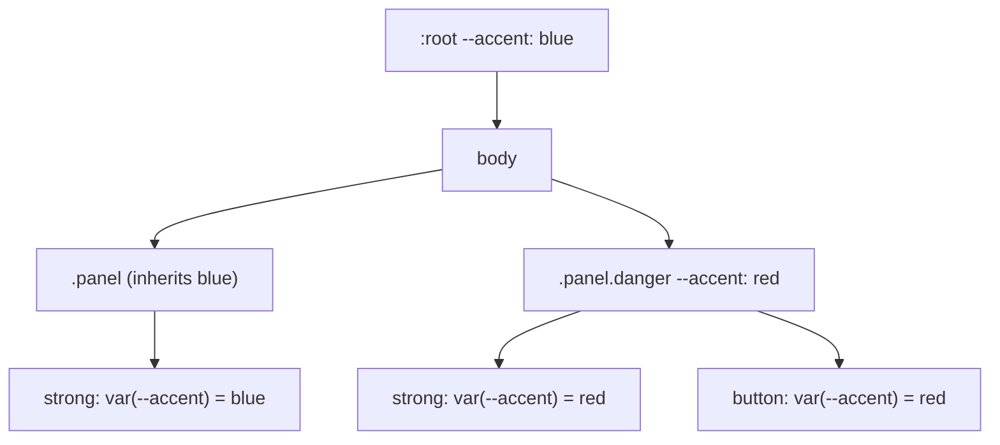

# Custom properties and theming

> **Before this lesson:** you should understand inheritance and specificity ([The cascade, specificity and inheritance](#/lesson/html-css/cascade)) and colour notations including `light-dark()` ([Colour](#/lesson/html-css/color)).

## In plain words

A **custom property** is a named value that you define once in your CSS and then reuse in as many places as you like. Many people call them **CSS variables**.

Think of a recipe that says "season with the house spice mix" in twelve different dishes. The mix itself is written down once, on a card by the stove. If the chef changes the card, all twelve dishes change, and nobody has to edit twelve recipes. A custom property is that card: `--brand-colour: teal` is written once, and every button, link and border that refers to it follows along.

In practice this is how design systems, dark mode and "theme switchers" are built. It removes the most tedious maintenance job in CSS (find-and-replace across hundreds of hard-coded values) and it lets components be customised from the outside. Interviewers ask how custom properties differ from the variables of preprocessors such as Sass, and how you would implement a theme with them.

## Declaring and using a custom property

Two pieces of syntax are all you need to begin.

```css
:root {
  --accent: #00796b;          /* 1. declare: a name starting with two dashes */
}
button {
  background: var(--accent);  /* 2. use: the var() function */
}
```

1. A custom property is declared like any other declaration, but its name **begins with two hyphens**. The name is your choice and it is case-sensitive: `--Accent` and `--accent` are different properties.
2. To read the value, wrap the name in `var()`.

`:root` is a selector that matches the top element of the document (the `<html>` element). Declaring variables there makes them available on every element of the page, for a reason explained in the next section.

```html-run
<!doctype html>
<html lang="en">
<head><meta charset="utf-8"><title>First custom property</title>
<style>
  :root {
    --accent: #00796b;
    --radius: 10px;
    --space: 1rem;
  }
  body   { font-family: system-ui, sans-serif; }
  .card  { border: 2px solid var(--accent); border-radius: var(--radius); padding: var(--space); max-width: 320px; }
  .card h3 { color: var(--accent); margin: 0 0 var(--space); }
  .card button { background: var(--accent); color: white; border: 0; border-radius: var(--radius); padding: .5rem 1rem; font: inherit; }
</style></head>
<body>
  <div class="card">
    <h3>Allotment plot 14</h3>
    <p>Change <code>--accent</code> in the editor to another colour and press Run.</p>
    <button type="button">Renew</button>
  </div>
</body>
</html>
```

The colour `#00796b` appears once, in the declaration, and is used in three places: the border, the heading and the button. Change that one line and all three follow.

## Custom properties inherit

Here is the idea that separates custom properties from variables in most programming languages: **they are properties, so they take part in the cascade and they inherit.**

A custom property declared on an element is available to that element and to **all of its descendants**. That is why `:root` gives "global" variables: every element is a descendant of the root.

It also means you can **redefine** a variable on any element, and everything inside that element sees the new value.

```html-run
<!doctype html>
<html lang="en">
<head><meta charset="utf-8"><title>Scoped overrides</title>
<style>
  :root    { --accent: #1565c0; }             /* default for the whole page */
  .danger  { --accent: #c62828; }             /* redefined for anything inside .danger */
  .success { --accent: #2e7d32; }

  body { font-family: system-ui, sans-serif; display: grid; gap: 10px; max-width: 340px; }
  .panel { border-left: 6px solid var(--accent); background: #f5f5f5; padding: .7rem 1rem; }
  .panel strong { color: var(--accent); }
  .panel button { background: var(--accent); color: white; border: 0; padding: .35rem .8rem; border-radius: 6px; font: inherit; }
</style></head>
<body>
  <div class="panel"><strong>Info</strong> uses the root value. <button>OK</button></div>
  <div class="panel danger"><strong>Danger</strong> redefines --accent. <button>Delete</button></div>
  <div class="panel success"><strong>Success</strong> redefines it again. <button>Done</button></div>
</body>
</html>
```

The rules for `.panel`, `.panel strong` and `.panel button` are written once and never mention red or green. Each panel resolves `var(--accent)` by looking at itself, then its parent, then its grandparent, and so on up to the root, using the first declaration it finds.



> [!INTERVIEW]
> "How do CSS custom properties differ from Sass variables?" Sass variables are replaced with their values when the CSS file is built; they do not exist in the browser. Custom properties are live in the browser: they cascade, inherit, can differ per element, can be changed by media queries and by JavaScript at run time, and are visible in developer tools.

## Fallback values

`var()` accepts a second argument, used when the property has not been defined:

```css
color: var(--text-colour, #222);
padding: var(--card-padding, var(--space, 1rem));   /* fallbacks can be nested */
```

Everything after the first comma is the fallback, so it may itself contain commas, as in a font stack.

Fallbacks make components configurable. A component can read `var(--button-bg, royalblue)`: it works with its built-in default, and anyone who sets `--button-bg` on an ancestor customises it without touching the component's CSS.

### Invalid at computed-value time

One behaviour surprises people. Suppose a variable *is* defined but holds a value that makes no sense where it is used:

```css
:root { --gap: red; }
.box  { margin: 10px; margin: var(--gap); }
```

You might expect the browser to throw away the second `margin` and fall back to `10px`, as it does with an ordinary invalid declaration. It cannot, because when it first reads the style sheet it does not yet know what `--gap` will contain. By the time the mistake is discovered, the earlier declaration has already been discarded. The property is said to be **invalid at computed-value time**, and it falls back to its inherited or initial value (for `margin`, that is `0`), not to the previous declaration and not to the `var()` fallback.

## Values are substituted as text

A custom property can hold almost anything: a colour, a length, a number, a font stack, a whole shadow, even a fragment of a value.

```css
:root {
  --shadow: 0 4px 12px rgb(0 0 0 / .15);
  --font-ui: system-ui, "Segoe UI", sans-serif;
  --hue: 200;
}
.card  { box-shadow: var(--shadow); font-family: var(--font-ui); }
.badge { background: hsl(var(--hue) 70% 45%); }
```

Two limits follow from how substitution works:

- **Units cannot be glued on.** `var(--n)px` is not valid. Store the unit in the variable, or multiply: `calc(var(--n) * 1px)`.
- **`var()` works only in property values.** It cannot be used for a property name, a selector, or the condition of a media query.

### Combining with `calc()`

`calc()` performs arithmetic in CSS, and with variables it lets one number drive a family of values.

```html-run
<!doctype html>
<html lang="en">
<head><meta charset="utf-8"><title>calc with variables</title>
<style>
  :root { --step: 8px; --hue: 265; }
  body { font-family: system-ui, sans-serif; }
  .stack { display: grid; gap: calc(var(--step) * 1); max-width: 320px; }
  .stack > div {
    padding: calc(var(--step) * 2);
    border-radius: calc(var(--step) * 1.5);
    color: white;
    background: hsl(var(--hue) 60% calc(25% + var(--i) * 12%));
  }
</style></head>
<body>
  <div class="stack">
    <div style="--i: 0">--i: 0</div>
    <div style="--i: 1">--i: 1</div>
    <div style="--i: 2">--i: 2</div>
    <div style="--i: 3">--i: 3</div>
  </div>
</body>
</html>
```

Every spacing value is a multiple of `--step`, so changing that one number rescales the whole component. Each row also sets its own `--i` through an inline `style` attribute, and the shared rule turns that number into a lightness. Passing a per-element number in this way is one of the few good uses of inline styles.

## Theming: light and dark

A **theme** is a coordinated set of colours (and sometimes fonts and spacing) applied across a site. With custom properties, a theme is a block of variable declarations, and switching theme means swapping which block applies.

The method has three layers.

**1. Use semantic names.** Name variables after their *role*, not their appearance: `--surface`, `--text`, `--border`, `--accent`. A name like `--white` becomes misleading the moment the dark theme sets it to charcoal.

**2. Follow the system preference by default** with a media query.

**3. Allow a manual override** with an attribute on the root element, which a script can set and remember.

```html-run
<!doctype html>
<html lang="en">
<head><meta charset="utf-8"><title>Theme switcher</title>
<style>
  /* Light values (default) */
  :root {
    color-scheme: light;
    --surface: #ffffff;
    --panel:   #f1f3f5;
    --text:    #1f2328;
    --muted:   #5b6470;
    --border:  #d0d7de;
    --accent:  #0b57d0;
    --on-accent: #ffffff;
  }
  /* Dark values when the system asks for dark, unless the user forced light */
  @media (prefers-color-scheme: dark) {
    :root:not([data-theme="light"]) {
      color-scheme: dark;
      --surface: #111418; --panel: #1b2026; --text: #e6e8eb; --muted: #9aa4af;
      --border: #313840; --accent: #8ab4f8; --on-accent: #0b1b33;
    }
  }
  /* Dark values when the user forced dark */
  :root[data-theme="dark"] {
    color-scheme: dark;
    --surface: #111418; --panel: #1b2026; --text: #e6e8eb; --muted: #9aa4af;
    --border: #313840; --accent: #8ab4f8; --on-accent: #0b1b33;
  }

  /* Components only ever mention variables */
  body   { font-family: system-ui, sans-serif; background: var(--surface); color: var(--text); margin: 0; padding: 1rem; }
  .card  { background: var(--panel); border: 1px solid var(--border); border-radius: 12px; padding: 1rem; max-width: 340px; }
  .card p { color: var(--muted); }
  .btn   { background: var(--accent); color: var(--on-accent); border: 0; border-radius: 8px; padding: .5rem .9rem; font: inherit; cursor: pointer; }
  .ghost { background: transparent; color: var(--text); border: 1px solid var(--border); }
</style></head>
<body>
  <div class="card">
    <h3 style="margin-top:0">Theme demo</h3>
    <p>Component rules never contain a colour value, only variable names.</p>
    <button class="btn" type="button" onclick="document.documentElement.dataset.theme='dark'">Dark</button>
    <button class="btn" type="button" onclick="document.documentElement.dataset.theme='light'">Light</button>
    <button class="btn ghost" type="button" onclick="delete document.documentElement.dataset.theme">System</button>
  </div>
</body>
</html>
```

Reading the selectors: `:root[data-theme="dark"]` matches the `<html>` element when it carries the attribute `data-theme="dark"`. The buttons set or remove that attribute through `document.documentElement.dataset.theme` (`document.documentElement` is JavaScript's name for the `<html>` element). Nothing else changes: the component rules stay as they are and re-resolve their `var()` references. A real site would also save the choice in `localStorage` so that it survives a reload.

`color-scheme` is set alongside the variables so that the browser's own parts, such as form controls and scrollbars, switch as well.

A shorter alternative, where browser support allows, is the `light-dark()` function from the colour lesson: `--surface: light-dark(#fff, #111418)` holds both values in one declaration.

## Design tokens: organising variables in layers

Large projects call their shared values **design tokens** and arrange them in tiers.

| Tier | Purpose | Example |
|---|---|---|
| **Primitive** | The raw palette and scales; no meaning attached | `--blue-600: #0b57d0; --space-3: 0.75rem` |
| **Semantic** | Roles, pointing at primitives | `--accent: var(--blue-600); --gap: var(--space-3)` |
| **Component** | Optional per-component hooks, pointing at semantic tokens | `--button-bg: var(--accent)` |

Components refer only to the lower two tiers. A theme changes the *semantic* tier (dark mode remaps `--surface` and `--text`), while a rebrand changes the *primitive* tier.

```css
:root {
  /* primitives */
  --blue-600: #0b57d0;  --grey-900: #1f2328;  --grey-50: #f6f8fa;
  --space-1: .25rem; --space-2: .5rem; --space-3: 1rem; --space-4: 2rem;
  /* semantic */
  --accent: var(--blue-600);
  --text: var(--grey-900);
  --surface: var(--grey-50);
}
```

## Reading and writing from JavaScript

Because the variables exist in the browser, scripts can use them. This is the bridge between program state and styling.

```html-run
<!doctype html>
<html lang="en">
<head><meta charset="utf-8"><title>Variables from JavaScript</title>
<style>
  :root { --hue: 200; --size: 90px; }
  body { font-family: system-ui, sans-serif; }
  .swatch { width: var(--size); height: var(--size); border-radius: 16px;
            background: hsl(var(--hue) 75% 50%); transition: width .2s, height .2s; margin: 1rem 0; }
  label { display: block; margin: .4rem 0; }
</style></head>
<body>
  <label>Hue <input type="range" min="0" max="360" value="200" id="hue"></label>
  <label>Size <input type="range" min="40" max="160" value="90" id="size"></label>
  <div class="swatch"></div>
  <output id="out"></output>
  <script>
    const root = document.documentElement;
    const show = () => out.textContent = '--hue is ' + getComputedStyle(root).getPropertyValue('--hue');
    hue.oninput  = e => { root.style.setProperty('--hue', e.target.value); show(); };
    size.oninput = e => root.style.setProperty('--size', e.target.value + 'px');
    show();
  </script>
</body>
</html>
```

- `element.style.setProperty('--name', value)` writes a variable on an element.
- `getComputedStyle(element).getPropertyValue('--name')` reads the value in effect.

The script sets numbers; the CSS decides what they mean. That division keeps presentation logic out of JavaScript.

## Typed properties with `@property`

By default the browser treats a custom property's value as an opaque string of text. One consequence is that it **cannot animate smoothly** between two values, because it does not know they are, say, angles. The `@property` rule registers a variable with a type, an initial value and an inheritance setting.

```css
@property --angle {
  syntax: "<angle>";       /* the kind of value it holds */
  inherits: false;         /* whether descendants inherit it */
  initial-value: 0deg;     /* value when nothing sets it */
}
```

Once registered, `--angle` can be transitioned or animated (for example to rotate a gradient), an invalid value is rejected in favour of the initial value, and `inherits: false` stops the value leaking into nested components.

> [!TIP]
> In the Styles pane of developer tools, hover over a `var(--name)` to see its resolved value and click it to jump to the declaration that supplied it.

> [!WARNING]
> A misspelled variable name produces no error message. The property silently falls back to its inherited or initial value. When a colour or size "disappears", check the spelling of the `var()` first.

## Pitfalls

- **Forgetting `var()`.** `color: --accent` is invalid; write `color: var(--accent)`.
- **Misspelled names fail silently.** `var(--acent)` is an undefined variable, so the property falls back to its inherited or initial value. Developer tools show undefined variables greyed out.
- **Expecting the previous declaration to act as a fallback.** An invalid variable value does not revert to an earlier rule. Provide the fallback inside `var()`.
- **Appending units.** `var(--n)px` does not work; use `calc(var(--n) * 1px)`.
- **Variables in media query conditions or selectors.** Not supported.
- **Appearance-based names** (`--red`, `--light-grey`) for values that change per theme. Use roles.
- **Defining everything on `:root`.** Variables that only one component uses are clearer when declared on that component.
- **A cycle.** `--a: var(--b); --b: var(--a);` makes both invalid.
- **Colours hard-coded beside variables.** One stray `#fff` in a component shows up as a white box in dark mode. Search for raw colour values during review.
- **Forgetting `color-scheme`.** Native controls stay light in your dark theme.

## Cheat sheet

| Goal | Code |
|---|---|
| Declare globally | `:root { --name: value; }` |
| Use | `property: var(--name);` |
| Use with a default | `var(--name, fallback)` |
| Override for a subtree | `.section { --name: other; }` |
| Per-element number | `<li style="--i: 3">` + `calc(var(--i) * 10px)` |
| Add a unit | `calc(var(--n) * 1rem)` |
| Dark values by system setting | `@media (prefers-color-scheme: dark) { :root { … } }` |
| Manual theme | `:root[data-theme="dark"] { … }` |
| Both values in one line | `--surface: light-dark(#fff, #111)` |
| Set from JavaScript | `el.style.setProperty('--name', value)` |
| Read from JavaScript | `getComputedStyle(el).getPropertyValue('--name')` |
| Animatable, typed variable | `@property --x { syntax: "<length>"; inherits: false; initial-value: 0px; }` |

## Summary

Custom properties are author-defined properties whose names start with `--` and whose values are read with `var()`. Because they cascade and inherit, a value set on `:root` is available everywhere and can be redefined for any subtree, which is what makes scoped variants and themes possible. Fallbacks make components configurable, `calc()` derives related values from one source, and semantic naming keeps themes coherent. A theme is a set of variable declarations selected by a media query or a root attribute, with `color-scheme` set alongside. JavaScript can read and write the variables at run time, and `@property` adds types so that they can be validated and animated.

## Glossary

| Term | Meaning |
|---|---|
| Custom property | An author-defined CSS property whose name begins with `--` |
| CSS variable | The everyday name for a custom property |
| `var()` | The function that inserts a custom property's value |
| `:root` | Selector for the document's top element, `<html>` |
| Fallback | The second argument of `var()`, used when the property is not defined |
| Scope | The part of the document tree in which a declared value is visible: the element and its descendants |
| Invalid at computed-value time | A declaration whose variable resolves to an unusable value; the property reverts to inherited or initial |
| `calc()` | A function that performs arithmetic on CSS values |
| Theme | A coordinated set of values, usually colours, applied site-wide |
| Design token | A named, shared design value such as a colour or spacing step |
| Semantic name | A name describing a value's role (`--surface`) instead of its look (`--white`) |
| `@property` | A rule that registers a custom property with a type, initial value and inheritance |
| Preprocessor | A tool such as Sass that generates CSS at build time |

## Check yourself

```quiz
[
  {"q": "Which declaration correctly uses a custom property named --gap?", "options": ["margin: --gap;", "margin: var(--gap);", "margin: $gap;", "margin: @gap;"], "answer": 1,
   "explain": "Custom properties are read with the var() function. The dollar and at-sign forms belong to Sass and Less."},
  {"q": ":root { --c: blue; } .box { --c: red; } p { color: var(--c); }. What colour is a paragraph inside <div class='box'>?", "options": ["Blue", "Red", "Black", "It depends on source order"], "answer": 1,
   "explain": "Custom properties inherit. The paragraph's nearest ancestor that declares --c is .box, so it resolves to red."},
  {"q": "Same CSS. What colour is a paragraph that is NOT inside .box?", "options": ["Blue", "Red", "Black", "Transparent"], "answer": 0,
   "explain": "With no closer declaration, the value inherited from :root applies."},
  {"q": "No rule defines --pad. What padding does padding: var(--pad, 12px) produce?", "options": ["0", "12px", "The declaration is ignored", "auto"], "answer": 1,
   "explain": "When the property is undefined, the fallback after the comma is used."},
  {"q": ":root { --w: 20; } .bar { width: var(--w)px; }. What happens?", "options": ["The bar is 20px wide", "The declaration is invalid; a unit cannot be appended to var()", "The bar is 20% wide", "The bar is 20rem wide"], "answer": 1,
   "explain": "Substitution yields the tokens 20 and px separately, which is not a valid length. Use calc(var(--w) * 1px)."},
  {"q": "What is the key difference between a CSS custom property and a Sass variable?", "options": ["Sass variables can hold colours and custom properties cannot", "Custom properties exist at run time, cascade and inherit; Sass variables are replaced at build time", "Custom properties are faster to type", "There is no difference"], "answer": 1,
   "explain": "Sass variables disappear during compilation. Custom properties are live in the browser and can vary per element and change dynamically."},
  {"q": "p { color: green; color: var(--missing-typo); } with --missing-typo undefined and no fallback. The paragraph's parent has color: purple. What colour is the paragraph?", "options": ["Green", "Purple", "Black", "Red"], "answer": 1,
   "explain": "The later declaration wins the cascade and then proves invalid at computed-value time, so color takes its inherited value, purple, not the earlier green."},
  {"q": "Why register a custom property with @property?", "options": ["To make it global", "To give it a type so the browser can validate and smoothly animate it", "To make it readable from JavaScript", "To increase its specificity"], "answer": 1,
   "explain": "Unregistered custom properties are untyped strings and cannot be interpolated. @property declares syntax, inheritance and an initial value."}
]
```

> **Source:** Duckett, *HTML & CSS* does not cover custom properties (they postdate the book); this lesson extends its ch. 11 colour material. MDN: https://developer.mozilla.org/en-US/docs/Web/CSS/CSS_cascading_variables/Using_CSS_custom_properties · https://developer.mozilla.org/en-US/docs/Web/CSS/var · https://developer.mozilla.org/en-US/docs/Web/CSS/@property · https://developer.mozilla.org/en-US/docs/Web/CSS/calc
