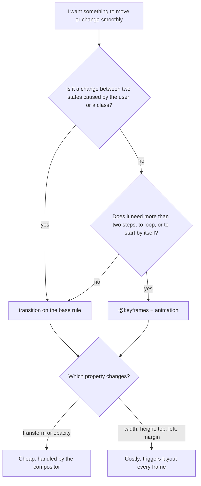

# Transitions, transforms and animations

> **Before this lesson:** you should know pseudo-classes such as `:hover` and `:focus-visible` ([Introducing CSS](#/lesson/html-css/css-intro)), positioning and stacking contexts ([Normal flow, display, positioning and stacking](#/lesson/html-css/display-positioning)) and custom properties ([Custom properties and theming](#/lesson/html-css/custom-properties)).

## In plain words

Without any extra instruction, a change in CSS happens instantly: a button is blue, you move the pointer over it, and in the very next frame it is green. **Transitions** and **animations** tell the browser to make a change *gradually*, over a stretch of time, by drawing all the in-between steps.

Think of a dimmer switch compared with an ordinary light switch. Both end with the light on, but the dimmer lets your eyes follow what happened. In an interface, motion does the same job: a menu that slides out from the left shows where it came from and where it will go back to; a button that eases to a darker colour confirms "yes, that is clickable".

Motion is where an interface starts to feel finished, so every front-end role expects you to add it tastefully. It is also where performance problems and accessibility complaints begin, so interviewers ask which properties are cheap to animate, how a transition differs from a keyframe animation, and how to respect people who get dizzy from movement.

## Three tools

| Tool | What it does | Typical trigger |
|---|---|---|
| **Transform** | Moves, scales, rotates or skews an element without disturbing its neighbours | — (a static effect that is often animated) |
| **Transition** | Smoothly animates a property from its old value to its new value when the value changes | A state change: `:hover`, `:focus`, a class added by script |
| **Animation** | Plays a scripted sequence of steps defined with `@keyframes` | Starts by itself; can loop |

## Transitions

### The smallest example

```html-run
<!doctype html>
<html lang="en">
<head><meta charset="utf-8"><title>First transition</title>
<style>
  body { font-family: system-ui, sans-serif; display: flex; gap: 1rem; }
  button { font: inherit; padding: .7rem 1.2rem; border: 0; border-radius: 8px; background: #1565c0; color: white; cursor: pointer; }
  button:hover { background: #ef6c00; }

  .smooth { transition: background-color 0.4s; }
</style></head>
<body>
  <button type="button">No transition</button>
  <button type="button" class="smooth">With transition</button>
</body>
</html>
```

Both buttons change from blue to orange when you hover over them. The first snaps. The second has one extra declaration:

```css
transition: background-color 0.4s;
```

It reads: "whenever my `background-color` changes, take 0.4 seconds to get there". Notice where it is written: on the **base rule**, not on `:hover`. That way the transition applies in both directions, when the pointer arrives and when it leaves.

### The four parts

`transition` is a shorthand for four properties.

| Property | Meaning | Example | Default |
|---|---|---|---|
| `transition-property` | Which property to animate | `background-color`, `transform`, `all` | `all` |
| `transition-duration` | How long it takes | `0.2s`, `200ms` | `0s` (instant) |
| `transition-timing-function` | The pattern of acceleration, called **easing** | `ease`, `linear`, `ease-in-out` | `ease` |
| `transition-delay` | How long to wait before starting | `0.1s` | `0s` |

Written together: `transition: transform 0.3s ease-out 0.1s;`. When two time values appear, the first is the duration and the second the delay. Several transitions are separated by commas:

```css
transition: background-color 0.2s, transform 0.2s, box-shadow 0.3s;
```

Naming the properties is better than `transition: all`, which animates anything that happens to change, including things you did not intend, and makes the browser do extra work.

### Easing

**Easing** describes how speed varies during the change. Real objects do not start and stop instantly, so constant speed (`linear`) looks mechanical.

| Keyword | Motion | Good for |
|---|---|---|
| `linear` | Constant speed | Continuous rotation, progress bars |
| `ease` | Quick start, slow finish (the default) | General use |
| `ease-in` | Starts slowly, ends fast | Things leaving the screen |
| `ease-out` | Starts fast, ends slowly | Things entering or responding to the user |
| `ease-in-out` | Slow at both ends | Movement from one place to another |
| `cubic-bezier(a, b, c, d)` | A curve you design | Custom "feel", including overshoot |
| `steps(n)` | Jumps in `n` equal steps with no in-between frames | Frame-by-frame sprite animation, typewriter effects |

```html-run
<!doctype html>
<html lang="en">
<head><meta charset="utf-8"><title>Easing</title>
<style>
  body { font: .85rem system-ui, sans-serif; }
  .track { background: #eceff1; border-radius: 999px; margin: 6px 0; padding: 3px; }
  .ball { width: 28px; height: 28px; border-radius: 50%; background: #7b1fa2; transition: transform 1.2s; }
  .stage:hover .ball, .stage:focus .ball { transform: translateX(260px); }
  .a { transition-timing-function: linear; }
  .b { transition-timing-function: ease; }
  .c { transition-timing-function: ease-in; }
  .d { transition-timing-function: ease-out; }
  .e { transition-timing-function: cubic-bezier(.34, 1.56, .64, 1); }
  .f { transition-timing-function: steps(5); }
  .stage { max-width: 300px; }
</style></head>
<body>
  <p>Hover over (or tab to) the tracks. All balls take 1.2 seconds.</p>
  <div class="stage" tabindex="0">
    linear<div class="track"><div class="ball a"></div></div>
    ease<div class="track"><div class="ball b"></div></div>
    ease-in<div class="track"><div class="ball c"></div></div>
    ease-out<div class="track"><div class="ball d"></div></div>
    cubic-bezier with overshoot<div class="track"><div class="ball e"></div></div>
    steps(5)<div class="track"><div class="ball f"></div></div>
  </div>
</body>
</html>
```

For durations, interface feedback (hover, press) feels right at about 100–200 milliseconds; larger movements such as a panel sliding in suit 200–400 milliseconds. Anything longer makes the interface feel slow.

### What can be transitioned

A property can be transitioned when the browser can calculate values between the start and the end: numbers, lengths, colours, transforms, opacity. It cannot calculate a midpoint between unrelated keywords, so two limits are worth knowing:

- **`display`** switches abruptly. To fade something out and then remove it, transition `opacity` and `visibility`. (Recent browsers add `transition-behavior: allow-discrete` and the `@starting-style` rule, which allow entry and exit effects on `display` changes.)
- **`height: auto`** has no numeric value to head toward. The well-known workaround animates a grid row from `0fr` to `1fr`, shown below; the newer `interpolate-size: allow-keywords` enables it directly where supported.

```html-run
<!doctype html>
<html lang="en">
<head><meta charset="utf-8"><title>Expanding panel</title>
<style>
  body { font-family: system-ui, sans-serif; max-width: 340px; }
  button { font: inherit; padding: .5rem .9rem; }
  .panel { display: grid; grid-template-rows: 0fr; transition: grid-template-rows .3s ease-out; }
  .panel.open { grid-template-rows: 1fr; }
  .panel > div { overflow: hidden; }
  .inner { background: #e8f5e9; padding: 0 1rem; border-radius: 8px; }
</style></head>
<body>
  <button type="button" aria-expanded="false" aria-controls="p"
          onclick="const o = p.classList.toggle('open'); this.setAttribute('aria-expanded', o)">Toggle details</button>
  <div class="panel" id="p"><div><div class="inner"><p>The row animates from 0fr to 1fr, so the height follows the content with no fixed number.</p><p>Add more text and it still fits.</p></div></div></div>
</body>
</html>
```

## Transforms

The `transform` property changes how an element is *drawn* without changing the space it occupies in the layout. Neighbouring elements do not move. That makes transforms ideal for animation.

| Function | Effect |
|---|---|
| `translate(x, y)`, `translateX()`, `translateY()` | Move. Percentages refer to the element's **own** size |
| `scale(n)`, `scale(x, y)` | Resize; `1` is normal, `1.1` is 10% larger |
| `rotate(45deg)` | Turn clockwise; other angle units are `turn` and `rad` |
| `skew(10deg)` | Slant |
| `perspective()`, `rotateX()`, `rotateY()`, `translateZ()` | Three-dimensional effects |

Functions can be chained and are applied from right to left: `transform: translateX(100px) rotate(45deg)` rotates first, then moves. `transform-origin` sets the pivot point (the centre by default).

There are also individual properties, `translate`, `rotate` and `scale`, which can be set and transitioned independently of each other: `scale: 1.05; rotate: 3deg;`.

```html-run
<!doctype html>
<html lang="en">
<head><meta charset="utf-8"><title>Transforms</title>
<style>
  body { font-family: system-ui, sans-serif; display: flex; gap: 1.6rem; padding: 2rem 1rem; flex-wrap: wrap; }
  .tile { width: 90px; height: 90px; border-radius: 12px; background: #26a69a; color: white; display: grid; place-items: center;
          font-size: .8rem; text-align: center; transition: transform .25s ease-out, box-shadow .25s; }
  .lift:hover   { transform: translateY(-8px); box-shadow: 0 12px 20px #0003; }
  .grow:hover   { transform: scale(1.15); }
  .spin:hover   { transform: rotate(180deg); }
  .combo:hover  { transform: translateY(-6px) rotate(-4deg) scale(1.05); }
  .corner { transform-origin: top left; }
  .corner:hover { transform: rotate(12deg); }
</style></head>
<body>
  <div class="tile lift">translateY</div>
  <div class="tile grow">scale</div>
  <div class="tile spin">rotate</div>
  <div class="tile combo">combined</div>
  <div class="tile corner">origin top left</div>
</body>
</html>
```

Hover over each tile. Notice that when a tile grows or lifts, the tiles beside it stay exactly where they were.

A classic use of `translate` percentages is centring an absolutely positioned box whose size is unknown: `top: 50%; left: 50%; translate: -50% -50%;`. The offsets move the box's top-left corner to the middle of the parent; the translation then pulls it back by half of *its own* width and height.

## Keyframe animations

A transition has only two points: where it starts and where it ends, and it needs something to trigger it. An **animation** can have any number of steps, can start by itself and can repeat.

It takes two parts. First, define the steps with an `@keyframes` rule and give the sequence a name:

```css
@keyframes pulse {
  from { transform: scale(1); }      /* the start (same as 0%) */
  50%  { transform: scale(1.15); }   /* halfway */
  to   { transform: scale(1); }      /* the end (same as 100%) */
}
```

Each block inside is a **keyframe**: a snapshot of styles at a percentage of the way through. Then attach the sequence to an element:

```css
.heart { animation: pulse 1.2s ease-in-out infinite; }
```

```html-run
<!doctype html>
<html lang="en">
<head><meta charset="utf-8"><title>Keyframes</title>
<style>
  body { font-family: system-ui, sans-serif; display: flex; gap: 2.5rem; align-items: center; padding: 1.5rem; flex-wrap: wrap; }

  @keyframes pulse { from { transform: scale(1); } 50% { transform: scale(1.2); } to { transform: scale(1); } }
  .heart { font-size: 2.5rem; animation: pulse 1.2s ease-in-out infinite; }

  @keyframes spin { to { transform: rotate(360deg); } }
  .spinner { width: 40px; height: 40px; border-radius: 50%; border: 5px solid #cfd8dc; border-top-color: #1565c0;
             animation: spin 0.9s linear infinite; }

  @keyframes slide-in { from { opacity: 0; transform: translateY(20px); } to { opacity: 1; transform: none; } }
  .toast { background: #263238; color: white; padding: .7rem 1rem; border-radius: 8px;
           animation: slide-in .5s ease-out both; }

  @keyframes blink { 50% { opacity: 0; } }
  .cursor { display: inline-block; width: 2px; height: 1.2em; background: currentColor; vertical-align: text-bottom;
            animation: blink 1s steps(1) infinite; }
</style></head>
<body>
  <div class="heart" role="img" aria-label="Heart">♥</div>
  <div class="spinner" role="status" aria-label="Loading"></div>
  <div class="toast">Saved (press Run to replay)</div>
  <div>Typing<span class="cursor"></span></div>
</body>
</html>
```

Four small animations, each showing something different:

- **pulse** has three keyframes and loops for ever.
- **spin** defines only `to`. When a keyframe is missing, the browser uses the element's existing style for it, so the rotation starts from zero. `linear` keeps the speed constant so the loop has no visible seam.
- **slide-in** runs once and animates two properties together.
- **blink** uses `steps(1)` so that the cursor switches on and off without fading.

### The animation properties

| Property | Meaning | Example values |
|---|---|---|
| `animation-name` | Which `@keyframes` to play | `pulse` |
| `animation-duration` | Length of one cycle | `1.2s` |
| `animation-timing-function` | Easing between keyframes | `ease-in-out`, `linear`, `steps(4)` |
| `animation-delay` | Wait before starting; a negative value starts part-way through | `0.3s`, `-0.5s` |
| `animation-iteration-count` | How many cycles | `1`, `3`, `infinite` |
| `animation-direction` | Forwards, backwards or alternating | `normal`, `reverse`, `alternate` |
| `animation-fill-mode` | Which styles apply before and after | `none`, `forwards`, `backwards`, `both` |
| `animation-play-state` | Running or paused | `running`, `paused` |

The shorthand accepts them in almost any order (the first time is the duration, the second the delay): `animation: slide-in 0.5s ease-out 0.2s 1 both;`.

**`animation-fill-mode` deserves a careful look**, because without it results are puzzling. By default, when an animation finishes, the element snaps back to its normal styles, and during a delay it shows its normal styles too.

- `forwards`: keep the final keyframe's styles after the animation ends.
- `backwards`: apply the first keyframe's styles during the delay.
- `both`: do both. This is what you want for entrance animations.

### Staggering with a variable

Give each item its own delay and a list appears one item after another. A custom property carries the index:

```html-run
<!doctype html>
<html lang="en">
<head><meta charset="utf-8"><title>Staggered list</title>
<style>
  body { font-family: system-ui, sans-serif; }
  @keyframes rise { from { opacity: 0; transform: translateY(12px); } }
  li { animation: rise .4s ease-out both; animation-delay: calc(var(--i) * 90ms);
       list-style: none; background: #e3f2fd; margin: .35rem 0; padding: .5rem .8rem; border-radius: 8px; max-width: 260px; }
  ul { padding: 0; }
</style></head>
<body>
  <ul>
    <li style="--i: 0">Flour</li><li style="--i: 1">Water</li><li style="--i: 2">Salt</li><li style="--i: 3">Starter</li><li style="--i: 4">Patience</li>
  </ul>
</body>
</html>
```

This `@keyframes` has only a `from` block: the animation runs from those styles to the element's normal styles.

## Transition or animation?



| | Transition | Animation |
|---|---|---|
| Number of steps | Two (from, to) | Any number of keyframes |
| Trigger | A property value changing | Runs when applied |
| Looping | No | Yes |
| Reverses automatically when the state ends | Yes | No |
| Typical use | Hover and focus feedback, toggled panels | Spinners, entrances, attention effects |

## Performance: animate `transform` and `opacity`

To show a page the browser works through stages: it calculates sizes and positions (**layout**), fills in pixels (**paint**), and then assembles the painted pieces (**composite**). The rendering lesson covers this in detail. For animation the key point is:

- Animating `width`, `height`, `margin`, `top` or `left` changes geometry, so the browser must redo layout and paint on **every frame**, sixty times a second.
- Animating `transform` or `opacity` changes only how an already-painted piece is assembled. That work is done by the **compositor**, often on the graphics processor (GPU), and stays smooth even when the page is busy.

So move things with `transform: translate()` instead of `left`, and resize visually with `scale()` instead of `width`.

> [!TIP]
> `will-change: transform` tells the browser in advance that an element will be animated, so it can prepare. Use it only on elements that have a proven stutter, and remove it afterwards; applying it widely wastes memory.

> [!INTERVIEW]
> "Which CSS properties are cheapest to animate and why?" `transform` and `opacity`, because they can be handled in the compositing stage without recalculating layout or repainting. Properties that affect geometry trigger layout and paint for every frame.

## Respecting reduced motion

For some people, including those with vestibular (inner-ear balance) disorders, large movements on screen cause dizziness or nausea. Operating systems have a "reduce motion" setting, and CSS can read it with a media query.

```css
@media (prefers-reduced-motion: reduce) {
  *, *::before, *::after {
    animation-duration: 0.01ms !important;
    animation-iteration-count: 1 !important;
    transition-duration: 0.01ms !important;
    scroll-behavior: auto !important;
  }
}
```

That blanket rule is a reasonable safety net. A more considered approach is to keep gentle effects such as a fade and remove the movement, or to write motion only inside `@media (prefers-reduced-motion: no-preference) { … }` so that it is opt-in.

> [!WARNING]
> Content that flashes more than three times a second can trigger seizures. Anything that moves or blinks for longer than five seconds needs a way to pause it (WCAG 2.2.2). Never convey information by animation alone.

## Pitfalls

- **`transition` on the `:hover` rule only.** The effect animates in and snaps back out. Put it on the base rule.
- **`transition: all`.** Animates unintended properties and costs performance. List what you mean.
- **Animating layout properties.** Use `transform` and `opacity`.
- **Transitioning to `height: auto` or `display: none`.** They do not interpolate; use the grid-row technique or opacity with visibility.
- **Animation snapping back at the end.** Add `animation-fill-mode: forwards` or `both`.
- **Forgetting the name or the duration.** With a duration of `0s` nothing visible happens.
- **A `transform` trapping `position: fixed` children** and creating a stacking context.
- **Inline elements ignoring `transform`.** Make them `inline-block`.
- **Hover-only effects.** Mirror them on `:focus-visible` for keyboard users.
- **Ignoring `prefers-reduced-motion`.**
- **Durations that are too long.** More than about 400 ms feels sluggish for interface feedback.

## Cheat sheet

| Goal | CSS |
|---|---|
| Smooth hover colour | `transition: background-color .2s;` on the base rule |
| Several properties | `transition: transform .2s ease-out, opacity .2s;` |
| Lift on hover | `:hover { transform: translateY(-4px); }` |
| Grow slightly | `transform: scale(1.05);` |
| Rotate | `transform: rotate(45deg);` |
| Fade in once | `@keyframes fade { from { opacity: 0; } }` + `animation: fade .4s both;` |
| Loading spinner | `@keyframes spin { to { transform: rotate(360deg); } }` + `animation: spin 1s linear infinite;` |
| Back-and-forth loop | `animation: bob 2s ease-in-out infinite alternate;` |
| Keep the end state | `animation-fill-mode: forwards;` |
| Stagger | `animation-delay: calc(var(--i) * 80ms);` |
| Pause on hover | `:hover { animation-play-state: paused; }` |
| Expand to content height | `grid-template-rows: 0fr` → `1fr` with a transition |
| Reduced motion | `@media (prefers-reduced-motion: reduce) { … }` |

## Summary

Transitions animate a property between two values when a state changes and are declared on the base rule with a property, a duration and an easing. Transforms move, scale and rotate an element without affecting layout. Keyframe animations define named multi-step sequences that can start by themselves, loop, alternate and hold their end state with `animation-fill-mode`. For smooth results animate `transform` and `opacity`, which the compositor handles without layout or paint. Keep interface motion short and purposeful, mirror hover effects on focus, and reduce or remove movement when the user asks for less.

## Glossary

| Term | Meaning |
|---|---|
| Transition | A gradual change of a property from one value to another when the value changes |
| Animation | A sequence of styles defined by keyframes and played over time |
| Keyframe | A snapshot of styles at a given percentage of an animation |
| `@keyframes` | The rule that defines and names an animation's keyframes |
| Transform | A visual move, scale, rotation or skew that does not affect layout |
| Duration | How long one transition or animation cycle lasts |
| Delay | The wait before a transition or animation starts |
| Easing (timing function) | The pattern of acceleration and deceleration during the change |
| Iteration count | How many times an animation repeats |
| Fill mode | Whether keyframe styles apply before the start and after the end |
| Interpolate | To calculate the in-between values from a start value to an end value |
| Compositor | The part of the browser that assembles painted layers, often using the GPU |
| Reduced motion | A user setting asking sites to minimise movement |
| Frame | One still image; browsers aim to draw about 60 per second |

## Check yourself

```quiz
[
  {"q": "Where should the transition declaration go so that a hover effect animates both in and out?", "options": ["On the :hover rule", "On the element's base rule", "On the parent", "In a media query"], "answer": 1,
   "explain": "The transition must be in effect in both states. On :hover only, it stops applying the moment the pointer leaves, so the return is instant."},
  {"q": "In transition: opacity 300ms ease-in 100ms, what is 100ms?", "options": ["The duration", "The delay", "The easing", "The frame rate"], "answer": 1,
   "explain": "The first time value is the duration and the second is the delay."},
  {"q": "Which pair of properties is cheapest to animate?", "options": ["width and height", "top and left", "transform and opacity", "margin and padding"], "answer": 2,
   "explain": "transform and opacity can be handled by the compositor without triggering layout or paint each frame."},
  {"q": "An element fades in with @keyframes from opacity 0 to 1 over 1s, with no fill mode, and its normal opacity is 0. What is seen after the animation ends?", "options": ["It stays visible", "It becomes invisible again", "It loops", "It flickers"], "answer": 1,
   "explain": "Without animation-fill-mode: forwards, the element returns to its own styles (opacity 0) when the animation finishes."},
  {"q": "What does this render? .box { width: 100px; transition: width 1s; } .box:hover { width: auto; }", "options": ["A smooth one-second growth to the content width", "An instant jump, because auto cannot be interpolated by default", "Nothing changes", "The box shrinks to zero"], "answer": 1,
   "explain": "Browsers cannot compute intermediate values between a length and the keyword auto unless interpolate-size is enabled, so the change is immediate."},
  {"q": "A box has transform: scale(2). What happens to the elements next to it?", "options": ["They are pushed away to make room", "They stay where they are; the box may overlap them", "They scale too", "They are hidden"], "answer": 1,
   "explain": "Transforms affect only how the element is drawn. The layout space it occupies is unchanged."},
  {"q": "@keyframes spin { to { transform: rotate(360deg); } } has no from block. Where does the rotation start?", "options": ["At 360deg", "At the element's current computed transform, here no rotation", "It is invalid", "At 180deg"], "answer": 1,
   "explain": "Missing keyframes are filled in from the element's own style, so the animation runs from the unrotated state."},
  {"q": "Which media query should wrap rules that tone down animation for users who request it?", "options": ["@media (hover: none)", "@media (prefers-reduced-motion: reduce)", "@media print", "@media (prefers-contrast: more)"], "answer": 1,
   "explain": "prefers-reduced-motion reflects the operating-system setting for minimising movement."}
]
```

> **Source:** Duckett, *HTML & CSS* does not cover CSS motion (it predates wide support); this lesson extends its CSS chapters. MDN: https://developer.mozilla.org/en-US/docs/Web/CSS/CSS_transitions/Using_CSS_transitions · https://developer.mozilla.org/en-US/docs/Web/CSS/CSS_animations/Using_CSS_animations · https://developer.mozilla.org/en-US/docs/Web/CSS/transform · https://developer.mozilla.org/en-US/docs/Web/CSS/@media/prefers-reduced-motion
