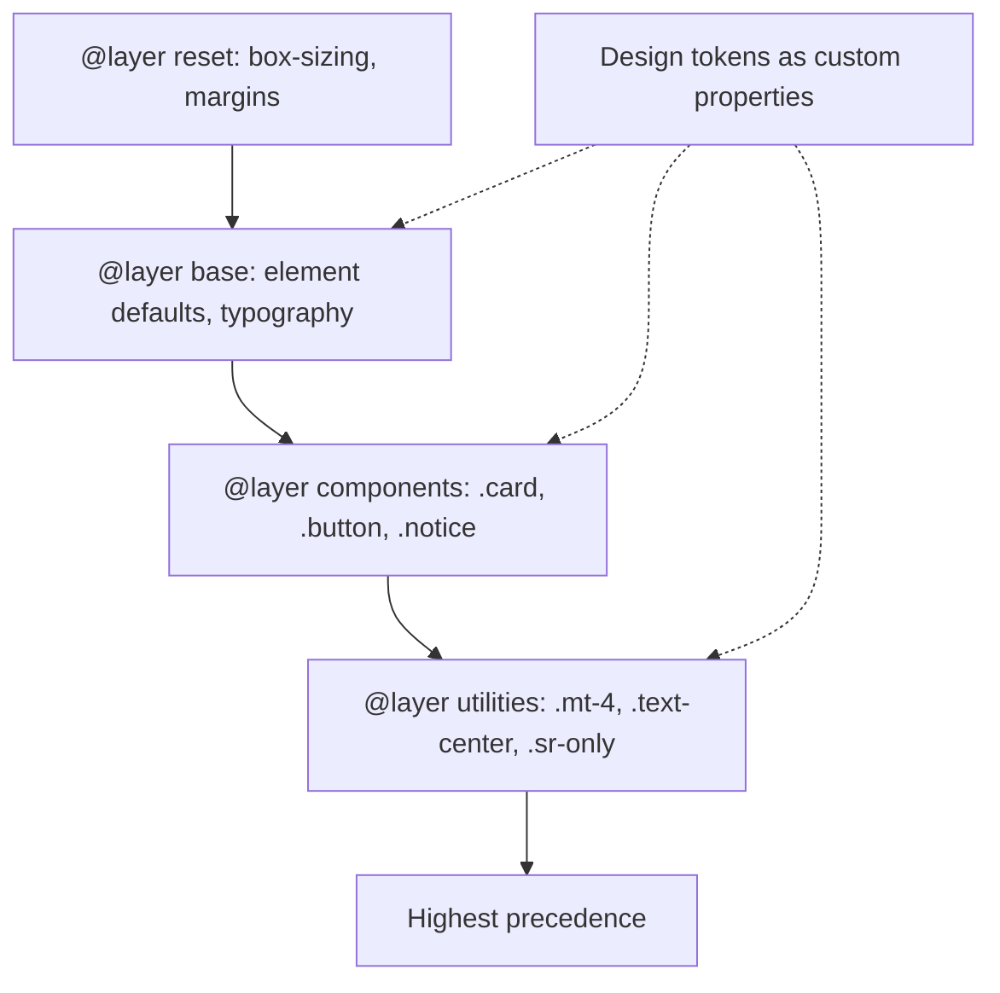

# CSS architecture: BEM, utilities, modules and layers

> **Before this lesson:** you need a solid grip on specificity and source order ([The cascade, specificity and inheritance](#/lesson/html-css/cascade)), on selectors ([Introducing CSS](#/lesson/html-css/css-intro)) and on custom properties ([Custom properties and theming](#/lesson/html-css/custom-properties)).

## In plain words

**CSS architecture** is the set of habits and conventions a team uses to keep its style sheets understandable and safe to change as a project grows.

Picture a shared kitchen. With one cook, things can live anywhere. With ten cooks and no system, someone moves the salt, someone else labels a jar "stuff", and within a month nobody can find anything and everybody is afraid to throw anything away. A kitchen that works has labelled shelves, an agreed place for each tool and a rule that you tidy your own station. CSS written by many people over several years has exactly the same problem, and the same kind of solution.

Writing CSS that works today is easy. Writing CSS that a colleague can modify next year without breaking a page they have never seen is the real skill, and it is what interviewers probe when they ask "how do you organise your CSS?", "what is BEM?" or "what are the trade-offs of utility classes?".

## Why CSS gets messy

Three features of the language cause trouble at scale. Understanding them makes every methodology below easier to understand, because each one is a response to these problems.

1. **Everything is global.** Any rule in any file can affect any element on any page. A selector such as `.title` written for the blog will also restyle the `.title` in the shopping basket.
2. **Specificity wars.** When a rule does not apply because another is more specific, the quick fix is an even more specific selector, or `!important`. Each fix raises the bar for the next person.
3. **Fear of deleting.** Because rules are global, nobody can be sure a rule is unused, so style sheets only ever grow. This is called **append-only CSS**.

Here is the problem in miniature.

```html-run
<!doctype html>
<html lang="en">
<head><meta charset="utf-8"><title>Leaky styles</title>
<style>
  body { font-family: system-ui, sans-serif; }
  /* Written by the blog team */
  .title { font-size: 2rem; color: #6a1b9a; text-transform: uppercase; }

  /* Written months later by the shop team, who also chose the name "title" */
  .basket { border: 1px solid #bbb; padding: 1rem; max-width: 280px; border-radius: 8px; }
  .title  { font-size: 1rem; font-weight: 600; }

  /* The blog team's fix: a stronger selector. The arms race has begun. */
  #blog .post .title { font-size: 2rem; }
</style></head>
<body>
  <div id="blog"><article class="post"><h2 class="title">Blog heading</h2></article></div>
  <div class="basket"><h3 class="title">Basket heading is purple and uppercase by accident</h3></div>
</body>
</html>
```

The two teams collided on a class name. The basket heading inherited purple, uppercase styling that nobody intended, and the blog's fix needed an id plus two classes, which will be hard to override later.

## Goals of a good architecture

- **Predictable**: you can tell what a rule affects by reading it.
- **Reusable**: a pattern is written once and used in many places.
- **Maintainable**: changing or removing something does not cause surprises elsewhere.
- **Scalable**: the approach still works with a hundred components and twenty contributors.

Two principles underpin every approach: **keep specificity low and flat** (mostly single classes), and **limit what each rule can reach**.

## Thinking in components

Modern interfaces are built from **components**: self-contained, reusable pieces such as a button, a card, a navigation bar or a modal. Good CSS mirrors this: the styles for one component live together and do not depend on where the component is placed.

Contrast two ways of styling a card's title:

```css
/* Location-dependent: breaks if the markup or the page changes */
#sidebar div.widgets > div h3 { … }

/* Component-based: works wherever the card is used */
.card__title { … }
```

## BEM: Block, Element, Modifier

**BEM** is a naming convention that makes the structure of a component visible in its class names and guarantees unique names without any tools.

| Part | What it is | Pattern | Example |
|---|---|---|---|
| **Block** | A standalone component | `block` | `card` |
| **Element** | A part of a block that has no meaning outside it | `block__element` (two underscores) | `card__title` |
| **Modifier** | A variant or state of a block or element | `block--modifier` (two hyphens) | `card--featured` |

```html-run
<!doctype html>
<html lang="en">
<head><meta charset="utf-8"><title>BEM</title>
<style>
  body { font-family: system-ui, sans-serif; display: flex; gap: 1rem; flex-wrap: wrap; }

  /* Block */
  .card { border: 1px solid #cfd8dc; border-radius: 12px; padding: 1rem; width: 220px; background: white; }
  /* Elements */
  .card__title  { margin: 0 0 .4rem; font-size: 1.1rem; }
  .card__text   { margin: 0 0 .8rem; color: #546e7a; }
  .card__button { font: inherit; border: 0; border-radius: 8px; padding: .45rem .9rem; background: #455a64; color: white; }
  /* Modifiers */
  .card--featured { border-color: #ff8f00; background: #fff8e1; }
  .card--featured .card__title { color: #e65100; }
  .card__button--primary { background: #00695c; }
</style></head>
<body>
  <article class="card">
    <h3 class="card__title">Standard plan</h3>
    <p class="card__text">Five projects.</p>
    <button class="card__button" type="button">Choose</button>
  </article>
  <article class="card card--featured">
    <h3 class="card__title">Team plan</h3>
    <p class="card__text">Unlimited projects.</p>
    <button class="card__button card__button--primary" type="button">Choose</button>
  </article>
</body>
</html>
```

Read the class names in the HTML and the structure explains itself: there is a `card` block, it has a `title`, a `text` and a `button`, and the second card is a `featured` variant with a `primary` button.

The rules of BEM:

- **Every selector is a single class**, so specificity is (0,1,0) almost everywhere and source order decides ties.
- **A modifier is added alongside the base class**, never instead of it: `class="card card--featured"`.
- **Elements are not nested in names.** A title inside a header inside a card is `card__title`, not `card__header__title`.
- **A block does not set its own outer position** (margin, grid placement). The parent that arranges blocks does that, so the block stays reusable.

The one accepted exception to "single class" is a modifier affecting a child, as in `.card--featured .card__title`.

| Strengths | Weaknesses |
|---|---|
| No tooling required; works in plain CSS | Long class names |
| Names cannot collide | Relies on discipline; nothing enforces it |
| Flat, low specificity | Naming things is still hard |
| HTML documents its own structure | A component's variations multiply modifiers |

> [!INTERVIEW]
> "What is BEM and what problem does it solve?" A class-naming convention: Block, `Block__Element`, `Block--Modifier`. It solves global-namespace collisions and specificity escalation by giving every part of every component a unique, single-class selector, and it makes the relationship between markup and styles readable.

## Utility-first CSS

A **utility class** does exactly one thing and is named after what it does: `.text-center { text-align: center; }`, `.mt-4 { margin-top: 1rem; }`. The **utility-first** approach, popularised by the Tailwind CSS framework, builds whole interfaces by combining many such classes directly in the HTML instead of inventing a named class for each component.

```html-run
<!doctype html>
<html lang="en">
<head><meta charset="utf-8"><title>Utility classes</title>
<style>
  /* A tiny hand-written utility set */
  .flex { display: flex; } .items-center { align-items: center; } .gap-3 { gap: .75rem; }
  .p-4 { padding: 1rem; } .px-3 { padding-inline: .75rem; } .py-1 { padding-block: .25rem; }
  .rounded-lg { border-radius: 12px; } .rounded-full { border-radius: 999px; }
  .border { border: 1px solid #cfd8dc; } .bg-white { background: #fff; } .bg-teal { background: #00695c; }
  .text-white { color: #fff; } .text-muted { color: #607d8b; } .text-sm { font-size: .875rem; } .font-bold { font-weight: 700; }
  .w-12 { width: 3rem; } .h-12 { height: 3rem; } .max-w-sm { max-width: 22rem; } .ml-auto { margin-left: auto; }
  body { font-family: system-ui, sans-serif; }
</style></head>
<body>
  <div class="flex items-center gap-3 p-4 border rounded-lg bg-white max-w-sm">
    <div class="w-12 h-12 rounded-full bg-teal"></div>
    <div>
      <div class="font-bold">Mina Okafor</div>
      <div class="text-sm text-muted">Product designer</div>
    </div>
    <button class="ml-auto px-3 py-1 rounded-full bg-teal text-white border" type="button">Follow</button>
  </div>
</body>
</html>
```

No class in that HTML describes *what* the thing is. Each describes one visual property, and the component emerges from the combination.

| Strengths | Weaknesses |
|---|---|
| No naming of components; no context-switching between files | HTML becomes long and dense |
| The style sheet stops growing: new features reuse existing utilities | A learning curve for the vocabulary |
| Changes are local: editing one element cannot break another | Repetition, unless you extract components in a templating or UI framework |
| Values come from a fixed scale, so spacing and colour stay consistent | Depends on a build tool to generate and trim the utility set |

Utility-first works best alongside a component framework (React, Vue, server-side templates), where the repeated markup lives in one reusable template.

Many teams use a hybrid: component classes for well-defined pieces plus a small set of utilities for one-off adjustments such as spacing and alignment.

## Scoped CSS: modules and friends

Tools can enforce what BEM achieves by convention.

**CSS Modules** are ordinary CSS files that a build tool processes so that every class name becomes unique to its file. You write short, simple names:

```css
/* Card.module.css */
.card  { border: 1px solid #cfd8dc; border-radius: 12px; }
.title { font-size: 1.1rem; }
```

and import them from the component's JavaScript:

```javascript
import styles from './Card.module.css';
// styles.title is something like "Card_title__x7Yz2"
element.className = styles.card;
```

In the generated page the class is `Card_title__x7Yz2`, so a `.title` in another file cannot collide with it. The scoping is automatic and reliable.

Related approaches you will hear about:

| Approach | Idea |
|---|---|
| **CSS Modules** | Build step makes class names unique per file |
| **Scoped styles in single-file components** (Vue, Svelte, Astro) | The framework adds a unique attribute to a component's elements and to its selectors |
| **CSS-in-JS** (styled-components, Emotion) | Styles are written in JavaScript and attached to components; some variants add run-time cost |
| **Shadow DOM** (Web Components) | The browser itself isolates a component's markup and styles from the page |
| **`@scope`** | A native CSS rule that limits selectors to a subtree, with an optional lower boundary |

Native `@scope` looks like this:

```css
@scope (.card) to (.card__content) {
  img { border-radius: 8px; }   /* images in the card, but not inside its content slot */
}
```

## Cascade layers as architecture

`@layer`, introduced in the cascade lesson, lets a project declare its precedence order in one line, so that the order no longer depends on specificity or on which file loads last.

```css
@layer reset, base, layout, components, utilities;
```

Styles in a later layer beat styles in an earlier one. A reset can never override a component, a utility always beats a component, and third-party CSS can be confined to its own low layer:

```css
@import url("vendor/datepicker.css") layer(vendor);
```

```html-run
<!doctype html>
<html lang="en">
<head><meta charset="utf-8"><title>Layered architecture</title>
<style>
  @layer reset, base, components, utilities;

  @layer reset {
    *, *::before, *::after { box-sizing: border-box; }
    h1, h2, h3, p { margin: 0; }
  }
  @layer base {
    body { font-family: system-ui, sans-serif; line-height: 1.5; color: #1f2328; }
    a { color: #0b57d0; }
  }
  @layer components {
    .notice { display: grid; gap: .3rem; padding: 1rem; border-radius: 10px; background: #e3f2fd; max-width: 320px; }
    .notice__title { font-size: 1.05rem; }
    .notice--warning { background: #fff3e0; }
  }
  @layer utilities {
    .mt-4 { margin-top: 1.5rem; }
    .text-center { text-align: center; }
  }
</style></head>
<body>
  <div class="notice"><h3 class="notice__title">Delivery update</h3><p>Your order leaves the depot today.</p></div>
  <div class="notice notice--warning mt-4 text-center"><h3 class="notice__title">Road closed</h3><p>Expect a delay.</p></div>
</body>
</html>
```

That miniature is a complete modern architecture: a reset, base element styles, BEM-named components and a few utilities, with the order of authority declared once.



## Organising files

A typical folder layout follows the same tiers.

```text
styles/
  tokens.css        custom properties: colours, spacing, type scale
  reset.css         normalise browser defaults
  base.css          element selectors: body, headings, links
  layout.css        page-level grids and wrappers
  components/
    button.css
    card.css
    nav.css
  utilities.css     single-purpose helpers
  main.css          imports the above in order
```

Older named systems describe similar tiers: **ITCSS** ("inverted triangle") orders files from generic and low-specificity to specific; **SMACSS** sorts rules into base, layout, module, state and theme; **OOCSS** separates structure from skin. You do not need to adopt one wholesale. The ideas they share are what matter.

### Resets

Browsers disagree slightly about default styles. A **reset** removes or evens out those defaults so that you build on a known baseline. A minimal modern one:

```css
*, *::before, *::after { box-sizing: border-box; }
body { margin: 0; line-height: 1.5; }
img, picture, video, canvas, svg { display: block; max-width: 100%; }
input, button, textarea, select { font: inherit; }
```

### Preprocessors and build tools

**Sass** (and its syntax SCSS) is a language that compiles to CSS and adds conveniences such as variables, loops, functions and reusable snippets called mixins. Native CSS now has custom properties, `calc()`, nesting and layers, so the gap is smaller than it was, but Sass remains common. **PostCSS** is a tool that transforms CSS with plug-ins, for example adding vendor prefixes automatically (Autoprefixer) or removing unused rules. A **bundler** combines and minifies files for production.

**Native nesting** lets you write related rules inside one another:

```css
.card {
  padding: 1rem;
  &:hover { box-shadow: 0 4px 12px rgb(0 0 0 / .15); }
  .card__title { margin: 0; }
  @media (min-width: 40rem) { padding: 2rem; }
}
```

The `&` stands for the parent selector. Nesting is tidy, but each level adds a selector and therefore specificity, so keep it shallow.

## Guidelines that outlast any methodology

- **Style with classes.** Avoid ids in selectors and avoid long chains of element names.
- **Keep specificity flat.** If you need `!important` to win, the architecture has a problem.
- **Do not style by location.** `.sidebar .button` couples a component to a place; `.button--compact` is a variant that can go anywhere.
- **Components do not position themselves.** Outer margins and grid placement belong to the parent or to a layout class.
- **Name by purpose.** `.alert--danger`, not `.red-box`.
- **Use tokens.** No raw colour or spacing values inside components; refer to custom properties.
- **Separate state from structure.** Use state classes (`.is-open`) or, better, ARIA attributes (`[aria-expanded="true"]`) as styling hooks.
- **Delete with confidence.** If styles are scoped to components, removing a component removes its CSS.
- **Lint.** A tool such as Stylelint can enforce naming patterns, maximum specificity and a ban on ids automatically.

> [!TIP]
> Before adopting a methodology across a project, convert one real component and ask a colleague to modify it without help. How easily they manage is the best measure of the convention.

> [!WARNING]
> Mixing conventions inside one code base (some BEM, some utilities, some id selectors) is worse than using any single one imperfectly. Agree on the approach and write it down.

## Pitfalls

- **Generic global names** like `.title`, `.box`, `.active`. They will collide.
- **Deep nesting in Sass or native CSS** producing selectors like `.nav .list .item .link span`.
- **Half-adopted BEM**, with elements named after their HTML tag or nested three levels deep.
- **Modifier without the base class.** `class="card--featured"` alone has none of the card's styles.
- **Utilities for everything in plain HTML** with no templating, leading to twenty identical class lists to update by hand.
- **Mixing several methodologies in one code base** without agreed boundaries.
- **`!important` as a routine tool.** Reserve it for utilities that must always win.
- **Third-party CSS loaded last and unlayered**, silently overriding your components.
- **Layout baked into components**: a card with `margin-bottom: 2rem` and `width: 33%` cannot be reused elsewhere.
- **Optimising for writing instead of reading.** Clever, terse selectors cost every future reader.

## Cheat sheet

| Approach | Core idea | Class example |
|---|---|---|
| BEM | Unique single-class names showing structure | `card`, `card__title`, `card--featured` |
| Utility-first | Many single-purpose classes composed in HTML | `flex gap-3 p-4 rounded-lg` |
| CSS Modules | Build step makes local names unique | `styles.title` → `Card_title__x7Yz2` |
| Scoped component styles | Framework adds a unique attribute | `h3[data-v-7ba5bd90]` |
| Shadow DOM | Browser-enforced isolation | Web Components |
| Cascade layers | Declared order of authority | `@layer reset, base, components, utilities;` |
| `@scope` | Native subtree scoping | `@scope (.card) { … }` |

| Rule of thumb | Why |
|---|---|
| One class per selector | Flat specificity; order of rules decides |
| No ids in CSS | Too specific to override |
| Tokens via custom properties | One source of truth for design values |
| Parent sets spacing between children | Components stay reusable |
| State via `[aria-*]` or `.is-*` | Styles and accessibility stay in step |

## Summary

CSS becomes hard to maintain because it is global, because specificity invites escalation and because nobody dares delete anything. Architecture counters that with component thinking, flat specificity and deliberate scoping. BEM achieves it with a naming convention; utility-first CSS with small composable classes; CSS Modules, scoped component styles, Shadow DOM and `@scope` with tool- or browser-enforced isolation. Cascade layers state the order of authority between resets, base styles, components and utilities. Whatever combination a team picks, the lasting rules are the same: style with classes, keep specificity low, use design tokens, keep layout out of components and write for the person who will read the code next.

## Glossary

| Term | Meaning |
|---|---|
| CSS architecture | Conventions for organising styles so a code base stays maintainable |
| Global scope | The fact that any CSS rule can match elements anywhere in the page |
| Component | A self-contained, reusable piece of interface |
| BEM | Block, Element, Modifier: a class-naming convention |
| Block / Element / Modifier | A component / a part of it / a variant or state of either |
| Utility class | A class that sets one property, named after its effect |
| Utility-first | Building interfaces mainly by composing utility classes |
| CSS Modules | A build technique that makes class names local to a file |
| CSS-in-JS | Writing styles inside JavaScript, attached to components |
| Shadow DOM | A browser feature that isolates a component's markup and styles |
| Cascade layer | A named group of rules with a declared precedence (`@layer`) |
| Reset | Styles that neutralise inconsistent browser defaults |
| Design token | A named, shared design value stored as a variable |
| Preprocessor | A language such as Sass that compiles to CSS |
| Linter | A tool that checks code against style rules automatically |

## Check yourself

```quiz
[
  {"q": "In BEM, what does the class name menu__item--active describe?", "options": ["A block called menu__item", "The active modifier of the item element of the menu block", "An element called active inside item", "Two blocks, menu and item"], "answer": 1,
   "explain": "Double underscore introduces an element of a block; double hyphen introduces a modifier of that block or element."},
  {"q": "What is the specificity of the BEM selector .card__title?", "options": ["(0,0,1)", "(0,1,0)", "(0,2,0)", "(1,0,0)"], "answer": 1,
   "explain": "It is a single class selector, whatever punctuation the name contains. Flat specificity is one of BEM's main benefits."},
  {"q": "Which HTML correctly applies a featured variant of a card in BEM?", "options": ["class='card--featured'", "class='card card--featured'", "class='card featured'", "id='card-featured'"], "answer": 1,
   "explain": "A modifier supplements the base class; on its own it would carry only the differences, not the block's core styles."},
  {"q": "What is the main trade-off of the utility-first approach?", "options": ["Higher specificity", "Styles leak between components", "Verbose HTML in exchange for a small, stable style sheet and local changes", "It cannot be responsive"], "answer": 2,
   "explain": "Markup carries many classes, but there is no naming burden, the CSS stops growing and edits affect only the element being changed."},
  {"q": "How do CSS Modules prevent class-name collisions?", "options": ["By using ids", "By rewriting class names at build time so they are unique per file", "By adding !important", "By loading each file in an iframe"], "answer": 1,
   "explain": "The build tool generates a unique name for each local class and gives your code a mapping from the name you wrote to the generated one."},
  {"q": "With @layer reset, components, utilities; which rule wins for margin on an element: .card.card--big { margin: 2rem } in components, or .m-0 { margin: 0 } in utilities?", "options": ["The components rule, because it has two classes", "The utilities rule, because its layer is declared later", "Whichever is later in the file", "Neither"], "answer": 1,
   "explain": "Layer order is compared before specificity, so a single-class utility in a later layer beats a more specific component selector."},
  {"q": "Why should a reusable component avoid setting its own outer margin?", "options": ["Margins are slow", "Spacing depends on context, so it belongs to the parent or layout; otherwise the component cannot be reused elsewhere", "Margins do not work on components", "It increases specificity"], "answer": 1,
   "explain": "The right gap differs from place to place. Letting the container control spacing keeps the component portable."},
  {"q": "What does this render? CSS: .title { color: red; } and later .title { color: blue; }. HTML: <h1 class='title'>A</h1>", "options": ["Red", "Blue", "Purple", "Black"], "answer": 1,
   "explain": "Equal specificity, so the later rule wins. This is how two teams choosing the same generic name override each other without noticing."}
]
```

> **Source:** Duckett, *HTML & CSS*, ch. 10 and ch. 18 touch on organising style sheets; the methodologies here postdate the book. MDN: https://developer.mozilla.org/en-US/docs/Learn_web_development/Core/Styling_basics/Organizing · https://developer.mozilla.org/en-US/docs/Web/CSS/@layer · https://developer.mozilla.org/en-US/docs/Web/CSS/@scope · https://developer.mozilla.org/en-US/docs/Web/CSS/CSS_nesting · BEM: https://en.bem.info/methodology/naming-convention/
