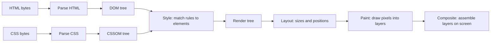
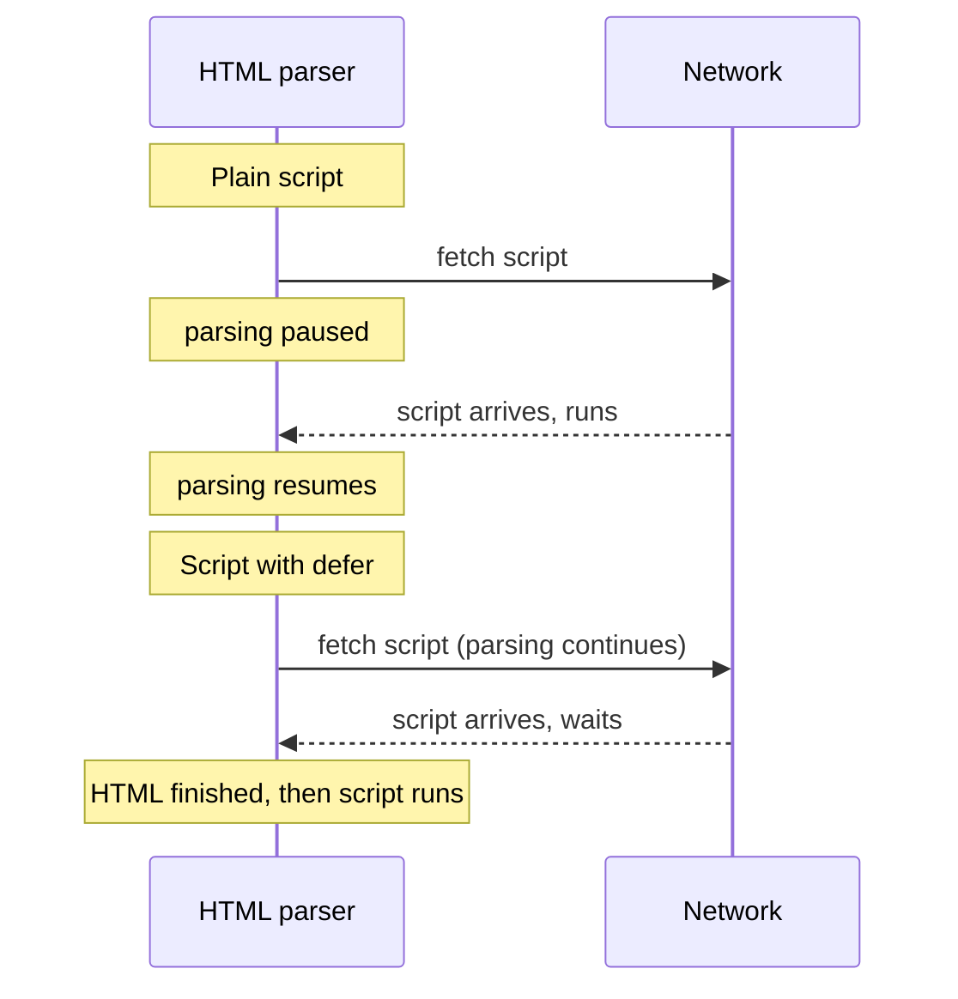

# How browsers render pages, and how to make them fast

> **Before this lesson:** you should know what the DOM is ([How web pages work](#/lesson/html-css/how-pages-work)), how images are loaded ([Images](#/lesson/html-css/images)), and why `transform` and `opacity` are cheap to animate ([Transitions, transforms and animations](#/lesson/html-css/transitions-animations)).

## In plain words

**Rendering** is everything a browser does to turn the text of your HTML and CSS files into coloured dots on a screen. **Web performance** is the study of how to make that happen quickly and smoothly.

Think of a restaurant kitchen. An order arrives (the HTML). The cook reads it, checks the house recipe book for how each dish should be presented (the CSS), works out how to arrange everything on the plate (layout), cooks and decorates each item (paint), and finally assembles the plate at the pass (composite). If the recipe book has not been delivered yet, nothing can leave the kitchen. If someone changes the order halfway through, parts of the work must be redone. A fast kitchen is one where nothing waits unnecessarily and little is ever redone.

Speed is not a luxury. Slow pages lose visitors and sales, search engines use speed measurements in ranking, and many people browse on modest phones over slow mobile networks. Interviewers regularly ask you to "explain what happens when a browser renders a page" and "how would you make this page load faster?", and both answers come from the pipeline described here.

## The rendering pipeline

A **pipeline** is a series of stages in which the output of one stage becomes the input of the next. The browser's pipeline has five main stages.



### 1. Parse: build the DOM and the CSSOM

The browser reads the HTML text and builds the **DOM** (Document Object Model), the tree of elements you met in the first lesson. It does this **incrementally**: it does not wait for the whole file but starts building as the first bytes arrive.

In the same way it reads every style sheet and builds a second tree called the **CSSOM** (CSS Object Model), which holds all the style rules.

### 2. Style: work out the final values

For every element, the browser finds all the CSS rules that match it, applies the cascade and inheritance, and settles on one value for each property. These are the element's **computed styles**.

The DOM and the computed styles are combined into the **render tree**, which contains only what will actually be displayed. An element with `display: none` is in the DOM but not in the render tree. Pseudo-elements such as `::before` are in the render tree but not in the DOM.

### 3. Layout: calculate geometry

Now the browser knows *how* each box should look but not *where* it goes. **Layout** (also called **reflow**) calculates the exact size and position of every box. It depends on the viewport width and on other boxes: a paragraph's height depends on its width, which depends on its parent's width, and so on.

### 4. Paint: fill in the pixels

**Paint** turns boxes into drawing instructions: text, colours, borders, shadows, images. The browser may split the page into several **layers**, a little like transparent sheets stacked on top of one another.

### 5. Composite: put the layers together

**Compositing** takes the painted layers and assembles them in the correct order into the image you see. This stage often runs on a separate thread and uses the graphics processor, which is why it is fast.

> [!INTERVIEW]
> "Describe the critical rendering path." Parse HTML into the DOM and CSS into the CSSOM; combine them in the style step into a render tree of visible nodes with computed styles; run layout to compute geometry; paint the boxes into layers; composite the layers to the screen. CSS blocks rendering, and scripts without `async` or `defer` block HTML parsing.

## What blocks what

Two resource types can hold the pipeline up, and knowing the difference explains most loading advice.

**CSS is render-blocking.** The browser will not paint anything until it has downloaded and parsed the style sheets in the `<head>`. This is deliberate: showing the page unstyled and then restyling it a moment later would produce an ugly flash. The consequence is that a large or slow CSS file delays the first glimpse of the page.

**JavaScript is parser-blocking by default.** When the HTML parser meets a plain `<script src="…">`, it stops building the DOM, downloads the script, runs it, and only then carries on, because the script might change the document. Two attributes change that:

| Script tag | Download | Execution | Order kept? |
|---|---|---|---|
| `<script src>` | Parser **stops** and waits | Immediately | Yes |
| `<script src async>` | In parallel with parsing | As soon as it arrives (interrupts the parser briefly) | No |
| `<script src defer>` | In parallel with parsing | After the HTML has been fully parsed | Yes |
| `<script type="module">` | In parallel | Deferred by default | Yes |

Use `defer` for scripts your page depends on, and `async` for independent ones such as analytics.



## Updating the page: which stages run again?

After the first render, any change (a hover, a script, an animation) sends the affected parts back through the pipeline. How far back depends on *what* changed.

| You change | Stages that re-run | Cost |
|---|---|---|
| Geometry: `width`, `height`, `margin`, `padding`, `top`, `left`, `font-size`, adding or removing elements | Style → **Layout** → Paint → Composite | Highest |
| Appearance only: `color`, `background`, `box-shadow`, `border-color`, `visibility` | Style → **Paint** → Composite | Medium |
| `transform`, `opacity` | Style → **Composite** only | Lowest |

This table is the reason for the advice in the animation lesson. The demo below moves two boxes the same distance. One changes `left`, forcing layout on every frame; the other changes `transform`.

```html-run
<!doctype html>
<html lang="en">
<head><meta charset="utf-8"><title>Layout vs composite animation</title>
<style>
  body { font: .85rem system-ui, sans-serif; }
  .lane { position: relative; height: 54px; background: #eceff1; margin: 6px 0 14px; border-radius: 8px; overflow: hidden; }
  .box { position: absolute; top: 7px; left: 0; width: 40px; height: 40px; border-radius: 8px; }
  @keyframes by-left      { to { left: 240px; } }
  @keyframes by-transform { to { transform: translateX(240px); } }
  .a { background: #e53935; animation: by-left 1.5s ease-in-out infinite alternate; }
  .b { background: #43a047; animation: by-transform 1.5s ease-in-out infinite alternate; }
  @media (prefers-reduced-motion: reduce) { .box { animation: none; } }
</style></head>
<body>
  Animating <code>left</code> (layout + paint + composite every frame)
  <div class="lane"><div class="box a"></div></div>
  Animating <code>transform</code> (composite only)
  <div class="lane"><div class="box b"></div></div>
</body>
</html>
```

On a quiet page both look the same. The difference appears when the main thread is busy with other work: the green box keeps gliding while the red one stutters.

### Layout thrashing

Browsers batch changes and run layout once, before the next frame. But if a script *reads* a geometric value (such as `offsetHeight` or `getBoundingClientRect()`) immediately after *writing* a style, the browser must run layout right then to give a correct answer. Doing that repeatedly in a loop is called **layout thrashing** (or forced synchronous layout).

```javascript
// Slow: write, read, write, read ... forces layout on every iteration
for (const el of items) {
  el.style.width = el.parentNode.offsetWidth / 2 + 'px';
}

// Fast: do all the reads first, then all the writes
const widths = items.map(el => el.parentNode.offsetWidth / 2);
items.forEach((el, i) => { el.style.width = widths[i] + 'px'; });
```

## Measuring: Core Web Vitals

"Fast" needs numbers. Google's **Core Web Vitals** are three measurements of real user experience that are widely used as targets.

| Metric | Full name | What it measures | Good |
|---|---|---|---|
| **LCP** | Largest Contentful Paint | Loading: when the largest image or text block in the viewport appears | ≤ 2.5 s |
| **CLS** | Cumulative Layout Shift | Visual stability: how much visible content jumps around unexpectedly | ≤ 0.1 |
| **INP** | Interaction to Next Paint | Responsiveness: delay between a click, tap or key press and the next visual update | ≤ 200 ms |

Two more are useful when diagnosing: **TTFB** (Time To First Byte, how quickly the server starts responding) and **FCP** (First Contentful Paint, when anything at all first appears).

Tools: **Lighthouse** (built into Chrome and Edge developer tools) runs a test load and reports these with suggestions; the **Performance** panel records exactly which pipeline stages ran and for how long; the **Network** panel shows every request and its size.

## Improving loading (LCP)

### Send less, and send it sooner

- **Compress and resize images.** They are usually most of a page's weight. Use AVIF or WebP, `srcset`/`sizes`, and do not serve a 3000-pixel photo into a 400-pixel slot.
- **Minify** CSS and JavaScript (remove whitespace and comments) and enable **compression** (Brotli or gzip) on the server.
- **Remove unused CSS and JavaScript.** The Coverage panel in developer tools shows how much of each file was actually used.
- **Cache** static files with long lifetimes and fingerprinted file names so that returning visitors download nothing.
- **Use a CDN** (content delivery network: servers spread around the world that keep copies of your files near your visitors).

### Unblock rendering

- Put `<link rel="stylesheet">` in the `<head>` and keep the CSS lean.
- Avoid `@import` inside CSS; each import is discovered only after its parent file has downloaded, so they load one after another instead of together.
- Mark scripts `defer` or `async`.

### Critical CSS

**Critical CSS** is the small subset of styles needed to render the part of the page visible without scrolling (often called **above the fold**, a newspaper term for the top half of the front page). The technique is to place that subset directly in a `<style>` element in the `<head>`, so that the first paint needs no extra request, and to load the full style sheet without blocking.

```html
<head>
  <style>
    /* critical: header, hero and basic typography only */
    body { margin: 0; font-family: system-ui, sans-serif; }
    .hero { min-height: 60vh; display: grid; place-items: center; }
  </style>
  <link rel="preload" href="/css/site.css" as="style" onload="this.rel='stylesheet'">
  <noscript><link rel="stylesheet" href="/css/site.css"></noscript>
</head>
```

Tools generate the critical subset automatically during the build. It is worth doing on pages where first-paint time matters and the style sheet is large; for a small site with one modest CSS file it adds complexity for little gain.

### Resource hints

A resource hint tells the browser about something it will need before it would otherwise discover it.

| Hint | Meaning | Use for |
|---|---|---|
| `<link rel="preconnect" href="https://fonts.example">` | Open the connection to another server early | Third-party fonts, APIs |
| `<link rel="dns-prefetch" href="…">` | Do only the DNS lookup early | A lighter fallback for preconnect |
| `<link rel="preload" href="hero.avif" as="image">` | Download this now, with high priority | The hero image, a key font |
| `<link rel="prefetch" href="/next-page.html">` | Download at low priority for a likely next navigation | The next step of a flow |
| `fetchpriority="high"` on `` | Raise this image's priority | The LCP image |

Preload sparingly: everything you promote pushes something else back.

### Lazy loading

**Lazy loading** means not downloading something until it is about to be needed.

```html

<iframe src="https://maps.example/embed" title="Map of the venue" loading="lazy"></iframe>
```

With `loading="lazy"` the browser postpones the request until the element is close to entering the viewport. Apply it to images and iframes that start off screen. **Never apply it to the LCP image**: that would delay the very thing you are trying to speed up.

For long pages, the CSS property `content-visibility: auto` goes further and lets the browser skip the layout and paint work for whole sections that are off screen; pair it with `contain-intrinsic-size` so the scrollbar stays stable.

## Improving stability (CLS)

A **layout shift** happens when visible content moves without the user having caused it. You have experienced it: you go to tap a link, an advert loads above it, everything jumps down and you tap the wrong thing.

The demo imitates a late-arriving image. Press the button and watch the text.

```html-run
<!doctype html>
<html lang="en">
<head><meta charset="utf-8"><title>Layout shift</title>
<style>
  body { font-family: system-ui, sans-serif; display: grid; grid-template-columns: 1fr 1fr; gap: 16px; }
  .col { border: 1px solid #cfd8dc; border-radius: 8px; padding: .6rem; }
  .pic { background: linear-gradient(135deg, #7e57c2, #26c6da); border-radius: 6px; }
  .bad  .pic { height: 0; }                         /* no space reserved */
  .bad.loaded .pic { height: 120px; }
  .good .slot { aspect-ratio: 16 / 9; background: #eceff1; border-radius: 6px; }   /* space reserved */
  .good .pic { height: 100%; opacity: 0; transition: opacity .3s; }
  .good.loaded .pic { opacity: 1; }
  button { grid-column: 1 / -1; font: inherit; padding: .5rem; }
  h4 { margin: 0 0 .4rem; }
</style></head>
<body>
  <button type="button" onclick="document.querySelectorAll('.col').forEach(c => c.classList.toggle('loaded'))">Simulate the image arriving</button>
  <div class="col bad"><h4>No reserved space</h4><div class="pic"></div><p>This paragraph is shoved down when the picture appears.</p></div>
  <div class="col good"><h4>Reserved space</h4><div class="slot"><div class="pic"></div></div><p>This paragraph does not move.</p></div>
</body>
</html>
```

Causes and cures:

| Cause | Cure |
|---|---|
| Images and videos without dimensions | Always give `width` and `height` attributes, or `aspect-ratio` in CSS |
| Adverts, embeds and iframes inserted late | Reserve the space with `min-height` or `aspect-ratio` |
| Content injected above existing content (banners, notices) | Reserve space, or overlay it instead of pushing content down |
| Web fonts swapping in with different letter widths | `font-display: swap` plus a similar fallback face; preload the key font; `size-adjust` to match metrics |
| Animating `height`, `top` or `margin` | Animate `transform` instead |

## Improving responsiveness (INP)

Most of a page's work happens on one **main thread**: running JavaScript, calculating styles, doing layout and paint. While it is busy with a long task, it cannot respond to a tap.

- Ship less JavaScript; break long-running scripts into smaller pieces.
- Keep the DOM reasonably small. Thousands of nodes make every style and layout pass slower.
- Avoid layout thrashing.
- Animate with `transform` and `opacity` so that motion does not compete for the main thread.
- Limit how much a change can affect with **containment**: `contain: layout paint` promises the browser that nothing inside a box affects anything outside it, so it can re-render that box in isolation.

### Does selector complexity matter?

Rarely. Browsers match selectors extremely quickly, and for typical pages the difference between `.nav-link` and `nav ul li a` cannot be measured. Simple selectors are better for maintainability, as the architecture lesson explained. Performance work is far better spent on images, JavaScript and avoiding layout.

## A performance checklist

1. **Measure first** with Lighthouse and the Network panel. Fix the biggest item, then measure again.
2. Images: right format, right dimensions, `width` and `height` set, lazy below the fold, high priority for the hero.
3. CSS: one lean file in the head, no `@import` chains, critical CSS inlined if the file is large.
4. JavaScript: `defer` or `async`; remove what is unused.
5. Fonts: few files, WOFF2, `font-display: swap`, preload the main one.
6. Reserve space for everything that loads late.
7. Animate only `transform` and `opacity`.
8. Compress, cache and serve from a CDN.
9. Test on a mid-range phone with network throttling switched on in developer tools.

> [!TIP]
> In the Network panel of developer tools, tick "Disable cache" and choose a throttling profile such as "Slow 4G". Reloading then shows what a first-time visitor on a phone experiences.

> [!WARNING]
> A laboratory score from a single test run on a fast computer is not the experience of real users. Where possible, look at field data collected from actual visits as well.

## Pitfalls

- **Optimising without measuring.** Guesswork usually targets the wrong thing.
- **Lazy-loading the hero image.** It delays LCP.
- **Images without dimensions.** The main cause of layout shift.
- **Render-blocking third-party style sheets and fonts.** One slow external server delays your whole page.
- **Plain `<script>` tags in the head.** They halt parsing; add `defer`.
- **Preloading everything.** Priorities only help when they are selective.
- **`will-change` on many elements.** Each promoted layer consumes memory.
- **Huge inlined CSS.** Inlining everything prevents caching and bloats every page.
- **Animating layout properties**, or reading and writing layout in a loop.
- **Testing only on a fast laptop on office Wi-Fi.** Your users are not there.
- **Web fonts causing invisible or jumping text.** Set `font-display` and choose a close fallback.

## Cheat sheet

| Goal | Technique |
|---|---|
| First paint sooner | Lean CSS in the head; inline critical CSS; `defer` scripts |
| Faster largest paint | Optimised hero image with `fetchpriority="high"`; preload it if it is found late |
| Fewer bytes | Modern image formats, `srcset`, minify, Brotli, remove unused code |
| Do not load what is not seen | `loading="lazy"` on off-screen images and iframes |
| No layout shift | `width`/`height` or `aspect-ratio`; reserve space for late content |
| Smooth animation | `transform`, `opacity` |
| Early connection | `<link rel="preconnect">` |
| Early download | `<link rel="preload" as="…">` |
| Skip off-screen rendering work | `content-visibility: auto` |
| Isolate expensive regions | `contain: layout paint` |
| Non-blocking script | `<script defer>` / `<script async>` |
| Measure | Lighthouse, Performance and Network panels |

## Summary

A browser renders by parsing HTML into the DOM and CSS into the CSSOM, computing styles, laying boxes out, painting them into layers and compositing those layers. CSS blocks the first paint and ordinary scripts block parsing, so keep style sheets lean and mark scripts `defer` or `async`. Later changes re-run only part of the pipeline: geometry changes cost the most and `transform` and `opacity` the least. Measure with the Core Web Vitals: improve LCP by sending less and prioritising the key resources, CLS by reserving space for everything that arrives late, and INP by keeping the main thread free. Lazy-load what is off screen, inline critical CSS where it pays, and always measure before and after.

## Glossary

| Term | Meaning |
|---|---|
| Rendering | Turning HTML and CSS into pixels on the screen |
| Pipeline | A sequence of processing stages, each feeding the next |
| DOM | The tree of elements built from the HTML |
| CSSOM | The tree of style rules built from the CSS |
| Render tree | The visible elements together with their computed styles |
| Computed style | The final value of every property for an element after the cascade |
| Layout (reflow) | Calculating the size and position of every box |
| Paint | Drawing boxes, text and images into layers |
| Composite | Assembling the painted layers into the final image |
| Critical rendering path | The steps the browser must finish before the first paint |
| Render-blocking | A resource that must load before anything can be painted (CSS) |
| Parser-blocking | A resource that pauses HTML parsing (a plain script) |
| Main thread | The single thread that runs scripts, style, layout and paint |
| Layout thrashing | Repeatedly forcing layout by interleaving style writes and geometry reads |
| Core Web Vitals | LCP, CLS and INP: standard measures of loading, stability and responsiveness |
| Critical CSS | The minimal styles for above-the-fold content, inlined in the head |
| Above the fold | The part of a page visible without scrolling |
| Lazy loading | Deferring a download until the resource is about to be needed |
| CDN | Content delivery network: servers that hold copies of files close to users |

## Check yourself

```quiz
[
  {"q": "Which is the correct order of the rendering pipeline?", "options": ["Layout, style, paint, parse, composite", "Parse, style, layout, paint, composite", "Parse, paint, layout, style, composite", "Style, parse, composite, layout, paint"], "answer": 1,
   "explain": "The browser parses HTML and CSS, computes styles, calculates geometry, paints layers and finally composites them."},
  {"q": "An element has display: none. Where does it exist?", "options": ["In the DOM and the render tree", "In the DOM but not the render tree", "In the render tree but not the DOM", "In neither"], "answer": 1,
   "explain": "The DOM contains every element; the render tree contains only what is rendered, so display: none nodes are left out."},
  {"q": "Which change can be handled by the composite stage alone, with no layout or paint?", "options": ["width", "background-color", "transform", "margin-top"], "answer": 2,
   "explain": "transform (and opacity) only alter how an existing layer is assembled. width and margin trigger layout; background-color triggers paint."},
  {"q": "What does <script src='app.js' defer> do?", "options": ["Blocks parsing until the script has run", "Downloads in parallel and runs after the HTML is parsed, in document order", "Runs as soon as it downloads, in any order", "Prevents the script from running"], "answer": 1,
   "explain": "defer keeps the parser working during the download and executes scripts in order once parsing has finished. async runs each as soon as it arrives."},
  {"q": "Which Core Web Vital is hurt most by images that have no width and height attributes?", "options": ["LCP", "CLS", "INP", "TTFB"], "answer": 1,
   "explain": "Without known dimensions the image occupies no space until it loads and then pushes content down: a layout shift."},
  {"q": "Why should the main hero image not have loading='lazy'?", "options": ["Lazy loading is deprecated", "It is usually the LCP element, and lazy loading delays its request", "It would cause layout shift", "It prevents caching"], "answer": 1,
   "explain": "Lazy loading waits until layout shows the image is near the viewport, which postpones the most important paint."},
  {"q": "What is critical CSS?", "options": ["CSS marked !important", "The styles needed for above-the-fold content, inlined in the head so the first paint needs no extra request", "CSS that fixes bugs", "A style sheet loaded with @import"], "answer": 1,
   "explain": "Inlining the minimal above-the-fold styles removes a render-blocking request; the full style sheet then loads without blocking."},
  {"q": "A script sets el.style.width and then immediately reads el.offsetHeight, in a loop over 500 elements. What is the problem called?", "options": ["Memory leak", "Layout thrashing", "Render blocking", "Cumulative layout shift"], "answer": 1,
   "explain": "Each read after a write forces the browser to run layout synchronously, 500 times instead of once."}
]
```

> **Source:** Duckett, *HTML & CSS*, ch. 19 (Practical Information) touches on page speed; the pipeline and metrics here go beyond the book. MDN: https://developer.mozilla.org/en-US/docs/Web/Performance/Guides/How_browsers_work · https://developer.mozilla.org/en-US/docs/Web/Performance/Guides/Critical_rendering_path · https://developer.mozilla.org/en-US/docs/Web/Performance/Guides/Lazy_loading · https://developer.mozilla.org/en-US/docs/Web/CSS/content-visibility · web.dev Core Web Vitals: https://web.dev/articles/vitals
