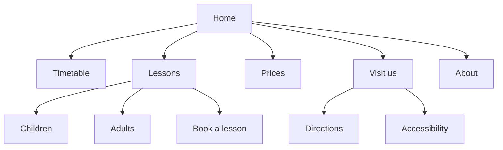
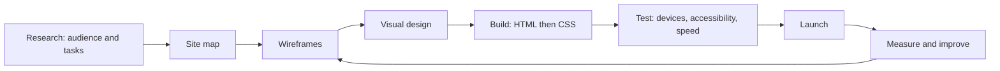
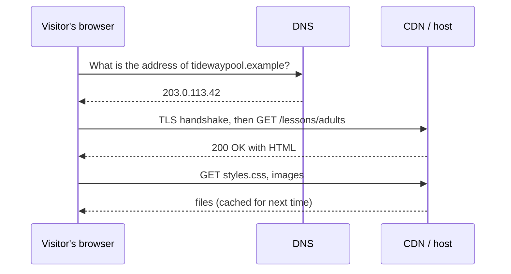

# From idea to live site: process, design, SEO, analytics and hosting

> **Before this lesson:** you should know semantic structure ([Semantic page structure](#/lesson/html-css/semantic-structure)), document metadata ([Ids, classes, generic containers and the document head](#/lesson/html-css/ids-classes-meta)) and the basics of speed ([How browsers render pages](#/lesson/html-css/rendering-performance)).

## In plain words

So far this track has been about *how* to build pages. This lesson is about everything around the building: deciding what to build and for whom, arranging it so people can find things, making it look organised, helping search engines discover it, learning what visitors actually do, and putting it on the internet under a name of your own.

Building a website is a lot like opening a shop. Before you buy shelves you decide who your customers are and what they come in for. You plan the floor so that popular items are easy to reach. You put a clear sign over the door and make sure the shop appears in the local directory. Once open, you watch which aisles people walk down. And of course you need premises and an address. Skipping the early steps is how you end up with a beautiful shop that nobody can find and nobody can navigate.

A developer who understands this wider picture is far more useful to a team than one who only writes code. Interviewers for front-end roles often ask about search engine optimisation, about what happens when you type a web address, and about how you would deploy a site.

## Part 1: Planning

### Who is it for, and what do they want?

Every decision that follows is easier if you can answer four questions first.

| Question | Example answer for a community pool's website |
|---|---|
| **Who** are the visitors? | Local families; lane swimmers; school organisers. Mostly on phones. |
| **Why** do they come? | To check opening times, book a lesson, find prices |
| **What** do they need to achieve it? | Today's timetable, a booking form, a price list, directions |
| **How often** will they return? | Weekly for timetables, so that page must be current and quick to reach |

A common planning device is the **persona**: a short description of an invented but realistic visitor ("Dana, 34, wants to book Saturday lessons for two children and checks on the bus"). A persona keeps discussion grounded: "would Dana find this?" is a better question than "do we like this?".

List the **key tasks** in order of importance. The most frequent tasks deserve the most prominent places on the page. The pool's opening times matter more to visitors than its history.

### Site maps: organising the pages

**Information architecture** is the practice of grouping and labelling content so people can find it. Its usual output is a **site map**: a tree diagram of the pages.



A good way to discover the groups is **card sorting**: write each piece of content on a card and ask a few likely visitors to arrange the cards into piles and name them. Their names are usually better navigation labels than the organisation's internal jargon.

Guidelines: keep the main navigation to about five to seven items, use the visitors' own words for labels, and make sure important pages are no more than two or three clicks from the home page.

### Wireframes: sketching each page

A **wireframe** is a plain sketch of a page that shows *what goes where* and nothing about colours or typefaces. Boxes stand in for images and lines stand in for text. Its purpose is to settle the arrangement and priority of information cheaply, before anyone spends hours on visual polish.

```html-run
<!doctype html>
<html lang="en">
<head><meta charset="utf-8"><title>A wireframe in HTML</title>
<style>
  * { box-sizing: border-box; }
  body { font: .8rem ui-monospace, monospace; margin: 0; padding: 10px; color: #555; }
  .wf { display: grid; gap: 8px; grid-template-columns: 2fr 1fr; max-width: 520px;
        grid-template-areas: "head head" "hero hero" "main side" "foot foot"; }
  .wf > div { border: 2px solid #9e9e9e; padding: 10px; background: #fafafa; }
  .head { grid-area: head; display: flex; justify-content: space-between; }
  .hero { grid-area: hero; min-height: 80px; display: grid; place-items: center;
          background: repeating-linear-gradient(45deg, #eee 0 10px, #f8f8f8 10px 20px) !important; }
  .main { grid-area: main; } .side { grid-area: side; } .foot { grid-area: foot; text-align: center; }
  .line { height: 8px; background: #cfcfcf; margin: 6px 0; border-radius: 4px; }
  .line.short { width: 60%; }
  .btn { display: inline-block; border: 2px solid #777; padding: 4px 10px; margin-top: 6px; }
</style></head>
<body>
  <div class="wf">
    <div class="head"><span>[logo]</span><span>Timetable · Lessons · Prices · Visit</span></div>
    <div class="hero">[photo of pool] &nbsp; Today: open 06:30–21:00</div>
    <div class="main">Today's sessions<div class="line"></div><div class="line"></div><div class="line short"></div><span class="btn">Full timetable</span></div>
    <div class="side">Book a lesson<div class="line"></div><div class="line short"></div><span class="btn">Book</span></div>
    <div class="foot">address · phone · accessibility</div>
  </div>
</body>
</html>
```

Even this crude sketch records real decisions: today's opening hours sit at the very top, the timetable gets the wide column, and booking has its own box with a button.

The usual sequence of work is:



The arrow from "measure" back to "wireframes" matters: a website is never finished, and what you learn after launch feeds the next round.

## Part 2: Visual design principles

You do not need to be a designer to apply a few principles that make any page clearer.

### Visual hierarchy

**Visual hierarchy** is the order in which the eye notices things. Designers control it so that the most important thing is seen first. The tools are:

| Tool | Effect |
|---|---|
| **Size** | Bigger is noticed first |
| **Weight and colour** | Bold and saturated stand out; grey recedes |
| **Position** | Top and left are read first in left-to-right languages |
| **White space** | An element with empty space around it gains importance |
| **Contrast** | Whatever differs from its surroundings draws attention |

```html-run
<!doctype html>
<html lang="en">
<head><meta charset="utf-8"><title>Hierarchy</title>
<style>
  body { font-family: system-ui, sans-serif; display: grid; grid-template-columns: 1fr 1fr; gap: 14px; }
  .card { border: 1px solid #cfd8dc; border-radius: 10px; padding: 1rem; }
  .flat * { font-size: 1rem; font-weight: 400; color: #222; margin: 0; }
  .good h3 { margin: 0; font-size: 1.4rem; }
  .good .meta { color: #607d8b; font-size: .85rem; margin: .2rem 0 .9rem; }
  .good .price { font-size: 1.8rem; font-weight: 800; color: #00695c; margin: 0; }
  .good .note { color: #607d8b; font-size: .85rem; margin: .2rem 0 1rem; }
  .good a { display: inline-block; background: #00695c; color: white; padding: .5rem 1rem; border-radius: 8px; text-decoration: none; font-weight: 600; }
</style></head>
<body>
  <div class="card flat"><h3>Adult swim lessons</h3><p>Tuesdays, 7 pm, 8 weeks</p><p>£64</p><p>Includes pool entry</p><a href="#">Book a place</a></div>
  <div class="card good"><h3>Adult swim lessons</h3><p class="meta">Tuesdays, 7 pm · 8 weeks</p><p class="price">£64</p><p class="note">Includes pool entry</p><a href="#">Book a place</a></div>
</body>
</html>
```

Both cards hold the same words. In the first, everything has equal weight and the eye has nowhere to start. In the second, size, weight, colour and spacing say: title, price, action.

### Grouping and similarity

- **Proximity**: items placed close together are understood as related. Put a label nearer to its own field than to the previous one; put more space *between* sections than *within* them.
- **Similarity**: things that look alike are assumed to behave alike. All links one colour; all primary buttons one style.
- **Alignment**: line elements up along shared edges. A page with a few strong alignment lines looks orderly; one where every block starts at a different position looks chaotic. Grids exist to provide those lines.
- **Consistency**: navigation in the same place on every page, the same words for the same things.

### Navigation design

Good navigation is concise, uses clear labels, shows the visitor where they are (highlight the current page, and mark it with `aria-current="page"`), looks clickable, and is the same on every page. On larger sites, **breadcrumbs** (Home › Lessons › Adults) show the path from the home page, and a search box helps people who know exactly what they want.

## Part 3: Search engine optimisation

**Search engine optimisation (SEO)** is the practice of making pages easy for search engines to find, understand and recommend.

A search engine works in three steps. A program called a **crawler** (or spider, or bot) follows links from page to page and downloads what it finds. The engine **indexes** each page, recording what it is about. When someone searches, it **ranks** the indexed pages by how relevant and trustworthy they seem.

SEO splits into what you control on your own pages and what happens elsewhere.

### On-page SEO

Most of it is things this track has already taught for other reasons.

| Element | Why it matters | Guidance |
|---|---|---|
| `<title>` | The headline of your search result and the strongest on-page signal | Unique per page, specific, roughly 50–60 characters, key words first |
| `<meta name="description">` | Often shown as the grey snippet under the title | One or two sentences, about 150 characters, written to earn the click |
| Headings | Show the structure and topics | One `<h1>` describing the page; logical `<h2>`–`<h3>` |
| Body text | What the page is actually about | Use the words your visitors search for, naturally |
| Link text | Describes the page being linked to | "Adult lesson timetable", never "click here" |
| Image `alt` | Lets images be understood and found | Accurate descriptions |
| URL | Read by people and engines | Short, lowercase, hyphenated words: `/lessons/adults` |
| Semantic HTML | Separates content from navigation and boilerplate | `main`, `article`, `nav`, `header`, `footer` |
| `lang` attribute | Identifies the language | `<html lang="en">` |

The first step is **keyword research**: finding out which words people type. A pool might call its service "aquatic tuition", but customers search for "swimming lessons near me". Write for the visitor's vocabulary.

```html
<head>
  <title>Adult Swimming Lessons in Harbourtown | Tideway Pool</title>
  <meta name="description" content="Eight-week adult swimming courses for beginners and improvers. Small groups, evening sessions, pool entry included. Book online.">
  <link rel="canonical" href="https://tidewaypool.example/lessons/adults">
</head>
```

### Technical SEO

These make sure crawlers can reach and trust your pages.

- **Crawlable links.** Use real `<a href>` links. A crawler does not click a `<div>` with a script attached.
- **`robots.txt`**: a text file at the site root telling crawlers which paths they should not fetch. It is a polite request, not a security measure.
- **`sitemap.xml`**: a file listing your URLs so that engines can find them all.
- **Canonical URL**: `<link rel="canonical">` names the preferred address when the same content is reachable at several.
- **`<meta name="robots" content="noindex">`** keeps one page out of the results.
- **HTTPS**, **mobile-friendliness** and **speed** (the Core Web Vitals) are all ranking factors.
- **Redirects**: when a page moves, send a permanent `301` redirect from the old address so that links and ranking carry over. Broken links ending in `404 Not Found` waste both.
- **Structured data**: a block of JSON-LD (a standard format for describing things to machines) using the schema.org vocabulary can tell engines that a page describes an event, a recipe, a product or a business, which can earn richer search results.

```html
<script type="application/ld+json">
{
  "@context": "https://schema.org",
  "@type": "SportsActivityLocation",
  "name": "Tideway Pool",
  "address": { "@type": "PostalAddress", "addressLocality": "Harbourtown" },
  "openingHours": "Mo-Su 06:30-21:00"
}
</script>
```

### Off-page SEO

The main off-page signal is **links from other sites**. Each link from a reputable, relevant site acts as a vote of confidence. The honest way to earn them is to publish things worth linking to. Buying links, hiding text, or stuffing pages with repeated keywords are known as "black hat" tactics; search engines detect and penalise them.

> [!INTERVIEW]
> "How does HTML affect SEO?" Search engines read the markup: a unique descriptive `<title>` and meta description, one clear `<h1>` and a sensible heading outline, semantic landmarks that separate content from chrome, descriptive link text and `alt` text, crawlable `<a href>` links, canonical URLs, structured data, and a fast, mobile-friendly page. Good semantic, accessible HTML is most of on-page SEO.

## Part 4: Analytics

**Web analytics** means collecting and studying data about how people use your site, so that decisions rest on evidence instead of opinion.

A typical analytics service gives you a small script to add to every page. When a page loads, the script reports the visit to the service, which then shows you summaries.

| Term | Meaning |
|---|---|
| **Users** (visitors) | Distinct people (strictly, distinct browsers) in a period |
| **Sessions** (visits) | Individual periods of activity; one user may have many |
| **Page views** | The number of times pages were loaded |
| **Bounce** | A session in which the visitor left without interacting further |
| **Engagement time** | How long visitors actively spent |
| **Traffic source** | Where the visitor came from: *organic search*, *direct* (typed or bookmarked), *referral* (a link on another site), *social*, *paid* |
| **Landing page / exit page** | The first / last page of a session |
| **Conversion** | A completed goal you care about: a booking, a sign-up, a purchase |
| **Conversion rate** | Conversions divided by sessions |

Questions worth asking of the data: Which pages are most visited (are they the easiest to reach)? Where do people arrive from? On which page do they give up during booking? What do they type into the site's search box (it reveals what they could not find)? How do phone users compare with desktop users?

A powerful technique is the **A/B test**: show half of the visitors version A of a page and the other half version B, and compare the conversion rates. It replaces arguments with measurements.

> [!WARNING]
> Analytics involves personal data. Laws such as the GDPR in Europe require a legal basis, often consent, before you set tracking cookies. Collect only what you will use, publish a privacy policy, honour consent choices, and consider privacy-focused tools that work without cookies.

Separately, **Google Search Console** and **Bing Webmaster Tools** are free services that show how your site appears in search: which queries bring visitors, which pages are indexed and any crawl errors.

## Part 5: Domains, hosting and deployment

To put a site on the internet you need three things: a name, a place to keep the files, and a way of getting the files there.

### Domain names and DNS

A **domain name** such as `tidewaypool.example` is a human-friendly label for a site. You rent one, usually yearly, from a company called a **registrar**.

Computers on the internet find each other by numeric **IP addresses** (for example `203.0.113.42`). The **Domain Name System (DNS)** is the internet's phone book: it translates names into those numbers. You configure it by creating **DNS records**.

| Record | Purpose |
|---|---|
| `A` | Points a name at an IPv4 address |
| `AAAA` | Points a name at an IPv6 address |
| `CNAME` | Makes one name an alias of another name (for example `www` → your host's name) |
| `MX` | Says which servers receive email for the domain |
| `TXT` | Holds arbitrary text, used to prove ownership and to configure email security |

Changes to DNS can take minutes or hours to spread across the internet, because other servers keep (cache) the old answer for a period called the **TTL** (time to live).

### Hosting

**Hosting** is renting space on a computer that is always connected to the internet, called a **server**, to keep your site's files and send them to visitors.

| Type | What it is | Suits |
|---|---|---|
| **Static hosting** | Serves fixed files (HTML, CSS, JavaScript, images) exactly as stored. Examples: GitHub Pages, Netlify, Cloudflare Pages, Vercel | Portfolios, documentation, this study guide; fast, cheap or free, very secure |
| **Shared hosting** | Many sites on one server, usually with PHP and a database | Small sites using a content management system such as WordPress |
| **VPS / cloud server** | A virtual machine you administer yourself | Custom applications needing full control |
| **Platform as a service** | You upload code; the platform runs and scales it | Web applications without server administration |

A **static site** is one whose pages exist as ready-made files. A **dynamic site** builds each page on request, typically from a database. Everything taught in this track can be hosted statically.

### Deployment

**Deployment** means publishing a new version of the site. The old method is copying files to the server by FTP or its secure successor SFTP. The modern method uses **Git**, a system that records every change to your files. You push your changes to a service such as GitHub, and the host automatically builds and publishes the site. This arrangement is called **continuous deployment**, and it gives you a history of every version and an easy way to roll back.

### HTTPS

**HTTPS** is HTTP sent through an encrypted connection (using the TLS protocol). It prevents anyone between the visitor and the server from reading or altering the page. Browsers label plain HTTP sites "Not secure", many browser features work only over HTTPS, and it is a ranking signal. The server proves its identity with a **certificate**; Let's Encrypt issues them free, and most hosts set one up for you automatically. Always redirect `http://` to `https://`.



### Launch checklist

- Every page has a unique `<title>` and meta description, a `lang`, a viewport meta tag and a favicon.
- HTML validated; no broken links; a helpful custom 404 page.
- Checked with keyboard only, with a screen reader and at 320px wide and 400% zoom.
- Images compressed with `alt`, `width` and `height`; Lighthouse run for performance and accessibility.
- HTTPS working, `http` redirecting, one canonical host (`www` or bare domain, not both).
- `robots.txt` and `sitemap.xml` in place; the site verified in Search Console.
- Analytics installed with a consent mechanism where required; privacy policy published.
- Social sharing tags (`og:title`, `og:description`, `og:image`) present.
- A backup and a way to roll back.

> [!TIP]
> Before launch, search for `site:yourdomain.example` in a search engine after a few days. The results show exactly which titles and descriptions the engine has picked up for each page.

## Pitfalls

- **Designing before knowing the audience and their tasks.** Attractive, and useless.
- **Navigation labelled with internal jargon.** Use visitors' words.
- **Everything emphasised.** If every element is bold and bright, there is no hierarchy.
- **Identical `<title>` on every page.** Search results cannot tell the pages apart.
- **Keyword stuffing and hidden text.** Penalised, and unpleasant to read.
- **Blocking the whole site in `robots.txt`**, a setting often left over from development.
- **Relying on `robots.txt` for privacy.** It is public and advisory; use real access control.
- **Moving pages without redirects.** Links break and rankings are lost.
- **Collecting analytics nobody reads**, or tracking without consent.
- **Vanity metrics.** Page views feel good; conversions tell you whether the site works.
- **Forgetting to renew the domain** or losing access to the registrar account.
- **Mixed content**: an HTTPS page loading images or scripts over HTTP, which browsers block.

## Cheat sheet

| Stage | Output or tool |
|---|---|
| Understand users | Personas, key tasks |
| Organise content | Card sort → site map |
| Arrange pages | Wireframes |
| Make it clear | Hierarchy (size, weight, colour, space), proximity, alignment, consistency |
| Be found | Unique `<title>`, meta description, `<h1>`, descriptive links, `alt`, clean URLs, sitemap, canonical, structured data |
| Stay crawlable | Real `<a href>` links, `robots.txt`, 301 redirects, no broken links |
| Learn | Analytics: sources, landing pages, conversions; Search Console; A/B tests |
| Name | Domain from a registrar; DNS records `A`, `AAAA`, `CNAME`, `MX`, `TXT` |
| House | Static hosting for files; servers or platforms for dynamic sites |
| Publish | Git push → automatic build and deploy |
| Secure | HTTPS certificate; redirect HTTP |

## Summary

A successful site begins with knowing who it serves and what they came to do. That knowledge shapes the site map, the wireframes and the visual hierarchy, which uses size, weight, colour, spacing, grouping and alignment to guide the eye. Search engines discover pages by crawling links and understand them through the same semantic, accessible HTML that helps people: titles, descriptions, headings, link text and alt text, supported by sitemaps, canonical URLs, redirects and structured data. Analytics shows what visitors really do and should be collected lawfully and sparingly. Going live requires a domain name resolved by DNS, hosting suited to the kind of site, a repeatable deployment process and HTTPS. After launch, measure, learn and improve.

## Glossary

| Term | Meaning |
|---|---|
| Persona | A short profile of a realistic invented visitor, used to guide decisions |
| Information architecture | Organising and labelling content so that it can be found |
| Site map | A diagram of a site's pages and how they are grouped |
| Wireframe | A plain sketch of a page's arrangement without visual styling |
| Visual hierarchy | The order in which design leads the eye through a page |
| SEO | Search engine optimisation: making pages easy to find and understand for search engines |
| Crawler | A program that follows links to discover and download pages |
| Index | A search engine's stored record of pages and their content |
| Canonical URL | The preferred address for a piece of content |
| Structured data | Machine-readable descriptions of a page's content, usually JSON-LD with schema.org |
| Analytics | Collecting and studying data about how a site is used |
| Conversion | A visitor completing a goal you defined |
| A/B test | Comparing two versions of a page by showing each to a share of visitors |
| Domain name | A human-readable name for a site, rented from a registrar |
| DNS | The system that translates domain names into IP addresses |
| Hosting | Renting an always-connected computer to store and serve a site |
| Static site | A site made of ready-made files served unchanged |
| Deployment | Publishing a new version of a site |
| HTTPS / TLS | HTTP over an encrypted, authenticated connection |
| Redirect (301) | A server response sending browsers and crawlers permanently to a new address |

## Check yourself

```quiz
[
  {"q": "What does a wireframe deliberately leave out?", "options": ["The position of the navigation", "The relative priority of content", "Colours, typefaces and final imagery", "Which pages exist"], "answer": 2,
   "explain": "A wireframe settles structure and priority. Visual styling is postponed so that arrangement can be agreed cheaply."},
  {"q": "Which HTML element is the strongest single on-page signal of a page's topic and is shown as the headline of a search result?", "options": ["meta keywords", "title", "footer", "h6"], "answer": 1,
   "explain": "The title element should be unique and descriptive for each page. The keywords meta tag is ignored by major search engines."},
  {"q": "What does robots.txt do?", "options": ["Password-protects pages", "Asks well-behaved crawlers not to fetch certain paths", "Removes pages from the internet", "Speeds up the site"], "answer": 1,
   "explain": "It is advisory and public. It offers no security and is not a reliable way to keep a page out of search results; use noindex or access control for that."},
  {"q": "A page moves from /swim-classes to /lessons. What should the old URL return?", "options": ["404 Not Found", "A 301 permanent redirect to /lessons", "The home page with status 200", "Nothing"], "answer": 1,
   "explain": "A permanent redirect sends visitors and crawlers to the new address and passes on the old page's ranking signals."},
  {"q": "Which DNS record makes www.example.org an alias of another host name?", "options": ["A", "MX", "CNAME", "TXT"], "answer": 2,
   "explain": "A CNAME record maps one name to another name. A and AAAA records map names to IP addresses; MX is for mail."},
  {"q": "In analytics, what is a conversion?", "options": ["Any page view", "A visitor completing a goal you defined, such as a booking", "A visitor arriving from search", "Changing HTTP to HTTPS"], "answer": 1,
   "explain": "Conversions measure whether the site achieves its purpose, which is more informative than raw traffic."},
  {"q": "Which kind of hosting suits a site made only of HTML, CSS, JavaScript and image files?", "options": ["Static hosting", "A dedicated database server", "A mail server", "It cannot be hosted without PHP"], "answer": 0,
   "explain": "Static hosts serve files exactly as stored. They are fast, inexpensive and have very little attack surface."},
  {"q": "What does this give a search engine? <a href='/prices'>Swimming lesson prices</a> versus <a href='/prices'>click here</a>", "options": ["No difference", "The first tells the engine and users what the target page is about; the second says nothing", "The second ranks higher because it is shorter", "Both are ignored"], "answer": 1,
   "explain": "Link text describes the destination to crawlers and to people navigating by links, so descriptive text helps both."}
]
```

> **Source:** Duckett, *HTML & CSS*, ch. 18 (Process & Design) and ch. 19 (Practical Information). MDN: https://developer.mozilla.org/en-US/docs/Glossary/SEO · https://developer.mozilla.org/en-US/docs/Learn_web_development/Howto/Web_mechanics/What_is_a_domain_name · https://developer.mozilla.org/en-US/docs/Learn_web_development/Howto/Tools_and_setup/How_much_does_it_cost · Google Search Central SEO starter guide: https://developers.google.com/search/docs/fundamentals/seo-starter-guide
