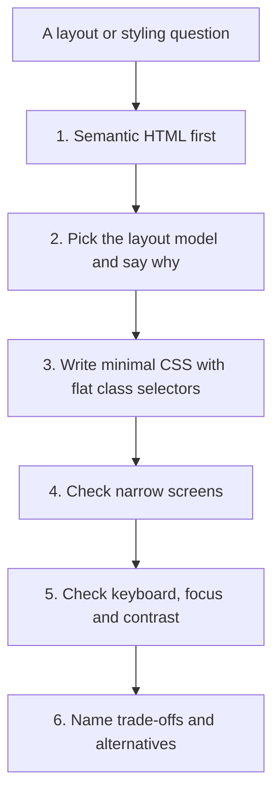

# HTML & CSS interview essentials

> **Before this lesson:** this is a review. It draws on every earlier lesson, especially [The cascade, specificity and inheritance](#/lesson/html-css/cascade), [The box model](#/lesson/html-css/box-model), [Normal flow, display, positioning and stacking](#/lesson/html-css/display-positioning), [Flexbox in depth](#/lesson/html-css/flexbox), [CSS Grid in depth](#/lesson/html-css/grid) and [Semantic page structure](#/lesson/html-css/semantic-structure). If a section here feels unfamiliar, follow the link and return.

## In plain words

A front-end interview is a conversation in which someone checks whether you understand *why* a page behaves as it does, not only whether you can make it look right by trial and error.

Compare a driving test. The examiner is not interested in whether you can reach the supermarket. They watch whether you check the mirrors, know who has priority at a junction and can explain what you would do if a tyre burst. In the same way, an interviewer who asks "how do you centre a div?" already knows the answer. They are listening for whether you know several ways, when each one applies and what its conditions are.

This lesson collects the questions that come up again and again, each with a short model answer, a live example you can edit, and the follow-up the interviewer is likely to ask. Reading it is useful; saying the answers aloud and rebuilding the examples from memory is what makes them stick.

## How to answer a CSS question well

A dependable shape for any answer:

1. **State the direct answer in one sentence.**
2. **Explain the mechanism**: the rule of the language that makes it true.
3. **Mention a condition or trade-off**: when it does not work, or an alternative.

For example, to "what does `position: sticky` do?": "It keeps an element in normal flow until scrolling reaches a threshold such as `top: 0`, then pins it there. It sticks only within its parent's box, and an ancestor with `overflow: hidden` will break it. I use it for table headers and section headings."

## 1. Centring

Centring is the best-known CSS question because it used to be difficult, and because there are several right answers that depend on *what* is being centred.

```html-run
<!doctype html>
<html lang="en">
<head><meta charset="utf-8"><title>Five ways to centre</title>
<style>
  body { font: .8rem system-ui, sans-serif; display: grid; grid-template-columns: repeat(3, 1fr); gap: 10px; }
  .stage { height: 110px; background: #eceff1; border-radius: 8px; }
  .dot { background: #5e35b1; color: white; padding: .4rem .7rem; border-radius: 8px; }

  /* 1. Flexbox: both directions */
  .flex { display: flex; justify-content: center; align-items: center; }

  /* 2. Grid: both directions, shortest */
  .grid { display: grid; place-items: center; }

  /* 3. Auto margins inside flex or grid */
  .auto { display: flex; } .auto .dot { margin: auto; }

  /* 4. Absolute position + translate: size unknown */
  .abs { position: relative; }
  .abs .dot { position: absolute; top: 50%; left: 50%; transform: translate(-50%, -50%); }

  /* 5. Horizontal only: block with a width and auto side margins */
  .block .dot { width: 120px; margin-inline: auto; text-align: center; }

  /* 6. Inline content: text-align on the parent */
  .text { text-align: center; line-height: 110px; } .text .dot { line-height: 1.2; display: inline-block; }
</style></head>
<body>
  <div class="stage flex"><div class="dot">1 flex</div></div>
  <div class="stage grid"><div class="dot">2 grid</div></div>
  <div class="stage auto"><div class="dot">3 margin auto</div></div>
  <div class="stage abs"><div class="dot">4 absolute</div></div>
  <div class="stage block"><div class="dot">5 horizontal only</div></div>
  <div class="stage text"><span class="dot">6 inline</span></div>
</body>
</html>
```

| Method | Centres | Conditions |
|---|---|---|
| `display: flex; justify-content: center; align-items: center` | Both ways | Container needs spare height for the vertical part |
| `display: grid; place-items: center` | Both ways | Same |
| `margin: auto` on a flex or grid child | Both ways | Parent must be flex or grid |
| `position: absolute; top: 50%; left: 50%; transform: translate(-50%, -50%)` | Both ways | Parent must be positioned; element is taken out of flow |
| `position: absolute; inset: 0; margin: auto` | Both ways | Element needs an explicit width and height |
| `margin-inline: auto` | Horizontally | Block element with a width or `max-width` |
| `text-align: center` on the parent | Horizontally | Applies to inline content: text, links, inline-block boxes |

**Model answer:** "For a box inside a container I use grid with `place-items: center`, or flex with `justify-content` and `align-items`. For a block of known width, horizontally only, auto inline margins. For an overlay that must leave the flow, absolute positioning at 50% with a translate of minus 50%, because translate percentages refer to the element's own size. Inline content is centred with `text-align` on the parent."

**Likely follow-up:** "Why doesn't vertical centring work on my page?" Because the container is only as tall as its content. Give it a height, for example `min-height: 100dvh`.

## 2. Specificity puzzles

Recall the three-column score: **(ids, classes + attributes + pseudo-classes, elements + pseudo-elements)**. Compare left to right; no column carries into the next. Inline styles beat any selector. `!important` beats inline. On a tie, the later rule wins.

Work out the colour of each line before running it.

```html-run
<!doctype html>
<html lang="en">
<head><meta charset="utf-8"><title>Specificity puzzles</title>
<style>
  body { font-family: system-ui, sans-serif; }
  /* Puzzle A */
  .list li          { color: teal; }       /* (0,1,1) */
  li.item           { color: crimson; }    /* (0,1,1)  tie: later wins */
  /* Puzzle B */
  #b p              { color: purple; }     /* (1,0,1) */
  .x.y.z p.note     { color: green; }      /* (0,4,1)  still loses to one id */
  /* Puzzle C */
  .c p              { color: orange !important; }
  /* Puzzle D */
  .d                { color: navy; }       /* sets colour on the parent */
  *                 { }                    /* (0,0,0) but would beat inheritance if it set colour */
  .d em             { color: inherit; }
  /* Puzzle E */
  :is(#e, .never) span { color: deeppink; }   /* (1,0,1): takes the id's weight */
  .e span.label        { color: gray; }       /* (0,2,1) */
</style></head>
<body>
  <ul class="list"><li class="item">A: teal or crimson?</li></ul>
  <div id="b" class="x y z"><p class="note">B: purple or green?</p></div>
  <div class="c"><p style="color: blue">C: orange or blue?</p></div>
  <p class="d">D: parent is navy, <em>and this em?</em></p>
  <div id="e" class="e"><span class="label">E: pink or gray?</span></div>
</body>
</html>
```

| Puzzle | Answer | Reason |
|---|---|---|
| A | Crimson | Both selectors score (0,1,1); source order breaks the tie |
| B | Purple | One id outranks any number of classes |
| C | Orange | `!important` in a style sheet beats a normal inline style |
| D | Navy | `color` inherits; `inherit` makes it explicit |
| E | Pink | `:is()` takes the specificity of its most specific argument, the id |

**Common mistake:** adding up specificity as an ordinary number, for example treating eleven classes as "110" and one id as "100". The columns are compared separately.

## 3. Block, inline and inline-block

| | `block` | `inline` | `inline-block` |
|---|---|---|---|
| Starts on a new line | Yes | No | No |
| Default width | Fills the container | Content width | Content width |
| Honours `width` and `height` | Yes | **No** | Yes |
| Vertical margin and padding affect layout | Yes | **No** | Yes |
| Examples | `div`, `p`, `h1`, `section`, `li` | `span`, `a`, `em`, `strong` | `button`, `input`, `img` (similar behaviour) |

**Model answer:** "Block boxes stack vertically and take the full available width. Inline boxes flow in a line of text and ignore width, height and vertical margins. Inline-block sits in a line like inline but can be sized like a block."

**Follow-ups:** Is display the same as the HTML content model? No: `display` is presentation; whether a `p` may contain a `div` is an HTML rule that CSS cannot change. Why is there a small gap under an image? An image is inline, so it sits on the text baseline, leaving room for descenders; `display: block` or `vertical-align: middle` removes it.

## 4. The box model and `box-sizing`

**Model answer:** "Each element is a box made of content, padding, border and margin. With the default `box-sizing: content-box`, `width` and `height` apply to the content only, so padding and border are added on top. With `border-box`, they include padding and border, so a declared width is the rendered width. I set `border-box` globally."

Quick sum: `width: 200px; padding: 20px; border: 5px solid` renders 250px wide under `content-box` and 200px under `border-box`. Margin is outside the box in both cases.

**Follow-up, margin collapsing:** adjacent vertical margins of block boxes combine into the larger one; a first child's top margin can escape through a parent that has no padding or border; it does not happen in flex or grid containers.

## 5. The `position` values

| Value | In flow? | Positioned relative to | Typical use |
|---|---|---|---|
| `static` | Yes | — (offsets ignored) | Default |
| `relative` | Yes | Its own normal position | Anchor for absolute children; small nudges |
| `absolute` | No | Nearest positioned ancestor | Badges, overlays, dropdowns |
| `fixed` | No | The viewport | Floating action buttons, cookie bars |
| `sticky` | Yes | Scroll container, once past its threshold | Sticky headers |

**Follow-ups:** What is a positioned ancestor? One whose `position` is not `static`. Why is my `z-index` ignored? Either the element is not positioned (and is not a flex or grid item), or it is inside a stacking context that sits below the element you are trying to cover. What creates a stacking context? Positioned elements with a `z-index`, `opacity` below 1, `transform`, `filter`, `isolation: isolate`, fixed and sticky positioning.

## 6. `em`, `rem` and other units

| Unit | Relative to | Use for |
|---|---|---|
| `px` | Nothing; fixed | Borders, fine details |
| `rem` | The root (`html`) font size | Font sizes, global spacing |
| `em` | The element's own font size (on `font-size`: the parent's) | Padding and gaps that scale with the component's text |
| `%` | The parent, usually its width | Fluid widths |
| `vw`, `vh`, `dvh` | The viewport | Full-height sections, fluid type inside `clamp()` |
| `ch` | Width of the digit 0 | Line length |
| `fr` | Share of leftover space in a grid | Grid tracks |

**Model answer:** "`rem` is always relative to the root font size, so it is predictable. `em` is relative to the current element's font size, so it compounds when nested. I size text in `rem` so that it respects the user's browser setting, and use `em` for spacing inside components."

A worked example: root 16px; `.card { font-size: 1.25rem; padding: 2em; }` gives a 20px font and 40px padding. A child with `font-size: 0.8em` is 16px; the same child with `0.8rem` would be 12.8px.

## 7. Building common layouts

You may be asked to write these on a whiteboard. Each fits in a handful of lines.

```html-run
<!doctype html>
<html lang="en">
<head><meta charset="utf-8"><title>Common layouts</title>
<style>
  * { box-sizing: border-box; }
  body { font: .8rem system-ui, sans-serif; display: grid; gap: 14px; margin: 10px; }
  .demo > * { background: #e3f2fd; border: 1px solid #64b5f6; padding: .5rem; border-radius: 6px; }
  h4 { margin: 0 0 4px; }

  /* A. Navigation bar: logo left, links right */
  .nav { display: flex; align-items: center; gap: 1rem; }
  .nav .links { margin-left: auto; display: flex; gap: 1rem; background: none; border: 0; padding: 0; }

  /* B. Sidebar + fluid content */
  .sidebar { display: grid; grid-template-columns: 140px 1fr; gap: 8px; }

  /* C. Holy grail */
  .grail { display: grid; gap: 6px; grid-template-columns: 90px 1fr 90px; grid-template-rows: auto 60px auto;
           grid-template-areas: "h h h" "n m a" "f f f"; }
  .grail > :nth-child(1) { grid-area: h; } .grail > :nth-child(2) { grid-area: n; } .grail > :nth-child(3) { grid-area: m; }
  .grail > :nth-child(4) { grid-area: a; } .grail > :nth-child(5) { grid-area: f; }

  /* D. Responsive card grid, no media queries */
  .cards { display: grid; gap: 8px; grid-template-columns: repeat(auto-fit, minmax(120px, 1fr)); }

  /* E. Footer at the bottom of a short page */
  .page { display: flex; flex-direction: column; min-height: 130px; gap: 6px; }
  .page main { flex: 1; }

  /* F. Equal-height columns */
  .equal { display: flex; gap: 8px; } .equal > * { flex: 1; }
</style></head>
<body>
  <div><h4>A. Nav bar</h4><div class="nav demo"><strong>Logo</strong><div class="links"><span>Docs</span><span>Blog</span><span>Sign in</span></div></div></div>
  <div><h4>B. Sidebar + content</h4><div class="sidebar demo"><aside>Sidebar</aside><main>Content</main></div></div>
  <div><h4>C. Holy grail</h4><div class="grail demo"><header>Header</header><nav>Nav</nav><main>Main</main><aside>Aside</aside><footer>Footer</footer></div></div>
  <div><h4>D. Auto-fit cards</h4><div class="cards demo"><div>1</div><div>2</div><div>3</div><div>4</div><div>5</div></div></div>
  <div><h4>E. Sticky footer</h4><div class="page demo"><header>Header</header><main>Main grows</main><footer>Footer</footer></div></div>
  <div><h4>F. Equal-height columns</h4><div class="equal demo"><div>Short</div><div>Taller<br>column<br>here</div><div>Short</div></div></div>
</body>
</html>
```

| Layout | Core CSS |
|---|---|
| Nav bar, links pushed right | `display: flex; align-items: center` + `margin-left: auto` on the right-hand group |
| Sidebar and content | `grid-template-columns: 240px 1fr` |
| Holy grail | `grid-template-areas` with rows `auto 1fr auto` |
| Responsive cards | `repeat(auto-fit, minmax(16rem, 1fr))` |
| Footer at the bottom | Column flex on the page with `min-height: 100dvh`; `flex: 1` on `main` |
| Equal-height columns | Flex or grid children stretch by default |
| Modal overlay | `<dialog>`, or `position: fixed; inset: 0; display: grid; place-items: center` |
| Media object (image beside text) | `display: flex; gap: 1rem` with `flex: none` on the image |

**Flexbox or Grid?** Flexbox for one direction where content sets the sizes; Grid for two directions where the layout sets the sizes.

## 8. Semantic choices

Expect to be shown markup and asked what is wrong, or to choose an element for a described component.

| Situation | Choose | Not |
|---|---|---|
| Goes to another URL | `<a href>` | `<button>`, clickable `<div>` |
| Performs an action on the page | `<button type="button">` | `<a href="#">`, `<div onclick>` |
| Main page content | One `<main>` | `<div id="main">` |
| Site navigation | `<nav>` containing a `<ul>` of links | A `<div>` of `<span>`s |
| Independent post or card | `<article>` | `<div class="post">` |
| Themed part with a heading | `<section>` | A `<section>` with no heading |
| Tabular data | `<table>` with `<caption>`, `<th scope>` | Nested `<div>`s |
| Image with a caption | `<figure>` + `<figcaption>` | `` followed by a `<p>` |
| Collapsible answer | `<details>` + `<summary>` | Script toggling a `<div>` |
| Emphasis / importance | `<em>` / `<strong>` | `<i>` / `<b>` chosen for the look |
| A form field's name | `<label for>` | `placeholder` alone |

**Model answer to "why semantic HTML?":** "Native elements carry roles, states and keyboard behaviour that assistive technology relies on; they give search engines and reader modes structure; and they make the code self-describing. Rebuilding that with `div`s needs ARIA and JavaScript and is easy to get wrong."

## 9. Accessibility quick-fire

- **`alt` text:** describe informative images; `alt=""` for decorative ones; never omit the attribute.
- **Keyboard:** everything reachable with Tab and operable with Enter or Space; visible focus via `:focus-visible`; never `outline: none` without a replacement.
- **Contrast:** 4.5:1 for normal text, 3:1 for large text and interface components.
- **ARIA:** first rule is to prefer native HTML. ARIA changes what is announced, not behaviour.
- **Visually hidden text:** a clipping class keeps text for screen readers; `display: none` removes it for everyone.
- **Forms:** every control has a label; errors are text, linked with `aria-describedby` and flagged with `aria-invalid`.
- **Motion:** respect `prefers-reduced-motion`.

| Hiding technique | Seen | Takes space | Announced by screen readers |
|---|---|---|---|
| `display: none` / `hidden` | No | No | No |
| `visibility: hidden` | No | Yes | No |
| `opacity: 0` | No | Yes | Yes |
| Visually-hidden class | No | No | Yes |
| `aria-hidden="true"` | Yes | Yes | No |

## 10. More questions with short answers

**What does `<!doctype html>` do?** It switches the browser into standards mode; without it you get quirks mode, which imitates old layout bugs.

**Difference between `id` and `class`?** An id is unique per page and is used for fragment links, labels and ARIA references; a class is reusable and is what you style with. An id selector's specificity is much higher.

**Pseudo-class versus pseudo-element?** A pseudo-class (`:hover`, `:nth-child()`) selects an existing element in a particular state or position. A pseudo-element (`::before`, `::first-line`) selects or creates a *part* of an element.

**`display: none` versus `visibility: hidden`?** The first removes the box, so no space is kept; the second keeps the space but hides the content. Both hide the element from assistive technology.

**How does the browser render a page?** Parse HTML to the DOM and CSS to the CSSOM, compute styles, lay out, paint, composite. CSS blocks rendering; plain scripts block parsing.

**Reflow versus repaint?** Reflow (layout) recalculates geometry and is the more expensive; repaint redraws pixels without changing geometry. `transform` and `opacity` avoid both.

**What is the difference between `min-width` and `max-width` media queries?** `min-width` applies from that width upward and suits mobile-first CSS; `max-width` applies up to that width.

**What does the viewport meta tag do?** It makes mobile browsers lay the page out at the device's real width instead of a virtual desktop width.

**How do `srcset` and `sizes` work?** `srcset` lists image files with their widths; `sizes` tells the browser how wide the image will be displayed; the browser chooses the smallest file that is sharp enough for the device.

**What is a CSS custom property?** A property named with two dashes and read with `var()`. It cascades and inherits, exists at run time and can be changed per element or by script.

**What is BEM?** A naming convention, `block__element--modifier`, that keeps selectors to a single class and avoids name collisions.

**How do you clear a float or contain floated children?** `clear: both` on a following element, or `display: flow-root` on the parent.

**What is the difference between `nth-child` and `nth-of-type`?** `:nth-child(n)` counts all sibling elements; `:nth-of-type(n)` counts only siblings with the same tag name.

**`transition` versus `animation`?** A transition animates between two states when a property changes; an animation plays named keyframes, may have many steps, can loop and starts without a trigger.

## A whiteboard checklist

When asked to write markup and styles in front of someone:

1. Start with the semantic HTML: landmarks, headings, lists, buttons and links. Say why you chose each.
2. Add `box-sizing: border-box`.
3. Choose the layout tool aloud: "one direction, so flex" or "rows and columns, so grid".
4. Use `gap` for spacing and relative units for sizes.
5. Mention responsiveness: what happens on a narrow screen?
6. Mention accessibility: labels, focus states, contrast, alt text.
7. State any assumption and any trade-off.



> [!INTERVIEW]
> "How do you centre a div?" is rarely about the answer. Name at least two methods, say which you would choose here and why, and mention the condition that makes vertical centring work (the container needs spare height).

> [!TIP]
> Practise aloud. Explaining specificity or the box model in complete sentences, without notes, exposes gaps that silent reading hides.

> [!WARNING]
> If you do not know an answer, say what you do know and how you would find out, for example by inspecting the element in developer tools or checking MDN. A confident wrong answer does more harm than an honest partial one.

## Pitfalls in interviews

- **Giving one memorised answer.** For centring or hiding, name several methods and when each fits.
- **Saying "it depends" and stopping.** Say what it depends on.
- **Reaching for `!important` or ids** to fix a specificity problem in a live exercise.
- **Div soup in a live exercise.** Interviewers notice missing `button`, `nav`, `label` and `main`.
- **Forgetting `alt`, labels or focus styles.** Accessibility is often an unspoken marking criterion.
- **Treating specificity as a decimal number.**
- **Confusing `justify-content` and `align-items` after changing `flex-direction`.**
- **Claiming `z-index` is "broken"** instead of reasoning about stacking contexts.
- **Not testing a narrow width.**
- **Guessing instead of opening developer tools.** Showing that you inspect the box model and the Styles pane is a strength.

## Cheat sheet

| Topic | One-line answer |
|---|---|
| Centre both ways | `display: grid; place-items: center` |
| Centre horizontally | `margin-inline: auto` with a width |
| Specificity | (ids, classes, elements); inline above; `!important` above that; ties → last wins |
| Box sizing | `border-box`: width includes padding and border |
| Block vs inline | New line and sizable vs in-line and not sizable |
| `relative` | Offset from itself; anchor for absolute children |
| `absolute` | Out of flow; relative to nearest positioned ancestor |
| `fixed` / `sticky` | Viewport / in flow until threshold |
| `rem` vs `em` | Root font size vs current element's font size |
| Flex vs Grid | One dimension vs two |
| Responsive cards | `repeat(auto-fit, minmax(16rem, 1fr))` |
| Link vs button | Navigates vs acts |
| Hide visually, keep for screen readers | Visually-hidden class |
| Cheap animation | `transform`, `opacity` |
| Rendering pipeline | Parse → style → layout → paint → composite |

## Summary

Interview questions about HTML and CSS return to a small set of fundamentals: how the cascade and specificity choose a winner, how the box model sizes an element, how `display` and `position` place it, how flexbox and Grid arrange groups of boxes, how relative units behave, and which HTML element expresses a given meaning. Strong answers give the direct result, explain the mechanism and name a condition or alternative. Practise by rebuilding the layouts in this lesson without looking, predicting the outcome of the specificity puzzles before running them, and explaining each answer aloud.

## Glossary

| Term | Meaning |
|---|---|
| Specificity | The score that decides which of several matching selectors wins |
| Cascade | The algorithm that picks one declaration per property per element |
| Box model | Content, padding, border and margin of an element's box |
| Normal flow | The default layout of block and inline boxes |
| Positioned ancestor | An ancestor whose `position` is not `static` |
| Stacking context | A group of elements layered together as one unit |
| Main axis / cross axis | The direction of a flex container's items / the perpendicular direction |
| Track | A row or column of a grid |
| Holy grail layout | Header, footer and three columns with a fluid centre |
| Semantic HTML | Markup chosen for meaning instead of appearance |
| Landmark | A page region assistive technology can jump to |
| Accessible name | The text by which assistive technology identifies an element |
| Reflow / repaint | Recalculating layout / redrawing pixels |
| Mobile first | Base styles for narrow screens, enhanced with `min-width` queries |

## Check yourself

```quiz
[
  {"q": "Which declaration pair centres a child both horizontally and vertically in its parent?", "options": ["text-align: center; vertical-align: middle", "display: grid; place-items: center", "margin: 0 auto", "position: relative; top: 50%"], "answer": 1,
   "explain": "place-items sets align-items and justify-items, centring the child in the grid cell. The parent still needs spare height."},
  {"q": "Rules: #nav a { color: red; } and nav.menu ul li a.link:hover { color: blue; }. What colour is a hovered link matching both?", "options": ["Blue, because it has more parts", "Red, because (1,0,1) beats (0,3,4)", "Purple", "Blue, because :hover always wins"], "answer": 1,
   "explain": "The id column is compared first. One id outweighs any number of classes, pseudo-classes and type selectors."},
  {"q": "What does this render? <span style='display:inline; width:200px; height:100px; background:gold'>Hi</span>", "options": ["A 200 by 100 gold box", "A gold background only as large as the text Hi", "Nothing", "A gold box 200 wide with automatic height"], "answer": 1,
   "explain": "Inline boxes ignore width and height, so the background covers only the text."},
  {"q": "With the root at 16px, .a { font-size: 2rem } contains .b { font-size: 0.5em; padding: 1em }. What is .b's padding?", "options": ["8px", "16px", "32px", "4px"], "answer": 1,
   "explain": ".a is 32px. .b's font size is half of its parent's, 16px. Padding in em uses .b's own font size: 16px."},
  {"q": "An absolutely positioned tooltip appears at the top-left of the page instead of beside its button. What is the usual cause?", "options": ["z-index is too low", "No ancestor is positioned, so it is placed relative to the page", "It needs display: block", "Absolute elements cannot be inside buttons"], "answer": 1,
   "explain": "Add position: relative to the intended container so that it becomes the tooltip's containing block."},
  {"q": "Which element should trigger opening a modal dialog on the same page?", "options": ["a href='#'", "div with an onclick handler", "button type='button'", "span with tabindex='0'"], "answer": 2,
   "explain": "It is an action, not navigation, so it is a button: focusable, keyboard-operable and announced correctly with no extra work."},
  {"q": "You must lay out a row of tags that wraps naturally, each sized by its text. Which tool is the better fit?", "options": ["Grid with fixed columns", "Flexbox with flex-wrap: wrap and gap", "A table", "Absolute positioning"], "answer": 1,
   "explain": "Content-sized items flowing in one direction and wrapping is exactly what flexbox is for."},
  {"q": "Which technique hides text from sighted users while keeping it available to screen readers?", "options": ["display: none", "visibility: hidden", "A visually-hidden class that clips the element to 1px", "aria-hidden='true'"], "answer": 2,
   "explain": "The clipping pattern removes the text from view but leaves it in the accessibility tree. The other options hide it from assistive technology, or only from it."}
]
```

> **Source:** Review of Duckett, *HTML & CSS*, ch. 1–19, extended with current practice. MDN: https://developer.mozilla.org/en-US/docs/Web/CSS/CSS_cascade/Specificity · https://developer.mozilla.org/en-US/docs/Web/CSS/CSS_box_alignment/Box_alignment_in_flexbox · https://developer.mozilla.org/en-US/docs/Web/CSS/Layout_cookbook · https://developer.mozilla.org/en-US/docs/Web/CSS/position
