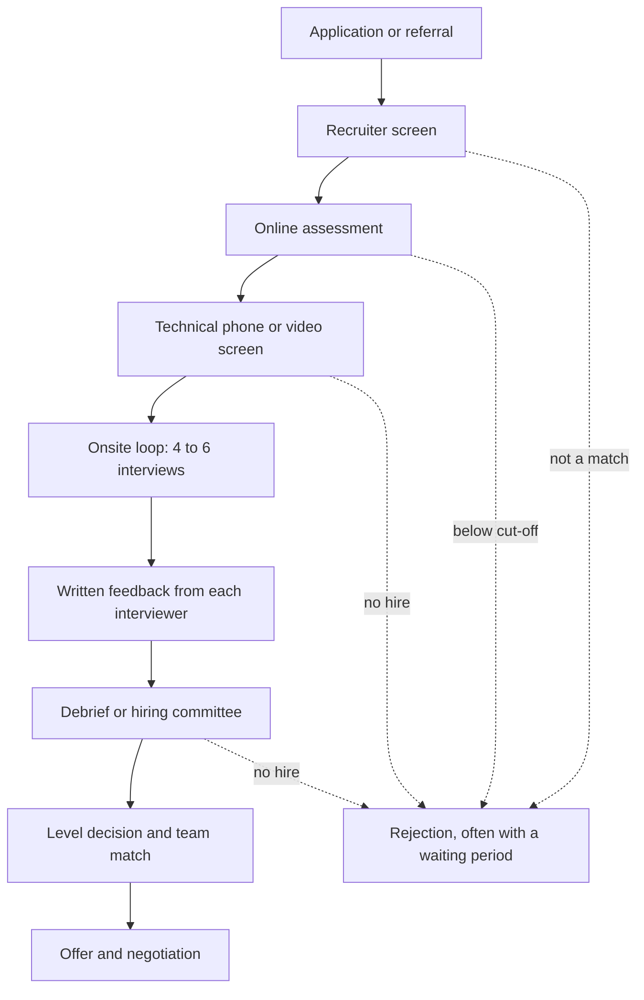

# How hiring at large tech companies works, end to end

## Before this lesson

You need no programming knowledge for this lesson. It helps to have seen what a coding question looks like; if you have not, open any problem in the [Arrays & Hashing track](#/track/neet-arrays) for two minutes and come back. If you want a wider view of every interview *type* (coding, design, testing, behavioural), read [How interviews work](#/lesson/thinking/how-interviews-work) in the Thinking track alongside this one.

## In plain words

Getting a software job at a large company is not one conversation. It is a **pipeline**: a fixed series of stages, each run by different people, each designed to answer one question about you cheaply before the company spends more time on the next stage.

An everyday analogy is a driving licence. First a paper form (are you eligible?), then a theory test (do you know the rules?), then a practical test with an examiner (can you drive?), and finally an office that reads the examiner's sheet and issues the licence. The examiner does not issue the licence, and the office never sat in the car. Hiring works the same way: the people who interview you usually do not decide alone, and the people who decide usually never met you. They read what was written about you.

Why does this matter for a job? Because candidates who understand the pipeline prepare for the right thing at the right time, know what "no news for two weeks" means, and do not misread a hard interview as a failed one. Most of this track teaches skills. This lesson teaches the map.

## The stages at a glance



Not every company uses every box, and the names differ, but the order is remarkably stable. Let us walk through each stage and ask the same three things: *who* runs it, *what question* it answers, and *what you should do*.

### Stage 0: getting noticed

A **recruiter** is a person whose job is to find candidates and guide them through the process; recruiters are usually not engineers. Your application reaches a recruiter in one of three ways:

- **A cold application** through the careers page. Large companies receive enormous numbers of these, so each one gets very little reading time.
- **A referral**: an employee submits your name. A referral does not get you hired, but it very often gets a human to read your resume, which is the hard part of stage 0.
- **Sourcing**: a recruiter finds *you*, typically through a public profile, open-source work or a past application.

What the stage answers: "Is it plausible that this person could pass our interviews for some open role?" The evidence is your resume and nothing else, which is why the lesson [Experience and a strong resume](#/lesson/interview-prep/experience-and-resume) spends so long on it.

### Stage 1: the recruiter screen

A 20 to 30 minute call. The recruiter checks facts that would make the rest pointless: are you allowed to work in the country, when can you start, which locations and roles interest you, roughly what level you are at, and whether you can talk about your own work clearly. Some recruiters ask a few light technical questions from a script (for example "what is the difference between a list and a hash table?"), but they are checking for red flags, not depth.

What to do: be friendly, be concise, have a two-minute summary of yourself ready (the lesson on [classic behavioural questions](#/lesson/interview-prep/classic-behavioural-questions) builds one), and ask the recruiter to describe the remaining stages. Recruiters are generally on your side. They are measured on hires, so they want you to succeed and will usually tell you the format if you ask.

> [!TIP]
> Ask the recruiter three things: how many interviews are in the loop, what type each one is (coding, design, behavioural), and which programming languages are allowed. This is normal, expected, and it turns preparation from guessing into planning.

### Stage 2: the online assessment

An **online assessment** (often shortened to OA) is a timed test you take alone in a browser: typically two or three programming problems in 60 to 90 minutes, judged automatically by hidden test cases. Some include multiple-choice questions or a work-style questionnaire.

What it answers: "Can this person write working code at all, without help, under time pressure?" It is a cheap filter, because no engineer's time is spent.

What to do: practise in the same conditions. Solve problems in an editor with a timer and without looking things up. Read the constraints carefully, because the hidden tests include large inputs that reject slow solutions. The problems attached to this track are judged the same way: hidden tests, including big ones.

### Stage 3: the technical screen

One or two interviews of 45 to 60 minutes with an engineer, by phone or video, using a shared editor. You solve one or two problems while explaining your thinking. There is usually no compiler, or one you should not lean on.

What it answers: "Is it worth a whole day of several engineers to interview this person onsite?" The bar is the same *kind* of bar as the onsite (problem solving, coding, communication), with less evidence.

What to do: everything in the [step-by-step method](#/lesson/interview-prep/seven-step-method) lesson. The single most common way to fail this stage is not a wrong answer. It is silence: the interviewer cannot write feedback about thinking they did not hear.

### Stage 4: the onsite loop

The **onsite** (it may be fully remote, the name stuck) is a block of four to six interviews in one day or spread over a few days. Each lasts 45 to 60 minutes with a different interviewer. The set of interviews is called the **loop**. A typical loop for a mid-level engineer contains:

| Interview type | How many | What it looks like |
|---|---|---|
| Coding and algorithms | 2 to 3 | A problem on a whiteboard or shared editor, like the technical screen |
| System design | 0 to 2 | "Design a service that …"; rare for new graduates, central for senior roles |
| Behavioural | 1, or mixed into the others | Questions about your past projects, conflicts and decisions |
| Domain-specific | 0 to 1 | For example front-end, mobile, machine learning, or testing |

Many companies also schedule a lunch or an informal chat. Treat it as friendly but not as off the record.

Each interviewer is normally given a focus area so that the loop as a whole covers every skill without everyone asking the same thing. Interviewers generally do not know how you did in the other rooms, on purpose, so that their judgments stay independent.

### Stage 5: written feedback

Within a day or so each interviewer writes a report. The usual contents are: the question asked, what you did step by step, strengths, concerns, and a **recommendation** on a short scale such as *strong hire, hire, leaning hire, leaning no hire, no hire, strong no hire*. Many companies also ask for a rating per skill. The next lesson, [What interviewers evaluate](#/lesson/interview-prep/what-interviewers-score), looks inside this report in detail, because everything you do in the room is aimed at what gets written here.

### Stage 6: the decision

Somebody reads all the reports together. Companies use one of two broad models:

- **A debrief led by the hiring manager.** The interviewers meet, discuss, and the manager of the team with the open role makes the call, sometimes subject to approval from above.
- **A hiring committee.** A group of experienced people *who did not interview you* reads the written packet (resume, reports, sometimes referral notes) and decides. The purpose is consistency: the same bar regardless of which team you interviewed with or how much a manager needs to fill a seat.

Either way the decision is made from text. A brilliant moment that no interviewer wrote down does not exist for the decision makers; a small stumble that was written down in neutral words is weighed against everything else.

> [!INTERVIEW]
> One weak interview rarely sinks a candidate, and one excellent interview rarely saves one. Reviewers look for a consistent picture. What hurts most is a *repeated* concern, for example two different interviewers independently noting "did not test the code".

### Stage 7: level and team

**Levelling** means deciding the seniority at which you would be hired: for example entry level, mid level, senior, staff. The level determines the pay band and the expectations after you join. It is usually decided from the same interview evidence, especially the system design and behavioural interviews, where scope and independence show.

Two things about levels surprise people:

1. You can pass the interviews and still be offered a level below the one you applied for (often called **down-levelling**). It is not an insult; it means the evidence for the higher level was not strong enough.
2. Level titles are not comparable across companies. "Senior" at one employer may match "mid level" at another. Compare responsibilities and pay, not words.

**Team matching** is how you end up on a specific team. In a *team-specific* process you interviewed for one team from the beginning. In a *general pool* process you pass a company-wide bar first and are then introduced to managers with openings; an offer may depend on a match being found.

### Stage 8: the offer

A recruiter calls with numbers: base salary, any bonus, any equity (shares or options that become yours over several years), and a start date. Almost always there is room to discuss them. The lesson [Evaluating and negotiating offers](#/lesson/interview-prep/evaluating-negotiating-offers) covers this stage on its own.

## How long does it all take?

From first recruiter call to offer, three to eight weeks is common; faster at small companies, slower when committees and team matching are involved. Silence between stages is normal and usually means scheduling, not rejection. It is fine to send one polite check-in after about a week, and it is fine (and useful) to tell a recruiter honestly that you have a deadline from another company.

## Why the process looks the way it does

Understanding the reasons removes a lot of frustration.

**Companies fear false positives more than false negatives.** A *false positive* is hiring someone who turns out to be a poor fit; a *false negative* is rejecting someone who would have done well. A bad hire costs months of salary, team time and morale, while a missed good candidate costs nothing visible. So the process is tuned to reject when in doubt. The uncomfortable consequence is that good engineers are rejected regularly, and that a rejection says "the evidence that day was not enough", not "you are not good enough".

**Algorithm questions are a proxy.** Nobody claims that reversing a linked list is the job. The claim is narrower: someone who can take an unfamiliar problem, reason aloud, find a correct approach, compare its cost with alternatives and turn it into clean code in 40 minutes is showing skills the job does need. The question is a small, fair, self-contained arena for those skills, which works for candidates from any background. You may disagree with the proxy, and many people do, but you will be measured by it.

**You are compared with other people who got the same question.** Interviewers reuse a question many times. They are not grading you against an absolute standard but against the spread of candidates they have seen on that same problem. A hard question where you needed two hints may be a better performance than an easy question you solved instantly. That is why you cannot judge your result from how the interview *felt*.

**Independent opinions reduce noise.** Any single interview is a noisy measurement: the question might suit you or not, the interviewer might be tired. Several independent interviews, written up before discussion, average the noise out. The demo below makes this concrete.

```python-run
import random

random.seed(4)

def one_interview(true_skill):
    """A noisy measurement: the true skill plus luck on the day."""
    return true_skill + random.gauss(0, 1.0)

def loop_passes(true_skill, interviews, bar=0.5):
    """Pass when the AVERAGE of the interview scores clears the bar."""
    scores = [one_interview(true_skill) for _ in range(interviews)]
    return sum(scores) / len(scores) >= bar

def pass_rate(true_skill, interviews, trials=20000):
    return sum(loop_passes(true_skill, interviews) for _ in range(trials)) / trials

print("skill   1 interview   5 interviews")
for skill in (-0.5, 0.0, 0.5, 1.0, 1.5):
    print(f"{skill:5.1f} {pass_rate(skill, 1):12.0%} {pass_rate(skill, 5):14.0%}")
```

Read the output line by line. `one_interview` adds random luck to a candidate's real ability. `loop_passes` averages several such measurements and compares the average with a bar. The table shows, for candidates of different true ability, how often they pass with one interview and with five. With a single interview, a clearly strong candidate (skill 1.5) still fails about one time in six, and a clearly weak one (skill −0.5) passes about one time in six. With five interviews the strong candidate almost always passes and the weak one almost never does. The candidate sitting exactly at the bar (0.5) passes half the time in both columns: more interviews cannot remove luck for borderline cases. Two practical lessons follow. First, a loop is fairer than a single conversation. Second, if you are near the bar, the outcome is close to a coin flip, so apply to several companies and, if rejected, try again later.

## What happens after a "no"

Most companies allow you to re-apply after a waiting period, commonly six months to a year. A past rejection is not a permanent mark; recruiters see that you interviewed before, and many successful hires are second or third attempts. Detailed feedback is rarely given, mainly for legal caution. You can still ask the recruiter one useful question: "Is there an area you would suggest I work on before re-applying?" Sometimes they answer.

## A worked example: reading a timeline

Suppose a candidate, Lena, logs the following.

- Day 1: recruiter call. Recruiter says the loop is "two coding, one design, one behavioural, team-specific".
- Day 6: online assessment, two problems. She fully solves one and passes about 70% of the hidden tests on the other.
- Day 9: invitation to a technical screen.
- Day 15: technical screen. She needs a hint to move from a quadratic solution to a linear one, then codes it cleanly and finds her own off-by-one bug while testing.
- Day 17: silence.
- Day 22: invitation to the onsite.

What can we infer at each point?

1. *Day 6.* A partially passing assessment is often enough. Cut-offs are set to remove clear mismatches, not to demand perfection, and they vary with how many candidates are in the pipeline.
2. *Day 15.* Needing one hint is ordinary. The interviewer's report can still say: "started with brute force and stated its complexity, optimised after one prompt, clean code, tested and fixed a bug without help". That is a positive report.
3. *Day 17.* Five working days of silence after a screen is scheduling. A rejection would normally have been sent quickly, because rejections need no coordination.
4. *Day 22.* "Team-specific" tells her the hiring manager will probably be one of the interviewers and will care about relevant experience, so she should prepare stories close to that team's domain and expect the design question to be related to their product area.

The skill here is replacing anxiety with inference: each event has a small number of likely explanations once you know the pipeline.

## Pitfalls

- **Preparing for the wrong stage.** Grinding hard dynamic programming before an online assessment that mostly tests careful implementation, or ignoring behavioural stories until the night before the onsite.
- **Treating the recruiter as an obstacle.** They are your best source of logistics, and they often speak for you when the packet is discussed.
- **Reading the interviewer's face.** Interviewers are trained to stay neutral, and some deliberately push until you get stuck to find your limit. A hard-feeling interview is not evidence of failure.
- **Assuming one bad round ends it.** Keep full effort for every remaining interview; the reviewers want a consistent picture, and a strong finish is part of it.
- **Giving up after one rejection.** With a process tuned against false positives, repeated attempts are part of the normal path.
- **Asking no questions.** Every interview ends with "any questions for me?". Having none reads as low interest. Prepare two real ones about the team's work.

> [!WARNING]
> Do not try to obtain or memorise "leaked" questions. Interviewers recognise rehearsed answers within a minute, follow up with a variation, and write "appeared to have seen the problem; could not adapt". Skills transfer between questions; memorised answers do not.

## Summary

- Hiring is a pipeline of cheap filters followed by expensive ones: resume, recruiter screen, online assessment, technical screen, onsite loop, written feedback, decision, level and team, offer.
- Each stage answers one question. Prepare for the question that stage asks.
- Decisions are made from written reports by people who may never have met you, so what matters is the evidence an interviewer can write down.
- The process is designed to reject when unsure, and you are compared with other candidates on the same question. Feelings after an interview are a poor guide.
- Several independent interviews make the result fairer but cannot remove luck near the bar. Apply widely and re-apply after a rejection.
- For how to turn this map into a schedule, continue to [Preparation plans](#/lesson/interview-prep/preparation-plans) and the site [roadmap](#/roadmap).

## Glossary

- **Pipeline**: the ordered series of stages a candidate passes through.
- **Recruiter**: the non-engineering contact who schedules and guides you through the process.
- **Referral**: an employee submitting your name for a role.
- **Online assessment (OA)**: an automatically judged, timed programming test taken alone.
- **Technical screen**: a remote interview with an engineer that decides whether to invite you onsite.
- **Onsite loop**: the main block of four to six interviews.
- **Feedback report**: the written summary and recommendation each interviewer submits.
- **Debrief**: a meeting where interviewers discuss a candidate.
- **Hiring committee**: a group that decides from written reports without having interviewed the candidate.
- **Levelling**: deciding the seniority and pay band of the offer; **down-levelling** is being offered a lower level than you applied for.
- **Team matching**: finding a specific team for a candidate who passed a general bar.
- **False positive / false negative**: hiring someone unsuitable / rejecting someone suitable.

```quiz
[
  {"q": "Who usually makes the final hire or no-hire decision at a company that uses a hiring committee?",
   "options": ["The interviewer who asked the hardest question", "A group that reads the written reports and did not interview the candidate", "The recruiter", "The candidate's future teammates by vote"],
   "answer": 1,
   "explain": "A committee decides from the written packet precisely so that the bar is consistent and independent of any one interviewer or team."},
  {"q": "What question is an online assessment mainly designed to answer?",
   "options": ["Whether the candidate can design large distributed systems", "Whether the candidate fits the team culture", "Whether the candidate can write working code alone under time pressure", "What salary the candidate expects"],
   "answer": 2,
   "explain": "It is an automatic, cheap filter on basic unaided coding ability before any engineer's time is spent."},
  {"q": "Why do large companies accept rejecting some good candidates?",
   "options": ["They have too many employees", "A bad hire is seen as far more costly than a missed good hire, so the process rejects when in doubt", "Recruiters are paid per rejection", "It is required by law"],
   "answer": 1,
   "explain": "The process is tuned to avoid false positives. The side effect is frequent false negatives, which is why re-applying is normal."},
  {"q": "You needed two hints on a hard problem and felt the interview went badly. What is the most accurate conclusion?",
   "options": ["You certainly failed", "You certainly passed", "You cannot tell: you are compared with others on the same question, and hints on a hard question are common", "The interviewer disliked you"],
   "answer": 2,
   "explain": "Evaluation is relative to other candidates who received the same question, and interviewers often push until you get stuck."},
  {"q": "In the simulation in this lesson, what did moving from one interview to five interviews change?",
   "options": ["Everyone passed more often", "Clearly strong candidates passed more reliably and clearly weak ones failed more reliably, while borderline candidates stayed near 50%", "Nothing changed", "Weak candidates passed more often"],
   "answer": 1,
   "explain": "Averaging independent noisy measurements reduces the effect of luck for candidates far from the bar; at the bar it remains a coin flip."},
  {"q": "What does down-levelling mean?",
   "options": ["Being rejected after the onsite", "Receiving an offer at a lower seniority level than the one applied for", "Being moved to a different city", "Having the interview shortened"],
   "answer": 1,
   "explain": "The candidate passed, but the evidence supported a lower level, which sets the pay band and expectations."},
  {"q": "Which request to a recruiter is appropriate before an onsite?",
   "options": ["The exact questions that will be asked", "The number and type of interviews and the languages allowed", "The other candidates' scores", "The interviewers' home addresses"],
   "answer": 1,
   "explain": "Format questions are normal and recruiters expect them. Asking for the questions themselves is not appropriate and would not help."}
]
```

> **Source:** McDowell, Cracking the Coding Interview 6e, Introduction and ch. I–II (The Interview Process; Behind the Scenes). Explanations, examples and the simulation are original.
