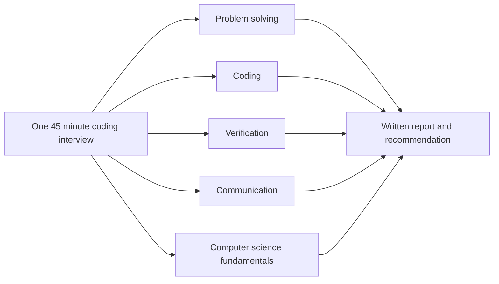

# What interviewers evaluate, and how scoring rubrics work

## Before this lesson

Read [How hiring works end to end](#/lesson/interview-prep/hiring-pipeline) first: this lesson zooms into one box of that pipeline, the written feedback. No coding knowledge is required, although one example mentions "time complexity", which means how the running time of a program grows as its input grows (taught from zero in [Big O foundations](#/lesson/interview-prep/big-o-foundations)).

## In plain words

After each interview, the interviewer fills in a form. The form has a handful of headings, a space for evidence under each, and a final recommendation. A **rubric** is the scoring guide behind that form: for each heading it describes what a weak, an acceptable and a strong performance look like, so that different interviewers grade in the same way.

Think of a figure-skating judge. The judge does not write "I liked it". They hold a sheet with categories (technique, difficulty, execution) and a description of each score. A skater who knows the sheet can make sure every category has something in it. Interviewing is the same: once you know the headings, you can deliberately give the interviewer evidence for each one, instead of hoping that solving the problem is enough.

It matters for a job because the people who decide read these forms and nothing else. Two candidates can write identical final code and receive different outcomes because one of them produced evidence under every heading and the other produced it under one.

## The headings almost every company uses

Names vary, but coding interviews are graded on roughly five dimensions.



### 1. Problem solving (analytical ability)

Did you understand the problem, ask about unclear points, find an approach, and improve it? Did you compare alternatives and reason about trade-offs? Did you need hints, and how did you use them?

A **trade-off** is a choice where improving one thing costs another, for example using extra memory to save time.

### 2. Coding

Can you turn the idea into correct, readable code at a reasonable speed? Readable means sensible names, small helper functions, no repeated blocks, and a structure another engineer could follow. Fluency in your chosen language counts: fumbling basic syntax in the language you picked yourself is noted.

### 3. Verification (testing and debugging)

Did you check your own work without being told to? Did you walk through the code with an example, consider **edge cases** (unusual inputs such as an empty list, a single element, duplicates, very large values), find bugs and fix them calmly?

### 4. Communication and collaboration

Could the interviewer follow your reasoning as it happened? Did you listen, respond to hints, and treat the session as two engineers working together? Would they want to work with you?

### 5. Computer science fundamentals

Do you know the standard building blocks (arrays, hash tables, trees, graphs, sorting, recursion) and can you state the cost of your solution in time and memory? This is the knowledge base that Part B of this track reviews.

Behavioural and system design interviews have their own headings (for instance ownership, conflict handling, dealing with ambiguity; or requirements, architecture, scaling, trade-offs). The lessons on [behavioural stories](#/lesson/interview-prep/story-grid-star) and [system design](#/lesson/interview-prep/system-design-scalability) cover those.

## What a rubric actually says

Below is a rubric of the kind interviewers are trained on. It is written for this lesson (every company words its own differently), but the levels are representative. Read across each row and notice that the difference between columns is rarely "solved it or not".

| Dimension | Below the bar | Meets the bar | Clearly above the bar |
|---|---|---|---|
| Problem solving | Starts coding at once; cannot find an approach without heavy help; ignores hints | States a simple correct approach, gives its cost, improves it with at most a hint or two | Finds an efficient approach independently, compares options, explains why it cannot be improved further |
| Coding | Code does not run or is tangled; long pauses on basic syntax | Working code with minor slips; reasonable names and structure | Clean, modular code written fluently; handles errors and boundaries naturally |
| Verification | Declares "done" without checking; cannot locate a bug when shown a failing input | Tests with an example when prompted or at the end; finds and fixes most bugs | Tests systematically without prompting, chooses revealing cases, fixes bugs with a careful, targeted change |
| Communication | Silent, or talks without structure; argues with hints | Explains the plan before coding; easy to follow; open to suggestions | Leads the conversation, checks understanding, makes the interviewer's job easy |
| Fundamentals | Wrong or missing complexity; unfamiliar with basic structures | Correct complexity for time and memory; picks suitable data structures | Knows alternatives and their costs; relates the problem to known techniques |

Each row gets a rating, and then the interviewer chooses an overall recommendation. A common scale has four to six steps, from *strong no hire* to *strong hire*. Many companies remove the neutral middle on purpose so that the interviewer has to lean one way.

> [!INTERVIEW]
> Interviewers are told to write **evidence, not adjectives**. "Good communicator" is useless to a reviewer. "Before coding, summarised the approach in three steps and asked whether duplicates could appear" is evidence. Your job is to produce quotable evidence.

## A worked example: two candidates, same code

Both candidates receive this task: *given a list of integers, return the two positions whose values add up to a target.* Both end with the same correct, fast solution that uses a dictionary. Here is what each interviewer could honestly write.

**Candidate A** read the problem, thought silently for four minutes, wrote the final code, and said "done". When asked about duplicates, they answered correctly. When asked for the cost, they said "linear".

**Candidate B** restated the task and asked whether the list can contain negative numbers and whether a solution is guaranteed. They described the simple approach first (check every pair), stated that it takes time proportional to n squared, and said it repeats work because it searches for the partner again and again. They proposed remembering the values already seen in a dictionary, checked the idea on a three-element example, wrote the code while saying what each part does, then traced it by hand with a list containing a duplicate and found that they had stored a value before checking for its partner, which broke the duplicate case. They fixed it and stated the time and memory cost.

<details>
<summary>Open to see the two reports side by side</summary>

| Dimension | Report on A | Report on B |
|---|---|---|
| Problem solving | "Reached the optimal solution. I could not observe how; no alternatives discussed." | "Started from brute force, identified repeated lookup as the bottleneck, moved to a hash map unprompted." |
| Coding | "Correct, concise." | "Correct, concise, narrated while writing." |
| Verification | "Did not test until I asked." | "Traced with a duplicate case, found and fixed an ordering bug without help." |
| Communication | "Quiet. Answered questions accurately when asked." | "Clear plan up front, asked two good clarifying questions." |
| Fundamentals | "Complexity correct when asked." | "Gave time and memory complexity for both approaches." |
| Overall | *Leaning hire*, low confidence: "may have seen the problem before" | *Hire* or *strong hire*, high confidence |

</details>

Candidate B made a mistake that A did not make, and still received the stronger report. The mistake gave the interviewer evidence for the verification row. This is the central point of the lesson: **the interview measures the process, and the final code is only one piece of evidence about it.**

## Turning a rubric into behaviour

The demo below encodes a simplified rubric: each dimension is rated from 1 to 4 and the overall recommendation is a rule on top of the ratings. Change the ratings and run it again.

```python-run
RUBRIC = ["problem_solving", "coding", "verification", "communication", "fundamentals"]

def recommend(ratings):
    """ratings: dict from dimension to 1 (poor) .. 4 (excellent)."""
    lowest = min(ratings.values())
    average = sum(ratings.values()) / len(ratings)
    if lowest == 1:
        return "no hire (a serious concern in one area)"
    if average >= 3.4:
        return "strong hire"
    if average >= 2.8:
        return "hire"
    if average >= 2.4:
        return "leaning no hire"
    return "no hire"

candidate_a = dict(problem_solving=3, coding=3, verification=2, communication=2, fundamentals=3)
candidate_b = dict(problem_solving=4, coding=3, verification=4, communication=4, fundamentals=3)
silent_genius = dict(problem_solving=4, coding=4, verification=1, communication=2, fundamentals=4)

for name, r in [("A", candidate_a), ("B", candidate_b), ("silent genius", silent_genius)]:
    print(f"{name:14s} average {sum(r.values()) / 5:.1f} -> {recommend(r)}")
```

`recommend` first looks at the lowest rating: one serious concern can outweigh strength elsewhere, which is how real reviewers treat, for example, code that was never tested. Otherwise it uses the average. The "silent genius" has three top ratings and still receives *no hire* because of the single 1. Real decisions are made by people, not formulas, but the shape is accurate: balance beats brilliance in one column.

From the rubric you can derive a small set of habits that put evidence in every row:

| Habit | Row it feeds |
|---|---|
| Restate the problem and ask two or three clarifying questions | Problem solving, communication |
| Say the simple approach and its cost before the clever one | Problem solving, fundamentals |
| Outline the plan in a few sentences before writing code | Communication |
| Use helper functions and meaningful names | Coding |
| Trace the finished code with a small example and one edge case | Verification |
| State time and memory cost at the end | Fundamentals |
| Treat a hint as information and build on it aloud | Communication, problem solving |

These habits are the skeleton of the [step-by-step method](#/lesson/interview-prep/seven-step-method).

## What interviewers are *not* scoring

- **Whether you had heard of the exact problem.** A recognised problem is less informative, so interviewers follow up with a twist.
- **Speed alone.** Finishing in 15 minutes leaves time for a second, harder question; it is good, but a careful 35 minutes with testing beats a rushed 15 with a bug nobody caught.
- **Perfect syntax on a whiteboard.** A missing colon is ignored. Not knowing how to loop over a dictionary in your chosen language is not.
- **Agreeing with the interviewer on everything.** Polite, reasoned disagreement is a positive signal about collaboration.

## How companies differ, in general terms

Company-specific details change every year and differ between offices, so this section describes *patterns* you can recognise, and questions to ask your recruiter, without attributing fixed habits to named employers.

| Pattern | What it looks like | How to adapt |
|---|---|---|
| Committee decides | Interviewers submit reports; a separate group decides; team match afterwards | Expect a slower decision; consistency across all rounds matters most |
| Hiring manager decides | Team-specific loop; the manager is in the room | Research the team's product; relevant experience weighs more |
| Elevated-bar interviewer | One interviewer from outside the team is responsible for keeping the bar high and can block an offer | Treat every round as equally important; you will not know which one it is |
| Values-driven behavioural rounds | The company publishes principles and every interviewer probes one or two of them | Prepare stories mapped to the published principles |
| Algorithm-heavy | Most rounds are data structures and algorithms on a shared document | Depth in [the pattern tracks](#/track/neet-arrays) pays off |
| Practical or take-home | Build a small feature, debug an existing project, or review code | Practise writing runnable, tested code with real tools; read [code quality scenarios](#/lesson/thinking/code-review-snippets) |
| Design-heavy for senior roles | Two design rounds and deep project discussions | Study the [System Design track](#/track/system-design) and prepare your own architecture stories |
| Start-up style | Fewer rounds, founders involved, broad questions, speed | Show range and initiative; expect less structure and faster offers |

Start-ups and smaller companies deserve one extra note. Their process is shorter and more personal, they value people who can work across many areas, and they may weigh concrete things you have built more than puzzle performance. Pay often contains more equity and less cash, and the risk is higher: all of that belongs to offer evaluation, covered in a [later lesson](#/lesson/interview-prep/evaluating-negotiating-offers).

> [!TIP]
> Whatever the company, the same question to the recruiter reveals the pattern: "Could you tell me how the decision is made after the interviews, and what each interview focuses on?"

## A note for when you become the interviewer

Sooner than you expect, you will sit on the other side. The book's advice to interviewers is worth knowing now because it explains good interviewers' behaviour:

- Good questions have several levels of solution, so that every candidate can make progress and strong ones can go further.
- Questions that hinge on one flash of insight, or on obscure knowledge, measure luck and trivia.
- Interviewers should encourage, give hints at a steady pace, and probe for depth, because a relaxed candidate gives a more accurate signal.
- Behavioural questions should dig for the candidate's own actions and decisions, not the team's.

When an interviewer keeps asking "and what did *you* do?" or "can it be faster?", they are following this guidance, not signalling displeasure.

## Pitfalls

- **Optimising for the answer instead of the evidence.** Silent correctness leaves four rows of the form empty.
- **Hiding uncertainty.** Saying "I am not sure this handles an empty list; let me check" is a verification point, not a weakness.
- **Fighting a hint.** A hint is the interviewer spending their own time to keep you moving. Use it, and say how it changes your plan.
- **Skipping the simple approach.** Naming the brute force and its cost takes thirty seconds and secures credit for fundamentals and problem solving even if the clever idea never arrives.
- **Ending without a complexity statement.** If you do not say it, the interviewer must ask, and "had to be asked" is how it is written down.
- **Assuming what one company does applies to all.** Ask about the format every time.

> [!WARNING]
> Never pretend you have not seen a question when you have. Say so. Interviewers usually switch questions and note your honesty; being caught reciting a memorised answer raises doubts about everything else you said.

## Summary

- Interviewers fill in a form with headings; a rubric defines weak, acceptable and strong for each heading.
- The five usual headings for coding rounds are problem solving, coding, verification, communication and fundamentals.
- Reports contain evidence. Aim to produce quotable evidence under every heading, every time.
- Two candidates with the same code can receive different recommendations; visible process, self-testing and clear communication make the difference.
- One serious gap can outweigh strengths elsewhere, so balance matters.
- Companies differ in who decides, how many rounds there are and what they emphasise; ask the recruiter instead of guessing.

## Glossary

- **Rubric**: a scoring guide that describes each rating level for each evaluated skill.
- **Dimension**: one heading of the rubric, such as coding or communication.
- **Recommendation**: the interviewer's overall verdict on a short scale from strong no hire to strong hire.
- **Evidence**: a concrete, observable thing the candidate did or said, recorded in the report.
- **Trade-off**: a decision in which gaining one quality costs another.
- **Edge case**: an unusual input at the boundary of what the code must handle.
- **Brute force**: the most direct solution that tries all possibilities, usually slow but easy to trust.
- **Elevated-bar interviewer**: an interviewer from outside the hiring team whose role is to protect the hiring standard.
- **Take-home**: an assignment completed in your own time and discussed later.

```quiz
[
  {"q": "What is a rubric in the context of interviewing?",
   "options": ["A list of the questions that will be asked", "A scoring guide describing weak, acceptable and strong performance for each skill", "The candidate's resume", "A legal contract"],
   "answer": 1,
   "explain": "The rubric makes different interviewers grade the same behaviour in the same way."},
  {"q": "Two candidates write identical correct code. One explained the approach, tested it and stated its cost; the other was silent. What usually happens?",
   "options": ["They receive the same recommendation", "The silent one is rated higher for speed", "The one who showed the process is rated higher because more rubric rows have evidence", "Both are rejected"],
   "answer": 2,
   "explain": "Reports are built from observable evidence across several dimensions, not from the final code alone."},
  {"q": "Which statement is written as evidence rather than as an adjective?",
   "options": ["Great communicator", "Smart", "Traced the code with an empty list and fixed an index error unprompted", "Seemed confident"],
   "answer": 2,
   "explain": "It records a specific observed action that a reviewer can weigh."},
  {"q": "In the demo, why did the candidate with three top ratings get a no-hire?",
   "options": ["The average was too low", "One dimension was rated 1, and a serious concern in a single area can outweigh strengths elsewhere", "They were too fast", "The function has a bug"],
   "answer": 1,
   "explain": "The rule checks the lowest rating first, mirroring how reviewers treat a serious gap such as never testing."},
  {"q": "You have seen the interview question before. What should you do?",
   "options": ["Recite the answer quickly", "Pretend to struggle", "Tell the interviewer", "Refuse to answer"],
   "answer": 2,
   "explain": "Honesty is noted positively and the interviewer can switch to a question that gives a real signal."},
  {"q": "Which habit provides evidence for the fundamentals dimension?",
   "options": ["Stating the time and memory cost of your solution", "Arriving early", "Writing very long variable names", "Asking about salary"],
   "answer": 0,
   "explain": "Complexity analysis and the choice of data structure are how fundamentals show up in a coding round."},
  {"q": "What is the best way to learn how a particular company runs its interviews?",
   "options": ["Assume it matches the last company you interviewed with", "Ask the recruiter how the decision is made and what each round covers", "Guess from the company logo", "Wait until the interview day"],
   "answer": 1,
   "explain": "Formats differ and change over time; recruiters expect and answer format questions."}
]
```

> **Source:** McDowell, Cracking the Coding Interview 6e, ch. I–III (The Interview Process; Behind the Scenes; Special Situations: For Interviewers). The rubric, reports and demo are original illustrations.
