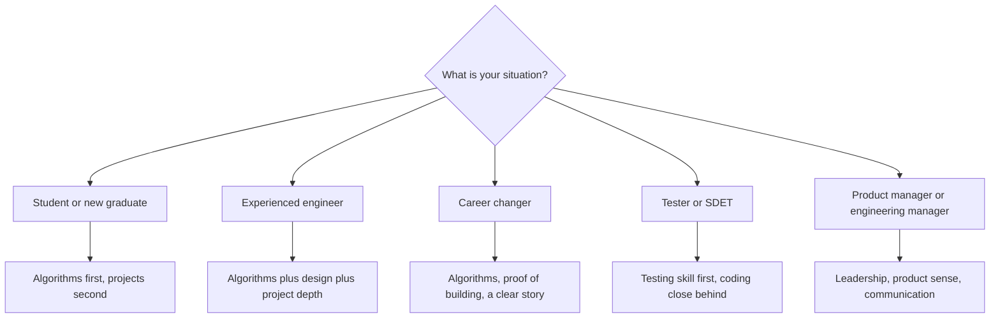

# Special situations: new graduates, experienced hires, career changers, testers and managers

## Before this lesson

Read [How hiring works end to end](#/lesson/interview-prep/hiring-pipeline) and [What interviewers evaluate](#/lesson/interview-prep/what-interviewers-score). This lesson assumes you know the stages of the pipeline and the five rubric headings (problem solving, coding, verification, communication, fundamentals).

## In plain words

The standard interview loop was designed with one person in mind: a software engineer with a few years of experience applying for a software engineering job. Many candidates are not that person. You might be a student with no full-time job behind you, a senior engineer with fifteen years, a nurse or accountant moving into software, a tester, or someone applying to manage products or people.

The loop is mostly the same for everyone, but the **weights** change. Think of a recipe that is adjusted for the guest: the ingredients stay, the proportions move. A new graduate is judged more on raw problem solving and potential; a senior engineer more on design and judgment; a manager more on people and delivery. If you prepare with the wrong proportions, you can do well on the parts that count least for you.

This matters for a job because preparation time is limited. Knowing which parts of the loop carry the most weight for your situation tells you where to spend it.

## The weight map

The table gives a rough picture of emphasis. "High" means the area often decides the outcome; "low" means it is rarely the deciding factor, not that it can be ignored.

| Situation | Algorithms and coding | System design | Behavioural and leadership | Domain knowledge |
|---|---|---|---|---|
| New graduate or intern | Very high | Low | Medium | Low |
| Experienced engineer | High | High | High | Medium |
| Career changer | Very high | Low to medium | High (your story) | Medium |
| Tester or SDET | Medium to high | Low to medium | Medium | Very high (testing) |
| Product or program manager | Low to medium | Medium (product design) | Very high | Very high (product sense) |
| Engineering lead or manager | Medium to high | High | Very high | Medium |
| Start-up candidate | Medium to high | Medium | High (initiative) | High (their stack) |

**SDET** stands for Software Development Engineer in Test: a person who writes software whose purpose is to test other software.



## New graduates and interns

### What is different

- Nobody expects production experience. Interviewers look for **potential**: can you learn quickly and reason well?
- The loop is almost entirely coding and algorithms. System design, if present at all, is light ("how would you structure this small program?").
- Behavioural questions draw on coursework, group projects, internships, clubs and personal projects. That is expected and fine.

### How to prepare

1. **Fundamentals before tricks.** The [DSA foundations track](#/track/dsa-foundations) and the six pattern tracks beginning with [Arrays & Hashing](#/track/neet-arrays) cover what is asked.
2. **Have two or three projects you can explain in depth.** Course assignments that every classmate also did are the weakest evidence. Something you chose to build, however small, shows initiative. The next lesson, [Experience and a strong resume](#/lesson/interview-prep/experience-and-resume), explains how to pick and present them.
3. **Apply early.** Internship and graduate hiring often happens many months before the start date.
4. **Treat internships as the main door.** A successful internship frequently converts into a full-time offer with a much shorter process.

> [!TIP]
> If you have no internship, you still have material: a personal project with real users (even five), a contribution to an open-source project, a teaching-assistant role, a hackathon. What interviewers want is evidence that you write code when nobody is making you.

## Experienced engineers

### What is different

A common and costly belief is "with my experience they will skip the algorithm questions". Usually they do not. Experienced candidates face the same coding rounds, and in some places a slightly *higher* bar on them, **plus** additional rounds:

- **System design**: designing a service on a whiteboard, discussing storage, scaling and failure. Its weight grows with seniority.
- **Project deep dives**: 30 to 45 minutes on one system you built. Expect "why that database?", "what would you do differently?", "what broke in production?".
- **Leadership behaviour**: mentoring, disagreeing with other senior people, influencing without authority, handling ambiguous goals.

Your level is decided largely from these added rounds. Two candidates with identical coding performance can receive offers one level apart because of how they handled design and scope.

### How to prepare

1. **Re-learn the algorithm material honestly.** Years of real work make you a better engineer and often a rustier puzzle solver. Budget time accordingly; the 12-week plan in [Preparation plans](#/lesson/interview-prep/preparation-plans) has a variant for this.
2. **Prepare design.** Work through the [System Design track](#/track/system-design), starting from its [four-step framework](#/lesson/system-design/framework-four-steps).
3. **Rehearse your own projects as stories with numbers.** Scale, latency, team size, what you personally decided. "We" hides you; say "I" for your part.
4. **Know your level target.** Ask the recruiter what level the role is and what distinguishes it from the level below.

> [!INTERVIEW]
> For senior roles, interviewers listen for *scope words*: did you design a function, a service, or a system used by several teams? Did you follow a plan or write it? Mention the widest scope that is true.

## Career changers

A **career changer** is someone entering software from another profession or from a non-traditional route such as self-study or a short intensive course.

### What is different

- Recruiters may hesitate at the resume stage because there is no software job title to match. Stage 0 is your hardest stage.
- Interviewers will ask "why the change?" and will check that your skills are real, not only certificates.
- Your previous career is an asset when you frame it well: domain knowledge (finance, health, logistics), professionalism, communication with customers, experience under pressure.

### How to prepare

1. **Build visible proof.** Two or three finished projects with source code online, ideally connected to your old field (a scheduling tool for clinics from a former nurse is memorable and credible).
2. **Close the theory gap deliberately.** Self-taught developers often build well but have not met Big O, hash tables or graphs by name. Those are exactly what interviews test. Follow the site [roadmap](#/roadmap) from the foundations.
3. **Write a one-minute story of the change** with a reason, a turning point and evidence of commitment. A worked model answer is in [Classic behavioural questions](#/lesson/interview-prep/classic-behavioural-questions).
4. **Use referrals.** A person vouching for you matters more when your resume is unusual.
5. **Consider stepping-stone roles** (support engineering, testing, internal tools, data analysis) at a company where moving into development is realistic. Ask how often such moves happen.

## Testers and SDETs

### What is different

Testing roles are judged on two skill sets at once: you must code *and* you must think like a tester. In many companies an SDET loop contains ordinary coding rounds at a slightly lower algorithmic bar, plus dedicated testing rounds:

- "How would you test a pen, a lift, a login page, a function that sorts?"
- "Here is a function; write the test cases."
- "The application crashes on start for some users. How do you investigate?"

### How to prepare

1. **Do not skip algorithm practice.** A common failure is strong testing answers with weak code.
2. **Learn a structured approach to test design**: who uses it, what are the use cases, what are the limits, how does it fail, how would you automate the checks. This track's lesson [Testing questions](#/lesson/interview-prep/testing-questions) gives the method, and the Thinking track goes deeper with [partitions and boundaries](#/lesson/thinking/partitions-boundaries).
3. **Think about your direction.** If your aim is a development role later, say so only if the company supports such moves, and keep your coding skills visibly strong.

## Product managers and program managers

A **product manager** (PM) decides *what* should be built and why; a **program manager** coordinates how and when work across teams gets delivered. Titles and duties vary a lot between companies, so ask what the role involves there.

### What is evaluated

- **Handling ambiguity**: given a vague prompt ("improve our maps product"), do you structure it, ask about goals and users, and move forward?
- **Customer focus**: do you start from who the user is and what they need, or from features you like?
- **Communication**: PMs spend their days explaining and persuading. Clarity is the product.
- **Passion for technology**, shown through informed opinions on real products.
- **Teamwork and leadership without authority**: engineers do not report to PMs, so influence must come from trust.
- **Technical depth**: varies from light to substantial. Some PM loops include a coding or technical design round.

### How to prepare

Practise product design questions aloud (users, needs, options, trade-offs, success measures), estimation questions, and many behavioural stories. The Thinking track has directly relevant lessons: [estimation](#/lesson/thinking/estimation-fermi), [metrics and experiments](#/lesson/thinking/metrics-experiments) and [prioritisation](#/lesson/thinking/prioritisation).

## Engineering leads and managers

### What is different

Most companies still expect managers to pass technical rounds, often coding and nearly always design, because a manager who cannot follow the technical discussion loses the team's respect. On top of that come management-specific areas:

- **People**: hiring, growing engineers, handling poor performance, resolving conflict between team members.
- **Delivery**: planning, estimating, cutting scope, reporting risk early.
- **Prioritisation and communication upward**: saying no, explaining trade-offs to non-technical leaders.
- **Past record**: concrete results of teams you led.

### How to prepare

Prepare stories in which *your* action as a lead changed an outcome: a hire you fought for, a difficult performance conversation, a project you rescued or cancelled. Be ready for hypotheticals ("two senior engineers disagree about an architecture; what do you do?"). The lessons [prioritisation](#/lesson/thinking/prioritisation) and [planning and estimating](#/lesson/thinking/planning-estimating) help with the delivery side.

> [!WARNING]
> Managers sometimes skip coding practice on the assumption that "they will not ask me to code". Many loops do. Ask the recruiter directly, and if there is a coding round, prepare for it as an engineer would.

## Start-ups, and joining through an acquisition

**Start-ups.** Processes vary widely. Common features: fewer rounds, interviews with founders, practical tasks in the company's own technology, and strong interest in what you have built on your own initiative. Expect questions about why you want this company in particular and how you handle unclear requirements. Personal fit weighs more because every hire is a large fraction of a small team.

**Acquisitions.** When a larger company buys a smaller one mainly to hire its people (sometimes called an *acquihire*), the smaller company's engineers are often interviewed individually, with the same kind of loop as external candidates. If you work at a start-up in acquisition talks, the practical advice is the same as for any candidate: practise as a team, including algorithms, and do not assume the deal exempts you.

## Worked example: choosing where to spend 40 hours

Three people each have 40 hours before their loops. The demo below turns the weight map into hours. Edit the weights to match what your recruiter tells you.

```python-run
WEIGHTS = {
    "new graduate":      dict(algorithms=7, design=1, behavioural=2, domain=0),
    "senior engineer":   dict(algorithms=4, design=3, behavioural=2, domain=1),
    "SDET":              dict(algorithms=3, design=1, behavioural=2, domain=4),
    "product manager":   dict(algorithms=1, design=2, behavioural=4, domain=3),
}

def plan(hours, weights):
    total = sum(weights.values())
    return {area: round(hours * w / total, 1) for area, w in weights.items()}

for person, weights in WEIGHTS.items():
    split = plan(40, weights)
    line = ", ".join(f"{area} {h}h" for area, h in split.items() if h)
    print(f"{person:16s} -> {line}")
```

`plan` divides the hours in proportion to the weights: each area receives `hours * weight / total_weight`. For the new graduate, algorithms have weight 7 out of 10, so they receive 28 of the 40 hours. For the senior engineer the same 40 hours spread across four areas, and the 12 hours of design are hours a new graduate would waste. The numbers are not precise truths; the point is that the split should be a decision, written down, not an accident.

Now apply it to a concrete person. Dario has six years as a back-end engineer and an onsite with two coding rounds, one design round and one behavioural round. A sensible 40-hour split from the table: about 16 hours of coding problems (two per day, timed, with spoken explanations), 12 hours of design (framework plus three practice designs), 8 hours preparing and rehearsing six project stories, and 4 hours on the company's products and domain. If Dario spent all 40 hours on algorithms, three of his four interviews would be under-prepared in the dimension that sets his level.

## Pitfalls

- **Preparing someone else's loop.** A new graduate studying distributed systems for weeks, or a senior engineer doing only puzzles.
- **Believing experience exempts you from coding rounds.** It rarely does.
- **Apologising for your background.** Career changers who present their past as a detour sound unsure; present it as an advantage plus a deliberate decision.
- **"We" in every sentence.** Interviewers must evaluate you, so separate your own actions from the team's.
- **Testers neglecting code, developers neglecting testing.** Each side is checked on the other's skill.
- **Not asking what the role means at this company.** Titles such as PM, SDET and lead differ a great deal between employers.

## Summary

- The loop's ingredients are the same for everyone; the weights depend on your situation.
- New graduates: algorithms and potential, supported by projects.
- Experienced engineers: algorithms still, plus system design, project depth and leadership, which decide the level.
- Career changers: prove you can build, close the theory gap, tell the story of the change with confidence.
- Testers: testing technique is the core, coding is close behind.
- Product and engineering managers: communication, ambiguity, people and delivery, usually with technical rounds as well.
- Ask the recruiter about the format, then split your preparation hours on purpose.

## Glossary

- **Potential**: an interviewer's estimate of how fast and how far a candidate will grow.
- **SDET**: Software Development Engineer in Test, an engineer who builds automated tests and test tools.
- **Career changer**: a candidate moving into software from another field or route.
- **Product manager (PM)**: the person responsible for deciding what a product should do and why.
- **Program manager**: the person coordinating delivery across teams.
- **Project deep dive**: an interview that examines one of your past systems in detail.
- **Scope**: the size of the area you were responsible for (a function, a service, several teams).
- **Acquihire**: an acquisition made mainly to hire the acquired company's staff.
- **Stepping-stone role**: a job adjacent to your target role, taken as a route into it.

```quiz
[
  {"q": "For a new graduate, which area usually carries the most weight?",
   "options": ["Large-scale system design", "Algorithms and coding", "People management", "Knowledge of the company's internal tools"],
   "answer": 1,
   "explain": "With little work history to examine, interviewers focus on problem solving and coding as signs of potential."},
  {"q": "An engineer with ten years of experience assumes the coding rounds will be skipped. What is the most accurate response?",
   "options": ["Correct, seniors never code in interviews", "Usually wrong: seniors face the same coding rounds plus design and leadership rounds", "Correct if they have a referral", "Only true for remote interviews"],
   "answer": 1,
   "explain": "Experience adds rounds; it rarely removes the coding ones."},
  {"q": "Which rounds most strongly influence the level of an experienced engineer's offer?",
   "options": ["The recruiter screen", "System design, project deep dives and leadership behaviour", "The online assessment", "The lunch conversation"],
   "answer": 1,
   "explain": "Scope, judgment and independence are visible in design and behavioural rounds, and those define seniority."},
  {"q": "What is the hardest stage for most career changers?",
   "options": ["Getting past the resume screen, because there is no matching job title", "The offer negotiation", "Team matching", "The lunch interview"],
   "answer": 0,
   "explain": "An unusual resume gets filtered early, which is why visible projects and referrals matter so much."},
  {"q": "An SDET loop typically tests which combination?",
   "options": ["Only manual testing knowledge", "Coding ability plus structured test design and troubleshooting", "Only system design", "Only behavioural questions"],
   "answer": 1,
   "explain": "SDETs write software that tests software, so both skill sets are examined."},
  {"q": "Why do interviewers of product managers give deliberately vague prompts?",
   "options": ["They did not prepare", "To see whether the candidate structures ambiguity by asking about users and goals", "To save time", "To test typing speed"],
   "answer": 1,
   "explain": "Handling ambiguity and starting from the customer are central PM skills."},
  {"q": "In the 40-hour demo, why does the senior engineer's plan differ from the new graduate's?",
   "options": ["Seniors study more slowly", "The weights differ, so hours are spread across design and behavioural areas that matter little for a graduate", "The function is random", "Seniors get more hours"],
   "answer": 1,
   "explain": "Hours are divided in proportion to the weights of each area for that situation."}
]
```

> **Source:** McDowell, Cracking the Coding Interview 6e, ch. III (Special Situations). The weight map, demo and worked example are original.
