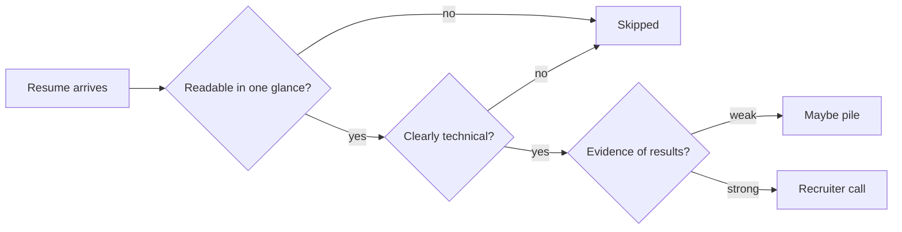

# Experience and a strong resume

## Before this lesson

Read [How hiring works end to end](#/lesson/interview-prep/hiring-pipeline) so that you know where the resume sits in the pipeline (stage 0, before any human has spoken to you), and skim [Special situations](#/lesson/interview-prep/special-situations) to find the paragraph that matches your background. No technical knowledge is needed here.

## In plain words

A **resume** (also called a CV) is a one-page summary of what you have done. In hiring it has exactly one job: to make a busy stranger decide, in well under a minute, that you are worth a phone call.

Picture a shop window. People walking past do not come in and inspect the stock; they glance for a few seconds and either enter or keep walking. A good window shows two or three of the best items clearly. A bad window is crammed with everything the shop owns, so nothing can be seen. Your resume is the window, and your experience is the stock. This lesson has two halves that follow from the picture: first, how to get stock worth showing (the right experience); second, how to dress the window (the resume itself), with a complete before-and-after example.

It matters for a job because every later stage depends on passing this one. Excellent interview skills are worthless if nobody invites you to interview.

## Part 1: getting the right experience

Recruiters and interviewers look for evidence of two things: that you can **write real software**, and that you **take initiative**. The most convincing evidence is something you built, especially something you were not forced to build.

### If you are a student

- **Take the courses with large projects.** A course in which you build a compiler, an operating-system component, a database or a web service gives you something concrete to describe. Among such courses, prefer the ones closest to real-world work.
- **Get an internship as early as you can.** Even a small company's internship in your first or second year makes the next, better one much easier to get.
- **Start something.** A personal project, a hackathon entry, a contribution to an open-source library, a tool for a student club. "Built an app that 40 classmates use to swap textbooks" beats a perfect grade in an elective.

### If you already work

- **Steer your work toward coding and toward things you can describe.** If your job has drifted into pure maintenance or configuration, ask for a development task, or shift your duties gradually.
- **Use evenings or weekends sparingly but deliberately.** One finished side project in a technology you want to work with says more than five abandoned ones.
- **Keep a private log of accomplishments.** Each month, write two lines: what you did and what changed because of it (faster, cheaper, fewer errors, more users). This log becomes your resume and your behavioural stories.

### If you are changing career

Build two or three finished projects, with the source code publicly visible and a short README file that explains what it does and how to run it. Where possible, connect a project to your previous field: it makes you memorable and shows judgment about real problems.

> [!TIP]
> A good interview project has four properties: you can explain why you built it, it has at least one hard technical decision you can defend, it is finished enough to demonstrate, and you can say what you would change. Size matters far less than these.

### Growing beyond "only coding"

For senior roles and for long-term growth, companies want people who are **T-shaped**: broad awareness across many areas (the top bar of the T) with real depth in one (the stem). You build breadth by reading, by trying small things outside your speciality, and by working with other teams; you build depth by owning something difficult for a long time. Leadership evidence also counts and does not require a title: mentoring a new colleague, running a small project, improving a team process.

## Part 2: what a resume screener actually does

A recruiter may have hundreds of applications for one role. Many companies also run resumes through software that extracts text and searches for keywords before a person looks. Studies and recruiters' own accounts agree on the consequence: a first human read lasts seconds, not minutes.

In that glance the reader tries to answer three questions:

1. **Is this person technical?** They scan for programming languages, job titles and project names.
2. **Did they accomplish things, or only hold positions?** They scan for results and numbers.
3. **Is it easy to read?** A dense wall of text is treated as a warning about how the person communicates.



Everything in the rules below follows from making those three answers obvious within a few seconds.

## The rules

### Length and layout

- **One page** if you have under about ten years of experience. Two pages at most beyond that. A long resume does not show more experience; it shows less editing, and the best items get lost among the weakest.
- **Reverse chronological order**: most recent job first.
- **Sections in order of strength.** A student leads with education and projects; an experienced engineer leads with employment.
- **Plain formatting.** One readable font, clear section headings, consistent dates, plenty of white space. Multi-column designs and graphics often break the software that extracts text.
- **Save as PDF** unless told otherwise, and give the file a sensible name.

### Bullets that show accomplishment

The core technique is one sentence shape:

> **Accomplished X by doing Y, as measured by Z.**

X is the result, Y is what you personally did, Z is the proof. Compare:

- Weak: "Responsible for the payments service."
- Strong: "Cut failed card payments by 18% by adding idempotent retry logic to the payments service (Python, PostgreSQL)."

**Idempotent** means that doing the operation twice has the same effect as doing it once, so a retry cannot charge a customer twice. You do not need to understand the term to see the difference between the bullets: the first names a duty, the second names a change in the world, the method and the tools.

Guidelines for bullets:

- Start with a strong verb in the past tense: built, designed, reduced, automated, led, migrated.
- Put a number wherever one honestly exists: percentages, time saved, users, requests per second, team size, money. If you do not know the exact figure, a careful estimate marked "about" is acceptable; an invented one is not.
- Three to five bullets for a recent job, one or two for an old one.
- One or two lines each. If a bullet needs three lines, it is two bullets or it has filler.

### Projects

List two to four of your most significant projects, with the technologies in parentheses and one or two lines on what was hard. Say whether it was a course project, an independent project or part of a job; independent projects carry the most weight because they show initiative. Link to the code or a running version if you can.

### Skills

Group them: languages, then frameworks and tools. A few honest words about level help the reader ("Python (advanced), Go (working knowledge)"). Leave out anything you could not discuss for five minutes: every word on a resume is an invitation to be asked about it. Ordinary office software does not belong here.

### Things to leave out

In many countries, hiring guidelines discourage photos, age, marital status and similar personal details because they can lead to bias; follow the local convention where you are applying. Also leave out: a generic "objective" sentence, school-level awards once you have a degree, every course you ever took, and unexplained jargon from a previous industry.

> [!WARNING]
> Never lie or inflate. Interviewers pick a line from your resume and dig for twenty minutes. "Expert in Kubernetes" followed by a blank look at a basic question damages everything else on the page. Write "familiar with" where that is the truth.

## A worked before-and-after example

Below is a first draft from a fictional candidate, Tomas, with two years of experience. Read it as a recruiter would, for a few seconds.

**Before**

> **Tomas Okafor**: Objective: To obtain a challenging position in a dynamic company where I can utilise my skills.
>
> **Software Developer, Brightline Logistics (2022–present).** I am part of the backend team. Responsible for maintaining the shipment tracking system. Worked on various bug fixes and features. Attended daily stand-up meetings and participated in code reviews. Used Java and SQL. Helped with the migration project.
>
> **Intern, Brightline Logistics (summer 2021).** Assisted senior developers with tasks.
>
> **Education.** BSc Computer Science, 2022. Courses: Programming 1, Programming 2, Databases, Networks, Calculus, Statistics, Operating Systems, Software Engineering, Algorithms.
>
> **Skills.** Java, SQL, Python, C, C++, HTML, CSS, JavaScript, Linux, Windows, Git, Word, Excel, teamwork, hard-working, fast learner.

What is wrong, line by line:

1. The objective says nothing that any other candidate could not say.
2. "Responsible for", "worked on", "helped with", "participated in" describe presence, not accomplishment. There is not a single number.
3. "The migration project" may be his best work, and it is one vague clause at the end.
4. The course list tells the reader nothing that the degree title did not.
5. The skills list mixes languages he may have used for one week with office software and personality claims that nobody can verify.

Now Tomas opens his private log, finds the facts, and rewrites.

**After**

> **Tomas Okafor** · tomas@example.com · github.com/example-tomas · Lagos / remote
>
> **Software Developer, Brightline Logistics** (2022–present)
> - Reduced shipment-status page load time from 4.1 s to 0.9 s by replacing per-row queries with two batched SQL joins and adding a Redis cache (Java, PostgreSQL).
> - Led the migration of 14 scheduled jobs from a single server to a queue-based worker pool; nightly processing time fell from 3 h to 35 min with zero missed runs in 8 months.
> - Wrote an integration-test suite (210 tests) for the tracking API, which cut production incidents caused by regressions from about 5 per quarter to 1.
> - Mentored one intern, whose barcode-validation feature shipped in her sixth week.
>
> **Software Engineering Intern, Brightline Logistics** (summer 2021)
> - Built an internal tool that flags duplicate shipment records; it removed about 6 hours per week of manual checking for the operations team (Python).
>
> **Projects**
> - **BusWhen** (independent): Android app showing live arrival estimates for two Lagos bus routes from crowd-reported positions; about 300 weekly users. Designed the estimation algorithm and a small Go back end.
> - **Tiny key-value store** (course project): log-structured storage engine with compaction, written in C; handled 50,000 writes per second in tests.
>
> **Education**: BSc Computer Science, University of Lagos, 2022.
>
> **Skills**: Java (advanced), SQL (advanced), Python (proficient), Go and C (working knowledge); PostgreSQL, Redis, Git, Linux, Docker.

Notice what changed and what did not. His two years of experience are the same. But now a five-second glance finds numbers in every bullet, a leadership signal (led a migration, mentored an intern), initiative (an independent app with users), and a skills line that can be believed. Every bullet is also the seed of an interview story: the migration is a ready answer to "tell me about a challenging project".

## Check your own bullets

The small program below applies three of the rules mechanically: weak openers, missing numbers, and length. It is a rough checker, not a judge of quality, but running your own bullets through it is a useful habit. Replace the list with your bullets.

```python-run
WEAK_OPENERS = ("responsible for", "worked on", "helped", "assisted", "participated", "involved in", "duties included")

def review(bullet):
    notes = []
    lowered = bullet.lower()
    if lowered.startswith(WEAK_OPENERS):
        notes.append("starts with a duty, not an accomplishment")
    if not any(ch.isdigit() for ch in bullet):
        notes.append("no number: can you measure the result?")
    words = len(bullet.split())
    if words > 32:
        notes.append(f"{words} words: split it or cut filler")
    if words < 6:
        notes.append("too short to say what you did")
    return notes or ["looks good"]

bullets = [
    "Responsible for maintaining the shipment tracking system.",
    "Worked on various bug fixes and features.",
    "Reduced page load time from 4.1 s to 0.9 s by batching SQL queries and adding a Redis cache.",
    "Led the migration of 14 scheduled jobs to a queue-based worker pool, cutting nightly processing from 3 h to 35 min.",
]
for b in bullets:
    print("-", b)
    for note in review(b):
        print("     ->", note)
```

`review` lower-cases the bullet and checks whether it begins with one of the weak phrases (`str.startswith` accepts a tuple of options). It then looks for any digit, counts the words with `split`, and returns a list of remarks. The first two bullets are flagged twice each; the last two pass. A bullet can pass this checker and still be dull, so the final test is human: read only the first six words of each bullet. If those six words already tell a result, the bullet works.

## Tailoring and the cover note

Keep one master resume with everything, then make a copy for each type of role and reorder it: for a data-heavy role, move the SQL and pipeline bullets to the top; for a mobile role, lead with the app. Mirror the important terms of the job advert where they are true for you, because both software filters and human screeners search for them. A cover letter is optional at most large companies; a short, specific note of three sentences (who you are, the one accomplishment most relevant to this team, why this company) is enough when one is requested.

## Pitfalls

- **Listing duties instead of results.** The reader already knows what a developer's duties are.
- **Too long.** Two pages of everything hide the three lines that would have earned the call.
- **"We" achievements with no "I".** State your own part; mention the team size for context.
- **Unreadable design.** Coloured sidebars and skill bars look modern and parse badly.
- **Every technology ever touched.** Each one is a possible interview question.
- **Typos and inconsistent dates.** They signal carelessness in a job that requires care. Have someone else proofread.
- **One resume for every application.** A small reorder takes ten minutes and changes what the glance finds.

> [!INTERVIEW]
> Before any interview, re-read your own resume and prepare a two-minute explanation of every bullet: the problem, your action, the result, and one thing you would do differently. Interviewers frequently open with "tell me about this line here".

## Summary

- Experience worth showing comes from building things, especially on your own initiative: large course projects, internships, side projects, open-source work.
- A resume is read in seconds and must make three answers obvious: technical, accomplished, readable.
- One page, reverse chronological, plain layout.
- Write bullets as "accomplished X by doing Y, as measured by Z", starting with a strong verb and containing a number.
- List a few real projects and an honest, grouped skills line.
- Never inflate; anything on the page can be examined.
- Keep an accomplishment log: it feeds both the resume and your [behavioural stories](#/lesson/interview-prep/story-grid-star).

## Glossary

- **Resume / CV**: a short written summary of your education, work and projects.
- **Resume screen**: the first filter, where a recruiter or software decides whether to contact you.
- **Bullet**: a one- or two-line statement of something you did.
- **Accomplishment log**: a private running list of what you did and what changed as a result.
- **T-shaped**: broad awareness across many areas with deep skill in one.
- **Keyword filter**: software that searches resumes for terms from the job description.
- **Tailoring**: reordering and adjusting a resume for a specific role.
- **Idempotent**: describes an operation that has the same effect whether it is performed once or several times.

```quiz
[
  {"q": "What is the single purpose of a resume in the hiring pipeline?",
   "options": ["To list every task you have ever done", "To make a reader decide quickly that you are worth contacting", "To replace the interview", "To state your salary expectations"],
   "answer": 1,
   "explain": "It is the stage 0 filter; its only job is to earn the first conversation."},
  {"q": "Which bullet best follows the 'accomplished X by doing Y, as measured by Z' shape?",
   "options": ["Responsible for the search feature", "Worked with a team on improving performance", "Cut search latency from 800 ms to 120 ms by adding an inverted index", "Participated in agile ceremonies"],
   "answer": 2,
   "explain": "It names a result, the method and a measurement, and starts with a strong verb."},
  {"q": "How long should the resume of a candidate with four years of experience usually be?",
   "options": ["One page", "Three pages", "As long as needed to list everything", "Half a page"],
   "answer": 0,
   "explain": "Under roughly ten years of experience, one page forces you to show only the strongest items."},
  {"q": "Why is an independent project often more persuasive than a required course assignment?",
   "options": ["It is always larger", "It shows initiative: you built something nobody made you build", "Recruiters dislike universities", "It needs no explanation"],
   "answer": 1,
   "explain": "Initiative and real building are the two things screeners look for."},
  {"q": "You used a framework for one afternoon two years ago. Should it be in your skills list?",
   "options": ["Yes, more keywords are always better", "Yes, listed as expert", "No: anything listed may be examined in depth", "Only in a larger font"],
   "answer": 2,
   "explain": "Every item invites questions; a weak answer on a listed skill damages trust in the rest."},
  {"q": "In the before-and-after example, what changed between the two versions?",
   "options": ["Tomas gained three years of experience", "The same experience was rewritten as measured accomplishments with clear structure", "He removed all technologies", "He added a photo"],
   "answer": 1,
   "explain": "The facts were the same; the presentation moved from duties to results with numbers."},
  {"q": "The checker program flags a bullet with no digits. Why is that a useful warning?",
   "options": ["Recruiters like arithmetic", "A number is usually the proof that a result happened, so its absence suggests a duty or a vague claim", "Digits are required by law", "It makes the resume longer"],
   "answer": 1,
   "explain": "Measured results are the quickest evidence of accomplishment; where no honest number exists, the bullet needs another concrete outcome."}
]
```

> **Source:** McDowell, Cracking the Coding Interview 6e, ch. IV (Before the Interview: Getting the Right Experience; Writing a Great Resume). The before-and-after resume, checker and examples are original.
