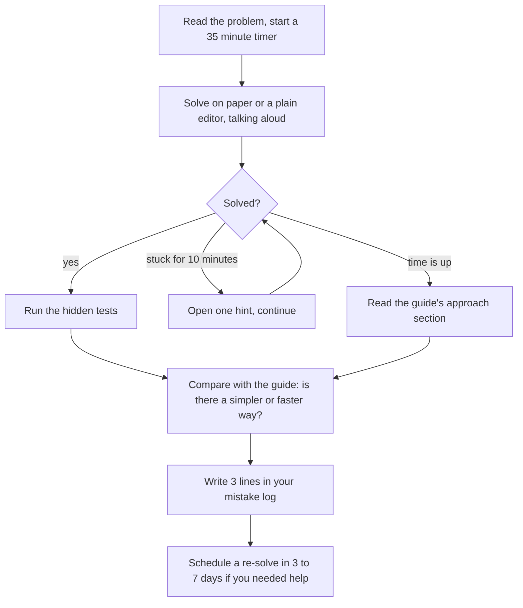

# Preparation plans: twelve weeks and four weeks

## Before this lesson

You should know the stages of the hiring pipeline ([How hiring works](#/lesson/interview-prep/hiring-pipeline)), what gets scored ([What interviewers evaluate](#/lesson/interview-prep/what-interviewers-score)) and which areas carry the most weight for you ([Special situations](#/lesson/interview-prep/special-situations)). Open the site [roadmap](#/roadmap) in another tab: both plans below point into it.

## In plain words

A **preparation plan** is a calendar that says what you will study and practise on each day between now and your interviews. It exists because interview preparation is a large pile of material, and without a calendar people do what feels comfortable: they re-read topics they already know and avoid the ones that scare them.

Training for a long-distance run is a fair comparison. Nobody prepares by running the full distance once on the day before. They follow a schedule that builds a base, adds harder sessions, includes practice races, and eases off before the event. Interview preparation has the same four phases: **foundations**, **patterns**, **mock interviews**, **taper**.

It matters for a job because the difference between candidates is rarely intelligence. It is usually that one of them practised the right things, in the right order, under realistic conditions, for long enough.

## What you are actually training

There are four separate skills, and each is trained differently.

| Skill | What it is | How it is trained |
|---|---|---|
| Knowledge | Data structures, algorithms, Big O, language features | Reading lessons, making notes, quizzes |
| Pattern recognition | Seeing that a new problem resembles one you know | Solving many varied problems and reviewing them |
| Performance | Explaining aloud, writing code without tools, managing 45 minutes | Timed practice and mock interviews |
| Stories | Clear answers about your past work | Writing and rehearsing a [story grid](#/lesson/interview-prep/story-grid-star) |

A plan that only reads lessons trains the first row. A plan that only grinds problems silently trains the second. People who fail after "doing 300 problems" have usually never trained the third.

## How to practise one problem

This routine is the unit both plans are built from. It takes 45 to 70 minutes per problem.



Five rules make the routine work:

1. **Try before you look.** The struggle is the training. Reading a solution feels like learning and produces almost none of the recall you need in the room.
2. **Write code without autocomplete** at least half the time: paper, a whiteboard, or a plain text editor. Then type it in and run it.
3. **Talk aloud**, even alone. It feels odd for a week and then becomes natural, which is the goal.
4. **Use hints one at a time.** Every problem in this track has three graded hints for this reason.
5. **Keep a mistake log**: for each problem, one line for the key idea, one for what blocked you, one for the bug you made. Before each interview, re-read the log, not the problems.

> [!TIP]
> Re-solving matters more than volume. A problem you could not do on Monday and can do cold on Friday has taught you something. Forty problems you half-remember have not.

## The 12-week plan

This plan assumes about 10 to 12 hours per week (for example 90 minutes on weekdays and three hours on one weekend day). It suits someone starting from uneven foundations, or an experienced engineer who has not touched algorithms for years.

### Phase 1, weeks 1 to 3: foundations

Goal: be able to state the cost of simple code and to implement the basic structures from memory.

| Week | Study | Practise |
|---|---|---|
| 1 | [Big O foundations](#/lesson/interview-prep/big-o-foundations) and [worked runtime examples](#/lesson/interview-prep/big-o-worked-examples); arrays, strings and hash tables in [DSA foundations](#/track/dsa-foundations) | 6 easy problems from [Arrays and strings](#/lesson/interview-prep/arrays-strings-approach) and [Arrays & Hashing](#/track/neet-arrays) |
| 2 | Linked lists, stacks and queues; the [seven-step method](#/lesson/interview-prep/seven-step-method) | 8 problems from [Linked lists](#/lesson/interview-prep/linked-lists-approach) and [Stacks and queues](#/lesson/interview-prep/stacks-queues-approach) |
| 3 | Recursion, binary search and sorting ([Sorting and searching](#/lesson/interview-prep/sorting-searching)) | 8 problems, including 2 re-solves from week 1 |

Checkpoint at the end of week 3: implement from a blank page a dynamic array, a singly linked list with insert and delete, a stack, a queue, binary search, and merge sort. Anything you cannot write is next week's first task.

### Phase 2, weeks 4 to 8: patterns

Goal: recognise the standard patterns and solve medium problems in about 30 minutes.

| Week | Pattern focus | Where on this site |
|---|---|---|
| 4 | Two pointers, sliding window, monotonic stack | [Sliding window, stack and binary search track](#/track/neet-window-stack) |
| 5 | Trees and binary search trees | [Trees and graphs](#/lesson/interview-prep/trees-graphs-approach), [Linked lists and trees track](#/track/neet-linked-trees) |
| 6 | Graphs, breadth-first and depth-first search, heaps | [Heaps and graphs track](#/track/neet-heap-graphs) |
| 7 | Backtracking and dynamic programming, part 1 | [Recursion and DP](#/lesson/interview-prep/recursion-dp-approach), [DP track](#/track/neet-dp) |
| 8 | Dynamic programming part 2, greedy, intervals, bit manipulation | [Greedy and maths track](#/track/neet-greedy-math), [Bit manipulation](#/lesson/interview-prep/bit-manipulation-approach) |

Each week: read the approach lesson for the topic first, then 10 to 12 problems (about 2 easy, 7 medium, 2 hard), with one day reserved for re-solves from the mistake log. Also in this phase, spend one hour per week on stories: fill in the [story grid](#/lesson/interview-prep/story-grid-star), one row at a time.

### Phase 3, weeks 9 to 11: performance

Goal: make the knowledge survive pressure, a listener and a clock.

- **Two mock interviews per week.** A mock interview is a rehearsal in which someone plays the interviewer, gives you a problem you have not seen, and stays silent or gives hints while you talk and code for 45 minutes, followed by ten minutes of feedback. A friend who is also preparing is ideal: you learn nearly as much from interviewing as from being interviewed. Use the rubric from [What interviewers evaluate](#/lesson/interview-prep/what-interviewers-score) as the feedback form.
- **Mixed sets.** Stop studying by topic. Pick problems at random so that nothing tells you which pattern applies; the [mixed practice](#/lesson/interview-prep/mixed-practice) module is built for this.
- **System design** if your loop has it: two practice designs per week from the [System Design track](#/track/system-design), spoken aloud against a timer.
- **Knowledge areas named by your recruiter**: your main language ([Java essentials](#/lesson/interview-prep/java-essentials), [C and C++ essentials](#/lesson/interview-prep/c-cpp-essentials)), [databases](#/lesson/interview-prep/databases-sql), [threads and locks](#/lesson/interview-prep/threads-locks), [testing](#/lesson/interview-prep/testing-questions).
- **Behavioural rehearsal**: say each story aloud twice, timed to two minutes.

### Phase 4, week 12: taper

Goal: arrive rested and confident.

- Re-read the mistake log and the cheat sheets at the end of each approach lesson.
- Two or three easy or medium problems per day to stay warm. No new hard topics.
- Prepare logistics: test the video tool and editor, confirm times and time zones, prepare questions to ask each interviewer, choose what to wear, plan the route if in person.
- Sleep. A tired brain loses more points than one extra dynamic programming problem gains.

## The 4-week plan

Sometimes an interview arrives before you are ready. Four weeks at about 15 hours per week can still change the outcome if you cut scope deliberately. The rule is **breadth of the common, not depth of the rare**.

| Week | Mornings or first block | Evenings or second block |
|---|---|---|
| 1 | Big O; arrays, strings, hash tables; the seven-step method | 10 problems: hashing, two pointers, sliding window |
| 2 | Linked lists, stacks, queues, binary search, trees | 12 problems: lists, stacks, tree traversals, binary search |
| 3 | Graph search, heaps, recursion, basic dynamic programming | 12 problems, mixed; first two mock interviews; draft 5 stories |
| 4 | Review of mistake log; your language's essentials; design basics if needed | 3 mock interviews; mixed easy and medium problems; rehearse stories; taper in the last two days |

What to drop in a four-week plan: advanced dynamic programming, rare graph algorithms, the balanced-tree internals, and anything your recruiter did not mention. What never to drop: speaking aloud, testing your code, at least five prepared stories, and the mock interviews.

> [!WARNING]
> The classic mistake under time pressure is to skip mock interviews "because there is no time". With four weeks left, one mock interview teaches more than five extra problems, because it exposes the habits (silence, no testing, no plan) that actually cost offers.

## Adjusting the plans to your situation

- **New graduate:** follow the plans as written; replace design with more problems.
- **Experienced engineer:** from week 5 onward, give one third of the weekly hours to system design and project deep-dive rehearsal.
- **Career changer:** add two weeks to phase 1. Solid foundations make phase 2 far faster.
- **Tester or SDET:** replace half of the hard algorithm problems with the [testing lesson](#/lesson/interview-prep/testing-questions) and the test-design lessons of the [Thinking track](#/track/thinking).
- **Working full time:** protect short daily sessions over long weekend sessions. Forty focused minutes on five days beats four tired hours on Sunday.

## Tracking progress with numbers

Feelings are unreliable in week 6, when everything seems hard. A simple log tells the truth. The program below takes a log of practice sessions and prints, for each topic, how many problems you attempted, how many you solved without help, and the average time, then lists the topics that need attention.

```python-run
from collections import defaultdict

# (topic, minutes taken, solved without hints?)
log = [
    ("arrays", 18, True), ("arrays", 25, True), ("arrays", 31, False), ("arrays", 20, True),
    ("linked lists", 22, True), ("linked lists", 35, False),
    ("trees", 40, False), ("trees", 38, False), ("trees", 29, True),
    ("graphs", 45, False),
    ("dp", 45, False), ("dp", 44, False), ("dp", 39, True),
]

stats = defaultdict(lambda: [0, 0, 0])          # attempts, solved alone, total minutes
for topic, minutes, alone in log:
    row = stats[topic]
    row[0] += 1
    row[1] += 1 if alone else 0
    row[2] += minutes

print(f"{'topic':14s} tries  alone  avg min")
weak = []
for topic, (tries, alone, minutes) in stats.items():
    rate = alone / tries
    print(f"{topic:14s} {tries:5d} {rate:6.0%} {minutes / tries:8.1f}")
    if tries < 3:
        weak.append(f"{topic}: too few attempts to judge ({tries})")
    elif rate < 0.5:
        weak.append(f"{topic}: solved alone only {rate:.0%} of the time")

print("\nNeeds attention:")
for line in weak:
    print(" -", line)
```

`defaultdict(lambda: [0, 0, 0])` creates a fresh three-number list the first time a topic appears, so the loop can add to it without checking whether the topic exists. The second loop computes the success rate and average time and applies two rules: fewer than three attempts means you cannot judge yet, and a solo success rate under 50% means the topic needs another pass. In the sample output, arrays look healthy, trees and dynamic programming are flagged, and graphs have too little data. Replace `log` with your own records each week and let the "needs attention" list choose next week's focus.

Reasonable targets by the end of phase 2: at least 70% of easy problems and 50% of medium problems solved without hints inside 30 minutes. By the end of phase 3: the same under mock-interview conditions.

## The day before and the day itself

- **Day before:** no new material. Review the cheat sheets and the mistake log for an hour, rehearse the "tell me about yourself" answer once, prepare your questions, stop early.
- **One hour before:** solve one easy problem to warm up, as a musician plays scales.
- **During each interview:** follow the [seven steps](#/lesson/interview-prep/seven-step-method). If one interview goes badly, reset completely before the next; the next interviewer does not know.
- **After the loop:** write down every question while you remember it. Whatever the result, those notes are the best practice material you will ever have.

## Pitfalls

- **Reading instead of solving.** Watching solutions gives a feeling of progress without the skill.
- **Only easy problems, or only hard ones.** Most interview questions are medium; practise mostly medium.
- **Never re-solving.** Without spaced repetition, week 2's lessons are gone by week 8.
- **Practising silently in an IDE.** The real thing has a listener and no autocomplete.
- **Leaving behavioural preparation to the last night.** Stories need rehearsal as much as algorithms do.
- **No rest.** Burning out in week 9 wastes the first eight weeks.
- **Counting problems instead of measuring ability.** "I did 200" says nothing; "I solve 6 of 10 mediums alone in 30 minutes" does.

> [!INTERVIEW]
> Interviewers can tell practised candidates within five minutes, not because they know the answer, but because they have a routine: they restate, ask, plan, code, test. The routine comes only from repetition under realistic conditions.

## Summary

- Preparation trains four things: knowledge, pattern recognition, performance and stories. A plan must cover all four.
- One problem is practised as: timed attempt aloud, hints one at a time, compare with the guide, log the mistake, re-solve later.
- The 12-week plan has four phases: foundations (3 weeks), patterns (5), performance with mock interviews (3), taper (1).
- The 4-week plan keeps the phases but covers only the most common topics and still includes mock interviews and stories.
- Adjust the split to your situation and track progress with a simple log.
- Follow the site [roadmap](#/roadmap) for the order of tracks, and use this track's approach lessons as the weekly summaries.

## Glossary

- **Preparation plan**: a dated schedule of study and practice leading up to interviews.
- **Pattern**: a reusable solution idea, such as two pointers or breadth-first search, that fits many problems.
- **Mock interview**: a realistic rehearsal with a person acting as interviewer.
- **Mistake log**: a short record, per problem, of the key idea and what went wrong.
- **Re-solve**: solving a previously failed problem again from a blank page after some days.
- **Spaced repetition**: reviewing material at increasing intervals so that it stays in memory.
- **Taper**: reducing workload shortly before the event to arrive rested.
- **Mixed set**: practice problems drawn from random topics, so the pattern is not given away.

```quiz
[
  {"q": "Which of the four trained skills is missing if you only solve problems silently in an editor with autocomplete?",
   "options": ["Knowledge", "Pattern recognition", "Performance: explaining aloud and coding without tools under time", "None, that covers everything"],
   "answer": 2,
   "explain": "Silent, tool-assisted practice does not rehearse speaking, unaided coding or time management, which the real interview demands."},
  {"q": "You are stuck on a practice problem after ten minutes. What does the routine recommend?",
   "options": ["Read the full solution immediately", "Open one hint and continue trying", "Skip the problem forever", "Start a different problem"],
   "answer": 1,
   "explain": "Graded hints keep you struggling productively; reading the whole solution removes the recall practice."},
  {"q": "What are the four phases of the 12-week plan, in order?",
   "options": ["Patterns, foundations, taper, mocks", "Foundations, patterns, performance, taper", "Mocks, taper, foundations, patterns", "Taper, foundations, patterns, performance"],
   "answer": 1,
   "explain": "Build the base, learn the patterns, rehearse under realistic conditions, then ease off before the interviews."},
  {"q": "With only four weeks, which activity should you NOT drop?",
   "options": ["Advanced dynamic programming", "Balanced-tree internals", "Mock interviews", "Rare graph algorithms"],
   "answer": 2,
   "explain": "Mock interviews expose performance habits that cost offers; rare topics give the least return."},
  {"q": "Why is re-solving a failed problem after a few days valuable?",
   "options": ["It increases the problem count", "It tests whether the idea can be recalled from a blank page, which is what the interview requires", "It is easier than new problems", "Interviewers ask the same problems"],
   "answer": 1,
   "explain": "Spaced recall turns a solution you once read into a technique you can produce."},
  {"q": "In the tracking program, why does 'graphs' appear under 'needs attention'?",
   "options": ["Its success rate is below 50%", "It has fewer than three attempts, so there is too little data to judge", "It took less than 20 minutes", "It is spelled wrongly"],
   "answer": 1,
   "explain": "The first rule flags topics with under three attempts before any rate is considered."},
  {"q": "What should you do on the day before the interview?",
   "options": ["Learn a new hard topic", "Solve problems until 3 a.m.", "Light review of cheat sheets and the mistake log, logistics, and sleep", "Nothing at all for a week"],
   "answer": 2,
   "explain": "The taper keeps you warm and rested; new hard material this late mostly produces anxiety."}
]
```

> **Source:** McDowell, Cracking the Coding Interview 6e, ch. IV (Before the Interview: Preparation Map) and ch. VII (Technical Questions: How to Prepare). The schedules, routine and tracking demo are original and refer to this site's tracks.
