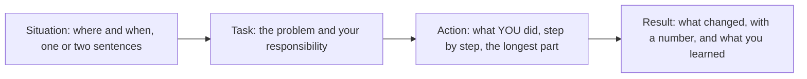

# The story grid and the STAR structure

## Before this lesson

Read [What interviewers evaluate](#/lesson/interview-prep/what-interviewers-score): you should know that interviewers record evidence under headings. It also helps to have your resume or accomplishment log at hand ([Experience and a strong resume](#/lesson/interview-prep/experience-and-resume)), because you will mine it for stories. The Thinking track has a companion lesson, [Behavioural answers with STAR](#/lesson/thinking/behavioural-star), with further practice prompts.

## In plain words

A **behavioural question** asks about something you actually did: "Tell me about a time you disagreed with a colleague." The idea behind it is that the best predictor of how you will act in the future is how you acted in the past.

Most people answer these badly, and not because their past is unimpressive. They answer badly because they try to remember and organise a story at the same moment as telling it. It is like being asked to cook a dinner for guests with no shopping done: the kitchen may be excellent, but nothing is on the shelves.

This lesson gives you two tools. The **story grid** is the shopping: a small table, prepared in advance, that maps your real projects to the common question themes. The **STAR structure** is the recipe: a fixed order for telling any story (Situation, Task, Action, Result) so that the listener can follow it and write it down.

It matters for a job because behavioural interviews are scored like any other round, they decide the level for senior candidates, and they are the easiest round to improve: a few hours of preparation changes the result.

## What the interviewer is listening for

Behind every behavioural question is a trait the company wants evidence of. The question is only the door.

| Question you hear | What is being checked |
|---|---|
| "Tell me about a challenging project." | Technical depth, persistence, how you break down a hard problem |
| "Tell me about a mistake or failure." | Honesty, ownership, whether you learn |
| "Describe a conflict with a teammate." | Listening, empathy, ability to disagree and still deliver |
| "When did you lead something?" | Initiative, influence without authority |
| "Tell me about a time you had too much to do." | Prioritisation, communication about risk |
| "What did you enjoy most or least?" | Motivation, fit with the role |
| "Describe a time you had to learn something fast." | Learning ability, humility |

Interviewers also listen to *how* you tell it: are you clear, are you specific, do you take credit fairly, do you speak about others with respect?

## Tool 1: the story grid

A story grid is a table. The **columns** are your three to five most substantial projects or jobs. The **rows** are the common themes. In each cell you write a few keywords, not sentences, that remind you of a specific episode.

Here is a filled-in grid for a fictional engineer, Mirela.

| Theme | Parcel-tracking rewrite (job) | Clinic booking app (side project) | Search team internship |
|---|---|---|---|
| Hardest challenge | Zero-downtime data migration, 40 M rows | Double-booking race condition | Ranking bug that only appeared for long queries |
| Mistake or failure | Shipped a cache with no expiry; stale statuses for 2 h | Underestimated the effort; launched 6 weeks late | Broke the nightly build in week 2 |
| Conflict | Disagreed with the lead about rewriting versus patching | Co-founder wanted features, I wanted tests | Reviewer rejected my change three times |
| Leadership or initiative | Organised a weekly failure-review meeting | Recruited two volunteer testers at the clinic | Wrote the onboarding guide nobody had |
| Enjoyed most | Measuring the speed-up | Watching receptionists use it | Pairing with a senior engineer |
| What I would change | Migrate in smaller batches | Talk to users before building | Ask for help sooner |
| Learned fast | Queue systems, in two weeks | Mobile development from zero | The codebase: 2 M lines |

A **race condition**, mentioned in one cell, is a bug that appears only when two things happen at nearly the same moment; the lesson [Threads and locks](#/lesson/interview-prep/threads-locks) explains it.

### How to build yours

1. **Choose the columns.** Pick projects where you personally did something meaningful and can remember details. Include at least one from outside your main job if you have it.
2. **Fill row by row, not column by column.** For each theme ask "which project has the best episode for this?" Empty cells are fine; you need two solid stories per row, not a full table.
3. **Use keywords only.** Sentences tempt you to memorise a script, and scripts sound recited.
4. **Check for coverage.** Every row needs at least one story, and you should not rely on one project for everything: retelling the same project five times makes your experience look thin.
5. **Review it before every interview**, including the phone screen. Five minutes with the grid replaces ten minutes of fumbling in the room.

> [!TIP]
> One good story usually fits several questions. Mirela's cache incident answers "tell me about a mistake", "a time you handled pressure", and "a time you improved a process" (because of what she did afterwards). When a question surprises you, scan the grid in your head for the nearest row.

### Know your technical projects in depth

For two or three of the columns, be ready to go far below the grid's surface, because technical interviewers often turn a behavioural question into a design discussion. For each of those projects, prepare:

- A two-sentence description a non-specialist could follow.
- The architecture: the main components and how data moves between them. Be able to draw it.
- The hardest technical decision, the alternatives you rejected, and why.
- The trade-offs you accepted, and what broke or nearly broke.
- How it would need to change for ten times the load.
- What you personally built, as opposed to the team.

## Tool 2: the STAR structure

STAR is an order of telling:



- **Situation**: the minimum context. Company type, team size, the project. Two sentences.
- **Task**: what needed to be solved and what your part was. One or two sentences. Some people merge Situation and Task and call the method "situation, action, result"; that is the same structure.
- **Action**: the steps you took and why. This is where the evidence is, so it should be about 60% of the answer. Three or four distinct actions are ideal.
- **Result**: the outcome, measured if possible, plus one sentence of reflection.

Aim for 90 seconds to two minutes in total. Longer answers lose the listener; the interviewer will ask follow-up questions about the parts they care about.

### Lead with the headline

Before the Situation, give a one-sentence summary of the whole story. Journalists call it the headline:

> "Sure. I will tell you about the time I shipped a cache without an expiry and showed customers stale delivery statuses for two hours, and what I changed afterwards."

The headline tells the interviewer where the story is going, so they can relax and listen, and it stops you from wandering.

### A worked example, built step by step

Question: **"Tell me about a mistake you made."**

Start from the grid cell: *Shipped a cache with no expiry; stale statuses for 2 h.* Now expand each part.

- **Headline.** "I once released a caching change that served out-of-date parcel statuses for about two hours."
- **Situation.** "I was a back-end developer on a five-person team at a logistics company. Our parcel-status page was slow, around four seconds."
- **Task.** "I had taken on making it faster before the holiday peak."
- **Action.** "I added a cache in front of the database and tested the speed, which improved a lot. What I did not test was what happens when a status changes. I had left the entries without an expiry, so after the release customers kept seeing 'in transit' for parcels that were delivered. When support reported it, I first rolled the change back, which took ten minutes, then told my lead and the support team exactly what had happened and how long it had lasted. The next day I added an expiry and, more importantly, made the service remove the cached entry whenever a status changed. I also wrote a test that updates a status and checks the page, and I proposed that any caching change must include an invalidation test in its review checklist."
- **Result.** "The page went from four seconds to under one, with correct data. The checklist item caught two similar problems in other people's changes that quarter. What I learned is to test the behaviour that my change could break, not only the behaviour it is meant to improve."

Read it again and notice four properties:

1. The mistake is real and is stated plainly, with no softening.
2. "I" appears in every action. The team is mentioned only for context.
3. The actions include the recovery (rollback, telling people) and the prevention (test, checklist).
4. The result has numbers and ends with a lesson that is specific to the story.

### Speak in "I", measure in numbers

Two small language habits change how a story is scored.

- **"I", not "we".** Humble people say "we" for everything, and the interviewer then cannot tell what the candidate did. Say "the team of five was responsible for X; my part was Y; I did Z". Giving credit to others for *their* parts is good; hiding your own is not.
- **Specifics, not adjectives.** "It was a very big performance improvement" is an adjective. "Median response time went from 800 to 120 milliseconds" is evidence.

## Checking a draft answer

It is hard to judge your own story. The program below applies a few mechanical checks to a draft: share of the Action part, the balance of "I" and "we", the presence of a number in the Result, and estimated speaking time (people speak roughly 140 words per minute). Paste in your own four parts and run it.

```python-run
import re

story = {
    "situation": "I was a back-end developer on a five-person team at a logistics company. Our parcel-status page took about four seconds to load.",
    "task": "I had taken on making it faster before the holiday peak.",
    "action": ("I added a cache in front of the database and measured the speed. I did not test what happens when a status changes, "
               "and I had left entries without an expiry, so customers saw stale statuses. When support reported it I rolled the change back, "
               "told my lead and the support team what had happened, then added an expiry and removed cached entries on every status change. "
               "I wrote a test for that case and proposed an invalidation check for every caching change in code review."),
    "result": "The page went from four seconds to under one with correct data, and the new check caught 2 similar problems that quarter. I learned to test what my change could break.",
}

def count(word, text):
    return len(re.findall(r"\b" + word + r"\b", text, flags=re.I))

words = {part: len(text.split()) for part, text in story.items()}
total = sum(words.values())
print("words per part:", words)
print(f"action share: {words['action'] / total:.0%} (aim for roughly 50 to 70%)")
print(f"speaking time: about {total / 140 * 60:.0f} seconds (aim for 90 to 120)")

everything = " ".join(story.values())
i_count, we_count = count("I", everything), count("we", everything)
print(f"'I' used {i_count} times, 'we' used {we_count} times")
if we_count > i_count:
    print("  -> the interviewer cannot see YOUR part; rewrite with 'I'")
if not re.search(r"\d", story["result"]):
    print("  -> the result has no number; can you measure the outcome?")
if "learn" not in story["result"].lower():
    print("  -> consider ending with what you learned")
```

The dictionary holds the four parts. `words` counts the words in each part with `split`. The action share is the Action word count divided by the total. `count` uses a regular expression with `\b` (a word boundary) so that "I" is counted as a whole word and not as a letter inside other words. The final three checks print advice only when a rule is broken. For this draft the action share is about 60%, the speaking time is around a minute, "I" clearly outnumbers "we", and the result contains a digit, so no warnings appear. The speaking time is on the short side; adding one sentence of technical detail to the Action would bring it to about 90 seconds.

## Handling questions you did not prepare for

1. **Pause.** Say "let me think of a good example" and take five seconds. Silence feels long to you and normal to the interviewer.
2. **Map the question to a theme row.** "Tell me about a time you had to push back on a requirement" is a conflict story. "Tell me about a time you worked with incomplete information" is a challenge or a learning story.
3. **If nothing fits exactly, say so and offer the nearest story.** "I have not had exactly that situation; the closest is …".
4. **For hypothetical questions** ("what would you do if …"), answer briefly in principle, then attach a real example: "…which is what I did when …".

## Pitfalls

- **No story, only opinions.** "I think communication is very important" answers nothing. The question asked for a time.
- **A story with no "I".** The team did great things and the interviewer learns nothing about you.
- **All Situation, no Action.** Three minutes of background, ten seconds of what you did.
- **The disguised success.** Answering a failure question with "my mistake was working too hard". Interviewers have heard it many times and read it as avoidance.
- **Blaming others.** Even when a colleague was at fault, describe facts and your own actions; never insult a past employer.
- **Reciting a script.** Memorised paragraphs sound flat and collapse at the first follow-up question. Memorise keywords and the order, not sentences.
- **One project for every answer.** Spread your stories across the grid's columns.
- **Confidential details.** Describe scale and shape without revealing things your employer would not want shared.

> [!INTERVIEW]
> Follow-up questions are a good sign, not an attack. "What would you do differently?", "How did the other person react?", "How did you measure that?" mean the interviewer is collecting evidence for your report. Prepare the answers to those three for every story in your grid.

> [!WARNING]
> Never invent a story. Interviewers probe details ("what was the table called?", "who else was in the meeting?") and invented stories fall apart. A small true story told well beats a grand false one every time.

## Summary

- Behavioural questions look for evidence of traits (ownership, collaboration, learning, leadership) in your real past actions.
- Build a story grid: projects as columns, themes as rows, keywords in the cells, at least two stories per theme.
- Know two or three projects deeply enough for a technical discussion.
- Tell every story in STAR order with a one-sentence headline first, and give most of the time to your own actions.
- Say "I" for your part and use numbers for results; end with a specific lesson.
- Rehearse aloud to about two minutes, expect follow-up questions, and never invent or recite.
- The next lesson, [Classic behavioural questions](#/lesson/interview-prep/classic-behavioural-questions), applies these tools to the questions almost every loop asks.

## Glossary

- **Behavioural question**: a question about a specific past experience, used to predict future behaviour.
- **Story grid**: a prepared table mapping your projects to common question themes.
- **Theme**: a category of behavioural question, such as conflict or failure.
- **STAR**: Situation, Task, Action, Result, the order in which to tell a story.
- **Headline**: a one-sentence summary given before the story.
- **Follow-up question**: an interviewer's request for more detail about a story.
- **Ownership**: taking responsibility for an outcome, including when it goes wrong.
- **Race condition**: a bug that depends on the timing of two events.

```quiz
[
  {"q": "Why do interviewers ask about specific past events instead of asking what you would do?",
   "options": ["Past behaviour is considered the best available predictor of future behaviour", "It is quicker", "Hypothetical questions are illegal", "They want to test memory"],
   "answer": 0,
   "explain": "Real actions are harder to fake than intentions and give concrete evidence for the report."},
  {"q": "What goes in the cells of a story grid?",
   "options": ["Full scripted answers", "A few keywords that recall a specific episode", "The interviewer's names", "Salary figures"],
   "answer": 1,
   "explain": "Keywords trigger the memory without tempting you to recite a script."},
  {"q": "Which STAR part should take the largest share of the answer?",
   "options": ["Situation", "Task", "Action", "Result"],
   "answer": 2,
   "explain": "The actions you personally took are the evidence; context should be brief."},
  {"q": "Which sentence is the strongest Result?",
   "options": ["It went really well", "Everyone was happy with the outcome", "Median response time fell from 800 ms to 120 ms, and I learned to profile before optimising", "We finished eventually"],
   "answer": 2,
   "explain": "It is measured and ends with a specific lesson."},
  {"q": "What is wrong with answering 'tell me about a failure' with 'I care too much about quality'?",
   "options": ["It is too short", "It is a disguised success that avoids the question and shows no ownership", "It is too technical", "Nothing is wrong with it"],
   "answer": 1,
   "explain": "The question checks honesty and learning; avoiding a real failure signals the opposite."},
  {"q": "In the checker program, why is the pattern written with \\b around the word?",
   "options": ["To make the search faster", "To match the word only as a whole word, so the letter 'I' inside other words is not counted", "To ignore numbers", "To match capital letters only"],
   "answer": 1,
   "explain": "\\b is a word boundary, so 'I' in 'in' or 'it' is not counted."},
  {"q": "A question surprises you and no prepared story fits exactly. What is the best move?",
   "options": ["Invent a story", "Say you have no example and stop", "Pause, map the question to the nearest theme, and offer the closest real story while saying so", "Change the subject"],
   "answer": 2,
   "explain": "A near-fit true story, honestly framed, still provides evidence; invention does not survive follow-ups."}
]
```

> **Source:** McDowell, Cracking the Coding Interview 6e, ch. V (Behavioral Questions: Interview Preparation Grid; Know Your Technical Projects; Responding to Behavioral Questions). The grid, story and checker are original.
