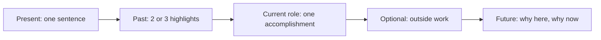

# Classic behavioural questions with model answers

## Before this lesson

Read [The story grid and the STAR structure](#/lesson/interview-prep/story-grid-star) first. This lesson assumes you have a story grid (projects as columns, themes as rows) and know the Situation, Task, Action, Result order with a one-sentence headline in front.

## In plain words

A small set of questions appears in nearly every interview loop: "tell me about yourself", strengths and weaknesses, a conflict, a failure, a time you led, and "why do you want to work here?". Because they are so predictable, an unprepared answer stands out badly, and a prepared one costs very little.

Think of them as the set pieces of a football match: corners and free kicks. Open play cannot be scripted, but set pieces can be rehearsed until they are reliable, and they decide a surprising number of matches.

For each question this lesson gives the purpose behind it, a structure, a **model answer** hidden in a collapsible block, and the usual mistakes. Try to draft your own answer before opening each block. The model answers belong to fictional people; copy the structure, never the content.

## 1. "Tell me about yourself"

### Why it is asked

It opens most interviews. The interviewer wants a short orientation (who is this person?) and is also hearing your communication for the first time. It is not an invitation to recite your resume from the top or to tell your life story.

### Structure: present, past, future

1. **Present in one sentence**: what you are now.
2. **Past in three or four sentences**: education or earlier roles, each with one highlight chosen because it is relevant to *this* job.
3. **Current role in a little more detail**: what you work on and one accomplishment.
4. **Outside work, optional, one sentence**: a project or interest that shows initiative or technical curiosity.
5. **Future**: why you are looking and why this role.

Keep it to 60 to 90 seconds. Plant "hooks": mention accomplishments briefly so that the interviewer can pick one and ask more.



<details>
<summary>Model answer: engineer with four years of experience</summary>

"I am a back-end engineer with four years of experience, mostly in logistics software.

I studied computer science in Lagos, where my final-year project was a small storage engine, which is where my interest in data systems started. After graduating I joined Brightline Logistics as their third back-end developer.

For the last two years I have owned the parcel-tracking service. The piece of work I am proudest of is moving our scheduled jobs from a single server to a queue-based worker pool: nightly processing went from three hours to thirty-five minutes, and I led two other developers through it.

Outside work I built a small app that estimates bus arrival times from crowd reports; around three hundred people use it each week.

I am looking for a place where the scale is larger than what I can reach where I am, and your routing team works on exactly the problems I enjoy most, which is why I applied."

</details>

<details>
<summary>Model answer: career changer</summary>

"I am a software developer who spent six years as a hospital pharmacist before moving into engineering.

In the pharmacy I kept running into the same problem: we tracked stock expiry in spreadsheets, and medicines were thrown away. I taught myself Python to automate the checks, and that tool ended up used by four wards. I enjoyed building it more than anything else in my job, so two years ago I started studying seriously: data structures, databases and web development, alongside work.

Since then I have built three complete projects, the largest being a shift-swap application that staff at my former hospital use daily, and for the past eight months I have worked as a contract developer for a clinic-software company.

I want to work on healthcare software full time, with engineers I can learn from, and that is what this role offers."

</details>

### Common mistakes

- Starting at childhood, or reading the resume line by line.
- Five minutes long.
- No connection to the role at the end.
- Negative reasons for leaving ("my manager is terrible").

## 2. Strengths

### Why it is asked

To hear what you believe you are good at and whether you can support a claim with evidence.

### Structure

Name one or two strengths that are relevant to the role, and for each give a short piece of evidence. A strength without an example is an adjective.

<details>
<summary>Model answer</summary>

"One strength is that I make slow or unreliable systems measurable before I change them. On the tracking service, people had tried to speed up the status page three times by guessing. I added timing around each query first and found that 80% of the time was one query executed once per row. Fixing that single thing took the page from four seconds to under one.

A second is that I write things down. I produced the onboarding guide for our service, and the last two people who joined made their first change to production within their first week, where it used to take about three."

</details>

## 3. Weaknesses

### Why it is asked

To check self-awareness and honesty, and to see whether you work on your shortcomings. Interviewers are not looking for a reason to reject you here; they are looking for a believable, mature answer.

### Structure

1. A **real** weakness, stated plainly, that is not fatal for the role.
2. A concrete example of its effect.
3. What you do about it now, with evidence that it is improving.

<details>
<summary>Model answer</summary>

"I tend to hold on to a problem too long before asking for help. Early last year I spent almost three days on a deployment failure that a colleague on the platform team resolved in twenty minutes once I finally asked, because it was a known limitation.

Since then I use a rule: if I have made no progress for ninety minutes, I write down what I tried and ask in the team channel. Writing it down solves the problem by itself about a third of the time, and my lead mentioned in my last review that I unblock myself much faster now. I still feel the pull to keep digging alone, so the rule is something I apply deliberately."

</details>

### Common mistakes

- **The disguised strength**: "I am a perfectionist", "I work too hard". It reads as evasion.
- **A fatal weakness** for the role: a developer saying "I do not like writing code".
- **No remedy**: naming the weakness and stopping.
- **Too many weaknesses**: one, handled well, is enough.

> [!INTERVIEW]
> A good weakness answer ends in the present tense: what you do *now*. The interviewer writes down the remedy, not the flaw.

## 4. A conflict or disagreement

### Why it is asked

Software is built by groups, and groups disagree. The interviewer wants to know whether you can disagree without damaging the relationship, whether you listen, and whether the work still gets done.

### Structure

STAR, with attention to three points inside the Action: how you **understood the other person's view**, how you **made your case with evidence**, and how the matter was **resolved**, including the possibility that you did not get your way.

<details>
<summary>Model answer</summary>

"I will describe a disagreement with my team lead about whether to rewrite our job scheduler or keep patching it.

The scheduler ran fourteen nightly jobs on one server and failed roughly twice a month. My lead wanted to keep patching, because a rewrite had gone badly on a previous project. I thought the design itself was the cause: one server, no retries.

Before arguing, I asked him to walk me through what had gone wrong with the earlier rewrite. His real concern was a long period with two half-working systems. That changed my proposal. Instead of a rewrite, I suggested moving one job, the least critical, to a queue-based worker as a two-week experiment, with the old scheduler untouched and a clear rollback. I collected the failure history of the last six months to show that nine of twelve incidents came from the single-server design.

He agreed to the experiment. The migrated job ran for a month without a failure, and we then moved the rest, one or two per week. He set the order and the pace, which kept the risk he cared about under control.

What I took from it is that the strongest argument is usually a small, reversible test, and that I only found that option because I asked about his reasons first."

</details>

### Common mistakes

- Painting the other person as stupid. The interviewer imagines being described that way by you.
- A "conflict" in which you were plainly right and everyone agreed immediately.
- Avoidance: "I do not really have conflicts." Everyone does; the answer suggests you avoid them or do not notice them.
- Escalating to a manager as the first step.

## 5. A failure or mistake

### Why it is asked

People who cannot admit mistakes repeat them and hide them. The interviewer checks ownership (do you say "I"?), recovery (what did you do in the moment?) and learning (what changed afterwards?).

The lesson on STAR built one such answer step by step (the cache with no expiry). Here is a second, of a different kind: a failure of judgment, not a bug.

<details>
<summary>Model answer</summary>

"The failure I learned most from was launching a side project six weeks late because I planned it badly.

A clinic had agreed to pilot a booking app that a friend and I were building, and I promised a date eight weeks out. I estimated only the coding and assumed everything else was small.

It was not. I had not counted testing on the clinic's old tablets, the receptionist training, or the data import from their paper diary. When I saw at week five that we would miss the date, my first instinct was to work nights and say nothing. Instead I called the clinic manager, told her we would be late and why, and gave her a new date with a list of what remained. I split the remaining work into pieces of at most two days and sent her a short progress note every Friday.

We launched six weeks after the original date. The clinic stayed with us, and she later told me the weekly notes were the reason. Since then I list every non-coding task before estimating and add a margin, and on my last three estimates at work I was within a week each time."

</details>

### Common mistakes

- A trivial failure ("I once had a typo").
- Blaming circumstances or other people.
- Stopping at the failure with no recovery and no lesson.

## 6. Leadership and initiative

### Why it is asked

At every level, companies want people who improve things without being told to. For senior roles, they want evidence that others followed you.

### Structure

STAR, emphasising: you **noticed** something nobody owned, you **acted** without waiting for permission where that was appropriate, you **brought others along**, and something is **still in place** because of it.

<details>
<summary>Model answer</summary>

"I will tell you about starting a weekly failure review on my team, which was not anybody's job.

We had a production incident every couple of weeks, and each one was fixed and forgotten. The same causes kept returning: missing timeouts, missing alerts.

I proposed a thirty-minute meeting each Friday to look at that week's incidents. Two colleagues were sceptical, expecting a blame session, so I wrote a one-page format in advance: what happened, what we learned, one action with an owner, and no names in the 'what happened' section. I ran the first few myself, starting with an incident I had caused, so that people saw it was safe. After a month I asked the others to take turns leading it.

Over two quarters, repeat incidents, meaning ones with a cause we had seen before, went from seven to one. The meeting is still running, and another team copied the format."

</details>

## 7. "Why this company?" and "Do you have questions for me?"

**Why this company.** Give two or three specific reasons that connect *your* interests to *their* work: a product you use and a problem in it that interests you, a technical article or open-source project from their engineers, the scale or domain. "It is a great company with smart people" could be said to anyone and is heard as "I did not prepare".

**Your questions.** Always have some. They are scored informally as interest and judgment. Three kinds work well:

| Kind | Example |
|---|---|
| Genuine curiosity | "What does a normal week look like for someone in this role?" |
| Insight | "I read that you moved from a single database to shards. What was the hardest part for your team?" |
| Passion and growth | "How do engineers here usually grow from mid-level to senior? What did that look like for you?" |

Avoid questions answered on the first page of the website, and keep salary questions for the recruiter.

## Rehearsal

Reading model answers does not make yours good. Speaking them does. A simple rehearsal method is to draw a random question, answer aloud for two minutes with a timer, and then check yourself against the list from the previous lesson (headline, "I", actions, measured result, lesson). The program below draws a random practice set so that you cannot predict the order.

```python-run
import random

QUESTIONS = {
    "opening": ["Tell me about yourself.", "Walk me through your background."],
    "strengths and weaknesses": ["What is your greatest strength?", "What is a weakness you are working on?"],
    "conflict": ["Tell me about a disagreement with a teammate.", "Describe a time you pushed back on a decision."],
    "failure": ["Tell me about a mistake you made.", "Describe a project that did not go as planned."],
    "leadership": ["When did you take initiative without being asked?", "Tell me about a time you led a group."],
    "motivation": ["Why do you want to work here?", "What do you want to be doing in three years?"],
}

random.seed()                      # different set on every run
session = [(theme, random.choice(options)) for theme, options in QUESTIONS.items()]
random.shuffle(session)

for number, (theme, question) in enumerate(session, start=1):
    print(f"{number}. [{theme}] {question}")
print("\nFor each: 5 seconds to pick a story, 2 minutes aloud, then check headline / I / actions / number / lesson.")
```

`QUESTIONS` maps each theme to two phrasings. The list comprehension picks one phrasing per theme with `random.choice`, and `random.shuffle` puts the six in a random order. `enumerate(session, start=1)` numbers them from 1. Run it, answer the six aloud, and run it again tomorrow: the wording and order change, the themes do not, which is exactly the situation in a real interview.

## Pitfalls across all of these

- **Being arrogant or falsely modest.** State facts and numbers; let them carry the weight.
- **Speaking badly of past employers or colleagues.**
- **Too long.** Two minutes, then stop and let the interviewer steer.
- **Generic answers.** Anything that another candidate could say word for word is not evidence about you.
- **Inconsistent stories.** Different interviewers compare notes; the same project should have the same numbers each time.
- **No questions at the end.**

> [!TIP]
> Record yourself once. Almost everyone discovers the same three things: the context is too long, the answer has too many "we"s, and the ending trails off. Fixing those three is most of the improvement.

> [!WARNING]
> Do not memorise the model answers in this lesson or anywhere else. Interviewers ask follow-up questions specifically to distinguish lived experience from rehearsed text, and a borrowed story cannot answer them.

## Summary

- A handful of questions recur in nearly every loop; prepare them as set pieces.
- "Tell me about yourself": present, past highlights, current accomplishment, future; about a minute, with hooks.
- Strengths: a claim plus evidence. Weaknesses: a real one, its effect, and what you do about it now.
- Conflict: understand the other view, argue with evidence, describe the resolution with respect.
- Failure: own it, describe the recovery, state the change it produced.
- Leadership: notice, act, bring others along, leave something lasting.
- Prepare specific reasons for wanting this company and real questions for each interviewer.
- Rehearse aloud in random order. For further scenarios, see [communication under pressure](#/lesson/thinking/behavioural-communication) in the Thinking track.

## Glossary

- **Set piece**: a predictable question that can be prepared and rehearsed in advance.
- **Hook**: a brief mention of an accomplishment that invites a follow-up question.
- **Disguised strength**: a "weakness" that is really a boast, such as perfectionism.
- **Self-awareness**: an accurate understanding of your own strengths and weaknesses.
- **Recovery**: what you did immediately after a mistake to limit the damage.
- **Initiative**: acting to improve something without being asked.
- **Escalation**: taking a disagreement to someone with more authority.
- **Insight question**: a question to the interviewer that shows you researched the company's work.

```quiz
[
  {"q": "Which structure suits 'tell me about yourself'?",
   "options": ["Childhood to present in full detail", "Present, a few relevant past highlights, a current accomplishment, and why this role", "A list of every technology you know", "Your salary history"],
   "answer": 1,
   "explain": "It orients the interviewer in about a minute and ends by connecting you to the role."},
  {"q": "Which is the best answer to 'what is a weakness of yours?'",
   "options": ["I am a perfectionist", "I have no weaknesses", "I hold on to problems too long before asking for help; here is what happened and the rule I now use", "I dislike programming"],
   "answer": 2,
   "explain": "It is real, not fatal for the role, illustrated, and ends with a current remedy."},
  {"q": "In the model conflict answer, what did the candidate do before arguing their case?",
   "options": ["Complained to a manager", "Asked the lead to explain the reasons behind his position", "Rewrote the system secretly", "Ignored the lead"],
   "answer": 1,
   "explain": "Understanding the other person's real concern produced a proposal that addressed it."},
  {"q": "What three things should a failure story contain?",
   "options": ["Blame, excuse, apology", "Ownership of the mistake, the recovery, and what changed afterwards", "The name of the person at fault", "Only the technical details"],
   "answer": 1,
   "explain": "Interviewers score ownership, recovery and learning."},
  {"q": "Why is 'it is a great company with smart people' a weak answer to 'why us?'",
   "options": ["It is impolite", "It could be said to any company, so it shows no preparation or specific interest", "It is too long", "It mentions people"],
   "answer": 1,
   "explain": "Specific reasons tied to your interests are evidence of motivation; generic praise is not."},
  {"q": "What is a 'hook' in an introduction?",
   "options": ["A joke", "A brief mention of an accomplishment that invites the interviewer to ask more", "A question about salary", "An apology"],
   "answer": 1,
   "explain": "Hooks let you steer the conversation toward your strongest material."},
  {"q": "Why does the rehearsal program shuffle the questions and vary the wording?",
   "options": ["To make the output longer", "Because real interviews keep the themes but change the order and phrasing, so you must recognise the theme", "To test the random module", "Because order never matters"],
   "answer": 1,
   "explain": "Recognising the theme behind an unfamiliar phrasing is the skill that lets you reach for the right prepared story."}
]
```

> **Source:** McDowell, Cracking the Coding Interview 6e, ch. V (Behavioral Questions: Responding to Behavioral Questions; So, tell me about yourself). All model answers and the rehearsal demo are original.
