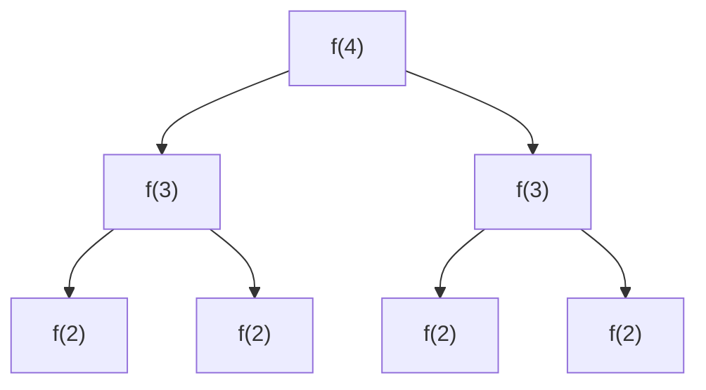

# Big O foundations: time, space, amortised, log and recursive runtimes

## Before this lesson

You should be able to read a short Python function with a loop and a list (see [Lists and loops](#/lesson/python/py-start-lists-loops) if not). No mathematics beyond multiplying and the idea of an exponent is required. For the formal definitions behind this lesson, the DSA track has [Asymptotic notation](#/lesson/dsa-foundations/asymptotic-notation); this lesson is the interview-focused version.

## In plain words

**Big O** is a way of describing how the work done by a piece of code grows as its input grows. It does not tell you how many seconds the code takes. It tells you the *shape* of the growth: does doubling the input double the work, quadruple it, or barely change it?

Imagine sending a large collection of photos to a friend in another city. You can upload them, and the time depends on how many photos there are: twice the photos, twice the time. Or you can put a hard drive in the post, which takes about two days whether the drive holds ten photos or ten million. For a few photos, uploading wins easily. For an enormous collection, the post wins, because its time does not grow with the amount of data. Big O is the language for that comparison: uploading is "linear in the size", posting is "constant".

It matters for a job because in every coding interview you will be asked "what is the complexity of your solution?", and because choosing between two approaches is, most of the time, choosing between two growth rates. Candidates who cannot answer lose points under "fundamentals" even when their code is correct.

## The idea, one small step at a time

### Counting steps instead of seconds

Seconds depend on the computer. So we count **basic steps**: one comparison, one addition, one assignment, one array access. Let `n` be the size of the input, for example the length of a list.

```python
def largest(values):
    best = values[0]          # 1 step
    for v in values:          # the loop body runs n times
        if v > best:          # 1 step each time
            best = v          # at most 1 step each time
    return best               # 1 step
```

The loop body runs `n` times and does at most 2 steps each time, plus 2 steps outside: at most `2n + 2` steps.

### Keeping only the shape

Big O throws away two things from `2n + 2`:

1. **Constant factors.** `2n` becomes `n`. Whether each pass does 2 steps or 20 depends on details of the machine and the language, and does not change the shape: doubling `n` still doubles the work.
2. **Smaller terms.** The `+ 2` is dropped, because for large `n` it is invisible next to `n`.

What is left is written **O(n)**, read "order n" or "linear time". In the same way `3n² + 50n + 7` becomes **O(n²)**: when `n` is a million, `n²` is a million million and `50n` is only fifty million.

> [!NOTE]
> In mathematics, O describes an upper bound, Ω (omega) a lower bound and Θ (theta) both at once. In interviews people say "O" and mean the tightest bound they can give. If your code is linear, say O(n), not "it is O(n²)" even though that is technically also an upper bound.

### The common growth rates

| Name | Notation | What doubling n does | Typical cause |
|---|---|---|---|
| Constant | O(1) | Nothing | Index into an array, hash table lookup |
| Logarithmic | O(log n) | Adds one step | Halving the problem each time (binary search) |
| Linear | O(n) | Doubles the work | One pass over the input |
| Linearithmic | O(n log n) | Slightly more than doubles | Efficient sorting |
| Quadratic | O(n²) | Multiplies by 4 | Every pair of elements |
| Exponential | O(2ⁿ) | Squares the work | Every subset |
| Factorial | O(n!) | Much worse | Every ordering |

The widget below plots these curves so that you can see how quickly they separate.

<div class="widget" data-widget="bigo"></div>

### Best, worst and expected case

The same code can take different amounts of work on different inputs of the same size. Searching a list for a value might find it at the first position (best case, O(1)) or not at all (worst case, O(n)). Unless stated otherwise, interviewers mean the **worst case**. The **expected case** (the average over typical inputs) matters when it differs from the worst case in an important way, as with hash tables and quicksort. The best case is rarely interesting: almost any algorithm can be lucky.

## Space complexity

Time is not the only resource. **Space complexity** describes how much *extra* memory the code needs as the input grows, using the same notation.

- Creating a list of `n` items uses O(n) space. An `n × n` grid uses O(n²).
- A handful of variables is O(1) space, however large the input.
- **The call stack counts.** Each function call that has not yet returned occupies memory. A recursion that goes `n` levels deep uses O(n) space even if it creates no lists.

```python
def total(n):                 # recursion: n calls waiting at the deepest point
    if n == 0:
        return 0
    return n + total(n - 1)   # O(n) time, O(n) space

def total_loop(n):            # loop: one variable
    s = 0
    for i in range(1, n + 1):
        s += i
    return s                  # O(n) time, O(1) space
```

Both functions do `n` additions, but the first keeps `n` unfinished calls on the stack. Note the difference between calls that exist **at the same time** and calls made **one after another**: a loop that calls a small helper `n` times uses O(1) stack space, because each call finishes before the next begins.

## Two rules that prevent most mistakes

### Add or multiply?

- "Do this, **then** do that" → **add** the costs.
- "Do this **for each** time you do that" → **multiply** the costs.

```python
for a in list_a:        # O(A)
    print(a)
for b in list_b:        # then O(B)      -> O(A + B)
    print(b)

for a in list_a:        # for each a ...
    for b in list_b:    # ... all of b   -> O(A * B)
        print(a, b)
```

### Use different letters for different inputs

In the example above the answer is O(A + B) or O(A · B), not O(n) or O(n²). The two lists can have very different lengths, and calling both "n" hides that. A frequent interview error is to write `n` for everything; define your variables aloud ("let s be the length of the longest string and a the number of strings").

### When can a term be dropped?

Only when another term is guaranteed to be at least as large. O(n² + n) is O(n²). But O(A + B²) cannot be simplified unless you know how A and B are related, and neither can O(n + log m).

## Amortised time

Some operations are cheap almost always and expensive once in a while. **Amortised time** is the average cost per operation over a long sequence, which is often the honest way to describe them.

The standard example is a **dynamic array**, the structure behind Python's `list`. It keeps spare room at the end. Appending writes into the spare room, which is O(1). When the room runs out, it allocates a bigger block (typically about double) and copies every element across, which is O(n). After that, many cheap appends are possible again.

How much copying happens in total? If the capacity doubles each time, the copies have sizes 1, 2, 4, 8, … up to about n. That sum is less than 2n. So n appends cost at most about n (for the writes) plus 2n (for all the copying): O(n) altogether, which is **O(1) per append, amortised**.

```python-run
def count_copies(n):
    capacity, size, copies = 1, 0, 0
    for _ in range(n):
        if size == capacity:        # full: grow and copy everything
            copies += size
            capacity *= 2
        size += 1                   # the append itself
    return copies

for n in (10, 100, 1000, 10000, 100000, 1000000):
    c = count_copies(n)
    print(f"n = {n:>8}: {c:>8} element copies, {c / n:.2f} per append")
```

`count_copies` simulates the array: `size` is the number of stored elements and `capacity` is the room available. When they are equal the array is full, so the function adds `size` to the copy counter and doubles the capacity. The output shows the copies per append staying below 2 however large `n` becomes. An individual append can still be slow (the one that triggers a resize), but averaged over the sequence each costs a constant amount. Say it this way in an interview: "append is O(1) amortised, O(n) in the worst case for a single call".

## Log n runtimes

A **logarithm** answers the question "how many times can I halve n before reaching 1?". For n = 16: 16 → 8 → 4 → 2 → 1 is four halvings, so log₂ 16 = 4. For a million it is about 20; for a billion, about 30. That slow growth is why O(log n) algorithms are so valuable.

Whenever an algorithm **discards a constant fraction of the remaining problem at each step**, the number of steps is logarithmic. Binary search in a sorted list is the model: compare with the middle, throw away half.

```python-run
def binary_search_steps(n):
    low, high, steps = 0, n - 1, 0
    target = -1                         # never found: forces the worst case
    while low <= high:
        steps += 1
        mid = (low + high) // 2
        if mid == target:
            break
        high = mid - 1                  # keep the left half
    return steps

for n in (16, 1000, 10**6, 10**9):
    print(f"n = {n:>10}: {binary_search_steps(n)} steps")
```

The loop keeps a range `low … high`, looks at the middle, and keeps only one side. `steps` counts the passes. The output grows by about 10 each time `n` is multiplied by a thousand, because 2¹⁰ ≈ 1000.

The base of the logarithm does not matter in Big O: logs in different bases differ only by a constant factor, and constants are dropped. Write O(log n).

The mirror image also appears: a loop whose counter **doubles** each time (`i = 1, 2, 4, 8, …` until it exceeds n) runs about log₂ n times.

## Recursive runtimes

For recursive code, draw the **tree of calls**. Each call is a node; the calls it makes are its children.

```python
def f(n):
    if n <= 1:
        return 1
    return f(n - 1) + f(n - 1)
```

Each call makes two calls, and the depth is n, so the tree has 1 + 2 + 4 + … + 2ⁿ⁻¹ = 2ⁿ − 1 nodes. Each node does O(1) work of its own, so the time is **O(2ⁿ)**.



The general pattern for a recursion that branches is:

$$\text{time} = O(\text{branches}^{\text{depth}}) \times \text{work per call}$$

**Space is different.** Although 2ⁿ calls happen in total, they do not all exist at once. At any moment only one path from the root to the current call is on the stack, so the space is O(depth) = **O(n)**.

Three checks for any recursive function:

1. How many recursive calls does one call make (the branching factor)?
2. How deep does it go before the base case (the depth)? Subtracting 1 each time gives depth n; halving gives depth log n.
3. How much work does each call do besides the recursive calls?

If a function makes **one** recursive call, the "tree" is a chain and the time is depth × work per call: O(n) for `total` above. If it makes two calls on **halves** (as merge sort does), the depth is log n and each *level* of the tree does O(n) work in total, giving O(n log n).

You can confirm the 2ⁿ claim by counting calls:

```python-run
calls = 0

def f(n):
    global calls
    calls += 1
    if n <= 1:
        return 1
    return f(n - 1) + f(n - 1)

for n in range(1, 11):
    calls = 0
    f(n)
    print(f"n = {n:2d}: {calls:5d} calls   (2^n - 1 = {2**n - 1})")
```

`calls` is a counter outside the function; `global calls` lets the function change it. Each run resets the counter, calls `f`, and prints the count next to the formula. The two columns match exactly.

## A worked example from start to finish

*Given a list of n words, each at most L letters long, the code sorts the letters of every word and then sorts the list of words. What is the running time?*

Take it in pieces and name the variables: `n` words, each up to `L` letters.

1. Sorting the letters of one word: O(L log L).
2. Doing that for every word: multiply by n → O(n · L log L).
3. Sorting the list of words: a sort makes O(n log n) *comparisons*. But comparing two words is not one step: it can look at up to L letters. So this part is O(L · n log n).
4. Steps 2 and 3 happen one after the other: add them.

Total: **O(n · L · (log L + log n))**.

The tempting wrong answer is O(n log n), which forgets that the items being sorted are strings. This example shows why the two rules matter: separate letters for separate quantities, and asking of every "step" whether it is truly constant.

## Pitfalls

- **Saying O(n²) because there are two loops.** Two loops in sequence are O(n + m); nested loops over different collections are O(n · m); an inner loop that halves is O(n log n). Count, do not pattern-match.
- **Forgetting hidden loops.** In Python, `x in some_list`, `some_list.index(x)`, slicing `a[i:j]`, `max(a)`, `sum(a)`, string concatenation in a loop and `list.insert(0, x)` are all O(length). Inside a loop they multiply.
- **Dropping a term that is not smaller.** O(A + B) stays as it is.
- **Ignoring the recursion stack** when stating space.
- **Confusing total calls with simultaneous calls** in recursive space analysis.
- **Mixing up amortised and worst case.** Say which one you mean.
- **Treating hash table operations as free in every situation.** They are O(1) *expected*; hashing a string of length L costs O(L).

> [!INTERVIEW]
> State complexity without being asked, for both time and space, and say what `n` is. A full-mark sentence sounds like: "This is O(n log n) time because of the sort, and O(n) extra space for the dictionary, where n is the number of orders."

> [!TIP]
> If you are unsure, plug in numbers. Imagine n = 1,000 and ask roughly how many basic steps happen; then imagine n = 2,000. If the count doubles the code is linear, if it quadruples it is quadratic.

## Summary

- Big O describes how work grows with input size, ignoring constant factors and smaller terms.
- Unless told otherwise, give the worst case; mention the expected case when it differs.
- Space complexity counts extra memory, including the depth of the recursion stack.
- Sequential blocks add; nested blocks multiply; different inputs get different letters.
- Amortised time is the average cost over a sequence: appending to a dynamic array is O(1) amortised.
- Halving (or doubling) per step gives O(log n).
- For recursion, time is about branches^depth times the work per call, and space is the depth.
- The next lesson, [What is the runtime?](#/lesson/interview-prep/big-o-worked-examples), applies all of this to many short examples.

## Glossary

- **Big O**: notation for the growth rate of running time or memory as input size grows.
- **Input size (n)**: the quantity the cost is measured against, such as list length.
- **Constant factor**: a fixed multiplier, ignored by Big O.
- **Worst case / expected case / best case**: the cost on the least favourable input, on average, and on the most favourable input.
- **Space complexity**: the extra memory needed, as a function of input size.
- **Call stack**: the memory holding function calls that have started and not yet returned.
- **Amortised time**: average cost per operation over a long sequence of operations.
- **Dynamic array**: an array that grows by allocating a larger block and copying when full.
- **Logarithm**: the number of times a value can be halved before reaching 1 (for base 2).
- **Branching factor**: the number of recursive calls made by one call.
- **Recursion depth**: the longest chain of nested calls.

```quiz
[
  {"q": "A function performs 5n² + 300n + 9 basic steps. What is its Big O?",
   "options": ["O(5n²)", "O(n² + n)", "O(n²)", "O(n)"],
   "answer": 2,
   "explain": "Constant factors and smaller terms are dropped; n² dominates for large n."},
  {"q": "One loop runs over list A and, after it finishes, a second loop runs over list B. What is the time?",
   "options": ["O(A · B)", "O(A + B)", "O(n²)", "O(max(A, B)²)"],
   "answer": 1,
   "explain": "Sequential work adds. The loops are not nested, and the lists have separate sizes."},
  {"q": "Why is appending to a dynamic array described as O(1) amortised?",
   "options": ["Every single append takes exactly one step", "Occasional O(n) copies are rare enough that the average cost per append over a long sequence is constant", "The array never needs to grow", "Copies are free"],
   "answer": 1,
   "explain": "With doubling, total copying over n appends is under 2n, so the average per append is constant even though one append may be slow."},
  {"q": "A loop starts with i = n and halves i each pass until i is 0. How many passes?",
   "options": ["O(n)", "O(log n)", "O(n²)", "O(1)"],
   "answer": 1,
   "explain": "Halving repeatedly reaches 1 after about log₂ n steps."},
  {"q": "A recursive function makes 2 recursive calls and each reduces n by 1 down to a base case. What are its time and space?",
   "options": ["O(n) time, O(n) space", "O(2ⁿ) time, O(2ⁿ) space", "O(2ⁿ) time, O(n) space", "O(n²) time, O(1) space"],
   "answer": 2,
   "explain": "The call tree has about 2ⁿ nodes, but only one root-to-leaf path of depth n is on the stack at once."},
  {"q": "Inside a loop over n items you write `if x in other_list`, where other_list has m items. What is the total time?",
   "options": ["O(n)", "O(n + m)", "O(n · m)", "O(log m)"],
   "answer": 2,
   "explain": "Membership in a list is a hidden linear scan, and it happens once per iteration: multiply."},
  {"q": "Which expression can be simplified to O(n²)?",
   "options": ["O(n² + m)", "O(n² + n log n)", "O(n² · m)", "O(n + m²)"],
   "answer": 1,
   "explain": "n log n is always smaller than n² for large n, so it can be dropped. Terms involving a different variable cannot."},
  {"q": "Sorting a list of n strings, each of length up to L, with a comparison sort costs:",
   "options": ["O(n log n)", "O(L · n log n)", "O(n · L)", "O(log n)"],
   "answer": 1,
   "explain": "The sort makes O(n log n) comparisons, and each string comparison may examine up to L characters."}
]
```

> **Source:** McDowell, Cracking the Coding Interview 6e, ch. VI (Big O). Explanations, code and demos are original.
