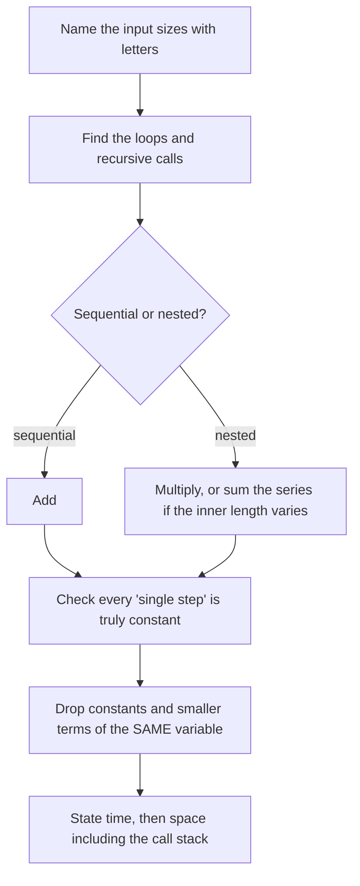

# What is the runtime? Worked examples

## Before this lesson

Work through [Big O foundations](#/lesson/interview-prep/big-o-foundations) first. You need its vocabulary: constant factors, add versus multiply, amortised time, logarithms, and the branches-to-the-power-of-depth rule for recursion. The Python used here is limited to loops, lists, dictionaries and simple recursion.

## In plain words

Knowing the definitions of Big O is like knowing the rules of chess: necessary, but it does not make you good at the game. Skill comes from working many positions. In an interview you will be shown, or will write, a short piece of code and must say how its cost grows, quickly and with a reason.

This lesson is a set of fifteen worked positions. Each has a short piece of code, a moment for you to guess, and then the reasoning. They are grouped by the kind of trap they contain. Try to answer each before reading on; the mistakes you make here are the cheapest ones you will ever make.

A method that works for every example:



## Group 1: loops

### Example 1: two passes

```python
def spread(values):
    low = high = values[0]
    for v in values:
        low = min(low, v)
    for v in values:
        high = max(high, v)
    return high - low
```

Two loops, each of length n, one after the other: n + n = 2n. Drop the constant. **O(n) time, O(1) space.** Merging the two loops into one would make the code a little faster in seconds, and would not change its Big O.

### Example 2: every pair, the triangular loop

```python
def count_inversions(a):
    count = 0
    for i in range(len(a)):
        for j in range(i + 1, len(a)):
            if a[i] > a[j]:
                count += 1
    return count
```

The inner loop does not always run n times. For i = 0 it runs n − 1 times, then n − 2, …, then 0. The total is

$$(n-1) + (n-2) + \dots + 1 + 0 = \frac{n(n-1)}{2}$$

which is n²/2 − n/2. Drop the constant ½ and the smaller term: **O(n²)**. A useful picture: the pairs (i, j) with i < j fill half of an n × n square. Half of a square is still proportional to the square.

### Example 3: two different collections

```python
def common_count(a, b):
    count = 0
    for x in a:
        for y in b:
            if x == y:
                count += 1
    return count
```

Let A and B be the two lengths. For each of A elements, B comparisons: **O(A · B)**. It is not O(n²): the lists are unrelated in size.

### Example 4: a constant-size inner loop

```python
def near_matches(a, b):
    count = 0
    for x in a:
        for y in b:
            for k in range(100):
                if x + k == y:
                    count += 1
    return count
```

The innermost loop runs exactly 100 times whatever the input. 100 is a constant: **O(A · B)**, the same as Example 3. A loop only contributes to Big O when its length depends on the input.

### Example 5: half the array

```python
def mirror(a):
    for i in range(len(a) // 2):
        j = len(a) - 1 - i
        a[i], a[j] = a[j], a[i]
```

n/2 iterations: **O(n)**. Doing half the work is a constant factor.

### Example 6: a loop that doubles

```python
def powers_below(n):
    out, p = [], 1
    while p < n:
        out.append(p)
        p *= 2
    return out
```

p takes the values 1, 2, 4, 8, … and stops when it reaches n. It needs about log₂ n doublings: **O(log n) time**, and O(log n) space for the output list.

### Example 7: a hidden loop

```python
def without_duplicates(items):
    result = []
    for x in items:
        if x not in result:      # scans result
            result.append(x)
    return result
```

It looks like one loop. But `x not in result` scans a list that can grow to n elements. In the worst case (all different) the scans cost 0 + 1 + 2 + … + (n − 1): **O(n²)**. Replacing the membership test with a set makes each test O(1) expected and the whole function **O(n)**. This is the single most common performance bug in interview code written in Python.

### Example 8: building a string piece by piece

```python
def join_all(words):
    text = ""
    for w in words:
        text = text + w
    return text
```

Strings cannot be changed in place, so each `text + w` builds a new string by copying everything so far. With n words of length L, the copies have lengths L, 2L, 3L, …, nL, which sums to about L · n²/2: **O(L · n²)**. The fix is to collect the pieces in a list and call `"".join(pieces)` once, which is O(L · n). (Some Python versions optimise the simple `+=` case, but you should not rely on it and it does not exist in Java or C#.)

## Group 2: what is n?

### Example 9: testing whether a number is prime

```python
def is_prime(n):
    if n < 2:
        return False
    d = 2
    while d * d <= n:
        if n % d == 0:
            return False
        d += 1
    return True
```

The loop stops when d² exceeds n, that is when d reaches √n. **O(√n)** time. Here n is the *value* of the number, not a length. If the interviewer asks in terms of the number of digits k, then n is about 10ᵏ and the time is O(10^(k/2)), which is exponential in the digit count. Always say what your variable measures.

### Example 10: sorting each word, then the list

This is the example worked in the previous lesson, restated because the trap is so common: for n words of at most L letters, sorting each word costs O(n · L log L), and sorting the list costs O(L · n log n) because each comparison reads up to L letters. Total **O(n · L · (log n + log L))**. Never write "n" for both the number of strings and their length.

## Group 3: recursion

### Example 11: sum of a balanced tree's values

```python
def tree_sum(node):
    if node is None:
        return 0
    return node.val + tree_sum(node.left) + tree_sum(node.right)
```

Two recursive calls, so is it O(2ⁿ)? No. The "branches to the power of depth" rule gives 2^depth, and for a balanced tree with N nodes the depth is about log₂ N, so 2^(log₂ N) = N. There is an easier argument that works for any tree shape: the function is called **once for every node** (plus once for every empty child), and does O(1) work per call. **O(N) time.** Space is the depth of the recursion: O(log N) for a balanced tree, O(N) for a tree that is one long chain.

The lesson: when recursion walks a data structure, count how many times each element is visited instead of applying a formula blindly.

### Example 12: plain recursive Fibonacci

```python
def fib(n):
    if n < 2:
        return n
    return fib(n - 1) + fib(n - 2)
```

Two branches, depth n: the upper bound is **O(2ⁿ)**. The tree is lopsided, because the right branch shrinks by 2, so the exact count is smaller: it grows like 1.618ⁿ, the golden ratio to the power n. In an interview, O(2ⁿ) is accepted, and mentioning that the tighter bound is about O(1.6ⁿ) is a bonus. Space is O(n): the longest chain of calls.

### Example 13: Fibonacci with a memo

```python
def fib_memo(n, memo=None):
    if memo is None:
        memo = {}
    if n < 2:
        return n
    if n not in memo:
        memo[n] = fib_memo(n - 1, memo) + fib_memo(n - 2, memo)
    return memo[n]
```

A **memo** is a table of answers already computed. Each value from 2 to n is computed once; every later request for it is a dictionary lookup. So there are about n "real" calls, each doing O(1) work, plus at most one cheap lookup call from each: **O(n) time, O(n) space**. The code differs from Example 12 by three lines, and n = 90 goes from longer than a human lifetime to instant. Check this claim yourself:

```python-run
import time

def fib(n):
    return n if n < 2 else fib(n - 1) + fib(n - 2)

def fib_memo(n, memo=None):
    if memo is None:
        memo = {}
    if n < 2:
        return n
    if n not in memo:
        memo[n] = fib_memo(n - 1, memo) + fib_memo(n - 2, memo)
    return memo[n]

for n in (15, 20, 25):
    start = time.perf_counter()
    fib(n)
    plain = time.perf_counter() - start
    start = time.perf_counter()
    fib_memo(n)
    fast = time.perf_counter() - start
    print(f"n = {n}: plain {plain * 1000:8.2f} ms   memo {fast * 1000:6.3f} ms")

print("fib_memo(90) =", fib_memo(90))
```

`time.perf_counter()` reads a precise clock; subtracting two readings gives elapsed seconds. Each time n grows by 5, the plain version takes roughly eleven times longer (1.618⁵ ≈ 11), while the memo version barely changes.

### Example 14: all orderings of a string

```python
def orderings(rest, prefix=""):
    if not rest:
        print(prefix)
        return
    for i in range(len(rest)):
        orderings(rest[:i] + rest[i + 1:], prefix + rest[i])
```

Work through it carefully, because this is where simple rules run out.

1. **How many times is the base case reached?** Once per ordering: n! times.
2. **How many calls in total?** Every ordering corresponds to a path of n + 1 calls from the root, so there are at most (n + 1) · n! calls. (Many are shared, so the true number is a small multiple of n!, but this bound is enough.)
3. **How much work per call?** Slicing and concatenating strings of length up to n: O(n). Printing at the base case: O(n).

Total: at most O(n · (n + 1) · n!) = **O(n² · n!)**. A tighter analysis gives O(n · n!), and either is a good interview answer as long as you explain the three questions. The method (count the leaves, bound the calls, multiply by the work per call) matters more than the final expression.

### Example 15: halving recursion with linear work

```python
def strange(a):
    if len(a) <= 1:
        return 0
    total = sum(a)                 # O(len(a))
    return total + strange(a[: len(a) // 2])
```

One recursive call, on half the list. The work at each level is proportional to the current length: n, then n/2, then n/4, … That series adds to less than 2n. **O(n) time**, not O(n log n). Compare with merge sort, which makes **two** calls on halves: there, every level does O(n) work in total and there are log n levels, giving O(n log n). One halved branch gives a shrinking series; two halved branches give equal levels.

## Check your reasoning with measurements

When you are unsure whether code is linear or quadratic, count operations for n and for 2n. If the count roughly doubles the code is linear; if it roughly quadruples it is quadratic; if it grows by a fixed amount it is logarithmic. The program below does this for three of the examples.

```python-run
def triangular(n):                       # Example 2
    steps = 0
    for i in range(n):
        for j in range(i + 1, n):
            steps += 1
    return steps

def hidden_scan(n):                      # Example 7 with all-different items
    steps, result = 0, []
    for x in range(n):
        steps += len(result)             # cost of 'x not in result'
        result.append(x)
    return steps

def halving_series(n):                   # Example 15
    steps = 0
    while n > 1:
        steps += n
        n //= 2
    return steps

print(f"{'function':16s} {'n=1000':>10s} {'n=2000':>10s}  ratio")
for f in (triangular, hidden_scan, halving_series):
    a, b = f(1000), f(2000)
    print(f"{f.__name__:16s} {a:10d} {b:10d}  {b / a:.2f}")
```

Each function returns a count of basic steps instead of doing real work. The last column is the ratio of the count for n = 2000 to the count for n = 1000. The first two print a ratio close to 4, confirming quadratic growth. The third prints a ratio close to 2: linear, as the series argument predicted. This doubling experiment is worth remembering as a tool: it settles arguments in seconds.

## A reference table of results

| Code shape | Runtime | Why |
|---|---|---|
| Loop to n, then another loop to n | O(n) | Add |
| Loop to n inside a loop to n | O(n²) | Multiply |
| Inner loop from i to n | O(n²) | Sum 1 + 2 + … + n |
| Loop to A inside loop to B | O(A · B) | Different inputs |
| Loop that doubles or halves its counter | O(log n) | Halvings |
| Loop to n with a halving loop inside | O(n log n) | Multiply |
| Loop to √n | O(√n) | Stops when d² > n |
| Membership test in a list inside a loop | O(n²) | Hidden scan |
| One recursive call, n − 1 | O(n) time and space | Chain |
| One recursive call on half, O(1) work | O(log n) | Halvings |
| One recursive call on half, O(n) work | O(n) | n + n/2 + n/4 + … |
| Two recursive calls on halves, O(n) work | O(n log n) | log n levels of n |
| Two recursive calls, n − 1 | O(2ⁿ) | Full binary tree of depth n |
| Visit every node of a tree | O(N) | Each node once |
| All subsets of n items | O(2ⁿ), or O(n · 2ⁿ) to copy each | Each item in or out |
| All orderings of n items | O(n · n!) | n! leaves, O(n) each |

## Pitfalls

- **Counting loops instead of iterations.** Two nested loops are not automatically n²; ask how many times the innermost line runs in total.
- **Applying 2^depth to tree traversals.** Count visits per node.
- **Assuming a "step" is constant.** String comparison, slicing, `in` on a list, `sum`, `max`, `sorted` and copying are loops in disguise.
- **Using one letter for two quantities.**
- **Forgetting that a memo changes the complexity completely.** With memoisation, count distinct subproblems, not paths.
- **Giving only time.** State space as well, including recursion depth.
- **Over-simplifying sums.** n + n/2 + n/4 + … is 2n, not n log n; 1 + 2 + … + n is n²/2, not n.

> [!INTERVIEW]
> When asked for complexity, do not announce a result and stop. Give the one-sentence reason: "The outer loop runs n times and the inner loop runs up to n minus i times, which sums to about n squared over two, so it is O(n²)." The reason is what is being graded, and it earns credit even if you slip on the final expression.

> [!TIP]
> Three sums cover most interview analysis. 1 + 2 + … + n ≈ n²/2. 1 + 2 + 4 + … + n ≈ 2n. n + n/2 + n/4 + … ≈ 2n. They are reviewed in [Useful maths and graph algorithms](#/lesson/interview-prep/review-math-graphs).

> [!WARNING]
> "It has a sort in it, so it is O(n log n)" is only true if nothing else in the code is more expensive. A sort followed by a nested pair of loops is O(n²): the largest term wins.

## Summary

- Name the input sizes first, with a separate letter for each independent quantity.
- Count how many times the innermost statement executes: add for sequences, multiply for nesting, sum the series when the inner length varies.
- Check that each step is truly constant: library calls, string operations and membership tests often hide loops.
- For recursion over a data structure, count visits per element; for branching recursion, bound the number of calls and multiply by the work per call; with a memo, count distinct subproblems.
- One halved branch with linear work is O(n); two halved branches with linear work is O(n log n).
- When in doubt, run a doubling experiment and look at the ratio.
- With this skill in place you are ready for the [seven-step method](#/lesson/interview-prep/seven-step-method), where complexity guides the search for a better solution.

## Glossary

- **Iteration count**: the number of times a statement executes over the whole run.
- **Triangular sum**: 1 + 2 + … + n, equal to n(n + 1)/2.
- **Geometric series**: a sum in which each term is a fixed multiple of the previous one, such as 1 + 2 + 4 + … or n + n/2 + n/4 + ….
- **Hidden loop**: an operation that looks like one step and actually scans a collection.
- **Call tree**: the diagram of which recursive calls make which others.
- **Leaf**: a call that makes no further recursive calls (a base case).
- **Memo**: a table storing results of subproblems already solved.
- **Subproblem**: a smaller instance of the same problem solved by a recursive call.
- **Doubling experiment**: measuring cost at n and 2n to infer the growth rate.

```quiz
[
  {"q": "for i in range(n): for j in range(i, n): work(). How many times does work() run, in Big O?",
   "options": ["O(n)", "O(n log n)", "O(n²)", "O(2ⁿ)"],
   "answer": 2,
   "explain": "The inner loop runs n, n−1, …, 1 times: a triangular sum of about n²/2."},
  {"q": "A loop runs n times and inside it another loop runs exactly 50 times. What is the time?",
   "options": ["O(50n)", "O(n²)", "O(n)", "O(n + 50)"],
   "answer": 2,
   "explain": "50 does not depend on the input, so it is a constant factor and is dropped."},
  {"q": "A function visits every node of a binary tree with N nodes, doing O(1) work at each and making two recursive calls. What is its running time?",
   "options": ["O(2^N)", "O(N)", "O(N log N)", "O(log N)"],
   "answer": 1,
   "explain": "Each node is visited exactly once. The 2^depth rule gives 2^(log N) = N for a balanced tree, and counting visits works for any shape."},
  {"q": "What does adding a memo to the recursive Fibonacci function change?",
   "options": ["Nothing in Big O terms", "Time drops from exponential to O(n), at the cost of O(n) memory", "Time becomes O(log n)", "Space drops to O(1)"],
   "answer": 1,
   "explain": "Each value from 2 to n is computed once; later requests are lookups."},
  {"q": "A recursive function does O(n) work and then calls itself once on half the input. Total time?",
   "options": ["O(n log n)", "O(n)", "O(log n)", "O(n²)"],
   "answer": 1,
   "explain": "n + n/2 + n/4 + … is a geometric series that sums to less than 2n."},
  {"q": "In a doubling experiment, the step count goes from 5,000 at n = 1000 to 20,000 at n = 2000. The growth is most likely:",
   "options": ["Linear", "Quadratic", "Logarithmic", "Constant"],
   "answer": 1,
   "explain": "Doubling n multiplied the work by 4, the signature of n²."},
  {"q": "Why is building a string with repeated `text = text + piece` in a loop of n pieces quadratic?",
   "options": ["The + operator is slow by design", "Each concatenation copies the whole string built so far, giving 1 + 2 + … + n copies of piece-sized blocks", "Strings use too much memory", "The loop runs n² times"],
   "answer": 1,
   "explain": "Immutable strings must be copied on every concatenation; the copy lengths form a triangular sum."},
  {"q": "The primality test that tries divisors d while d·d <= n runs in:",
   "options": ["O(n)", "O(log n)", "O(√n)", "O(n²)"],
   "answer": 2,
   "explain": "The loop stops when d exceeds the square root of n."}
]
```

> **Source:** McDowell, Cracking the Coding Interview 6e, ch. VI (Big O: Examples and Exercises). All code examples and the measurement demo are original.
