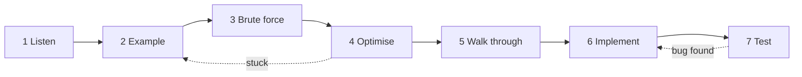

# The seven-step method for technical questions

## Before this lesson

You should be comfortable with [Big O foundations](#/lesson/interview-prep/big-o-foundations) and know the rubric headings from [What interviewers evaluate](#/lesson/interview-prep/what-interviewers-score). You need basic Python (loops, lists, dictionaries). The NeetCode-style track has a parallel lesson, [How to approach a coding problem](#/lesson/neet-arrays/approach), which you can read for a second explanation of the same habit.

## In plain words

A **technical question** in an interview is a small programming problem you solve live, in conversation, in about 40 minutes. Most candidates who fail do not fail because the problem was beyond them. They fail because they had no procedure: they started typing immediately, got tangled, went silent, and ran out of time.

Pilots do not rely on inspiration to land an aircraft. They follow a checklist, every time, including on days when they feel sure they remember everything. The checklist is what makes performance reliable under pressure. This lesson gives you a seven-step checklist for technical questions:

1. **Listen**
2. **Example**
3. **Brute force**
4. **Optimise**
5. **Walk through**
6. **Implement**
7. **Test**

It matters for a job because each step produces evidence under a different heading of the interviewer's form. Follow the steps and the form fills itself in; skip steps and whole rows stay empty, whatever the quality of your final code.



Throughout the lesson we will carry one problem, invented for this track:

> *A service receives a list of login events in time order. Each event is the name of the user who logged in. Return the name of the first user (earliest in the list) who appears exactly once, or an empty string if there is none.*

## Step 1: Listen

Read or hear the whole problem and treat **every detail as a clue**. Problem statements are short; words are rarely there by accident.

Details that often matter:

- "sorted", "in time order" → an algorithm that exploits order probably exists.
- "repeatedly called", "a stream" → precomputation or a data structure that updates cheaply.
- "small alphabet", "only lower-case letters" → a fixed-size table can replace a general structure.
- "in place", "without extra memory" → the simple dictionary solution is not what they want in the end.

Then **restate the problem in your own words and ask clarifying questions**. For our problem:

- "Are names case-sensitive? Is `Ana` the same user as `ana`?"
- "How large can the list be? Does it fit in memory?"
- "What should I return when every user appears more than once?"
- "By 'first' you mean earliest position in the list, not alphabetical order?"

Write the answers down. Suppose the interviewer says: case-sensitive, up to a few million events, return an empty string, earliest position.

> [!TIP]
> Write the key facts at the top of the editor or whiteboard: input type, output type, sizes, special cases. When you are stuck later, re-read them. A detail you have not used yet is frequently the hint.

## Step 2: Example

Draw a concrete example before thinking about algorithms. Most examples candidates invent are **too small, too tidy, or a special case**. A good example is:

- **Specific**: real values, not "some names".
- **Large enough** to show the pattern: usually six to ten elements.
- **Not a special case**: not already sorted, not all equal, not conveniently balanced.

For our problem a poor example is `["ana", "bo"]`. A useful one is:

```
events = ["kim", "ana", "bo", "kim", "cy", "ana", "bo", "dee"]
```

Here `kim`, `ana` and `bo` repeat; `cy` and `dee` appear once; the answer is `cy`, which is neither the first element nor the last. Working it by hand already shows something: the answer cannot be decided when you first see `cy`, because a later event could still repeat it.

Keep a second, nasty example in mind for later: `["x", "x"]` (answer `""`) and `[]`.

## Step 3: Brute force

State the most obvious correct method, even if it is slow, **and state its cost**. Do not code it yet.

"For each event, scan the whole list and count how often that name occurs. Return the first name whose count is one. That is two nested passes, so O(n²) time and O(1) extra space."

Why say something you do not intend to write?

- It proves you understand the problem.
- It gives you a baseline to improve and a fallback if nothing better arrives.
- It earns credit: many candidates never articulate any working approach.

> [!INTERVIEW]
> Candidates often stay silent because the brute force feels embarrassing. Interviewers want to hear it. "The simple way is O(n²); I think we can do better because we recount the same names many times" is exactly the sentence that gets written down under problem solving.

## Step 4: Optimise

Now improve the brute force. The next lesson, [Optimisation techniques](#/lesson/interview-prep/optimisation-techniques), teaches a toolbox for this step; here is the short version applied to our problem.

Look at the brute force and ask three questions:

1. **Where is the bottleneck?** The inner scan that counts occurrences, repeated for every event.
2. **Is any work unnecessary?** Counting a name fully when all we need to know is "once or more than once".
3. **Is any work duplicated?** Yes: `kim` is counted from scratch each time it appears.

Duplicated counting suggests counting once and remembering. A dictionary from name to count does that in one pass. A second pass over the events, in order, returns the first name whose count is 1.

"Two passes: build counts, then find the first name with count one. O(n) time, and O(u) space for u distinct users."

Can it be better? Every event must be read at least once, because any unread event could change the answer. So O(n) time is the best conceivable, and we can stop optimising time. Space could matter with millions of distinct users; mention it and ask whether it is a concern.

If you get stuck in this step, go back to the example and solve it by hand, slowly, watching what your own mind does. People naturally keep a tally. That tally is the dictionary.

## Step 5: Walk through

Before writing code, describe the algorithm in a few numbered sentences and trace it on your example. This is the cheapest moment to find a flaw: changing a sentence costs seconds, changing half-written code costs minutes.

```
1. counts = empty dictionary
2. for each name in events: counts[name] += 1
3. for each name in events (same order): if counts[name] == 1, return name
4. return ""
```

Trace on the example: after step 2, counts are kim 2, ana 2, bo 2, cy 1, dee 1. Step 3 reads kim (2), ana (2), bo (2), kim (2), cy (1) → return `cy`. Correct.

Say what variables you will need and what the structure of the code will be. Interviewers relax visibly when a candidate does this, because it predicts that the code will arrive in order.

> [!WARNING]
> The most expensive mistake in a coding interview is starting to code before you know exactly what you are going to write. If you cannot describe the algorithm in plain sentences, you are not ready for step 6.

## Step 6: Implement

Now write real code, in the top-left corner of the space, with normal indentation. Aim for code you would be content to see in a review:

- **Meaningful names** (`counts`, not `d`).
- **Small helper functions** when a part has a clear job; you may call a helper before writing it and fill it in afterwards.
- **Handle the special cases** you noted in step 1.
- **Keep talking**: one short sentence per block about what it does.

```python
def first_single_login(events):
    counts = {}
    for name in events:
        counts[name] = counts.get(name, 0) + 1
    for name in events:
        if counts[name] == 1:
            return name
    return ""
```

Line by line: `counts = {}` creates an empty dictionary. The first loop visits every name; `counts.get(name, 0)` returns the current tally or 0 if the name is new, and the line stores the tally plus one. The second loop visits the names again in their original order and returns the first whose tally is exactly 1. If the loop finishes, no such name exists and the function returns the empty string.

## Step 7: Test

Do not say "done" when the last line is written. Test, in this order:

1. **Conceptual read-through.** Read each line and ask whether it does what you meant, as if reviewing a colleague's code.
2. **Unusual-looking code.** Check index arithmetic, loop boundaries, `<` versus `<=`, anything with `- 1`.
3. **Hot spots.** Base cases of recursion, integer division, null or missing values, the first and last iteration.
4. **Small test cases.** Trace by hand with a three- or four-element input. Small inputs find the same bugs as large ones and take a fraction of the time.
5. **Special cases.** Empty input, a single element, all equal, extreme values.

For our function: `[]` → both loops are skipped, returns `""`. `["x"]` → count 1, returns `x`. `["x", "x"]` → count 2, returns `""`. The main example → `cy`.

When you find a bug, **do not patch the first thing you see**. Understand why it happened, then fix it, then re-test the cases that passed before.

Here is the whole solution with its tests as a runnable block. Change the events and predict the output before running.

```python-run
def first_single_login(events):
    counts = {}
    for name in events:
        counts[name] = counts.get(name, 0) + 1
    for name in events:
        if counts[name] == 1:
            return name
    return ""

def brute_force(events):
    for i, name in enumerate(events):
        if sum(1 for other in events if other == name) == 1:
            return name
    return ""

tests = [
    ["kim", "ana", "bo", "kim", "cy", "ana", "bo", "dee"],
    [],
    ["x"],
    ["x", "x"],
    ["Ana", "ana"],
]
for events in tests:
    fast, slow = first_single_login(events), brute_force(events)
    print(f"{str(events):60s} -> {fast!r:6s} {'ok' if fast == slow else 'MISMATCH'}")
```

The block also contains the brute force. Comparing a fast solution with a slow, plainly correct one on many inputs is a professional testing technique, and it is how the problems on this site check your submissions. `{fast!r}` prints the value with quotes so that an empty string is visible.

## How the 45 minutes are spent

| Step | Minutes | Evidence it creates |
|---|---|---|
| Listen and clarify | 2 to 4 | Communication, problem solving |
| Example | 2 to 3 | Problem solving |
| Brute force | 1 to 3 | Problem solving, fundamentals |
| Optimise | 5 to 12 | Problem solving |
| Walk through | 2 to 4 | Communication |
| Implement | 10 to 15 | Coding |
| Test | 5 to 8 | Verification |

That leaves a few minutes for a follow-up question and for your own questions. Notice that implementation is about a third of the time. Candidates who spend 35 minutes on code have skipped the steps that earn most of the marks.

## The same steps on a harder example, in brief

*Given the daily closing prices of a share, find the largest profit from buying on one day and selling on a later day.*

1. **Listen.** "Later day" is the key detail: the order of the list matters. Ask: can the profit be zero if prices only fall? (Yes, return 0.)
2. **Example.** `[7, 3, 8, 2, 9, 4]`. By hand the best is buy at 2, sell at 9: profit 7. Note that the lowest price comes after an earlier high, so "max minus min" over the whole list would be wrong in other examples such as `[9, 1]`.
3. **Brute force.** Try every pair (buy day, later sell day): O(n²).
4. **Optimise.** Duplicated work: for each selling day we search again for the cheapest earlier day. Keep a running minimum instead. One pass: O(n) time, O(1) space.
5. **Walk through.** min so far 7; day 2: price 3, profit −4 → 0, min 3; price 8: profit 5; price 2: min 2; price 9: profit 7; price 4: profit 2. Best 7.
6. **Implement.** Six lines: two variables and a loop.
7. **Test.** Falling prices `[5, 4, 3]` → 0; one day → 0; empty → 0.

The site's version of this problem is [Best Time to Buy and Sell Stock](#/problem/best-time-to-buy-and-sell-stock); try it using the checklist aloud.

## Pitfalls

- **Coding immediately.** It feels productive and it is the commonest cause of failure.
- **Silent thinking.** Thirty seconds of silence is fine if you announce it ("let me think for a moment"); five minutes is a blank report.
- **A toy example.** Two elements in sorted order show nothing.
- **Skipping the brute force** because it seems too easy to mention.
- **Optimising without a baseline.** You cannot tell whether an idea is an improvement if you never stated the starting cost.
- **Declaring victory without testing.** Interviewers write "did not test" more often than almost any other criticism.
- **Fixing a bug by guesswork.** Random edits create new bugs and show a lack of method.
- **Ignoring a hint.** If the interviewer mentions something, it is not small talk.

## Summary

- Use the same seven steps for every technical question: listen, example, brute force, optimise, walk through, implement, test.
- Listening means catching every detail and asking questions; an example must be specific, big enough and not a special case.
- Always state the brute force and its cost before improving it.
- Optimise by looking for bottlenecks, unnecessary work and duplicated work, and stop when you reach the best conceivable cost.
- Describe and trace the algorithm before writing code.
- Write clean, modular code while narrating, then test systematically and fix bugs with understanding.
- Practise the checklist aloud on every problem until it is automatic; the [preparation plans](#/lesson/interview-prep/preparation-plans) are built around that routine.

## Glossary

- **Technical question**: a programming problem solved live during an interview.
- **Clarifying question**: a question to the interviewer that removes ambiguity from the problem.
- **Example (worked input)**: a concrete input you trace by hand to understand the problem.
- **Special case**: an input with unusual structure, such as empty or already sorted.
- **Brute force**: the direct solution that checks all possibilities.
- **Bottleneck**: the part of an algorithm that dominates its running time.
- **Walk-through**: describing and tracing an algorithm before coding it.
- **Helper function**: a small function that performs one part of a larger task.
- **Hot spot**: a place in code where bugs are especially likely, such as boundaries.
- **Baseline**: the known cost of a simple solution, against which improvements are judged.

```quiz
[
  {"q": "What is the correct order of the seven steps?",
   "options": ["Implement, test, optimise, example, listen, brute force, walk through", "Listen, example, brute force, optimise, walk through, implement, test", "Listen, implement, example, test, optimise, brute force, walk through", "Example, listen, optimise, brute force, implement, walk through, test"],
   "answer": 1,
   "explain": "Understanding comes first, then a baseline, then improvement, then a checked plan, and only then code and tests."},
  {"q": "Which is the best example input for 'first user who logged in exactly once'?",
   "options": ["[\"a\"]", "[\"a\", \"b\"]", "[\"kim\", \"ana\", \"bo\", \"kim\", \"cy\", \"ana\", \"bo\", \"dee\"]", "[\"a\", \"a\", \"a\", \"a\"]"],
   "answer": 2,
   "explain": "It is specific, large enough to show the pattern and not a special case; the answer is neither first nor last."},
  {"q": "Why state the brute-force solution if you will not code it?",
   "options": ["To waste time", "It shows understanding, gives a baseline cost to improve, and is a fallback", "Interviewers require slow code", "It is always the final answer"],
   "answer": 1,
   "explain": "A stated baseline earns credit and makes it possible to judge whether a later idea is better."},
  {"q": "In the login problem, what duplicated work does the brute force do?",
   "options": ["It sorts the list twice", "It recounts the occurrences of the same name every time that name appears", "It allocates a dictionary", "It reads the input from disk repeatedly"],
   "answer": 1,
   "explain": "Counting once into a dictionary removes the repeated scans and brings the time from O(n²) to O(n)."},
  {"q": "What should you do immediately before writing code?",
   "options": ["Ask about salary", "Describe the algorithm in a few sentences and trace it on your example", "Erase the example", "Write the tests in another language"],
   "answer": 1,
   "explain": "A walk-through finds flaws while they cost seconds to fix, and shows the interviewer where the code is going."},
  {"q": "Which testing order does the lesson recommend?",
   "options": ["Large random inputs first", "Conceptual read-through, unusual code, hot spots, small cases, special cases", "Only the example given by the interviewer", "No testing if the code looks right"],
   "answer": 1,
   "explain": "Reading and targeted checks find most bugs quickly; small hand-traced inputs are faster than large ones."},
  {"q": "You find a bug during testing. What is the right reaction?",
   "options": ["Change lines at random until the output looks right", "Hide it", "Work out why it happens, fix the cause, then re-run the earlier test cases", "Start again from an empty file"],
   "answer": 2,
   "explain": "A reasoned fix followed by re-testing shows method; guess-patching usually introduces new bugs."},
  {"q": "Roughly what share of a 45-minute interview should the implementation step take?",
   "options": ["Almost all of it", "About a third", "Under two minutes", "None"],
   "answer": 1,
   "explain": "Understanding, planning and testing earn most of the marks; code is around 10 to 15 minutes."}
]
```

> **Source:** McDowell, Cracking the Coding Interview 6e, ch. VII (Technical Questions: Walking Through a Problem). The running example, code and timings are original.
