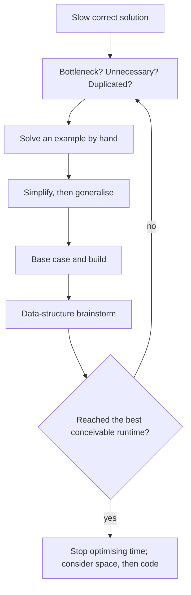

# Optimisation techniques and the best conceivable runtime

## Before this lesson

Read [The seven-step method](#/lesson/interview-prep/seven-step-method): this lesson expands its fourth step, "optimise". You need [Big O foundations](#/lesson/interview-prep/big-o-foundations), and you should know what a dictionary (hash table), a sorted list and binary search are; if not, see [Hash maps and sets](#/lesson/neet-arrays/arrays-hashing-pattern) and [Binary search done right](#/lesson/neet-window-stack/binary-search-right).

## In plain words

You have a slow, correct solution. Now what? "Think harder" is not a method. Experienced engineers improve a solution by asking a small set of standard questions, in the same way a doctor works through a list of standard checks instead of waiting for a diagnosis to appear.

This lesson gives you those questions:

1. **Look for bottlenecks, unnecessary work and duplicated work** in the slow solution.
2. **Do it yourself**: solve an example by hand and notice what your mind does.
3. **Simplify and generalise**: solve an easier version, then adapt.
4. **Base case and build**: solve for one element, then extend to n.
5. **Data-structure brainstorm**: run through the structures you know and ask what each would give you.

And one compass, the **best conceivable runtime**, which tells you when to stop.

It matters for a job because the step from a quadratic solution to a linear one is where most interviews are decided, and because the same habits are what make someone useful when a real system is too slow.



## Technique 1: bottlenecks, unnecessary work, duplicated work

### Bottlenecks

A **bottleneck** is the part of the algorithm that dominates its running time. Improving anything else is pointless until the bottleneck is fixed. There are two kinds.

*One slow step among several.* Suppose step one sorts (O(n log n)) and step two is a single pass (O(n)). Making the pass twice as fast changes nothing in Big O; only replacing the sort would.

*A chunk of work done again and again.* Example: a shop has a catalogue of `c` prices, and for each of `q` customer budgets we want the most expensive item that the customer can afford.

```python
def best_affordable(catalogue, budgets):
    answers = []
    for budget in budgets:
        best = -1
        for price in catalogue:              # the repeated search
            if price <= budget and price > best:
                best = price
        answers.append(best)
    return answers
```

This is O(q · c). The bottleneck is the inner search, executed q times. Searching is something we know how to speed up: sort the catalogue once (O(c log c)) and binary-search each budget (O(log c)). Total O((c + q) log c).

### Unnecessary work

Work whose result cannot affect the answer. Example: count the triples of whole numbers `a ≤ b < c ≤ n` that form a right-angled triangle (a² + b² = c²).

```python
def triangles(n):
    count = 0
    for a in range(1, n + 1):
        for b in range(a, n + 1):
            for c in range(b + 1, n + 1):    # unnecessary search
                if a * a + b * b == c * c:
                    count += 1
    return count
```

For fixed a and b there is at most one c that can work: the square root of a² + b². Searching for it is unnecessary; compute it and check. That removes a whole loop, O(n³) → O(n²). A milder form of the same idea is the early exit: stop the inner loop as soon as c² exceeds a² + b².

### Duplicated work

Work that is done more than once with the same result. Example: a list of daily sales and many questions of the form "total sales from day i to day j". Answering each by adding the slice is O(n) per question, and the same partial sums are recomputed constantly. Compute **prefix sums** once (prefix[k] = total of the first k days) and every question becomes one subtraction: `prefix[j + 1] - prefix[i]`.

The login-counting problem in the previous lesson was also duplicated work, cured by a dictionary. Memoisation in recursion, from [the worked Big O examples](#/lesson/interview-prep/big-o-worked-examples), is the same cure again.

The demo runs the slow and fast versions of the catalogue example side by side and counts comparisons.

```python-run
import bisect, random

random.seed(1)
catalogue = [random.randint(1, 10**6) for _ in range(2000)]
budgets = [random.randint(1, 10**6) for _ in range(2000)]

def slow(catalogue, budgets):
    steps, answers = 0, []
    for budget in budgets:
        best = -1
        for price in catalogue:
            steps += 1
            if best < price <= budget:
                best = price
        answers.append(best)
    return answers, steps

def fast(catalogue, budgets):
    ordered = sorted(catalogue)
    answers = []
    for budget in budgets:
        i = bisect.bisect_right(ordered, budget)     # number of prices <= budget
        answers.append(ordered[i - 1] if i else -1)
    return answers

slow_answers, steps = slow(catalogue, budgets)
print("same answers:", slow_answers == fast(catalogue, budgets))
print("slow version comparisons:", steps)
print("fast version: about", 2000 * 11, "for sorting plus", 2000 * 11, "for the searches")
```

`bisect.bisect_right(ordered, budget)` returns how many prices are less than or equal to the budget, using binary search; the element immediately before that position is the most expensive affordable price. The slow version performs four million comparisons; the fast one about forty thousand. The first printed line confirms that both give identical answers, which is how you should always validate an optimisation.

## Technique 2: do it yourself

Your intuition is often cleverer than your first algorithm. Take a realistic example and solve it **by hand**, then ask "what did I do there?".

*Problem: a calendar has a list of bookings, each a (start, end) pair in any order. Produce the list of busy periods with overlapping bookings merged.*

A first algorithmic thought is to compare every booking with every other and merge, repeating until nothing changes: messy and at least O(n²).

Now do it by hand for `(9, 10), (13, 15), (9.5, 11), (14, 16), (11, 12)`. Almost everyone does the same thing: they first put the bookings in order of start time, then sweep left to right, extending the current busy period while the next booking starts before it ends, and starting a new period otherwise. That *is* the algorithm: sort by start, one pass, O(n log n). Nothing was invented; it was observed.

Two rules make this technique work: use an example that is big and irregular enough that you cannot solve it at a glance, and pay attention to shortcuts you take without thinking, because each shortcut is an optimisation.

## Technique 3: simplify and generalise

Change or remove a constraint to get an easier problem, solve that, then carry the idea back.

*Problem: in a grid of numbers (some negative), find the rectangular block with the largest total.*

Simplify: what if the grid had a single row? Then the problem is "the stretch of a list with the largest sum", which has a well-known one-pass solution (keep a running sum; restart it when it becomes negative). Generalise: a block that spans rows r1 to r2 can be squashed into a single row by adding its columns. So for each pair of rows, squash and apply the one-row solution. That is the reference approach to this track's problem [Most Profitable Block](#/problem/ctci-max-block-sum).

Common simplifications: two dimensions → one; a stream → a fixed list; any characters → only two kinds; a general graph → a tree; "find the best" → "check whether a given answer works".

## Technique 4: base case and build

Solve the problem for one element, then work out how to extend a solution for n − 1 elements to n. This leads naturally to recursive and dynamic-programming solutions.

*Problem: list all the subsets of a set of n items.*

- Base: the empty set has one subset, the empty one: `[[]]`.
- Build: suppose you already have all subsets of the first n − 1 items. Adding item n gives two versions of each: without the item (already in the list) and with it (a copy plus the item).

```python-run
def subsets(items):
    result = [[]]                         # base case: no items
    for item in items:                    # build: add one item at a time
        result += [chosen + [item] for chosen in result]
    return result

for group in subsets(["tea", "milk", "sugar"]):
    print(group)
```

`result` starts with the single empty subset. For each item, the list comprehension makes a copy of every existing subset with the item appended, and `+=` adds those copies to the list. After three items there are 2 × 2 × 2 = 8 subsets. The doubling at each step also *proves* the count is 2ⁿ, which gives the complexity for free.

## Technique 5: data-structure brainstorm

When no idea comes, go through the structures you know, one by one, and ask what each would make cheap. It sounds mechanical, and that is its strength.

*Problem: scores arrive one at a time; after each arrival, report the k-th highest score seen so far.*

| Structure | What it would give | Verdict |
|---|---|---|
| Unsorted list | O(1) insert, but finding the k-th highest needs a sort each time | Too slow |
| Sorted list | k-th highest in O(1), but insert is O(n) | Better, still slow |
| Hash table | Fast lookup by value, no notion of order | Not useful here |
| Balanced search tree | Insert and rank queries in O(log n) | Works, heavy to implement |
| Min-heap of size k | Holds the k highest; its smallest element is the answer; insert in O(log k) | Simple and fast |

A **heap** is a structure that always gives you its smallest (or largest) element quickly; see [Binary heaps](#/lesson/neet-heap-graphs/binary-heaps). The brainstorm lands on it without any flash of insight. A useful personal list to run through: array, hash table, stack, queue, linked list, heap, tree or trie, graph, plus the two techniques "sort it first" and "two pointers".

## The compass: best conceivable runtime

The **best conceivable runtime** (BCR) is the best running time you could *imagine* for a problem, based only on what any solution must do. It is not a promise that such an algorithm exists. It is a limit you cannot beat.

How to find it: ask what every correct algorithm is forced to do.

- If the answer can depend on every element, each must be read at least once: BCR is at least O(n).
- If the output itself has size k, producing it takes at least O(k). Listing all pairs is at least O(n²) because there can be that many pairs.
- If the input is sorted and you seek one element, you do not need to read everything: the BCR could be O(log n).

How to use it, with a full example.

*Problem: given a **sorted** list of distinct integers and a target T, decide whether two of them add up to T.*

1. **BCR.** Any element could be part of the pair, so we may need to look at all of them: O(n). We cannot hope for better.
2. **Brute force.** All pairs: O(n²).
3. **Bottleneck.** For each element x we search for T − x by scanning. Searching a sorted list can be done by binary search: O(n log n). Better, and still above the BCR, so keep going.
4. **What would O(n) require?** Constant work per element. A hash set of seen values gives that: O(n) time, O(n) space. We have reached the BCR for time.
5. **We have not used "sorted" in the hash solution.** An unused detail is a clue. Put one pointer at each end; if the sum is too small move the left pointer right, if too large move the right pointer left. O(n) time and O(1) space.

At step 4 the BCR told us to stop looking for a faster algorithm and start looking at space instead. Without it, a candidate either stops too early ("n log n is good enough") or wastes minutes chasing an impossible O(log n).

> [!INTERVIEW]
> Saying the BCR aloud is a strong signal: "We must look at every element at least once, so we cannot do better than linear time. I am at n log n, so there may be a linear solution; let me look for it." It shows you reason about limits, not only about code.

> [!NOTE]
> A solution that meets the BCR is optimal in time. A BCR that no known algorithm meets is not a contradiction: sorting by comparisons has an obvious lower bound of O(n) from reading the input, yet provably needs O(n log n).

## Putting the techniques in order

In practice you cycle through them quickly:

1. State the brute force and its cost. State the BCR. The gap between them is your search space.
2. Mark the bottleneck. Ask whether the repeated step is a search (→ hashing, sorting plus binary search), a recomputation (→ precompute, memoise), or avoidable (→ compute directly, exit early).
3. If nothing appears, do an example by hand.
4. If still nothing, simplify the problem, or try base case and build.
5. If still nothing, run the data-structure list.
6. Each time you improve, re-check for unused details in the problem statement and compare with the BCR.

Also remember the classic trade: **spend memory to save time**. Hash tables, prefix sums, memo tables and precomputed lookups are all forms of it. And remember two cheap transformations: sorting the input, which costs only O(n log n) and unlocks binary search and two pointers, and processing in a different order (from the end, or by increasing size).

## Pitfalls

- **Optimising the wrong part.** Polishing a linear pass while a quadratic loop sits next to it.
- **Micro-optimising.** Saving a comparison inside a loop does not change Big O and costs clarity. Change the growth rate first.
- **Never computing the BCR**, and therefore not knowing whether to keep searching.
- **Abandoning a correct slow solution** for a clever idea you cannot finish. Keep the fallback.
- **Trading away correctness.** Every optimisation should be checked against the brute force on small inputs.
- **Ignoring space.** A faster solution that needs O(n²) memory may be worse in practice; say the trade-off aloud.
- **Forgetting unused information.** "Sorted", "distinct", "positive", "small range" are hints.

> [!TIP]
> When the interviewer asks "can you do better?", first say what you would have to avoid: "To beat n squared I cannot compare every pair, so I need a way to find each element's partner without scanning." Naming the obstacle very often suggests the tool.

> [!WARNING]
> Do not claim an optimisation you have not checked on an example. A fast wrong answer is rated below a slow correct one.

## Summary

- Improve a slow solution by asking standard questions, not by waiting for inspiration.
- Find the bottleneck; remove unnecessary work (compute directly, exit early) and duplicated work (remember results, precompute).
- Solve a realistic example by hand and turn your own shortcuts into the algorithm.
- Simplify the problem, solve the easy version, then generalise.
- Solve the base case and extend one element at a time.
- Brainstorm data structures systematically; a heap, hash table or sort often removes the bottleneck.
- Compute the best conceivable runtime to know how far to go and when to switch attention to space.
- Continue with [Good code, wrong answers and not giving up](#/lesson/interview-prep/good-code-and-recovery) for the implementation and recovery side.

## Glossary

- **Bottleneck**: the part of an algorithm that determines its overall running time.
- **Unnecessary work**: computation whose result cannot affect the answer.
- **Duplicated work**: the same computation performed more than once.
- **Early exit**: stopping a loop as soon as its result is decided.
- **Prefix sum**: a precomputed running total that allows any range total with one subtraction.
- **Precomputation**: doing work once in advance so that later questions are cheap.
- **Simplify and generalise**: solve an easier variant, then adapt the idea to the original.
- **Base case and build**: solve the smallest instance, then extend solutions step by step.
- **Heap**: a structure giving fast access to the smallest or largest element.
- **Best conceivable runtime (BCR)**: a lower limit on running time implied by what any solution must do.
- **Space-time trade-off**: using more memory to reduce running time, or the reverse.

```quiz
[
  {"q": "An algorithm sorts the input and then makes one linear pass. Which part is the bottleneck?",
   "options": ["The linear pass", "The sort, O(n log n)", "Both equally", "Neither"],
   "answer": 1,
   "explain": "The sort dominates; speeding up the pass does not change the overall growth rate."},
  {"q": "In the right-angled triangle example, why can the innermost loop be removed?",
   "options": ["The triangles are sorted", "For fixed a and b there is at most one possible c, which can be computed directly", "Python loops are free", "c is always equal to n"],
   "answer": 1,
   "explain": "Searching for a value that can be calculated is unnecessary work; removing it drops a factor of n."},
  {"q": "Many queries ask for the total of a range of a fixed list. Which technique removes the duplicated work?",
   "options": ["Sorting the list", "Prefix sums computed once", "Recursion", "A stack"],
   "answer": 1,
   "explain": "With prefix sums each range total is one subtraction instead of a fresh loop."},
  {"q": "What does the 'do it yourself' technique ask you to do?",
   "options": ["Write the code without help", "Solve a realistic example by hand and observe the method your intuition uses", "Search the internet", "Skip the example"],
   "answer": 1,
   "explain": "Human shortcuts on a concrete example, such as sorting bookings by start time, are often the efficient algorithm."},
  {"q": "For 'does a sorted list contain two numbers adding to T', what is the best conceivable runtime and why?",
   "options": ["O(1), because the list is sorted", "O(n), because any element might be part of the pair and must be examined", "O(n²), because there are n² pairs", "O(log n), because of binary search"],
   "answer": 1,
   "explain": "Every element may need to be read once. The two-pointer method achieves this bound."},
  {"q": "You have an O(n log n) solution and the BCR is O(n). What does that tell you?",
   "options": ["Your solution is wrong", "A faster solution may exist and is worth a short search; nothing below O(n) is possible", "You must stop immediately", "The BCR must be incorrect"],
   "answer": 1,
   "explain": "The BCR bounds the search: improvement is conceivable down to O(n), and not beyond."},
  {"q": "In the brainstorm for 'k-th highest score so far', why does a min-heap of size k fit?",
   "options": ["It stores all scores in sorted order", "Its smallest element is exactly the k-th highest, and each insertion costs O(log k)", "It uses no memory", "Heaps support binary search"],
   "answer": 1,
   "explain": "Keeping only the k largest values makes the heap's minimum the required answer."},
  {"q": "After finding an O(n) hash-based solution for the sorted two-sum problem, what clue pointed to an even better solution?",
   "options": ["The interviewer's expression", "The fact that 'sorted' had not been used, suggesting two pointers and O(1) space", "The list length", "The value of T"],
   "answer": 1,
   "explain": "An unused detail in the statement is usually a hint; here it removes the extra memory."}
]
```

> **Source:** McDowell, Cracking the Coding Interview 6e, ch. VII (Technical Questions: optimise-and-solve techniques; Best Conceivable Runtime). All example problems, code and the demo are original.
