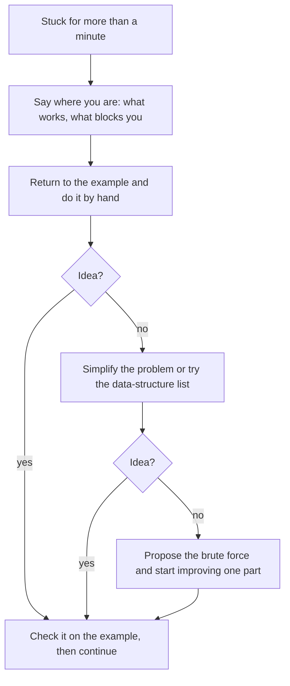

# Good code, wrong answers and not giving up

## Before this lesson

Read [The seven-step method](#/lesson/interview-prep/seven-step-method) and [Optimisation techniques](#/lesson/interview-prep/optimisation-techniques). This lesson covers what happens around steps 6 and 7 (implement and test) and what to do when things go badly. You need to read simple Python classes; if `class` and `__init__` are new, see [Classes in Python](#/lesson/python/py-start-classes).

## In plain words

Two candidates can reach the same algorithm and still write very different code. One produces something a colleague could read, extend and trust. The other produces something that works today and frightens whoever opens the file next. Interviewers are choosing a future teammate, so they care which kind of code you write when nobody has asked for neatness.

A second fact is equally important: **almost nobody gets through an interview without a mistake**. A wrong first idea, a bug, a hint needed, a blank moment. What separates successful candidates is not the absence of mistakes but what they do in the next sixty seconds.

A good comparison is a professional cook. The dish must taste right (correct), arrive on time (efficient), and be made in a kitchen that another cook could step into (clean). And when a sauce splits, the professional neither panics nor pretends it did not happen: they fix it and carry on.

This lesson has three parts: what good code looks like, how to handle wrong answers and a few awkward situations, and how to keep going when you are stuck.

## Part 1: what good code looks like

Five properties, in rough order of importance during an interview:

| Property | Meaning | How it shows in 40 minutes |
|---|---|---|
| **Correct** | Works for expected and unexpected inputs | You test, and you handle edge cases |
| **Efficient** | Sensible time and memory | You can state the complexity and it is near the best possible |
| **Simple** | No more code than needed | Twenty clear lines instead of sixty tangled ones |
| **Readable** | Another developer can follow it | Good names, consistent structure, a comment where something is subtle |
| **Maintainable** | Easy to change later | Small functions, no copy-pasted blocks, data kept in proper structures |

These sometimes pull against each other, and saying so is a sign of maturity: "I could shave a pass by merging these loops, but two simple loops are easier to read and the complexity is the same."

### A worked before-and-after

*Task: two shopping carts must be merged. Each cart is a list of (item name, quantity) entries, possibly with the same item listed more than once. Produce one cart with total quantities, dropping items whose total is zero, sorted by name.*

A first version written in a hurry:

```python
def m(a, b):
    r = []
    for i in range(len(a)):
        f = False
        for j in range(len(r)):
            if r[j][0] == a[i][0]:
                r[j] = (r[j][0], r[j][1] + a[i][1])
                f = True
        if not f:
            r.append((a[i][0], a[i][1]))
    for i in range(len(b)):
        f = False
        for j in range(len(r)):
            if r[j][0] == b[i][0]:
                r[j] = (r[j][0], r[j][1] + b[i][1])
                f = True
        if not f:
            r.append((b[i][0], b[i][1]))
    r2 = []
    for x in r:
        if x[1] != 0:
            r2.append(x)
    r2.sort()
    return r2
```

It works. Now read it as a reviewer:

1. **Names say nothing**: `m`, `r`, `f`, `r2`, `x[1]`.
2. **The same twelve lines appear twice**, once for each cart. A fix in one copy will be forgotten in the other.
3. **The wrong data structure**: finding an item by scanning a list makes the whole function O(n²).
4. **Positions instead of meaning**: `x[0]` and `x[1]` force the reader to remember which is the name.
5. **No thought about bad input**: what if a quantity is negative, or a cart is `None`?

A second version:

```python
def add_cart(totals, cart):
    """Add every (name, quantity) entry of cart into the totals dictionary."""
    for name, quantity in cart or []:
        totals[name] = totals.get(name, 0) + quantity


def merge_carts(first, second):
    totals = {}
    add_cart(totals, first)
    add_cart(totals, second)
    return sorted((name, qty) for name, qty in totals.items() if qty != 0)
```

What changed, and which property each change serves:

- A **helper function** removed the duplicated block (maintainable). Merging three carts is now one more line.
- A **dictionary** replaced the scan (efficient: O(n log n), dominated by the final sort).
- **Unpacking** `for name, quantity in cart` gave the values names (readable).
- `cart or []` treats a missing cart as empty (correct), in half a line.
- The whole thing is nine lines (simple).

Run both and confirm they agree:

```python-run
def add_cart(totals, cart):
    for name, quantity in cart or []:
        totals[name] = totals.get(name, 0) + quantity

def merge_carts(first, second):
    totals = {}
    add_cart(totals, first)
    add_cart(totals, second)
    return sorted((name, qty) for name, qty in totals.items() if qty != 0)

cart_a = [("tea", 2), ("milk", 1), ("tea", 1)]
cart_b = [("milk", -1), ("rice", 3)]
print(merge_carts(cart_a, cart_b))
print(merge_carts(cart_a, None))
print(merge_carts([], []))
```

The first call prints `[('rice', 3), ('tea', 3)]`: tea is 2 + 1, milk is 1 − 1 = 0 and is dropped, and the result is sorted by name. The second call shows that a missing cart is handled; the third that two empty carts give an empty list.

### Habits that produce good code under time pressure

- **Use data structures generously.** If the problem talks about "a booking with a start, an end and a room", define a small class or a named tuple instead of juggling three parallel lists. Nobody will object to you writing `class Booking` with three fields, and everything after it becomes clearer.
- **Reuse code.** The second time you are about to write the same lines, stop and make a function.
- **Be modular.** Give each task its own function: `parse`, `validate`, `compute`. You may call a helper before writing it ("assume `is_valid(move)` exists; I will write it after the main loop"), which also lets you spend time on the interesting part first.
- **Be flexible where it is free.** Write the noughts-and-crosses check for an n × n board, not for 3 × 3, if it costs no extra effort. Do not build a framework nobody asked for.
- **Check for errors, or say that you would.** Careful engineers do not assume input is valid. If full validation would take too long, leave a marker and say so: "I will add a TODO here to reject negative quantities."
- **Write neatly from the start.** Top-left corner, consistent indentation, room between lines for insertions.

> [!INTERVIEW]
> Narrate design choices in one breath as you make them: "I will pull this into a helper because both branches need it." The interviewer cannot give credit for a good decision they did not notice.

## Part 2: wrong answers and awkward moments

### "I got it wrong. Have I failed?"

No. Three facts from how interviews are evaluated:

1. **Answers are not marked right or wrong.** The interviewer assesses how good your final solution was, how long it took, how much help you needed and how clean the code was, as a whole.
2. **You are compared with other candidates on the same question.** If a question is hard, most people struggle, and struggling productively is a normal performance.
3. **Many questions are too hard to solve perfectly on purpose.** A question that everyone solves instantly tells the interviewer nothing.

So the useful question is never "was I perfect?" but "did I keep making visible progress?".

### When your approach turns out to be wrong

Say it plainly, say why, and move: "This fails when two bookings have the same start time, because I assumed starts were unique. Let me go back to the sorted version and handle ties." Abandoning a broken idea quickly is rated higher than defending it.

### When you find a bug

Follow the routine from step 7: reproduce it with the smallest input, understand the cause, fix the cause, re-run earlier cases. Stay matter-of-fact. Bugs are normal; panic and random edits are what gets written down.

### When you receive a hint

A hint is not a penalty notice. Interviewers give hints to nearly everyone, and what they note is how you use them. Repeat the hint in your own words, connect it to your current state, and continue: "So if I process the bookings from the latest end time… then I never need to look back. Right, that removes the inner loop."

### When you have seen the question before

Tell the interviewer. They will usually thank you and change the question. If you conceal it, one of two things happens: you solve it suspiciously fast and they suspect the truth, or you act out a struggle and they later discover it. Both are worse than honesty, and both leave you with a second, harder question anyway.

### Which language should you use?

Unless the role requires a particular language, use the one you know best. When choosing, weigh:

- **Fluency**: nothing costs more time than fighting syntax.
- **Readability**: can the interviewer follow it even if it is not their language? Python, Java, C++, JavaScript and C# are widely understood.
- **Convenience**: a language with built-in dictionaries, lists and sorting saves many lines.
- **Fewer traps**: manual memory management adds risk when you are nervous.

If you use a library function, be ready to say what it does and what it costs. And it is acceptable to say "I do not remember the exact name of the method that splits a string; I will call it `split`". Interviewers care about logic, not perfect recall of an API.

## Part 3: not giving up

Interview questions can look impossible for the first few minutes. That is by design, and the interviewer is watching what you do with the difficulty: do you engage with it, or shrink from it?

A practical routine for being stuck:



1. **Say where you are.** "I can find the answer for one query in linear time. What blocks me is doing it for all queries without repeating that scan." Stating the obstacle precisely is half of solving it, and it lets the interviewer give a targeted hint.
2. **Go back to the example.** Do it by hand; make it bigger; try a different shape of input.
3. **Change the problem.** Smaller, sorted, one-dimensional, only two kinds of value.
4. **Walk the toolbox.** Hash table? Sort first? Two pointers? Stack? Heap? Recursion on a smaller input?
5. **Fall back on the brute force and improve a piece.** A working slow solution with a clear account of its bottleneck is a respectable result.

What not to do: go silent, say "I do not know" and stop, or ask "can you tell me the answer?". Any forward motion beats those.

> [!TIP]
> Enthusiasm is a real signal. A candidate who says "interesting, let me try it from the other end" when their idea fails is someone people want on their team. You can practise this: when a practice problem defeats you, say aloud what you will try next before you look at the hints.

### A short script for the worst moment

Suppose you are 25 minutes in, your approach has collapsed, and your mind is blank. Say something like:

> "My approach does not handle overlapping ranges, so I am going to step back. Here is what I know for certain: the brute force is n squared and correct. I am going to write that cleanly first so that we have a working solution, and while I write I will look for the repeated work."

This does four things: it shows honesty, keeps the conversation alive, guarantees working code on the board, and gives your mind a simple task while it recovers. Very often the better idea arrives while writing the simple version.

## Pitfalls

- **Clever one-liners nobody can read.** Clarity beats compression.
- **Copy-paste with small edits.** The interviewer sees duplicated code and a future bug.
- **Single-letter names everywhere.** `i` and `j` for loop counters are fine; `a`, `b`, `x2`, `tmp3` for meaningful values are not.
- **Assuming valid input silently.** Either check, or state the assumption aloud.
- **Arguing with a hint**, or ignoring it.
- **Hiding a known flaw** in the hope it will not be noticed. Interviewers notice, and concealment is far worse than the flaw.
- **Apologising repeatedly.** Acknowledge a mistake once, fix it, move on.
- **Giving up aloud.** "I cannot do this" ends the evidence-gathering.

> [!WARNING]
> Never fake results. If you did not trace a test case, do not say you did. If you are unsure whether the code handles an empty list, say you are unsure and check. Interviewers have the solution in front of them; an invented claim costs trust that no later brilliance repairs.

## Summary

- Good interview code is correct, efficient, simple, readable and maintainable; mention trade-offs between these when they arise.
- Use real data structures, helper functions and meaningful names; remove duplication; handle or at least flag invalid input.
- Interviews are graded on the whole performance, relative to others on the same question. Mistakes are expected.
- When wrong, say so and change course; when you find a bug, fix its cause; when given a hint, build on it aloud; when you know the question, say so.
- Choose the language you are most fluent in.
- When stuck, state the obstacle, return to the example, simplify, walk the toolbox, and fall back on an improvable brute force. Keep moving and stay visibly engaged.
- This completes the method. Part B of the track applies it topic by topic, starting with [Arrays and strings](#/lesson/interview-prep/arrays-strings-approach).

## Glossary

- **Readable**: easy for another developer to understand on first reading.
- **Maintainable**: easy to modify safely later.
- **Modular**: divided into small parts, each with one job.
- **Duplication**: the same logic written in more than one place.
- **Helper function**: a small function that performs one sub-task for a larger function.
- **Input validation**: checking that input is acceptable before using it.
- **TODO marker**: a note in code that something remains to be done.
- **Fallback**: a simpler solution kept in reserve in case the better one cannot be finished.
- **Hint**: information from the interviewer intended to move you forward.
- **Fluency**: the ability to write a language quickly without looking things up.

```quiz
[
  {"q": "Which list names the five properties of good code used in this lesson?",
   "options": ["Long, clever, fast, new, commented", "Correct, efficient, simple, readable, maintainable", "Short, compiled, typed, tested, deployed", "Recursive, generic, abstract, lazy, pure"],
   "answer": 1,
   "explain": "These five are what interviewers and reviewers look for; they sometimes trade off against one another."},
  {"q": "In the cart example, what was the main benefit of the helper function add_cart?",
   "options": ["It made the code longer", "It removed a duplicated block, so a change is made in one place and more carts can be merged easily", "It made the function recursive", "It avoided using a dictionary"],
   "answer": 1,
   "explain": "Removing duplication improves maintainability and reduces the chance of fixing one copy and forgetting the other."},
  {"q": "Why did replacing the list scan with a dictionary matter?",
   "options": ["Dictionaries use no memory", "Finding an item's running total became O(1) expected instead of O(n), removing the quadratic behaviour", "Dictionaries are always sorted", "It was required by Python"],
   "answer": 1,
   "explain": "The right data structure removed the bottleneck as well as shortening the code."},
  {"q": "You realise halfway through that your approach is wrong. What should you do?",
   "options": ["Keep going and hope", "Defend it until time runs out", "Say so, explain why it fails, and switch to a sound approach", "Stay silent"],
   "answer": 2,
   "explain": "Recognising and abandoning a broken idea quickly is a positive signal; persisting with it is not."},
  {"q": "How should a hint from the interviewer be treated?",
   "options": ["As a sign that you have failed", "As information to restate, connect to your current state and build on", "As something to argue with", "As a trick to be ignored"],
   "answer": 1,
   "explain": "Nearly everyone receives hints; what is recorded is how well you use them."},
  {"q": "You recognise the interview question from your practice. What is the right move?",
   "options": ["Pretend it is new and act out a struggle", "Solve it instantly without comment", "Tell the interviewer you have seen it", "End the interview"],
   "answer": 2,
   "explain": "Honesty is valued and the interviewer can pick a question that gives a real signal."},
  {"q": "Which language should you normally choose for a coding interview?",
   "options": ["The most fashionable one", "The one you are most fluent in, provided the interviewer can read it", "Assembly, to show depth", "Whichever the previous candidate used"],
   "answer": 1,
   "explain": "Fluency saves time and reduces errors; readability lets the interviewer follow your logic."},
  {"q": "You are completely stuck with 20 minutes left. What does the lesson recommend?",
   "options": ["Say 'I do not know' and wait", "Ask for the answer", "State the obstacle, then write the correct brute force cleanly while looking for the repeated work", "Change the subject"],
   "answer": 2,
   "explain": "It keeps the conversation alive, puts working code on the board and often triggers the better idea."}
]
```

> **Source:** McDowell, Cracking the Coding Interview 6e, ch. VII (Technical Questions: Handling Incorrect Answers; When You've Heard a Question Before; language choice; What Good Coding Looks Like; Don't Give Up). The cart example and scripts are original.
