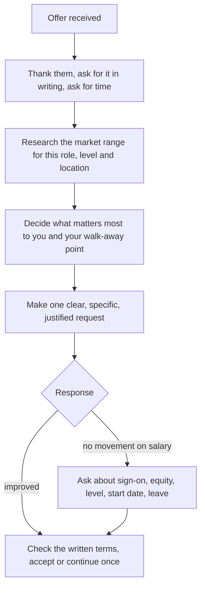

# Evaluating and negotiating offers

## Before this lesson

Read [How hiring works end to end](#/lesson/interview-prep/hiring-pipeline), in particular the last two stages (level and team, then the offer). No technical background is needed. One small Python demo compares offers; it uses only arithmetic and dictionaries.

## In plain words

An **offer** is the company's proposal of the terms under which you would work for them: the job, the level, the pay and the start date. Receiving one is the goal of everything so far, and it is also the start of a short phase in which a few conversations can change your income for years, because every later raise is usually calculated from where you started.

Think of buying a house. Nobody sensible decides on the sticker price alone; they look at the neighbourhood, the condition, the running costs and what happens if they need to sell. And almost nobody pays the first number mentioned, yet the conversation with the seller stays polite, because both sides want the sale to happen. An offer deserves the same two activities: **evaluate** all of it, then **negotiate** it respectfully.

It matters for a job because many people, especially at the start of a career, accept the first number out of gratitude or fear, and choose between companies on base salary alone. Both are avoidable mistakes.

> [!NOTE]
> Pay structures, tax rules and employment law differ a great deal between countries and companies. This lesson explains the common concepts and a method. It is general career information, not financial, tax or legal advice; for decisions involving significant equity or contracts, consult a qualified adviser in your country.

## What happens between the last interview and the offer

1. **Waiting.** Decisions take from a day to a few weeks. Silence usually means scheduling of the debrief or committee. One polite check-in after about a week is fine.
2. **The call.** A recruiter phones with good news and often an initial set of numbers, or asks about your expectations first.
3. **The written offer.** Details arrive by email. Only the written version counts.
4. **A deadline.** Offers come with a date by which you must answer. Deadlines can very often be extended if you ask with a reason.

### If the answer is no

A rejection means the evidence gathered that day did not clear a bar that is deliberately set high. It is not a permanent judgment. Do three things: thank the recruiter, ask whether there is an area they would suggest working on (sometimes you get an answer), and ask when you may apply again. Then write down every question you remember while it is fresh. Many engineers at well-known companies were rejected by those same companies on an earlier attempt.

### If the answer is yes, and you have other processes running

- **Ask for time.** "Thank you, I am excited about this. I am finishing two other processes and would like to make a careful decision. Could I have until the 20th?" Recruiters hear this daily.
- **Tell the other companies.** "I have received an offer with a deadline of the 20th. You are one of my top choices; is it possible to complete your process before then?" Companies frequently speed up for a candidate who has an offer.
- **Declining an offer.** Do it promptly, by phone or a courteous email, with thanks and without criticism. The recruiter and the engineers you met may cross your path again.

## Evaluating an offer

### The parts of compensation

**Compensation** is the full set of things you receive for your work. The usual parts:

| Part | What it is | What to ask |
|---|---|---|
| Base salary | Fixed pay per year | Is it reviewed yearly? How have raises been in recent years? |
| Sign-on bonus | A one-time payment when you join | Must it be repaid if you leave within a year? |
| Annual bonus | A yearly payment, often a percentage of salary tied to performance | What is the target, and what have people actually received? |
| Equity | Shares or options in the company that become yours over time | What kind, how many, what vesting schedule? |
| Relocation | Help with moving costs | Lump sum or reimbursed expenses? |
| Benefits | Health cover, pension contributions, paid leave, parental leave, equipment, training budget | What is included and what does it cost you? |

Two terms need a careful definition.

**Equity** means a share of ownership. It comes mainly in two forms. *Share grants* (often called restricted stock units) are shares given to you over time; they are worth whatever the share price is. *Options* are the right to buy shares at a fixed price in the future; they are worth something only if the company's value rises above that price, and at a private company you may not be able to sell them for years, or ever.

**Vesting** is the schedule on which equity becomes yours. A typical schedule spreads a grant over four years, sometimes with a **cliff**: nothing vests until you have stayed a minimum period, commonly one year, after which the first portion vests at once. If you leave before the cliff you receive none of it.

### Compare totals, per year, over several years

Because some parts are one-time and some are yearly, compare **total compensation per year** over the period you might stay. Divide a four-year equity grant by four; count the sign-on bonus only in year one.

```python-run
offers = {
    "Northwind (large company)": dict(base=95000, bonus_pct=0.10, signon=10000, equity_4yr=80000, equity_risk=0.9),
    "Tidepool (start-up)":       dict(base=82000, bonus_pct=0.00, signon=0,     equity_4yr=160000, equity_risk=0.2),
    "Calder (mid-size)":         dict(base=101000, bonus_pct=0.05, signon=5000,  equity_4yr=20000, equity_risk=0.8),
}

def yearly(offer, year):
    cash = offer["base"] * (1 + offer["bonus_pct"])
    if year == 1:
        cash += offer["signon"]
    paper_equity = offer["equity_4yr"] / 4
    return cash, paper_equity, paper_equity * offer["equity_risk"]

print(f"{'offer':28s} {'year-1 cash':>12s} {'4-yr cash':>10s} {'equity/yr':>10s} {'risk-adjusted 4-yr total':>26s}")
for name, offer in offers.items():
    cash_total = equity_adj_total = 0
    for year in (1, 2, 3, 4):
        cash, paper, adjusted = yearly(offer, year)
        cash_total += cash
        equity_adj_total += adjusted
    year1_cash = yearly(offer, 1)[0]
    print(f"{name:28s} {year1_cash:12,.0f} {cash_total:10,.0f} {offer['equity_4yr'] / 4:10,.0f} {cash_total + equity_adj_total:26,.0f}")
```

Each offer is a dictionary. `yearly` returns three numbers for a given year: cash (base plus bonus, plus the sign-on in year one), the equity for that year at face value, and the equity multiplied by `equity_risk`, a number between 0 and 1 that expresses how much you trust that value. The loop adds four years. In the output, the start-up has the largest equity on paper and the smallest cash; once its equity is discounted to 20% of face value, its four-year total is the lowest of the three. Change `equity_risk` for the start-up to 0.6 and run again: the ranking changes. The demo's point is not the specific numbers but that **the conclusion depends on an assumption you should make consciously**. Equity in a large public company is close to cash; equity in an early company is a lottery ticket with unknown odds.

Remember also that the same salary buys very different lives in different cities. Compare what is left after housing and taxes, not the headline figure.

### What money does not show

The choice between two reasonable offers is seldom decided best by a few percent of pay. Weigh these at least as heavily.

- **Learning and career development.** Will you work with people you can learn from? Will the company's name and the skills you gain open doors later? How fast do people advance, and is it possible to move between teams? A first job that makes you much better is worth more than a slightly higher salary.
- **The manager and the team.** Your direct manager affects your daily life more than the company's brand. Did you meet them? Did the interviewers seem like people you would enjoy working with?
- **The work itself.** What exactly will you do in the first six months? Does it involve skills you want to build?
- **Company stability.** For a large company the risk is mostly about your team; for a start-up, ask how long the money will last and how the business earns or plans to earn revenue. Being laid off is unpleasant, but for a strong engineer it is rarely a catastrophe, so weigh stability sensibly instead of treating it as everything.
- **Happiness.** Hours, flexibility, remote policy, culture, location, commute. Ask current employees what an ordinary week is like. A job you dread is expensive at any salary.

> [!TIP]
> Before you see any numbers, write down your three most important criteria. People who do this make choices they still agree with a year later; people who do not are pulled toward whichever number is largest.

## Negotiating

### Why you should, and why it is safe

- **It is expected.** Recruiters usually have room above the first number and assume a conversation.
- **A polite, reasonable request does not get offers withdrawn.** Recruiters want to close the hire they have worked on for weeks.
- **Small differences compound.** Raises and bonuses are typically percentages of your base, so a higher start carries forward.
- **Not asking has a certain outcome**: you receive the first number.

If the idea makes you uncomfortable, that is normal. Treat it as a joint problem: you and the recruiter are both trying to reach terms that make you say yes.

### Principles



1. **Know the market.** Use several sources: public salary surveys, sites where employees report pay, friends in the industry, and recruiters themselves, who will often tell you the range for a level if asked.
2. **Have an alternative if you can.** Another offer, or a current job you are content to keep, is the strongest position, and it also makes you calmer. Never invent one.
3. **Ask for a specific number, with a reason.** "Could you do better?" invites a token increase. "Based on the range for this level and my other offer, I would be ready to sign at 104,000" gives the recruiter something to take to the people who approve it.
4. **Ask a little above your target**, because the reply usually lands between the two positions.
5. **Negotiate the whole package.** If base salary is fixed by a pay band, sign-on bonus and equity are often more flexible. So are the start date, relocation help, extra leave, a guaranteed first review date, and sometimes the level itself.
6. **Be enthusiastic and courteous throughout.** You are talking to future colleagues.
7. **Prefer a conversation for the request and writing for the result.** A call builds rapport; an email confirms exactly what was agreed. If phone calls make you anxious, email is acceptable.
8. **Get the final terms in writing before you resign from anything.**

### Model scripts

<details>
<summary>Asking for time</summary>

"Thank you so much. I am really pleased, and I enjoyed meeting the team. I want to give this the careful thought it deserves, and I am also finishing a conversation with one other company. Would it be possible to give you my answer by Friday the 20th?"

</details>

<details>
<summary>Making the request with a competing offer</summary>

"I have thought about it carefully and this is the team I would most like to join. The one thing holding me back is compensation. I have another offer with a base of 101,000, and the market data I have seen for this level in this city centres on about 100,000 to 108,000. If you could bring the base to 104,000, I would be ready to accept today."

</details>

<details>
<summary>Making the request without a competing offer</summary>

"I am very excited about the role. Having looked at the market range for this level here, and given my four years of back-end experience and the migration work we discussed in the interviews, I was expecting something closer to 104,000 in base. Is there flexibility to get there?"

</details>

<details>
<summary>When the answer is "the base is fixed"</summary>

"I understand that the band limits the base. In that case, could we look at the sign-on bonus or the equity grant to close the gap? An additional 8,000 sign-on would make this an easy decision for me."

</details>

<details>
<summary>When asked for your expectations before any offer</summary>

"I would like to learn more about the level and the full package before naming a figure. Could you share the range you have in mind for this role?" If pressed: give a researched range whose lower end you would be content with.

</details>

### What to check before you sign

- Level and title, written.
- Base, bonus target, sign-on amount and any repayment condition.
- Equity: type, number of units or value, vesting schedule, cliff.
- Start date, location and remote arrangements.
- Notice period and any clause limiting where you can work afterwards. Read these; ask about anything unclear.
- Benefits and when they begin.

## Pitfalls

- **Accepting on the call.** Always thank, ask for the written offer, and take at least a day.
- **Comparing base salary only**, ignoring bonus, equity, benefits and cost of living.
- **Treating start-up equity as cash.** It may become very valuable or worth nothing; decide how much of it you are willing to count.
- **Ignoring the cliff and repayment clauses.**
- **Bluffing about other offers.** Recruiters may ask for details, and a discovered bluff can end the process.
- **An ultimatum tone.** "Match this or I walk" damages a relationship you are about to depend on.
- **Negotiating endlessly.** One clear request, perhaps one follow-up, then decide.
- **Accepting, then continuing to interview and reneging.** It burns people who helped you, and the industry is smaller than it looks.
- **Choosing only for money.** Learning, manager and happiness dominate over a five-year horizon.

> [!INTERVIEW]
> Recruiters often ask early, "what are your salary expectations?". You are not obliged to give a number first. A friendly deflection ("I would like to understand the role and level first; what range is budgeted?") is standard, and in some places employers are required to share the range when asked.

> [!WARNING]
> Do not resign from your current job, or decline other offers, on the strength of a verbal promise. Wait for the signed written offer and any checks it depends on (background check, right-to-work verification) to clear.

## Summary

- An offer starts a short phase in which evaluation and a respectful negotiation have long-lasting effects.
- Rejections are not permanent: ask for advice, note the questions, re-apply later.
- With several processes, ask for time and tell the other companies your deadline.
- Compare total yearly compensation over several years, discounting equity by how much you trust it, and adjust for cost of living.
- Weigh learning, the manager and team, the actual work, stability and day-to-day happiness alongside money.
- Negotiate: research the range, make one specific and justified request, consider the whole package, stay warm, and get the result in writing.
- Once the offer is signed, the next lesson, [On the job](#/lesson/interview-prep/on-the-job), is about making the first years count.

## Glossary

- **Offer**: the employer's proposed terms of employment.
- **Compensation**: everything received for work: salary, bonuses, equity and benefits.
- **Base salary**: the fixed yearly pay.
- **Sign-on bonus**: a one-time payment for joining, sometimes repayable if you leave early.
- **Equity**: ownership in the company, as share grants or options.
- **Option**: the right to buy a share later at a price fixed now.
- **Vesting**: the schedule on which equity becomes yours.
- **Cliff**: a minimum period before any equity vests.
- **Pay band**: the salary range a company allows for a given level.
- **Total compensation**: the yearly value of all parts of pay combined.
- **Walk-away point**: the terms below which you would decline.
- **Counter-offer**: a response proposing different terms.

```quiz
[
  {"q": "A recruiter phones with an offer. What is the best immediate response?",
   "options": ["Accept at once before they change their mind", "Thank them, ask for the offer in writing, and ask for time to consider", "Demand 30% more immediately", "Say nothing and hang up"],
   "answer": 1,
   "explain": "Gratitude plus time lets you evaluate properly; only the written offer counts."},
  {"q": "What does a one-year cliff on a four-year equity grant mean?",
   "options": ["All equity vests on the first day", "Nothing vests until you have completed one year; leave earlier and you receive none", "The equity expires after one year", "The share price is fixed for one year"],
   "answer": 1,
   "explain": "The cliff is a minimum stay before the first portion of equity becomes yours."},
  {"q": "In the comparison demo, why can the ranking of offers change when equity_risk changes?",
   "options": ["The program has a bug", "The start-up's large paper equity is discounted by how much you trust it, and that assumption drives the total", "Base salary changes with risk", "Sign-on bonuses are random"],
   "answer": 1,
   "explain": "Equity at an early company may be worth much or nothing, so the comparison depends on a conscious assumption."},
  {"q": "Which request is most likely to produce a meaningful improvement?",
   "options": ["'Can you do any better?'", "'Based on the market range and my other offer, I would be ready to sign at 104,000'", "'I need more money or I will leave'", "'Whatever you think is fair'"],
   "answer": 1,
   "explain": "A specific figure with a justification gives the recruiter something concrete to get approved."},
  {"q": "The recruiter says the base salary cannot move because of the pay band. What is a sensible next step?",
   "options": ["Give up", "Ask about sign-on bonus, equity, level, start date or leave", "Threaten to post a bad review", "Ask again every day"],
   "answer": 1,
   "explain": "Other parts of the package are often more flexible than base salary."},
  {"q": "Which factor does the lesson say often matters more than a small difference in pay, especially early in a career?",
   "options": ["The office furniture", "How much you will learn and who you will learn from", "The company's logo", "The number of interview rounds"],
   "answer": 1,
   "explain": "Skills and experience gained in the first years raise all future offers."},
  {"q": "Is it acceptable to invent a competing offer to strengthen your position?",
   "options": ["Yes, everyone does it", "No: it is dishonest and can end the process if discovered", "Only for start-ups", "Only by email"],
   "answer": 1,
   "explain": "Recruiters may ask for details; honesty protects both the offer and your reputation."},
  {"q": "When should you resign from your current job?",
   "options": ["As soon as the recruiter calls", "After the verbal offer", "After you have the signed written offer and any conditions have cleared", "Before the onsite"],
   "answer": 2,
   "explain": "Verbal terms can change and offers can be conditional on checks; wait for the completed written agreement."}
]
```

> **Source:** McDowell, Cracking the Coding Interview 6e, ch. VIII (The Offer and Beyond: Handling Offers and Rejection; Evaluating the Offer; Negotiation). The scripts, figures and comparison demo are original illustrations.
