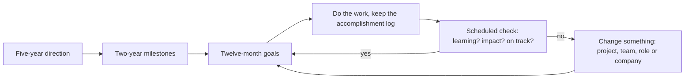

# On the job: the first years

## Before this lesson

Read [Evaluating and negotiating offers](#/lesson/interview-prep/evaluating-negotiating-offers). This lesson begins where that one ends: you have accepted an offer. It also refers to the accomplishment log introduced in [Experience and a strong resume](#/lesson/interview-prep/experience-and-resume) and to the rubric idea from [What interviewers evaluate](#/lesson/interview-prep/what-interviewers-score). No technical knowledge is required.

## In plain words

Getting the job is not the end of the story this track tells. The interview measured whether you *could* do the work. The years that follow decide what you actually become: which skills you build, who trusts you, and what your next resume says. Many people prepare for months to get hired and then drift for years once they are in.

A career resembles a long journey more than a single race. Reaching the starting city (the offer) took effort, but the direction you travel from there matters more than how fast you arrived. Someone who checks the map once a year and adjusts course ends up somewhere they chose. Someone who never checks ends up wherever the road happened to lead.

This lesson covers four habits for the first years: **set a timeline and check it**, **build strong relationships**, **ask for what you want**, and **keep your interview skills alive**. It adds a practical plan for the first ninety days, because early impressions last a long time.

It matters for a job in the most direct way: these habits decide promotions, the quality of your next opportunity, and whether work is something you steer or something that happens to you.

## Why people drift

A common pattern: you join, the work is new and absorbing, you learn a lot for a year or two. Then the learning slows, the tasks start to repeat, and because nothing is actually wrong, nothing changes. Three or five years later you realise that your skills have not moved for a long time and that your resume has one line that grew longer without getting stronger.

Nobody chooses this. It happens by default, because there is no moment that forces a decision. The cure is to create those moments on purpose.

## Habit 1: set a timeline and check it

Before you start, or in your first month, write down answers to four questions:

1. **Where do I want to be in five years?** The kind of work, the level, perhaps the field. A rough direction is enough.
2. **What must be true in two years for that to be on track?** Skills, scope of responsibility, evidence.
3. **What will I therefore do in the next twelve months?** Concrete: lead a small project, become the team's reference person for one system, give a talk, learn one new technology properly.
4. **What would tell me it is time to change team or company?** For example: "I have learned nothing substantial for a year" or "there is no path to the next level here".

Then put a recurring date in your calendar, every six or twelve months, to re-read the page and answer honestly:

- What did I learn since the last check?
- What did I ship, and what was my part?
- Am I closer to the two-year picture?
- Is this still the right place to get there?



The check is not a search for a reason to leave. Most checks end with "on track; next year I want X". Its value is that when the answer becomes "no", you notice within months, not years.

### The accomplishment log, continued

Keep the log you started for your resume. Once a month, add two or three lines: what you did, what changed as a result, and who can confirm it. It serves three purposes: your yearly review (your manager will not remember what you did in February; you will), promotion cases (which are built from evidence, exactly like interview reports), and your next resume.

The small program below shows one way to keep such a log in a form you can summarise. Replace the entries with your own.

```python-run
from collections import defaultdict

log = [
    ("2025-01", "delivery",   "Moved 14 scheduled jobs to a worker pool; nightly run 3 h -> 35 min"),
    ("2025-02", "quality",    "Wrote 210 integration tests for the tracking API"),
    ("2025-03", "mentoring",  "Onboarded a new joiner; first production change in week 1"),
    ("2025-03", "delivery",   "Cut status-page load time from 4.1 s to 0.9 s"),
    ("2025-05", "leadership", "Started weekly failure review; repeat incidents 7 -> 1 over two quarters"),
    ("2025-06", "learning",   "Completed internal course on queue systems; ran a brown-bag session"),
]

by_theme = defaultdict(list)
for month, theme, text in log:
    by_theme[theme].append(f"{month}: {text}")

for theme, items in sorted(by_theme.items()):
    print(theme.upper())
    for item in items:
        print("   ", item)

expected = {"delivery", "quality", "mentoring", "leadership", "learning", "collaboration"}
missing = expected - set(by_theme)
print("\nThemes with no entry this half-year:", ", ".join(sorted(missing)) or "none")
```

Each log entry is a tuple of month, theme and a one-line description. The loop groups the entries by theme in a `defaultdict(list)`, which creates an empty list the first time a theme is seen. The final lines compare the themes you have evidence for with the themes a review usually asks about, using set subtraction (`expected - set(by_theme)`), and print what is missing. In the sample, "collaboration" has no entry: a prompt either to write down something you forgot or to seek out that kind of work in the next half-year. Notice that the themes are a rubric, the same idea interviewers use, applied to your own year.

## Habit 2: build strong relationships

Technical skill gets you hired. Over the following years, a large share of your opportunities will come through people: a manager who recommends you for a project, a former colleague who refers you, a senior engineer who teaches you things no document contains.

### Your manager

- **Learn what they are measured on** and help with it. A manager whose goals you advance becomes your advocate.
- **Hold regular one-to-one meetings** and bring an agenda: progress, obstacles, one question about your growth.
- **No surprises.** Report risks and delays early, with a proposal. Late bad news damages trust far more than the delay itself.
- **Say what you want** (see habit 3). Managers are not mind readers.

### Mentors

A **mentor** is a more experienced person who gives you advice over time. You do not need a formal programme. Notice who gives thoughtful code reviews or explains things well, ask them a specific question, and follow up on what they suggested. People enjoy helping someone who visibly uses the help.

### Peers and other teams

- Do careful, kind code reviews. Being known as someone whose reviews make code better is a durable reputation.
- Help people when they are stuck, and write down what you figure out so that the next person finds it.
- Get to know one or two people in neighbouring teams. Most interesting projects cross team boundaries.

### Staying in touch

When you or a colleague move on, keep the connection: a note of congratulations, an occasional message, a coffee when you are in the same city. This is not manipulation; it is ordinary friendliness, and it is also how most senior hires actually happen. The people around you now are your professional network in ten years.

> [!TIP]
> A simple rule for building a reputation: be the person who closes loops. If you said you would look into something, come back with an answer, even if the answer is "I could not find out". Reliability is rarer than brilliance and noticed more.

## Habit 3: ask for what you want

Interesting projects, promotions and raises are rarely distributed by a perfectly informed observer. They go disproportionately to people who have said, clearly and reasonably, what they are aiming for.

- **Tell your manager your goals.** "I would like to move toward back-end performance work, and to be ready for the next level within about eighteen months. What would you need to see?" Now your manager can steer suitable work to you and tell you what is missing.
- **Ask for the specific project.** If something is being planned that fits your goals, ask to be on it, and say why you would be useful.
- **Ask for feedback before reviews, not at them.** "What is one thing I should do differently this quarter?" A review should contain nothing you are hearing for the first time.
- **Ask about the criteria for the next level** and get them in writing if they exist. Then collect evidence against each criterion in your log.
- **Be direct about problems that can be fixed.** If your tasks are all maintenance and you want development work, say so, with a proposal.

Asking does not guarantee getting. But a reasonable request, made once and politely, costs nothing, and it replaces silent frustration with information: either things change, or you learn that they will not, which your timeline check needs to know.

<details>
<summary>Model wording: asking about promotion</summary>

"I would like to talk about my growth. My aim is to reach senior level in roughly the next eighteen months. Could you tell me how you see the gap between where I am and that level, and which two or three things would make the strongest case? I would also like to take on the scheduler redesign if it goes ahead, since leading a project of that size seems to be one of the things I am missing."

</details>

<details>
<summary>Model wording: asking for different work</summary>

"For the last two quarters most of my time has gone to support tickets. I understand they need to be handled, and I am glad to keep a share of them. I would like at least half my time on feature development, because that is where I want to grow. Could we look at how the tickets are distributed, or could I take the reporting feature that is starting next month?"

</details>

## Habit 4: keep your interview skills alive

It sounds strange to interview when you are content. There are sound reasons to do a small amount regularly.

- **Skills fade.** Interviewing is a specific performance. After five years without practice, a strong engineer can perform badly, which leads to poor offers at exactly the moment they are needed.
- **It keeps you informed.** A conversation with another company every year or two tells you what the market values, what your skills are worth and what kinds of roles exist.
- **It protects you.** Reorganisations and layoffs happen to good people. Being a few weeks from interview-ready is security.
- **It can confirm you are in the right place.** Often the outcome is renewed appreciation for your current job.

Practical version: once a year, refresh your resume from the log; solve a handful of problems aloud (the [mixed practice](#/lesson/interview-prep/mixed-practice) module is designed for this); and take an occasional recruiter call. And volunteer as an **interviewer** at your company as soon as you can: it is the best training there is, because you see many candidates attempt the same problem and learn exactly what separates good performances from weak ones.

## The first ninety days

Early impressions form quickly and persist. A simple plan:

| Period | Aim | Actions |
|---|---|---|
| Days 1 to 30 | Learn | Set up your environment; read the main codebase and its documentation; fix a small bug to learn the release process; meet every teammate one-to-one; ask your manager "what does a good first three months look like?"; write down every question and its answer |
| Days 31 to 60 | Contribute | Deliver one or two small features end to end; start reviewing other people's changes; improve the onboarding notes with what confused you |
| Days 61 to 90 | Own | Take responsibility for one area or component; propose one small improvement to a process or tool; agree goals for the next six months with your manager |

Three attitudes help throughout:

- **Ask questions early, in batches.** Try for a reasonable time first (the ninety-minute rule from the weaknesses example in [Classic behavioural questions](#/lesson/interview-prep/classic-behavioural-questions) works well), then ask with a note of what you tried. New joiners are expected to ask; struggling in silence for days is the real mistake.
- **Understand before you criticise.** Odd-looking decisions usually have a history. Ask "what led to this design?" before proposing to replace it.
- **Write things down.** Your notes become documentation, and writing documentation is one of the fastest ways for a newcomer to be visibly useful.

> [!INTERVIEW]
> Everything in this lesson feeds your *next* interview. Leading a small project gives a leadership story; a mistake handled well gives a failure story; the log gives numbers. Behavioural interviews are easy for people who have been deliberate about their work, and hard for people who have not.

## When to move on

Changing team or company is a normal part of a career, not a failure of loyalty. Signals that deserve attention at a timeline check:

- You have learned little for a year and see no project that would change that.
- The path to the next level is blocked or undefined, and asking has not clarified it.
- The work or the environment makes you consistently unhappy, and you have tried to change what you can.
- The company's direction makes your skills narrower instead of broader.

Before leaving, try the cheaper options: a different project, a different team, a direct conversation. If you do leave, do it well: give proper notice, document your work, hand over carefully and thank people. How you leave is remembered at least as long as what you did while you were there.

## Pitfalls

- **Coasting.** Being comfortable for years without growing, noticed only when you need a new job.
- **Waiting to be noticed.** Assuming good work speaks for itself. It speaks more clearly when you also say what you are aiming for.
- **No record of accomplishments.** At review time and at resume time you will remember a fraction of what you did.
- **Neglecting relationships** because "I am here to code".
- **Hiding problems from your manager** until they explode.
- **Job-hopping with no direction**, or the opposite, staying out of inertia.
- **Letting interview skills decay to zero.**
- **Burning bridges on the way out.**

> [!WARNING]
> Do not treat an outside offer as a routine tool to force a raise. Used once, honestly, when you would really accept the other job, it can be legitimate. Used as a bluff, it damages trust with the people who decide your future projects, and sometimes the bluff is called.

## Summary

- The offer is a starting point; your direction afterwards matters more than how you got in.
- Write a five-year direction, two-year milestones and twelve-month goals, and check them on a fixed schedule so that drift is caught early.
- Keep an accomplishment log; it powers reviews, promotions and your next resume.
- Invest in your manager, mentors, peers and former colleagues; be reliable and helpful.
- Say what you want: goals, projects, feedback, criteria for the next level.
- Keep interviewing skills warm with a small yearly routine, and become an interviewer.
- Use the first ninety days to learn, contribute, then own something.
- This closes Part A of the track. Part B begins with [Arrays and strings](#/lesson/interview-prep/arrays-strings-approach).

## Glossary

- **Career timeline**: a written set of long-, medium- and short-term goals with scheduled reviews.
- **Drift**: staying in a role without growth because nothing forces a decision.
- **Accomplishment log**: a running record of what you did and its effect.
- **One-to-one**: a regular private meeting between an employee and their manager.
- **Mentor**: a more experienced person who gives advice over time.
- **Advocate (sponsor)**: someone with influence who actively recommends you for opportunities.
- **Promotion case**: the collected evidence that someone is performing at the next level.
- **Onboarding**: the process of getting a new team member productive.
- **Professional network**: the people who know your work and whom you can call on, and who can call on you.
- **Notice period**: the time between resigning and your last working day.

```quiz
[
  {"q": "Why does the lesson recommend a scheduled career check every six or twelve months?",
   "options": ["To find a reason to quit", "Because without a forced decision point, people drift for years without noticing", "Because companies require it", "To ask for a raise each time"],
   "answer": 1,
   "explain": "Drift happens by default; a recurring check turns it into a visible, early signal."},
  {"q": "What is the main use of an accomplishment log after you are hired?",
   "options": ["To complain about colleagues", "Evidence for reviews, promotion cases and your next resume", "To track your working hours", "To replace code comments"],
   "answer": 1,
   "explain": "Reviews and promotions are decided from evidence, and memory loses most of a year's work."},
  {"q": "In the log program, what does `expected - set(by_theme)` compute?",
   "options": ["The total number of entries", "The themes a review usually covers for which you have no entry yet", "The months with no work", "The longest entry"],
   "answer": 1,
   "explain": "Set subtraction leaves the expected themes that are absent from your log, showing where evidence is missing."},
  {"q": "Which behaviour most helps your relationship with your manager?",
   "options": ["Hiding delays until the deadline", "Reporting risks early with a proposal, and saying what you want to grow toward", "Avoiding one-to-one meetings", "Agreeing with everything"],
   "answer": 1,
   "explain": "No surprises plus clear goals lets a manager trust you and steer suitable work to you."},
  {"q": "Why should you tell your manager which level or kind of work you are aiming for?",
   "options": ["It is rude not to", "Opportunities go disproportionately to people whose goals are known, and you learn what is missing", "Managers must grant every request", "It guarantees promotion"],
   "answer": 1,
   "explain": "A clear, reasonable request gives your manager something to act on and gives you information either way."},
  {"q": "What is a good reason to keep interview skills warm while happily employed?",
   "options": ["To threaten your employer monthly", "Skills fade, the market changes, and unexpected reorganisations happen", "Interviews are relaxing", "There is no good reason"],
   "answer": 1,
   "explain": "A small yearly routine keeps you informed and a few weeks from ready if circumstances change."},
  {"q": "What is the recommended focus of the first 30 days in a new job?",
   "options": ["Rewriting the architecture", "Learning: environment, codebase, release process, people, and what a good first quarter looks like", "Negotiating a raise", "Working alone without asking questions"],
   "answer": 1,
   "explain": "Understanding the system and the team first makes later contributions faster and better received."},
  {"q": "Which signal most clearly suggests it may be time to change team or company?",
   "options": ["One difficult week", "A year with little learning and no realistic path to change that, even after asking", "A colleague got a new chair", "You finished a project"],
   "answer": 1,
   "explain": "Sustained absence of growth with no remedy is what the timeline check is designed to catch."}
]
```

> **Source:** McDowell, Cracking the Coding Interview 6e, ch. VIII (The Offer and Beyond: On the Job). The ninety-day plan, scripts and log demo are original.
