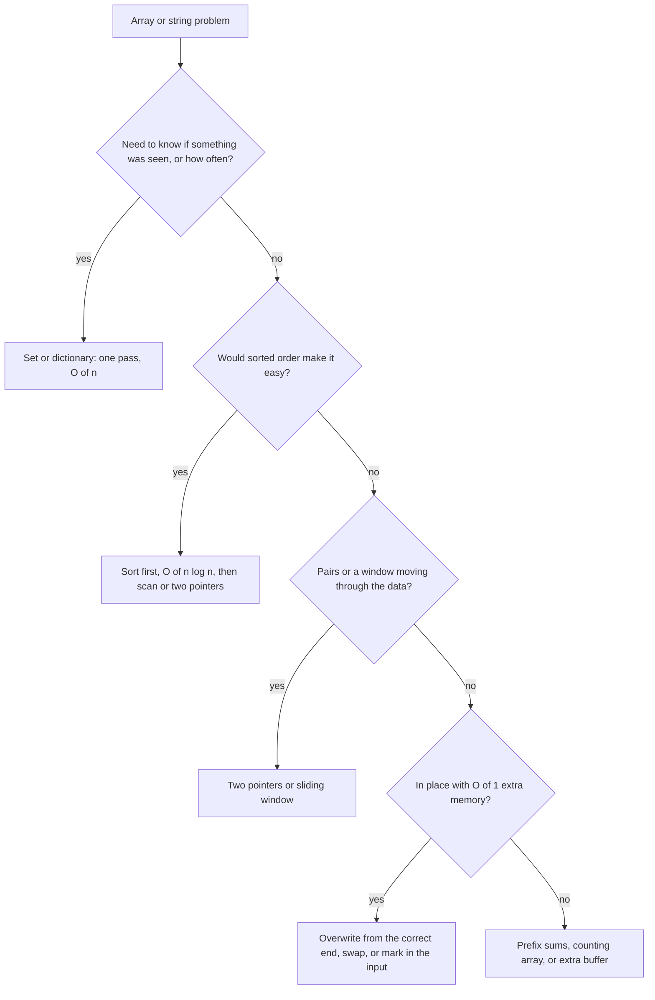

# Arrays and strings: approach and cheat sheet

## Before this lesson

You should have read [Big O foundations](#/lesson/interview-prep/big-o-foundations) and [The seven-step method](#/lesson/interview-prep/seven-step-method), and be able to write loops over Python lists and strings. This is a compact review. For slower, deeper teaching follow the links to [Low-level arrays](#/lesson/dsa-foundations/low-level-arrays), [Dynamic arrays](#/lesson/dsa-foundations/dynamic-arrays) and [Hash maps and sets](#/lesson/neet-arrays/arrays-hashing-pattern).

## In plain words

An **array** is a row of numbered boxes: box 0, box 1, box 2, and so on, all the same size and sitting side by side in memory. Because they are side by side, the computer can jump straight to box number 5,000 without looking at the boxes before it. A **string** is an array whose boxes each hold one character.

Think of a street where the houses are numbered in order. If you know the number, you walk directly to the house. That is the array's great strength: reaching any position takes the same short time. Its weakness is the mirror image: squeezing a new house between number 12 and number 13 means renumbering every house after it.

A **hash table** is the second tool of this chapter. It is a cloakroom: you hand over a coat and get a ticket computed from it; with the ticket the attendant goes directly to the right hook. It answers "have I seen this before?" and "what is stored under this key?" almost instantly.

These two structures matter for a job because they are in nearly every program you will ever write, and for interviews because a large share of first-round questions use nothing else. If you can use arrays, strings and hash tables fluently and state what each operation costs, you can solve most easy and many medium problems.

## The three building blocks

### Hash tables

A hash table stores key → value pairs. Internally:

1. A **hash function** turns the key into a number (the hash code).
2. That number is reduced to an index in an internal array, for example `hash % array_length`.
3. The pair is stored at that index. Two different keys can land on the same index; that is a **collision**, commonly handled by keeping a short list at each index (chaining).

To look a key up, the table recomputes the index and searches only that short list. With a reasonable hash function and enough room, each list holds a handful of entries at most, so insert, lookup and delete are **O(1) on average**. In the worst case (everything collides) they are O(n). A different implementation, a balanced search tree, gives O(log n) for everything and keeps the keys in order; the review lesson [Hashing, balanced trees and MapReduce](#/lesson/interview-prep/review-hashing-trees-mapreduce) compares them.

In Python a `dict` is a hash table of pairs and a `set` is a hash table of keys only.

```python-run
visits = ["ana", "bo", "ana", "cy", "bo", "ana"]

seen = set()
first_repeat = None
counts = {}
for name in visits:
    if name in seen and first_repeat is None:    # O(1) membership test
        first_repeat = name
    seen.add(name)
    counts[name] = counts.get(name, 0) + 1       # O(1) update

print("first repeated visitor:", first_repeat)
print("visit counts:", counts)
print("visited exactly once:", [n for n, c in counts.items() if c == 1])
```

The loop reads each name once. `name in seen` asks the set whether the name has appeared; that test does not scan anything. `counts.get(name, 0) + 1` reads the current tally (0 if absent) and stores one more. The output shows the first repeat (`ana`), the tallies and the names seen once. This "one pass with a set or a dictionary" is the most frequent pattern in interview problems.

### Resizable arrays

A plain array has a fixed length. A **resizable array** (Python's `list`, Java's `ArrayList`, C++'s `vector`) grows automatically: when it is full it allocates a larger block, typically about double, and copies the elements over. One append is occasionally O(n) but, as shown in [Big O foundations](#/lesson/interview-prep/big-o-foundations), the copies are rare enough that appending is **O(1) amortised**.

Operations at the *end* are cheap. Operations at the *front or middle* (`insert(0, x)`, `pop(0)`, `del a[i]`) shift everything after them and cost O(n).

### Building strings

In Python, Java, C# and JavaScript, strings are **immutable**: they cannot be changed once created. Adding a character creates a new string and copies the old one. Doing that in a loop of n steps copies 1 + 2 + … + n characters, which is O(n²).

The cure is to collect pieces in a resizable array and join them once at the end (`"".join(parts)` in Python, `StringBuilder` in Java and C#).

```python-run
import time

def slow_build(n):
    text = ""
    for i in range(n):
        text = text + "x" + text[:0]      # forces a fresh copy each time
    return text

def fast_build(n):
    parts = []
    for i in range(n):
        parts.append("x")
    return "".join(parts)

for n in (20000, 40000, 80000):
    t0 = time.perf_counter(); slow_build(n); t1 = time.perf_counter(); fast_build(n); t2 = time.perf_counter()
    print(f"n = {n:6d}: concatenate {1000 * (t1 - t0):7.1f} ms   join {1000 * (t2 - t1):5.1f} ms")
```

Each time n doubles, the concatenating version takes roughly four times as long, while the join version only doubles: quadratic against linear. (The odd-looking `+ text[:0]` prevents an optimisation that some Python versions apply to the simplest form of `+=`; you should not depend on that optimisation.)

## The usual tricks



### 1. Count characters

Many string questions reduce to "how many of each character?". Two strings are rearrangements of one another exactly when their counts match; a string can be rearranged into a palindrome exactly when at most one character has an odd count. Use a dictionary, or, when the alphabet is small and known, an array indexed by character code (26 slots for lower-case letters).

Always ask what the character set is. "ASCII" (128 characters) versus "any Unicode text" changes both the data structure and the constants.

### 2. Sort to create structure

Sorting costs O(n log n) and often turns a hard question into an easy scan: duplicates become neighbours, the closest pair becomes adjacent, rearrangements become equal strings. Mention the hash-based O(n) alternative and choose with the interviewer.

### 3. Two pointers

Two indexes moving through the data replace a nested loop. Common forms: one from each end moving inward (palindromes, reversing, pair sums in sorted data); a slow "write" index and a fast "read" index (removing elements in place); one index in each of two sequences (merging, comparing with one edit allowed). Taught fully in [Two pointers](#/lesson/neet-arrays/two-pointers-pattern).

### 4. Work backwards when space is at the end

If an array has spare room at its end and you must expand its contents in place (for example replacing each space with a three-character code, or merging a second sorted array into it), fill **from the back**. Writing from the front would overwrite data you have not read yet. First count to find the final length, then move a read index and a write index leftward.

### 5. Use the input as its own notebook

When extra memory is forbidden, look for places inside the input to store marks: the first row and column of a matrix can record which rows and columns must be cleared; the sign of a number can record "visited".

### 6. Doubling for rotations

Every rotation of a string `s` is a substring of `s + s`. So "is `t` a rotation of `s`?" is one length check and one substring search.

### 7. Matrices are arrays of arrays

Rotating a square image by 90 degrees can be done in place layer by layer with four-way swaps, or by transposing and then reversing each row. Index arithmetic is where the bugs live: write down where one specific cell goes before coding. See [Matrix tricks](#/lesson/neet-greedy-math/matrix-tricks).

## A worked example with full reasoning

*Problem: a warehouse label is valid if no character appears more than once. Decide whether a label is valid.* (This track's version is [Distinct Badge Code](#/problem/ctci-distinct-badge-code).)

**Listen.** Ask: which characters can appear? Does case matter? Suppose: printable ASCII, case matters.

**Example.** `"A7-b7"` → invalid (two `7`s). `"A7-b"` → valid.

**Brute force.** Compare every character with every later one: O(n²) time, O(1) space.

**Optimise.** The inner loop is a search ("has this character occurred?"), and searches are what sets are for. One pass with a set: O(n) time, O(k) space for an alphabet of k characters.

**A sharper observation.** With 95 printable ASCII characters, any label longer than 95 *must* contain a repeat (there are more positions than distinct characters; this is the pigeonhole principle). So the loop runs at most 95 times, and the time is O(min(n, k)): effectively constant for a fixed alphabet. Saying this aloud shows you think about the input, not only the code.

**Follow-up: no extra data structure.** Either sort the characters first and compare neighbours (O(n log n), and it modifies or copies the input), or, for a 26-letter alphabet, use the bits of one integer as 26 on/off switches.

```python-run
def all_distinct(label):
    if len(label) > 95:              # pigeonhole: a repeat is certain
        return False
    seen = set()
    for ch in label:
        if ch in seen:
            return False
        seen.add(ch)
    return True

def all_distinct_bits(word):
    """Lower-case letters only, no set: one integer used as 26 switches."""
    switches = 0
    for ch in word:
        bit = 1 << (ord(ch) - ord("a"))
        if switches & bit:
            return False
        switches |= bit
    return True

for text in ["A7-b7", "A7-b", "", "x" * 200]:
    print(repr(text[:12]), "->", all_distinct(text))
print("planet ->", all_distinct_bits("planet"), "  letter ->", all_distinct_bits("letter"))
```

In `all_distinct_bits`, `ord(ch) - ord("a")` converts a letter to a number from 0 to 25, and `1 << that` is an integer with only that bit switched on. `switches & bit` is non-zero when the letter was seen before; `switches |= bit` records it. The lesson [Bit manipulation](#/lesson/interview-prep/bit-manipulation-approach) explains these operators.

**Test.** Empty string (valid), one character, a repeat at the very end, upper and lower case of the same letter (distinct here), a string longer than the alphabet.

## Complexity cheat sheet

| Operation | Array / Python list | Hash table (dict, set) | String |
|---|---|---|---|
| Read or write by index | O(1) | n/a | Read O(1); write impossible (immutable) |
| Search for a value | O(n) | O(1) average | O(n) for a character, O(n + m) for a substring with a good algorithm |
| Append at end | O(1) amortised | n/a | O(n): makes a new string |
| Insert or delete at front or middle | O(n) | n/a | O(n) |
| Insert, delete, lookup by key | n/a | O(1) average, O(n) worst | n/a |
| Slice of length k | O(k) | n/a | O(k) |
| Sort | O(n log n) | n/a | O(n log n) |
| Compare two of length n | O(n) | O(n) | O(n) |
| Join n pieces of total length L | n/a | n/a | O(L) |

Space reminders: a set or dictionary of n items is O(n); a counting array over a fixed alphabet is O(1); slicing and `sorted` create copies.

## Problems in this module and what each trains

| Problem | Skill |
|---|---|
| [Distinct Badge Code](#/problem/ctci-distinct-badge-code) | Set membership, alphabet bound |
| [Shuffled Twins](#/problem/ctci-shuffled-twins) | Character counting |
| [Run-Length Shrink](#/problem/ctci-run-length-shrink) | Scanning runs, building strings efficiently |
| [One Typo Apart](#/problem/ctci-one-typo-apart) | Two pointers over two strings |
| [Quarter-Turn Grid](#/problem/ctci-quarter-turn-grid) | In-place matrix index arithmetic |
| [Blackout Rows and Columns](#/problem/ctci-blackout-rows-cols) | Using the input as its own notebook |
| [Turned Word](#/problem/ctci-turned-word) | The doubling trick for rotations |

For many more problems in this family, with pattern-by-pattern teaching, continue in the [Arrays & Hashing track](#/track/neet-arrays).

## Pitfalls

- **Hidden linear operations inside loops**: `x in list`, `list.index`, `list.insert(0, x)`, `list.pop(0)`, slicing, `str.count`. Each multiplies your complexity by n.
- **String concatenation in a loop.** Use a list and `join`.
- **Not asking about the character set and case sensitivity.** The right answer depends on them.
- **Off-by-one errors at the ends**: the last valid index is `len(a) - 1`; loops over pairs of neighbours stop one early.
- **Modifying a list while iterating over it.** Build a new list, or iterate over indexes backwards.
- **Assuming hash operations are free for long keys.** Hashing a string of length L costs O(L).
- **Forgetting empty input**, single-element input and inputs where every element is the same.
- **Aliasing rows of a matrix**: in Python `[[0] * n] * m` creates m references to the *same* row. Use a list comprehension.

> [!INTERVIEW]
> For any array or string question, three clarifying questions are almost always worth asking: "Can it be empty?", "What values or characters can appear, and can they repeat?", and "May I modify the input, or use extra memory?" The answers frequently select the algorithm.

> [!TIP]
> When you catch yourself writing a nested loop whose inner loop *searches* for something, stop and ask whether a set, a dictionary or a sort would make that search disappear. This single reflex upgrades many O(n²) solutions to O(n) or O(n log n).

> [!WARNING]
> "O(1) lookup" for a hash table is an average. If an interviewer asks about the worst case, the answer is O(n), and you should be able to explain collisions and how resizing keeps the average low.

## Summary

- Arrays give O(1) access by index and O(n) insertion or deletion away from the end; resizable arrays append in O(1) amortised.
- Hash tables give O(1) average insert, lookup and delete; they are the standard cure for repeated searching and for counting.
- Strings are immutable in most languages: build them with a list and one join.
- Standard tricks: count characters, sort to create structure, two pointers, fill from the back, mark inside the input, double a string to test rotations, treat matrix problems as careful index arithmetic.
- Always clarify the character set, emptiness, duplicates and whether the input may be modified, and state time and space at the end.

## Glossary

- **Array**: a fixed-size, contiguous sequence of elements accessed by index.
- **Index**: the position number of an element, starting at 0.
- **Resizable (dynamic) array**: an array that grows by allocating a larger block and copying.
- **String**: a sequence of characters.
- **Immutable**: unable to be changed after creation.
- **Hash table**: a structure mapping keys to values through a hash function, with O(1) average operations.
- **Hash function**: a function that converts a key into a number used to choose a storage position.
- **Collision**: two different keys mapping to the same position.
- **Chaining**: handling collisions by keeping a small list at each position.
- **Two pointers**: a technique using two indexes that move through the data in a coordinated way.
- **In place**: modifying the input directly, using only O(1) extra memory.
- **Pigeonhole principle**: if more items than containers exist, some container holds at least two items.
- **Transpose**: swap rows and columns of a matrix, so element (r, c) moves to (c, r).

```quiz
[
  {"q": "Why can an array return its 5,000th element as quickly as its first?",
   "options": ["It searches from both ends", "Elements are the same size and contiguous, so the position is computed directly from the index", "It keeps a hash table inside", "It is sorted"],
   "answer": 1,
   "explain": "Address = start + index × element size, a single calculation regardless of the index."},
  {"q": "What is the average and the worst-case cost of a lookup in a hash table?",
   "options": ["O(1) and O(1)", "O(1) average, O(n) worst case", "O(log n) and O(n)", "O(n) and O(n²)"],
   "answer": 1,
   "explain": "With few collisions each bucket is short; if every key collides the bucket must be scanned."},
  {"q": "Why is building a long string with repeated concatenation in a loop slow in languages with immutable strings?",
   "options": ["The loop runs n² times", "Every concatenation copies the string built so far, giving a triangular sum of copies", "Strings are stored on disk", "Characters are compared pairwise"],
   "answer": 1,
   "explain": "Copy lengths 1, 2, …, n add up to about n²/2; collecting pieces and joining once is linear."},
  {"q": "How can you test whether t is a rotation of s with one substring search?",
   "options": ["Sort both strings", "Check that the lengths are equal and that t occurs in s + s", "Reverse s", "Compare their first characters"],
   "answer": 1,
   "explain": "Every rotation y + x of s = x + y appears inside x + y + x + y."},
  {"q": "An array has spare room at the end and you must expand its content in place. From which end should you write?",
   "options": ["From the front", "From the back, so that unread data is not overwritten", "From the middle", "It does not matter"],
   "answer": 1,
   "explain": "The free space is at the end; writing there first never destroys elements still to be read."},
  {"q": "A label uses only the 95 printable ASCII characters. Why can a uniqueness check stop after at most 95 characters?",
   "options": ["Longer labels are invalid input", "By the pigeonhole principle, 96 or more characters must contain a repeat", "Sets hold at most 95 items", "ASCII strings are sorted"],
   "answer": 1,
   "explain": "More positions than distinct characters guarantees a duplicate, so longer inputs are rejected at once."},
  {"q": "Which Python operation is O(n) and often hides inside a loop?",
   "options": ["a[i]", "len(a)", "x in a, where a is a list", "a.append(x)"],
   "answer": 2,
   "explain": "Membership in a list scans it; using a set makes the test O(1) on average."},
  {"q": "What is wrong with creating a grid as [[0] * n] * m in Python?",
   "options": ["It is too slow", "All m rows are the same list object, so changing one row changes them all", "It creates strings", "It uses too little memory to work"],
   "answer": 1,
   "explain": "The outer multiplication copies the reference, not the row. Use [[0] * n for _ in range(m)]."}
]
```

> **Source:** McDowell, Cracking the Coding Interview 6e, ch. 1 (Arrays and Strings). Explanations, code and examples are original.
