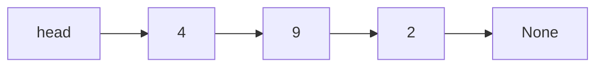

# Linked lists: approach and cheat sheet

## Before this lesson

You should know arrays and their costs from [Arrays and strings](#/lesson/interview-prep/arrays-strings-approach), and be able to read a small Python class. For a slower introduction see [Singly linked lists](#/lesson/dsa-foundations/singly-circular) in the DSA track, and for the pattern lessons see [Linked-list pointers](#/lesson/neet-linked-trees/ll-pointers), [Fast and slow pointers](#/lesson/neet-linked-trees/ll-fast-slow) and [Reversal](#/lesson/neet-linked-trees/ll-reversal).

## In plain words

A **linked list** is a chain of small objects called **nodes**. Each node holds one value and a note saying where the next node is. To read the list you start at the first node (the **head**) and follow the notes one at a time until a node says "there is no next".

A treasure hunt is a good picture. Each clue tells you where the next clue is hidden. You cannot jump to the seventh clue: you must follow the first six. But adding a new clue in the middle is easy: change one clue to point to the new one, and make the new one point to where the old one pointed. Nothing else moves.

That is the trade against an array. An array lets you jump to any position instantly but makes insertion in the middle expensive. A linked list makes insertion and removal cheap *once you are standing at the right place*, but getting to a place means walking.

Linked lists matter for a job because they appear inside many other structures (queues, hash-table buckets, least-recently-used caches), and for interviews because they test one thing very precisely: whether you can change references carefully without losing track of anything.

## The node, and walking the list

```python
class ListNode:
    def __init__(self, val=0, next=None):
        self.val = val        # the stored value
        self.next = next      # reference to the following node, or None at the end
```

In a **singly linked list** each node knows only its successor. In a **doubly linked list** each node also has a `prev` reference to its predecessor, which allows walking backwards and removing a node without knowing the one before it.



```python-run
class ListNode:
    def __init__(self, val=0, next=None):
        self.val = val
        self.next = next

def build(values):
    head = None
    for v in reversed(values):          # put each value in front of the list so far
        head = ListNode(v, head)
    return head

def to_text(head):
    parts = []
    node = head
    while node:                         # stop when node is None
        parts.append(str(node.val))
        node = node.next                # follow the reference
    return " -> ".join(parts) or "(empty)"

chain = build([4, 9, 2])
print(to_text(chain))

# insert 7 after the first node: two reference changes, nothing shifts
chain.next = ListNode(7, chain.next)
print(to_text(chain))

# delete the node after the first node: one reference change
chain.next = chain.next.next
print(to_text(chain))
```

`build` creates nodes from the last value to the first; each new node points at the list built so far, and becomes the new head. `to_text` shows the standard traversal loop: `while node:` continues until the reference is `None`, and `node = node.next` moves one step. The insertion creates a node whose `next` is the old second node and attaches it to the first node. The deletion makes the first node skip over its neighbour; the skipped node is no longer reachable and is reclaimed automatically in Python or Java (in C and C++ you must free it yourself).

## Deleting a node

To delete node `n` from a singly linked list you need the node **before** it, `prev`, and then set `prev.next = n.next`. Two details cause most bugs:

- **Deleting the head.** There is no previous node; the head itself changes. Functions that might remove the head must *return* the new head.
- **Null checks.** `node.next.next` crashes when `node.next` is `None`.

In a doubly linked list you also repair the backward reference: `n.next.prev = n.prev` (if `n.next` exists).

## The usual tricks

### 1. The dummy head

Many operations have a special case for the first node. A **dummy node** (also called a sentinel) placed in front of the real head removes it: every real node now has a predecessor, and at the end you return `dummy.next`.

```python
def remove_all(head, target):
    dummy = ListNode(0, head)
    prev = dummy
    while prev.next:
        if prev.next.val == target:
            prev.next = prev.next.next      # skip it; do not advance prev
        else:
            prev = prev.next
    return dummy.next
```

Without the dummy, removing a run of matching nodes at the front needs separate code. With it, one loop handles everything.

### 2. The runner (two pointers)

Walk the list with two references at once. Variants:

- **Fixed gap**: move one pointer k nodes ahead, then move both together; when the leader falls off the end, the follower is k nodes from the end. Finds the k-th node from the tail in one pass.
- **Fast and slow**: one moves two nodes per step, the other one. When the fast pointer reaches the end, the slow one is at the middle. If the list has a loop, the fast pointer eventually lands on the slow one.

```python-run
class ListNode:
    def __init__(self, val=0, next=None):
        self.val, self.next = val, next

def build(values):
    head = None
    for v in reversed(values):
        head = ListNode(v, head)
    return head

def middle(head):
    slow = fast = head
    while fast and fast.next:       # fast needs two more steps to be possible
        slow = slow.next
        fast = fast.next.next
    return slow.val if slow else None

def kth_from_end(head, k):
    lead = head
    for _ in range(k):
        if lead is None:
            return None             # fewer than k nodes
        lead = lead.next
    trail = head
    while lead:
        lead, trail = lead.next, trail.next
    return trail.val

for values in ([1, 2, 3, 4, 5], [1, 2, 3, 4], [7]):
    print(values, "middle:", middle(build(values)), " 2nd from end:", kth_from_end(build(values), 2))
```

In `middle`, the loop condition `fast and fast.next` guarantees that `fast.next.next` is safe. For an even number of nodes this version returns the second of the two middle nodes. In `kth_from_end`, the first loop creates the gap and reports failure if the list is too short; the second loop moves both pointers until the leader is `None`.

### 3. Reverse by flipping arrows

Reversing a list in place needs three references: the previous node, the current node and the saved next node.

```python
def reverse(head):
    prev = None
    while head:
        nxt = head.next       # save the rest
        head.next = prev      # flip this arrow
        prev = head           # advance prev
        head = nxt            # advance current
    return prev               # the old tail is the new head
```

This is the single most reused piece of linked-list code. Checking whether a list reads the same in both directions, for instance, becomes: find the middle, reverse the second half, compare the halves.

### 4. Build new chains instead of rearranging in place

To split a list around a value, or to merge two sorted lists, keep one or more output chains (each with its own dummy head and tail pointer) and move nodes onto them as you walk. Remember to end the last chain with `None`, or a leftover reference creates a loop.

### 5. A stack for reverse-order access

A singly linked list cannot be read backwards. Pushing values on a stack while walking, then popping, gives them in reverse. This solves "add two numbers stored most-significant-digit first" without modifying the lists.

### 6. Recursion, with its price

Many list problems have short recursive solutions ("solve it for the rest of the list, then deal with this node"). Recursion processes nodes on the way back, which gives access to "later" nodes first. The price is O(n) stack space, and in Python the default recursion limit (about 1,000 frames) is exceeded by long lists. Mention the cost, and prefer loops for long inputs.

## A worked example with full reasoning

*Problem: decide whether a singly linked list of colours reads the same forwards and backwards, using O(1) extra memory.* (This track's [Mirror List](#/problem/ctci-mirror-list).)

**Listen and example.** `3 → 8 → 8 → 3` yes; `3 → 8 → 5` no; the empty list and a single node count as yes. Note an odd-length case: `1 → 2 → 1`.

**Brute force.** Copy the values into an array and compare it with its reverse: O(n) time, O(n) space. Say this first; it is correct and simple.

**Optimise for space.** We need to compare the first half with the second half *reversed*. We know how to find the middle (fast and slow pointers) and how to reverse a list in place. Combine them.

**Walk through** on `3 → 8 → 8 → 3`:

1. Slow and fast start at the first node. Step 1: slow at the first 8, fast at the second 8. Step 2: slow at the second 8, fast becomes `None`. Slow marks the start of the second half.
2. Reverse from slow: the second half becomes `3 → 8`.
3. Compare `3, 8` (from the head) with `3, 8` (from the reversed half): equal.

For odd length, `1 → 2 → 1`: slow stops at 2; the reversed half is `1 → 2`; comparing `1, 2` from the head with `1, 2` succeeds. The middle node is compared with itself, which is harmless.

**Implement.**

```python
def is_mirror(head):
    slow = fast = head
    while fast and fast.next:
        slow, fast = slow.next, fast.next.next
    prev = None
    while slow:                                   # reverse the second half
        slow.next, prev, slow = prev, slow, slow.next
    left, right = head, prev
    while right:                                  # the reversed half is the shorter or equal one
        if left.val != right.val:
            return False
        left, right = left.next, right.next
    return True
```

The line `slow.next, prev, slow = prev, slow, slow.next` evaluates the whole right-hand side first, then assigns from left to right, so it performs the three steps of the reversal without a temporary variable.

**Test.** Empty list, one node, two equal nodes, two different nodes, odd and even lengths, a near-mirror that differs only in the middle pair.

**Complexity.** O(n) time, O(1) extra space. One honest remark to add: the function leaves the second half reversed. In production code you would reverse it back before returning; say so.

## Complexity cheat sheet

| Operation | Singly linked list | Doubly linked list | Array (for comparison) |
|---|---|---|---|
| Access the k-th element | O(k) | O(k) | O(1) |
| Search for a value | O(n) | O(n) | O(n) |
| Insert or delete at the head | O(1) | O(1) | O(n) |
| Insert at the tail (with a tail pointer) | O(1) | O(1) | O(1) amortised |
| Delete the tail | O(n): must find the previous node | O(1) | O(1) |
| Insert or delete after a known node | O(1) | O(1) | O(n) |
| Delete a known node itself | O(n), or O(1) with the copy-next trick | O(1) | O(n) |
| Reverse | O(n) time, O(1) space | O(n) | O(n) |
| Find the middle, k-th from end, detect a loop | O(n) time, O(1) space | same | n/a |

The "copy-next trick": to delete a node when you only have a reference to that node (not its predecessor), copy the next node's value into it and unlink the next node. It cannot delete the last node.

## Problems in this module and what each trains

| Problem | Skill |
|---|---|
| [Drop Repeat Nodes](#/problem/ctci-drop-repeat-nodes) | Deleting while walking with `prev` and a set |
| [Kth From the Tail](#/problem/ctci-kth-from-tail) | Fixed-gap runner |
| [Pivot Split](#/problem/ctci-pivot-split-list) | Building two chains with dummy heads |
| [Digit List Sum (Forward Order)](#/problem/ctci-digit-list-sum) | Stacks for reverse access, carry handling |
| [Mirror List](#/problem/ctci-mirror-list) | Middle, in-place reversal, comparison |
| [Loop Entry Index](#/problem/ctci-loop-entry-index) | Cycle detection and locating the loop start |

More list problems with pattern teaching are in the [Linked lists and trees track](#/track/neet-linked-trees).

## Pitfalls

- **Losing the rest of the list.** Overwriting `node.next` before saving it. Save first, then rewire.
- **Dereferencing `None`.** Every `x.next` assumes `x` is not `None`; every `x.next.next` assumes two things.
- **Forgetting that the head may change**, and not returning the new head.
- **Advancing `prev` after a deletion**, which skips checking the node that moved into place.
- **Leaving a stale `next` on the last node** of a rebuilt list, creating a cycle and an endless loop in the caller.
- **Off by one with the runner**: stopping when `lead.next` is `None` instead of when `lead` is `None` shifts the answer by one node.
- **Deep recursion on long lists.**
- **Assuming you can index.** Writing `list[i]` thinking of an array; each access is a walk.

> [!INTERVIEW]
> Draw the nodes as boxes with arrows, and when you change a reference, cross out the old arrow and draw the new one. Interviewers follow diagrams far more easily than spoken pointer changes, and you will catch your own mistakes.

> [!TIP]
> Clarify three things at the start of any list problem: singly or doubly linked? Is there a tail pointer or a stored length? May the list contain a cycle? Each answer changes what is cheap.

> [!WARNING]
> After any in-place rearrangement, trace a two-node and a one-node list through your code. Small lists exercise the head and tail special cases, which is where linked-list code fails.

## Summary

- A linked list trades O(1) access by position for O(1) insertion and removal at a known place.
- Deleting needs the previous node; operations that can change the head must return it.
- A dummy head removes first-node special cases.
- Two pointers (fixed gap, or fast and slow) find the k-th from the end, the middle and loops in one pass and O(1) space.
- In-place reversal with three references is a building block for many problems.
- Build separate output chains for partitioning and merging; end them with `None`.
- A stack or recursion gives reverse-order access at O(n) extra space.

## Glossary

- **Node**: an object holding a value and a reference to the next node.
- **Head / tail**: the first and last nodes of a list.
- **Singly linked list**: each node references only its successor.
- **Doubly linked list**: each node references both its successor and its predecessor.
- **Reference (pointer)**: a value that identifies where another object is.
- **Traversal**: visiting nodes one after another by following references.
- **Dummy node (sentinel)**: an extra node placed before the head to remove special cases.
- **Runner technique**: walking a list with two pointers at different speeds or with a fixed gap.
- **Cycle (loop)**: a list in which following `next` eventually returns to an earlier node.
- **In-place reversal**: reversing a list by redirecting its existing references.
- **Recursion limit**: the maximum depth of nested calls a language runtime allows.

```quiz
[
  {"q": "What is the cost of reading the 500th element of a singly linked list?",
   "options": ["O(1)", "O(log n)", "O(k), walking from the head", "O(n²)"],
   "answer": 2,
   "explain": "There is no index arithmetic; you must follow 499 references."},
  {"q": "What do you need in order to delete a node from a singly linked list in the usual way?",
   "options": ["The node after it", "The node before it", "The tail", "The length"],
   "answer": 1,
   "explain": "Deletion redirects the previous node's next reference past the node being removed."},
  {"q": "What problem does a dummy head node solve?",
   "options": ["It makes the list sorted", "It removes special-case code for operations on the first real node", "It speeds up indexing", "It prevents cycles"],
   "answer": 1,
   "explain": "With a dummy in front, every real node has a predecessor, so one loop handles all positions."},
  {"q": "A fast pointer moves two nodes per step and a slow pointer one. When the fast pointer reaches the end, where is the slow pointer?",
   "options": ["At the head", "At the middle", "At the tail", "Past the end"],
   "answer": 1,
   "explain": "The slow pointer has covered half the distance of the fast pointer."},
  {"q": "In the in-place reversal loop, why is the next node saved before changing head.next?",
   "options": ["To count the nodes", "Otherwise the reference to the rest of the list is lost", "To sort the list", "It is not necessary"],
   "answer": 1,
   "explain": "Overwriting next without saving it disconnects the unprocessed part of the list."},
  {"q": "After partitioning a list into two chains and joining them, what must you remember?",
   "options": ["To sort both chains", "To set the next of the final node to None, or a cycle may remain", "To delete the dummy nodes manually in Python", "To reverse the result"],
   "answer": 1,
   "explain": "The last node may still point to an old neighbour that is now earlier in the list."},
  {"q": "What is the main cost of solving a linked-list problem recursively?",
   "options": ["It is always slower in Big O time", "O(n) call-stack space, and possible recursion-limit errors on long lists", "It cannot handle empty lists", "It requires a doubly linked list"],
   "answer": 1,
   "explain": "Each node adds a stack frame; long lists exceed Python's default limit."},
  {"q": "How does the mirror check achieve O(1) extra space?",
   "options": ["It copies the list into an array", "It finds the middle, reverses the second half in place and compares the two halves", "It sorts the list", "It uses a hash set"],
   "answer": 1,
   "explain": "Both building blocks, the middle search and the reversal, use only a few references."}
]
```

> **Source:** McDowell, Cracking the Coding Interview 6e, ch. 2 (Linked Lists). Explanations, code and examples are original.
