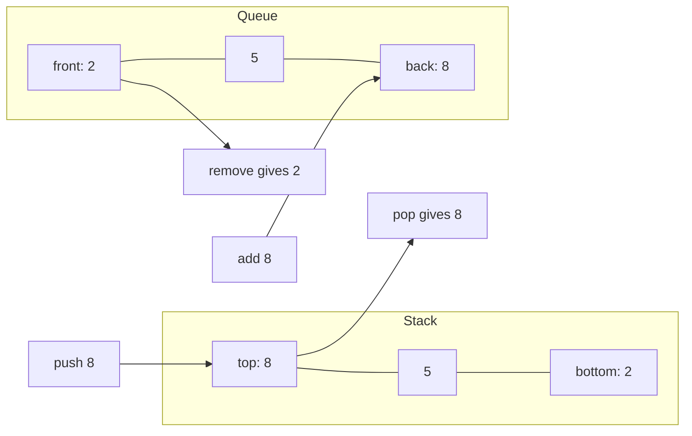

# Stacks and queues: approach and cheat sheet

## Before this lesson

You should know resizable arrays ([Arrays and strings](#/lesson/interview-prep/arrays-strings-approach)) and linked lists ([Linked lists](#/lesson/interview-prep/linked-lists-approach)), because stacks and queues are built from one or the other. For fuller teaching see [Stacks](#/lesson/dsa-foundations/stacks) and [Queues and deques](#/lesson/dsa-foundations/queues-deques) in the DSA track, and [Stack basics](#/lesson/neet-window-stack/stack-basics) and [Monotonic stack](#/lesson/neet-window-stack/monotonic-stack) for the patterns.

## In plain words

A **stack** and a **queue** are both containers with a strict rule about which item comes out next.

A stack is a pile of plates. You put a plate on top and you take a plate from the top. The plate you added most recently is the first to leave. The rule is called **LIFO**: last in, first out.

A queue is a line at a bakery. People join at the back and are served from the front. Whoever has waited longest is next. The rule is **FIFO**: first in, first out.

Neither structure lets you reach into the middle. That restriction is a feature, not a weakness: because only one or two positions are ever touched, every operation is O(1), and the rule itself does useful work. A stack remembers "what was I doing before this?" (function calls, undo, matching brackets, backtracking). A queue preserves "who is next?" (tasks waiting for a printer, breadth-first search, buffering between a fast producer and a slow consumer).

They matter for a job because they are everywhere in real systems, and for interviews because many questions that do not mention stacks or queues are solved by one, and because "design a stack that also does X" is a favourite way to test whether you can extend a simple structure without breaking its costs.

## The two interfaces

| Stack operation | Meaning | Queue operation | Meaning |
|---|---|---|---|
| `push(x)` | Put x on top | `add(x)` / enqueue | Put x at the back |
| `pop()` | Remove and return the top | `remove()` / dequeue | Remove and return the front |
| `peek()` | Look at the top without removing | `peek()` | Look at the front |
| `isEmpty()` | Is it empty? | `isEmpty()` | Is it empty? |



Both pictures hold the values 2, 5, 8, inserted in that order. The stack hands back 8 first; the queue hands back 2 first.

### In Python

```python-run
from collections import deque

stack = []                 # a list used as a stack: the END of the list is the top
for x in (2, 5, 8):
    stack.append(x)        # push
print("stack:", stack, "| peek:", stack[-1], "| pop:", stack.pop(), "| left:", stack)

queue = deque()            # a double-ended queue: O(1) at both ends
for x in (2, 5, 8):
    queue.append(x)        # add at the back
print("queue:", list(queue), "| peek:", queue[0], "| remove:", queue.popleft(), "| left:", list(queue))
```

`stack.append` and `stack.pop()` work at the end of the list, which is O(1). `stack[-1]` reads the last element without removing it. For a queue, do **not** use a list with `pop(0)`: removing the first element of a list shifts all the others and costs O(n). `collections.deque` (pronounced "deck", short for double-ended queue) supports `append`, `appendleft`, `pop` and `popleft` in O(1).

### How they are implemented

- **Stack on a resizable array**: push and pop at the end. O(1) amortised push, O(1) pop.
- **Stack on a linked list**: push and pop at the head. O(1) always.
- **Queue on a linked list**: keep both a head (front) and a tail (back) reference. Add at the tail, remove at the head.
- **Queue on a circular array**: a fixed array with two indexes, `front` and `size`; positions wrap around with `% capacity`. This is the "ring buffer" used in device drivers and network code.

One practical difference: a stack implemented with recursion uses the language's own call stack, which is limited. An explicit stack in a list is limited only by memory. Converting a recursive algorithm to an iterative one with an explicit stack is a standard request.

## Where stacks solve problems that do not mention stacks

1. **Matching and nesting.** Brackets, HTML tags, nested function calls: push an opener, and when a closer arrives it must match the top.
2. **Undo and backtracking.** The most recent decision is the first to be reversed.
3. **Evaluating expressions.** Operands and operators wait on stacks until what follows them is known.
4. **"Next greater element" questions.** A stack kept in increasing or decreasing order (a **monotonic stack**) answers, for every element, where the next larger or smaller one is, in O(n) total.
5. **Depth-first search** without recursion.

```python-run
def brackets_ok(text):
    pairs = {")": "(", "]": "[", "}": "{"}
    stack = []
    for position, ch in enumerate(text):
        if ch in "([{":
            stack.append(ch)                       # remember the opener
        elif ch in pairs:
            if not stack or stack.pop() != pairs[ch]:
                return f"mismatch at position {position}"
    return "balanced" if not stack else f"{len(stack)} opener(s) never closed"

for sample in ["f(a[1], {b: 2})", "(]", "((x)", "x) + (y"]:
    print(f"{sample:18s} -> {brackets_ok(sample)}")
```

`pairs` maps each closing bracket to the opener it needs. Openers are pushed. When a closer arrives, the code checks two failure cases in one line: the stack is empty (nothing to close) or the popped opener is the wrong kind. At the end, anything left on the stack was never closed. The LIFO rule is exactly the nesting rule: the most recently opened bracket must close first.

## Where queues solve problems

1. **Breadth-first search**: explore a graph or tree level by level; the queue holds the frontier. See [DFS and BFS](#/lesson/neet-heap-graphs/dfs-bfs).
2. **Scheduling and buffering**: tasks processed in arrival order.
3. **Sliding windows over a stream**: a deque holds the timestamps or candidates still inside the window. This track's [Sliding-Window Rate Gate](#/problem/ctci-rate-gate) is an example.
4. **Caches and "oldest first" policies.**

## The usual tricks for design questions

### 1. Store extra information with each element

*A stack that reports its minimum in O(1).* A single "current minimum" variable breaks when the minimum is popped. But the minimum of the stack *at the moment an element was pushed* never changes while that element remains, because nothing beneath it can change. So push pairs (value, minimum so far), or keep a second stack of minimums. This is [Floor Stack](#/problem/ctci-floor-stack).

### 2. Two stacks make a queue

Pouring one stack into another reverses its order, and reversing LIFO gives FIFO. Keep an inbox stack for arrivals and an outbox stack for departures; **refill the outbox only when it is empty**. Each element is pushed twice and popped twice in its life, so the cost is O(1) amortised per operation. This is [Relay Queue From Two Stacks](#/problem/ctci-relay-queue).

```python-run
class TwoStackQueue:
    def __init__(self):
        self.inbox, self.outbox, self.moves = [], [], 0

    def add(self, x):
        self.inbox.append(x)

    def remove(self):
        if not self.outbox:                     # refill ONLY when empty
            while self.inbox:
                self.outbox.append(self.inbox.pop())
                self.moves += 1
        return self.outbox.pop()

q = TwoStackQueue()
out = []
for round_number in range(1000):
    q.add(round_number)
    q.add(round_number + 0.5)
    out.append(q.remove())
while q.inbox or q.outbox:
    out.append(q.remove())
print("in FIFO order:", out == sorted(out))
print("elements:", len(out), "| transfers between stacks:", q.moves, "| per element:", q.moves / len(out))
```

The test interleaves additions and removals, then drains the queue. The first printed line confirms the order is first in, first out. The second shows the amortised argument in numbers: 2,000 elements, exactly 2,000 transfers, one per element.

### 3. Several structures side by side

*A repair shop that hands a free technician the longest-waiting device, or the longest-waiting phone, or the longest-waiting laptop.* One queue per kind, with an arrival number stored in each entry so that the two fronts can be compared. This is [Repair Counter](#/problem/ctci-repair-counter). The general idea: when one structure cannot answer every query cheaply, keep two that share an ordering key.

### 4. Index arithmetic inside one array

*Three stacks in one array*: give each stack a region; stack s occupies indexes `s * capacity` to `s * capacity + capacity - 1`, and one size counter per stack is all the bookkeeping needed ([Three Stacks, One Array](#/problem/ctci-triple-stack-array)). *A stack of stacks* that starts a new pile when one is full is mostly a matter of stating the rules for empty and full piles precisely ([Book Piles](#/problem/ctci-book-piles)).

### 5. Use a second stack as working space

*Sort a stack using only one other stack*: keep the second stack sorted; to insert a new element, move larger elements back to the first stack temporarily. This is insertion sort, O(n²), expressed with stacks ([Sort With One Spare Stack](#/problem/ctci-sort-with-spare-stack)).

## A worked example with full reasoning

*Problem: design a stack with `push`, `pop`, `top` and `lowest` (the current minimum), all O(1).*

**Listen.** Confirm: `lowest` does not remove anything; duplicates are allowed; what should the operations return on an empty stack? Suppose −1.

**Example.** Push 5, 2, 8, then `lowest` → 2; pop (8); pop (2); `lowest` → 5.

**Brute force.** An ordinary stack; `lowest` scans all elements: O(n).

**First idea and why it fails.** Keep one variable `low`, updated on push. After pushing 5, 2, 8 it holds 2. Pop 8: fine. Pop 2: now the minimum should be 5, but the variable cannot know that without scanning. The information needed (the earlier minimum) was thrown away.

**Insight.** The earlier minimum is exactly what a stack is good at remembering. For each element, store the minimum of everything at or below it:

| Pushed | Stored pair (value, minimum so far) |
|---|---|
| 5 | (5, 5) |
| 2 | (2, 2) |
| 8 | (8, 2) |

`lowest` reads the second field of the top pair. Popping removes the pair, and the pair underneath already holds the correct earlier minimum.

**Implement.**

```python
class FloorStack:
    def __init__(self):
        self.items = []

    def push(self, x):
        low = x if not self.items else min(x, self.items[-1][1])
        self.items.append((x, low))

    def pop(self):
        return self.items.pop()[0] if self.items else -1

    def top(self):
        return self.items[-1][0] if self.items else -1

    def lowest(self):
        return self.items[-1][1] if self.items else -1
```

**Test.** Empty-stack calls; duplicates of the minimum (push 3, 3, pop, `lowest` must still be 3); descending pushes; a new minimum pushed and popped.

**Complexity and a refinement.** Every operation is O(1); space is O(n) extra, one number per element. To save memory when few elements are new minimums, keep a separate stack that records a value only when it is less than **or equal to** the current minimum, and pop it when that value leaves. The "or equal" matters: with strict less-than, the second 3 above would not be recorded, and popping the first 3 would wrongly discard the minimum.

## Complexity cheat sheet

| Structure | Operation | Cost | Note |
|---|---|---|---|
| Stack (array or linked list) | push, pop, peek, isEmpty | O(1) | Array push is amortised |
| Queue (linked list, deque, circular array) | add, remove, peek, isEmpty | O(1) | |
| Python `list` as a queue | `pop(0)`, `insert(0, x)` | O(n) | Avoid; use `deque` |
| Queue from two stacks | add O(1), remove O(1) amortised | Worst single remove O(n) | |
| Stack with minimum | all O(1) | O(n) extra space | |
| Sorting a stack with one extra stack | O(n²) time | O(n) space | |
| Monotonic stack over n elements | O(n) total | Each element pushed and popped once | |
| Search for a value in either | O(n) | Not what they are for | |

## Problems in this module and what each trains

| Problem | Skill |
|---|---|
| [Floor Stack](#/problem/ctci-floor-stack) | Storing extra state per element |
| [Relay Queue From Two Stacks](#/problem/ctci-relay-queue) | Reversal by pouring, amortised cost |
| [Book Piles](#/problem/ctci-book-piles) | A structure of structures, boundary rules |
| [Sort With One Spare Stack](#/problem/ctci-sort-with-spare-stack) | Using a stack as working space |
| [Three Stacks, One Array](#/problem/ctci-triple-stack-array) | Index arithmetic, per-stack bookkeeping |
| [Repair Counter](#/problem/ctci-repair-counter) | Coordinating two queues with a shared order |

For the algorithmic patterns (monotonic stacks, sliding-window deques) continue in the [Sliding window and stack track](#/track/neet-window-stack).

## Pitfalls

- **Popping or peeking an empty structure.** Decide what should happen and check before every pop.
- **Using a Python list as a queue** with `pop(0)`: silently O(n) per removal.
- **Confusing which end is the top.** With a list, the top is the end; state it and stay consistent.
- **Refilling the outbox while it still has elements** in the two-stack queue, which scrambles the order.
- **A single "minimum" variable** in the minimum-stack problem; it cannot be restored after a pop.
- **Strict comparison in the auxiliary minimum stack**, losing duplicates of the minimum.
- **Forgetting capacity rules** in fixed-size designs: full versus empty, per-stack versus total.
- **Deep recursion where an explicit stack is needed.**

> [!INTERVIEW]
> In design-style stack and queue questions, state the cost you are promising for each operation before coding ("push and pop O(1), lowest O(1), O(n) extra space") and say the word "amortised" when it applies. Interviewers listen for whether you know the difference.

> [!TIP]
> If a problem involves "the most recent thing that has not been dealt with yet", think stack. If it involves "the oldest thing that has not been dealt with yet", think queue. If it needs both ends, think deque.

> [!WARNING]
> Amortised O(1) does not mean every call is fast. In a system with strict response-time limits, a single O(n) transfer in the two-stack queue may be unacceptable; mention the worst case when asked about real-time behaviour.

## Summary

- A stack is last in, first out; a queue is first in, first out; both offer O(1) operations at their active ends.
- In Python use a list for a stack and `collections.deque` for a queue.
- Stacks model nesting, undo, expression evaluation and depth-first search; queues model fairness, buffering and breadth-first search.
- Design tricks: store extra state with each element, combine two structures, pour between stacks to reverse order, and use index arithmetic to share one array.
- State the promised cost of each operation, including amortised versus worst case, and test empty and full conditions.

## Glossary

- **Stack**: a container where the most recently added item is removed first.
- **Queue**: a container where the earliest added item is removed first.
- **LIFO / FIFO**: last in, first out / first in, first out.
- **Push / pop**: add to and remove from the top of a stack.
- **Enqueue / dequeue**: add to the back and remove from the front of a queue.
- **Peek**: look at the next item without removing it.
- **Deque**: a double-ended queue with O(1) insertion and removal at both ends.
- **Circular array (ring buffer)**: a fixed array whose indexes wrap around, used to implement a queue.
- **Call stack**: the stack the language runtime uses to keep track of active function calls.
- **Monotonic stack**: a stack whose contents are kept in increasing or decreasing order.
- **Amortised cost**: the average cost per operation over a long sequence.

```quiz
[
  {"q": "Values 1, 2, 3 are added in that order. In which order do a stack and a queue return them?",
   "options": ["Stack 1,2,3; queue 3,2,1", "Stack 3,2,1; queue 1,2,3", "Both 1,2,3", "Both 3,2,1"],
   "answer": 1,
   "explain": "A stack is last in, first out; a queue is first in, first out."},
  {"q": "Why is `list.pop(0)` a poor way to implement a queue in Python?",
   "options": ["It returns the wrong element", "Removing the first element shifts all the others, costing O(n) each time", "Lists cannot hold numbers", "It raises an error on non-empty lists"],
   "answer": 1,
   "explain": "collections.deque removes from the left in O(1)."},
  {"q": "In the bracket checker, why is a stack the right structure?",
   "options": ["Brackets are numbers", "The most recently opened bracket must be the first to close, which is the LIFO rule", "Stacks sort their contents", "Queues cannot store characters"],
   "answer": 1,
   "explain": "Nesting means the latest opener is matched first."},
  {"q": "Why does a single 'current minimum' variable fail for a stack with a minimum operation?",
   "options": ["Variables are slow", "After the minimum is popped, the previous minimum is unknown without scanning", "Stacks cannot contain duplicates", "It uses too much memory"],
   "answer": 1,
   "explain": "The earlier minimum must be remembered per element, for example as a (value, minimum so far) pair."},
  {"q": "In a queue built from two stacks, when should elements be moved from the inbox to the outbox?",
   "options": ["On every add", "On every remove", "Only when the outbox is empty", "Never"],
   "answer": 2,
   "explain": "Moving while the outbox still has elements would place newer items in front of older ones."},
  {"q": "What is the cost of remove in the two-stack queue?",
   "options": ["O(1) worst case", "O(1) amortised, with an occasional O(n) call", "O(log n)", "O(n) amortised"],
   "answer": 1,
   "explain": "Each element is transferred once in its lifetime, so the average is constant although one call may move many elements."},
  {"q": "In an auxiliary stack that records minimums, why push when the new value is less than OR EQUAL to the current minimum?",
   "options": ["To use more memory", "So that duplicates of the minimum are each recorded and one pop does not discard the minimum while a copy remains", "Because equal values are illegal", "To keep the stack sorted ascending"],
   "answer": 1,
   "explain": "With strict less-than, popping one copy of a duplicated minimum would remove the only record of it."},
  {"q": "Which structure does breadth-first search rely on?",
   "options": ["A stack", "A queue", "A hash set only", "A heap"],
   "answer": 1,
   "explain": "Nodes are explored in the order they were discovered, level by level."}
]
```

> **Source:** McDowell, Cracking the Coding Interview 6e, ch. 3 (Stacks and Queues). Explanations, code and examples are original.
