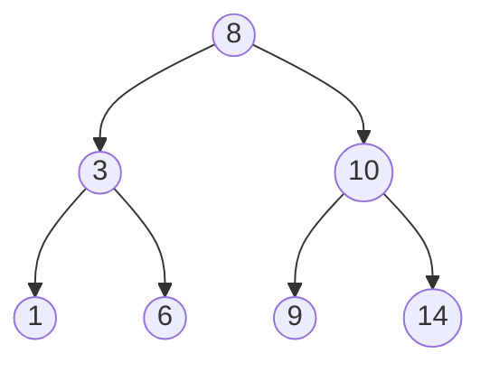

# Trees and graphs: approach and cheat sheet

## Before this lesson

You need recursion (see [Recursion examples](#/lesson/dsa-foundations/recursion-examples) if a function calling itself is new), linked lists ([Linked lists](#/lesson/interview-prep/linked-lists-approach)) and stacks and queues ([Stacks and queues](#/lesson/interview-prep/stacks-queues-approach)). This lesson is a compact review of a large area. The deep teaching is in [Tree basics](#/lesson/neet-linked-trees/tree-basics), [Tree traversals](#/lesson/neet-linked-trees/tree-traversals), [Binary search trees](#/lesson/neet-linked-trees/tree-bst), [Binary heaps](#/lesson/neet-heap-graphs/binary-heaps), [Graph representations](#/lesson/neet-heap-graphs/graph-representations) and [DFS and BFS](#/lesson/neet-heap-graphs/dfs-bfs).

## In plain words

A **tree** is a structure of connected items (called **nodes**) arranged like a family tree or a company's reporting chart. There is one node at the top, the **root**. Every other node has exactly one parent, and a node may have several children. There are no loops: you cannot follow parent-to-child links and arrive back where you started.

A **graph** is the general version: a set of nodes with connections (called **edges**) between any of them. A road map is a graph: towns are nodes, roads are edges, and there may be many routes between two towns, including round trips. A tree is a graph with strict rules; a linked list is a tree in which every node has at most one child.

They matter for a job because hierarchies and networks are everywhere: folders, web pages, organisation charts, dependencies between software packages, friendships, routes. They matter for interviews because they are the natural home of the two search strategies every candidate must know, depth-first and breadth-first, and because the vocabulary is full of words that sound alike and mean different things. Many wrong answers start with a wrong assumption about what kind of tree was meant.

## Tree vocabulary that interviewers expect

Ask about these before solving; each changes the algorithm or the cost.

| Term | Meaning | Why it matters |
|---|---|---|
| **Binary tree** | Each node has at most two children, called left and right | Most interview trees are binary, but ask |
| **Binary search tree (BST)** | For every node: all values in the left subtree are smaller, all in the right subtree larger | Enables search by comparison; ask how duplicates are handled |
| **Balanced** | The height is about log n, not n | Decides whether operations are O(log n) or O(n) |
| **Complete** | Every level is full except possibly the last, which is filled from the left | The shape of a heap; can be stored in an array |
| **Full** | Every node has zero or two children | Occasionally a given condition |
| **Perfect** | Full and complete: all leaves on the same level, 2ᵏ − 1 nodes | Rare in practice; do not assume it |
| **Leaf** | A node with no children | Base cases |
| **Height / depth** | Height: longest path down to a leaf. Depth of a node: distance from the root | State whether you count nodes or edges |

The BST rule applies to **whole subtrees**, not only to a node and its two children. A tree in which every child is on the correct side of its parent can still break the rule deeper down; this is the classic bug in "validate a BST" ([Valid Search Tree](#/problem/ctci-valid-search-tree)).



The picture is a balanced binary search tree: everything left of 8 is smaller, everything right is larger, and the same holds at 3 and at 10.

## Traversals

A **traversal** visits every node once. For binary trees there are three depth-first orders, named after when the node itself is handled relative to its children, and one breadth-first order.

```python-run
from collections import deque

class TreeNode:
    def __init__(self, val, left=None, right=None):
        self.val, self.left, self.right = val, left, right

root = TreeNode(8, TreeNode(3, TreeNode(1), TreeNode(6)), TreeNode(10, TreeNode(9), TreeNode(14)))

def in_order(node, out):
    if node:
        in_order(node.left, out)      # left subtree first
        out.append(node.val)          # then the node itself
        in_order(node.right, out)     # then the right subtree

def pre_order(node, out):
    if node:
        out.append(node.val)          # node first
        pre_order(node.left, out)
        pre_order(node.right, out)

def post_order(node, out):
    if node:
        post_order(node.left, out)
        post_order(node.right, out)
        out.append(node.val)          # node last

def level_order(node):
    out, queue = [], deque([node])
    while queue:
        cur = queue.popleft()
        out.append(cur.val)
        for child in (cur.left, cur.right):
            if child:
                queue.append(child)
    return out

for name, walk in (("in-order", in_order), ("pre-order", pre_order), ("post-order", post_order)):
    values = []
    walk(root, values)
    print(f"{name:11s}", values)
print(f"{'level-order':11s}", level_order(root))
```

The three recursive functions differ only in where the `append` line sits. In-order on a binary search tree prints the values in **sorted order**, which is the most useful fact about BSTs. Pre-order handles a parent before its children (good for copying or serialising a tree). Post-order handles children before their parent (good for computing something about a subtree, such as its height, and passing it up). Level-order uses a queue and visits the tree one row at a time.

**The single most useful tree technique**: write a recursive function that returns some information about a subtree to its parent. Height, size, "is balanced", "contains the target" and many others fit the shape

```
solve(node) = combine(node.val, solve(node.left), solve(node.right))
```

with a base case for the empty tree. The pattern lesson [Returning values up the tree](#/lesson/neet-linked-trees/tree-return-up) is devoted to it.

## Heaps and tries, briefly

A **binary min-heap** is a complete binary tree in which every node is smaller than or equal to its children, so the smallest value is always at the root. Inserting adds at the bottom and swaps upward; removing the minimum moves the last element to the root and swaps downward. Both are O(log n); reading the minimum is O(1). A max-heap is the mirror image. Heaps answer "what is the smallest (or largest) right now?" repeatedly: top-k problems, merging sorted streams, Dijkstra's algorithm. In Python, `heapq` provides a min-heap on a list.

A **trie** (prefix tree) stores strings character by character: each node represents a prefix and each child one more letter, with a marker on nodes that complete a word. Looking up a word or a prefix of length L costs O(L), independent of how many words are stored. Tries power autocomplete and word-search problems; see [Trie basics](#/lesson/neet-linked-trees/trie-basics).

## Graphs

### Vocabulary

- **Directed** edges are one-way (follower relationships, prerequisites); **undirected** edges go both ways (friendships, two-way roads).
- **Weighted** edges carry a number such as distance or cost.
- A **path** is a sequence of edges; a **cycle** is a path that returns to its start. A graph with no cycles is **acyclic**; a directed acyclic graph is called a DAG.
- A graph is **connected** when every node can be reached from every other. Otherwise it consists of several **connected components**.

### Representations

| Representation | What it stores | Space | Is there an edge u→v? | Neighbours of u |
|---|---|---|---|---|
| Adjacency list | For each node, a list of its neighbours | O(V + E) | O(degree of u) | O(degree of u) |
| Adjacency matrix | A V × V table of true/false or weights | O(V²) | O(1) | O(V) |

V is the number of nodes (vertices) and E the number of edges. Most interview graphs are sparse (few edges per node), so the adjacency list is the default. Interview inputs often arrive as a list of edge pairs; your first step is to convert it.

### The two searches

**Depth-first search (DFS)** goes as far as possible along one branch before backing up. It is naturally recursive, or uses an explicit stack. **Breadth-first search (BFS)** visits all nodes one step away, then two steps away, and so on, using a queue.

```python-run
from collections import deque

edges = [(0, 1), (0, 2), (1, 3), (2, 3), (3, 4), (5, 6)]      # undirected; node 7 is isolated
n = 8
adj = [[] for _ in range(n)]
for u, v in edges:
    adj[u].append(v)
    adj[v].append(u)

def dfs(start):
    order, seen, stack = [], {start}, [start]
    while stack:
        u = stack.pop()
        order.append(u)
        for v in reversed(adj[u]):          # reversed so that lower neighbours are visited first
            if v not in seen:
                seen.add(v)
                stack.append(v)
    return order

def bfs_distances(start):
    dist = {start: 0}
    queue = deque([start])
    while queue:
        u = queue.popleft()
        for v in adj[u]:
            if v not in dist:               # first time reached = shortest distance
                dist[v] = dist[u] + 1
                queue.append(v)
    return dist

print("DFS order from 0:", dfs(0))
print("BFS distances from 0:", bfs_distances(0))

components, seen = 0, set()
for node in range(n):
    if node not in seen:
        components += 1
        seen.update(dfs(node))
print("connected components:", components)
```

The first lines build the adjacency list; because the graph is undirected, each edge is recorded in both directions. In `dfs`, the `seen` set is essential: a graph can contain cycles, and without marking visited nodes the search would run forever. In `bfs_distances`, a node's distance is fixed the first time it is reached, which is why BFS finds the **fewest-edges path** in an unweighted graph. The final loop counts connected components by starting a search from every node not yet seen: three components here (0–4, 5–6, and 7 alone).

**Choosing between them:**

| Need | Use |
|---|---|
| Shortest path by number of edges | BFS |
| Visit everything, any order; explore all options; detect cycles; topological order | DFS (or either) |
| The answer is likely close to the start, in a wide graph | BFS |
| Memory is tight and the graph is wide but shallow | DFS |
| Weighted shortest path | Dijkstra ([review lesson](#/lesson/interview-prep/review-math-graphs)) |

**Bidirectional search** runs two breadth-first searches at once, one from each end, until they meet. If each node has about k neighbours and the path has length d, one search explores about kᵈ nodes while two half-length searches explore about 2·k^(d/2): an enormous saving. This track's [Friend Hops](#/problem/ctci-friend-hops) practises it.

### Ordering a DAG

When edges mean "must come before" (build steps, course prerequisites), a **topological order** lists the nodes so that every edge points forward. Kahn's algorithm repeatedly takes a node with no remaining prerequisites; if nodes remain when none is available, there is a cycle and no order exists. See [Compile Order](#/problem/ctci-compile-order) and the [review lesson](#/lesson/interview-prep/review-math-graphs).

## A worked example with full reasoning

*Problem: decide whether a binary tree is height-balanced: at every node, the heights of the two subtrees differ by at most one.* ([Level-Headed Tree](#/problem/ctci-level-headed-tree).)

**Listen.** "At every node" is the key phrase. Checking only the root is not enough.

**Example.** A root whose left side is a chain of three nodes and whose right side is a single node: the root's subtrees have heights 3 and 1 → unbalanced. A subtler case: both sides of the root have height 3, but the left side is itself lopsided inside → still unbalanced.

**Brute force.** Write `height(node)`. For every node, compute the heights of both children and compare, then recurse into the children. Each `height` call walks a whole subtree, and it is called for every node: O(n log n) on a balanced tree and O(n²) on a chain.

**Optimise.** Duplicated work: heights of deep subtrees are recomputed for every ancestor. Compute each height once, bottom-up (post-order), and let the same function carry the verdict upward. Use a special return value, −1, to mean "already unbalanced below".

**Walk through.** `check(node)` returns the height, or −1. Empty tree → 0. Get the left result; if −1, return −1 at once. Same for the right. If the two heights differ by more than 1, return −1. Otherwise return 1 + the larger height.

**Implement.**

```python
def is_balanced(root):
    def check(node):
        if node is None:
            return 0
        left = check(node.left)
        if left == -1:
            return -1
        right = check(node.right)
        if right == -1 or abs(left - right) > 1:
            return -1
        return 1 + max(left, right)
    return check(root) != -1
```

**Test.** Empty tree; single node; a perfect tree; a chain; the subtle case with equal heights at the root and an imbalance below.

**Complexity.** Each node is visited once: O(n) time. Space is the recursion depth: O(h) for a tree of height h.

## Complexity cheat sheet

| Structure or algorithm | Operation | Cost |
|---|---|---|
| Binary search tree, balanced | search, insert, delete | O(log n) |
| Binary search tree, unbalanced (worst case) | search, insert, delete | O(n) |
| Any binary tree | traversal (any order) | O(n) time, O(h) space; level order O(width) space |
| Binary heap | peek min/max O(1); insert, remove O(log n); build from n items O(n) | |
| Trie | insert, search, prefix check | O(L) for a word of length L |
| Graph (adjacency list) | DFS or BFS | O(V + E) time, O(V) space |
| Graph (adjacency matrix) | DFS or BFS | O(V²) |
| Topological sort | Kahn's or DFS-based | O(V + E) |
| Bidirectional BFS | shortest path | About O(k^(d/2)) versus O(kᵈ) |
| Dijkstra with a heap | weighted shortest paths | O((V + E) log V) |

## Problems in this module and what each trains

| Problem | Skill |
|---|---|
| [Route Exists](#/problem/ctci-route-exists) | Building an adjacency list; BFS or DFS with a visited set |
| [Balanced Tree From Sorted Scores](#/problem/ctci-balanced-bst-from-sorted) | Recursion on index ranges; BST construction |
| [Level-Headed Tree](#/problem/ctci-level-headed-tree) | Returning information up the tree |
| [Valid Search Tree](#/problem/ctci-valid-search-tree) | Passing ranges down; the whole-subtree rule |
| [Next Larger Entry](#/problem/ctci-inorder-next-value) | Steering by comparisons in O(height) |
| [Compile Order](#/problem/ctci-compile-order) | Topological sort and cycle detection |
| [Shared Ancestor](#/problem/ctci-shared-ancestor) | Post-order counting; missing-node cases |
| [Downward Paths With a Given Total](#/problem/ctci-downward-path-count) | Prefix sums along a root-to-node path |
| [Arrival Orders That Build the Same Tree](#/problem/ctci-bst-arrival-orders) | Combinatorics on tree structure |

## Pitfalls

- **Assuming a binary tree is a binary search tree**, or that it is balanced. Ask.
- **Checking the BST property only between parent and child.**
- **Forgetting the visited set in graph search**, which loops forever on cycles.
- **Marking nodes visited when dequeued instead of when enqueued**, so the same node is queued many times.
- **Using DFS for shortest paths** in unweighted graphs. Only BFS gives the minimum number of edges.
- **Ignoring disconnected graphs.** One search from one start does not reach every component.
- **Treating directed edges as undirected**, or the reverse.
- **Deep recursion on skewed trees or long paths.** Use an explicit stack or queue for large inputs.
- **Stating O(log n) for BST operations without the word "balanced".**

> [!INTERVIEW]
> Begin every tree question with three clarifications: "Is it a binary tree? A search tree? Balanced?" and every graph question with three more: "Directed or undirected? Weighted? Can it have cycles or be disconnected?" Interviewers frequently leave these out to see whether you ask.

> [!TIP]
> When a tree problem feels hard, ask "what would I need to know about each child's subtree to answer the question at this node?". That list of things is exactly what your recursive function should return.

> [!WARNING]
> Recursive solutions on trees are elegant, but their memory use is the height of the tree, which is n for a degenerate tree. State space as O(h) and say what h is in the worst case.

## Summary

- A tree is a connected structure with one root and no cycles; a graph is any set of nodes and edges.
- Clarify the kind of tree (binary, search, balanced, complete) and the kind of graph (directed, weighted, cyclic, connected).
- In-order traversal of a BST gives sorted order; post-order is the natural way to compute subtree information and return it upward.
- Heaps give repeated access to the minimum or maximum in O(log n); tries give O(L) word and prefix lookups.
- Store sparse graphs as adjacency lists; DFS and BFS both run in O(V + E) with a visited set.
- BFS finds shortest paths by edge count; bidirectional search shrinks the explored region dramatically; topological sort orders a DAG.

## Glossary

- **Node / edge**: an item of a tree or graph / a connection between two nodes.
- **Root / leaf**: the top node of a tree / a node with no children.
- **Subtree**: a node together with all of its descendants.
- **Binary search tree**: a binary tree in which left-subtree values are smaller and right-subtree values larger than each node's value.
- **Balanced tree**: a tree whose height is proportional to log n.
- **Complete tree**: all levels full except possibly the last, which is filled from the left.
- **Traversal**: a systematic visit of every node (in-order, pre-order, post-order, level-order).
- **Heap**: a complete tree in which each node is at least as small (min-heap) or as large (max-heap) as its children.
- **Trie**: a tree that stores strings by shared prefixes.
- **Adjacency list / matrix**: per-node neighbour lists / a V × V table of connections.
- **DFS / BFS**: depth-first search / breadth-first search.
- **Connected component**: a maximal group of nodes that can all reach one another.
- **DAG**: directed acyclic graph.
- **Topological order**: an ordering of a DAG's nodes in which every edge points from earlier to later.

```quiz
[
  {"q": "Which traversal of a binary search tree visits the values in sorted order?",
   "options": ["Pre-order", "In-order", "Post-order", "Level-order"],
   "answer": 1,
   "explain": "Left subtree (smaller values), then the node, then the right subtree (larger values)."},
  {"q": "A tree satisfies 'left child < parent < right child' at every node. Is it necessarily a binary search tree?",
   "options": ["Yes", "No: the rule must hold for entire subtrees, not only for direct children", "Only if it is balanced", "Only if it is complete"],
   "answer": 1,
   "explain": "A deeper node can violate the order relative to an ancestor even when every parent-child pair looks correct."},
  {"q": "What is the cost of searching a binary search tree with n nodes in the worst case?",
   "options": ["O(1)", "O(log n) always", "O(n), when the tree is a chain", "O(n log n)"],
   "answer": 2,
   "explain": "Only a balanced BST guarantees O(log n); inserting sorted data into a plain BST produces a chain."},
  {"q": "Which search finds the path with the fewest edges in an unweighted graph?",
   "options": ["Depth-first search", "Breadth-first search", "In-order traversal", "Any search"],
   "answer": 1,
   "explain": "BFS reaches nodes in order of distance from the start, so the first arrival is the shortest."},
  {"q": "Why is a visited set required when searching a general graph but not a tree?",
   "options": ["Graphs are larger", "Graphs can contain cycles, so a node can be reached again and the search would never end", "Trees are sorted", "It is not required"],
   "answer": 1,
   "explain": "A tree has exactly one path to each node from the root; a graph may have many, including loops."},
  {"q": "For a sparse graph with V nodes and E edges, which representation and search cost are standard?",
   "options": ["Adjacency matrix, O(V²)", "Adjacency list, O(V + E)", "Edge list, O(E²)", "Trie, O(L)"],
   "answer": 1,
   "explain": "Adjacency lists store only existing edges, and each node and edge is handled once."},
  {"q": "In the balanced-tree check, what is the purpose of returning −1?",
   "options": ["It is the height of an empty tree", "It signals that a subtree is already unbalanced, so the result can be passed up without further work", "It marks leaves", "It counts nodes"],
   "answer": 1,
   "explain": "One function returns both the height and the verdict, giving a single O(n) pass."},
  {"q": "Why does bidirectional BFS explore far fewer nodes than one-sided BFS?",
   "options": ["It skips half the graph at random", "Two searches of depth d/2 visit about 2·k^(d/2) nodes instead of k^d", "It uses a stack", "It sorts the nodes first"],
   "answer": 1,
   "explain": "The explored region grows exponentially with depth, so halving the depth takes the square root of the work."}
]
```

> **Source:** McDowell, Cracking the Coding Interview 6e, ch. 4 (Trees and Graphs). Explanations, code and examples are original.
