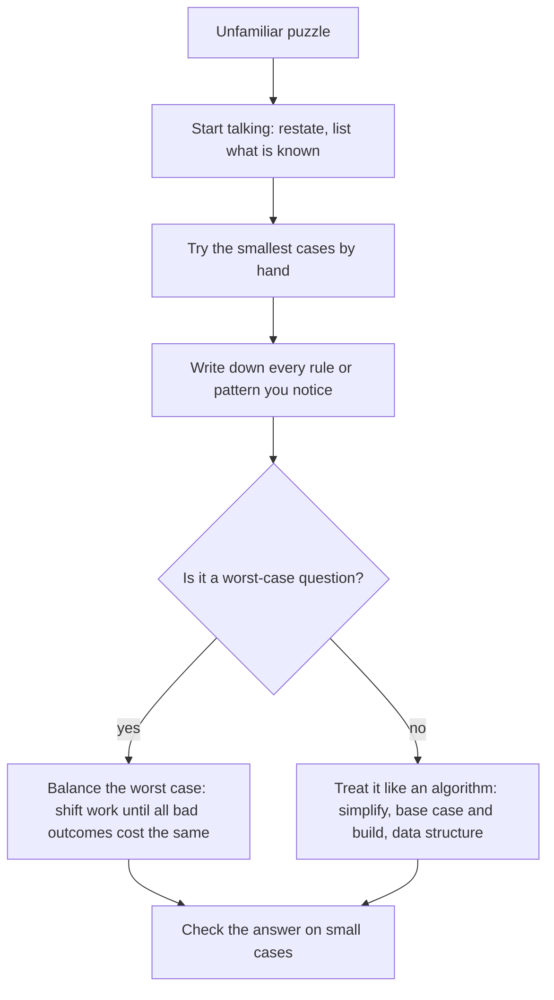

# Maths and logic puzzles

## Before this lesson

You need school arithmetic (fractions, remainders) and basic Python loops. Familiarity with [Big O foundations](#/lesson/interview-prep/big-o-foundations) helps for the prime sieve. Related teaching on this site: [Number theory](#/lesson/neet-greedy-math/number-theory) for primes and divisors, and [Estimation](#/lesson/thinking/estimation-fermi) in the Thinking track for a different style of numerical interview question.

## In plain words

A **puzzle question** (or brain-teaser) is a problem that looks like a riddle: nine identical-looking coins with one heavy one, two jugs and a tap, a hallway of lockers. Good puzzle questions are not tricks with a hidden catch. They are small reasoning problems that can be worked out step by step, and the interviewer wants to watch you do exactly that.

Think of a detective story. The detective does not solve the case with a sudden vision. They write down what is known, try the simplest explanation, notice what does not fit, and narrow things down. Solving a puzzle aloud should sound the same.

Two areas of school mathematics appear so often in these questions that they are worth reviewing properly: **prime numbers** and **probability**. This lesson covers both from zero and then gives four strategies for attacking puzzles you have never seen.

It matters for a job because the same habits (state what you know, try small cases, look for a pattern, check the worst case) are how engineers debug and design. It matters for interviews because some companies still ask these questions, and because probability and number facts appear inside ordinary coding problems.

## Prime numbers

A **prime** is a whole number greater than 1 that can be divided evenly only by 1 and itself: 2, 3, 5, 7, 11, 13, … Every whole number greater than 1 can be written as a product of primes in exactly one way (ignoring order). For example 84 = 2 × 2 × 3 × 7 = 2² × 3 × 7. This is its **prime factorisation**.

### Divisibility through factorisations

If you write two numbers by their prime powers, several questions become easy:

- **x divides y** exactly when every prime in x appears in y with at least the same power. 12 = 2² × 3 divides 84 = 2² × 3 × 7; it does not divide 42 = 2 × 3 × 7 (only one 2).
- The **greatest common divisor** (gcd), the largest number dividing both, takes the *smaller* power of each prime.
- The **least common multiple** (lcm), the smallest number both divide, takes the *larger* power of each prime.
- Therefore gcd(x, y) × lcm(x, y) = x × y.

In practice the gcd is computed with Euclid's algorithm (`math.gcd` in Python), which repeatedly replaces the pair (a, b) by (b, a mod b) and needs only O(log n) steps.

### Testing one number for primality

To check whether n is prime, try dividing by 2, 3, 4, … Only divisors up to √n need testing: if n = a × b with a ≤ b, then a ≤ √n, so a factor above the square root always comes with a partner below it.

### Finding all primes up to n: the sieve of Eratosthenes

Write down all numbers from 2 to n. Take the first number not yet crossed out (2): it is prime; cross out all its multiples. Take the next survivor (3): prime; cross out its multiples. Continue. What survives is the list of primes. Two refinements: start crossing out at p × p (smaller multiples were already removed by smaller primes), and stop when p × p exceeds n.

```python-run
import math

def is_prime(n):
    if n < 2:
        return False
    d = 2
    while d * d <= n:              # only up to the square root
        if n % d == 0:
            return False
        d += 1
    return True

def sieve(limit):
    is_p = [True] * (limit + 1)
    is_p[0:2] = [False, False]
    p = 2
    while p * p <= limit:
        if is_p[p]:
            for multiple in range(p * p, limit + 1, p):   # start at p squared
                is_p[multiple] = False
        p += 1
    return [i for i, flag in enumerate(is_p) if flag]

print("primes up to 60:", sieve(60))
print("97 prime?", is_prime(97), "| 91 prime?", is_prime(91), "(91 = 7 x 13)")
print("gcd(84, 36) =", math.gcd(84, 36), "| lcm =", 84 * 36 // math.gcd(84, 36))
```

`is_prime` stops as soon as `d * d` exceeds n. In `sieve`, the list `is_p` holds a true/false flag per number; `range(p * p, limit + 1, p)` walks the multiples of p starting at p squared. The sieve costs about O(n log log n), which for practical purposes is close to linear, far better than testing each number separately.

## Probability

**Probability** measures how likely an event is, as a number from 0 (impossible) to 1 (certain). When all outcomes are equally likely:

$$P(\text{event}) = \frac{\text{number of outcomes where the event happens}}{\text{number of all outcomes}}$$

Rolling one fair die, P(even) = 3/6 = 1/2.

### The rules

| Rule | Formula | In words |
|---|---|---|
| Complement | P(not A) = 1 − P(A) | Often "at least one" is easier as 1 − P(none) |
| And (general) | P(A and B) = P(A) × P(B given A) | Chance of A, times chance of B once A has happened |
| And (independent) | P(A and B) = P(A) × P(B) | When A tells you nothing about B |
| Or (general) | P(A or B) = P(A) + P(B) − P(A and B) | Subtract the overlap counted twice |
| Or (mutually exclusive) | P(A or B) = P(A) + P(B) | When both cannot happen together |

Two pairs of words are constantly confused:

- **Independent** events do not influence each other (two separate coin flips).
- **Mutually exclusive** events cannot both happen (one die showing 2 and showing 5).

If two events with non-zero probability are mutually exclusive, they are certainly *not* independent: knowing that one happened tells you the other did not.

### Worked example: at least one six in four rolls

Direct counting is messy (exactly one six, exactly two, …). Use the complement: P(no six in one roll) = 5/6; the rolls are independent, so P(no six in four rolls) = (5/6)⁴ = 625/1296; hence P(at least one six) = 1 − 625/1296 = 671/1296 ≈ 0.518.

### Worked example: one shot or best of three

You hit a target with probability p per throw. Game 1: one throw, win on a hit. Game 2: three throws, win with at least two hits. Which is better?

- Game 1: p.
- Game 2: exactly two hits can happen in three arrangements (miss first, miss second, miss third), each with probability p²(1 − p), and three hits has probability p³. Total 3p²(1 − p) + p³ = 3p² − 2p³.

Game 1 is better when p > 3p² − 2p³. Dividing by p (for p > 0) and rearranging gives (2p − 1)(p − 1) > 0. Since p − 1 is negative for p < 1, this needs 2p − 1 < 0: **p < 1/2**. A weak thrower should take the single throw; a strong one should take best of three; at exactly 0, 1/2 and 1 the games tie. This is the problem [One Shot or Best of Three](#/problem/ctci-two-of-three). The general lesson: more trials favour whoever has the per-trial advantage.

Exact fractions and a simulation are two ways to check such reasoning:

```python-run
from fractions import Fraction
import random

at_least_one_six = 1 - Fraction(5, 6) ** 4
print("P(at least one six in 4 rolls) =", at_least_one_six, "~", float(at_least_one_six))

def game2(p):
    return 3 * p**2 - 2 * p**3

for p in (Fraction(1, 4), Fraction(1, 2), Fraction(3, 4)):
    print(f"p = {p}: one throw {p}, best of three {game2(p)}")

random.seed(7)
trials = 200_000
hits = sum(any(random.randint(1, 6) == 6 for _ in range(4)) for _ in range(trials))
print("simulated at-least-one-six:", hits / trials)
```

`Fraction` keeps numbers as exact fractions, so `1 - (5/6)**4` prints as `671/1296` with no rounding. The simulation rolls four dice two hundred thousand times and counts the experiments containing a six; the result agrees with the exact value to about two decimal places. In an interview you cannot run code, but naming the check ("I could confirm this by simulation or by enumerating all outcomes") is worth saying.

## Four strategies for puzzles



### Strategy 1: start talking

Silence is the only wrong move. Restate the puzzle, say what is given and what is asked, propose the first idea however naive, and evaluate it aloud. The interviewer can only credit reasoning they hear, and will often nudge you if they know where you are.

### Strategy 2: develop rules and patterns

Write down every small fact you discover, as a numbered rule. Puzzles usually fall to the *combination* of two or three such facts, and you will forget the first by the time you find the third unless it is on the board.

**Worked puzzle: the hallway of lockers.** There are n closed lockers. Student 1 toggles every locker, student 2 toggles every second locker, student 3 every third, and so on up to student n. Which lockers are open at the end?

- Rule 1: locker L is toggled by student k exactly when k divides L.
- Rule 2: so locker L is toggled once per divisor of L, and it ends open when that count is odd.
- Rule 3: divisors come in pairs (d, L/d). For 12: (1, 12), (2, 6), (3, 4). Pairs give an even count.
- Rule 4: the only way to get an odd count is a divisor paired with itself: d × d = L. So L must be a perfect square.

Answer: lockers 1, 4, 9, 16, … are open; their number is the whole part of √n. Try the small case n = 10 by hand to confirm: lockers 1, 4, 9. The practice problem [Pier Lamps](#/problem/ctci-lamp-toggle) is the same reasoning with lamps and switches in place of lockers.

### Strategy 3: balance the worst case

Many puzzles ask for a guaranteed number of steps. If your plan has one unlucky branch that costs far more than the others, move effort from the lucky branches to the unlucky one until they cost the same. A balanced worst case is usually optimal.

**Worked puzzle: nine coins, one heavy.** With a two-pan balance, find the heavy coin in the fewest weighings. First idea: four against four. If they balance, the ninth coin is the heavy one (lucky: one weighing). If not, you have four suspects and need two more weighings: three in total. The branches are unbalanced: one outcome ends immediately, the others drag on.

Balance them. A weighing has **three** outcomes (left heavy, right heavy, equal), so split into three equal groups: three against three, with three aside. Every outcome leaves exactly three suspects. Then one against one, with one aside: every outcome identifies the coin. Two weighings, guaranteed. In general, w weighings handle up to 3ʷ coins ([Counterfeit Coin Weighings](#/problem/ctci-coin-weighings)).

**Worked puzzle: two test phones and a tower.** A phone breaks if dropped from some unknown floor or higher. With two phones and 100 floors, how many drops guarantee finding that floor? With one phone you must go floor by floor. With two, use the first phone to jump and the second to scan the gap. Jumps of 10 give a worst case of 10 + 9 = 19 drops, and the worst case sits at the top: the plan is unbalanced. Balance it: each jump should be one floor shorter than the last, so that every extra jump used is paid for by a shorter scan. If the first jump is t floors, the worst case is always t drops, and the floors covered are t + (t − 1) + … + 1 = t(t + 1)/2. The smallest t with t(t + 1)/2 ≥ 100 is 14. This is [Two Phones, One Tower](#/problem/ctci-two-phone-drop).

### Strategy 4: use your algorithm tools

If you are stuck, a puzzle is still a problem, and the techniques from [Optimisation techniques](#/lesson/interview-prep/optimisation-techniques) apply: solve a simpler version (three coins before nine), solve the base case and build up, or model it as a data structure. The two-jugs puzzle, for instance, is a graph: each state is (litres in jug A, litres in jug B), each pour is an edge, and breadth-first search finds the fewest moves ([Two Jugs](#/problem/ctci-jug-pour)).

```python-run
from collections import deque

def fewest_moves(a, b, goal):
    start = (0, 0)
    dist = {start: 0}
    queue = deque([start])
    while queue:
        x, y = queue.popleft()
        if goal in (x, y):
            return dist[(x, y)]
        pour_ab, pour_ba = min(x, b - y), min(y, a - x)
        for state in ((a, y), (x, b), (0, y), (x, 0), (x - pour_ab, y + pour_ab), (x + pour_ba, y - pour_ba)):
            if state not in dist:
                dist[state] = dist[(x, y)] + 1
                queue.append(state)
    return -1

print("3 and 5 litre jugs, measure 4:", fewest_moves(3, 5, 4), "moves")
print("2 and 6 litre jugs, measure 5:", fewest_moves(2, 6, 5), "(impossible)")
```

Each state is a pair. The six next states are: fill A, fill B, empty A, empty B, pour A into B, pour B into A; a pour moves `min(source amount, free room in the target)`. `dist` doubles as the visited set. The second call returns −1 because both jug sizes are even, so only even amounts can ever be measured: a multiple of gcd(a, b) is required.

## Number facts that appear inside coding problems

| Fact | Use |
|---|---|
| 1 + 2 + … + n = n(n + 1)/2 | Loop analysis; missing-number problems |
| A number has an odd count of divisors exactly when it is a perfect square | Locker-style puzzles |
| Only divisors up to √n need checking | Primality, factorisation |
| gcd(a, b) = gcd(b, a mod b) | Reducing fractions, jug problems |
| Amounts measurable with jugs a and b are multiples of gcd(a, b) | Feasibility checks |
| k yes/no questions distinguish at most 2ᵏ cases; k three-way weighings at most 3ᵏ | Lower bounds for search puzzles |
| P(at least one) = 1 − P(none) | Most "at least" questions |
| n items can be ordered in n! ways; choosing k of n: n! / (k!(n − k)!) | Counting outcomes |

The review lesson [Useful maths and graph algorithms](#/lesson/interview-prep/review-math-graphs) derives the sums and counting formulas.

## Problems in this module and what each trains

| Problem | Skill |
|---|---|
| [K-th Number From Chosen Primes](#/problem/ctci-smooth-number-k) | Prime factors; merging sorted streams |
| [Chance of a Dice Total](#/problem/ctci-dice-sum-probability) | Counting outcomes exactly; reduced fractions |
| [Pier Lamps](#/problem/ctci-lamp-toggle) | Finding the pattern; integer square roots |
| [Two Phones, One Tower](#/problem/ctci-two-phone-drop) | Balancing the worst case |
| [Two Jugs](#/problem/ctci-jug-pour) | Modelling a puzzle as a state graph |
| [Counterfeit Coin Weighings](#/problem/ctci-coin-weighings) | Three-way outcomes and base-3 logarithms |
| [One Shot or Best of Three](#/problem/ctci-two-of-three) | Probability algebra with exact arithmetic |

## Pitfalls

- **Going silent** while you search for the "aha". The process is what is graded.
- **Assuming a trick.** Take the statement literally and ask about anything ambiguous.
- **Confusing independent with mutually exclusive**, and adding probabilities that overlap.
- **Forgetting that order matters** when counting outcomes: two dice have 36 equally likely ordered outcomes, and a total of 7 arises from 6 of them, not from 3.
- **Treating outcomes as equally likely when they are not.** The eleven possible totals of two dice are not each 1/11.
- **Optimising the average instead of the worst case** when the question says "guarantee".
- **Floating-point answers to exact questions.** Use fractions and integer square roots; `int(n ** 0.5)` is wrong for some large n.
- **Not checking the final answer on a small case.**

> [!INTERVIEW]
> If you recognise a famous puzzle, say so, as with any question you have seen before. If you do not, announce your method: "I will try it with three coins first to see the pattern." Interviewers rate a clear method with a hint above a memorised answer.

> [!TIP]
> For any "minimum guaranteed number of steps" puzzle, compute a lower bound by counting outcomes. Ten coins cannot be handled in two weighings because two weighings have only nine distinct result patterns. This is the puzzle version of the best conceivable runtime.

> [!WARNING]
> Do not trust a probability that feels right. Human intuition about chance is unreliable. Enumerate a small case or check that your probabilities over all possible outcomes add up to 1.

## Summary

- Puzzle questions are reasoning exercises; talk through them like a detective.
- Primes: every number factorises uniquely; test divisors only up to √n; use a sieve to list primes; gcd and lcm follow from prime powers.
- Probability: count favourable over total outcomes; use the complement for "at least one"; multiply for independent "and"; add for mutually exclusive "or"; subtract the overlap otherwise.
- Strategies: start talking; write down rules and patterns from small cases; balance the worst case; fall back on algorithm tools such as simplification and modelling as a graph.
- Check lower bounds by counting outcomes, and verify answers on small cases.

## Glossary

- **Prime number**: a whole number above 1 with no divisors other than 1 and itself.
- **Prime factorisation**: writing a number as a product of primes.
- **Greatest common divisor (gcd)**: the largest number dividing two given numbers.
- **Least common multiple (lcm)**: the smallest number that two given numbers both divide.
- **Sieve of Eratosthenes**: a method of listing primes by crossing out multiples.
- **Probability**: a number from 0 to 1 measuring how likely an event is.
- **Outcome / event**: one possible result of an experiment / a set of outcomes.
- **Independent events**: events where one happening does not change the chance of the other.
- **Mutually exclusive events**: events that cannot both happen.
- **Complement**: the event that A does not happen, with probability 1 − P(A).
- **Worst case**: the least favourable outcome, used when a guarantee is required.
- **State graph**: a graph whose nodes are situations and whose edges are allowed moves.

```quiz
[
  {"q": "To test whether n is prime by trial division, up to which divisor must you check?",
   "options": ["n − 1", "n / 2", "The square root of n", "log n"],
   "answer": 2,
   "explain": "Any factor larger than √n pairs with one smaller than √n, which would already have been found."},
  {"q": "84 = 2² × 3 × 7 and 90 = 2 × 3² × 5. What is their greatest common divisor?",
   "options": ["2 × 3 = 6", "2² × 3² × 5 × 7 = 1260", "3", "12"],
   "answer": 0,
   "explain": "Take the smaller power of each shared prime: 2¹ and 3¹."},
  {"q": "What is the probability of at least one six in four rolls of a fair die?",
   "options": ["4/6", "1 − (5/6)⁴", "(1/6)⁴", "1/6"],
   "answer": 1,
   "explain": "Use the complement: one minus the probability of no six in all four independent rolls."},
  {"q": "Two events with positive probability are mutually exclusive. Are they independent?",
   "options": ["Yes, always", "No: if one happens the other certainly does not, so they influence each other", "Only for dice", "Cannot be determined"],
   "answer": 1,
   "explain": "Independence means knowing one tells you nothing about the other; exclusivity tells you everything."},
  {"q": "In the locker puzzle, why do only perfect-square lockers end up open?",
   "options": ["Squares are even", "Divisors pair up as d and L/d, so the count is even unless some divisor pairs with itself", "The last student opens them", "Squares are prime"],
   "answer": 1,
   "explain": "A locker is toggled once per divisor; only perfect squares have an odd number of divisors."},
  {"q": "Why is three-against-three the right first weighing for nine coins with one heavy coin?",
   "options": ["Three is a lucky number", "A weighing has three outcomes, and equal groups make every outcome leave the same number of suspects", "It uses fewer coins", "Four against four is impossible"],
   "answer": 1,
   "explain": "Balancing the worst case across all three outcomes gives the guaranteed minimum of two weighings."},
  {"q": "With two test phones and 100 floors, why should each jump of the first phone be one floor shorter than the previous one?",
   "options": ["To save time walking", "So that each extra jump used is offset by a shorter scan, keeping the worst case the same everywhere", "Because higher floors are more dangerous", "It makes no difference"],
   "answer": 1,
   "explain": "With a first jump of t, the total is always t drops and covers t(t+1)/2 floors; t = 14 suffices for 100."},
  {"q": "With a 2-litre and a 6-litre jug, why can you never measure exactly 5 litres?",
   "options": ["5 is larger than 2", "Every reachable amount is a multiple of gcd(2, 6) = 2", "The jugs are unmarked", "It needs more than 10 moves"],
   "answer": 1,
   "explain": "Filling, emptying and pouring only ever produce multiples of the greatest common divisor of the capacities."}
]
```

> **Source:** McDowell, Cracking the Coding Interview 6e, ch. 6 (Math and Logic Puzzles). Explanations, worked puzzles, code and examples are original.
