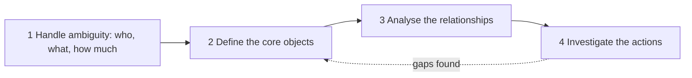
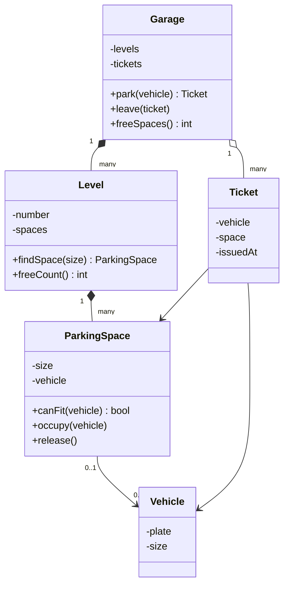
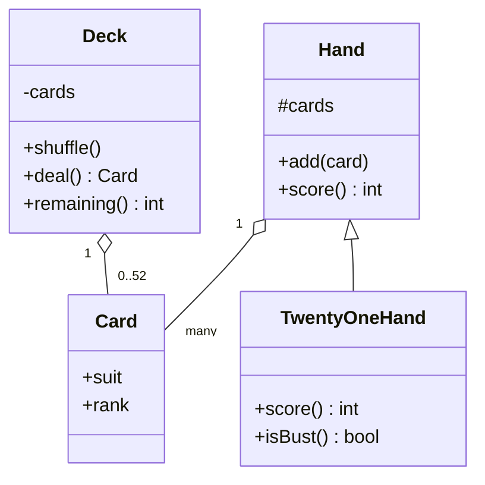

# Object-oriented design questions

## Before this lesson

You should be able to read and write a simple Python class with `__init__` and methods ([Classes in Python](#/lesson/python/py-start-classes)), and know what inheritance means at a basic level ([Inheritance](#/lesson/python/py-inheritance)). The Thinking track teaches the same skill in a longer format in [An object-design framework](#/lesson/thinking/object-design-framework) and [Worked object designs](#/lesson/thinking/object-design-worked); the Java track covers the language features in [Interfaces](#/lesson/java/java-interfaces) and [Polymorphism](#/lesson/java/java-polymorphism).

## In plain words

An **object-oriented design (OOD) question** asks you to sketch the classes for some real-world thing: a car park, a deck of cards, a library, a vending machine. A **class** is a blueprint for a kind of object; it says what data each object holds and what actions it can perform.

Imagine being asked to organise a new restaurant. You would not start by cooking. You would decide who does what: a host seats guests, waiters take orders, the kitchen cooks, the till handles payment, and you would decide what information passes between them. If the roles are sensible, the restaurant can grow, replace a member of staff, or add a delivery service without chaos. OOD is that role-assignment exercise for software.

There is no single correct answer. The interviewer is watching whether you clarify what is wanted, divide responsibilities cleanly, and produce something that could absorb a change in requirements. It matters for a job because most of an engineer's design work is of exactly this kind: not inventing algorithms, but deciding which piece of code owns which data and behaviour so that the system stays understandable.

## A four-step approach



### Step 1: handle ambiguity

OOD prompts are vague on purpose. "Design a car park" could mean a single open lot or a multi-level building with payment and reserved spaces. Do not guess: ask. A useful list is **who** uses it, **what** they do with it, **where and when**, and **how much** (scale).

For a car park: Which vehicle types? Different space sizes? Multiple levels? Is payment in scope? Do we need to find a free space quickly, or only count them? Agree a scope that fits the time, and say what you are leaving out.

### Step 2: define the core objects

List the main things in the system. A practical trick: write a few sentences describing what happens, and underline the **nouns**; they are candidate classes. "A *car* enters the *garage* and is assigned a *space* on some *level*; the driver receives a *ticket*."

Candidates: `Vehicle`, `Garage`, `Level`, `ParkingSpace`, `Ticket`.

### Step 3: analyse the relationships

Decide how the objects relate.

| Relationship | Phrase | Meaning | Example |
|---|---|---|---|
| Inheritance | "is a" | One class is a specialised kind of another | A `Car` is a `Vehicle` |
| Composition | "has a", owns | An object is made of others that do not outlive it | A `Garage` has `Level`s |
| Association | "uses", "knows about" | One object refers to another that exists independently | A `Ticket` refers to a `Vehicle` |
| Multiplicity | one-to-one, one-to-many, many-to-many | How many of each side | One `Level` has many `ParkingSpace`s |

Be critical about inheritance. Ask whether the subclasses really behave differently. If the only difference between a car and a motorcycle is a size value, a single `Vehicle` class with a `size` field is simpler than three subclasses.

### Step 4: investigate the actions

Walk through the main things the system must do, the **use cases**, and for each decide which object is responsible. The verbs in your sentences become methods: "the garage *parks* a vehicle", "a level *finds* a free space", "a space *is released*". This walk-through nearly always reveals something missing (a class, a field, a relationship); go back and add it. That iteration is expected and is what the dotted arrow in the diagram means.

## Principles that guide the choices

- **One responsibility per class.** If you describe a class with "and" ("stores spaces *and* calculates fees *and* prints tickets"), split it.
- **Encapsulation.** Keep data private to the class that owns it and expose actions. Other classes ask the `Level` for a free space; they do not rummage through its list.
- **Program to interfaces.** Code that depends on "something that can calculate a fee" can accept a new pricing rule without being edited. An **interface** is a list of methods a class promises to provide, without saying how.
- **Prefer composition to inheritance** when behaviour may vary independently. A `Garage` that *has* a pricing policy can swap it; a `WeekendGarage` subclass cannot be combined with a `DiscountGarage` subclass.
- **Design for the likely change, not for every imaginable one.** Mention where extension would go; do not build it.

## Design patterns worth knowing by name

A **design pattern** is a named, reusable solution shape. Interviewers do not expect a catalogue, but three or four come up repeatedly.

| Pattern | Idea | Typical use | Caution |
|---|---|---|---|
| **Singleton** | Exactly one instance of a class, globally reachable | A configuration object, a connection pool | Hides dependencies and makes testing harder; many engineers avoid it. Passing the single object explicitly is usually better |
| **Factory method** | A function or method decides which concrete class to create | Creating the right `Vehicle` subclass from a type code | Do not add it when there is only one class |
| **Strategy** | An interchangeable object supplies one piece of behaviour | Pricing rules, sorting orders, AI difficulty | |
| **Observer** | Objects subscribe to be notified when something changes | A display board updating when spaces fill | |
| **State** | An object's behaviour depends on its current state, modelled explicitly | A vending machine: idle, has money, dispensing | See [Modelling state machines](#/lesson/thinking/modelling-state-machines) |

```python-run
class FlatRate:
    def fee(self, hours):
        return 4.0

class HourlyRate:
    def __init__(self, per_hour):
        self.per_hour = per_hour
    def fee(self, hours):
        return self.per_hour * max(1, hours)

class Till:
    def __init__(self, pricing):          # composition: the till HAS a pricing strategy
        self.pricing = pricing
    def charge(self, hours):
        return self.pricing.fee(hours)

def make_pricing(kind):                   # a tiny factory
    return FlatRate() if kind == "flat" else HourlyRate(2.5)

for kind in ("flat", "hourly"):
    till = Till(make_pricing(kind))
    print(f"{kind:7s} pricing, 3 hours ->", till.charge(3))
```

`FlatRate` and `HourlyRate` both offer a method `fee(hours)`. `Till` does not know or care which one it holds: it calls `self.pricing.fee`. That is the strategy pattern. `make_pricing` hides the decision about which class to create: a minimal factory. Adding a weekend tariff means writing one new class and one new branch in the factory; `Till` is untouched.

## Worked design 1: a parking garage

**Scope agreed with the interviewer.** Multi-level garage. Three vehicle sizes (motorcycle, car, bus) and three space sizes (compact, regular, large). A vehicle may use a space of its own size or larger. We need to park, to leave, and to report free spaces. Payment is out of scope.

**Core objects and relationships.**



Reading the diagram: a filled diamond (`*--`) is composition (a garage is made of levels; a level is made of spaces). A plain arrow is association (a space refers to the vehicle parked in it, if any). `+` marks public methods, `-` private fields.

**Actions.**

- *Park*: `Garage.park(vehicle)` asks each level in turn for `findSpace(vehicle.size)`; the level returns the smallest free space that fits; the space is occupied; a `Ticket` linking vehicle and space is created and returned. If no level has a space, return nothing and let the caller show "full".
- *Leave*: `Garage.leave(ticket)` releases `ticket.space` and discards the ticket.
- *Free spaces*: sum of `Level.freeCount()`.

**Decisions to say aloud.**

- Vehicle sizes are a field, not subclasses, because behaviour does not differ.
- The fitting rule lives in `ParkingSpace.canFit`, the one place that knows both sizes.
- `Level.findSpace` is where efficiency lives: a list scan is O(spaces); keeping a set of free spaces per size makes it O(1). State the simple version, then the improvement.
- A bus needing several adjacent spaces would change `findSpace` only. Payment would add a pricing strategy to `Garage`, as in the code above.

A compact, testable version of this design is the problem [Parking Garage](#/problem/ctci-parking-garage).

## Worked design 2: a deck of cards for several games

**Scope.** A standard 52-card deck usable for more than one game; show how blackjack-style scoring would be added.

**Core objects.** `Card` (suit and rank), `Deck` (the cards; shuffle and deal), `Hand` (the cards a player holds). Game-specific rules must not leak into these.



The hollow triangle (`<|--`) is inheritance: `TwentyOneHand` is a `Hand` that overrides `score` so that an ace counts 1 or 11. Here inheritance is justified because behaviour really differs by game.

```python-run
import random

class Card:
    def __init__(self, rank, suit):
        self.rank, self.suit = rank, suit
    def __repr__(self):
        return f"{self.rank}{self.suit}"

class Deck:
    RANKS = ["A", "2", "3", "4", "5", "6", "7", "8", "9", "10", "J", "Q", "K"]
    SUITS = ["s", "h", "d", "c"]
    def __init__(self, seed=None):
        self.cards = [Card(r, s) for s in self.SUITS for r in self.RANKS]
        random.Random(seed).shuffle(self.cards)
    def deal(self):
        return self.cards.pop()
    def remaining(self):
        return len(self.cards)

class Hand:
    def __init__(self):
        self.cards = []
    def add(self, card):
        self.cards.append(card)
    def score(self):                       # generic: number of cards
        return len(self.cards)

class TwentyOneHand(Hand):
    def score(self):
        total = aces = 0
        for card in self.cards:
            if card.rank == "A":
                aces, total = aces + 1, total + 1
            elif card.rank in ("J", "Q", "K"):
                total += 10
            else:
                total += int(card.rank)
        return total + 10 if aces and total + 10 <= 21 else total
    def is_bust(self):
        return self.score() > 21

deck = Deck(seed=3)
hand = TwentyOneHand()
for _ in range(3):
    hand.add(deck.deal())
print("hand:", hand.cards, "| score:", hand.score(), "| bust:", hand.is_bust(), "| cards left:", deck.remaining())
```

`Deck.__init__` builds the 52 combinations with a list comprehension and shuffles them with a seeded generator, so the demo is repeatable. `Hand` knows nothing about any game. `TwentyOneHand` inherits `add` unchanged and replaces `score`: every ace counts 1 first, and one ace is upgraded by 10 if that does not exceed 21 (two aces at 11 would already be 22). A poker hand would be another subclass, or better, a separate scoring strategy. The scoring rule on its own is the problem [Card Hand Value](#/problem/ctci-hand-value).

## Checking a design against change

A quick way to evaluate what you have drawn is to throw three or four plausible changes at it and count how many classes each one touches. Good designs localise change.

| Proposed change (garage) | Classes touched in the design above |
|---|---|
| Add electric-vehicle charging spaces | `ParkingSpace` (a flag or subtype), `Level.findSpace` |
| Charge by the hour | New pricing strategy; `Garage.leave` calls it |
| A display board per level | An observer subscribed to `Level` |
| Reserve a space in advance | New `Reservation` class; `Level.findSpace` consults it |

If one change forces edits in every class, responsibilities are in the wrong places.

## Problems in this module and what each trains

| Problem | Skill |
|---|---|
| [Parking Garage](#/problem/ctci-parking-garage) | State kept in the right place; ordered fitting rule |
| [Card Hand Value](#/problem/ctci-hand-value) | A rule owned by one class |
| [Translation Bureau](#/problem/ctci-translation-bureau) | Routing by grade; a backlog; freeing and reassigning |
| [Flip the Discs](#/problem/ctci-flip-discs) | One rule applied in eight directions; validate before mutating |
| [Miniature File System](#/problem/ctci-mini-fs) | A tree of entries; the composite idea |

## Pitfalls

- **Coding before clarifying.** The scope decides the classes.
- **One giant class** that knows and does everything, usually called `Manager` or `System`.
- **Inheritance for everything.** Deep hierarchies for differences that are a single field.
- **Classes with data and no behaviour**, with all the logic in one controller. Put behaviour next to the data it uses.
- **Exposing internals**: returning the raw list of spaces for other classes to modify.
- **Patterns for their own sake.** Naming five patterns in a small design signals memorisation, not judgment.
- **Ignoring the walk-through.** Without tracing a use case you will not notice the missing `Ticket`.
- **No mention of trade-offs or extension points.**

> [!INTERVIEW]
> Talk in terms of responsibilities: "The level is responsible for knowing which of its spaces are free; the garage only coordinates." That sentence shows more design sense than any diagram, and it is easy for the interviewer to quote in feedback.

> [!TIP]
> Keep the first version small: four or five classes with two or three methods each, then extend when asked. A complete small design beats an unfinished grand one.

> [!WARNING]
> Be careful with the singleton pattern. It is the best-known pattern and the one most often criticised: global state makes code hard to test and hides who depends on what. If you propose it, say why one instance is truly required and how you would test code that uses it.

## Summary

- OOD questions test how you clarify a vague brief and divide responsibilities, not whether you find "the" answer.
- Four steps: handle ambiguity, define the core objects (nouns), analyse relationships (is-a, has-a, uses, how many), investigate the actions (verbs become methods), and iterate.
- Give each class one responsibility, keep data private, depend on interfaces, and prefer composition unless behaviour really differs by kind.
- Know singleton, factory, strategy, observer and state by name and by purpose, including their costs.
- Test a design by proposing changes and seeing how few classes must be edited.

## Glossary

- **Class / object**: a blueprint / a concrete thing built from it.
- **Method**: an action an object can perform.
- **Encapsulation**: hiding an object's data behind its methods.
- **Inheritance ("is a")**: a class that specialises another and reuses or overrides its behaviour.
- **Composition ("has a")**: an object built from other objects that it owns.
- **Association**: a looser reference from one object to another.
- **Interface**: a set of methods a class promises to implement.
- **Polymorphism**: calling the same method on different kinds of object and getting each kind's own behaviour.
- **Use case**: one thing a user or another system does with the system.
- **Design pattern**: a named, reusable design solution.
- **Singleton / factory / strategy / observer / state**: the patterns described in the table above.
- **Multiplicity**: how many objects take part on each side of a relationship.

```quiz
[
  {"q": "What is the first step when given 'design a car park'?",
   "options": ["Draw the class diagram", "Ask clarifying questions to settle scope: vehicle types, levels, payment, scale", "Choose a database", "Write the park() method"],
   "answer": 1,
   "explain": "The prompt is deliberately vague; the agreed scope determines which classes are needed."},
  {"q": "In a description of the system, which words usually become classes and which become methods?",
   "options": ["Adjectives and adverbs", "Nouns become classes, verbs become methods", "Verbs become classes, nouns become methods", "Numbers become classes"],
   "answer": 1,
   "explain": "Things in the story are candidate objects; the actions they perform are candidate methods."},
  {"q": "Cars, motorcycles and buses differ only by a size value in your garage. What is the simplest sound design?",
   "options": ["Three subclasses with identical code", "One Vehicle class with a size field", "A singleton per vehicle", "No vehicle class at all"],
   "answer": 1,
   "explain": "Inheritance is worth it when behaviour differs; a data difference is a field."},
  {"q": "Which relationship is described by 'a Garage is made of Levels'?",
   "options": ["Inheritance", "Composition", "Polymorphism", "Overloading"],
   "answer": 1,
   "explain": "The garage owns its levels: a has-a relationship."},
  {"q": "What does the strategy pattern allow?",
   "options": ["Only one instance of a class", "Swapping one piece of behaviour, such as a pricing rule, by supplying a different object", "Faster sorting", "Automatic memory management"],
   "answer": 1,
   "explain": "The owner calls a method on the strategy object and does not depend on which concrete rule it is."},
  {"q": "Why is the singleton pattern often criticised?",
   "options": ["It uses too much memory", "It introduces global state that hides dependencies and makes testing hard", "It cannot be written in Python", "It prevents inheritance"],
   "answer": 1,
   "explain": "Code that reaches for a global instance is harder to isolate in tests and to reason about."},
  {"q": "In the card example, why is TwentyOneHand a justified subclass of Hand?",
   "options": ["Subclasses are always better", "Its scoring behaviour really differs: aces count 1 or 11", "It has a longer name", "Python requires it"],
   "answer": 1,
   "explain": "The subclass overrides score with game-specific behaviour while reusing add."},
  {"q": "How can you quickly evaluate a design you have drawn?",
   "options": ["Count the classes; more is better", "Propose plausible requirement changes and see how few classes each one touches", "Check that every class is a singleton", "Remove all private fields"],
   "answer": 1,
   "explain": "Well-placed responsibilities keep changes local; widespread edits reveal misplaced responsibilities."}
]
```

> **Source:** McDowell, Cracking the Coding Interview 6e, ch. 7 (Object-Oriented Design). The worked designs, diagrams and code are original.
